# Satom Cloud Network – Dossier du binôme TP-AC

Projet réalisé par Thomas Prud'homme et Abderahmane Chaouche pour le client fictif Groupe Léman Finance SA (formation AWS niveau 300, Geneva Institute of Technology, promo E3, semaine du 16 au 20 novembre 2026).

Tout le TP a été refait à la main dans la console AWS, puis filmé : les captures de ce dossier sont tirées de ces enregistrements (le bandeau avec le compte et le rôle est masqué, comme les identifiants de compte). Une première version avait été faite en ligne de commande (scripts du dépôt) ; quand un chapitre cite une mesure de cette première version, il le dit.

Tout est fait dans la région de Stockholm (`eu-north-1`). Nos ressources portent le suffixe `-TP-AC` et les tags `Projet=SatomCloudNetwork`, `Equipe=TP-AC` et `Environnement=prod` ou `dev`.

Les modules 9, 10 et 11 utilisent un domaine réel : le sous-domaine `leman.thomastp.ch`, délégué à Route 53, avec des certificats publics ACM validés par DNS.

## Vidéo


Vidéo complète du tutoriel (34 minutes, voix de Thomas et d'Abderahmane), refaite à la main dans la console AWS, modules 0 à 13, avec un vrai domaine pour les modules 9 à 11 : [https://youtu.be/emZqnBNtOjM](https://youtu.be/emZqnBNtOjM) (non répertoriée : seules les personnes qui ont le lien peuvent la voir).

## Où nous en sommes

Tout est fait : les modules 0 à 13 sont réalisés, testés et filmés.


Tout le code (scripts AWS CLI, templates CloudFormation), les preuves et les captures sont dans le dépôt GitHub public `Thomas-TP/satom-cloud-network-TP-AC`.


# Module 0 – Cadrage et plan d'adressage

## Objectif
Poser le cadre avant de créer le moindre serveur : un projet décrit en quelques lignes, des noms et des balises communs, un plan d'adresses écrit à l'avance, un budget qui nous prévient quand la dépense monte, et les questions que nous poserions au client. Dans la console AWS, la seule ressource de ce module est le budget.

## Ce qu'il faut savoir
**Le projet.** Le Groupe Léman Finance SA (client fictif) veut un réseau AWS qui sépare la production du développement, relie le siège de Genève et l'agence de Lausanne, garde une trace des accès et reste maîtrisé en coût. Tout doit pouvoir être redéployé depuis un template (module 13).

**Nos conventions.** Le compte AWS est partagé avec toute la classe. Pour retrouver nos ressources, et ne toucher à aucune autre, chaque nom se termine par `-TP-AC` et chaque ressource qui accepte des balises reçoit les trois mêmes : `Projet=SatomCloudNetwork`, `Equipe=TP-AC` et `Environnement=prod` ou `dev`. Nous supprimons en fin de projet en nous appuyant sur cette balise.

**Un budget AWS n'arrête rien.** Il compare la dépense à un montant et envoie un message quand un seuil est franchi (sur le coût réel ou sur le coût prévu). Il ne coupe aucune ressource. Autre détail à connaître : AWS envoie un message de vérification à chaque nouveau destinataire, et un destinataire non vérifié ne reçoit aucune alerte.

## Ce que nous avons fait
Nous avons créé le budget dans la console, dans *Facturation et gestion des coûts > Budgets*.
1. Bouton *Créer un budget*, puis *Personnaliser (avancé)* à la place du modèle simplifié, et le type *Budget de coûts*.
2. Nom `budget-TP-AC-satom`, période mensuelle, budget récurrent, montant de `100` USD. La portée reste celle par défaut : tous les services AWS.
3. Une alerte : seuil de `80` % du montant budgété, déclencheur *Réel*, destinataire `budget-tp-ac@example.com`. L'adresse est fictive (voir les pièges plus bas).
4. L'étape facultative *Attacher des actions* est passée sans rien ajouter.
5. Page *Vérification*, puis *Créer un budget*. La console confirme « Votre budget budget-TP-AC-satom a été créé » et la liste le montre à 100,00 USD, état *Sain*.

## Captures
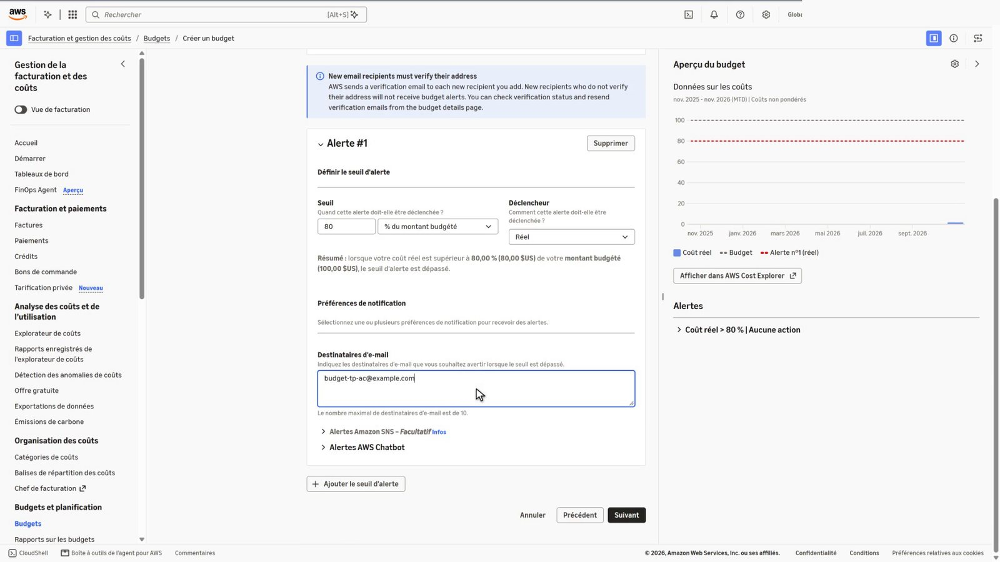

Le seuil est réglé à 80 % du montant budgété (80,00 USD d'après le résumé de la console), sur le coût réel. Le bandeau bleu du haut est l'avertissement d'AWS sur la vérification des adresses.


Avant de créer, la page de vérification résume le budget : `budget-TP-AC-satom`, période *Monthly*, début en novembre 2026, 100,00 USD. Le tableau *Balises* est vide : nous n'avons pas étiqueté le budget.

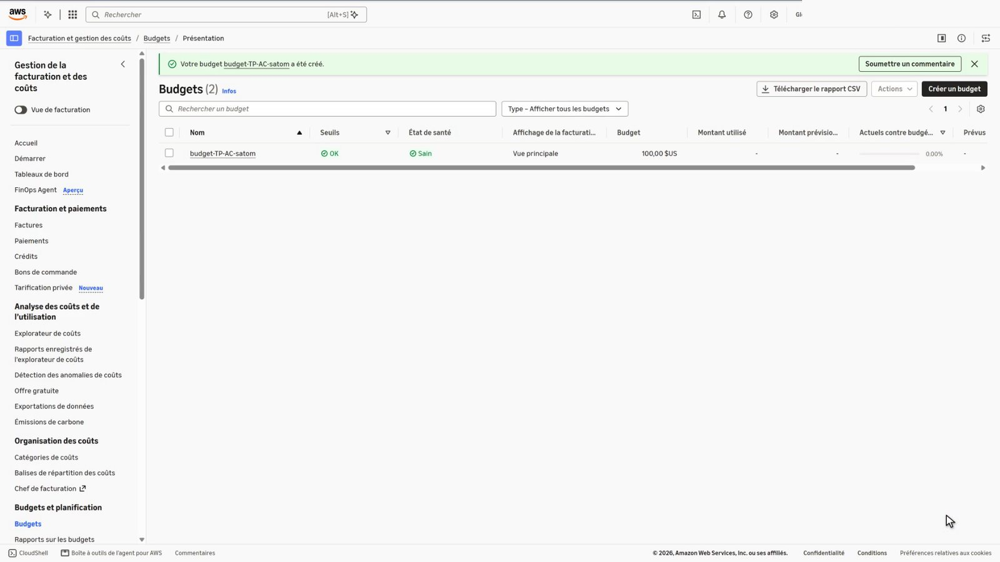

Le budget apparaît dans la liste avec l'état *Sain*. Le compteur indique deux budgets : l'autre appartient à quelqu'un d'autre sur le compte partagé, et sa ligne est masquée sur la capture.

## Plan d'adressage
| Réseau | Plage | Contenu |
|---|---|---|
| `vpc-prod-leman-TP-AC` | `10.20.0.0/22` | production |
| `sub-public-1a-TP-AC` | `10.20.0.0/26` | `web-01-TP-AC` (`10.20.0.10`) |
| `sub-public-1b-TP-AC` | `10.20.0.64/26` | NAT (module 2), routeur `rtr-aws-TP-AC` (`10.20.0.74`), deuxième zone du load balancer |
| `sub-prive-1a-TP-AC` | `10.20.1.0/26` | `app-01-TP-AC` (`10.20.1.10`) |
| `sub-fw-1a-TP-AC` | `10.20.2.0/28` | endpoint du pare-feu (module 4) |
| réservé | `10.20.3.0/26` | base de données (jamais créé) |
| `vpc-dev-leman-TP-AC` | `10.21.0.0/24` | développement, `dev-01-TP-AC` (`10.21.0.10`) dans `sub-dev-1a-TP-AC` (`10.21.0.0/26`) |
| siège (simulé) | `192.168.10.0/24` | plage donnée par le sujet |
| agence (simulée) | `192.168.20.0/24` | plage donnée par le sujet |


Le schéma montre l'ensemble une fois les modules 1 à 13 en place. Les routeurs du siège et de l'agence sont des instances EC2 avec strongSwan et FRRouting, et la liaison Direct Connect est simulée par un tunnel GRE avec BGP (voir les modules 7 et 8). Le reste est réel.

## Tableau récapitulatif
| Élément | Valeur |
|---|---|
| Région | Stockholm, `eu-north-1` |
| Suffixe des noms | `-TP-AC` |
| Balises | `Projet=SatomCloudNetwork`, `Equipe=TP-AC`, `Environnement=prod` ou `dev` |
| Budget | `budget-TP-AC-satom`, type coûts, mensuel, 100 USD |
| Alerte | 80 % du montant, coût réel, vers `budget-tp-ac@example.com` (fictive) |
| Accès aux machines | Session Manager (SSM), sans SSH ni paire de clés |
| Domaine (modules 9 à 11) | `leman.thomastp.ch`, délégué à Route 53 |

## Crédits et estimation du budget
Le compte part avec 100 USD de crédits. Les activités « Gagnez des crédits AWS » nous en ont rapporté 100 de plus ; nous les avons faites avant le tournage et supprimé les ressources de test juste après (voir `NETTOYAGE.md`). Notre plan de tournage comptait avec environ 180 USD de crédits disponibles.

Avant de commencer, nous avons chiffré l'architecture complète, allumée en permanence. Les tarifs de l'EC2 `t3.micro`, de la NAT Gateway et de l'ALB viennent de l'API de prix d'AWS pour Stockholm (`prix_aws.py`, résultat dans `docs/modules/m00/prix.json`). L'API ne nous a rien renvoyé pour le pare-feu, le Transit Gateway, le VPN et l'adresse IPv4 publique : ces quatre lignes sont des tarifs publics que nous avons repris à la main, à contrôler sur la facture. Taux de change retenu : 1 USD = 0,90 CHF (hypothèse).

| Poste | USD par heure | USD par mois (730 h) | Origine du tarif |
|---|---|---|---|
| Instances `t3.micro` (8) | 0,0864 | 63 | API de prix |
| NAT Gateway | 0,0460 | 34 | API de prix |
| Load balancer (ALB) | 0,0239 | 17 | API de prix |
| Network Firewall (1 endpoint) | 0,3950 | 288 | tarif public, repris à la main |
| Transit Gateway (4 attachements) | 0,2000 | 146 | tarif public (0,05 USD par attachement) |
| VPN (2 connexions) | 0,1000 | 73 | tarif public (0,05 USD par connexion) |
| Adresses IPv4 publiques (9) | 0,0450 | 33 | tarif public (0,005 USD par adresse) |
| **Total** | **0,90** | **654** | |

* Allumé en permanence, l'ensemble coûterait environ **654 USD par mois, soit 589 CHF**, très au-dessus des 150 CHF par équipe annoncés dans le sujet.
* Allumé 40 heures (une semaine de cours), il coûte environ **36 USD, soit 32 CHF**.
* Nos réponses : le pare-feu, le Transit Gateway et les VPN pèsent plus de 90 % du total, nous ne les gardons que le temps des tests et des captures. La NAT et l'ALB suivent le même principe. Tout est supprimé à la fin du projet.

## Questions au client
Chacun de nous a écrit trois questions pour son rôle. Elles servent à vérifier que l'exigence est mesurable, à savoir qui décide, et quel est le risque. Le client est fictif : nous n'avons pas de réponses, et le binôme de contrôle doit encore valider cette liste en classe.

**Architecte réseau**
1. Combien d'utilisateurs, au siège et à l'agence, et quel débit maximal faut-il prévoir vers le cloud ? C'est ce qui décide du dimensionnement des liaisons.
2. Qui décide de la région définitive (Zurich ou Francfort) et de la date à laquelle l'application quitte la salle serveur ?
3. Quelle durée de coupure est tolérable si une liaison tombe, et qui accepte ce risque ?

**Ingénieur sécurité**
1. Quelles règles précises s'appliquent à ces données (FINMA, LPD…), et combien de temps faut-il conserver les journaux pour le prouver ?
2. Qui valide l'ajout d'un nouveau domaine autorisé dans le pare-feu, et dans quel délai ?
3. Que se passe-t-il si un accès du développement atteint la production : quelle séparation minimale exige-t-on, réseaux seulement ou comptes séparés ?

## Pièges rencontrés
* **L'adresse de l'alerte est fictive.** Nous n'avons pas voulu mettre une vraie boîte aux lettres dans un dossier public. Conséquence : AWS ne peut pas vérifier l'adresse, donc l'alerte ne partirait nulle part. Pour un vrai client, il faudrait une adresse réelle, vérifiée dès la création.
* **Le budget n'est pas étiqueté.** Le formulaire propose des balises ; nous n'en avons pas mis (la page de vérification le montre). C'est le seul objet du projet qui ne porte pas nos trois balises.

## Ce qui diffère du sujet
* **Région.** Le sujet parle de Zurich. Cette région n'est pas activée sur le compte (`AuthFailure`) et Francfort est refusée par l'organisation du formateur. Nous travaillons à Stockholm.
* **Budget.** Le sujet annonce 150 CHF par équipe. Le compte dispose de crédits partagés ; nous avons fixé 100 USD par mois avec une alerte à 80 %.
* **Services bloqués jusqu'au 17/11/2026.** Network Firewall, Transit Gateway, VPN et Direct Connect étaient refusés par une règle de l'organisation (détail dans `01-services-bloques.md`). Ils sont autorisés depuis le 17/11, et nous avons refait les modules concernés.
* **Domaine et certificats.** Le nom d'exemple du sujet n'est pas un domaine que nous possédons. Nous utilisons `leman.thomastp.ch`, un sous-domaine de `thomastp.ch` (le portfolio de Thomas, qui n'est pas modifié), délégué à Route 53 par quatre enregistrements NS ajoutés chez Cloudflare. Les certificats sont des certificats publics ACM validés par DNS.
* **Adresses IP.** Les autres équipes utilisent déjà `10.0.0.0/16`, et le prof nous a dit qu'un /16 était beaucoup trop grand. Nos plages sont plus petites (voir le plan).
* **Rôles du binôme.** Le sujet prévoit une répartition par rôles. Nous ne l'avons pas appliquée : nous avons traité tous les modules ensemble, et dans la vidéo nous nous partageons la voix.
* **Méthode.** Une première version a été construite avec l'AWS CLI et PowerShell (dossier `scripts/`) puis avec des templates CloudFormation (`cfn/`). Nous avons ensuite tout refait à la main dans la console du 18 au 20 novembre, en filmant. Le dossier décrit ce deuxième passage, et les captures en viennent.

## Nettoyage
Le budget fait partie du nettoyage de fin de projet. L'ordre complet des suppressions est dans `NETTOYAGE.md`. Une seule ressource du projet reste côté AWS : le Network Firewall `nfw-prod-leman-TP-AC` du module 4, dont la suppression échoue côté service (un cas AWS Support est ouvert). Son endpoint est dans `sub-public-1b-TP-AC`, créé au module 2 : la suppression de ce sous-réseau et de son VPC dépend donc de ce déblocage.


---

# Module 1 – VPC et sous-réseaux

## Objectif
Créer le réseau de production et y poser deux serveurs : `web-01-TP-AC` dans un sous-réseau public et `app-01-TP-AC` dans un sous-réseau privé. À la fin du module, rien ne sort encore du VPC : c'est le travail du module 2.

## Ce qu'il faut savoir
Un VPC est un réseau isolé, propre à notre compte et à une région, avec une plage d'adresses (un CIDR). Un sous-réseau découpe cette plage et vit dans une seule zone de disponibilité. AWS garde cinq adresses dans chaque sous-réseau : un /26 compte 64 adresses, 59 sont utilisables, et la console l'affiche (« Adresses IP disponibles : 59 »).

Deux sous-réseaux d'un même VPC ne peuvent pas se recouvrir. Un sous-réseau n'est pas « public » ou « privé » par nature : ce qui change, c'est sa table de routage (module 2). Pour l'instant, nos deux sous-réseaux suivent la table principale du VPC, qui ne contient que la route locale. Les machines du VPC se voient entre elles, mais aucune route ne mène vers l'extérieur.

Le sujet propose un /16 pour le VPC. Nous avons pris un `/22`, soit 1024 adresses : le compte est partagé avec la classe, les autres équipes utilisent déjà `10.0.0.0/16`, et deux serveurs n'ont pas besoin de plus.

Dernier point : nous administrons les serveurs avec Session Manager (SSM), sans SSH ni paire de clés. Il faut pour cela un rôle IAM que les instances peuvent endosser. L'agent SSM de l'instance appelle AWS vers l'extérieur : il lui faudra donc un chemin vers Internet, que nous n'avons pas encore.

## Ce que nous avons fait
**Le VPC.** Dans *VPC > Vos VPC*, bouton *Créer un VPC*, option *VPC uniquement*. Nom `vpc-prod-leman-TP-AC`, saisie manuelle du CIDR IPv4 `10.20.0.0/22`, pas d'IPv6, puis les balises `Projet`, `Equipe` et `Environnement=prod` (la balise `Name` vient du champ de nom). La console affiche le VPC à l'état *Available* avec une seule table de routage, la principale.

**Les deux sous-réseaux.** Dans *Sous-réseaux > Créer un sous-réseau*, nous choisissons le VPC et ajoutons deux sous-réseaux dans le même formulaire, tous deux en zone `eu-north-1a` :
* `sub-public-1a-TP-AC`, `10.20.0.0/26`
* `sub-prive-1a-TP-AC`, `10.20.1.0/26`

Chacun reçoit les trois balises du projet. Les deux passent à *Available*.

**Le test de chevauchement.** Nous rouvrons le même formulaire et saisissons un sous-réseau `sub-test-chevauchement` en `10.20.0.0/27`, une plage qui se trouve à l'intérieur de `10.20.0.0/26`. La console écrit en rouge que le CIDR chevauche celui du sous-réseau existant, et le bouton *Créer un sous-réseau* ne crée rien.

**Le rôle pour SSM.** Dans *IAM > Rôles > Créer un rôle* : entité de confiance *Service AWS*, cas d'utilisation *EC2*, politique `AmazonSSMManagedInstanceCore`, nom `TP-AC-ec2-ssm-role`. En créant le rôle pour EC2, la console crée aussi le profil d'instance du même nom, que nous retrouvons dans le formulaire de lancement. Nous n'avons pas mis de balises sur ce rôle.

**`web-01-TP-AC`.** Dans *EC2 > Lancer une instance* :
* nom `web-01-TP-AC`, avec les trois balises ;
* image Amazon Linux 2023, type `t3.micro`, *Continuer sans paire de clés* ;
* réseau : VPC `vpc-prod-leman-TP-AC`, sous-réseau `sub-public-1a-TP-AC`, attribution automatique d'une adresse IP publique *Activer* ;
* groupe de sécurité : nous sélectionnons le groupe existant `default` du VPC ;
* configuration réseau avancée : adresse IP principale `10.20.0.10` ;
* détails avancés : profil d'instance IAM `TP-AC-ec2-ssm-role`.

**`app-01-TP-AC`.** Même recette, avec trois différences :
* le sous-réseau est `sub-prive-1a-TP-AC`, et l'attribution d'une adresse publique est sur *Désactiver* : personne ne peut joindre cette machine depuis Internet ;
* l'adresse privée fixe est `10.20.1.10` ;
* dans les *Données utilisateur*, un petit script qui démarre au premier lancement. Il écrit un serveur HTTP Python (`/opt/app.py`) qui écoute sur le port `8080` et répond `app-01 TP-AC /api/health`, et il en fait un service systemd nommé `app`. C'est la « mini API » que nous interrogerons à partir du module 3.

Les deux instances utilisent le groupe `default`, qui laisse passer le trafic entre ses membres. Nous le remplaçons par des groupes dédiés au module 3.

## Captures


Le VPC existe : état *Available*, CIDR `10.20.0.0/22`. Le « Mappage des ressources » en bas montre zéro sous-réseau et une table de routage, la principale. (L'identifiant du propriétaire est masqué sur cette capture et sur les suivantes.)


Les deux sous-réseaux sont créés d'un coup, à l'état *Available*, avec les plages `10.20.1.0/26` et `10.20.0.0/26`.


Le test de chevauchement : la console refuse `10.20.0.0/27` et nomme le sous-réseau qui est déjà là, `10.20.0.0/26`.

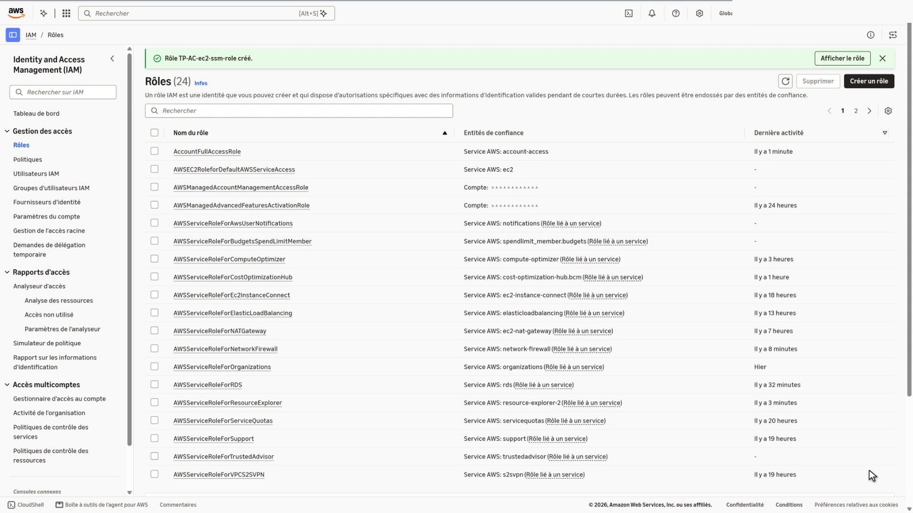

Le rôle `TP-AC-ec2-ssm-role` est créé. (Les numéros de compte de deux rôles préexistants sont masqués.)


Le réseau de `web-01-TP-AC` : sous-réseau `sub-public-1a-TP-AC`, adresse publique automatique *Activer*, groupe `default`, adresse principale `10.20.0.10`.


Le même écran pour `app-01-TP-AC` : sous-réseau `sub-prive-1a-TP-AC`, adresse publique *Désactiver*, adresse principale `10.20.1.10`.

## Tableau récapitulatif
| Ressource | Valeur |
|---|---|
| VPC | `vpc-prod-leman-TP-AC`, `10.20.0.0/22` |
| Sous-réseau public | `sub-public-1a-TP-AC`, `10.20.0.0/26`, `eu-north-1a` |
| Sous-réseau privé | `sub-prive-1a-TP-AC`, `10.20.1.0/26`, `eu-north-1a` |
| Rôle IAM | `TP-AC-ec2-ssm-role`, politique `AmazonSSMManagedInstanceCore` |
| `web-01-TP-AC` | `t3.micro`, Amazon Linux 2023, `10.20.0.10`, adresse publique automatique |
| `app-01-TP-AC` | `t3.micro`, Amazon Linux 2023, `10.20.1.10`, aucune adresse publique, API sur le port `8080` |
| Groupe de sécurité | `default` du VPC (remplacé au module 3) |
| Accès | Session Manager, pas de paire de clés |

## Résultats des tests
Ce que nous avons vu à l'écran pendant le tournage. Les autres vérifications (ping entre les deux serveurs, accès à Internet) viennent aux modules 2 et 3.

```
=== Module 1 : VPC et sous-réseaux (relevé sur le tournage dans la console, région eu-north-1) ===
VPC créé : vpc-prod-leman-TP-AC (vpc-0fcf09d8d94cf76d6), CIDR 10.20.0.0/22, état Available.
Sous-réseaux créés (état Available) :
  sub-public-1a-TP-AC  subnet-0c4418125d33777a7  10.20.0.0/26  eu-north-1a
  sub-prive-1a-TP-AC   subnet-01d0eb66cffa73898  10.20.1.0/26  eu-north-1a
Adresses IP disponibles affichées par la console au lancement des instances : 59 dans chacun des deux /26 (64 moins les 5 adresses réservées par AWS).

Test de chevauchement : création de sub-test-chevauchement, VPC vpc-prod-leman-TP-AC, eu-north-1a, CIDR 10.20.0.0/27
  -> message de la console : "L'adresse CIDR chevauche avec le CIDR du sous-réseau existant : 10.20.0.0/26."
  -> la page reste ouverte avec l'erreur, aucun sous-réseau n'est créé (la liste des sous-réseaux du VPC n'en compte que deux au module 2).

Rôle IAM créé : TP-AC-ec2-ssm-role (entité de confiance : service EC2, politique AmazonSSMManagedInstanceCore).

Instances lancées (t3.micro, Amazon Linux 2023, sans paire de clés, groupe de sécurité default, profil TP-AC-ec2-ssm-role) :
  web-01-TP-AC  sub-public-1a-TP-AC  10.20.0.10  adresse publique automatique : activée
  app-01-TP-AC  sub-prive-1a-TP-AC   10.20.1.10  adresse publique automatique : désactivée
Dans Session Manager (module 2), les deux instances apparaissent "Online", et sur app-01-TP-AC la commande hostname -I répond 10.20.1.10.

Non testé dans ce module : le ping de web-01-TP-AC vers app-01-TP-AC (fait au module 3, avec les Security Groups) et l'accès à Internet (module 2).
```

## Pièges rencontrés
* **Une ligne de balise vide bloque la création.** Dans le formulaire des sous-réseaux, un champ « Entrer la clé » resté vide affiche « Vous devez spécifier une clé de balise » et la console refuse de continuer. Nous l'avons rencontré en filmant ; il faut supprimer la ligne vide.
* **La saisie des balises propose les valeurs des autres équipes.** Dans la liste de suggestions, à côté de `prod`, apparaît `prod-MF` : c'est l'étiquette d'un camarade. Nous tapons la valeur en entier plutôt que de cliquer une suggestion.
* **Les serveurs ne sont pas joignables par SSM dans ce module.** Ni `web-01-TP-AC` ni `app-01-TP-AC` n'ont de route vers Internet pour l'instant. Nous n'ouvrons donc pas de session ici : la première session SSM est au module 2. Le ping entre les deux machines est testé au module 3.
* **Le groupe `default` est un raccourci.** Il suffit pour ce module, mais il ne distingue pas le web de l'application. Il disparaît des instances au module 3.

## Ce qui diffère du sujet
* **Plage du VPC.** `10.20.0.0/22` à la place du /16 du sujet (compte partagé, plages des autres équipes).
* **Région.** Stockholm à la place de Zurich (voir le module 0).
* **Un seul sous-réseau par rôle dans ce module.** Un deuxième sous-réseau public, en zone B, arrive au module 2 parce que la zone A ne peut plus accueillir de NAT.
* **Test de chevauchement.** Dans la console, le refus s'affiche en rouge sous le champ du CIDR. En ligne de commande, notre première version recevait l'erreur `InvalidSubnet.Conflict`.
* **Pas de Reachability Analyzer.** L'outil était refusé par l'organisation jusqu'au 17/11 et nous ne l'avons pas utilisé pendant le tournage.
* **Première version.** Notre premier passage, fait avec l'AWS CLI, avait un ping `web-01` vers `app-01` dès ce module. Dans la version filmée, ce test est reporté au module 3.

## Nettoyage
Rien n'est supprimé pendant le tournage. Le VPC, les sous-réseaux, le rôle et les deux instances sont supprimés à la fin du projet (voir `NETTOYAGE.md`). La seule ressource du projet qui reste côté AWS est le Network Firewall du module 4, dont la suppression est bloquée côté service ; son endpoint est dans un sous-réseau du VPC, dont la suppression dépend donc de ce déblocage.


---

# Module 2 – Routage : IGW et NAT

## Objectif
Donner un accès à Internet au sous-réseau public, un accès sortant seulement au sous-réseau privé, le prouver depuis le serveur privé, puis provoquer une panne de route pour apprendre à la retrouver.

## Ce qu'il faut savoir
Un sous-réseau est public quand sa table de routage envoie `0.0.0.0/0` vers une passerelle Internet (IGW) et que l'instance a une adresse publique. Une IGW se crée puis s'attache à un VPC : tant qu'elle n'est pas attachée, elle ne sert à rien.

Un sous-réseau privé n'a pas de route vers l'IGW. Pour que ses machines puissent quand même sortir (mises à jour, agent SSM), on place une passerelle NAT dans un sous-réseau public. La NAT remplace l'adresse privée de la machine par sa propre adresse Elastic : l'extérieur ne voit que la NAT et ne peut rien initier vers l'intérieur. La NAT a un prix : AWS la facture à chaque heure où elle existe (0,046 USD de l'heure à Stockholm d'après l'API de prix), plus chaque Go traité.

Quand plusieurs routes correspondent à une destination, la plus précise gagne. Ici, la route `10.20.0.0/22` (locale) passe avant `0.0.0.0/0`.

## Ce que nous avons fait
Tout se passe dans *VPC*, sauf la preuve, qui se fait dans *Systems Manager*.

1. **Passerelle Internet.** *Passerelles Internet > Créer* : nom `igw-prod-leman-TP-AC`, balises du projet. Elle est créée à l'état *Detached*. *Actions > Attacher au VPC*, VPC `vpc-prod-leman-TP-AC` : l'état passe à *Attached*.
2. **Table publique.** *Tables de routage > Créer* : `rt-public-leman-TP-AC`, dans le VPC de production, avec les balises. Elle ne contient que la route locale. Onglet *Routes > Modifier des routes > Ajouter une route* : destination `0.0.0.0/0`, cible *Passerelle Internet*, `igw-prod-leman-TP-AC`. Puis onglet *Associations de sous-réseau* : nous cochons `sub-public-1a-TP-AC`. C'est cette association qui rend le sous-réseau public.
3. **Table privée.** Même création pour `rt-prive-leman-TP-AC`, associée à `sub-prive-1a-TP-AC`. Elle n'a que la route locale : rien ne sort.
4. **Un deuxième sous-réseau public, en zone B.** `sub-public-1b-TP-AC`, `10.20.0.64/26`, zone `eu-north-1b`, avec les balises, puis association à `rt-public-leman-TP-AC` (la table publique a donc deux sous-réseaux). Nous savions que la zone A avait atteint sa limite de passerelles NAT, le compte étant partagé avec la classe ; l'explication est dans l'étape suivante.
5. **Passerelle NAT.** *Passerelles NAT > Créer* : nom `nat-prod-leman-TP-AC`, mode *Selon la zone* (la console propose aussi un mode *Régional*, que nous n'avons pas pris), sous-réseau `sub-public-1a-TP-AC`, connectivité *Publique*, bouton *Allouer une adresse IP Elastic*, balises. Au clic sur *Créer*, la console refuse : « Performing this operation would exceed the limit of 5 NAT gateways ». Nous avons tenté la zone A d'abord, ce qui montre l'erreur à l'écran. Nous changeons le sous-réseau pour `sub-public-1b-TP-AC`, nous allouons une nouvelle adresse Elastic et la création passe. La NAT reste *Pending* un peu plus d'une minute, puis devient *Available*.
6. **Route privée.** Dans `rt-prive-leman-TP-AC`, *Modifier des routes*, nouvelle route `0.0.0.0/0`, cible *Passerelle NAT*, `nat-prod-leman-TP-AC`. La table compte désormais deux routes.
7. **Preuve par Session Manager.** *Systems Manager > Session Manager > Démarrer une session*, instance `app-01-TP-AC`. Dans le terminal du navigateur : `whoami`, `hostname -I`, puis `curl -s https://checkip.amazonaws.com`. La machine n'a pas d'adresse publique, mais Internet la voit avec l'adresse Elastic de la NAT.
8. **Panne volontaire.** Dans la même session, nous lançons une boucle qui interroge `checkip.amazonaws.com` chaque seconde (`while true; do curl -s -m 2 https://checkip.amazonaws.com || echo ECHEC; sleep 1; done`). Dans la console, nous supprimons la route `0.0.0.0/0` de `rt-prive-leman-TP-AC` et nous enregistrons. Les requêtes échouent. Nous remettons la route vers la NAT et l'adresse revient.

`web-01-TP-AC` n'a pas d'Elastic IP : il garde l'adresse publique automatique reçue au module 1, qui change si on arrête l'instance.

## Captures


La passerelle Internet est attachée au VPC de production : état *Attached*, et le bandeau vert confirme l'attachement. Les balises du projet sont visibles en bas.


Premier essai de la NAT, dans la zone A : le bandeau rouge dit que l'opération dépasserait la limite de 5 passerelles NAT. Le bouton *Demander une augmentation de quota* est proposé à côté.


Second essai, dans la zone B : la NAT est *Available*, dans `sub-public-1b-TP-AC`, avec l'adresse privée `10.20.0.101` et l'adresse publique `13.62.130.160`.


La table privée après enregistrement : `0.0.0.0/0` vers `nat-055a6d12887edeb60`, et la route locale. Le sous-réseau associé est `sub-prive-1a-TP-AC`.

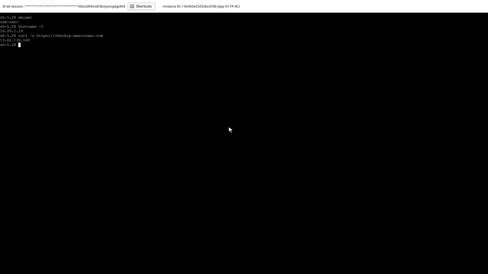

La preuve : sur `app-01-TP-AC`, `hostname -I` répond `10.20.1.10` (adresse privée seulement), et `curl` sur `checkip.amazonaws.com` répond `13.62.130.160`, l'adresse de la NAT. (L'identifiant de session est en partie masqué par la console elle-même.)


La panne et la reprise sur une seule image : la boucle affiche l'adresse de la NAT, puis 29 lignes `ECHEC` pendant que la route est retirée, puis l'adresse revient dès que nous la remettons.

## Tableau récapitulatif
| Ressource | Valeur |
|---|---|
| `igw-prod-leman-TP-AC` | `igw-0476502e016e32232`, attachée à `vpc-prod-leman-TP-AC` |
| `rt-public-leman-TP-AC` | `10.20.0.0/22` local ; `0.0.0.0/0` vers l'IGW ; associée à `sub-public-1a-TP-AC` et `sub-public-1b-TP-AC` |
| `rt-prive-leman-TP-AC` | `10.20.0.0/22` local ; `0.0.0.0/0` vers la NAT ; associée à `sub-prive-1a-TP-AC` |
| `sub-public-1b-TP-AC` | `10.20.0.64/26`, `eu-north-1b` |
| `nat-prod-leman-TP-AC` | `nat-055a6d12887edeb60`, dans `sub-public-1b-TP-AC`, adresse privée `10.20.0.101`, adresse Elastic `13.62.130.160` |

## Si ça ne marche pas : quatre vérifications
Nous les avons dites en vidéo pendant la panne, dans cet ordre :
1. Le sous-réseau est-il associé à la bonne table de routage ?
2. La route par défaut existe-t-elle dans cette table ?
3. Pointe-t-elle vers la bonne cible (IGW ou NAT) ?
4. La cible est-elle en bon état (NAT *Available*, IGW *Attached*, adresse publique sur l'instance pour un serveur public) ?

## Résultats des tests
Ce que nous avons vu à l'écran pendant le tournage.

```
=== Module 2 : routage, passerelle Internet et NAT (relevé sur le tournage dans la console, région eu-north-1) ===
Passerelle Internet igw-prod-leman-TP-AC (igw-0476502e016e32232) : état Attached au VPC vpc-prod-leman-TP-AC.

Tables de routage :
  rt-public-leman-TP-AC (rtb-06d51c36561985d79) : 10.20.0.0/22 local ; 0.0.0.0/0 -> igw-0476502e016e32232
      associée à sub-public-1a-TP-AC et sub-public-1b-TP-AC
  rt-prive-leman-TP-AC  (rtb-088ba1f009f668cfc) : 10.20.0.0/22 local ; 0.0.0.0/0 -> nat-055a6d12887edeb60
      associée à sub-prive-1a-TP-AC

Passerelle NAT, premier essai dans sub-public-1a-TP-AC (eu-north-1a) :
  -> erreur : "Performing this operation would exceed the limit of 5 NAT gateways"
Passerelle NAT, second essai dans sub-public-1b-TP-AC (eu-north-1b, 10.20.0.64/26) :
  nat-prod-leman-TP-AC (nat-055a6d12887edeb60), connectivité publique, adresse privée 10.20.0.101, adresse Elastic 13.62.130.160
  état Pending à la création, Available un peu plus d'une minute plus tard

Session Manager, instances en ligne : app-01-TP-AC et web-01-TP-AC (Ping status : Online).
Session Manager sur app-01-TP-AC (aucune adresse publique) :
  sh-5.2$ whoami
  ssm-user
  sh-5.2$ hostname -I
  10.20.1.10
  sh-5.2$ curl -s https://checkip.amazonaws.com
  13.62.130.160            <- l'adresse Elastic de la NAT, pas celle d'app-01

Panne volontaire (boucle : while true; do curl -s -m 2 https://checkip.amazonaws.com || echo ECHEC; sleep 1; done) :
  13.62.130.160 (route 0.0.0.0/0 -> NAT présente)
  route 0.0.0.0/0 supprimée de rt-prive-leman-TP-AC
  ECHEC x 29 (une tentative dure au plus 3 s : 2 s de délai de curl et 1 s de pause)
  route 0.0.0.0/0 -> NAT remise
  13.62.130.160 (la sortie repart)
Pendant la coupure, la fenêtre de Session Manager est restée figée : les lignes ECHEC ne se sont affichées qu'une fois la route remise.
```

## Pièges rencontrés
* **Quota de NAT atteint dans la zone A.** Le compte est partagé : cinq NAT par zone de disponibilité, et celles de la classe comptent aussi. C'est pour cela que la NAT est dans `sub-public-1b-TP-AC`. Pour que cela fonctionne, le sous-réseau de la NAT doit lui-même avoir une route vers l'IGW : c'est la raison de l'association de la zone B à `rt-public-leman-TP-AC`.
* **Une Elastic IP de trop.** Le premier essai, refusé, avait déjà alloué une adresse Elastic. Pour le second, nous en avons alloué une autre. La première n'est associée à aucune NAT : elle doit être relâchée avec le reste, sinon elle est facturée comme toute adresse IPv4 publique.
* **Session Manager refusait de démarrer.** Au clic sur *Démarrer la session*, la console a affiché, lors de deux tentatives, « l'instance n'est pas configurée pour être utilisée avec AWS Systems Manager », alors que `app-01-TP-AC` et `web-01-TP-AC` apparaissaient *Online* dans la liste. Nous avons recommencé la scène et la session s'est ouverte ; la cause exacte n'est pas dans nos notes.
* **La fenêtre de session se fige pendant la panne.** Tant que la route est retirée, aucune nouvelle ligne ne s'affiche. C'est logique : la session Session Manager passe elle aussi par la NAT. Les 29 lignes `ECHEC` sont apparues d'un seul coup une fois la route remise. Notre commentaire de la vidéo dit que les requêtes « échouent aussitôt » : c'est vrai pour la boucle sur la machine, mais l'écran ne le montre qu'après coup. Une tentative durant au plus trois secondes (deux de délai, une de pause), 29 échecs correspondent à une coupure d'environ une minute et demie, soit le temps de revenir dans la console et de remettre la route.

## Ce qui diffère du sujet
* **NAT en zone B.** Le schéma habituel place la NAT dans le sous-réseau public de la zone A. À cause du quota, nous avons créé un second sous-réseau public en zone B pour l'héberger.
* **Pas d'Elastic IP sur `web-01-TP-AC`.** Notre première version, avec l'AWS CLI, plaçait une Elastic IP sur `web-01` et la NAT en zone A. La version filmée garde l'adresse publique automatique et la NAT en zone B.
* **Test de panne.** Notre première version pinguait `8.8.8.8` chaque seconde et mesurait 19 secondes de coupure. La version filmée interroge `checkip.amazonaws.com` avec `curl`, ce qui prouve en plus par quelle adresse nous sortons. Elle ne chiffre pas la coupure : elle dure le temps de revenir dans la console.
* **Suppression de la NAT.** Le sujet demande de la supprimer en fin de séance. Nous la gardons pendant tout le tournage, car l'agent SSM d'`app-01-TP-AC` en dépend, et nous la supprimons à la fin du projet.

## Nettoyage
La NAT, son adresse Elastic, l'IGW, les tables de routage et le sous-réseau `sub-public-1b-TP-AC` sont supprimés à la fin du projet, comme le reste (voir `NETTOYAGE.md`). La NAT est la première ressource à retirer, puisqu'elle est facturée à l'heure. Une seule ressource du projet reste côté AWS : le Network Firewall `nfw-prod-leman-TP-AC` du module 4, dont la suppression est bloquée côté service. Son endpoint se trouve dans `sub-public-1b-TP-AC` : ce sous-réseau, et le VPC qui le contient, ne peuvent partir qu'une fois le pare-feu débloqué.


---

# Module 3 – Security Groups et NACL

## Objectif
Poser deux niveaux de filtrage sur le VPC de production : un Security Group par rôle (web, application) et une NACL sur le sous-réseau public. Le but est de savoir dire, devant une connexion qui échoue, si c'est le groupe ou la NACL qui bloque.

## Ce qu'il faut savoir
Un Security Group se pose sur l'instance. Il garde l'état des connexions : si l'aller est autorisé, la réponse repart sans règle de plus. Il ne contient que des autorisations, tout le reste est refusé. La source d'une règle peut être une adresse, une plage ou un autre groupe, c'est-à-dire « toutes les instances qui portent ce groupe ».

Une NACL se pose sur un sous-réseau. Elle ne garde aucun état : il faut autoriser l'aller et le retour. La réponse d'un serveur HTTPS revient vers un port éphémère du client, d'où la plage 1024-65535. Ses règles sont numérotées et lues par ordre croissant, la première qui correspond gagne. Elle accepte les refus, et une règle `*` refuse tout ce qui n'a pas été prévu.

Un paquet entrant passe d'abord la NACL du sous-réseau, puis le groupe de l'instance. Il faut que les deux disent oui.

## Ce que nous avons fait
Tout se fait dans la console, dans *EC2* pour les groupes, dans *VPC* pour la NACL, dans *Systems Manager* pour les tests.

1. **Groupe web.** *EC2 > Groupes de sécurité > Créer*. Nom `web-TP-AC`, description « Web : 443 public, 22 plage de test », VPC `vpc-prod-leman-TP-AC`. Deux règles entrantes : TCP 443 depuis `0.0.0.0/0` (« HTTPS public ») et TCP 22 depuis `203.0.113.0/24` (« SSH plage de test »). Nous laissons la règle sortante par défaut (tout). Balises du projet, plus `Name = sg-web-TP-AC`.
2. **Groupe application.** Même écran : `app-TP-AC`, description « App : 8080, 22 et ICMP depuis le groupe web ». Trois règles entrantes, et pour chacune la source n'est pas une adresse mais le groupe `web-TP-AC` (nous tapons `web-TP` dans le champ et nous le choisissons dans la liste) : TCP 8080 (« API depuis web »), SSH 22 (« SSH depuis web »), *Tous les ICMP - IPv4* (« ping depuis web »). Balise `Name = sg-app-TP-AC`.
3. **Brancher les groupes.** Dans *Instances*, nous cochons l'instance, puis *Actions > Sécurité > Modifier les groupes de sécurité* : `web-01-TP-AC` reçoit `web-TP-AC`, `app-01-TP-AC` reçoit `app-TP-AC`, et dans les deux cas nous retirons le groupe `default`. (Dans la vidéo, nous ouvrons le même écran par son adresse directe.)
4. **Premier test, depuis `web-01`.** *Systems Manager > Session Manager*, session sur `web-01-TP-AC`. `ping -c 3 10.20.1.10` : trois réponses sur trois, environ 0,2 ms. `curl -s http://10.20.1.10:8080/api/health` répond `app-01 TP-AC /api/health`. Le groupe de l'application laisse donc passer le ping et le 8080 venant du groupe web.
5. **nginx sur `web-01`.** Pour avoir quelque chose qui répond sur le 443, nous installons nginx (`sudo dnf -y install nginx`, quelques dizaines de secondes) avec un certificat auto-signé : `openssl req -x509 -nodes -newkey rsa:2048 -days 365`, sujet `CN=portefeuilles.leman-finance.example`, clé et certificat dans `/etc/pki/nginx`. Le fichier `/etc/nginx/conf.d/web.conf` écoute sur `443 ssl`, répond `web-01 TP-AC` à la racine et relaie `/api/` vers `http://10.20.1.10:8080`. Après `nginx -t` et `systemctl enable --now nginx`, `curl -sk https://localhost/` répond `web-01 TP-AC` et `curl -sk https://localhost/api/health` répond `app-01 TP-AC /api/health`. Le certificat est auto-signé parce que ce nom n'est pas un domaine à nous : le vrai domaine n'arrive qu'aux modules 9 à 11.
6. **La NACL.** *VPC > ACL réseau > Créer* : `nacl-public-TP-AC`, VPC de production, balises du projet. Une NACL neuve refuse tout. Règles entrantes : 100 TCP 443 depuis `0.0.0.0/0`, 110 TCP 1024-65535 depuis `0.0.0.0/0`, 120 *Tout le trafic* depuis `10.20.0.0/22` (le VPC), toutes en *Autoriser*. Règles sortantes : les mêmes trois, vers les mêmes destinations. Onglet *Associations de sous-réseau > Modifier* : nous cochons `sub-public-1a-TP-AC` seulement. Les deux autres sous-réseaux (`sub-public-1b-TP-AC` et `sub-prive-1a-TP-AC`) restent sur la NACL par défaut.
7. **Panne volontaire du groupe.** Dans une session sur `web-01`, une boucle interroge l'API chaque seconde : `while true; do curl -s -m 2 http://10.20.1.10:8080/api/health || echo ECHEC; echo; sleep 1; done`. Dans la console, nous retirons la règle 8080 du groupe `app-TP-AC` : la boucle devrait passer à `ECHEC`. Puis nous remettons la règle (TCP 8080, source `web-TP-AC`). Ce qui s'est réellement passé à l'écran est raconté dans « Pièges rencontrés ».

## Captures


Le groupe `web-TP-AC` vient d'être créé (bandeau vert). Ses deux règles entrantes : HTTPS depuis tout Internet, SSH depuis `203.0.113.0/24`. Le numéro de propriétaire du compte est masqué sur cette image.


Le groupe `app-TP-AC` : trois règles, SSH 22, TCP 8080 et ICMP, toutes avec pour source le groupe `web-TP-AC` (colonne *Source*, identifiant `sg-02e5eca080b53acb6`) et non une adresse.


Depuis `web-01-TP-AC` : trois pings sur trois, puis la réponse de l'API de `app-01`. L'identifiant de session, en haut à gauche, est masqué.


La fin de l'installation de nginx, la configuration en HTTPS, `nginx -t` qui annonce `test is successful`, et les deux `curl -sk` : la page du serveur web, puis l'API de `app-01` relayée par nginx.


L'éditeur des règles entrantes de `nacl-public-TP-AC`, avant l'enregistrement. Les trois règles 100, 110 et 120 sont en *Autoriser* ; la ligne grisée `*` est la règle par défaut, qui refuse. Les règles sortantes ont la même forme.


L'association de la NACL : seul `sub-public-1a-TP-AC` (`10.20.0.0/26`, zone `eu-north-1a`) est coché. Les deux autres sous-réseaux sont encore sur la NACL par défaut (colonne *Associé à*).

## Tableau récapitulatif
| Élément | Valeur |
|---|---|
| `web-TP-AC` | `sg-02e5eca080b53acb6`, tag `Name = sg-web-TP-AC` ; entrée TCP 443 depuis `0.0.0.0/0`, TCP 22 depuis `203.0.113.0/24` ; sortie libre |
| `app-TP-AC` | `sg-0d8c8d4173d74dac8`, tag `Name = sg-app-TP-AC` ; entrée TCP 8080, TCP 22 et ICMP, source `web-TP-AC` ; sortie libre |
| `web-01-TP-AC` | groupe `web-TP-AC` (le groupe `default` est retiré) |
| `app-01-TP-AC` | groupe `app-TP-AC` (le groupe `default` est retiré) |
| `nacl-public-TP-AC` | `acl-07f03eee282fe2a87`, associée à `sub-public-1a-TP-AC` |
| NACL, entrée | 100 TCP 443 `0.0.0.0/0` ; 110 TCP 1024-65535 `0.0.0.0/0` ; 120 tout `10.20.0.0/22` ; `*` refuser |
| NACL, sortie | 100 TCP 443 ; 110 TCP 1024-65535 ; 120 tout `10.20.0.0/22` (mêmes destinations) ; `*` refuser |

## Résultats des tests
Ces sorties viennent de notre première exécution, faite en ligne de commande avant le tournage, sur les mêmes groupes et la même NACL. La vidéo reprend le test de `web-01` vers `app-01` (captures ci-dessus) et la panne du 8080, mais pas les essais de la NACL : retrait de la règle de retour, puis refus explicite numéro 50 placé avant l'autorisation numéro 100. Dans cet essai, c'est la règle au numéro le plus bas qui gagne.

```
=== TP1 : Security Groups ===
curl https depuis Internet vers web-01 : HTTP 200
ping depuis Internet vers web-01 (ICMP non autorise) : pas de reponse (attendu)
app-01 n'a pas d'IP publique : None

=== TP2 : SG (avec etat) vs NACL (sans etat) ===
web-01 -> app-01:8080 : Success	app-01 TP-AC /api/health 	
NACL : regle de retour (sortie ephemere 1024-65535) retiree -> curl externe : HTTP 000 ECHEC (code curl 28 : timeout/refus)
NACL : regle de retour retablie -> curl externe : HTTP 200

=== TP3 : diagnostic ===
8080 retire de sg-app -> web-01 -> app-01:8080 : Success	ECHEC 	
8080 retabli -> web-01 -> app-01:8080 : Success	app-01 TP-AC /api/health 	
NACL : refus explicite regle 50 (avant l'autorisation 100) -> curl externe : HTTP 000 ECHEC (code curl 28 : timeout/refus)  [la regle au numero le plus bas gagne]
refus supprime -> curl externe : HTTP 200
```

## Pièges rencontrés
* **Le nom du groupe.** AWS interdit un nom de groupe qui commence par `sg-`. Le groupe s'appelle donc `web-TP-AC`, et c'est la balise `Name` (`sg-web-TP-AC`) qui s'affiche dans la liste.
* **La source d'une règle.** Quand on tape `web-TP` dans le champ *Source* sans choisir le groupe dans la liste, la console affiche en rouge « Un bloc d'adresse CIDR, un ID de groupe de sécurité ou une liste de préfixes doit être spécifié » et refuse d'enregistrer.
* **La panne du 8080, telle que filmée.** Dans la vidéo, la boucle de `web-01` reste verte : aucun `ECHEC`. Au moment de supprimer la règle 8080 du groupe `app-TP-AC`, le clic est tombé à côté, d'après l'enregistrement : c'est la source de la règle SSH qui s'est vidée, la console a refusé d'enregistrer (le message rouge ci-dessus) et le groupe n'a pas changé. La règle ajoutée ensuite aurait de toute façon fait doublon, et la liste des règles que montre le module 5 contient encore les trois règles d'origine (SSH, 8080 et ICMP depuis le groupe web). Nous n'avons pas refait cette prise. La panne elle-même est prouvée par la sortie de la première exécution, plus haut : après retrait du 8080, le `curl` de `web-01` échoue ; une fois la règle remise, il répond.
* **Des prises refaites.** Cinq des six scènes de ce module ont demandé au moins une reprise. À chaque fois, la console n'a pas réagi comme le geste prévu l'attendait : une liste déroulante restée ouverte, une source de règle non validée.
* **Le port 22 est fermé deux fois.** Le groupe web l'ouvre depuis `203.0.113.0/24`, mais la NACL n'autorise ni le 22 ni l'ICMP depuis l'extérieur. Cela ne gêne pas : nous administrons les machines par Session Manager, sans SSH.

## Ce qui diffère du sujet
* **L'adresse de la « salle d'exploitation ».** Le sujet parle de cette adresse sans la donner. Nous avons mis `203.0.113.0/24`, une plage réservée à la documentation : personne ne peut s'en servir, ce qui convient pour un port d'administration dont nous ne nous servons pas.
* **Les noms.** Le groupe porte le nom `web-TP-AC` et non `sg-web-TP-AC`, pour la raison ci-dessus.
* **Les autres groupes.** Les groupes du load balancer et du développement ne sont pas dans ce module : celui du développement arrive au module 5, celui du load balancer au module 9.
* **Les tests de la NACL.** Ils n'ont pas été refilmés. Les résultats viennent de la première exécution en ligne de commande, et la vidéo ne montre que la création de la NACL et son association.

## Nettoyage
Les deux groupes et la NACL ne coûtent rien. Ils ont été supprimés à la fin du tournage avec le reste du réseau, dans l'ordre décrit dans `docs/NETTOYAGE.md` (les instances d'abord, puis les groupes et la NACL), à l'exception de ce qui retient encore le pare-feu du module 4 : voir ce module.


---

# Module 4 – Network Firewall

> Ce module a d'abord été refusé par l'organisation AWS (`network-firewall:*`). Le blocage a été levé le 17/11/2026, sans que nous sachions qui l'a levé. Notre premier essai, en ligne de commande, date de ce jour-là ; le module a ensuite été refait à la main dans la console et filmé le 18/11/2026. Le pare-feu est réel, pas simulé.

## Objectif
Contrôler ce qui sort du sous-réseau privé : n'autoriser que les dépôts de mises à jour Amazon Linux et les services AWS, bloquer tout le reste et garder une trace des flux, bloqués comme autorisés, dans CloudWatch Logs.

## Ce qu'il faut savoir
AWS Network Firewall est un pare-feu managé. AWS le déploie sous forme d'un *endpoint* posé dans un sous-réseau à part. Rien n'y passe tout seul : c'est à nous d'écrire des routes qui envoient le trafic vers cet endpoint.

Il a deux moteurs de règles. Le moteur sans état regarde chaque paquet isolément. Le moteur avec état suit la connexion et sait lire le nom d'un site dans une requête HTTP ou TLS : c'est lui qui applique notre liste de domaines. La politique du pare-feu règle l'ordre d'évaluation et l'action par défaut. Nous avons pris l'ordre strict (les règles sont lues dans l'ordre) et l'action « abandon établi » : le pare-feu laisse passer l'établissement de la connexion TCP, puis abandonne la suite dès que le nom du site n'est dans aucune règle d'autorisation. Chaque abandon génère une alerte.

Le pare-feu doit voir les deux sens d'une connexion. Si l'aller passe par l'endpoint et que le retour le contourne, il ne voit qu'un côté de l'échange et coupe. Toute la partie routage du module sert à obtenir cette symétrie. Le service est facturé environ 0,40 USD de l'heure : on ne le laisse pas tourner.

## Ce que nous avons fait
Le chemin voulu est : serveur privé, pare-feu, NAT, Internet. Tout se fait dans *VPC* (menus *Sous-réseaux*, *Tables de routage*, *Network Firewall*) et dans *CloudWatch*.

1. **Sous-réseau du pare-feu.** `sub-fw-1a-TP-AC`, VPC de production, zone `eu-north-1a`, plage `10.20.2.0/28`, balises du projet. C'est le plus petit sous-réseau qu'AWS accepte : 16 adresses. Il passe à *Available* tout de suite.
2. **Deux tables de routage**, pour construire le chemin de sortie :
   * `rt-fw-leman-TP-AC` : route `0.0.0.0/0` vers la passerelle NAT `nat-prod-leman-TP-AC`, associée à `sub-fw-1a-TP-AC`. Ce que le pare-feu laisse passer part donc vers la NAT.
   * `rt-nat-leman-TP-AC` : route `0.0.0.0/0` vers la passerelle Internet `igw-prod-leman-TP-AC`, associée à `sub-public-1b-TP-AC`. C'est le sous-réseau de la NAT, en zone B (la zone A avait atteint la limite de NAT au module 2). Il quitte ainsi `rt-public-leman-TP-AC` et prend cette table à lui.
3. **Groupe de règles.** *Network Firewall > Groupes de règles > Créer* : `rg-depots-autorises-TP-AC`, description « Autorise les depots de mises a jour et les services AWS ». Version *Classique*, type *Groupe de règles avec état*, format *Générateur visuel de règles*, puis *Liste de domaines*, ordre strict. Domaines : `.amazonlinux.com` et `.amazonaws.com`, protocoles HTTP et HTTPS, action *Autoriser*. Capacité 100 : AWS la fixe à la création, on ne peut plus la changer.
4. **Politique.** *Stratégies de pare-feu > Créer* : `policy-prod-leman-TP-AC`, version *Classique*, sans la « défense active contre les menaces » (option payante). Ordre d'évaluation *Ordre strict*, action d'abandon *Abandon établi*, action d'alerte *Alerte établie*. Nous ajoutons `rg-depots-autorises-TP-AC` en priorité 1.
5. **Pare-feu.** *Pare-feu > Créer* : `nfw-prod-leman-TP-AC`. Type de capacité *Routed firewall* (la console l'affiche en anglais ; l'autre choix, *Routed firewall, NAT and explicit proxy*, fait créer des NAT par AWS, alors que nous avons déjà la nôtre), attachement au VPC `vpc-prod-leman-TP-AC`, zone `eu-north-1a`, sous-réseau `sub-fw-1a-TP-AC`, adresses IPv4, politique existante `policy-prod-leman-TP-AC`, balises. Dans le récapitulatif, la console active par défaut la protection contre la suppression et celle contre les changements de sous-réseau. Le statut passe de *Mise en service* à *Prêt* au bout de quelques minutes (accéléré dans la vidéo).
6. **Deux groupes de journaux.** *CloudWatch > Groupes de journaux > Créer* : `/leman/nfw-alert-TP-AC` et `/leman/nfw-flow-TP-AC` (classe *Standard*, conservation illimitée). Puis, dans la page du pare-feu, *Journalisation > Modifier* : type *Alert* vers `/leman/nfw-alert-TP-AC`, type *Flow* vers `/leman/nfw-flow-TP-AC`, destination *CloudWatch log group* pour les deux. Il faut deux journaux parce qu'une alerte n'est émise que pour ce qui est bloqué : pour voir passer le flux autorisé, il faut le journal des flux.
7. **Route par défaut du privé.** Dans `rt-prive-leman-TP-AC`, nous modifions la route `0.0.0.0/0` : la cible *Passerelle NAT* devient *Point de terminaison de l'équilibreur de charge de passerelle* (c'est le nom que la console donne à l'endpoint d'un pare-feu), `vpce-02fcd420fb34607b8`. Tout ce que `app-01` envoie vers Internet passe maintenant par le pare-feu.
8. **Route de retour.** Dans `rt-nat-leman-TP-AC`, nous ajoutons `10.20.1.0/26` (le sous-réseau privé) vers le même endpoint. Sans elle, la NAT répondrait à `app-01` directement, par la route locale du VPC, et le pare-feu ne verrait jamais le retour.
9. **Le test, depuis `app-01`.** Session Manager sur `app-01-TP-AC`, trois `curl -sS -m 10 -o /dev/null -w "HTTP %{http_code}"` : sur `https://cdn.amazonlinux.com/`, sur `https://example.com/` et sur `https://www.wikipedia.org/`.
10. **Les journaux.** Dans CloudWatch, nous ouvrons le flux de `/leman/nfw-alert-TP-AC` et celui de `/leman/nfw-flow-TP-AC`.

La NAT est en zone B et l'endpoint en zone A : le trafic de sortie traverse donc deux zones. Ce serait à éviter en production (coût et dépendance), nous l'acceptons pour ce montage.

## Captures
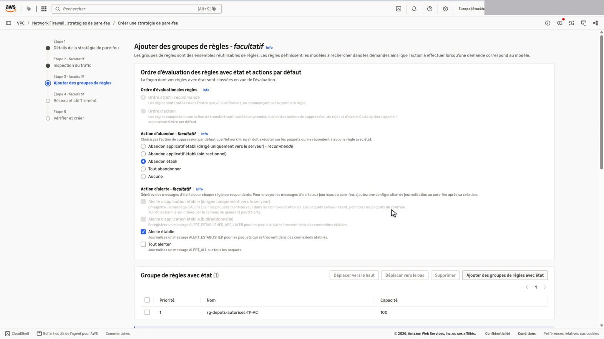

La politique `policy-prod-leman-TP-AC` avant sa création. L'ordre strict est celui du groupe de règles. L'action d'abandon par défaut est *Abandon établi*, l'alerte est *Alerte établie*. En bas, le groupe `rg-depots-autorises-TP-AC` est en priorité 1.

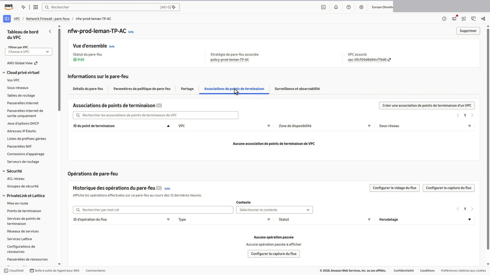

Le pare-feu `nfw-prod-leman-TP-AC` est au statut *Prêt*, avec sa politique. L'onglet ouvert ici, *Associations de points de terminaison*, est vide : il ne liste que les associations ajoutées à la main depuis d'autres VPC. L'endpoint créé avec le pare-feu, lui, se repère dans les routes (capture suivante).

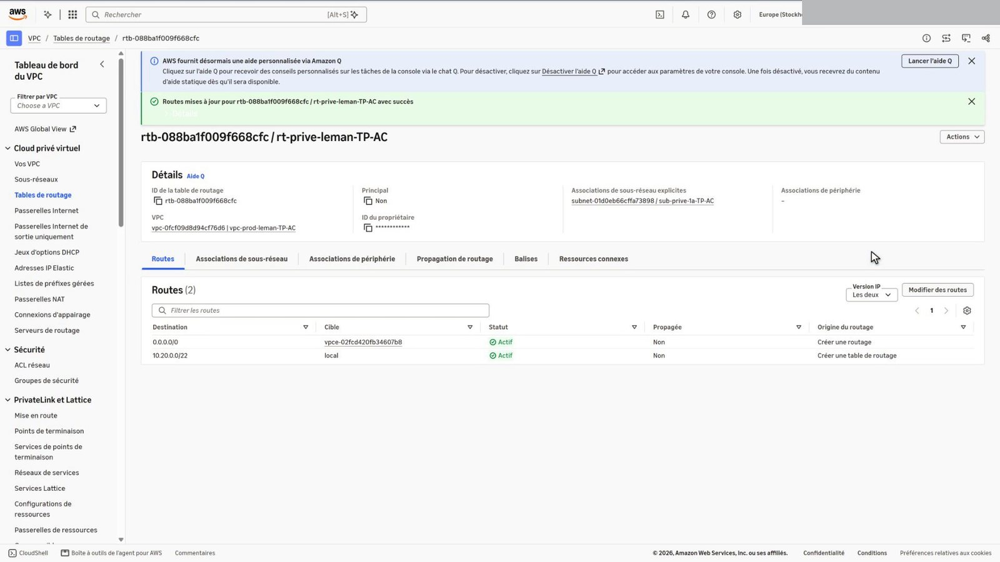

La table du sous-réseau privé après modification : la route par défaut `0.0.0.0/0` pointe vers `vpce-02fcd420fb34607b8`, l'endpoint du pare-feu, et non plus vers la NAT. La route locale `10.20.0.0/22` est inchangée.


Le test depuis `app-01-TP-AC`. `cdn.amazonlinux.com` répond `HTTP 403` : c'est la réponse du site, la connexion a donc traversé le pare-feu. `example.com` et `www.wikipedia.org` ne sont pas dans la liste : après dix secondes, `curl: (28) Connection timed out` et `HTTP 000`.

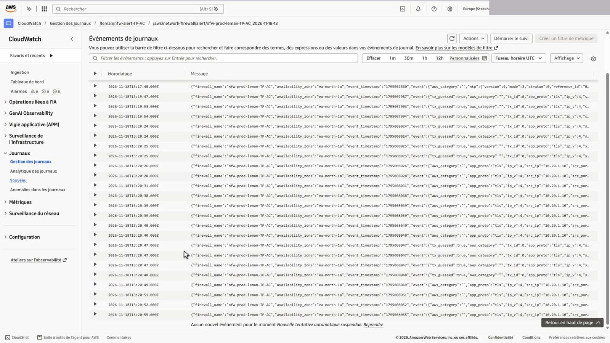

Le journal des alertes, avec une ligne JSON par événement. On lit le nom du pare-feu, la zone `eu-north-1a`, le protocole `tls` et l'adresse source `10.20.1.10`, celle d'`app-01`. La première ligne, de 13:17 UTC, est une requête NTP (`ntp`) : l'instance sort aussi sur le port 123, que la politique abandonne et signale. Les lignes suivantes sont des alertes TLS. La liste s'arrête à 13:20:55 UTC, avant nos trois `curl` : ce sont des alertes sur le trafic que `app-01` émet sans qu'on le lui demande. Pour une alerte sur un `curl` bloqué, voir la sortie du pare-feu CloudFormation plus bas (`proto tls`, `action blocked`).


Le journal des flux : six enregistrements. Les quatre premiers portent la source `10.20.1.10` et des compteurs `netflow` (paquets, octets), les deux derniers, de 13:21 UTC, des drapeaux TCP : l'heure concorde avec celle de nos `curl`, ce sont sans doute leurs connexions. Les lignes sont tronquées à droite par la largeur de la page ; la console les déplie au clic.

## Tableau récapitulatif
| Élément | Valeur |
|---|---|
| Sous-réseau du pare-feu | `sub-fw-1a-TP-AC`, `10.20.2.0/28`, `eu-north-1a` |
| `rt-fw-leman-TP-AC` | `0.0.0.0/0` vers `nat-prod-leman-TP-AC` ; associée à `sub-fw-1a-TP-AC` |
| `rt-nat-leman-TP-AC` | `0.0.0.0/0` vers `igw-prod-leman-TP-AC` ; `10.20.1.0/26` vers l'endpoint ; associée à `sub-public-1b-TP-AC` |
| `rt-prive-leman-TP-AC` | `0.0.0.0/0` vers l'endpoint `vpce-02fcd420fb34607b8` ; `10.20.0.0/22` local |
| Groupe de règles | `rg-depots-autorises-TP-AC`, avec état, liste de domaines `.amazonlinux.com` et `.amazonaws.com`, HTTP et HTTPS, autoriser, capacité 100 |
| Politique | `policy-prod-leman-TP-AC`, ordre strict, abandon établi, alerte établie |
| Pare-feu | `nfw-prod-leman-TP-AC`, endpoint dans `sub-fw-1a-TP-AC` |
| Journaux | `/leman/nfw-alert-TP-AC` (alertes), `/leman/nfw-flow-TP-AC` (flux) |

## Résultats des tests
Ces sorties viennent du pare-feu que le modèle CloudFormation du module 13 a déployé le 17/11. Ce n'est pas le pare-feu fait à la main de la vidéo : son endpoint porte un autre identifiant (`vpce-0951ba9169b5e0399`), et il a un groupe de règles de plus, qui laisse passer le trafic interne du VPC. Les résultats sont les mêmes que ceux de la vidéo (voir la capture du test) : `cdn.amazonlinux.com` répond `HTTP 403`, `example.com` et Wikipédia expirent.

```
=== Module 4 : pare-feu deploye par la stack stack-interconnexion-leman-TP-AC ===
Pare-feu nfw-prod-leman-TP-AC : statut READY, endpoint vpce-0951ba9169b5e0399 dans le sous-reseau sub-fw-1a-TP-AC (10.20.2.0/28)
Routes : rt-prive 0.0.0.0/0 -> vpce-0951ba9169b5e0399 (endpoint du pare-feu)
[autorise] curl https://cdn.amazonlinux.com/ -> HTTP 403
[bloque]   curl https://example.com/        -> Failed	curl: (28) Connection timed out after 10002 milliseconds HTTP 000	failed to run commands: exit status 28
[bloque]   curl https://www.wikipedia.org/  -> Failed	curl: (28) Connection timed out after 10003 milliseconds HTTP 000	failed to run commands: exit status 28
[interne]   web-01 -> app-01:8080 (trafic interne, autorise par la regle 1 du pare-feu) -> Success	app-01 TP-AC /api/health 	

Journal des alertes /leman/nfw-alert-TP-AC (flux bloques) :
  47 alertes ; exemples :
  src 10.20.1.10 -> dst 13.40.182.125:123 | proto ntp | action blocked | aws:alert_established action
  src 10.20.1.10 -> dst 18.133.139.197:123 | proto ntp | action blocked | aws:alert_established action
  src 10.20.1.10 -> dst 104.20.23.154:443 | proto tls | action blocked | aws:alert_established action

Journal des flux /leman/nfw-flow-TP-AC (tous les flux vus par le pare-feu, dont le flux autorise) :
  128 flux vus (app-01 et web-01 vers app-01) ; exemples :
  src 10.20.0.115:40388 -> dst 10.20.1.10:8080 | proto TCP | octets 180
  src 10.20.0.19:41222 -> dst 10.20.1.10:8080 | proto TCP | octets 180
  src 10.20.0.115:14054 -> dst 10.20.1.10:8080 | proto TCP | octets 180
  src 10.20.0.19:25106 -> dst 10.20.1.10:8080 | proto TCP | octets 180
```

## Pièges rencontrés
* **Le service était refusé.** Jusqu'au 17/11, toute création Network Firewall échouait avec un refus de l'organisation (voir `docs/01-services-bloques.md`). Nous avons d'abord rédigé le module sans le réaliser, puis l'avons refait pour de vrai après la levée du blocage.
* **Un `403` est un succès.** `cdn.amazonlinux.com` répond 403 parce que nous ne demandons pas une page qui existe. Le bon signe est que le serveur répond : le pare-feu a laissé passer.
* **La NAT en zone B.** À cause de la limite de NAT par zone (module 2), la NAT n'est pas dans la même zone que l'endpoint. Il a fallu une table de routage dédiée à `sub-public-1b-TP-AC` pour y poser la route de retour sans toucher au sous-réseau de `web-01`.
* **L'onglet vide.** *Associations de points de terminaison* affiche « Aucune association » alors que le pare-feu est prêt. Ce n'est pas une erreur : l'endpoint se trouve dans les routes.
* **Les prises à refaire.** Cinq scènes sur onze ont été refaites au moins une fois (groupe de règles, politique, journalisation, routes, journaux) : la console n'a pas réagi comme le geste prévu l'attendait.
* **Le pare-feu ne se laisse plus supprimer.** Voir « Nettoyage ».
* **Ce que nous avons appris du premier essai.** En ligne de commande, trois étapes ont échoué (groupe de journaux, journalisation, routes). Nous avons aussi constaté que `web-01` ne joignait plus `app-01` quand la route de retour était posée dans la table du sous-réseau de `web-01`, et qu'une règle de groupe de sécurité écrite « depuis un groupe » ne correspond plus au trafic qui sort d'un endpoint de pare-feu. Dans la version filmée, ces deux défauts ne se voient pas : la NAT est seule dans `sub-public-1b-TP-AC`, et le trafic entre `web-01` et `app-01` ne passe pas par le pare-feu. Il faut en retenir que le pare-feu au milieu d'un VPC impose un trafic symétrique et des règles de groupe par adresses plutôt que par groupe.

## Ce qui diffère du sujet
* **La route de retour.** Le sujet demande une route de retour dans la table publique. Nous l'avons mise dans une table à part, `rt-nat-leman-TP-AC`, pour ne pas toucher à `web-01` (voir ci-dessus et `docs/02-ecarts-au-sujet.md`).
* **Le flux autorisé dans les journaux.** Le sujet demande de voir le flux autorisé et le flux bloqué. Un journal d'alertes ne contient que ce qui est bloqué : nous avons ajouté le journal des flux.
* **Un seul groupe de règles dans la vidéo.** La version filmée a une seule liste de domaines. La version CloudFormation en a deux (la seconde laisse passer le trafic interne du VPC).
* **Pas de défense active.** L'option payante de détection des menaces est désactivée, et nous n'inspectons pas le contenu chiffré.

## Nettoyage
Tout ce que nous avons créé pour ce module a été supprimé, sauf le pare-feu lui-même. `nfw-prod-leman-TP-AC` reste bloqué côté AWS : la suppression échoue depuis la console comme en ligne de commande avec `InternalServerError: Internal failure`. Nous avons vérifié et écarté les causes habituelles : protection contre la suppression désactivée, plus aucune route vers l'endpoint, plus de journalisation. En essayant de le contourner, nous avons déplacé l'endpoint dans `sub-public-1b-TP-AC` ; l'ancien endpoint a disparu d'EC2, mais l'attachement reste en suppression côté Network Firewall. Nous avons ouvert un cas AWS Support (*Compte et facturation*, plan Basic) pour obtenir la suppression et l'arrêt de la facturation. La politique `policy-prod-leman-TP-AC` et le groupe de règles `rg-depots-autorises-TP-AC` restent avec lui tant qu'il existe, et ne coûtent rien. Le pare-feu, lui, est facturé environ 0,40 USD de l'heure : c'est la ressource facturée qu'il nous reste à faire disparaître (voir `docs/NETTOYAGE.md`).


---

# Module 5 – VPC Peering

## Objectif
Créer un VPC de développement, le relier à la production par un peering en n'ouvrant que le port 8080, et vérifier ce que le peering ne permet pas : relier deux VPC aux plages qui se chevauchent, ou passer par un VPC intermédiaire.

## Ce qu'il faut savoir
Un peering est une liaison privée entre deux VPC, sur le réseau d'AWS. L'un fait la demande (le *demandeur*), l'autre l'accepte (l'*accepteur*). Quand les deux VPC sont dans le même compte et la même région, nous acceptons nous-mêmes. Une demande non acceptée expire au bout de sept jours.

La connexion ne suffit pas. Il faut ajouter une route dans chaque VPC vers la plage de l'autre, puis ouvrir ce qu'on veut laisser passer dans les Security Groups. Les deux plages ne doivent pas se chevaucher, sinon AWS ne sait pas où envoyer un paquet. Enfin, le peering n'est pas transitif : si A est relié à B et B à C, A ne joint pas C.

Il y a une autre limite, qui explique le module 6 : chaque nouvelle paire de VPC demande sa propre connexion et ses propres routes. Avec un Transit Gateway, un seul point de raccordement suffit.

## Ce que nous avons fait
Il y a deux parties : construire le VPC de développement, puis le relier. Tout se fait dans la console, dans *VPC* et *EC2*.

**Le VPC de développement**

1. **VPC.** *VPC > Créer un VPC*, option *VPC uniquement* : nom `vpc-dev-leman-TP-AC`, bloc IPv4 saisi à la main `10.21.0.0/24`, pas d'IPv6, balises du projet avec `Environnement = dev`. La console annonce la création, l'état passe à *Available*. Le VPC arrive avec sa table de routage principale et sa NACL par défaut, sans sous-réseau.
2. **Sous-réseau.** `sub-dev-1a-TP-AC`, zone `eu-north-1a`, plage `10.21.0.0/26`. Une plage modeste suffit : un seul serveur y vivra.
3. **Passerelle Internet.** `igw-dev-leman-TP-AC`, créée à l'état *Detached*, puis *Actions > Attacher au VPC* vers `vpc-dev-leman-TP-AC`. Elle donne au développement sa sortie vers Internet.
4. **Table de routage.** `rt-dev-leman-TP-AC`, dans le VPC de développement : route `0.0.0.0/0` vers `igw-dev-leman-TP-AC`, associée à `sub-dev-1a-TP-AC`. Ce sont les mêmes gestes qu'au module 2.
5. **Security Group.** `dev-TP-AC` (balise `Name = sg-dev-TP-AC`), description « Dev : aucune entree, sortie libre », dans le VPC de développement. Aucune règle entrante : personne ne peut entrer. La sortie reste libre.
6. **Instance.** *EC2 > Lancer une instance* : `dev-01-TP-AC`, Amazon Linux 2023, `t3.micro`, sans paire de clés, VPC `vpc-dev-leman-TP-AC`, sous-réseau `sub-dev-1a-TP-AC`, adresse IP publique automatique *Activer*, groupe existant `dev-TP-AC`, adresse principale `10.21.0.10`, profil d'instance IAM `TP-AC-ec2-ssm-role` (celui du module 1, pour Session Manager). Nous lui laissons une adresse publique parce que ce VPC n'a pas de NAT : c'est le chemin de l'agent SSM vers le service.

**Le peering**

7. **La demande.** *VPC > Connexions d'appairage > Créer* : nom `pcx-lab-TP-AC`, VPC local (demandeur) `vpc-prod-leman-TP-AC` (`10.20.0.0/22`), puis *Ce compte*, *Cette région (eu-north-1)*, VPC accepteur `vpc-dev-leman-TP-AC` (`10.21.0.0/24`), balises du projet. La connexion apparaît *En attente d'acceptation*.
8. **L'acceptation.** *Actions > Accepter la demande*, puis *Accepter la demande* dans la fenêtre de confirmation. L'état passe à *Active*. Un bandeau propose *Modifier mes tables de routage maintenant*.
9. **Les routes, des deux côtés.** Dans `rt-prive-leman-TP-AC` : `10.21.0.0/24` vers *Connexion d'appairage*, `pcx-lab-TP-AC`. Dans `rt-dev-leman-TP-AC` : `10.20.0.0/22` vers la même connexion. Nous n'avons rien posé dans `rt-public-leman-TP-AC` : `web-01` ne joint donc pas le développement.
10. **Le 8080, et rien d'autre.** Dans `app-TP-AC`, nouvelle règle entrante TCP 8080, source `10.21.0.0/24` (une plage, pas un groupe), description « API depuis le VPC de dev ». Le groupe a maintenant quatre règles.
11. **Le test, depuis `dev-01`.** Session Manager sur `dev-01-TP-AC` : `hostname -I` donne `10.21.0.10` ; `curl -s -m 5 http://10.20.1.10:8080/api/health` répond `app-01 TP-AC /api/health` ; `ping -c 2 -W 2 10.20.1.10` reste sans réponse ; le port 22 de `app-01` est fermé.
12. **La plage qui chevauche.** Nous créons un VPC `vpc-chevauche-TP-AC` en `10.20.0.0/24` (AWS le permet : c'est un VPC à part), puis nous tentons un peering `pcx-chevauche-TP-AC` entre la production et ce VPC.

La connexion `pcx-lab-TP-AC` est supprimée au module 6, comme le demande le sujet : le Transit Gateway prend sa place.

## Captures
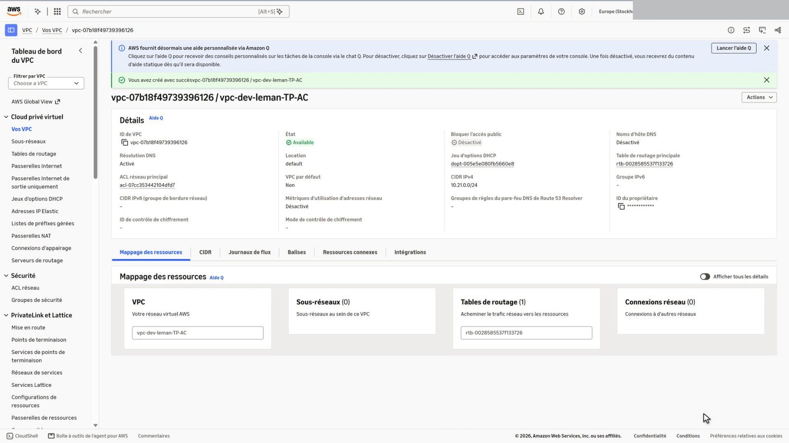

Le VPC de développement vient d'être créé : état *Available*, CIDR `10.21.0.0/24`. Le mappage en bas confirme qu'il n'a encore aucun sous-réseau (0) et une seule table de routage, la principale.

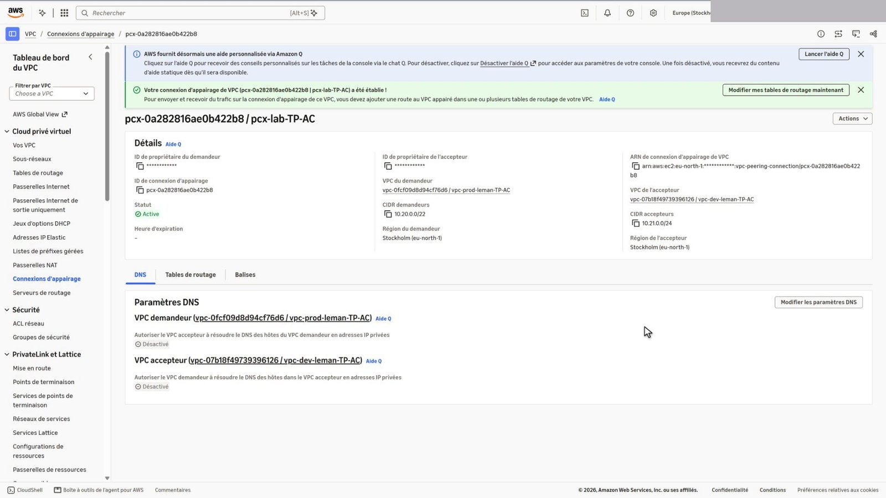

La connexion `pcx-lab-TP-AC` est *Active*. À gauche le demandeur, `vpc-prod-leman-TP-AC` en `10.20.0.0/22`, à droite l'accepteur, `vpc-dev-leman-TP-AC` en `10.21.0.0/24`. Les identifiants de compte sont masqués par la console. Le bandeau vert rappelle qu'il reste à ajouter les routes.

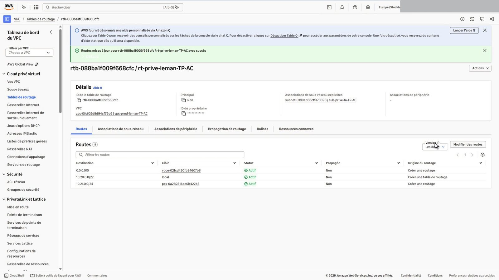

La table du sous-réseau privé de la production après l'ajout de la route : `10.21.0.0/24` part vers `pcx-0a282816ae0b422b8`. On voit aussi la route par défaut vers l'endpoint du pare-feu, posée au module 4.


Le groupe `app-TP-AC` après l'ajout : quatre règles entrantes. La nouvelle est la deuxième ligne : TCP 8080, source `10.21.0.0/24`. Les trois autres viennent du module 3 (source : le groupe web).

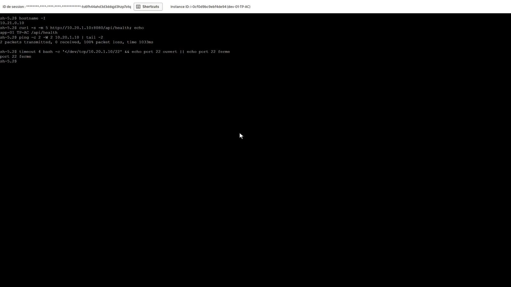

Le test depuis `dev-01-TP-AC` : adresse `10.21.0.10`, réponse de l'API sur le 8080, ping à `100% packet loss`, puis `port 22 ferme`. Ce qui n'est pas ouvert dans `app-TP-AC` ne passe pas, même avec le peering en place.


La demande de peering avec le VPC en `10.20.0.0/24` : la console affiche un message rouge sous chaque liste de VPC, « Une connexion d'appairage ne peut pas être créée entre 2 VPC avec des CIDR qui se chevauchent. Sélectionnez 2 VPC ayant des CIDR distincts. » La page ne passe pas à la connexion créée.

## Tableau récapitulatif
| Élément | Valeur |
|---|---|
| `vpc-dev-leman-TP-AC` | `vpc-07b18f49739396126`, `10.21.0.0/24` |
| `sub-dev-1a-TP-AC` | `10.21.0.0/26`, `eu-north-1a` |
| `igw-dev-leman-TP-AC` | attachée à `vpc-dev-leman-TP-AC` |
| `rt-dev-leman-TP-AC` | `0.0.0.0/0` vers l'IGW du dev ; `10.20.0.0/22` vers le peering ; `10.21.0.0/24` local ; associée à `sub-dev-1a-TP-AC` |
| `dev-TP-AC` | tag `Name = sg-dev-TP-AC` ; aucune règle entrante ; sortie libre |
| `dev-01-TP-AC` | `t3.micro`, Amazon Linux 2023, `10.21.0.10`, adresse publique automatique |
| `pcx-lab-TP-AC` | `pcx-0a282816ae0b422b8`, production `10.20.0.0/22` avec développement `10.21.0.0/24`, statut *Active* |
| `rt-prive-leman-TP-AC` (prod) | `10.21.0.0/24` vers `pcx-lab-TP-AC` |
| `app-TP-AC` | nouvelle règle : TCP 8080 depuis `10.21.0.0/24` |

## Résultats des tests
Ces sorties viennent de notre première exécution, en ligne de commande. Pour l'API sur le 8080 et le port 22 fermé, elles disent la même chose que la vidéo. Trois points diffèrent. Le ping refusé n'est pas dans ces sorties, il n'est que dans la vidéo (capture ci-dessus). Pour le chevauchement, AWS acceptait alors la demande puis la faisait échouer à l'acceptation, alors que la console refuse tout de suite. Enfin, le test de non-transitivité (le troisième VPC `10.22.0.0/24` et `tiers-01`) n'a été fait que dans cette première exécution : il n'est pas filmé.

```
dev-01 SSM en ligne : True
=== TP2 : peering pcx-lab (prod <-> dev) ===
dev-01 -> app-01:8080 : Success	app-01 TP-AC /api/health 	
dev-01 -> app-01:22 (non ouvert depuis dev) : Success	FERME 	

=== TP3 : limites du peering ===
Acceptation du peering avec un VPC en 10.20.0.0/24 (chevauche 10.20.0.0/22) -> aws: [ERROR]: An error occurred (InvalidStateTransition) when calling the AcceptVpcPeeringConnection operation: Invalid state transition for pcx-0b30499bae7844bdf, attempted to transition from failed to provisioning
app-01 (prod, peering direct) -> tiers-01 10.22.0.10 : Success	2 packets transmitted, 2 received, 0% packet loss, time 1002ms rtt min/avg/max/mdev = 0.170/0.294/0.419/0.124 ms 	
dev-01 (via prod = transit, NON transitif) -> tiers-01 10.22.0.10 : Success	2 packets transmitted, 0 received, 100% packet loss, time 1043ms  exit=0
```

Les deux dernières lignes se lisent ainsi : `app-01`, relié directement au troisième VPC, le joint (2 paquets sur 2) ; `dev-01`, qui n'y est relié que par la production, ne le joint pas (0 sur 2, 100 % de perte). Le peering ne transmet pas.

## Pièges rencontrés
* **Le chevauchement selon l'outil.** En ligne de commande, la demande passait puis échouait à l'acceptation (`InvalidStateTransition`, de l'état `failed` à `provisioning`). Dans la console, la validation du formulaire la bloque avant. Même règle, deux moments.
* **Le ping refusé n'est pas une panne.** `app-TP-AC` n'ouvre l'ICMP qu'au groupe web, et depuis le développement seulement le 8080. Ping et SSH échouent donc, c'est voulu.
* **Une adresse publique sur `dev-01`.** Sans NAT dans le VPC de développement, l'agent SSM ne joint pas Systems Manager. Nous avons gardé une adresse publique, avec un groupe sans aucune règle entrante.
* **Les quotas.** Le compte est partagé avec la classe. Pour les VPC, la limite est de 5 par région ; nous avons demandé une hausse à 15 (voir `docs/00-plan-adressage.md`). Pour les instances, le 16/11 les 16 vCPU du compte étaient saturés par la classe et nous ne pouvions plus démarrer nos machines. La limite a été portée à 48 vCPU le 17/11.
* **Une demande qui expire.** Tant que le peering n'est pas accepté, il reste en attente, et la console affiche une date limite : le 25/11/2026 pour la nôtre, sept jours après la création.

## Ce qui diffère du sujet
* **Les plages.** Les plages du sujet (`10.0.0.0/16` et `10.1.0.0/16`, voir `docs/02-ecarts-au-sujet.md`) recouvrent celles des autres équipes du compte partagé : nous avons pris `10.20.0.0/22` et `10.21.0.0/24`.
* **Le peering est temporaire.** Comme le sujet le demande, `pcx-lab-TP-AC` est supprimé au module 6, et les routes du dev et du privé passent au Transit Gateway. Cette suppression est filmée au module 6.
* **La non-transitivité n'est pas filmée.** Elle a été vérifiée à la première exécution (sortie ci-dessus), pas refaite dans la console.

## Nettoyage
Le peering `pcx-lab-TP-AC` est supprimé au module 6. Le VPC `vpc-dev-leman-TP-AC` avec son sous-réseau, sa passerelle Internet, sa table, son groupe de sécurité et `dev-01-TP-AC`, ainsi que le VPC de test `vpc-chevauche-TP-AC`, ont été supprimés à la fin du tournage avec le reste (voir `docs/NETTOYAGE.md`). Il ne reste rien de ce module côté AWS.


---

# Module 6 – Transit Gateway

## Objectif
Remplacer le peering du module 5 par un point central, `tgw-leman-TP-AC`, qui relie la prod et le dev. Chaque environnement a sa propre table de routage sur le Transit Gateway, pour que nous décidions à la main qui voit qui. Le même Transit Gateway accueillera ensuite les deux VPN du module 7.

## Ce qu'il faut savoir
Avec un peering, chaque paire de VPC a son propre lien. À trois réseaux, cela fait trois liens, à quatre réseaux six. Un Transit Gateway inverse la logique : chaque VPC se branche une seule fois, par un **attachement**, et le Transit Gateway se charge du reste.

Il faut distinguer deux choses dans ses tables de routage :
- l'**association** : l'attachement est rattaché à une seule table, celle qu'AWS consulte pour les paquets qui arrivent de ce VPC ;
- la **propagation** : l'attachement publie sa plage d'adresses dans une ou plusieurs tables, pour que d'autres sachent comment le joindre.

À la création, AWS propose d'associer et de propager automatiquement tout le monde dans une table par défaut. Nous avons décoché les deux options pour construire les tables nous-mêmes. Dernier point : un attachement n'envoie du trafic que dans les zones de disponibilité où il possède un sous-réseau, et les tables de routage des VPC doivent encore pointer vers le Transit Gateway. Un attachement et une table coûtent de l'argent à l'heure (environ 0,05 USD par attachement).

## Ce que nous avons fait
Tout a été fait à la main dans la console, dans la région Stockholm (`eu-north-1`). Les noms portent le suffixe `-TP-AC` et les balises `Projet=SatomCloudNetwork`, `Equipe=TP-AC`, `Environnement`.

1. **Le Transit Gateway** : `tgw-leman-TP-AC`, description « Transit Gateway du projet Satom Cloud Network », ASN Amazon 64512. Support DNS et support ECMP VPN laissés cochés, association et propagation par défaut décochées. Il met environ quatre minutes à passer de `Pending` à `Available`.
2. **L'attachement de la prod** : `tgwa-prod-TP-AC`, sur `vpc-prod-leman-TP-AC`, avec un sous-réseau dans chacune des deux zones où le VPC en possède un : `sub-prive-1a-TP-AC` en `eu-north-1a`, et celui de `eu-north-1b` (`sub-public-1b` dans notre plan d'adressage).
3. **L'attachement du dev** : `tgwa-dev-TP-AC`, sur `vpc-dev-leman-TP-AC`, avec son seul sous-réseau (`sub-dev-1a-TP-AC`).
4. **Deux tables de routage** : `tgw-rt-prod-TP-AC` et `tgw-rt-dev-TP-AC`. Pourquoi deux ? Pour que chaque environnement ne voie que ce que nous décidons.
5. **Associations** : `tgwa-prod-TP-AC` dans `tgw-rt-prod-TP-AC`, `tgwa-dev-TP-AC` dans `tgw-rt-dev-TP-AC`.
6. **Propagations croisées** : `tgwa-dev-TP-AC` propage dans `tgw-rt-prod-TP-AC` (la prod apprend `10.21.0.0/24`) et `tgwa-prod-TP-AC` propage dans `tgw-rt-dev-TP-AC` (le dev apprend `10.20.0.0/22`). Chaque table ne connaît donc que l'autre côté.
7. **Routes dans les VPC** : dans `rt-prive-leman-TP-AC` (prod), la route `10.21.0.0/24` qui visait le peering vise maintenant `tgw-leman-TP-AC`. Même geste dans `rt-dev-leman-TP-AC` pour `10.20.0.0/22`.
8. **Suppression du peering** `pcx-lab-TP-AC`, devenu inutile (la console demande de taper « supprimer » pour confirmer).
9. **Test et panne volontaire** depuis `dev-01-TP-AC` (voir plus bas).

## Captures


Le formulaire de création. On y voit les deux cases « Association de table de routage par défaut » et « Propagation par défaut de la table de routage » décochées.


La table de la prod : une seule route, `10.21.0.0/24`, de type « Propagé », qui vient de l'attachement du VPC de dev. Elle ne sait rien d'autre.


La table du dev, symétrique : seule la plage de la prod, `10.20.0.0/22`, y figure.

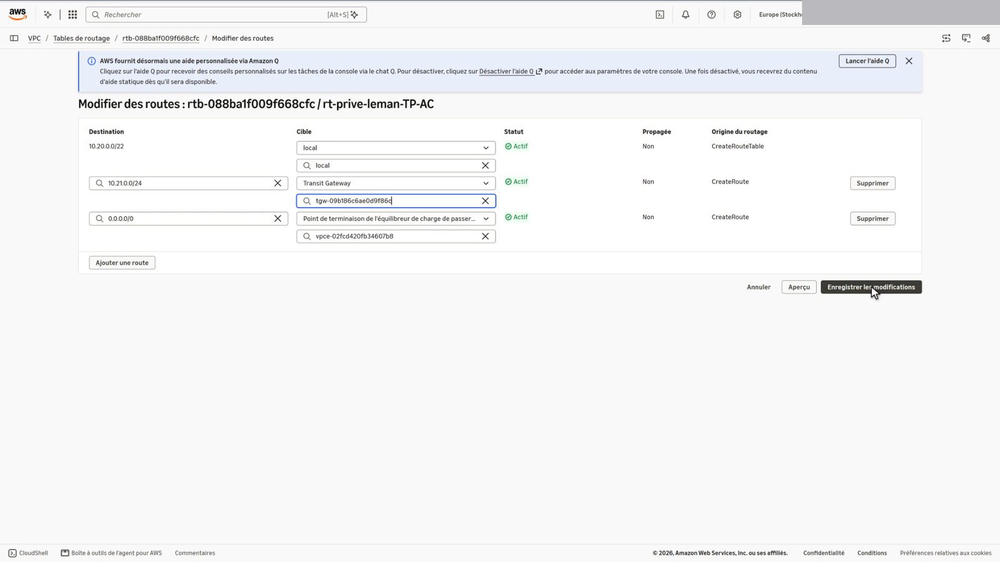

La table privée de la prod pendant la modification : `10.21.0.0/24` a pour cible « Transit Gateway ». La route `0.0.0.0/0` (vers le point de terminaison du pare-feu du module 4) n'a pas bougé.


Le peering `pcx-lab-TP-AC` supprimé : AWS affiche « Supprimée » et le bandeau vert confirme. La ligne du dessous est un ancien peering du même nom, déjà supprimé lors d'un essai précédent.


Le test depuis `dev-01-TP-AC` (adresse `10.21.0.10`). Le premier `curl` vers `app-01` (`10.20.1.10:8080`) répond « app-01 TP-AC /api/health ». Dans la boucle, la rangée de `ECHEC` correspond au moment où nous avons retiré la propagation ; les réponses reviennent après que nous l'avons remise.

## Récapitulatif
| Élément | Valeur |
|---|---|
| Transit Gateway | `tgw-leman-TP-AC`, ASN 64512, association et propagation par défaut désactivées |
| Attachements | `tgwa-prod-TP-AC` (deux zones), `tgwa-dev-TP-AC` (une zone) |
| Tables | `tgw-rt-prod-TP-AC`, `tgw-rt-dev-TP-AC` (une troisième, `tgw-rt-sites-TP-AC`, vient au module 7) |
| Ce que chaque table apprend | prod : `10.21.0.0/24` ; dev : `10.20.0.0/22` |
| Routes dans les VPC | `rt-prive-leman-TP-AC` : `10.21.0.0/24` vers le Transit Gateway ; `rt-dev-leman-TP-AC` : `10.20.0.0/22` vers le Transit Gateway |
| Coût | environ 0,05 USD de l'heure par attachement |

## Résultats des tests
Le test de la vidéo est simple : depuis `dev-01`, un `curl` sur `http://10.20.1.10:8080/api/health` répond par le Transit Gateway, puis nous cassons la route de retour en retirant la propagation, les requêtes échouent, et tout repart quand nous la remettons (voir la dernière capture).

Le bloc ci-dessous est le relevé de notre **première version** de ce module, faite à la ligne de commande et déployée par le modèle CloudFormation du module 13. Il dit la même chose que la vidéo (réponse par le Transit Gateway, puis échec quand la propagation est retirée). Il liste aussi des attachements des modules 7 et 8 (VPN, Direct Connect Gateway) et la table `tgw-rt-sites-TP-AC`, qui n'existaient pas encore au moment de ce module dans la version refaite en console.

```
=== Module 6 : Transit Gateway deploye par la stack stack-interconnexion-leman-TP-AC ===
Attachements : tgwa-prod-TP-AC	vpc	available | tgwa-dev-TP-AC	vpc	available | None	vpn	available | tgwa-vpn-agence-TP-AC	vpn	available | None	direct-connect-gateway	available
Peering pcx-lab encore actif ? : 0 (0 = supprime)
Tables : tgw-rt-prod-TP-AC	available | tgw-rt-dev-TP-AC	available | tgw-rt-sites-TP-AC	available
Routes tgw-rt-prod : 10.21.0.0/24	propagated | 192.168.10.0/24	static | 192.168.20.0/24	static
Routes tgw-rt-dev  : 10.20.0.0/22	propagated
dev-01 -> app-01:8080 par le Transit Gateway : Success	app-01 TP-AC /api/health 	

=== TP3 : propagation de tgwa-dev vers tgw-rt-prod retiree ===
Routes tgw-rt-prod apres retrait : 192.168.10.0/24	static | 192.168.20.0/24	static
dev-01 -> app-01:8080 (la reponse n'a plus de route) : Success	ECHEC 	
Propagation retablie : Success	app-01 TP-AC /api/health
```

## Pièges rencontrés
- **Un Transit Gateway est lent à naître.** Il reste `Pending` environ quatre minutes, et les attachements et les tables passent aussi par `Pending` avant `Available`. Il faut attendre l'état `Available` avant d'associer ou de propager. Une de nos prises de vue s'est d'ailleurs arrêtée sur une page d'erreur de la console (« table de routage introuvable »).
- **Un doublon par notre faute.** Lors de la première version (ligne de commande), notre script a créé un second Transit Gateway avec ses deux attachements ; nous les avons supprimés le 17/11/2026 (journal dans `docs/NETTOYAGE.md`). Faire les gestes à la main nous a évité ce piège.
- **Une propagation oubliée casse dans un seul sens.** Sans la route du dev dans la table de la prod, la requête de `dev-01` arrive à `app-01`, mais la réponse n'a nulle part où aller. C'est exactement ce que montrent les `ECHEC` de la capture : le symptôme est un délai dépassé, pas un refus.
- **Le quota de vCPU de la classe.** Le compte est partagé et la limite de vCPU a souvent été atteinte (elle a été montée de 16 à 48 sur notre demande). Il nous est arrivé d'arrêter `dev-01` pour libérer de la place : il faut le relancer avant ce test, sinon il n'apparaît pas dans Session Manager.
- **La session de la console expire.** Plusieurs fois, la console est revenue sur une page blanche de reconnexion. Nous nous reconnectons et reprenons l'étape.

## Ce qui diffère du sujet
- Nos plages sont `10.20.0.0/22` (prod) et `10.21.0.0/24` (dev), pas `10.0.0.0/16` et `10.1.0.0/16` : le compte est partagé par toute la classe et ces plages recouvrent celles des autres équipes.
- Le Transit Gateway était refusé par l'organisation AWS jusqu'au 17/11/2026 (action `ec2:CreateTransitGateway`). Nous avons d'abord fait le module à la ligne de commande après la levée du blocage, puis nous l'avons refait entièrement à la main dans la console, ce que montre la vidéo.
- Le peering est supprimé à la fin du module, comme le sujet le demande.

## Nettoyage
Le Transit Gateway est facturé à l'heure par attachement. Tout a été supprimé à la fin du projet (attachements, tables, Transit Gateway) ; la seule ressource que nous n'avons pas pu supprimer est le Network Firewall `nfw-prod-leman-TP-AC`, bloqué côté AWS (voir `docs/NETTOYAGE.md`).


---

# Module 7 – VPN site à site (siège et agence)

## Objectif
Relier le siège (`192.168.10.0/24`, Genève) et l'agence (`192.168.20.0/24`, Lausanne) au cloud par des tunnels IPsec qui aboutissent sur `tgw-leman-TP-AC`. Les deux sites doivent joindre `app-01` sur le port 8080, et aucun des deux ne doit voir le VPC de dev. Nous testons aussi ce qui se passe quand un tunnel tombe.

Ce qui est **réel** : les deux connexions VPN côté AWS (`vpn-siege-TP-AC` et `vpn-agence-TP-AC`), avec deux tunnels IPsec chacune, soit quatre tunnels, ainsi que les passerelles clientes, le Transit Gateway et toutes ses routes. Ce qui est **simulé** : le siège et l'agence n'existent pas. Chacun est un petit VPC avec une instance Ubuntu, `rtr-siege-TP-AC` ou `rtr-agence-TP-AC`, sur laquelle tourne strongSwan, un logiciel IPsec libre. Cette instance joue le routeur du client.

## Ce qu'il faut savoir
Une connexion VPN d'AWS donne **deux tunnels** IPsec, vers deux adresses publiques différentes d'AWS. Chaque tunnel a son adresse interne en `169.254.x.x/30` et sa **clé pré-partagée** (PSK), un secret que les deux extrémités doivent connaître. Du côté du client, AWS ne fournit rien : il faut un équipement qui parle IPsec. La **passerelle cliente** (Customer Gateway) n'est que la description de cet équipement, c'est-à-dire son adresse publique. Il faut donc que chaque routeur ait une adresse publique fixe, une Elastic IP.

Nous utilisons le **routage statique**. Pour un VPN rattaché à un Transit Gateway, les routes statiques ne se déclarent pas sur la connexion VPN : elles vont dans une table de routage du Transit Gateway. AWS refuse de les déclarer ailleurs (nous l'avons appris par une erreur lors de la première version).

Sur le routeur, strongSwan est configuré en **IKEv2**, avec des échanges chiffrés `aes256-sha256-modp2048` (AES 256, SHA-256, groupe Diffie-Hellman 14), des sélecteurs de trafic `0.0.0.0/0` et une interface virtuelle par tunnel (`xfrm-siege1`, `xfrm-siege2`, `xfrm-agence1`, `xfrm-agence2`). Le tunnel 1 est le tunnel préféré (route de métrique 100) et le tunnel 2 le secours (métrique 200). Un petit script ne garde la route d'un tunnel que s'il est établi.

Une règle d'hygiène : les clés partagées n'apparaissent dans aucun fichier du dépôt ni dans le dossier. Elles sont dans AWS Secrets Manager, et les routeurs les lisent au moment de la configuration, sans jamais les afficher.

## Ce que nous avons fait
Tout a été fait à la main dans la console AWS, région Stockholm, avec le suffixe `-TP-AC` partout et les balises habituelles. Voici l'ordre de la vidéo.

**1. Les secrets**
- Dans Secrets Manager, un secret `Projet/SatomCloudNetwork/vpn` de type « Autre type de secret », avec quatre paires clé/valeur : `siege1`, `siege2`, `agence1`, `agence2` (une clé par tunnel). Les valeurs sont saisies dans des champs masqués. Clé de chiffrement par défaut (`aws/secretsmanager`), pas de rotation.
- Sur le rôle `TP-AC-ec2-ssm-role` (celui des instances), une politique en ligne `lire-cles-vpn-TP-AC` : `secretsmanager:GetSecretValue` sur ce secret seulement, et `ec2:DescribeVpnConnections`. Le routeur a besoin de la seconde pour lire la description de son VPN.

**2. Les deux sites simulés**
- `vpc-siege-TP-AC` (`192.168.10.0/24`) avec `sub-siege-TP-AC` (`192.168.10.0/26`), `igw-siege-TP-AC` et `rt-siege-TP-AC` (route `0.0.0.0/0` vers la passerelle Internet, associée au sous-réseau). Même chose pour l'agence : `vpc-agence-TP-AC` (`192.168.20.0/24`), `sub-agence-TP-AC`, `igw-agence-TP-AC`, `rt-agence-TP-AC`.
- Les deux plages ne se recouvrent ni entre elles ni avec nos VPC AWS (`10.20.0.0/22` et `10.21.0.0/24`) : sans cela, un VPN ne peut pas router correctement.
- Un Security Group par routeur, `rtr-siege-TP-AC` et `rtr-agence-TP-AC`, créé **sans aucune règle entrante** : nous ne connaissons pas encore les adresses des tunnels.
- Les routeurs : instances `rtr-siege-TP-AC` et `rtr-agence-TP-AC`, Ubuntu Server 26.04 LTS en `t3.micro`, sans paire de clés (nous y accédons par Session Manager grâce au profil `TP-AC-ec2-ssm-role`), adresses privées fixes `192.168.10.10` et `192.168.20.10`.
- Une Elastic IP par routeur (`eip-rtr-siege-TP-AC`, `eip-rtr-agence-TP-AC`), allouée puis associée à l'instance.

**3. Côté AWS**
- Deux passerelles clientes, `cgw-siege-TP-AC` et `cgw-agence-TP-AC`, qui décrivent chaque routeur par son Elastic IP. Le numéro d'AS (65000) est obligatoire dans le formulaire mais n'a aucun effet en routage statique.
- Deux connexions VPN, `vpn-siege-TP-AC` et `vpn-agence-TP-AC` : cible « Passerelle de transit » `tgw-leman-TP-AC`, passerelle cliente existante, routage **statique**, stockage des clés « Standard » (nous tapons les clés nous-mêmes, masquées), options des tunnels par défaut sauf la clé de chaque tunnel. Au total, AWS prépare quatre tunnels. La création prend quelques minutes.
- Sur le Transit Gateway, une troisième table, `tgw-rt-sites-TP-AC`. Les deux VPN y sont **associés**, et seul l'attachement de la prod (`tgwa-prod-TP-AC`) s'y **propage** : les sites apprennent `10.20.0.0/22` et jamais le dev.
- Dans `tgw-rt-prod-TP-AC`, une route statique par site, vers le VPN correspondant : `192.168.10.0/24` vers `vpn-siege-TP-AC` et `192.168.20.0/24` vers `vpn-agence-TP-AC`. C'est le chemin de retour des réponses. `tgw-rt-dev-TP-AC` n'en reçoit aucune.
- Dans `rt-prive-leman-TP-AC`, les deux plages des sites ont pour cible le Transit Gateway.
- Dans `sg-app` (le groupe `app-TP-AC`), le port 8080 est ouvert depuis `192.168.10.0/24` (« API depuis siege ») et `192.168.20.0/24` (« API depuis agence »). Rien d'autre pour les sites : pas de ping.
- Dans chaque Security Group de routeur, deux règles « Tout le trafic » en entrée, depuis les deux adresses publiques des tunnels AWS en `/32` (« Tunnel 1 AWS » et « Tunnel 2 AWS »). Toute autre adresse est ignorée. Ces adresses ne sont connues qu'après la création du VPN, d'où l'ordre.

**4. La configuration des routeurs** (Session Manager, `sudo -i`), même recette pour les deux :
- installation de `strongswan-swanctl`, `charon-systemd` et `awscli` ;
- lecture des clés dans Secrets Manager vers un fichier `psk.json` en `chmod 600`, et de la description du VPN (`describe-vpn-connections`, champ `CustomerGatewayConfiguration`) vers `vpn.xml` ;
- un petit script Python, `gen.py`, lit ces deux fichiers et écrit `/etc/swanctl/conf.d/siege.conf` (ou `agence.conf`) : deux connexions IKEv2 (`siege-t1`, `siege-t2`), détection de pair mort toutes les 10 secondes, redémarrage automatique du tunnel, et un identifiant d'interface (11 et 12 pour le siège, 21 et 22 pour l'agence). Il écrit aussi le script qui crée les interfaces `xfrm-…` avec les adresses internes `169.254.x.x/30` ;
- routage IP activé, filtrage de chemin inverse (`rp_filter`) désactivé, `systemctl restart strongswan` et `swanctl --load-all` (deux connexions chargées) ;
- un script `watch.sh`, lancé en arrière-plan, qui toutes les secondes pose la route `10.20.0.0/22` vers `xfrm-siege1` (métrique 100) ou `xfrm-siege2` (métrique 200) selon que le tunnel est établi, et la retire sinon.

**5. Vérifications et tests**
- Console : les quatre tunnels sont « Haut », et `tgw-rt-prod-TP-AC` contient les trois routes (le dev propagé, les deux sites en statique).
- Depuis chaque routeur, avec l'adresse du site comme source (`--interface 192.168.10.10`) : `curl` sur `app-01:8080`, `ping` vers `app-01`, `ping` vers `dev-01`.
- Panne d'un tunnel du siège (voir plus bas).

## Captures
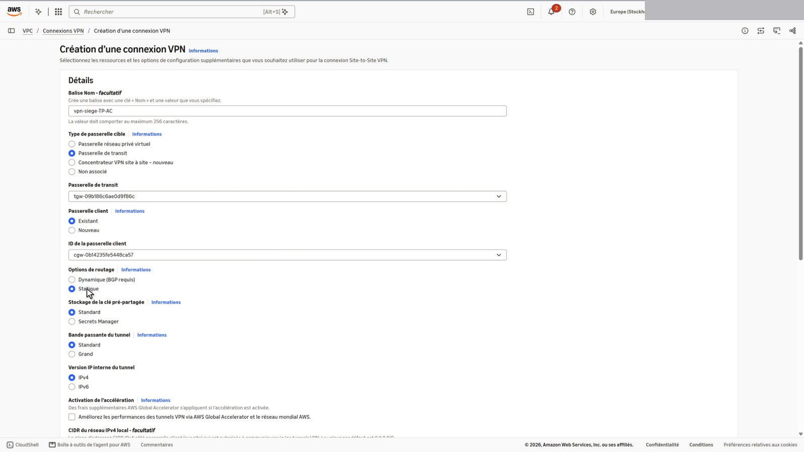

La création de `vpn-siege-TP-AC` : cible « Passerelle de transit », passerelle cliente existante, options de routage « Statique ». Les clés des tunnels, plus bas dans la page, sont saisies dans des champs masqués ; nous n'avons pas gardé de capture de cette partie.


La table de routage de la prod, une fois les tunnels montés : le dev (propagé depuis un VPC) et les deux sites (statiques, ressource de type VPN), tous « Actif ».


L'onglet « Détails du tunnel » de `vpn-siege-TP-AC` : les deux tunnels sont « Haut », avec leurs adresses externes et leurs adresses internes en `169.254.x.x/30`. Les deux lignes « Supprimé » du dessus sont les connexions du même nom de notre première version. `vpn-agence-TP-AC` montre le même résultat.

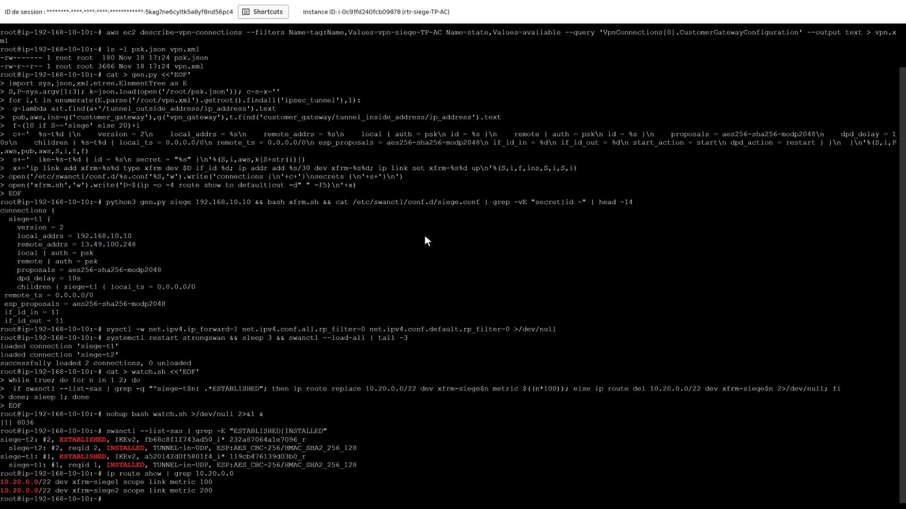

La configuration du routeur du siège par Session Manager : le script de génération (il lit les clés dans `psk.json`, donc aucune clé n'apparaît), un extrait de `siege.conf`, puis `swanctl --list-sas` qui montre `siege-t1` et `siege-t2` `ESTABLISHED` en IKEv2 avec `ESP:AES_CBC-256/HMAC_SHA2_256_128`. Les deux dernières lignes sont les routes `10.20.0.0/22` : métrique 100 par `xfrm-siege1`, 200 par `xfrm-siege2`.


Les tests depuis le siège. `ip route get` montre que le trafic passe par `xfrm-siege1`. Le `curl` sur le port 8080 répond « app-01 TP-AC /api/health ». Le `ping` vers `app-01` échoue (pas de règle ICMP pour les sites), et celui vers `dev-01` (`10.21.0.10`) aussi : le dev reste injoignable.


Les mêmes tests depuis l'agence, par `xfrm-agence1` : l'API répond, le ping et le dev sont refusés.


La panne du tunnel 1 du siège. La boucle envoie une requête vers l'API toutes les demi-secondes. Dernière réponse à 17:51:33, premier `ECHEC` à 17:51:35, retour des réponses à 17:52:02 : environ 29 secondes sans service.


La seconde session, côté commandes : adresse du tunnel 1, règles `iptables` qui jettent les paquets (17:51:33), puis la route `10.20.0.0/22` qui passe par `xfrm-siege2` avec la métrique 200, enfin le retrait des règles et la relance du tunnel 1 à 17:52:27.

## Récapitulatif
| Élément | Valeur |
|---|---|
| Connexions VPN | `vpn-siege-TP-AC`, `vpn-agence-TP-AC`, routage statique, cible `tgw-leman-TP-AC` |
| Passerelles clientes | `cgw-siege-TP-AC`, `cgw-agence-TP-AC` (une Elastic IP chacune, ASN 65000 sans effet) |
| Tunnels | deux par site, quatre en tout, tous « Haut » |
| IKE et ESP | IKEv2, `aes256-sha256-modp2048`, clé pré-partagée par tunnel |
| Routeurs simulés | `rtr-siege-TP-AC` (`192.168.10.10`), `rtr-agence-TP-AC` (`192.168.20.10`), strongSwan, interfaces `xfrm-…` |
| Table du Transit Gateway pour les sites | `tgw-rt-sites-TP-AC` : VPN associés, seule la prod propagée |
| Chemin retour | `192.168.10.0/24` et `192.168.20.0/24` statiques dans `tgw-rt-prod-TP-AC`, et dans `rt-prive-leman-TP-AC` vers le Transit Gateway |
| Ce que les sites peuvent faire | TCP 8080 vers `app-01` ; ni ping, ni accès au dev |
| Clés partagées | secret `Projet/SatomCloudNetwork/vpn` (Secrets Manager), jamais écrites ailleurs |
| Coût | environ 0,05 USD de l'heure par connexion VPN et par attachement |

## Résultats des tests
Ce que montre la vidéo, mesuré par nous : les quatre tunnels sont `ESTABLISHED` côté routeur et « Haut » côté AWS ; depuis chaque site, `curl` sur `app-01:8080` répond ; le ping vers `app-01` et vers `dev-01` ne passe pas ; la panne du tunnel 1 du siège coupe le service pendant environ 29 secondes, puis tout passe par le tunnel 2, et le retour du tunnel 1 ne coupe rien. La panne de l'agence n'a pas été refilmée.

Le bloc ci-dessous est le relevé de notre **première version** (ligne de commande, VPN déployés par le modèle CloudFormation du module 13). Il faut le lire avec ces différences :
- les adresses des tunnels sont celles de ces anciens VPN ;
- le siège pouvait alors **pinger** `app-01` (trois paquets sur trois), parce que la règle ICMP existait ; dans la version refaite à la main, nous n'avons ouvert que le 8080 et le ping échoue ;
- la panne a été mesurée pour le siège (29,2 s) **et** pour l'agence (33,5 s), avec un `curl` toutes les 0,3 s ; la vidéo ne refait que le siège, avec un `curl` toutes les 0,5 s (1 s d'attente au plus) et un réglage IKE plus serré ;
- les essais depuis `dev-01` vers les sites ne figurent que dans ce relevé.

```
=== Module 7 - etape 1 : VPN crees par la stack, avant configuration des routeurs ===
vpn-siege-TP-AC : available	ipsec.1	True
  tunnels (adresse AWS, etat) : 16.16.69.252	DOWN | 16.192.162.35	DOWN
vpn-agence-TP-AC : available	ipsec.1	True
  tunnels (adresse AWS, etat) : 13.61.98.78	DOWN | 13.63.173.212	DOWN
tgw-rt-prod : 10.21.0.0/24	propagated	active | 192.168.10.0/24	static	blackhole | 192.168.20.0/24	static	blackhole

=== Module 7 - etape 2 : tunnels, flux et segmentation ===
siege : swanctl --list-sas (cote routeur)
siege-t2: #2, ESTABLISHED, IKEv2, 35f033fe3ecf3ca4_i* 67e0bc1592994c7c_r
  siege-t2: #2, reqid 2, INSTALLED, TUNNEL-in-UDP, ESP:AES_CBC-256/HMAC_SHA2_256_128
siege-t1: #1, ESTABLISHED, IKEv2, c4c613fa152a7cd4_i* d1219417c5494da4_r
  siege-t1: #1, reqid 1, INSTALLED, TUNNEL-in-UDP, ESP:AES_CBC-256/HMAC_SHA2_256_128

agence : swanctl --list-sas (cote routeur)
agence-t2: #2, ESTABLISHED, IKEv2, e2e49f4e64242dc5_i* 2f6ae7a044ccede0_r
  agence-t2: #2, reqid 2, INSTALLED, TUNNEL-in-UDP, ESP:AES_CBC-256/HMAC_SHA2_256_128
agence-t1: #1, ESTABLISHED, IKEv2, dd2a0ff6e93c4d51_i* 01379b4f96a3567f_r
  agence-t1: #1, reqid 1, INSTALLED, TUNNEL-in-UDP, ESP:AES_CBC-256/HMAC_SHA2_256_128

vpn-siege-TP-AC, etat des tunnels vu par AWS : 16.16.69.252	UP	 | 16.192.162.35	UP	
vpn-agence-TP-AC, etat des tunnels vu par AWS : 13.61.98.78	UP	 | 13.63.173.212	UP	
tgw-rt-prod (routes actives) : 10.21.0.0/24	propagated	vpc | 192.168.10.0/24	static	vpn | 192.168.20.0/24	static	vpn
tgw-rt-dev  (routes actives) : 10.20.0.0/22	propagated
tgw-rt-sites (routes actives) : 10.20.0.0/22	propagated

-- siege -> app-01 (10.20.1.10)
ping : --- 10.20.1.10 ping statistics ---
3 packets transmitted, 3 received, 0% packet loss, time 2004ms
rtt min/avg/max/mdev = 2.645/2.703/2.818/0.081 ms
	
8080 : app-01 TP-AC /api/health
	

-- agence -> app-01 (seul le 8080 est autorise)
8080 : app-01 TP-AC /api/health
	
ping (doit echouer) : 2 packets transmitted, 0 received, 100% packet loss, time 1014ms

	

-- segmentation : aucun site ne joint dev-01 (10.21.0.10), dev-01 ne joint pas les sites (dev-01 SSM : Online)
siege -> dev-01 : 3 packets transmitted, 0 received, 100% packet loss, time 2048ms

	
agence -> dev-01 : 3 packets transmitted, 0 received, 100% packet loss, time 2050ms

	
dev-01 -> siege : 3 packets transmitted, 0 received, 100% packet loss, time 2119ms

	
dev-01 -> agence : 3 packets transmitted, 0 received, 100% packet loss, time 2114ms

=== Module 7 - etape 3 : bascule entre les deux tunnels du siege ===
avant le test : tunnels vus par AWS = UP	UP
T+10 s : panne silencieuse du tunnel 1 (les paquets vers 16.16.69.252 sont perdus, comme une vraie coupure)

T+15 s : route : 10.20.1.10 from 192.168.10.10 dev xfrm-siege1 uid 0 

T+60 s : route : 10.20.1.10 from 192.168.10.10 dev xfrm-siege2 uid 0  ; tunnels etablis cote routeur : 1

T+90 s : le tunnel 1 est retabli (paquets de nouveau acceptes, IKE relance)

T+130 s : route : 10.20.1.10 from 192.168.10.10 dev xfrm-siege1 uid 0 

--- resultat des requetes curl sur le port 8080 (une toutes les 0,3 s)

interruption de 29.2 s, de T+9.9 s a T+39.0 s

sessions IKE etablies : 2

	

etat vu par AWS : 16.16.69.252	DOWN | 16.192.162.35	UP

=== Module 7 - etape 4 : bascule entre les deux tunnels de l'agence ===
avant le test : tunnels vus par AWS = UP	UP
T+10 s : panne silencieuse du tunnel 1 (les paquets vers 13.61.98.78 sont perdus, comme une vraie coupure)

T+15 s : route : 10.20.1.10 from 192.168.20.10 dev xfrm-agence1 uid 0 

T+60 s : route : 10.20.1.10 from 192.168.20.10 dev xfrm-agence2 uid 0  ; tunnels etablis cote routeur : 1

T+90 s : le tunnel 1 est retabli (paquets de nouveau acceptes, IKE relance)

T+130 s : route : 10.20.1.10 from 192.168.20.10 dev xfrm-agence1 uid 0 

--- resultat des requetes curl sur le port 8080 (une toutes les 0,3 s)

interruption de 33.5 s, de T+9.7 s a T+43.2 s

sessions IKE etablies : 2

	
etat vu par AWS : 13.61.98.78	UP | 13.63.173.212	UP
```

## Bascule entre les deux tunnels
Pour imiter une vraie panne, nous ne coupons pas l'interface : nous jetons les paquets échangés avec l'adresse AWS du tunnel 1 (`iptables -I OUTPUT -d … -j DROP` et `iptables -I INPUT -s … -j DROP`). C'est une perte silencieuse, comme une ligne coupée.

Avant le test, nous avons resserré la détection de strongSwan (`retransmit_tries = 3`, `retransmit_timeout = 2.0` dans `/etc/strongswan.d/tpac.conf`) et relancé le service. Pour la mesure, une requête vers l'API toutes les 0,5 s depuis l'adresse du siège, avec une attente de 1 s au plus. Résultat de la vidéo : environ **29 secondes** d'échecs, puis tout passe par le tunnel 2 (route `xfrm-siege2`, métrique 200). Quand nous retirons les règles et relançons le tunnel 1, aucune requête n'échoue.

Ce délai est celui que prennent le routeur pour constater la panne (détection de pair mort toutes les 10 s, puis les retransmissions) et le script pour déplacer la route. Côté AWS, la détection a ses propres délais, que nous ne maîtrisons pas. La durée n'est pas fixe : à la ligne de commande nous avions mesuré entre 26 et 34 secondes. Le sujet parle d'une bascule « sans coupure » : avec un VPN IPsec, ce n'est pas possible (voir `docs/02-ecarts-au-sujet.md`), et nous préférons le dire plutôt que de le cacher.

## Pièges rencontrés
- **Quota d'Elastic IP et de vCPU.** Le compte est partagé : cinq Elastic IP pour toute la classe, et une limite de vCPU souvent atteinte. Notre premier essai du module 7 (16/11/2026) a échoué à cause de l'un ou l'autre. Il faut deux Elastic IP pour les deux routeurs, et parfois arrêter une instance (`dev-01`) pour libérer des vCPU.
- **Les Security Groups des routeurs ne peuvent pas être finis tout de suite.** Les adresses publiques des tunnels AWS ne sont connues qu'une fois le VPN créé. D'où un groupe vide au début, rempli plus tard.
- **Des lignes « Supprimé » du même nom.** Dans la liste des connexions VPN, `vpn-siege-TP-AC` et `vpn-agence-TP-AC` apparaissent deux fois : les anciennes sont à l'état « Supprimé ». Il faut sélectionner celles qui sont « Disponible ».
- **Une route statique créée mais invisible.** Juste après sa création, le tableau des acheminements reste vide, avec un bandeau d'AWS qui dit que la propagation peut prendre quelques instants. À la première version, les routes des sites étaient `blackhole` tant que les tunnels n'étaient pas montés.
- **Le ping qui échoue n'est pas une panne.** Seul le 8080 est ouvert aux sites. Nous testons donc l'API avec `curl`, et nous gardons le ping pour montrer ce qui est refusé.
- **Associer une Elastic IP.** Lors d'un essai, le formulaire a répondu « Aucune adresse IP publique trouvée » ; à notre avis parce que l'adresse n'était pas sélectionnée dans la liste avant « Actions, Associer ». Nous avons refait la scène en sélectionnant d'abord la ligne.
- **La session de la console expire.** À plusieurs reprises, la console est revenue sur une page blanche de reconnexion. Nous nous reconnectons et reprenons l'étape.
- **Nos premières mesures de panne étaient trompeuses** (première version). En coupant l'interface, la bascule semblait immédiate, ce qui n'arrive jamais en vrai ; avec un `ping`, le même flux restait collé au tunnel mort et la mesure atteignait 81 s. Des requêtes `curl` qui ouvrent chaque fois une nouvelle connexion sont plus représentatives.
- **Les clés ne doivent traîner nulle part.** Les quatre clés sont saisies deux fois (dans le secret, puis dans les formulaires des deux VPN), toujours dans des champs masqués, et conservées hors du dépôt. Le dépôt est public : une clé écrite dans un fichier y serait publiée.

## Ce qui diffère du sujet
- **Adresses des passerelles clientes.** Le sujet donne `203.0.113.10` et `198.51.100.10` : ce sont des adresses réservées à la documentation, aucun tunnel ne peut s'établir vers elles. Nous utilisons une Elastic IP par routeur.
- **Routes statiques.** Elles sont dans la table de routage du Transit Gateway (`tgw-rt-prod-TP-AC`), pas sur la connexion VPN.
- **Bascule « sans coupure ».** Impossible avec IPsec : nous mesurons environ 29 secondes d'interruption.
- **Les sites sont simulés** par deux instances EC2 avec strongSwan, pas par du matériel ni par GNS3. Nos tests partent des routeurs eux-mêmes, avec l'adresse du site comme adresse source : aucun poste n'est derrière.
- **Plages.** Nos VPC AWS sont en `10.20.0.0/22` et `10.21.0.0/24` plutôt que `10.0.0.0/16` et `10.1.0.0/16`, déjà utilisées par d'autres équipes du compte.
- **Ping depuis le siège.** Notre première version l'autorisait ; dans la version filmée, nous n'avons ouvert que le port 8080 pour les deux sites.
- Les actions VPN étaient refusées par l'organisation AWS jusqu'au 17/11/2026 ; ce module a ensuite été fait avec le vrai VPN d'AWS.

## Nettoyage
Les connexions VPN et les attachements sont facturés à l'heure : nous avons tout supprimé à la fin du projet (connexions VPN, passerelles clientes, Elastic IP, routes, tables et attachements du Transit Gateway, routeurs, VPC du siège et de l'agence, secret `Projet/SatomCloudNetwork/vpn`). La seule ressource qui reste est le Network Firewall `nfw-prod-leman-TP-AC`, dont la suppression est bloquée côté AWS (cas ouvert auprès du Support, voir `docs/NETTOYAGE.md`).


---

# Module 8 – Direct Connect

## Objectif
Comprendre comment le siège serait relié à AWS par une liaison dédiée, la dimensionner, puis montrer ce qui se passe quand elle tombe : le trafic doit passer tout seul par le VPN du module 7, et revenir sur la liaison dédiée dès qu'elle remarche.

Ce qui est **réel** : le Direct Connect Gateway `dxgw-leman-TP-AC` et son association au Transit Gateway `tgw-leman-TP-AC`, avec les préfixes autorisés. AWS crée de lui-même un attachement de type « Direct Connect Gateway » dans le Transit Gateway. Ce qui est **simulé** : la liaison dédiée elle-même. Nous ne commandons pas de fibre : elle est remplacée par un tunnel GRE entre deux routeurs (`rtr-siege-TP-AC` et `rtr-aws-TP-AC`), qui échangent leurs routes par BGP. Le chemin de secours est un second tunnel GRE qui passe dans le vrai VPN du module 7.

## Ce qu'il faut savoir
Direct Connect est un câble loué entre le siège du client et un point de présence d'AWS (1, 10 ou 100 Gbit/s). Sur ce câble, une interface virtuelle porte une session BGP avec AWS. Derrière, un Direct Connect Gateway se branche sur un Transit Gateway, qui distribue les routes aux VPC.

BGP choisit le chemin avec la préférence locale (local-pref) la plus haute. Pour décourager un chemin, on l'allonge : c'est le « prepend », qui répète le numéro d'AS dans le chemin annoncé, et BGP préfère le chemin le plus court. Ici, la liaison dédiée reçoit une local-pref de 200 et le chemin par le VPN part avec trois répétitions de plus.

Un VPN statique, comme celui du module 7, ne parle pas BGP : un prepend n'aurait aucun effet dessus. Nous faisons donc passer une session BGP dans un tunnel GRE à l'intérieur du VPN. Le tunnel GRE est transporté comme n'importe quel paquet, et c'est lui qui donne un second chemin à BGP.

## Dimensionnement
Nous devons transférer 2 To en 8 heures : 16 000 Gbit sur 28 800 s, soit environ 0,56 Gbit/s. Une liaison de 1 Gbit/s suffit, avec une marge d'environ 44 %. Parmi les emplacements Direct Connect de la région, nous retenons sur le papier **EQSK1** (Equinix Sweden SK1), qui propose du 1 Gbit/s. Nous ne commandons rien. Il n'y a pas d'emplacement près de Genève dans la région de Stockholm.

## Ce que nous avons fait
Tout a été fait dans la console, le 18/11/2026, avec le suffixe `-TP-AC` et les balises habituelles. Voici l'ordre de la vidéo.

**1. La partie réelle**
- Console Direct Connect, « Passerelles Direct Connect », puis « Créer une passerelle » : `dxgw-leman-TP-AC`, ASN côté Amazon **64513**. Nous avons choisi un numéro différent de celui du Transit Gateway (64512). Un premier essai fait par la ligne de commande avec 64512 avait été refusé à l'association.
- Dans les détails de la passerelle, onglet « Associations des passerelles », « Associer la passerelle » : `tgw-leman-TP-AC` et les préfixes autorisés `10.20.0.0/22,192.168.10.0/24`. L'association reste « Associating » pendant quelques minutes, puis passe à « Associated » (nous avons accéléré l'attente dans la vidéo).
- Dans la console VPC, le Transit Gateway montre alors un nouvel attachement de type « Direct Connect Gateway ». AWS l'a créé tout seul.

**2. Ce qu'il faut préparer pour le routeur côté AWS**
- Une route `192.168.10.0/24` vers `tgw-leman-TP-AC` dans `rt-public-leman-TP-AC`, puis la même dans `rt-nat-leman-TP-AC`, la table du sous-réseau `sub-public-1b-TP-AC` où le routeur va vivre. Cette route sert au tunnel GRE qui passe dans le VPN.
- Le Security Group `rtr-aws-TP-AC` (description « Routeur cote AWS : GRE depuis le siege », balise `Name` = `sg-rtr-aws-TP-AC`), d'abord sans règle.
- L'instance `rtr-aws-TP-AC` : Ubuntu Server en `t3.micro`, dans `sub-public-1b-TP-AC` (zone B), adresse privée fixe `10.20.0.74`, adresse publique automatique, sans paire de clés, profil `TP-AC-ec2-ssm-role` pour entrer par Session Manager. Le lancement a échoué la première fois (voir les pièges). Nous avons arrêté `dev-01-TP-AC`, puis relancé.
- L'attachement du VPC de production au Transit Gateway (`tgwa-prod-TP-AC`) ne couvrait que la zone A. Nous avons ajouté `eu-north-1b` avec le sous-réseau de la zone B, puis attendu un peu plus d'une minute que la modification soit appliquée.

**3. Les règles de sécurité**
- `rtr-aws-TP-AC` : le protocole 47 (GRE) depuis l'Elastic IP de `rtr-siege-TP-AC` (« GRE Direct Connect simule ») et depuis `192.168.10.0/24` (« GRE dans le VPN »).
- `rtr-siege-TP-AC` : le protocole 47 depuis l'adresse publique de `rtr-aws-TP-AC` et depuis `10.20.0.74/32`.
- `app-TP-AC` : le port 8080 depuis `10.20.0.74/32` (« API depuis rtr-aws »). Sans cette règle, `app-01` ne répond pas au routeur.

**4. Les deux routeurs**
Sur chacun, par Session Manager : installation de FRRouting (`frr`) et activation du démon `bgpd`.
- `rtr-aws-TP-AC` : le routage IPv4 est activé et `rp_filter` désactivé. Deux tunnels GRE : `gre-dx` (`169.254.100.1/30`, vers l'Elastic IP du siège, c'est notre « fibre » sur Internet) et `gre-vpn` (`169.254.101.1/30`, vers `192.168.10.10`, qui passe dans le VPN). BGP AS 64513, annonce de `10.20.0.0/22`, voisins `169.254.100.2` et `169.254.101.2` (AS 65010), timers 3 s / 9 s. Une règle de traduction d'adresse (NAT, `MASQUERADE`) pour `192.168.10.0/24` : `app-01` répond ainsi au routeur, sans que nous touchions aux tables des VPC. Une route statique `192.168.10.10/32` vers la passerelle du sous-réseau (`10.20.0.65`) garantit que le tunnel `gre-vpn` ne dépend pas de la liaison qu'il doit remplacer.
- `rtr-siege-TP-AC` (le routeur du module 7) : les mêmes tunnels vus de l'autre côté (`169.254.100.2/30` et `169.254.101.2/30`, `gre-dx` vers l'adresse publique de `rtr-aws`, `gre-vpn` vers `10.20.0.74`), BGP AS 65010 et annonce de `192.168.10.0/24`. Une route-map `DX-IN` met `local-preference 200` sur ce qui arrive par `gre-dx`. Une route-map `VPN-OUT` ajoute trois fois `65010` au chemin annoncé par `gre-vpn`. Les routes que strongSwan avait posées vers `10.20.0.0/22` sont remplacées par des routes statiques « flottantes » (distance 150 et 160) : BGP, à 20, l'emporte. Un petit script garde une route `10.20.0.74/32` vers le tunnel IPsec qui est monté, pour que `gre-vpn` ait toujours un chemin.

Le sujet propose GNS3. Nous ne l'avons pas utilisé : les routeurs sont des instances EC2 avec FRRouting. Dans le dépôt, le modèle `cfn/interconnexion-leman.yaml` (module 13) crée le Direct Connect Gateway avec une ressource personnalisée (une petite fonction Lambda), parce qu'il n'existe pas de type CloudFormation natif. Ce modèle n'a été essayé qu'en ligne de commande.

## Captures
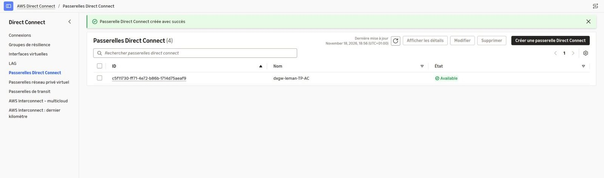

La passerelle `dxgw-leman-TP-AC` vient d'être créée (bandeau vert) et son état est « Available ».


L'association au Transit Gateway est active : ASN 64513, préfixes autorisés `10.20.0.0/22` et `192.168.10.0/24`, type `transitGateway`.


Dans la console VPC, le Transit Gateway a un attachement de type « Direct Connect Gateway », créé par AWS. Deux lignes « Deleted » sont des attachements VPN de nos essais précédents.


Le premier lancement de `rtr-aws-TP-AC` est refusé : la limite de 48 vCPU de l'ensemble de la classe est atteinte.

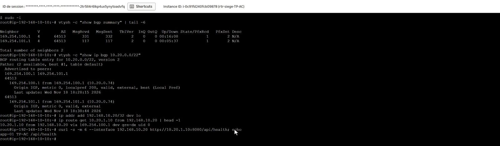

Sur `rtr-siege-TP-AC` : deux sessions BGP établies, avec un préfixe reçu chacune. Le meilleur chemin vers `10.20.0.0/22` passe par `169.254.100.1` avec `localpref 200`. L'API de `app-01` répond par `gre-dx`, depuis l'adresse `192.168.10.20` que nous avons ajoutée sur l'interface `lo` pour jouer un poste du LAN.


La coupure de la liaison. Une boucle interroge l'API toutes les demi-secondes et affiche par où passe le trafic. Elle répond par `169.254.100.1` (la liaison) jusqu'à 18:47:59. Cinq tentatives échouent entre 18:48:00 et 18:48:06. À 18:48:07, les réponses viennent par `169.254.101.1` (le VPN).

## Tableau récapitulatif
| Élément | rtr-siege-TP-AC | rtr-aws-TP-AC |
|---|---|---|
| ASN | 65010 | 64513 |
| Adresse dans le réseau | `192.168.10.10` | `10.20.0.74` |
| GRE « liaison dédiée » (`gre-dx`) | `169.254.100.2/30` | `169.254.100.1/30` |
| GRE dans le VPN (`gre-vpn`) | `169.254.101.2/30` | `169.254.101.1/30` |
| Annonce BGP | `192.168.10.0/24` | `10.20.0.0/22` |
| Timers BGP | 3 s / 9 s | 3 s / 9 s |

| Politique | Valeur |
|---|---|
| Liaison dédiée (`gre-dx`), à la réception | `local-preference 200` |
| VPN (`gre-vpn`), à l'envoi par le siège | prepend `65010` trois fois en plus |
| Préfixes autorisés du Direct Connect Gateway | `10.20.0.0/22`, `192.168.10.0/24` |
| Direct Connect Gateway | `dxgw-leman-TP-AC`, ASN 64513, associé à `tgw-leman-TP-AC` |

## Résultats des tests
Le journal ci-dessous vient du premier passage, fait avec la ligne de commande sur le même schéma. La vidéo refait les mêmes contrôles dans la console : mêmes valeurs de local-pref et de prepend, mêmes timers.

```
=== TP1 : dimensionnement et Direct Connect Gateway (reel) ===
2 To en 8 h = 16 000 Gbit / 28 800 s = 0,556 Gbit/s -> liaison 1 Gbit/s (marge ~44 %)
Emplacement retenu (non commande) : EQSK1, Equinix Sweden SK1 (vitesses 1G / 10G / 100G), le plus proche disponible dans la region eu-north-1
dxgw : dxgw-leman-TP-AC	64513	available
association avec tgw-leman : associated 192.168.10.0/24	10.20.0.0/22

=== TP2 : GRE + BGP ===
rtr-aws : traduction d'adresse (NAT) pour app-01 :
-P POSTROUTING ACCEPT
-A POSTROUTING -s 192.168.10.0/24 -o ens5 -j MASQUERADE
	

rtr-siege : show bgp summary

IPv4 Unicast Summary (VRF default):
BGP router identifier 192.168.10.10, local AS number 65010 vrf-id 0
BGP table version 2
RIB entries 3, using 576 bytes of memory
Peers 2, using 1448 KiB of memory

Neighbor        V         AS   MsgRcvd   MsgSent   TblVer  InQ OutQ  Up/Down State/PfxRcd   PfxSnt Desc
169.254.100.1   4      64513        20        21        0    0    0 00:00:34            1        2 DX-simule-GRE
169.254.101.1   4      64513        20        23        0    0    0 00:00:34            1        2 VPN-GRE-dans-IPsec

Total number of neighbors 2
	

rtr-aws : show ip bgp (prefixes recus du siege)
BGP table version is 4, local router ID is 10.20.0.74, vrf id 0
Default local pref 100, local AS 64513
Status codes:  s suppressed, d damped, h history, * valid, > best, = multipath,
               i internal, r RIB-failure, S Stale, R Removed
Nexthop codes: @NNN nexthop's vrf id, < announce-nh-self
Origin codes:  i - IGP, e - EGP, ? - incomplete
RPKI validation codes: V valid, I invalid, N Not found

   Network          Next Hop            Metric LocPrf Weight Path
*> 10.20.0.0/22     0.0.0.0                  0         32768 i
*  192.168.10.0/24  169.254.101.2            0             0 65010 65010 65010 65010 i
*>                  169.254.100.2            0             0 65010 i

Displayed  2 routes and 3 total paths
	

siege -> app-01 (chemin choisi) :
10.20.1.10 from 192.168.10.50 via 169.254.100.1 dev gre-dx uid 0 
    cache 
--- 10.20.1.10 ping statistics ---
3 packets transmitted, 3 received, 0% packet loss, time 2003ms
rtt min/avg/max/mdev = 2.663/2.984/3.323/0.269 ms
app-01 TP-AC /api/health
	

=== TP3 : politique et bascule ===
rtr-siege : show ip bgp 10.20.0.0/22 (local-pref 200 sur DX, 100 sur VPN)
BGP routing table entry for 10.20.0.0/22, version 2
Paths: (2 available, best #2, table default)
  Advertised to non peer-group peers:
  169.254.100.1 169.254.101.1
  64513
    169.254.101.1 from 169.254.101.1 (10.20.0.74)
      Origin IGP, metric 0, valid, external
      Last update: Tue Nov 17 18:48:40 2026
  64513
    169.254.100.1 from 169.254.100.1 (10.20.0.74)
      Origin IGP, metric 0, localpref 200, valid, external, best (Local Pref)
      Last update: Tue Nov 17 18:48:40 2026
	

rtr-aws : show ip bgp 192.168.10.0/24 (le chemin VPN arrive avec AS-path prepend x3)
BGP routing table entry for 192.168.10.0/24, version 4
Paths: (2 available, best #2, table default)
  Advertised to non peer-group peers:
  169.254.100.2 169.254.101.2
  65010 65010 65010 65010
    169.254.101.2 from 169.254.101.2 (192.168.10.10)
      Origin IGP, metric 0, valid, external
      Last update: Tue Nov 17 18:48:39 2026
  65010
    169.254.100.2 from 169.254.100.2 (192.168.10.10)
      Origin IGP, metric 0, valid, external, best (AS Path)
      Last update: Tue Nov 17 18:48:39 2026
	

T+10 s : panne de la liaison DX (le GRE vers 56.228.132.92 est perdu, sans coupure de l'interface)
route : 10.20.1.10 from 192.168.10.50 via 169.254.100.1 dev gre-dx uid 0 
T+40 s (DX en panne) route : 10.20.1.10 from 192.168.10.50 via 169.254.101.1 dev gre-vpn uid 0 
Neighbor        V         AS   MsgRcvd   MsgSent   TblVer  InQ OutQ  Up/Down State/PfxRcd   PfxSnt Desc
169.254.100.1   4      64513        33        38        0    0    0 00:00:22      Connect        0 DX-simule-GRE
169.254.101.1   4      64513        44        47        0    0    0 00:01:43            1        2 VPN-GRE-dans-IPsec
T+40 s : liaison DX retablie
T+70 s (DX retablie) route : 10.20.1.10 from 192.168.10.50 via 169.254.100.1 dev gre-dx uid 0 
--- ping horodate depuis 192.168.10.50 (une sonde toutes les 0,5 s, 180 sondes)
180 packets transmitted, 162 received, 10% packet loss, time 89755ms
rtt min/avg/max/mdev = 2.636/3.564/19.321/1.658 ms
interruption de 9.6 s, de T+9.5 s a T+19.1 s (sondes 21 a 38 perdues)
```

## Mesure de la bascule
Pour simuler une vraie panne, nous supprimons les paquets GRE de la liaison dédiée avec `iptables`, **sans couper l'interface**. BGP doit s'en apercevoir lui-même.
- **Dans la vidéo (console, 18/11)** : cinq tentatives échouent, de 18:48:00 à 18:48:06, soit sept secondes environ. Le trafic passe ensuite par le VPN. Nous retirons la règle `iptables` : la session BGP de la liaison revient et, à 18:48:49, les réponses repassent par `169.254.100.1` sans aucune tentative perdue.
- **Premier passage (ligne de commande)** : 9,6 secondes d'interruption (une sonde toutes les 0,5 s, 180 sondes, voir le journal).

Les deux valeurs sont cohérentes avec les timers 3 s / 9 s : BGP déclare le voisin mort quand il n'a rien reçu pendant 9 s, et la dernière keepalive date de zéro à trois secondes avant la panne. Quant au retour, il n'y a pas de coupure parce que le VPN reste en service tant que la liaison dédiée n'est pas revenue.

La source du test est une adresse supplémentaire du LAN (`192.168.10.20`), pas celle du routeur. Au premier passage nous avions pingué depuis l'adresse du routeur lui-même, qui répond par une route directe : la mesure ne passait pas par BGP et ne montrait presque rien.

## Pièges rencontrés
- **Limite de vCPU de la classe.** Le lancement de `rtr-aws-TP-AC` a été refusé : « You have requested more vCPU capacity than your current vCPU limit of 48 ». Le compte est partagé par toute la classe. Nous avons arrêté `dev-01-TP-AC`, dont nous n'avions pas besoin à ce moment, puis relancé avec la même configuration : cette fois, le lancement a réussi.
- **L'attachement du VPC ne couvrait que la zone A.** Un attachement au Transit Gateway ne livre du trafic que dans les zones où il a un sous-réseau. Le routeur étant en zone B, il fallait ajouter `sub-public-1b-TP-AC` à `tgwa-prod-TP-AC`.
- **Une route de plus dans une autre table.** La table du sous-réseau de la zone B est `rt-nat-leman-TP-AC`, pas `rt-public-leman-TP-AC`. La route vers le siège devait donc être posée aux deux endroits.
- **Routage récursif (premier passage, ligne de commande).** Au début, la bascule durait 45 secondes et la session BGP du VPN tombait à chaque panne. Des captures de paquets ont montré que la réponse du chemin de secours revenait à l'intérieur du tunnel de la liaison dédiée : sur `rtr-aws`, la route vers l'extrémité GRE du siège (`192.168.10.10`) était recouverte par la route BGP `192.168.10.0/24` apprise par `gre-dx`. Le secours dépendait donc de la liaison qu'il devait remplacer. Une route statique `192.168.10.10/32` vers le routeur du sous-réseau règle le problème. Dans la version filmée, elle est dans la configuration dès le départ.
- **Mauvais ASN (premier passage).** Un Direct Connect Gateway créé avec le même ASN que le Transit Gateway (64512) est refusé à l'association. Nous l'avons recréé en 64513.
- **Bandeaux rouges dans la console.** La console Direct Connect, et par moments d'autres pages, affichent des erreurs `AccessDeniedException` (par exemple `DescribeLocations`) avec la mention « explicit deny in a service control policy ». C'est l'organisation AWS qui bloque ces lectures : la liste des emplacements n'est pas consultable. Les actions dont nous avions besoin (créer la passerelle, l'associer) ont fonctionné malgré les bandeaux.

## Ce qui diffère du sujet
- **Pas de vraie liaison.** Le sujet parle d'une liaison Direct Connect près de Genève. Il n'y a aucun emplacement près de Genève dans la région de Stockholm, et nous ne commandons pas de fibre. Emplacement retenu sur le papier : EQSK1 (1 Gbit/s).
- **Bascule vers le VPN.** Avec un VPN statique, le prepend du sujet n'aurait aucun effet, faute de BGP sur ce chemin. Nous avons fait passer le BGP dans un tunnel GRE à l'intérieur du vrai VPN du module 7.
- **Les routeurs** sont des instances EC2 avec FRRouting, pas des appareils GNS3.
- **Le test** part d'une adresse supplémentaire sur `rtr-siege-TP-AC`, pas d'un vrai poste du LAN du siège.
- Direct Connect était refusé par l'organisation AWS jusqu'au 17/11/2026 (voir `01-services-bloques.md`). Le Direct Connect Gateway et son association sont réels depuis cette date.

## Nettoyage
Le Direct Connect Gateway ne coûte rien. Son association au Transit Gateway ajoute un attachement facturé 0,05 USD de l'heure, et les instances des routeurs sont facturées à l'heure aussi. Tout a été supprimé à la fin du projet (association, passerelle, routeurs, routes ajoutées, règles de sécurité de ce module). La seule ressource qui reste est le Network Firewall `nfw-prod-leman-TP-AC` du module 4, dont la suppression est bloquée côté AWS (voir `docs/NETTOYAGE.md`).


---

# Module 9 – Load balancer

## Objectif
Publier le site derrière un Application Load Balancer (ALB) en HTTPS, sur deux zones de disponibilité, avec un vrai certificat ACM et une règle qui envoie `/api/*` vers l'API. Puis provoquer une panne et voir comment l'ALB la signale.

## Ce qu'il faut savoir
Un ALB travaille au niveau de l'application (HTTP, HTTPS) et a un nœud par zone de disponibilité : il lui faut donc des sous-réseaux dans au moins deux zones. Il écoute sur un **listener** (ici le port 443). Le listener a une action par défaut et des **règles** (chemin, nom d'hôte, en-tête) qui envoient les requêtes vers des **groupes cibles**. Chaque groupe cible contrôle la santé de ses cibles : une cible qui ne répond plus est marquée « non saine » et ne reçoit plus de trafic.

Pour servir du HTTPS, le listener a besoin d'un certificat. Un certificat public d'AWS Certificate Manager (ACM) est gratuit et se renouvelle seul, à une condition : il faut prouver qu'on contrôle le domaine. C'est la **validation par DNS** : on crée un enregistrement CNAME, fourni par ACM, dans la zone du domaine. Quand le domaine est dans Route 53, la console le crée en un clic. Le certificat ne vaut que pour les noms qu'il contient : le nom `….elb.amazonaws.com` d'un ALB n'y figure pas, il faut donc un nom de notre domaine qui pointe vers l'ALB.

L'ALB coûte environ 0,03 USD de l'heure.

## Environnement
Le réseau construit à la main aux modules 1 à 3 avait été supprimé après le premier tournage. Pour les modules 9 à 11 (tournés le 20/11/2026), nous avons redéployé un environnement avec un modèle CloudFormation, la pile `env-m9-m11-TP-AC` : même nom (`vpc-prod-leman-TP-AC`), mêmes plages (`10.20.0.0/22`, sous-réseaux publics `10.20.0.0/26` en zone A et `10.20.0.64/26` en zone B, sous-réseau privé `10.20.1.0/26`), `web-01-TP-AC` (`10.20.0.10`, nginx en HTTPS sur le port 443 avec un certificat auto-signé), `app-01-TP-AC` (`10.20.1.10`, l'API sur le port 8080), et les Security Groups `web-TP-AC` et `app-TP-AC`. Le modèle ne contient ni ALB, ni groupes cibles, ni Security Group pour l'ALB : tout cela est fait dans la console, ci-dessous.

Le domaine est réel : `leman.thomastp.ch`, un sous-domaine délégué à une zone publique Route 53 (voir le module 10). Cette zone existait déjà avant le tournage.

## Ce que nous avons fait
Voici l'ordre de la vidéo.

**1. Le certificat (ACM, région Stockholm)**
- « Demander un certificat », type public. Noms : `leman.thomastp.ch` et `*.leman.thomastp.ch`. Validation par DNS, clé RSA 2048, exportation désactivée (valeurs par défaut de la console). Balises habituelles, plus `Name` = `cert-leman-TP-AC`.
- Dans les détails du certificat, « Création d'enregistrements dans Route 53 » : la console place le CNAME de validation dans la zone `leman.thomastp.ch`.
- Le certificat passe à « Émis » en une minute et demie : demandé à 12:52:23, émis à 12:53:54. Il est valable jusqu'au 6 juin 2027.

**2. Les deux groupes cibles**
- `tg-web-TP-AC` : protocole **HTTPS**, port 443, VPC `vpc-prod-leman-TP-AC`, contrôle de santé HTTPS sur `/`, cible `web-01-TP-AC`.
- `tg-app-TP-AC` : protocole **HTTP**, port 8080, contrôle de santé HTTP sur `/api/health`, cible `app-01-TP-AC`.
- Nous n'avons pas touché aux « Paramètres avancés de vérification de l'état » : ce sont les valeurs par défaut de la console.

**3. Le Security Group de l'ALB**
- `alb-TP-AC` (description « ALB : 443 public », balise `Name` = `sg-alb-TP-AC`) : une seule règle entrante, le port 443 en TCP depuis `0.0.0.0/0`. Il laisse entrer les clients, et rien d'autre.

**4. L'ALB**
- `alb-prod-leman-TP-AC`, accessible depuis Internet, IPv4, dans `vpc-prod-leman-TP-AC`. Zones `eu-north-1a` (`sub-public-1a-TP-AC`) et `eu-north-1b` (`sub-public-1b-TP-AC`). Le groupe `default` est retiré et remplacé par `alb-TP-AC`.
- Listener : le protocole HTTPS, donc le port 443, avec l'action par défaut « transmettre à `tg-web-TP-AC` ». Le certificat vient d'ACM : `leman.thomastp.ch`. La politique de sécurité est celle que la console recommande (TLS 1.3 et 1.2).
- Après la création, l'ALB est « Mise en service » (provisioning) ; il faut attendre quelques minutes. Nous avons accéléré l'attente dans la vidéo.

**5. Un nom pour l'ALB**
- Dans la zone `leman.thomastp.ch` de Route 53, un enregistrement `origin`, de type A, alias vers « l'application et Classic Load Balancer », région Stockholm, l'ALB `alb-prod-leman-TP-AC`. Le certificat couvre ce nom, ce qui n'est pas le cas du nom `….elb.amazonaws.com`.

**6. Les règles du trafic**
- `app-TP-AC` : une règle entrante de plus, le port 8080 depuis le groupe `alb-TP-AC` (« API depuis alb »). La règle d'origine (8080 depuis `web-TP-AC`) reste.
- Sur le listener HTTPS:443 : une règle de priorité **10** avec la condition « chemin = `/api/*` » et l'action « transmettre à `tg-app-TP-AC` ». Tout le reste va à `tg-web-TP-AC`.

**7. Les tests**
- Les deux groupes cibles affichent une cible saine.
- Dans un navigateur, `https://origin.leman.thomastp.ch/` répond `web-01 TP-AC` et `https://origin.leman.thomastp.ch/api/health` répond `app-01 TP-AC /api/health`, sans avertissement de certificat.
- Depuis `web-01-TP-AC` (Session Manager), la panne : `systemctl stop nginx`, puis `curl` sur l'ALB.

## Captures


Le certificat ACM est « Émis ». La validation par DNS a pris une minute et demie.


Le listener HTTPS:443 de `alb-prod-leman-TP-AC` avec le certificat `leman.thomastp.ch` et ses deux règles : `/api/*` vers `tg-app-TP-AC` (priorité 10), tout le reste vers `tg-web-TP-AC`.


Les deux groupes cibles sont sains : `web-01-TP-AC` sur HTTPS 443 et `app-01-TP-AC` sur HTTP 8080.

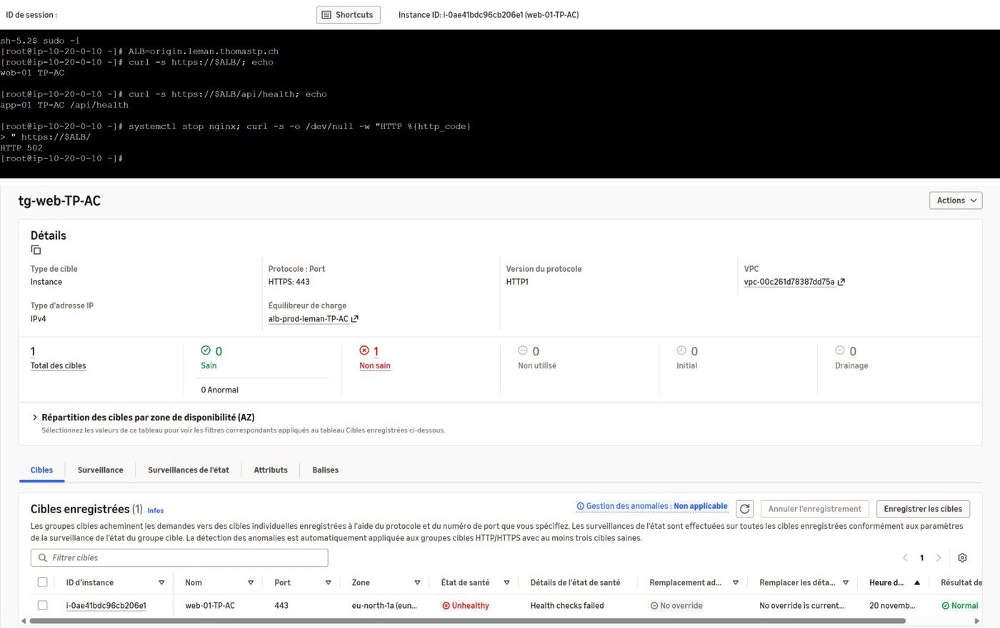

La panne : nginx est arrêté sur `web-01`, l'ALB répond `HTTP 502`, et la cible de `tg-web-TP-AC` passe à « Unhealthy » avec le détail « Health checks failed ».


Après `systemctl start nginx`, la page revient (`web-01 TP-AC`) et, quelques minutes plus tard, la cible est de nouveau « Healthy ».

## Tableau récapitulatif
| Élément | Valeur |
|---|---|
| ALB | `alb-prod-leman-TP-AC`, Internet, IPv4, zones A et B (`sub-public-1a-TP-AC`, `sub-public-1b-TP-AC`) |
| Security Group de l'ALB | `alb-TP-AC` : 443 depuis `0.0.0.0/0` |
| Listener | HTTPS 443, certificat ACM public `leman.thomastp.ch` + `*.leman.thomastp.ch` |
| Nom de l'ALB | `origin.leman.thomastp.ch` (alias Route 53) |
| `tg-web-TP-AC` | HTTPS 443, santé HTTPS `/`, cible `web-01-TP-AC` |
| `tg-app-TP-AC` | HTTP 8080, santé HTTP `/api/health`, cible `app-01-TP-AC` |
| Règle du listener | priorité 10, chemin `/api/*` vers `tg-app-TP-AC` ; défaut vers `tg-web-TP-AC` |
| `app-TP-AC` | 8080 depuis `web-TP-AC` (d'origine) et depuis `alb-TP-AC` (ajouté) |

## Résultats des tests
Le journal ci-dessous vient du premier passage, fait avec la ligne de commande sur un environnement équivalent. Il contient deux essais que la vidéo ne montre pas : le test avec le certificat vérifié (`curl` sans `-k`) sur `portefeuilles.leman.thomastp.ch`, et la fermeture du port 443 dans `alb-TP-AC` (le client n'obtient aucune réponse, `curl` sort en erreur 28). La vidéo montre, dans la console, le 502 et la reprise.

```
=== Domaine reel (20/11/2026) : tests sans -k, certificat verifie ===
--- curl.exe sans -k (certificat verifie) :
https://portefeuilles.leman.thomastp.ch/ -> web-01 TP-AC (cfn)
 [HTTP 200, verif certificat : 0]
https://portefeuilles.leman.thomastp.ch/api/health -> app-01 TP-AC (cfn) /api/health
 [HTTP 200, verif certificat : 0]
--- certificat :
subject=CN=leman.thomastp.ch
issuer=C=US, O=Amazon, CN=Amazon RSA 2048 S21
notBefore=Nov 20 07:47:39 2026 GMT
notAfter=Jun  6 08:47:39 2027 GMT

=== Pannes (premiere execution, avant le passage au domaine reel) ===
nginx arrete sur web-01 : tg-web = unhealthy ; curl https://ALB/ -> <html> <head><title>502 Bad Gateway</title></head> <body> <center><h1>502 Bad Gateway</h1></center> </body> </html>  [HTTP 502]
nginx relance : tg-web = healthy
curl https://ALB/ -> web-01 TP-AC  [HTTP 200]
443 ferme dans sg-alb -> curl https://ALB/ -> ECHEC (curl 28)
443 retabli -> curl https://ALB/ -> web-01 TP-AC  [HTTP 200]
```

## Pièges rencontrés
- **Un 502, pas un 503.** Quand nginx s'arrête, l'ALB reçoit « connexion refusée » de la cible et répond 502 (Bad Gateway). Le contrôle de santé n'est pas instantané : il faut plusieurs contrôles ratés d'affilée. Dans la vidéo, nous avons attendu un peu plus de deux minutes avant de voir la cible « Unhealthy » dans la console.
- **La page revient avant la cible.** Juste après `systemctl start nginx`, le `curl` obtient déjà `web-01 TP-AC` alors que la cible était encore « Unhealthy » à la dernière vérification. Nous l'expliquons ainsi : quand aucune cible d'un groupe n'est saine, l'ALB envoie quand même le trafic aux cibles qui existent, plutôt que de renvoyer une erreur. La cible repasse à « Healthy » seulement après plusieurs contrôles réussis d'affilée (valeurs par défaut des paramètres avancés, que nous n'avons pas changées). Nous n'avons pas mesuré cette durée à la seconde.
- **Le groupe cible web est en HTTPS alors que nginx a un certificat auto-signé.** Le contrôle de santé de l'ALB ne vérifie pas le certificat de la cible, donc la cible est saine quand même.
- **Un nginx qui fait télécharger la page.** Sans type de contenu, nginx envoie le texte en `application/octet-stream` et le navigateur propose de télécharger le fichier au lieu de l'afficher. La configuration de `web-01` contient donc `default_type text/plain` : c'est ce qui permet à nos tests de lire `web-01 TP-AC` dans le navigateur.
- **Le certificat doit correspondre au nom.** Avec le nom `….elb.amazonaws.com` de l'ALB, `curl` refuse le certificat. D'où l'alias `origin.leman.thomastp.ch`, qui est couvert par le certificat, et le fait que nous testons sans `-k`.
- **La limite de vCPU de la classe.** Le déploiement de l'environnement de tournage a échoué plusieurs fois avant le tournage pour la même raison qu'au module 8 (la classe atteint la limite de 48 vCPU). Nous avons attendu qu'une place se libère, puis redéployé.
- **L'attente.** ACM (une minute et demie) et l'ALB (quelques minutes) demandent du temps ; dans la vidéo, ces attentes sont accélérées.

## Ce qui diffère du sujet
- **Certificat.** Le sujet est respecté avec un domaine réel (écart n°9 de `docs/02-ecarts-au-sujet.md`) : certificat public validé par DNS, listener HTTPS, test sans désactiver la vérification.
- **Un Security Group séparé pour l'ALB.** Le sujet réutilise `sg-web` ; nous avons créé `alb-TP-AC`. En revanche `web-TP-AC` reste ouvert sur le port 443, comme au module 3 : nous n'avons pas limité les serveurs web à l'ALB. Seul `app-TP-AC` a reçu une règle pour l'ALB.
- **Le groupe cible web est en HTTPS 443** (pas en HTTP 80), parce que nginx de `web-01` ne sert que le HTTPS depuis le module 3.
- **Environnement de tournage.** Les modules 9 à 11 ont été filmés dans un environnement redéployé avec un modèle CloudFormation (voir plus haut), pas dans le réseau fait à la main aux modules 1 à 3.

## Nettoyage
Tout ce qui a été créé pour ce module a été supprimé le 20/11/2026 : l'ALB `alb-prod-leman-TP-AC` et son listener, les groupes cibles `tg-web-TP-AC` et `tg-app-TP-AC`, le Security Group `alb-TP-AC` (avec la règle 8080 qui y faisait référence), l'enregistrement `origin`, le certificat ACM et la pile `env-m9-m11-TP-AC` (voir `docs/NETTOYAGE.md`). La seule ressource qui reste de notre projet est le Network Firewall `nfw-prod-leman-TP-AC` du module 4, dont la suppression est bloquée côté AWS.


---

# Module 10 – Route 53

## Objectif
Donner des noms à nos machines avec une zone privée, publier le site sous un vrai nom de domaine avec une zone publique, et prévoir une bascule automatique : si le site tombe, le DNS doit répondre avec une adresse de secours.

## Ce qu'il faut savoir
Une **zone privée** n'est visible que depuis les VPC auxquels on l'associe. Les instances l'interrogent par le résolveur du VPC, à l'adresse « base + 2 » : ici `10.20.0.2`. Pour qu'une zone privée fonctionne, le VPC doit avoir la résolution DNS et les noms d'hôte DNS activés.

Une **zone publique** reçoit quatre serveurs de noms d'AWS. Pour qu'Internet la connaisse, il faut les déclarer chez celui qui héberge le DNS du domaine parent : c'est la **délégation**. Notre domaine `thomastp.ch` est hébergé chez Cloudflare. Nous n'y avons ajouté que quatre enregistrements NS pour le sous-domaine `leman`, qui délèguent `leman.thomastp.ch` à Route 53. Le reste de la zone de `thomastp.ch` (le portfolio de Thomas) n'a jamais été touché.

Un enregistrement **alias** pointe vers une ressource AWS (ici l'ALB). Pour un **basculement** (failover), on crée deux enregistrements du même nom : le principal, relié à une **surveillance de l'état** (health check), et un secondaire, que Route 53 renvoie quand la surveillance dit que le principal est en panne.

## Ce que nous avons fait
Tournage du 20/11/2026, dans l'environnement décrit au module 9. Voici l'ordre de la vidéo.

**1. La zone privée**
- Route 53, « Créer une zone hébergée » : `prod.leman.internal`, description « Noms internes du VPC de production », type **privée**, région Stockholm, VPC `vpc-prod-leman-TP-AC`, balises habituelles. La console rappelle que le VPC doit avoir `enableDnsHostnames` et `enableDnsSupport` à `true`.
- Deux enregistrements A : `web` vers `10.20.0.10` et `app` vers `10.20.1.10`.
- Dans la console VPC, « Modifier les paramètres du VPC » sur `vpc-prod-leman-TP-AC` : nous cochons « Activer les noms d'hôte DNS ». La résolution DNS était déjà activée. Le modèle CloudFormation du module 9 avait laissé les noms d'hôte désactivés.
- Depuis `web-01-TP-AC` (Session Manager) : `getent hosts web.prod.leman.internal`, `getent hosts app.prod.leman.internal`, `grep nameserver /etc/resolv.conf` (voir les pièges : dans la vidéo, la résolution n'a rien répondu).

**2. La zone publique `leman.thomastp.ch`**
- La zone et la délégation chez Cloudflare ont été préparées avant le tournage. La vidéo montre la zone : ses détails donnent les quatre serveurs de noms (les mêmes que ceux déclarés chez Cloudflare) et l'enregistrement `origin`, créé au module 9, qui pointe vers l'ALB.

**3. La surveillance de l'état**
- « Créer une surveillance de l'état » : `hc-portail-TP-AC`, point de terminaison public, par nom de domaine, protocole **HTTPS**, `origin.leman.thomastp.ch`, port 443, chemin `/`.
- Intervalle **Rapide (10 secondes)** et seuil d'échec **2** : deux contrôles ratés d'affilée et le point de terminaison est déclaré en panne.
- L'indication du nom du serveur (SNI) reste cochée : Route 53 envoie le nom `origin.leman.thomastp.ch` dans la négociation TLS, et l'ALB présente le bon certificat.

**4. Les enregistrements de basculement**
- Dans `leman.thomastp.ch`, deux enregistrements `portefeuilles` :
  - **principal** : type A, alias vers l'ALB `alb-prod-leman-TP-AC` (Stockholm), politique de routage « Basculement », type « Principale », surveillance `hc-portail-TP-AC`, identifiant `portefeuilles-principal`, « Évaluer l'état de la cible » activé ;
  - **secondaire** : type A, valeur `203.0.113.50` (une adresse réservée à la documentation), durée de vie 300 s, politique « Basculement », type « Secondaire », identifiant `portefeuilles-secours`, sans surveillance.

**5. Le test de basculement**
- Sur `web-01-TP-AC`, nous installons `bind-utils` (pour `dig`), puis nous interrogeons **directement** le premier serveur de noms de la zone, `ns-1673.awsdns-17.co.uk`, ce qui évite les caches des résolveurs : `dig +short @$NS portefeuilles.leman.thomastp.ch`.
- Une boucle pose la question toutes les trois secondes et affiche l'heure.
- Dans une seconde session, `systemctl stop nginx` sur `web-01`, puis, plus tard, `systemctl start nginx`.

## Captures


La zone publique `leman.thomastp.ch`, avec ses quatre serveurs de noms. Le compteur indique quatre enregistrements, mais la liste n'en montre qu'un (`origin`) : voir les pièges.

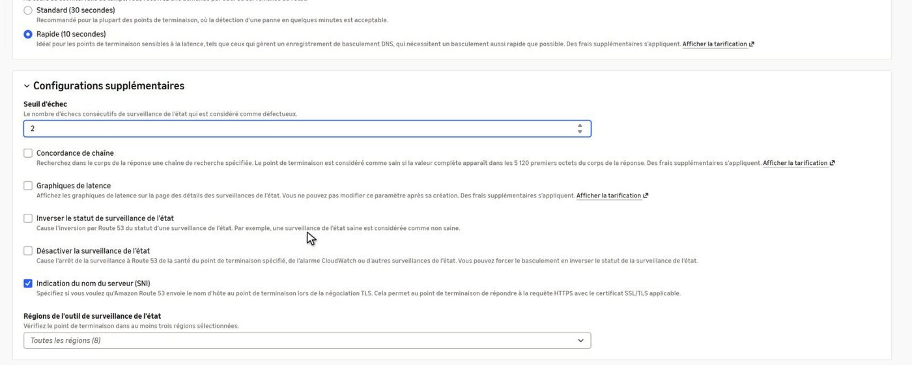

La surveillance de l'état avant sa création : intervalle « Rapide (10 secondes) », seuil d'échec `2`, SNI activé.

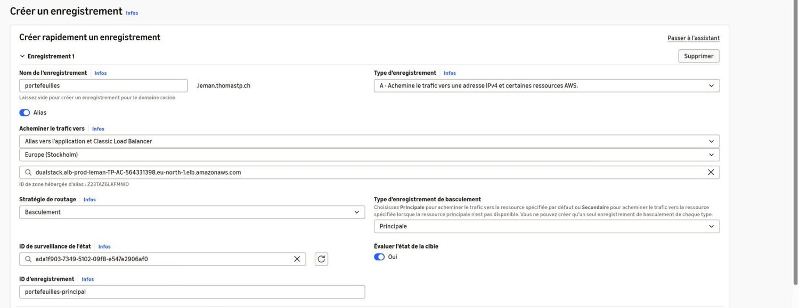

L'enregistrement principal de `portefeuilles` : alias vers l'ALB, routage « Basculement », type « Principale », relié à la surveillance `hc-portail-TP-AC`.


La boucle de `dig` pendant la panne. Tant que nginx tourne, la réponse contient les deux adresses de l'ALB (une par zone). Nous avons arrêté nginx à 12:56:29. À 12:57:02, la réponse devient `203.0.113.50`, l'adresse de secours : trente-trois secondes plus tard.


Le retour. Nous avons relancé nginx à 12:57:43. La réponse reste `203.0.113.50` jusqu'à 13:00:01 et revient à l'adresse de l'ALB à 13:00:04, après 141 secondes. Elle n'a d'abord qu'une seule adresse, puis les deux adresses de façon stable à partir de 13:00:28.

## Tableau récapitulatif
| Zone | Nom | Cible |
|---|---|---|
| privée | `web.prod.leman.internal` | `10.20.0.10` |
| privée | `app.prod.leman.internal` | `10.20.1.10` |
| publique | `origin.leman.thomastp.ch` | alias vers l'ALB |
| publique | `portefeuilles.leman.thomastp.ch` (principal) | alias vers l'ALB, surveillance `hc-portail-TP-AC` |
| publique | `portefeuilles.leman.thomastp.ch` (secours) | `203.0.113.50`, TTL 300 s |
| publique | `cdn.leman.thomastp.ch` | alias vers CloudFront (module 11) |

| Surveillance de l'état | Valeur |
|---|---|
| Nom | `hc-portail-TP-AC` |
| Point de terminaison | `https://origin.leman.thomastp.ch:443/` |
| Intervalle, seuil d'échec | 10 s, 2 échecs |

## Résultats des tests
Le journal ci-dessous vient du premier passage, fait avec la ligne de commande : la résolution de la zone privée (qui avait bien répondu) et, sous « Domaine réel », les mesures du basculement faites le 20/11/2026 avec la même configuration. Les mesures de la vidéo (console) sont dans les captures ci-dessus : **33 secondes** pour passer au secours, **141 secondes** pour revenir.

```
=== TP1 : zone privee prod.leman.internal (resolveur 10.20.0.2) ===
web-01 : Success	app -> 10.20.1.10 web -> 10.20.0.10
web-01 : Success	serveur DNS utilise : nameserver 10.20.0.2

=== Domaine reel (20/11/2026) : basculement Route 53 (primaire ALB -> secours statique 203.0.113.50) ===
12:26:03 arret de nginx sur web-01 : Success	11:26:05
etat de la cible tg-web : unhealthy
12:30:09 reponse DNS avant relance : 203.0.113.50 (secours)
12:30:10 relance de nginx : Success	11:30:12
12:30:44 la reponse DNS publique est revenue a l'equilibreur (13.62.60.176) apres 34 s
web-01 TP-AC (cfn)
 [HTTP 200]
12:31:14 2e mesure - arret de nginx : Success	11:31:15
12:32:22 la reponse DNS publique est devenue le secours (203.0.113.50) apres 70 s
```

Les mesures du premier passage sont de 70 s (aller, seconde mesure) et 34 s (retour). Elles diffèrent beaucoup de celles de la vidéo, surtout au retour. Un contrôle de 10 s avec deux échecs laisse attendre vingt à trente secondes à l'aller, ce qu'on voit dans la vidéo. Au retour, il faut d'abord que le groupe cible de l'ALB redevienne sain (module 9), puis que Route 53 constate deux contrôles réussis. Au premier passage, le groupe cible était réglé à 10 s d'intervalle et 2 réussites pour redevenir sain. Dans la console, nous avons gardé les valeurs par défaut des paramètres avancés (que nous n'avons pas relevées ; d'après la documentation d'AWS : 30 s et 5 réussites), ce qui explique sans doute un retour plus lent. Les valeurs détaillées du premier passage sont dans `docs/modules/m10/tests-domaine-reel.txt`.

## Pièges rencontrés
- **La résolution de la zone privée n'a rien répondu dans la vidéo.** Sur `web-01`, les deux commandes `getent hosts web.prod.leman.internal` et `getent hosts app.prod.leman.internal` n'affichent aucune ligne. Le résolveur du VPC (`nameserver 10.20.0.2`) est bien celui utilisé. Nous n'avons pas expliqué cet échec sur le moment et nous n'avons pas refait l'essai à l'écran. Deux pistes : le réglage « noms d'hôte DNS » du VPC venait d'être changé, ou la zone privée venait d'être créée. Au premier passage (ligne de commande), la résolution avait fonctionné (`web` vers `10.20.0.10`, `app` vers `10.20.1.10`, voir le journal).
- **Les noms d'hôte DNS du VPC.** Une zone privée associée à un VPC dont les noms d'hôte DNS sont désactivés ne se résout pas. La console le signale par un bandeau à la création de la zone, mais ne change rien toute seule : il faut cocher la case dans le VPC.
- **La console Route 53 n'affiche pas tout.** Les enregistrements NS et SOA créés avec la zone ne sont pas dans la liste par défaut : le compteur dit « Enregistrements (4) », la liste n'en montre qu'un (`origin`). Les quatre serveurs de noms se lisent dans « Détails de la zone hébergée ».
- **« Statut : Inconnu ».** Juste après sa création, la surveillance de l'état n'a pas encore de statut. Il faut attendre quelques contrôles avant que la console affiche « Sain ».
- **Une mesure qui dépend de la question.** Si nous interrogions notre résolveur habituel, les caches DNS cacheraient une partie du basculement. C'est pour cela que nous interrogeons directement un serveur de noms d'AWS.
- **Une adresse de secours qui ne mène nulle part.** `203.0.113.50` est une adresse de documentation : le test prouve que le DNS change de réponse, pas qu'un second site prend le relais.

## Ce qui diffère du sujet
- **Le domaine.** Le sujet est respecté avec un domaine réel : une zone publique déléguée depuis un sous-domaine d'un domaine existant (écart n°9 de `docs/02-ecarts-au-sujet.md`).
- **Le secours** est une adresse statique de documentation, pas un second site : nous n'avons pas de site de secours.
- **La mesure** interroge directement un serveur de noms d'AWS depuis `web-01`, pas un résolveur public. C'est la durée de réaction de Route 53, sans les caches.
- **La zone privée** : la vidéo ne montre pas de résolution réussie (voir les pièges). La preuve que la zone fonctionne est celle du premier passage.

## Nettoyage
Tout a été supprimé le 20/11/2026 : les zones `leman.thomastp.ch` (avec `origin`, les deux `portefeuilles`, `cdn` et le CNAME de validation d'ACM) et `prod.leman.internal`, puis la surveillance `hc-portail-TP-AC` (environ 0,50 USD par mois, un peu plus avec l'intervalle rapide). Les quatre enregistrements NS du sous-domaine `leman` ont été retirés du DNS de Cloudflare ; le reste de la zone `thomastp.ch` n'a jamais été modifié. Voir `docs/NETTOYAGE.md`.


---

# Module 11 – CloudFront

## Objectif
Mettre un CDN devant l'ALB : garder en cache le contenu statique, ne jamais mettre l'API en cache, servir le tout sous un nom de notre domaine avec un vrai certificat, et empêcher l'accès direct à l'ALB.

## Ce qu'il faut savoir
CloudFront sert le contenu depuis un point de présence proche du visiteur et ne va chercher le fichier à l'origine (ici l'ALB) que s'il ne l'a pas en cache. Les en-têtes de la réponse le montrent : `x-cache` indique `Hit` (servi par le cache) ou `Miss` (allé chercher à l'origine), et `x-amz-cf-pop` donne le point de présence.

Chaque chemin (`/static/*`, `/api/*`, le reste) a son **comportement** : une politique de cache et une politique de requête à l'origine. Un fichier modifié à l'origine reste servi dans son ancienne version jusqu'à la fin du délai de cache, sauf si on lance une **invalidation**.

Pour servir la distribution sous un nom de notre domaine (un « autre nom de domaine »), CloudFront demande un certificat ACM émis en **`us-east-1`** (Virginie), quelle que soit la région de l'ALB. Et pour qu'on ne puisse plus contourner CloudFront, le Security Group de l'ALB n'accepte que la **liste de préfixes** gérée par AWS pour CloudFront.

## Ce que nous avons fait
Tournage du 20/11/2026, dans l'environnement décrit au module 9. Voici l'ordre de la vidéo.

**1. Un fichier statique sur `web-01`**
- Sur `web-01-TP-AC` (Session Manager) : le fichier `/usr/share/nginx/html/static/logo.png`, qui contient le texte `logo v1`, et un bloc `location /static/` dans `/etc/nginx/conf.d/web.conf` (avec `default_type image/png`). Puis `nginx -t && systemctl reload nginx`.

**2. La distribution**
- CloudFront, « Créer une distribution ». Étape 1, le forfait : nous choisissons **le paiement à l'utilisation**. La console prévient en jaune qu'elle ne peut pas vérifier nos autorisations pour les forfaits à tarif unique.
- Étape 2 : nom `cf-portail-TP-AC`, description « Portail Leman Finance TP-AC (origine ALB, HTTPS) », « Configuration d'un seul site Web ».
- Étape 3, l'origine : type « Elastic Load Balancer », et nous tapons nous-mêmes le nom `origin.leman.thomastp.ch` (celui de l'alias du module 9), pas le nom `….elb.amazonaws.com` que propose le bouton « Browse load balancers ». Paramètres d'origine et de cache recommandés, qui imposent le **HTTPS** entre CloudFront et l'ALB : le certificat de l'ALB couvre `origin.leman.thomastp.ch`, CloudFront l'accepte.
- Étape 4 : pas de pare-feu applicatif (« Ne pas activer les protections de sécurité »). Puis vérification et création.

**3. Le nom `cdn.leman.thomastp.ch`**
- Le nom alternatif `cdn.leman.thomastp.ch` et le certificat ACM `leman.thomastp.ch` de `us-east-1` ont été posés **avec la ligne de commande** (`aws cloudfront update-distribution`) : la liste de certificats de la console ne proposait pas le nôtre. Le résultat se lit ensuite dans la console, dans les paramètres de la distribution. Ce certificat de `us-east-1` avait été demandé avant le tournage.
- Dans Route 53, zone `leman.thomastp.ch` : un enregistrement `cdn`, de type A, alias vers la distribution CloudFront (`….cloudfront.net`). Cette étape est faite dans la console.

**4. Les comportements**
Dans l'onglet « Comportements » de la distribution, deux comportements en plus de celui par défaut :
- `/static/*` vers l'origine de l'ALB : méthodes GET et HEAD, politique de cache `CachingOptimized` (durée de vie par défaut de 24 heures).
- `/api/*` : toutes les méthodes HTTP, politique de cache `CachingDisabled`, politique de requête à l'origine `AllViewerAndCloudFrontHeaders-2022-06` (tous les en-têtes, cookies et paramètres de la requête sont transmis à l'origine).

**5. L'ALB ne parle plus qu'à CloudFront**
- Dans `alb-TP-AC` : la règle HTTPS ouverte à tous est retirée et remplacée par le port 443 en TCP depuis la liste de préfixes gérée `com.amazonaws.global.cloudfront.origin-facing` (description « HTTPS depuis CloudFront »).

**6. Les tests**
Depuis `web-01-TP-AC`, avec `curl` sur `cdn.leman.thomastp.ch` (nous ne gardons que l'état HTTP et les en-têtes `x-cache` et `x-amz-cf-pop`) :
- `/static/logo.png` deux fois de suite : `Miss`, puis `Hit`.
- `/api/health` deux fois : `Miss` les deux fois.
- Nous remplaçons le fichier par `logo v2` sur `web-01` : CloudFront sert toujours `logo v1`.
- Dans la console, onglet « Invalidations » : création d'une invalidation pour `/static/*`. Moins d'une minute plus tard, CloudFront sert `logo v2`.
- Accès direct à l'ALB par `origin.leman.thomastp.ch` : `curl` sort après 6 secondes, sans réponse (`HTTP 000`).

## Captures


La distribution `cf-portail-TP-AC` porte le nom alternatif `cdn.leman.thomastp.ch` et le certificat ACM `leman.thomastp.ch` (coche verte), avec la politique de sécurité `TLSv1.2_2021`. L'avertissement « Facturation : Autorisations manquantes » est celui des forfaits (voir les pièges).


L'enregistrement `cdn.leman.thomastp.ch` : un alias vers la distribution CloudFront. La console grise la région (« USA Est (Virginie du Nord) »), car CloudFront est global.


Le comportement `/api/*` : `CachingDisabled` pour la politique de cache et `AllViewerAndCloudFrontHeaders-2022-06` pour la requête à l'origine.

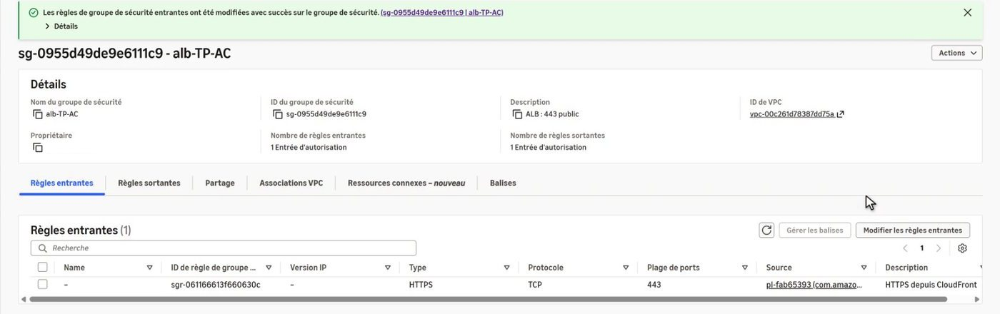

`alb-TP-AC` après la modification : une seule règle entrante, le port 443 depuis la liste de préfixes `pl-fab65393` (`com.amazonaws.global.cloudfront…`).


Tous les tests dans un seul terminal. `Miss` puis `Hit` sur le fichier statique (point de présence `ARN56-P2`), `Miss` à chaque appel sur l'API. Le fichier modifié sur `web-01` (`logo v2`) est servi en `logo v1` par le cache, puis en `logo v2` après l'invalidation. L'accès direct à l'ALB reste sans réponse (`HTTP 000`).

## Tableau récapitulatif
| Élément | Valeur |
|---|---|
| Distribution | `cf-portail-TP-AC`, paiement à l'utilisation, sans pare-feu applicatif |
| Origine | `origin.leman.thomastp.ch` (l'ALB), HTTPS seulement |
| Nom alternatif et certificat | `cdn.leman.thomastp.ch`, certificat ACM `leman.thomastp.ch` de `us-east-1` (posés par la CLI) |
| Alias Route 53 | `cdn.leman.thomastp.ch` vers la distribution |
| Comportement `/static/*` | `CachingOptimized`, GET et HEAD |
| Comportement `/api/*` | `CachingDisabled`, requête à l'origine `AllViewerAndCloudFrontHeaders-2022-06`, toutes les méthodes |
| `alb-TP-AC` | 443 depuis `com.amazonaws.global.cloudfront.origin-facing` seulement |

## Résultats des tests
Le journal ci-dessous vient du premier passage, fait avec la ligne de commande sur la même configuration (origine HTTPS, nom `cdn.leman.thomastp.ch`). La vidéo refait les mêmes tests dans la console : mêmes résultats, `Miss` puis `Hit`, l'API jamais en cache, l'ancienne version servie jusqu'à l'invalidation, l'ALB injoignable en direct.

```
=== Domaine reel (20/11/2026) : CloudFront (cdn.leman.thomastp.ch, origine HTTPS origin.leman.thomastp.ch) ===
1er appel /static/logo.png : HTTP/1.1 200 OK X-Cache: Miss from cloudfront
2e appel  /static/logo.png : HTTP/1.1 200 OK X-Cache: Hit from cloudfront
contenu : logo v1
API 1 : HTTP/1.1 200 OK X-Cache: Miss from cloudfront
API 2 : HTTP/1.1 200 OK X-Cache: Miss from cloudfront
fichier modifie sur web-01 (v2) ; le cache sert encore : logo v1 (HTTP/1.1 200 OK X-Cache: Hit from cloudfront )
apres invalidation (Completed) : logo v2 (HTTP/1.1 200 OK X-Cache: Hit from cloudfront )

=== ALB verrouille : seul CloudFront (liste de prefixes geree par AWS) peut le joindre ===
acces direct a l'ALB (origin.leman.thomastp.ch) : HTTP 000 (delai depasse attendu)
via CloudFront (cdn.leman.thomastp.ch/api/health) : app-01 TP-AC (cfn) /api/health
 [HTTP 200]
```

## Pièges rencontrés
- **Le certificat n'apparaissait pas dans la console.** Pour le nom alternatif, la liste de certificats de la console ne proposait pas notre certificat de `us-east-1`. Nous avons posé le nom et le certificat avec la ligne de commande ; tout le reste est fait dans la console.
- **« Autorisations manquantes ».** À l'étape du forfait, la console dit qu'elle ne peut pas vérifier nos autorisations pour les forfaits à tarif unique ; une fois la distribution créée, la ligne « Facturation » affiche le même avertissement avec un lien « Corriger ce problème ». Nous avons gardé le paiement à l'utilisation, qui fonctionne sans ces autorisations.
- **Le nom de l'origine.** Avec le nom `….elb.amazonaws.com` de l'ALB, le certificat de l'ALB ne correspond pas et CloudFront refuserait la connexion HTTPS. Nous tapons donc `origin.leman.thomastp.ch`.
- **Une distribution qui se déploie.** Juste après la création et après chaque modification, la distribution reste « Déploiement » pendant quelques minutes.
- **Le cache garde l'ancienne version.** Après la modification du fichier sur `web-01`, `curl` obtient encore `logo v1` : c'est le comportement attendu, jusqu'à l'invalidation.
- **L'API ne doit pas être mise en cache.** `Miss` à chaque appel sur `/api/health` confirme que `CachingDisabled` fonctionne. Si une requête de l'API était servie depuis le cache, un client pourrait recevoir la réponse d'un autre.

## Ce qui diffère du sujet
- **Le domaine et le certificat** sont réels (écart n°9 de `docs/02-ecarts-au-sujet.md`) : la distribution est servie sous `cdn.leman.thomastp.ch` avec un vrai certificat. Seul le réglage du nom alternatif a été fait en ligne de commande, parce que la console ne proposait pas le certificat.
- **L'origine est en HTTPS**, avec un vrai certificat sur l'ALB, comme le réglage recommandé de la console.
- **La politique de requête de `/api/*`** est `AllViewerAndCloudFrontHeaders-2022-06`, pas `AllViewer` : c'est le nom exact de la politique que nous avons choisie dans la liste.
- **Pas de pare-feu applicatif (WAF).**
- **Environnement de tournage** : voir le module 9.

## Nettoyage
La distribution a été désactivée après avoir retiré le nom alternatif et le certificat, puis supprimée le 20/11/2026, avec l'enregistrement `cdn`, le certificat de `us-east-1` et le reste de ce qui avait été créé pour les modules 9 à 11 (voir `docs/NETTOYAGE.md`). La seule ressource qui reste de notre projet est le Network Firewall `nfw-prod-leman-TP-AC` du module 4, dont la suppression est bloquée côté AWS.


---

# Module 12 – CloudWatch et Flow Logs

## Objectif
Savoir si le portail va bien sans fixer la console toute la journée : un tableau de bord pour voir, une alarme qui prévient quand le site renvoie des erreurs, et les journaux de flux du VPC pour comprendre pourquoi une connexion a été refusée.

## Ce qu'il faut savoir
**Métriques et alarmes.** Chaque service envoie ses mesures à CloudWatch, par exemple le nombre de réponses 5xx de l'ALB par minute. Une alarme prend une statistique (somme, moyenne…) sur une période, la compare à un seuil et se trouve dans l'un des trois états suivants : `OK`, `En alarme` ou `Données insuffisantes`. Le troisième est piégeux. Si l'ALB ne reçoit aucune requête pendant une minute, la métrique n'a tout simplement pas de point pour cette minute, et selon le réglage « traitement des données manquantes » l'alarme n'a rien à évaluer. Nous y reviendrons dans les résultats.

**SNS et SQS.** Une rubrique SNS diffuse chaque message à tous ses abonnés : une adresse e-mail, une file, une fonction Lambda… Une file SQS garde les messages jusqu'à ce que quelqu'un les lise. Comme l'adresse e-mail de notre rubrique est fictive et ne pourra jamais être confirmée, la file nous sert de preuve : si un message y arrive, c'est que l'alarme a bien parlé à la rubrique.

**Flow Logs.** Un journal de flux enregistre, pour chaque interface réseau du VPC, les connexions vues pendant une fenêtre (dix minutes par défaut) : adresse source et destination, ports, protocole, et surtout `ACCEPT` ou `REJECT`. On l'envoie dans un groupe de journaux CloudWatch, que l'on interroge ensuite avec Logs Insights.

## Ce que nous avons fait
Tout a été fait dans la console, région Europe (Stockholm). Les noms portent le suffixe `-TP-AC` et les balises habituelles (Projet, Equipe, Environnement).

1. **La rubrique SNS.** SNS, Rubriques, Créer : type Standard, nom `sns-exploitation-leman-TP-AC`, nom complet « Alertes exploitation Leman ». Ensuite un abonnement de protocole « Adresse de messagerie » vers `exploitation-tp-ac@example.com` (adresse fictive, choisie pour la vidéo). L'abonnement reste en « Confirmation en attente » : personne ne peut cliquer le lien de confirmation.
2. **La file SQS.** SQS, Créer une file d'attente : type Standard, nom `sqs-exploitation-leman-TP-AC`, réglages par défaut (chiffrement SSE-SQS compris).
3. **L'abonnement de la file à la rubrique.** Depuis la console SQS, onglet « Abonnements SNS », « Abonner à la rubrique Amazon SNS », choix de `sns-exploitation-leman-TP-AC`, Enregistrer. La console ajoute elle-même à la file l'autorisation qui permet à la rubrique d'y écrire.
4. **L'alarme.** CloudWatch, Alarmes, Créer une alarme. Métrique `HTTPCode_ELB_5XX_Count` de l'espace de noms `AWS/ApplicationELB`, pour l'ALB `alb-prod-leman-TP-AC`. La console propose par défaut la statistique « Moyenne » sur 5 minutes : nous passons à **Somme** sur **1 minute**, condition « Supérieur » au seuil **5**. Deux notifications vers la rubrique `sns-exploitation-leman-TP-AC` : une quand l'alarme passe **En alarme**, une quand elle passe **OK**. Nom : `alarm-5xx-portail-TP-AC`. À la création, la console signale que certains abonnements sont encore en attente de confirmation (celui de l'e-mail).
5. **Le tableau de bord `db-portail-leman-TP-AC`.** Nous le créons vide, puis « Actions » et l'édition de la source : au lieu d'ajouter les widgets un par un, nous collons un JSON de quatre graphiques en courbes (période 60 s) : « Cibles saines » (`HealthyHostCount` de `tg-web-TP-AC` et `tg-app-TP-AC`), « Cibles non saines » (`UnHealthyHostCount`, mêmes groupes), « Temps de reponse de l ALB » (`TargetResponseTime`) et « Erreurs 5xx de l ALB » (`HTTPCode_ELB_5XX_Count`, somme). « Mettre à jour », puis « Enregistrer ». (Dans le JSON, nous avons écrit les titres sans accent ni apostrophe.)
6. **Le journal de flux.** Console VPC, le VPC `vpc-prod-leman-TP-AC`, onglet « Journaux de flux », Créer : nom `fl-vpc-prod-leman-TP-AC`, filtre **Tout**, intervalle d'agrégation de 10 minutes (valeur par défaut), destination « Envoyer aux journaux CloudWatch », groupe `/leman/vpc-prod/flow-TP-AC` (saisi à la main : la console le crée), « Créer et utiliser un nouveau rôle de service » (la console le nomme `VPCFlowLogs-Cloudwatch-` suivi d'un numéro) et format par défaut.
7. **Du trafic refusé à retrouver.** Depuis une session Systems Manager sur `rtr-agence-TP-AC` (le routeur simulé de l'agence), nous lançons cinq tentatives de connexion TCP vers le port 22 de `web-01-TP-AC` (`timeout 3 bash -c "</dev/tcp/$WEB/22"`). Le terminal affiche cinq fois « port 22 refuse » : le Security Group de `web-01-TP-AC` n'ouvre pas le 22 à cette source.
8. **Logs Insights.** CloudWatch, Logs Insights, groupe `/leman/vpc-prod/flow-TP-AC`, plage d'une heure, requête :
   `filter action="REJECT" | stats count(*) as refus by srcAddr, dstPort | sort refus desc | limit 10`
9. **Le test de l'alarme.**
   - Sur `web-01-TP-AC`, session Systems Manager : `systemctl stop nginx`.
   - Sur `rtr-siege-TP-AC`, une boucle envoie soixante requêtes, une par seconde, à `https://<domaine CloudFront>/essai1` jusqu'à `/essai60` et affiche le code HTTP. Nous obtenons soixante fois **502** : CloudFront passe à l'ALB, qui ne joint plus nginx.
   - Nous rechargeons la page de l'alarme toutes les trente secondes environ, jusqu'à ce qu'elle passe **En alarme** (la vidéo accélère l'attente).
   - Nous relançons nginx (`systemctl start nginx`) et attendons encore quelques minutes sans envoyer de requête.
10. **La preuve de réception.** SQS, `sqs-exploitation-leman-TP-AC`, « Envoyer et recevoir des messages », « Rechercher des messages » : la file contient deux messages, que nous ouvrons.

## Captures


Le tableau de bord enregistré, avec les données déjà reçues de l'ALB. Les courbes gardent la trace des pannes provoquées aux modules précédents, comme l'arrêt de nginx du module 9 : cibles qui tombent, pics d'erreurs 5xx (jusqu'à 93 par minute).


Le journal de flux juste après sa création : état « Actif », type de trafic « Tout », destination `/leman/vpc-prod/flow-TP-AC`, créé le 18 novembre 2026 à 23 h 47 (heure locale).


La requête Logs Insights a analysé 9 936 enregistrements de la dernière heure et en a trouvé 6 115 refusés. La première ligne du tableau est une adresse en `15.177.18.63` qui totalise 186 refus enregistrés sur le port 443.


L'alarme après les soixante 502 : état « En alarme », seuil « `HTTPCode_ELB_5XX_Count` > 5 pour 1 points de données dans 1 minute », actions activées. La chronologie du dessous montre la bande verte (OK) d'avant, puis la bande rouge.


Quelques minutes après le redémarrage de nginx, la même alarme est sortie de l'alarme, mais elle affiche « Données insuffisantes », pas « OK » (voir les résultats et les pièges).


La file contient deux notifications de la rubrique, taille 2,27 Ko chacune. La console SQS affiche l'heure locale (UTC+1), alors que les graphiques CloudWatch sont en UTC.

## Tableau récapitulatif
| Élément | Nom | Réglage |
|---|---|---|
| Rubrique SNS | `sns-exploitation-leman-TP-AC` | Standard ; abonnés : e-mail fictif (jamais confirmé) et la file SQS |
| File SQS | `sqs-exploitation-leman-TP-AC` | Standard, réglages par défaut |
| Alarme | `alarm-5xx-portail-TP-AC` | `HTTPCode_ELB_5XX_Count` de `alb-prod-leman-TP-AC`, somme sur 1 minute, supérieur à 5, 1 point sur 1 ; données manquantes traitées comme manquantes |
| Actions de l'alarme | vers la rubrique SNS | au passage En alarme et au passage OK (rien pour « Données insuffisantes ») |
| Tableau de bord | `db-portail-leman-TP-AC` | 4 graphiques, période 60 s |
| Journal de flux | `fl-vpc-prod-leman-TP-AC` | tout le trafic, agrégation 10 min, vers CloudWatch Logs |
| Groupe de journaux | `/leman/vpc-prod/flow-TP-AC` | créé par la console, sans durée de conservation fixée |
| Rôle de service | `VPCFlowLogs-Cloudwatch-…` | créé par la console pour le journal de flux |

## Résultats des tests
Ce que la vidéo montre, dans l'ordre :

| Test | Résultat |
|---|---|
| Abonnement e-mail | « Confirmation en attente » (adresse fictive) |
| Abonnement de la file | créé, la console confirme « Abonnement à la rubrique … effectué avec succès » |
| Alarme juste après sa création et avant le test | « Données insuffisantes » |
| Journal de flux | état « Actif » |
| Sonde SSH vers `web-01-TP-AC` | 5 essais, 5 refus affichés par le terminal |
| Logs Insights | requête terminée : 10 lignes sur 6 115 refus ; en tête, `15.177.18.63` vers le port 443, 186 refus |
| 60 requêtes via CloudFront avec nginx arrêté | 60 codes 502 |
| Alarme après ces requêtes | **En alarme** |
| Alarme après le redémarrage de nginx et quelques minutes sans trafic | **Données insuffisantes** (pas OK) |
| File SQS | 2 messages, envoyés à 23 h 54 le 18 novembre et à 0 h 09 le 19 novembre (UTC+1) |

Sur ces deux messages, voici ce que nous pouvons affirmer. Leurs heures d'envoi correspondent à la chronologie de l'alarme : la bande verte (OK) commence vers 22 h 54 UTC, soit 23 h 54 à Genève, et la bande rouge (En alarme) vers 23 h 09 UTC, soit 0 h 09. Le premier message est donc le passage à OK, le second le passage en alarme. Dans la vidéo, nous n'avons pas fait défiler le texte des messages : la fenêtre n'en montre que les premières lignes (`"Type" : "Notification"`).

Le bloc ci-dessous est la sortie de notre première exécution, faite en ligne de commande avant que nous refassions tout à la main. Il garde son intérêt pour les mesures, mais l'alarme n'y avait pas les mêmes réglages (5 minutes sur 2 périodes, erreurs des cibles) ; le retour à OK qui y figure ne concerne donc pas l'alarme filmée.

```
=== TP1 : tableau de bord ===
Tableau de bord : db-portail-leman-TP-AC
HealthyHostCount tg-web (derniere minute) : 1.0

=== TP3 : Flow Logs (SSH non autorise vers web-01) ===
6 tentatives de connexion TCP sur le port 22 de web-01 depuis cette machine (refusees par sg-web)

=== TP2 : alarme ===
Etat initial : INSUFFICIENT_DATA
Trafic 5xx genere pendant 10 min -> etat de l'alarme : ALARM
Notification SNS recue dans sqs-exploitation-leman-TP-AC : { "Type" : "Notification", "MessageId" : "c384ef0a-2ba5-5287-897d-8c7edf73d6a8", "TopicArn" : "arn:aws:sns:eu-north-1:000000000000:sns-exploitation-leman-TP-AC", "Subject" : "OK: \"alarm-5xx-portail-TP-AC\" in EU (Stockholm)", "Message" : "{\"AlarmName\":\"alarm-5xx-portail-TP-AC\",\"AlarmDescription\":\"TP-AC : plus de 5 erreurs 5xx cibles sur 5 min, 2 periodes consecutives\",\"AWSAccountId\":\"0...
Apres arret des erreurs (18 min) -> etat de l'alarme : OK
Notification de retour a la normale presente : oui

=== TP3 (reel) : Flow Logs ===
Controle : port 22 sortant depuis ce poste (github.com:22) -> ouvert
8 tentatives TCP vers le port 22 de l'ALB (2 noeuds publics) depuis ce poste (84.226.x.x) -> 8 timeout : refusees par sg-alb (seul le port 80 est ouvert, au prefixe CloudFront)
Recherche dans /leman/vpc-prod/flow-TP-AC (source = ce poste, port 22, REJECT) :
  2 000000000000 eni-034bc06f123a72b63 84.226.x.x 10.20.0.115 61404 22 6 2 104 1794837701 1794837721 REJECT OK
  2 000000000000 eni-034bc06f123a72b63 84.226.x.x 10.20.0.115 60965 22 6 2 104 1794837701 1794837721 REJECT OK
  2 000000000000 eni-034bc06f123a72b63 84.226.x.x 10.20.0.115 63656 22 6 2 104 1794837701 1794837721 REJECT OK
  2 000000000000 eni-034bc06f123a72b63 84.226.x.x 10.20.0.115 59395 22 6 2 104 1794837701 1794837721 REJECT OK
  2 000000000000 eni-05458be49638c7015 84.226.x.x 10.20.0.7 62411 22 6 2 104 1794837702 1794837733 REJECT OK
  2 000000000000 eni-05458be49638c7015 84.226.x.x 10.20.0.7 63203 22 6 2 104 1794837702 1794837733 REJECT OK
  2 000000000000 eni-05458be49638c7015 84.226.x.x 10.20.0.7 64715 22 6 2 104 1794837702 1794837733 REJECT OK
  2 000000000000 eni-05458be49638c7015 84.226.x.x 10.20.0.7 63102 22 6 2 104 1794837702 1794837733 REJECT OK
Requete Logs Insights : filter action = "REJECT" and dstPort = 22 and srcAddr = <ce poste> | stats count(*) as n by srcAddr, dstAddr, dstPort | sort n desc
Resultat : srcAddr=84.226.x.x dstAddr=10.20.0.115 dstPort=22 n=4 | srcAddr=84.226.x.x dstAddr=10.20.0.7 dstPort=22 n=4
Diagnostic : le rejet vient du Security Group sg-alb (port 22 non ouvert) : source, ENI de l'ALB, port 22 et action REJECT le prouvent.

=== TP3 (web-01) : Flow Logs, sonde SSH vers web-01 ===
Controle : https vers web-01 (443 ouvert) -> HTTP 000 pendant le script (web-01 venait de demarrer) ; controle refait a part, web-01 demarree : HTTP 200
10 tentatives TCP vers web-01:22 depuis une machine non autorisee (84.226.x.x) -> 10 timeout (sg-web n'ouvre le 22 qu'a la salle d'exploitation)
Recherche dans /leman/vpc-prod/flow-TP-AC (source = ce poste, destination 10.20.0.10, port 22, REJECT) :
  aucune ligne livree dans le delai
Requete Logs Insights : filter action = "REJECT" and dstPort = 22 and srcAddr = <ce poste> and dstAddr = "10.20.0.10" | stats count(*) as n by srcAddr, dstAddr, dstPort
Resultat : srcAddr=84.226.x.x dstAddr=10.20.0.10 dstPort=22 n=1
Diagnostic : rejet par sg-web (port 22 non ouvert a cette source) ; ENI de web-01, port 22, action REJECT.
```

## Pièges rencontrés
- **Pas de retour à OK sans trafic.** Notre alarme est repassée à « Données insuffisantes », pas à « OK », et aucune notification de retour à la normale n'est donc partie. Sans requête, l'ALB n'émet pas de point de métrique, et nous avons laissé le réglage par défaut (données manquantes traitées comme manquantes). Pour obtenir un OK, il suffit d'envoyer quelques requêtes saines après la panne, ou de choisir « Traiter les données manquantes comme bonnes ». Nous ne l'avons pas fait dans la vidéo.
- **Statistique par défaut.** La console propose « Moyenne » sur 5 minutes. Pour compter des erreurs, il faut la somme, et une minute pour que l'alarme réagisse vite.
- **Deux ALB du même nom dans CloudWatch.** En filtrant sur `alb-prod-leman-TP-AC`, la console trouve deux répartiteurs (suffixes `0174805d…` et `ced6af2c…`), probablement parce que l'ALB a été recréé pendant les modules 9 à 11. L'alarme porte sur le second, `ced6af2c…`.
- **Un e-mail fictif ne se confirme pas.** L'abonnement e-mail reste « Confirmation en attente » ; sans la file SQS, nous n'aurions aucune preuve d'envoi.
- **Le journal de flux n'est pas instantané.** Les enregistrements arrivent par fenêtres de dix minutes et mettent quelques minutes à apparaître dans le groupe de journaux. Dans notre rush, l'histogramme de Logs Insights commence environ trois minutes après la création du journal.
- **La requête du haut du classement n'est pas notre sonde.** Dans l'heure analysée, la requête a trouvé 6 115 enregistrements de refus, sans doute du bruit d'Internet et des appels vers le port 443 de l'ALB, fermé à tout sauf à CloudFront depuis le module 11. Nos cinq essais SSH ne figurent pas parmi les lignes visibles à l'écran. Pour les isoler, il fallait ajouter `and dstPort = 22` au filtre ; nous ne l'avons pas fait dans la vidéo. Nous n'avons pas vérifié qui est derrière `15.177.18.63` (nous soupçonnons un service d'Amazon, par exemple les sondes de santé de Route 53).
- **Fuseaux horaires.** Les graphiques CloudWatch sont réglés en UTC, les consoles SQS et VPC affichent l'heure locale (UTC+1) : un décalage d'une heure qui peut faire croire à une erreur.

## Si ça ne marche pas : quatre vérifications
1. Quelle métrique dérive : erreurs 5xx, temps de réponse, cibles saines ? Le tableau de bord le dit en un coup d'œil.
2. L'état de l'alarme, son onglet « Historique » et le traitement des données manquantes.
3. Les abonnements de la rubrique : statut confirmé ? La file autorise-t-elle la rubrique à écrire ?
4. Les journaux de flux : la requête `filter action="REJECT" | stats count(*) by srcAddr, dstPort` donne la source et le port, puis la règle de Security Group ou de NACL à corriger.

## Ce qui diffère du sujet
- **E-mail.** L'adresse d'abonnement est fictive : aucune notification n'arrive dans une vraie boîte. La preuve de réception passe par la file SQS.
- **Alarme.** Nous surveillons les erreurs 5xx de l'ALB lui-même (`HTTPCode_ELB_5XX_Count`), celles qu'il renvoie quand plus aucune cible ne répond (502). La fenêtre est d'une minute, avec un seul point : l'alarme réagit vite, ce qui raccourcit le test, au prix d'une sensibilité plus grande aux pointes isolées. Notre première version, en ligne de commande, comptait les 5xx des cibles sur 5 minutes et deux périodes.
- **Déclenchement du test.** Nous provoquons l'erreur en arrêtant nginx et non par une route d'erreur de notre API.
- **Retour à la normale.** Il n'est pas démontré dans la vidéo (voir les pièges).
- **Conservation des journaux.** Nous n'avons pas fixé de durée de conservation sur le groupe `/leman/vpc-prod/flow-TP-AC` (notre première version la limitait à 3 jours). Le groupe aurait donc conservé les journaux indéfiniment sans notre nettoyage.
- **Logs Insights.** La capture montre le classement général des refus, pas le filtre précis sur le port 22 de notre sonde.

## Nettoyage
Le 20 novembre 2026, nous avons supprimé tout ce qui a été créé dans ce module : l'alarme `alarm-5xx-portail-TP-AC`, le tableau de bord `db-portail-leman-TP-AC`, la rubrique `sns-exploitation-leman-TP-AC` avec ses abonnements, la file `sqs-exploitation-leman-TP-AC`, le journal de flux `fl-vpc-prod-leman-TP-AC`, le groupe de journaux `/leman/vpc-prod/flow-TP-AC` et le rôle de service du journal de flux. Les requêtes Logs Insights ne laissent rien à supprimer. Voir `docs/NETTOYAGE.md` pour l'ensemble du projet, où seul le Network Firewall `nfw-prod-leman-TP-AC` reste bloqué côté AWS.


---

# Module 13 – CloudFormation

## Objectif
Décrire une partie du réseau dans un modèle CloudFormation, le déployer en pile depuis la console, constater une dérive quand quelqu'un modifie une ressource à la main, la corriger, puis supprimer la pile d'un seul geste.

## Ce qu'il faut savoir
Un **modèle** est un fichier (ici en YAML) qui décrit des ressources, des paramètres que l'on remplit au déploiement et des sorties. Une **pile** est ce modèle une fois déployé. CloudFormation calcule l'ordre de création d'après les dépendances et supprime dans l'ordre inverse : la pile ne retire que ce qu'elle a créé.

Un modèle qui crée un rôle IAM oblige à cocher une case de la console (« Je sais qu'AWS CloudFormation peut créer des ressources IAM »), ce qui correspond à la capacité `CAPABILITY_IAM`.

La **dérive** (drift) est l'écart entre ce que le modèle décrit et ce qui existe vraiment, par exemple après une modification faite à la main dans une autre console. CloudFormation la détecte ressource par ressource, mais seulement pour les types qui la gèrent : dans notre pile, douze ressources sur quinze.

Un **jeu de modifications** (change set) montre ce qu'une mise à jour va ajouter, modifier ou remplacer avant de l'exécuter. Nous l'avons utilisé lors de notre première version en ligne de commande, mais nous ne l'avons pas refait dans la console (voir plus bas).

## Ce que nous avons fait
Tout dans la console CloudFormation, région Europe (Stockholm), le 19 novembre 2026 après minuit.

1. **Le modèle.** Nous avons déployé `cfn/reseau-leman-etape1.yaml`. Il décrit **quinze ressources** : un VPC, trois sous-réseaux (public 1a, public 1b, privé 1a), une passerelle Internet et son attachement, une table de routage publique avec sa route par défaut et ses deux associations, trois Security Groups (ALB, web, app) et un rôle IAM avec son profil d'instance pour Systems Manager. Les noms portent `-cfn-TP-AC` (par exemple `sg-web-cfn-TP-AC`), pour ne pas les confondre avec le réseau fait à la main aux modules 1 à 3. Ce VPC est un second réseau à côté du premier : plage `10.30.0.0/22`, alors que le réseau de production du TP est en `10.20.0.0/22`.
2. **La création.** « Créer une pile », « Choisir un modèle existant », « Charger un fichier de modèle » : la console envoie le fichier dans un compartiment S3 qu'elle gère. Nom de la pile : `stack-portail-leman-TP-AC`. Les paramètres gardent leurs valeurs par défaut, sauf `CertificateArn`, obligatoire, que nous remplissons (la vidéo masque la valeur). Dans les options : balises Projet (`SatomCloudNetwork`), Equipe (`TP-AC`), Environnement (`prod`), et la case des capacités IAM. Puis « Soumettre ».
3. **L'état de la pile.** Créée à 0 h 37 min 25 s, elle passe en `CREATE_COMPLETE` à 0 h 40 min 01 s. L'onglet « Événements » montre l'ordre : le VPC et ses voisins d'abord, puis les routes, les Security Groups, et en dernier le profil d'instance, qui attend son rôle. L'onglet « Ressources » en liste quinze, toutes en `CREATE_COMPLETE`, et « Sorties » en donne deux : `VpcId` et `SgWebId`, exportées sous `stack-portail-leman-TP-AC-VpcId` et `stack-portail-leman-TP-AC-SgWebId`.
4. **La dérive.** Dans la console EC2, nous ouvrons le Security Group `sg-web-cfn-TP-AC` (créé par la pile) et nous ajoutons une règle entrante à la main : SSH (TCP 22) depuis `203.0.113.0/24`, description « SSH ajoute a la main ».
5. **La détection.** De retour dans la pile : « Actions de pile », « Détecter l'écart de pile ». Quelques dizaines de secondes plus tard, la pile est en `DRIFTED` (vérification de 0 h 45 min 56 s). Les résultats listent douze ressources : le `SgWeb` est en `MODIFIED`, toutes les autres lignes visibles à l'écran en `IN_SYNC`. Le détail de l'écart montre une différence, `SecurityGroupIngress.1`, de type `ADD`, avec les valeurs « attendue » (la règle du port 80 seulement) et « actuelle » (les deux règles, dont le SSH).
6. **La correction.** Nous supprimons la règle SSH dans EC2, puis nous relançons la détection. La pile repasse à `IN_SYNC` (vérification de 0 h 49 min 15 s).
7. **La suppression.** « Supprimer la pile », nous saisissons son nom pour confirmer (case « Mode Express » laissée décochée). La suppression démarre à 0 h 51 min 58 s et se termine à 0 h 52 min 20 s. Les événements montrent l'ordre inverse de la création : les Security Groups, la passerelle Internet, les sous-réseaux, la table de routage, et le VPC en dernier.

## Ce que la pile couvre, et ce qu'elle ne couvre pas
La vidéo n'installe pas tout le TP dans CloudFormation. Voici ce qui y est et ce qui n'y est pas.

| Dans la pile `stack-portail-leman-TP-AC` | Pas dans la pile filmée |
|---|---|
| VPC, trois sous-réseaux, passerelle Internet, table et route publiques | `web-01`, `app-01`, les groupes cibles et l'ALB |
| trois Security Groups, rôle IAM et profil SSM | Network Firewall, Transit Gateway, VPN, Direct Connect |
| deux sorties exportées | Route 53, CloudFront, surveillance |
| | aucun jeu de modifications, aucune recréation après suppression |

Le dépôt contient aussi `cfn/reseau-leman.yaml` (le même réseau, avec `web-01`, `app-01`, les groupes cibles et l'ALB en HTTPS) et `cfn/interconnexion-leman.yaml` (pare-feu, Transit Gateway, VPN, Direct Connect Gateway). Lors de notre première exécution en ligne de commande, nous avons déployé `reseau-leman.yaml` avec un jeu de modifications, testé la dérive, supprimé la pile puis redéployé (bloc des tests plus bas), et nous avons déployé, supprimé et redéployé `interconnexion-leman.yaml`. Nous n'avons rien rejoué de cela dans la console pour la vidéo.

Sur le certificat : la pile filmée n'importe aucun certificat. Le paramètre `CertificateArn` existe dans le modèle (il sert dans le modèle complet, pour le listener HTTPS de l'ALB), mais aucune des quinze ressources ne l'utilise, et l'étape que nous avons déployée n'a pas d'ALB. La description du paramètre parle encore d'un « certificat importé, auto-signé » : c'est un reste de la première version, où nous importions un certificat auto-signé faute de domaine. Dans la vidéo, nous avons saisi l'ARN d'un certificat ACM déjà présent dans le compte (valeur masquée).

## Captures
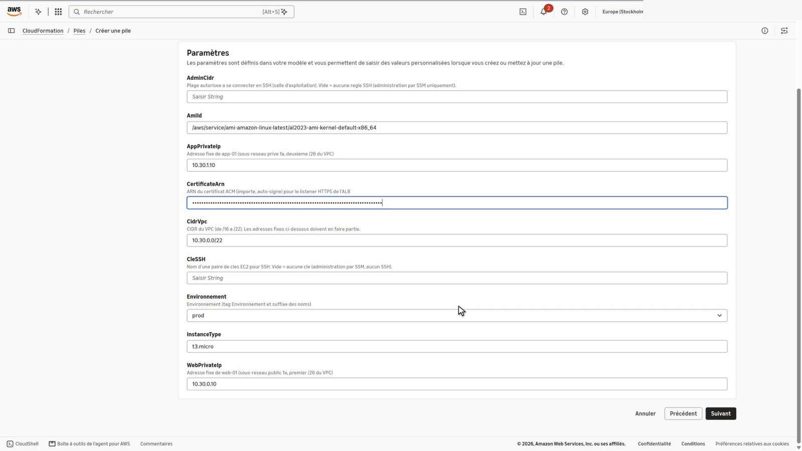

Les paramètres du modèle dans la console. Seul `CertificateArn` est rempli, et masqué à l'écran. `CidrVpc` vaut `10.30.0.0/22`, `Environnement` `prod`, `AdminCidr` et `CleSSH` restent vides : le modèle n'ouvre donc aucun SSH.


La pile `stack-portail-leman-TP-AC`, créée le 19 novembre 2026 à 0 h 37, en `CREATE_COMPLETE`, avec ses quinze ressources.


La détection de dérive : pile `DRIFTED`, `SgWeb` en `MODIFIED`, les autres lignes visibles en `IN_SYNC`.


Le détail : propriété `SecurityGroupIngress.1`, modification `ADD`. À droite, la règle « SSH ajoute a la main », port 22, absente du modèle.


Après le retrait de la règle et une nouvelle détection : statut de l'écart `IN_SYNC`, dernière vérification à 0 h 49 min 15 s.

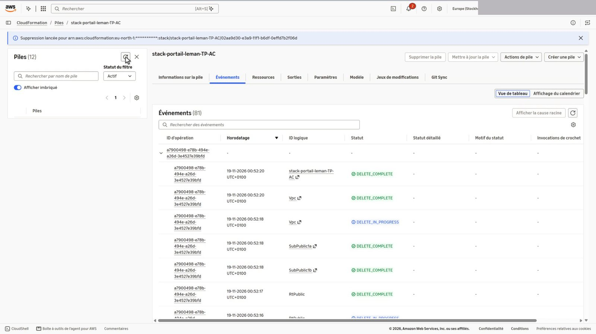

La suppression : les événements les plus récents en haut, `stack-portail-leman-TP-AC` en `DELETE_COMPLETE` à 0 h 52 min 20 s, juste après le VPC. La liste des piles du côté gauche est vide.

## Tableau récapitulatif
| Paramètre | Valeur utilisée |
|---|---|
| `Environnement` | `prod` (autre valeur permise : `dev`) |
| `CidrVpc` | `10.30.0.0/22` (le réseau fait à la main est en `10.20.0.0/22`) |
| `WebPrivateIp` / `AppPrivateIp` | `10.30.0.10` / `10.30.1.10` (non utilisés par cette étape) |
| `AdminCidr` | vide : pas de règle SSH |
| `CleSSH` | vide : administration par Systems Manager, pas de SSH |
| `InstanceType` / `AmiId` | `t3.micro` / Amazon Linux 2023 par paramètre SSM (non utilisés par cette étape) |
| `CertificateArn` | ARN d'un certificat ACM (masqué), non utilisé par cette étape |

| Élément | Valeur |
|---|---|
| Modèle | `cfn/reseau-leman-etape1.yaml`, quinze ressources |
| Pile | `stack-portail-leman-TP-AC`, `CREATE_COMPLETE` en environ deux minutes et demie |
| Sorties | `VpcId`, `SgWebId` |
| Dérive | règle SSH manuelle : `DRIFTED`, puis `IN_SYNC` une fois retirée |
| Suppression | une vingtaine de secondes, dans l'ordre inverse de la création |

## Résultats des tests
Ce que la vidéo montre :

| Test | Résultat |
|---|---|
| Création de la pile depuis le fichier téléversé | `CREATE_COMPLETE`, 15 ressources, 2 sorties |
| Règle SSH ajoutée à la main sur `sg-web-cfn-TP-AC` | pile `DRIFTED`, `SgWeb` `MODIFIED`, différence `SecurityGroupIngress.1` `ADD` |
| Règle retirée, nouvelle détection | pile `IN_SYNC` |
| Suppression de la pile | `DELETE_COMPLETE`, VPC supprimé en dernier |

Le bloc ci-dessous vient de notre première exécution, en ligne de commande et avant de tout refaire à la main. Il couvre ce que la vidéo ne montre pas : le jeu de modifications qui ajoute les instances et l'ALB, la règle SSH déclarée dans le modèle par le paramètre `AdminCidr`, la suppression complète puis le redéploiement. Il utilise le modèle complet, avec un certificat auto-signé (d'où les `curl -k`).

```
=== TP1 : validation et creation de la stack (reseau seul) ===
validate-template : parametres = CidrVpc	WebPrivateIp	AppPrivateIp	AdminCidr	CleSSH	Environnement	InstanceType	CertificateArn	AmiId
Statut : CREATE_COMPLETE ; sorties : VpcId	vpc-0310d32aa87687c10 SgWebId	sg-06d62e0ec61238041

=== TP2 : change set (instances, groupes cibles, ALB) ===
Change set cs-ajouts-912889504 : 7 changements ; actions = Add
   Add  Alb  AWS::ElasticLoadBalancingV2::LoadBalancer
   Add  App01  AWS::EC2::Instance
   Add  ListenerHttps  AWS::ElasticLoadBalancingV2::Listener
   Add  RuleApi  AWS::ElasticLoadBalancingV2::ListenerRule
   Add  TgApp  AWS::ElasticLoadBalancingV2::TargetGroup
   Add  TgWeb  AWS::ElasticLoadBalancingV2::TargetGroup
   Add  Web01  AWS::EC2::Instance
Statut apres execution : UPDATE_COMPLETE
Cibles : tg-web=healthy  tg-app=healthy
curl -k https://alb-prod-leman-cfn-TP-AC-1508405322.eu-north-1.elb.amazonaws.com/api/health -> app-01 TP-AC (cfn) /api/health
curl -k https://alb-prod-leman-cfn-TP-AC-1508405322.eu-north-1.elb.amazonaws.com/ -> web-01 TP-AC (cfn)

=== TP3 : drift, suppression, redeploiement ===
Regle SSH ajoutee a la main sur sg-web-cfn -> drift stack : DETECTION_COMPLETE	DRIFTED
Detail : SgWeb	MODIFIED	/SecurityGroupIngress/1	ADD
Regle manuelle retiree -> drift stack : DETECTION_COMPLETE	IN_SYNC
Change set cs-declaration-template-2112251803 : 1 changements ; actions = Modify
   Modify  SgWeb  AWS::EC2::SecurityGroup
Regle declaree dans le template (AdminCidr) puis redeploiement -> statut : UPDATE_COMPLETE
Apres correction par le template -> drift stack : DETECTION_COMPLETE	IN_SYNC
Regles de sg-web-cfn : tcp	80	None	sg-0517516cc80d5f705 tcp	22	203.0.113.0/24	None
Suppression de la stack (ordre inverse des dependances) : 2 min -> DELETE_COMPLETE (stack disparue)
VPC restants avec le tag de la stack : 0
Change set cs-redeploiement-1694842148 : 7 changements ; actions = Add
   Add  Alb  AWS::ElasticLoadBalancingV2::LoadBalancer
   Add  App01  AWS::EC2::Instance
   Add  ListenerHttps  AWS::ElasticLoadBalancingV2::Listener
   Add  RuleApi  AWS::ElasticLoadBalancingV2::ListenerRule
   Add  TgApp  AWS::ElasticLoadBalancingV2::TargetGroup
   Add  TgWeb  AWS::ElasticLoadBalancingV2::TargetGroup
   Add  Web01  AWS::EC2::Instance
Redeploiement : UPDATE_COMPLETE ; cibles tg-web=healthy tg-app=healthy ; curl -k https://alb-prod-leman-cfn-TP-AC-1090625744.eu-north-1.elb.amazonaws.com/api/health -> app-01 TP-AC (cfn) /api/health
```

## Pièges rencontrés
- **La description du modèle promet plus que le modèle.** La console affiche, dans la fiche de la pile, la description de `reseau-leman-etape1.yaml` : elle parle de `web-01`, `app-01`, de groupes cibles et d'un ALB, qui ne sont pas dans cette étape. C'est un reste de la première version du fichier.
- **Un paramètre obligatoire qui ne sert à rien.** `CertificateArn` n'a pas de valeur par défaut, donc la console l'exige, même si cette étape n'a pas d'ALB. Nous avons donné l'ARN d'un certificat existant.
- **La dérive n'est pas détectée partout.** Le tableau des écarts liste douze ressources, pas quinze : les deux associations de table de routage et l'attachement de la passerelle Internet ne participent pas à la détection.
- **La règle manuelle n'est pas « dans » la pile.** Tant que `AdminCidr` reste vide, le modèle ne contient aucune règle SSH : toute règle de ce genre ajoutée à la main est une dérive. Le retrait manuel ramène la pile en phase, mais ne documente rien. Pour que la règle appartienne à la pile, il faut la déclarer dans le modèle, ce que prévoit `AdminCidr` ; nous l'avons fait lors de la première version, pas dans la vidéo.
- **Le nom des ressources est généré.** CloudFormation nomme le rôle IAM et le Security Group avec un suffixe aléatoire (par exemple `stack-portail-leman-TP-AC-SgWeb-…`). Notre nom lisible, `sg-web-cfn-TP-AC`, est la balise `Name`.

## Si ça ne marche pas : quatre vérifications
1. L'état de la pile : `*_COMPLETE`, `*_FAILED` ou `ROLLBACK_*`.
2. Les événements : la première ressource en `CREATE_FAILED` donne la raison dans la colonne « Motif du statut ».
3. La dérive : « Détecter l'écart de pile », puis le détail de la ressource en `MODIFIED`.
4. Le retour en arrière : on corrige le modèle, jamais la ressource à la main.

## Ce qui diffère du sujet
Le module vise un réseau décrit dans un modèle, avec paramètres, jeu de modifications, détection de dérive et redéploiement identique. Notre vidéo n'en montre qu'une partie, et nous préférons le dire plutôt que de laisser croire à plus.

- **Étendue.** La pile filmée est l'étape 1 du modèle (réseau, Security Groups, rôle SSM). Les instances, l'ALB, le pare-feu, le Transit Gateway, les VPN et Direct Connect ne sont pas dans cette pile : ils existent dans les modèles `reseau-leman.yaml` et `interconnexion-leman.yaml`, essayés seulement en ligne de commande lors de la première exécution.
- **Pas de jeu de modifications** dans la vidéo : la pile a été créée directement.
- **Pas de recréation** : la pile est supprimée à la fin du module, pas redéployée ensuite. La preuve d'un redéploiement identique vient de la première exécution (bloc des tests).
- **Un second réseau, pas le premier.** La pile décrit un VPC `10.30.0.0/22` à côté de celui que nous avons construit à la main (`10.20.0.0/22`) ; nous ne reconstruisons pas le réseau des modules 1 à 3 depuis le modèle.
- **Pas de certificat importé** : le modèle ne crée aucun certificat. Voir l'encadré plus haut.

## Nettoyage
La pile `stack-portail-leman-TP-AC` a été supprimée dans la vidéo même, le 19 novembre 2026 à 0 h 52 : plus aucune ressource `-cfn-TP-AC` ne restait. Les modèles `cfn/*.yaml` restent dans le dépôt. Pour le reste du projet, voir `docs/NETTOYAGE.md` : tout a été supprimé le 20 novembre 2026, sauf le Network Firewall `nfw-prod-leman-TP-AC`, dont la suppression échoue côté AWS.


---

# Points du sujet impossibles, incohérents ou réalisés autrement

Le sujet a été rédigé avec l'aide d'une IA : certaines consignes ne peuvent pas être suivies à la lettre, ou se contredisent. Cette liste dit, pour chacune, ce que nous avons fait à la place et pourquoi. Elle est destinée au formateur.

| # | Module | Ce que dit le sujet | Pourquoi ce n'est pas possible tel quel | Ce que nous avons fait |
|---|---|---|---|---|
| 1 | 8 | Une liaison Direct Connect près de Genève | Il n'existe aucun emplacement Direct Connect près de Genève dans la région de Stockholm (Zurich n'est pas activée sur le compte, Francfort est refusée). Et nous ne commandons pas de fibre. | Emplacement retenu sur le papier : EQSK1 (Equinix Sweden SK1, 1 Gbit/s). Direct Connect Gateway réel et associé au Transit Gateway ; la liaison est simulée par un tunnel GRE et BGP (FRRouting). |
| 2 | 7 | Une bascule entre deux tunnels VPN « sans coupure » | Un VPN IPsec ne peut pas basculer sans coupure : AWS met un certain temps à constater qu'un tunnel est mort avant d'utiliser l'autre. Nous avons mesuré entre 26 et 34 secondes (valeurs exactes au module 7). | Mesure honnête, avec une vraie panne silencieuse (paquets perdus, sans couper l'interface). |
| 3 | 8 | Une bascule Direct Connect vers VPN en quelques secondes, avec un prepend | Un VPN statique ne parle pas BGP : le prepend n'aurait aucun effet. | Le BGP du chemin « VPN » passe dans un tunnel GRE à l'intérieur du vrai VPN. Bascule mesurée au module 8. |
| 4 | 7 | Customer Gateways en `203.0.113.10` et `198.51.100.10` | Ce sont des adresses réservées à la documentation : aucun tunnel ne s'établit vers elles. | Une Elastic IP par routeur de site (`rtr-siege-TP-AC`, `rtr-agence-TP-AC`). |
| 5 | 6, 7 | Plages `10.0.0.0/16` et `10.1.0.0/16` | Le compte est partagé par toute la classe : ces plages recouvrent celles des autres. | `10.20.0.0/22` (prod) et `10.21.0.0/24` (dev). |
| 6 | 7 | Déclarer les routes statiques sur la connexion VPN | Pour un VPN rattaché à un Transit Gateway, AWS refuse : les routes se déclarent dans la table de routage du Transit Gateway. | Routes dans `tgw-rt-prod-TP-AC`. |
| 7 | 4 | Ne mettre que la route de retour `10.20.1.0/26` dans la table publique | Cela casse `web-01` vers `app-01` : la requête passe par le pare-feu, pas la réponse, et le pare-feu perd l'état. Les Security Groups « depuis un groupe » ne correspondent plus au trafic qui sort d'un endpoint de pare-feu. | Routes symétriques, et règles de `sg-app` par plage d'adresses (module 4). |
| 8 | 4 | Le flux autorisé doit apparaître dans les journaux | Un journal d'alertes ne contient que ce qui est bloqué. | Second journal, de type flux (`/leman/nfw-flow-TP-AC`). |
| 9 | 10, 11 | Zone publique et certificat ACM validé par DNS pour le domaine du client | Le nom d'exemple du sujet n'est pas un domaine que nous possédons : on ne peut ni le déléguer, ni y valider un certificat. Au début, nous n'avions pas de domaine. | Le sujet est maintenant respecté avec un domaine réel : le sous-domaine `leman.thomastp.ch` (domaine `thomastp.ch`, jamais modifié) est délégué à une zone publique Route 53 par quatre enregistrements NS ajoutés chez Cloudflare. Certificat public ACM validé par DNS (`leman.thomastp.ch` et `*.leman.thomastp.ch`, plus un en `us-east-1` pour CloudFront), listener HTTPS de l'ALB, nom alternatif `cdn.leman.thomastp.ch` sur CloudFront, tests avec la vérification du certificat activée. Écarts restants : le secours du basculement Route 53 est une adresse statique de documentation (`203.0.113.50`), pas un vrai site de secours ; le nom alternatif de CloudFront a été posé avec la ligne de commande (`aws cloudfront update-distribution`), parce que la liste de certificats de la console ne proposait pas le certificat. |
| 10 | 0 | Un module « cadrage » sans client joignable | Nous ne pouvons pas poser nos questions au client. | Questions et budget rédigés par nos soins, à relire (module 0). |
| 11 | 1 | Région Zurich | `eu-central-2` n'est pas activée (`AuthFailure`), Francfort est refusée par l'organisation. | Stockholm (`eu-north-1`), acceptée avec le formateur. |
| 12 | 8 | Console Direct Connect | La page affiche un bandeau rouge `DescribeLocations` : « explicit deny in a service control policy ». L'organisation refuse la lecture de la liste des emplacements. | La console reste utilisable pour ce qui nous sert : nous y avons créé le Direct Connect Gateway et son association au Transit Gateway (module 8). La liste des emplacements n'est pas consultable. |
| 13 | 4, 6, 7, 8 | Services autorisés | L'organisation refusait Network Firewall, Transit Gateway, VPN et Direct Connect jusqu'au 17/11/2026 (voir `01-services-bloques.md`). | Modules refaits en réel après la levée, et redéployés depuis un modèle CloudFormation. |

## Ce qui reste simulé malgré tout
- Les deux sites (siège, agence) sont des instances EC2 avec strongSwan, pas du matériel réel.
- La « fibre » Direct Connect est un tunnel GRE sur Internet : il n'y a pas d'interface virtuelle physique.
- Le basculement Route 53 mène à une adresse de documentation (`203.0.113.50`), pas à un second site réel.
- GNS3 n'est pas utilisé : les routeurs sont des instances EC2 avec FRRouting.
