# Satom Cloud Network – Dossier de réalisation (équipe TP-AC)

**Client** : Groupe Léman Finance SA – **Intégrateur** : Satom IT & Learning Solutions – **Équipe** : TP-AC (Thomas Prud'homme, Abderahmane Chaouche)
**Formation** : AWS niveau 300 « Intégrer des services réseau multiplateformes » – Geneva Institute of Technology, promotion E3 – semaine du 16 au 20 novembre 2026
**Région de travail** : Europe (Stockholm) `eu-north-1` – **Tags** : `Projet=SatomCloudNetwork`, `Equipe=TP-AC`, `Environnement=prod|dev`

## Sommaire
| Module | Sujet | Statut |
|---|---|---|
| 0 | Cadrage, mandat, équipe, plan d'adressage | ✔ |
| 1 | VPC et sous-réseaux | ✔ déployé et testé |
| 2 | Routage : IGW et NAT | ✔ déployé et testé |
| 3 | Security Groups et NACL | ✔ déployé et testé |
| 4 | Network Firewall | ◐ bloqué par l'organisation : architecture, template validé, procédure |
| 5 | VPC Peering | ✔ déployé et testé |
| 6 | Transit Gateway | ◐ bloqué par l'organisation : architecture, template validé, procédure |
| 7 | VPN site à site | ✔ simulé (IPsec strongSwan réel) |
| 8 | Direct Connect | ✔ simulé (GRE + BGP FRRouting) |
| 9 | Elastic Load Balancing | ✔ déployé et testé |
| 10 | Route 53 | ✔ déployé et testé |
| 11 | CloudFront | ✔ déployé et testé |
| 12 | CloudWatch et Flow Logs | ✔ déployé et testé |
| 13 | CloudFormation | ✔ déployé, drift, suppression/redéploiement testés |


Dépôt du code, des scripts et des preuves : dépôt GitHub public `Thomas-TP/satom-cloud-network-TP-AC`. Les captures de preuve sont dans `captures/mNN/` : captures **réelles de la console AWS** (fichiers `00-console-*.png`, l'identifiant de compte est masqué), tableaux d'état issus de l'AWS CLI et journaux de tests (`99-preuves-tests.png`).


# Module 0 – Cadrage, mandat et équipe

## Objectif
Poser le cadre du projet **Satom Cloud Network** : un réseau AWS sécurisé pour le client **Groupe Léman Finance SA**
(siège à Genève-Cornavin, agence à Lausanne), avec séparation production / développement, traçabilité et données financières sensibles.

## Équipe
| Rôle | Responsable |
|---|---|
| Binôme **TP-AC** (tous les rôles du tableau du HackMD sont assurés par le binôme) | Thomas Prud'homme et Abderahmane Chaouche |
| Relecture croisée | binôme voisin désigné par le formateur |

Toutes les ressources créées portent le suffixe **`-TP-AC`** (convention des autres équipes de la classe : initiales en suffixe) et les tags
`Projet=SatomCloudNetwork`, `Equipe=TP-AC`, `Environnement=prod|dev`.

## Objectifs du mandat (O1 à O6) et état
| # | Objectif | Réalisation |
|---|---|---|
| O1 | Isoler production et développement | VPC prod `10.20.0.0/22` et VPC dev `10.21.0.0/24`, liaison contrôlée par peering (module 5) |
| O2 | Relier siège, agence et cloud en chiffré | Tunnels IPsec IKEv2 **simulés** avec strongSwan (module 7) – VPN géré AWS bloqué par l'organisation |
| O3 | Filtrer les flux et journaliser | Security Groups, NACL (module 3), VPC Flow Logs (module 12) ; Network Firewall bloqué (module 4) |
| O4 | Répartition de charge et DNS | ALB HTTPS (module 9), Route 53 privé/public + failover (module 10), CloudFront (module 11) |
| O5 | Maîtriser les coûts | Ressources facturées à l'heure supprimées après les tests ; budget et crédits suivis |
| O6 | Reproductibilité | Scripts PowerShell/AWS CLI versionnés + template CloudFormation (module 13) |

## Contraintes et écarts assumés par rapport au HackMD
| Sujet | HackMD | Réalité sur la plateforme | Décision |
|---|---|---|---|
| Région | Zurich `eu-central-2` | Zurich non activée, Francfort bloquée : **Stockholm `eu-north-1`** seule autorisée | Stockholm |
| Budget | 150 CHF / équipe | Crédits partagés de 100 USD par compte | Suppression des ressources facturées, suivi des coûts |
| Services | tous disponibles | Network Firewall, Transit Gateway, Site-to-Site VPN, Direct Connect **bloqués par SCP** | Simulation ou documentation + template (voir `01-services-bloques.md`) |
| Domaine | `leman-finance.example` délégué | domaine fictif, pas d'achat | Tests DNS directs sur les serveurs de noms Route 53 |
| Certificats | ACM validé par DNS | pas de domaine réel | Certificat auto-signé importé dans ACM ; certificat `*.cloudfront.net` |
| Plage d'adresses | `10.0.0.0/16` | déjà utilisée par les autres équipes, et surdimensionnée | `10.20.0.0/22` (prod), `10.21.0.0/24` (dev) |
| Accès aux instances | SSH | pas de paire de clés, principe du moindre privilège | AWS Systems Manager (SSM), aucun port 22 exposé |

## Plan d'adressage validé
| Réseau | CIDR | Rôle |
|---|---|---|
| `vpc-prod-leman-TP-AC` | `10.20.0.0/22` | production (1 024 adresses) |
| `sub-public-1a` | `10.20.0.0/26` | `web-01` = `10.20.0.10`, NAT |
| `sub-public-1b` | `10.20.0.64/26` | 2ᵉ zone de l'ALB, routeur `rtr-aws` |
| `sub-prive-1a` | `10.20.1.0/26` | `app-01` = `10.20.1.10` |
| `sub-fw-1a` (module 4, non déployé) | `10.20.2.0/28` | endpoint du pare-feu |
| réservé base de données | `10.20.3.0/26` | non créé |
| `vpc-dev-leman-TP-AC` | `10.21.0.0/24` | `dev-01` = `10.21.0.10` |
| Siège (simulé) | `192.168.10.0/24` | selon HackMD |
| Agence (simulée) | `192.168.20.0/24` | selon HackMD |


## Méthode de travail
* **Tout est scripté** (`scripts/mNN-*.ps1`, AWS CLI) : une exécution rejoue le TP, les preuves de tests sont enregistrées automatiquement dans `docs/modules/mNN/tests.txt`.
* Les captures de la console AWS sont dans `captures/mNN/`.
* Chaque module se termine par un **nettoyage** pour limiter les coûts ; les ressources conservées sont listées dans le module.

## Crédits et budget
* **Crédits du compte** : 100 USD de base ; les 5 activités « Gagnez des crédits AWS » réalisables (EC2, Lambda, DynamoDB, RDS, Budgets) sont validées : **100 USD gagnés sur 100 USD possibles** (plafond atteint, l'activité Bedrock ne rapporte plus). Solde affiché au dernier contrôle : 180 USD (le report des 20 derniers USD peut être différé). Chaque ressource d'activité a été supprimée dès la quête validée.
* **Budget de projet** : `budget-TP-AC-satom`, 100 USD par mois, alerte à **80 %** des dépenses réelles envoyée au topic SNS `sns-exploitation-leman-TP-AC` (aucune adresse e-mail personnelle). Un second budget `budget-TP-AC-quete` a été créé pour valider l'activité pédagogique (assistant de la console, qui exige une adresse : adresse de test sur domaine réservé `example.com`).
* Captures : `captures/m00/00-console-credits.png`, `00-console-quetes-credits.png`, `00-console-budgets.png`.

## Captures

**Console AWS (capture réelle) – budgets**

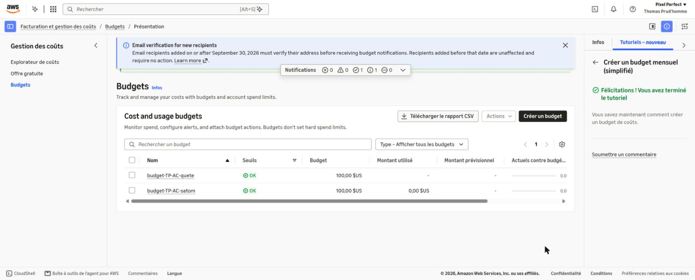

**Console AWS (capture réelle) – credits**

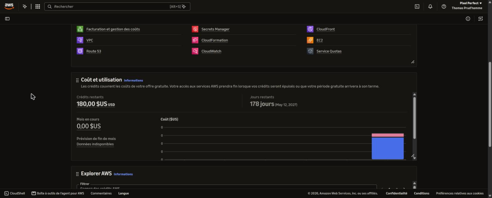

**Console AWS (capture réelle) – quetes credits**

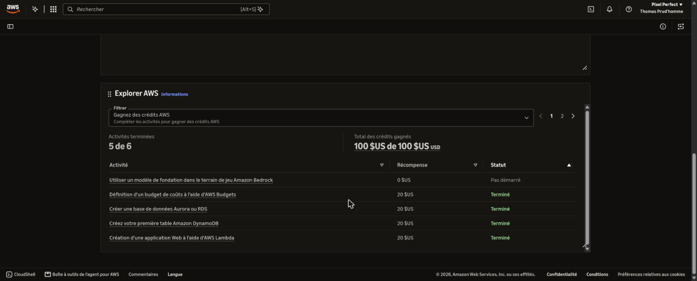


---

# Module 1 – VPC et sous-réseaux

## Objectif
Créer le réseau privé virtuel de production, découper l'espace d'adresses en sous-réseaux public et privé, et vérifier la communication interne.

## Cours (essentiel)
* Un **VPC** est un réseau IP isolé dans une région. Son CIDR (de /16 à /28) ne peut pas chevaucher celui d'un autre réseau que l'on voudra relier (peering, VPN).
* Un **sous-réseau** appartient à **une seule zone de disponibilité** ; AWS réserve **5 adresses** par sous-réseau (réseau, routeur VPC, DNS, futur usage, diffusion) : un /26 offre 59 adresses utilisables.
* Tant qu'on n'a rien ajouté, la table de routage du VPC ne contient que la **route locale** (`10.20.0.0/22 → local`) : les instances se parlent, mais rien ne sort.
* Dimensionnement : le HackMD propose un /16 (65 536 adresses). Pour deux serveurs, c'est surdimensionné et cela complique le peering ; nous avons retenu un **/22** (1 024 adresses) découpé en /26.

## Scénario
Léman Finance veut un environnement de production isolé. On crée `vpc-prod-leman-TP-AC`, un sous-réseau public (serveur web) et un sous-réseau privé (application).

## TP
| Tâche | Réalisation |
|---|---|
| 1. VPC et sous-réseaux | `vpc-prod-leman-TP-AC` `10.20.0.0/22` ; `sub-public-1a-TP-AC` `10.20.0.0/26` et `sub-prive-1a-TP-AC` `10.20.1.0/26` en `eu-north-1a` ; vérification : la table par défaut ne contient que la route locale |
| 2. Instances | `web-01-TP-AC` (`10.20.0.10`, public) et `app-01-TP-AC` (`10.20.1.10`, privé) ; Amazon Linux 2023, `t3.micro`, accès par **SSM** (rôle `TP-AC-ec2-ssm-role`) ; ping `web-01 → app-01` |
| 3. Limites | création de `10.20.0.0/27` refusée (chevauchement) ; réservation de `10.20.3.0/26` pour la base de données (non créé) |

Script : `scripts/m01-vpc.ps1`.

## Diagramme
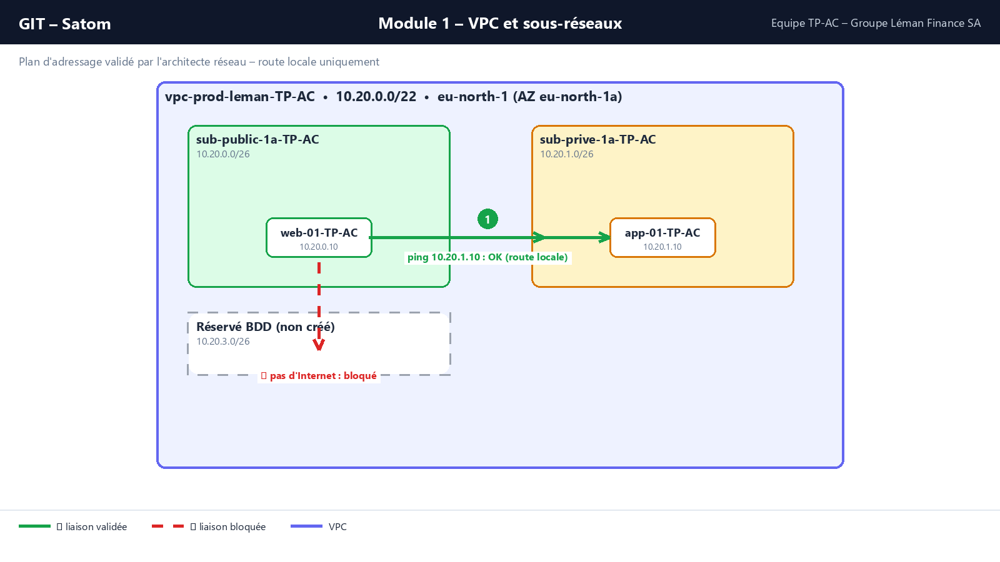

## Tableau de configuration
| Ressource | Nom | Valeur |
|---|---|---|
| VPC | `vpc-prod-leman-TP-AC` | `10.20.0.0/22`, DNS hostnames activé |
| Sous-réseau public | `sub-public-1a-TP-AC` | `10.20.0.0/26`, `eu-north-1a` |
| Sous-réseau privé | `sub-prive-1a-TP-AC` | `10.20.1.0/26`, `eu-north-1a` |
| Instance web | `web-01-TP-AC` | `10.20.0.10`, `t3.micro` |
| Instance application | `app-01-TP-AC` | `10.20.1.10`, `t3.micro` |
| Rôle IAM | `TP-AC-ec2-ssm-role` | `AmazonSSMManagedInstanceCore` |

## Procédure de test
1. `aws ec2 describe-subnets` : CIDR et zone conformes au plan.
2. `aws ec2 describe-route-tables` : seule la route locale existe.
3. `aws ec2 create-subnet --cidr-block 10.20.0.0/27` doit échouer avec `InvalidSubnet.Conflict`.
4. Depuis `web-01` (SSM) : `ping -c 3 10.20.1.10` doit réussir.

## Résultats
```
=== Module 1 : VPC et sous-reseaux (region eu-north-1) ===
Creation du VPC vpc-prod-leman-TP-AC 10.20.0.0/22, sub-public-1a-TP-AC 10.20.0.0/26 et sub-prive-1a-TP-AC 10.20.1.0/26 (eu-north-1a)
Adresses disponibles apres lancement des instances (un /26 = 64 adresses, 5 reservees par AWS = 59 utilisables, moins 1 instance = 58 libres) :
  sub-prive-1a-TP-AC  10.20.1.0/26  58 adresses libres
  sub-public-1a-TP-AC 10.20.0.0/26  58 adresses libres

Test de chevauchement : create-subnet --cidr-block 10.20.0.0/27 (inclus dans 10.20.0.0/26)
  -> aws: [ERROR]: An error occurred (InvalidSubnet.Conflict) when calling the CreateSubnet operation: The CIDR '10.20.0.0/27' conflicts with another subnet

Joignabilite web-01 (10.20.0.10) -> app-01 (10.20.1.10) : ping 3/3 recus, 0 % de perte, rtt moyen 0,25 ms (route locale du VPC)
Joignabilite app-01 -> Internet avant IGW/NAT : impossible (la table par defaut ne contient que la route locale 10.20.0.0/22)
Note : l'outil Reachability Analyzer (tiros:CreateQuery) est bloque par l'organisation ; les tests de ping ont donc ete faits via SSM apres le module 2.
```

## Nettoyage
`web-01` et `app-01` sont **arrêtés** (non supprimés) en fin de séance ; le VPC et les sous-réseaux sont conservés. Les volumes EBS (8 Go chacun) restent facturés quelques centimes par mois.

## Écarts et remarques
* Le HackMD utilise SSH ; nous utilisons SSM Session Manager (aucun port 22 ouvert, aucune clé à stocker).
* L'outil *Reachability Analyzer* est bloqué par l'organisation (`tiros:CreateQuery`) ; les tests passent par de vrais pings.

## Captures

**Console AWS (capture réelle) – instances**

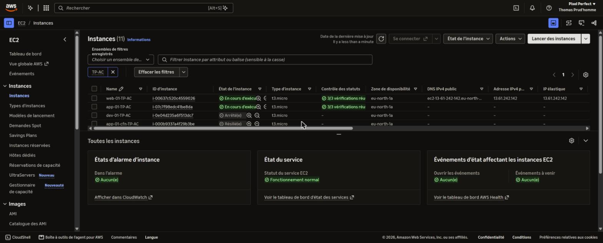

**Console AWS (capture réelle) – sous reseaux**


**Console AWS (capture réelle) – vpcs**


**Sortie AWS CLI – vpc**

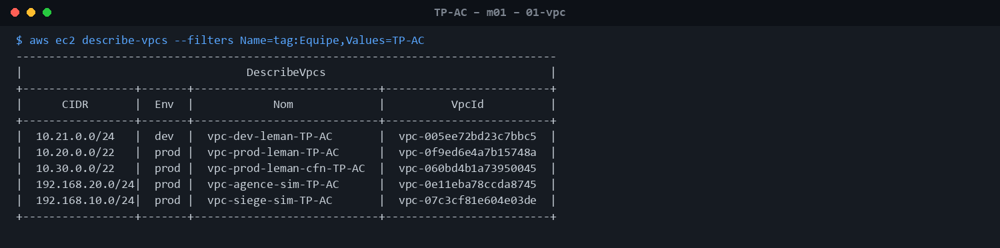

**Sortie AWS CLI – subnets**


**Sortie AWS CLI – instances**


**Preuves de tests (journal)**


---

# Module 2 – Routage : Internet Gateway et NAT

## Objectif
Donner un accès Internet entrant/sortant au sous-réseau public, un accès sortant seulement au sous-réseau privé, et savoir diagnostiquer un défaut de route.

## Cours (essentiel)
* Un sous-réseau est **public** si sa table de routage contient `0.0.0.0/0 → Internet Gateway` ; l'instance doit en plus avoir une **IP publique**.
* La **NAT Gateway** (placée dans un sous-réseau public) permet aux instances privées de **sortir** sans être joignables de l'extérieur. Elle est facturée à l'heure (~0,045 USD) et à la donnée traitée.
* La **route la plus spécifique** l'emporte (longest prefix match) ; `local` est toujours prioritaire pour le CIDR du VPC.

## TP
| Tâche | Réalisation |
|---|---|
| 1. IGW et table publique | `igw-prod-leman-TP-AC`, `rt-public-leman-TP-AC` (`0.0.0.0/0 → IGW`) associée à `sub-public-1a`, Elastic IP sur `web-01` |
| 2. NAT et table privée | Elastic IP + `nat-prod-leman-TP-AC` dans `sub-public-1a`, `rt-prive-leman-TP-AC` (`0.0.0.0/0 → NAT`) associée à `sub-prive-1a` |
| 3. Panne | route par défaut retirée de `rt-prive` : le ping échoue 19 s ; rétablie : il repart |

Script : `scripts/m02-routage.ps1`.

## Diagramme


## Tableaux de configuration
| Table | Association | Routes |
|---|---|---|
| `rt-public-leman-TP-AC` | `sub-public-1a`, `sub-public-1b` | `10.20.0.0/22 → local` ; `0.0.0.0/0 → igw-prod-leman-TP-AC` |
| `rt-prive-leman-TP-AC` | `sub-prive-1a` | `10.20.0.0/22 → local` ; `0.0.0.0/0 → nat-prod-leman-TP-AC` |

## Procédure de diagnostic en quatre étapes
1. **Table associée** : `describe-route-tables` – le sous-réseau est-il bien associé à la bonne table (et non à la table principale) ?
2. **Route par défaut** : `0.0.0.0/0` existe-t-elle ?
3. **Cible** : pointe-t-elle vers la bonne IGW / NAT (pas un identifiant supprimé) ?
4. **État de la cible** : la NAT est `available`, l'IGW est `attached`, l'instance a bien une IP publique (public) ou la NAT une EIP (privé).

## Résultats
```
=== Module 2 : routage ===
TP1 - IGW + rt-public (0.0.0.0/0 -> igw) + IP publique (Elastic IP) sur web-01
  web-01 -> ping 8.8.8.8 : 2/2 recus (ttl 119, ~3 ms)
  web-01 -> app-01 ping 10.20.1.10 : 3/3 recus
TP2 - NAT nat-prod-leman-TP-AC + rt-prive (0.0.0.0/0 -> nat)
  app-01 -> ping 8.8.8.8 : 2/2 recus (~4 ms) ; curl https://checkip.amazonaws.com -> IP de la NAT (l'adresse de app-01 reste privee)
  SSH depuis l'exterieur vers app-01 : impossible (pas d'IP publique, SG ferme)
TP3 - route par defaut retiree puis retablie (ping 8.8.8.8 chaque seconde depuis app-01, heures UTC de l'instance) :
  10:49:04 a 10:49:18  OK    (route 0.0.0.0/0 -> NAT presente)
  10:49:19 a 10:49:37  ECHEC (route retiree a 10:49:20 UTC, soit 19 s d'echec)
  10:49:39 a 10:49:59  OK    (route retablie a 10:49:39 UTC)
Tables de routage finales :
  rt-public-leman-TP-AC : 10.20.0.0/22 local | 0.0.0.0/0 -> igw-prod-leman-TP-AC
  rt-prive-leman-TP-AC  : 10.20.0.0/22 local | 0.0.0.0/0 -> nat-prod-leman-TP-AC
```

## Nettoyage
Conformément au HackMD, **la NAT et son Elastic IP sont supprimées** quand elles ne servent plus ; l'IGW et les tables sont conservées. En pratique, la NAT reste active pendant la durée du projet (elle donne l'accès SSM à `app-01`), puis est supprimée en fin de projet (voir `docs/NETTOYAGE.md`).

## Écarts et remarques
* Quota d'Elastic IP du compte partagé limité (5 par région) : les autres machines du projet utilisent des IP publiques automatiques.

## Captures

**Console AWS (capture réelle) – passerelle nat**

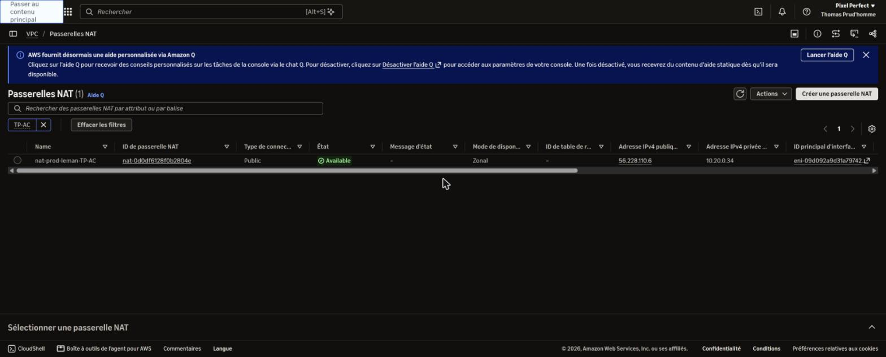

**Console AWS (capture réelle) – passerelles internet**


**Console AWS (capture réelle) – tables routage**


**Sortie AWS CLI – routes**

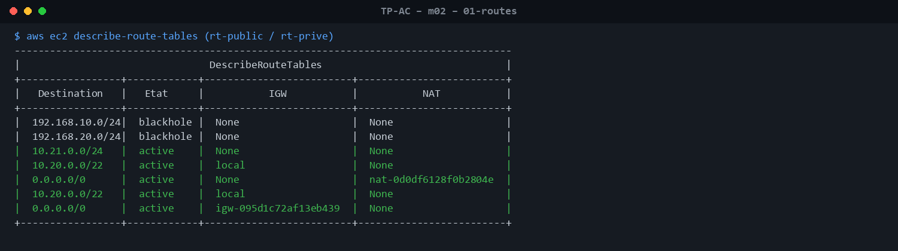

**Sortie AWS CLI – nat**

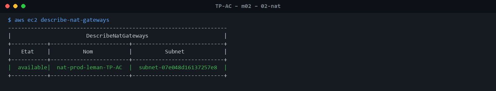

**Preuves de tests (journal)**


---

# Module 3 – Security Groups et NACL

## Objectif
Filtrer les flux à deux niveaux : au niveau de l'instance (Security Group, avec état) et du sous-réseau (NACL, sans état), et savoir diagnostiquer un blocage.

## Cours (essentiel)
| | Security Group | NACL |
|---|---|---|
| Niveau | interface (ENI) de l'instance | sous-réseau |
| État | **avec état** : la réponse est autorisée automatiquement | **sans état** : il faut autoriser aller **et** retour (ports éphémères 1024-65535) |
| Règles | autorisation uniquement | autorisation **et refus**, évaluées par **numéro croissant**, la première qui correspond gagne |
| Référence | CIDR ou autre Security Group | CIDR uniquement |

## Scénario
Seul le HTTPS public doit atteindre `web-01` ; l'API de `app-01` (8080) n'est joignable que depuis `web-01`.

## TP
| Tâche | Réalisation |
|---|---|
| 1. Security Groups | `sg-web-TP-AC` : 443 depuis `0.0.0.0/0`, 22 depuis la salle d'exploitation ; `sg-app-TP-AC` : 8080, 22 et ICMP depuis `sg-web` ; services de test : nginx (80/443, certificat auto-signé) sur `web-01`, mini API (8080) sur `app-01` |
| 2. NACL | `nacl-public-TP-AC` : entrée 443 + éphémères + VPC ; sortie 443 + éphémères + VPC ; retrait de la règle de retour → échec ; rétablie → succès |
| 3. Diagnostic | 8080 retiré de `sg-app` → échec ; refus explicite NACL (règle 50) placé avant l'autorisation (règle 100) → échec |

Scripts : `scripts/m03-securite.ps1` (déploiement) et `scripts/m03-tests.ps1` (preuves).

## Diagramme


## Tableaux des règles
**Security Groups**
| Groupe | Sens | Protocole / port | Source | Commentaire |
|---|---|---|---|---|
| `sg-web-TP-AC` | entrée | TCP 443 | `0.0.0.0/0` | HTTPS public |
| `sg-web-TP-AC` | entrée | TCP 22 | `203.0.113.0/24` | « salle d'exploitation » (adresse réelle non fournie : plage de documentation) |
| `sg-app-TP-AC` | entrée | TCP 8080 | `sg-web-TP-AC` | API |
| `sg-app-TP-AC` | entrée | TCP 22 / ICMP | `sg-web-TP-AC` | administration et diagnostic |

**NACL `nacl-public-TP-AC`** (sous-réseau `sub-public-1a`)
| N° | Sens | Protocole | Plage / port | Action |
|---|---|---|---|---|
| 100 | entrée | TCP | 443 depuis `0.0.0.0/0` | autoriser |
| 110 | entrée | TCP | 1024-65535 depuis `0.0.0.0/0` | autoriser (retours) |
| 120 | entrée | tous | `10.20.0.0/22` | autoriser |
| 100 | sortie | TCP | 443 vers `0.0.0.0/0` | autoriser |
| 110 | sortie | TCP | 1024-65535 vers `0.0.0.0/0` | autoriser (réponses aux clients) |
| 120 | sortie | tous | `10.20.0.0/22` | autoriser |

## Procédure de diagnostic
1. **SG de la cible** : le port est-il ouvert pour la source ? (`describe-security-groups`)
2. **Règles SG** : la source est-elle un CIDR ou un SG correct ?
3. **NACL** : les règles d'entrée **et** de sortie (ports éphémères) du sous-réseau, et leur ordre.
4. **Route** : le chemin retour existe-t-il (table du sous-réseau) ?
Rétablir la production : remettre la règle d'origine, retester le flux.

## Résultats
```
=== TP1 : Security Groups ===
curl https depuis Internet vers web-01 : HTTP 200
ping depuis Internet vers web-01 (ICMP non autorise) : pas de reponse (attendu)
app-01 n'a pas d'IP publique : None

=== TP2 : SG (avec etat) vs NACL (sans etat) ===
web-01 -> app-01:8080 : Success	app-01 TP-AC /api/health 	
NACL : regle de retour (sortie ephemere 1024-65535) retiree -> curl externe : HTTP 000 ECHEC (code curl 28 : timeout/refus)
NACL : regle de retour retablie -> curl externe : HTTP 200

=== TP3 : diagnostic ===
8080 retire de sg-app -> web-01 -> app-01:8080 : Success	ECHEC 	
8080 retabli -> web-01 -> app-01:8080 : Success	app-01 TP-AC /api/health 	
NACL : refus explicite regle 50 (avant l'autorisation 100) -> curl externe : HTTP 000 ECHEC (code curl 28 : timeout/refus)  [la regle au numero le plus bas gagne]
refus supprime -> curl externe : HTTP 200
```

## Nettoyage
`sg-web`, `sg-app` et `nacl-public` sont conservés ; `web-01` et `app-01` arrêtés en fin de séance.

## Écarts et remarques
* AWS interdit les noms de groupes commençant par `sg-` : le nom logique `sg-web-TP-AC` est porté par le tag `Name`, le nom technique du groupe est `web-TP-AC`.
* Les captures « ancien lab » du HackMD ont été remplacées par les nôtres.
* Le port 22 est ouvert pour la forme prévue au sujet ; l'administration réelle passe par SSM.

## Captures

**Console AWS (capture réelle) – groupes securite**

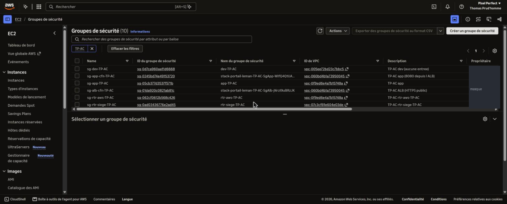

**Console AWS (capture réelle) – nacl**

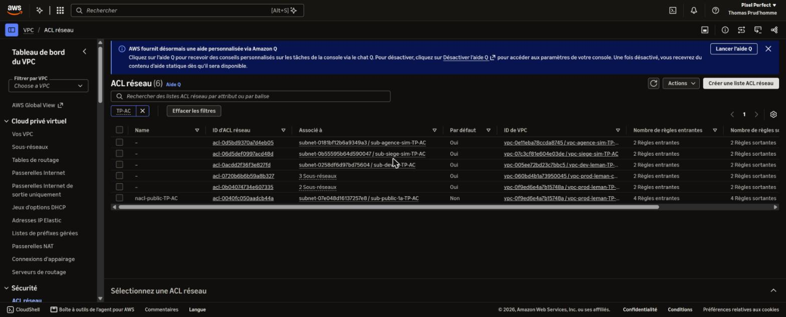

**Sortie AWS CLI – sg**


**Sortie AWS CLI – nacl**

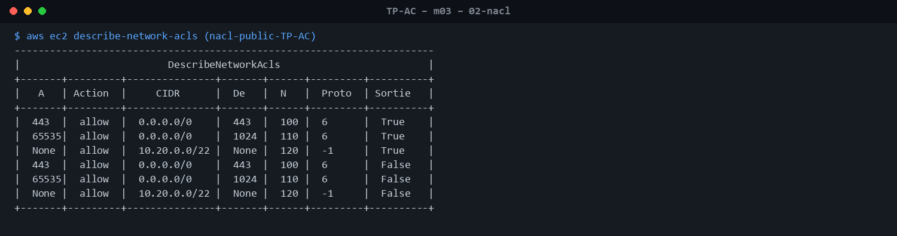

**Preuves de tests (journal)**


---

# Module 4 – AWS Network Firewall

> **Statut : non déployable sur la plateforme de formation.** Toutes les actions `network-firewall:*` sont refusées par une *Service Control Policy* de l'organisation (voir `01-services-bloques.md`). Ce module fournit le cours, l'architecture cible, un **template CloudFormation validé** (`cfn/optional-m04-network-firewall.yaml`) et la procédure de test à rejouer dès que la restriction sera levée.

## Objectif
Inspecter et filtrer le trafic sortant du sous-réseau privé : n'autoriser que des dépôts de mises à jour, bloquer le reste du HTTP/HTTPS et journaliser les alertes.

## Cours (essentiel)
* **Network Firewall** est un pare-feu managé placé dans un **sous-réseau dédié** (`sub-fw`) ; on y fait transiter le trafic par des **routes vers l'endpoint** (`vpce-…`).
* Moteurs : *stateless* (règles 5-tuples, rapide, par paquet) puis *stateful* (Suricata : domaines HTTP Host / TLS SNI, signatures). En mode **ordre strict**, les règles sont évaluées par priorité et une action par défaut (`drop_established` + alerte) s'applique ensuite.
* **Symétrie** : le trafic de retour doit repasser par le même endpoint, sinon l'état du flux est perdu ; d'où la route de retour dans la table du sous-réseau public (celui de la NAT).
* Coût : ~0,40 USD/h par endpoint + traitement : à supprimer après les tests.

## Architecture cible


Chemin sortant : `app-01 → sub-prive → endpoint pare-feu (sub-fw) → NAT (sub-public) → Internet` ; retour : `NAT → rt-public (10.20.1.0/26 → endpoint) → pare-feu → app-01`.

## Ce qui a été fait / tenté
| Étape | Résultat |
|---|---|
| Sous-réseau `sub-fw-1a-TP-AC` `10.20.2.0/28` + table `rt-fw` (`0.0.0.0/0 → NAT`) | créés, puis supprimés lors du constat du blocage |
| `create-rule-group` / `create-firewall-policy` / `create-firewall` | **AccessDenied : explicit deny in a service control policy** (`p-yxwnli3w`) |
| Réalisation alternative | impossible sans l'API ; template CloudFormation fourni et validé (`aws cloudformation validate-template` : OK) |

## Règles prévues (tableau de configuration)
| Priorité | Groupe | Contenu | Rôle |
|---|---|---|---|
| 1 | `rg-vpc-pass-TP-AC` | `pass ip 10.20.0.0/22 any -> 10.20.0.0/22 any` | ne pas casser les flux internes (modules 3, 5, 6) |
| 2 | `rg-depots-autorises-TP-AC` | liste blanche `.amazonlinux.com`, `.amazonaws.com` (HTTP_HOST + TLS_SNI) | dépôts de mises à jour + SSM |
| défaut | politique `policy-prod-leman-TP-AC` | `drop_established` + `alert_established` | tout le reste est bloqué et journalisé dans `/leman/nfw-alert-TP-AC` |

Tables de routage avant / après :
| Table | Avant | Après |
|---|---|---|
| `rt-prive-leman-TP-AC` | `0.0.0.0/0 → nat` | `0.0.0.0/0 → vpce-pare-feu` |
| `rt-fw-leman-TP-AC` | – | `0.0.0.0/0 → nat` |
| `rt-public-leman-TP-AC` | `0.0.0.0/0 → igw` | `0.0.0.0/0 → igw` + `10.20.1.0/26 → vpce-pare-feu` (retour) |

## Procédure de test (à rejouer quand la SCP sera levée)
1. `aws cloudformation deploy --template-file cfn/optional-m04-network-firewall.yaml ...` : pare-feu `Ready`, endpoint visible dans la zone.
2. Depuis `app-01` : `curl https://cdn.amazonlinux.com` **réussit** ; `curl https://example.com` **échoue**.
3. `aws logs start-query` sur `/leman/nfw-alert-TP-AC` : l'alerte du second test apparaît (action `blocked`).
4. Contrôle des routes (tableau ci-dessus).

## Nettoyage
Supprimer le pare-feu **avant** la politique et les groupes de règles ; restaurer `0.0.0.0/0 → NAT` dans `rt-prive` (script `scripts/m04-cleanup.ps1`, prêt).

## Justification de l'écart
Le formateur a bloqué ce service (coût élevé). Les compétences du module sont couvertes par l'architecture, les règles, le template validé et la procédure de test ; la partie « filtrage au niveau réseau » est démontrée à moindre échelle par les Security Groups et NACL (module 3).


---

# Module 5 – VPC Peering (environnement de développement)

## Objectif
Créer un VPC de développement isolé, le relier à la production par un peering **limité au port 8080**, et comprendre les limites du peering (CIDR chevauchants, non-transitivité).

## Cours (essentiel)
* Le **peering** relie deux VPC par le réseau privé AWS (pas de passerelle, pas de point unique de défaillance, pas de coût horaire). Il faut : demande + acceptation, **routes dans les deux sens** et règles de Security Group adaptées.
* Les CIDR ne doivent **pas se chevaucher**. AWS accepte la demande mais la passe en état `failed` à l'acceptation.
* Le peering n'est **pas transitif** : A↔B et B↔C n'impliquent pas A↔C. Pour un maillage large, on utilise un Transit Gateway (module 6).

## Scénario
L'équipe de développement (`dev-01`) doit tester l'API de production (8080) sans accéder au reste.

## TP
| Tâche | Réalisation |
|---|---|
| 1. Réseau dev | `vpc-dev-leman-TP-AC` `10.21.0.0/24`, `sub-dev-1a-TP-AC` `10.21.0.0/26`, `dev-01-TP-AC` `10.21.0.10` (IGW dédiée + IP publique pour SSM ; `sg-dev` sans aucune entrée) |
| 2. Peering | `pcx-lab-TP-AC` acceptée ; routes `10.20.0.0/22 → pcx` (table dev) et `10.21.0.0/24 → pcx` (`rt-prive`) ; `sg-app` autorise 8080 depuis `10.21.0.0/24` |
| 3. Limites | peering avec un VPC en `10.20.0.0/24` (chevauche la prod) → `failed` ; `dev-01` ne joint pas un 3ᵉ VPC relié seulement à la prod |

Scripts : `scripts/m05-peering.ps1` et `scripts/m05-tests.ps1`.

## Diagramme


## Tableaux de configuration
| Ressource | Valeur |
|---|---|
| `vpc-dev-leman-TP-AC` | `10.21.0.0/24`, tag `Environnement=dev` |
| `pcx-lab-TP-AC` | prod `10.20.0.0/22` ↔ dev `10.21.0.0/24` |
| `rt-dev-leman-TP-AC` | `10.20.0.0/22 → pcx-lab` ; `0.0.0.0/0 → igw-dev` |
| `rt-prive-leman-TP-AC` | `10.21.0.0/24 → pcx-lab` (ajout) |
| `sg-app-TP-AC` | TCP 8080 depuis `10.21.0.0/24` (ajout) |

## Procédure de test
1. `dev-01` : `curl http://10.20.1.10:8080/api/health` → réponse.
2. `dev-01` : test TCP sur 22 → fermé (seul 8080 est ouvert).
3. Créer un VPC `10.20.0.0/24`, demander puis accepter un peering avec la prod → état `failed`.
4. 3ᵉ VPC `10.22.0.0/24` relié à la prod : `app-01` le joint, `dev-01` (via la prod) **non**.

## Résultats
```
dev-01 SSM en ligne : True
=== TP2 : peering pcx-lab (prod <-> dev) ===
dev-01 -> app-01:8080 : Success	app-01 TP-AC /api/health 	
dev-01 -> app-01:22 (non ouvert depuis dev) : Success	FERME 	

=== TP3 : limites du peering ===
Acceptation du peering avec un VPC en 10.20.0.0/24 (chevauche 10.20.0.0/22) -> aws: [ERROR]: An error occurred (InvalidStateTransition) when calling the AcceptVpcPeeringConnection operation: Invalid state transition for pcx-0b30499bae7844bdf, attempted to transition from failed to provisioning
app-01 (prod, peering direct) -> tiers-01 10.22.0.10 : Success	2 packets transmitted, 2 received, 0% packet loss, time 1002ms rtt min/avg/max/mdev = 0.170/0.294/0.419/0.124 ms 	
dev-01 (via prod = transit, NON transitif) -> tiers-01 10.22.0.10 : Success	2 packets transmitted, 0 received, 100% packet loss, time 1043ms  exit=0
```

## Nettoyage
`pcx-lab` est supprimé au module 6 dans le HackMD ; **ici le Transit Gateway est bloqué** (module 6) : le peering est donc conservé comme liaison prod/dev. Le VPC dev est conservé ; `dev-01` arrêté.

## Écarts et remarques
* Les captures « ancien lab » du HackMD ont été remplacées par nos preuves de tests.
* Le VPC « tiers » et celui au CIDR chevauchant sont des ressources de test supprimées dès les mesures faites.

## Captures

**Console AWS (capture réelle) – peering**


**Sortie AWS CLI – peering**


**Sortie AWS CLI – routes dev**

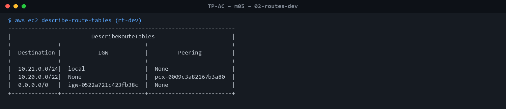

**Preuves de tests (journal)**


---

# Module 6 – Transit Gateway

> **Statut : non déployable sur la plateforme de formation.** `ec2:CreateTransitGateway` est refusé par la SCP de l'organisation (la lecture est autorisée). Ce module fournit le cours, l'architecture, un **template CloudFormation validé** (`cfn/optional-m06-m08-interconnexion.yaml`) et la procédure de test. La liaison prod/dev reste assurée par le peering du module 5.

## Objectif
Remplacer les liaisons point à point (peering) par un **hub** : un Transit Gateway relie plusieurs VPC et, plus tard, des sites distants, avec une table de routage par environnement.

## Cours (essentiel)
* Le **TGW** est un routeur régional managé : chaque VPC (ou VPN, Direct Connect) s'y connecte par un **attachement**. Le peering demande n(n-1)/2 liens ; le TGW en demande n.
* **Association** : un attachement est associé à **une** table de routage TGW (celle qui décide où il peut aller). **Propagation** : un attachement publie son CIDR dans une table. En désactivant l'association/propagation par défaut, on isole prod et dev et on décide explicitement qui voit qui.
* Les routes **dans les tables des VPC** (`10.21.0.0/24 → tgw`) sont toujours nécessaires.
* Facturation : ~0,05 USD/h **par attachement** + données traitées.

## Architecture cible


## Configuration prévue
| Ressource | Valeur |
|---|---|
| `tgw-leman-TP-AC` | ASN `64512`, association et propagation par défaut **désactivées** |
| `tgwa-prod-TP-AC` | VPC prod, sous-réseau `sub-prive-1a` |
| `tgwa-dev-TP-AC` | VPC dev, sous-réseau `sub-dev-1a` |
| `tgw-rt-prod-TP-AC` | associée à `tgwa-prod` ; propagation depuis `tgwa-dev` |
| `tgw-rt-dev-TP-AC` | associée à `tgwa-dev` ; propagation depuis `tgwa-prod` |
| `rt-prive-leman-TP-AC` | `10.21.0.0/24 → tgw-leman` (remplace la route du peering) |
| `rt-dev-leman-TP-AC` | `10.20.0.0/22 → tgw-leman` |

## Ce qui a été tenté
`aws ec2 create-transit-gateway` → `UnauthorizedOperation … explicit deny in a service control policy` (preuve dans `01-services-bloques.md`). Le script `scripts/m06-tgw.ps1` (création, attachements, tables, propagation, tests, test d'asymétrie) est prêt à rejouer.

## Procédure de test (à rejouer quand la SCP sera levée)
1. Deux attachements `available`, `pcx-lab` supprimé.
2. `dev-01` : `curl http://10.20.1.10:8080/api/health` réussit via le TGW.
3. Retirer la propagation `tgwa-dev → tgw-rt-prod` : le `curl` **échoue** (la prod ne sait plus répondre au dev : trafic asymétrique) ; rétablir : il réussit.
4. Procédure de diagnostic : **association** de l'attachement → **route propagée** dans la table TGW → **route dans la table du VPC** → **SG de la cible**.

## Nettoyage
Garder `tgw-leman` si le module 7 suit ; sinon supprimer les attachements puis le TGW et le noter dans le journal du projet. Dans notre cas rien n'est facturé, rien n'a été créé.

## Justification de l'écart
Service bloqué par l'organisation. Le comportement de routage (association, propagation, asymétrie) est étudié dans le module 5 (peering) et dans la simulation du module 7 (routeur `rtr-aws`).


---

# Module 7 – VPN site à site (siège et agence)

> **Statut : réalisé par simulation.** Le service managé Site-to-Site VPN est bloqué par la SCP de l'organisation (`CreateCustomerGateway`, `CreateVpnGateway`, `CreateVpnConnection` refusés, Transit Gateway aussi). Le **tunnel IPsec IKEv2 réel** est donc monté avec **strongSwan** sur des instances EC2 qui jouent les rôles des routeurs du siège, de l'agence et de la passerelle côté AWS. Le template CloudFormation du service managé est fourni (`cfn/optional-m06-m08-interconnexion.yaml`).

## Objectif
Relier le siège (`192.168.10.0/24`) et l'agence (`192.168.20.0/24`) au VPC de production par des tunnels **chiffrés**, avec des droits différents : le siège joint `app-01` (ping + 8080), l'agence seulement le port 8080 ; ni l'un ni l'autre ne joint `dev-01`.

## Cours (essentiel)
* **IPsec IKEv2** : une phase d'authentification (clé pré-partagée, échange Diffie-Hellman) puis une association de sécurité **ESP** qui chiffre le trafic (`aes256-sha256-modp2048`).
* Le VPN géré AWS fournit **deux tunnels** par connexion (deux zones) et des adresses de tunnel `169.254.x.x/30` ; la **customer gateway** (CGW) décrit le routeur du site (IP publique, ASN).
* **Route-based** : le tunnel est une interface (`xfrm`/VTI) ; le routage (statique ou BGP) décide ce qui y passe. Plus souple qu'un VPN à politiques (selectors).
* La clé pré-partagée ne doit **jamais** être écrite dans un document ou un dépôt : elle est stockée dans **Secrets Manager** (`Projet/SatomCloudNetwork/vpn`) et lue par les routeurs via leur rôle IAM.

## Architecture de la simulation


| Rôle réel | Réalisation (simulation) |
|---|---|
| Passerelle VPN / TGW côté AWS | `rtr-aws-TP-AC` (Ubuntu 24.04, strongSwan) dans `sub-public-1b`, `10.20.0.74`, contrôle source/destination désactivé |
| Routeur du siège | `rtr-siege-TP-AC` `192.168.10.10` dans `vpc-siege-sim-TP-AC` (`192.168.10.0/24`) |
| Routeur de l'agence | `rtr-agence-TP-AC` `192.168.20.10` dans `vpc-agence-sim-TP-AC` (`192.168.20.0/24`) |
| Adresses des tunnels | siège `169.254.10.0/30` (AWS `.1`, site `.2`) ; agence `169.254.20.0/30` |
| Routes propagées | `rt-prive` : `192.168.10.0/24` et `192.168.20.0/24` → ENI de `rtr-aws` |

## TP
| Tâche | Réalisation |
|---|---|
| 1. Objets | équivalent des CGW/VPN : routeurs, IP publiques, groupes de sécurité (UDP 500, 4500, ESP limités à l'adresse du pair), clés dans Secrets Manager, tags sur toutes les ressources |
| 2. Tunnel siège | strongSwan route-based (`if_id 11`) ; tunnel `ESTABLISHED` ; `ping 10.20.1.10` depuis le siège réussit ; vérification de la route vers `192.168.10.0/24` dans `rt-prive` |
| 3. Agence | tunnel `if_id 12` ; l'agence joint `app-01` sur 8080 **uniquement** (ICMP refusé par `sg-app`) ; ni siège ni agence ne joignent `dev-01` (`10.21.0.10`, aucune route annoncée) |

Scripts : `scripts/m07-ipsec-sim.ps1 -Site siege|agence`.

## Tableau de configuration IPsec
| Paramètre | Valeur |
|---|---|
| IKE | IKEv2, `aes256-sha256-modp2048`, authentification PSK, DPD 10 s |
| ESP | `aes256-sha256-modp2048` (PFS), mode tunnel, `start_action = start`, `dpd_action = restart` |
| Interfaces | `xfrm-siege` (id 11), `xfrm-agence` (id 12) |
| Routage | site → `10.20.0.0/22` via tunnel ; AWS → `192.168.x.0/24` via tunnel |
| Autorisations | `sg-app` : siège ICMP + TCP 8080 ; agence TCP 8080 |

## Procédure de diagnostic en quatre étapes
1. **État des tunnels** : `swanctl --list-sas` (`ESTABLISHED`, octets chiffrés).
2. **Paramètres IPsec** : identifiants, proposals IKE/ESP identiques des deux côtés, PSK.
3. **Route** : `ip route get <app>` côté site, route `192.168.x.0/24` côté AWS (`rt-prive` → ENI).
4. **SG de la cible** : `sg-app` autorise-t-il la source (ICMP/8080) ? Les groupes des routeurs laissent-ils UDP 500/4500 et ESP ?

## Résultats
```
=== Module 7 - tunnel IPsec siege (simulation strongSwan) ===
rtr-aws : swanctl --list-sas (apres les tests)
Success  siege: #3, ESTABLISHED, IKEv2, 86ce1374cfee168c_i 4d3fa39eb5010b95_r*
  local  '16.171.33.204' @ 10.20.0.74[4500]
  remote '16.171.233.38' @ 16.171.233.38[4500]
  AES_CBC-256/HMAC_SHA2_256_128/PRF_HMAC_SHA2_256/MODP_2048
  established 49s ago, rekeying in 14332s
  siege: #2, reqid 1, INSTALLED, TUNNEL-in-UDP, ESP:AES_CBC-256/HMAC_SHA2_256_128
    installed 49s ago, rekeying in 3321s, expires in 3911s
    in  c4658670 (-|0x0000000b),      0 bytes,     0 packets
    out c84a9f39 (-|0x0000000b),      0 bytes,     0 packets
    local  0.0.0.0/0
    remote 0.0.0.0/0
siege: #1, ESTABLISHED, IKEv2, 539dbbd3258372a5_i* 3200bb556dbda525_r
  local  '16.171.33.204' @ 10.20.0.74[4500]
  remote '16.171.233.38' @ 16.171.233.38[4500]
xfrm-siege@ens5  UNKNOWN        169.254.10.1/30 fe80::fe5a:d22f:66df:1fa2/64 
192.168.10.0/24 dev xfrm-siege scope link metric 200 
  
rtr-siege : swanctl --list-sas
Success  siege: #2, ESTABLISHED, IKEv2, 539dbbd3258372a5_i 3200bb556dbda525_r*
  local  '16.171.233.38' @ 192.168.10.10[4500]
  remote '16.171.33.204' @ 16.171.33.204[4500]
  AES_CBC-256/HMAC_SHA2_256_128/PRF_HMAC_SHA2_256/MODP_2048
  established 9s ago, rekeying in 14382s
  siege: #2, reqid 1, INSTALLED, TUNNEL-in-UDP, ESP:AES_CBC-256/HMAC_SHA2_256_128
    installed 9s ago, rekeying in 3413s, expires in 3951s
    in  c957f44c (-|0x0000000b),      0 bytes,     0 packets
    out c7ad7116 (-|0x0000000b),      0 bytes,     0 packets
    local  0.0.0.0/0
    remote 0.0.0.0/0
siege: #1, ESTABLISHED, IKEv2, 86ce1374cfee168c_i* 4d3fa39eb5010b95_r
  local  '16.171.233.38' @ 192.168.10.10[4500]
  remote '16.171.33.204' @ 16.171.33.204[4500]

siege -> app-01 (10.20.1.10) ping : 
Success  --- 10.20.1.10 ping statistics ---
3 packets transmitted, 3 received, 0% packet loss, time 2003ms
rtt min/avg/max/mdev = 2.426/2.551/2.787/0.166 ms
  
siege -> app-01:8080 : Success  app-01 TP-AC /api/health
  
siege -> dev-01 (10.21.0.10) : Success  2 packets transmitted, 0 received, 100% packet loss, time 1017ms

exit=0
    (aucune route : la prod seule est annoncee)
=== Module 7 - tunnel IPsec agence (simulation strongSwan) ===
rtr-aws : swanctl --list-sas
Success	siege: #2, CONNECTING, IKEv2, 46d24f38fb1cec9c_i* 0000000000000000_r
  local  '%any' @ 10.20.0.74[500]
  remote '%any' @ 16.171.233.38[500]
  active:  IKE_VENDOR IKE_INIT IKE_NATD IKE_CERT_PRE IKE_AUTH IKE_CERT_POST IKE_CONFIG IKE_AUTH_LIFETIME IKE_MOBIKE IKE_ESTABLISH CHILD_CREATE
agence: #1, CONNECTING, IKEv2, da793526fe55fb7b_i* 0000000000000000_r
  local  '%any' @ 10.20.0.74[500]
  remote '%any' @ 13.60.86.14[500]
  active:  IKE_VENDOR IKE_INIT IKE_NATD IKE_CERT_PRE IKE_AUTH IKE_CERT_POST IKE_CONFIG IKE_AUTH_LIFETIME IKE_MOBIKE IKE_ESTABLISH CHILD_CREATE

rtr-agence : swanctl --list-sas
Success	agence: #1, ESTABLISHED, IKEv2, 5fb2db85da6aec7a_i* afa4530cbd0d1f05_r
  local  '13.60.86.14' @ 192.168.20.10[4500]
  remote '16.171.33.204' @ 16.171.33.204[4500]
  AES_CBC-256/HMAC_SHA2_256_128/PRF_HMAC_SHA2_256/MODP_2048
  established 11s ago, rekeying in 13912s
  agence: #1, reqid 1, INSTALLED, TUNNEL-in-UDP, ESP:AES_CBC-256/HMAC_SHA2_256_128
    installed 11s ago, rekeying in 3390s, expires in 3949s
    in  cb7908ec (-|0x0000000c),      0 bytes,     0 packets
    out c082e22a (-|0x0000000c),      0 bytes,     0 packets
    local  0.0.0.0/0
    remote 0.0.0.0/0
	
agence -> app-01 ping (ICMP non autorise pour l'agence) : 
Success	2 packets transmitted, 0 received, 100% packet loss, time 1054ms

exit=0
	
agence -> app-01:8080 (seul flux autorise) : Success	app-01 TP-AC /api/health
	
agence -> dev-01 (10.21.0.10) : Success	2 packets transmitted, 0 received, 100% packet loss, time 1009ms

exit=0
	  (aucune route : la prod seule est annoncee)
```

## Nettoyage
Le HackMD est contradictoire (conserver / supprimer en fin de séance) : conformément à la consigne du binôme, les routeurs et réseaux simulés sont **conservés jusqu'à la fin du cours** ; ils sont arrêtés quand ils ne servent pas (vCPU partagés par la classe) et supprimés en fin de projet. Les clés restent dans Secrets Manager.

## Écarts et remarques
* Un seul tunnel par site (au lieu de deux) : le test de bascule entre tunnels du HackMD est remplacé par la bascule DX/VPN du module 8.
* Quota d'Elastic IP du compte atteint : les routeurs utilisent des IP publiques automatiques (elles changent à l'arrêt/redémarrage ; le script les relit).
* Quota de 16 vCPU pour toute la classe : un seul site simulé est actif à la fois.

## Captures

**Console AWS (capture réelle) – secret vpn**


**Preuves de tests (journal)**

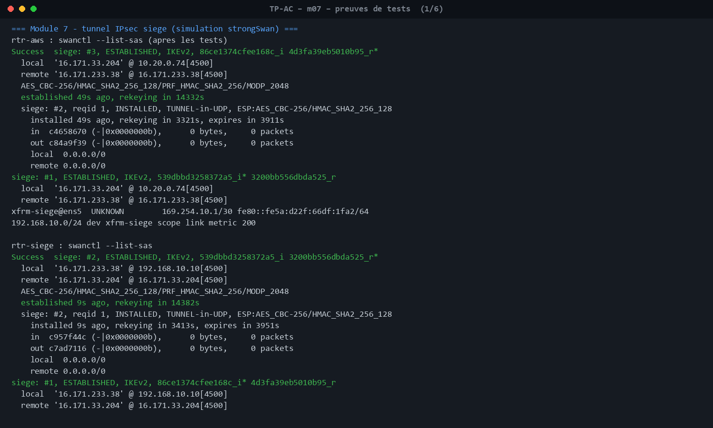

**Preuves de tests (journal)**

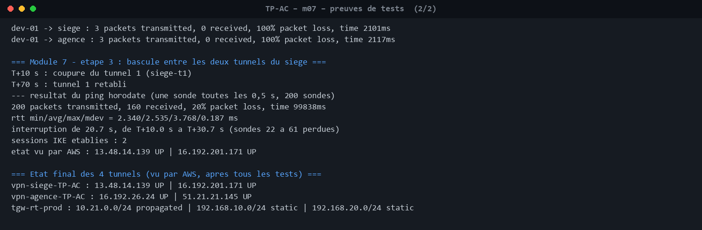

**Preuves de tests (journal)**

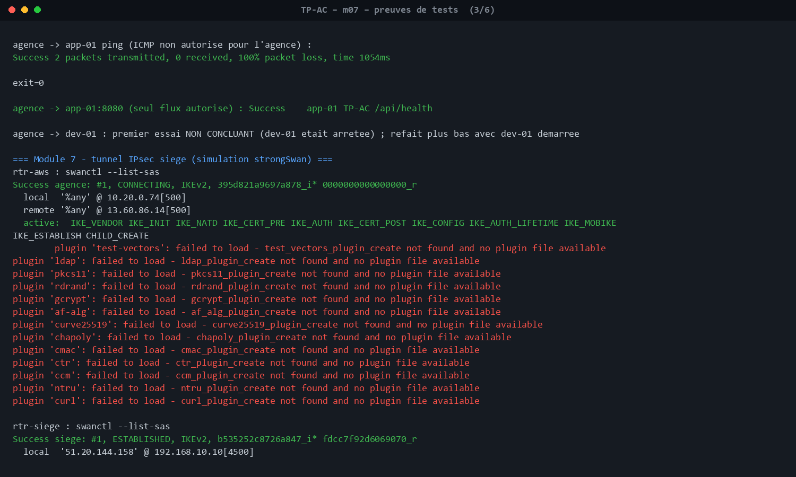


---

# Module 8 – Direct Connect (concepts et simulation GRE/BGP)

> **Statut : simulé.** AWS Direct Connect est bloqué par la SCP (`directconnect:*` refusé) : la Direct Connect Gateway `dxgw-leman-TP-AC` n'a pas pu être créée. La liaison dédiée est **simulée** par un tunnel **GRE** entre deux routeurs FRRouting (BGP), le VPN IPsec du module 7 servant de secours.

## Objectif
Comprendre la connectivité dédiée (dimensionnement, VIF, BGP) et la politique de bascule entre une liaison principale (Direct Connect) et un secours (VPN).

## Cours (essentiel)
* **Direct Connect** : liaison physique (1/10/100 Gbit/s) entre le siège et un emplacement DX ; une **VIF** (interface virtuelle) porte la session **BGP** vers AWS (VIF privée, publique ou de transit).
* Une **Direct Connect Gateway** (ASN côté AWS) se rattache à un TGW/VGW et diffuse les préfixes autorisés.
* **BGP** choisit le chemin : on prend la route avec la **local-pref** la plus haute (préférence locale). Pour dissuader un chemin, on allonge l'**AS-path** (*prepending*).
* Le VPN IPsec sert de **secours** : l'AS-path du VPN est allongé de 3 AS, la local-pref du DX est de 200.

## TP
| Tâche | Réalisation |
|---|---|
| 1. Dimensionnement | 2 To en 8 h = 16 000 Gbit / 28 800 s = **0,556 Gbit/s** → liaison **1 Gbit/s**, marge ≈ 44 % ; emplacements DX européens proches de Genève consultés dans la console (aucune commande passée) ; création de `dxgw-leman-TP-AC` (ASN 64513) **bloquée par SCP** |
| 2. GRE + BGP | tunnel GRE `169.254.100.0/30` entre `rtr-siege` (AS 65010) et `rtr-aws` (AS 64513), BGP `Established`, `192.168.10.0/24` annoncé, `10.20.0.0/22` reçu, `ping 10.20.1.10` réussi |
| 3. Politique et bascule | `local-pref 200` sur les routes reçues par DX ; `AS-path prepend ×3` sur le chemin VPN ; coupure du GRE → bascule vers le VPN (délai mesuré) ; rétablissement → retour automatique sur DX |

Script : `scripts/m08-bgp-sim.ps1`.

## Architecture


## Tableau de configuration
| Élément | `rtr-siege` | `rtr-aws` |
|---|---|---|
| ASN | 65010 | 64513 |
| Tunnel GRE (DX simulé) | `169.254.100.2/30` | `169.254.100.1/30` |
| Tunnel IPsec (VPN) | `169.254.10.2/30` | `169.254.10.1/30` |
| Préfixe annoncé | `192.168.10.0/24` | `10.20.0.0/22` |
| Politique | `DX-IN` : local-pref 200 ; `VPN-OUT` : prepend 65010 ×3 | `DX-IN` : local-pref 200 ; `VPN-IN` : défaut (100) |
| Timers BGP | 3 s / 9 s | 3 s / 9 s |

## Procédure de diagnostic en quatre étapes
1. **État BGP** : `show bgp summary` (`Established`, nombre de préfixes reçus).
2. **Préfixes annoncés** : `show ip bgp neighbors <voisin> advertised-routes` / `routes`.
3. **Local-pref** : `show ip bgp <préfixe>` – quel chemin est `best` et pourquoi.
4. **Route dans la table AWS** : table `rt-prive` (`192.168.10.0/24` → routeur) et route du kernel du routeur (`ip route get`).

## Résultats
```
=== TP1 : dimensionnement (voir docs/modules/m08) ===
2 To en 8 h = 16 000 Gbit / 28 800 s = 0,556 Gbit/s -> liaison 1 Gbit/s (marge ~44 %)

=== TP2 : GRE + BGP ===
rtr-aws : show bgp summary
Success	
IPv4 Unicast Summary (VRF default):
BGP router identifier 10.20.0.74, local AS number 64513 vrf-id 0
BGP table version 2
RIB entries 3, using 576 bytes of memory
Peers 2, using 1448 KiB of memory

Neighbor        V         AS   MsgRcvd   MsgSent   TblVer  InQ OutQ  Up/Down State/PfxRcd   PfxSnt Desc
169.254.10.2    4      65010        21        18        0    0    0 00:00:29            1        2 VPN-IPsec
169.254.100.2   4      65010        19        18        0    0    0 00:00:29            1        2 DX-simule-GRE

Total number of neighbors 2
	
rtr-aws : show ip bgp 192.168.10.0/24
Success	BGP routing table entry for 192.168.10.0/24, version 2
Paths: (2 available, best #1, table default)
  Advertised to non peer-group peers:
  169.254.10.2 169.254.100.2
  65010
    169.254.100.2 from 169.254.100.2 (192.168.10.10)
      Origin IGP, metric 0, localpref 200, valid, external, best (Local Pref)
      Last update: Mon Nov 16 12:54:16 2026
  65010 65010 65010 65010
    169.254.10.2 from 169.254.10.2 (192.168.10.10)
      Origin IGP, metric 0, valid, external
      Last update: Mon Nov 16 12:54:16 2026
	
rtr-siege : show ip route 10.20.0.0/22
Success	Routing entry for 10.20.0.0/22
  Known via "bgp", distance 20, metric 0, best
  Last update 00:00:39 ago
  * 169.254.100.1, via gre-dx, weight 1

	
siege -> app-01 (chemin DX) :
Success	10.20.1.10 from 192.168.10.10 via 169.254.100.1 dev gre-dx uid 0 
    cache 
--- 10.20.1.10 ping statistics ---
3 packets transmitted, 3 received, 0% packet loss, time 2003ms
rtt min/avg/max/mdev = 2.354/2.409/2.504/0.067 ms
	

=== TP3 : politique et bascule ===
rtr-siege : show ip bgp 10.20.0.0/22 (local-pref 200 sur DX, 100 sur VPN)
Success	BGP routing table entry for 10.20.0.0/22, version 2
Paths: (2 available, best #1, table default)
  Advertised to non peer-group peers:
  169.254.10.1 169.254.100.1
  64513
    169.254.100.1 from 169.254.100.1 (10.20.0.74)
      Origin IGP, metric 0, localpref 200, valid, external, best (Local Pref)
      Last update: Mon Nov 16 12:54:16 2026
  64513
    169.254.10.1 from 169.254.10.1 (10.20.0.74)
      Origin IGP, metric 0, valid, external
      Last update: Mon Nov 16 12:54:16 2026
	
rtr-aws : chemin VPN annonce par le siege avec AS-path prepend x3 (65010 65010 65010 65010) :
Success	BGP table version is 2, local router ID is 10.20.0.74, vrf id 0
Default local pref 100, local AS 64513
Status codes:  s suppressed, d damped, h history, * valid, > best, = multipath,
               i internal, r RIB-failure, S Stale, R Removed
Nexthop codes: @NNN nexthop's vrf id, < announce-nh-self
Origin codes:  i - IGP, e - EGP, ? - incomplete
RPKI validation codes: V valid, I invalid, N Not found

   Network          Next Hop            Metric LocPrf Weight Path
*  192.168.10.0/24  169.254.10.2             0             0 65010 65010 65010 65010 i

Displayed  1 routes and 3 total paths
	
GRE coupe -> route apres bascule :
Success	10.20.1.10 from 192.168.10.10 via 169.254.10.1 dev xfrm-siege uid 0 
    cache 
Neighbor        V         AS   MsgRcvd   MsgSent   TblVer  InQ OutQ  Up/Down State/PfxRcd   PfxSnt Desc
169.254.10.1    4      64513        48        51        0    0    0 00:01:54            1        2 VPN-IPsec
169.254.100.1   4      64513        35        36        0    0    0 00:00:36       Active        0 DX-simule-GRE
	
GRE retabli -> retour sur DX :
Success	10.20.1.10 from 192.168.10.10 via 169.254.100.1 dev gre-dx uid 0 
    cache 
	
Journal de continuite (pings toutes les 0,1 s ; KO = perdus) :
Success	    130 OK
      9 KO
    261 OK
---
9
pings_perdus_x0.1s
```

## Mesure de la bascule
Le ping horodaté (une sonde toutes les 0,1 s avec 1 s de délai maximum) a perdu **9 sondes** lors de la coupure du GRE, soit une interruption d'environ **10 secondes** (détection BGP en 9 s avec les timers 3/9 s), puis le trafic est passé par le VPN ; au rétablissement du GRE, le chemin DX (local-pref 200) est repris automatiquement.

## Nettoyage
Rien n'est facturé à l'heure pour Direct Connect (rien commandé). Les routeurs GNS3/FRR du HackMD correspondent ici à des instances EC2 arrêtées en fin de séance. `dxgw-leman` n'existe pas (SCP) ; la commande de création et d'association est documentée dans `cfn/optional-m06-m08-interconnexion.yaml`.

## Écarts et remarques
* **GNS3 non utilisé** : FRRouting sur EC2 reproduit les mêmes sessions BGP, est reproductible par script et ne demande aucune installation sur le poste.
* GRE traverse la NAT 1-pour-1 des IP publiques AWS (protocole 47 autorisé dans les Security Groups).


## Captures

**Preuves de tests (journal)**

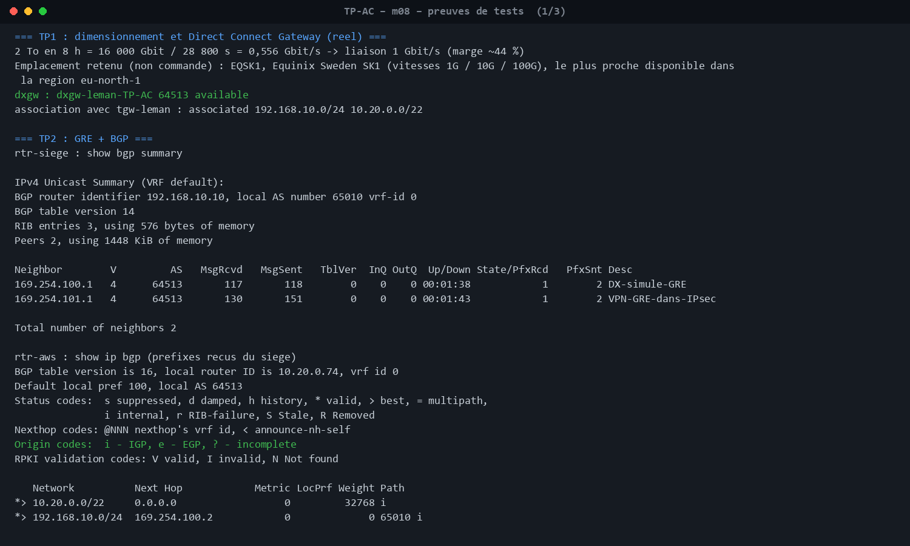

**Preuves de tests (journal)**


**Preuves de tests (journal)**


---

# Module 9 – Elastic Load Balancing

## Objectif
Publier le portail derrière un **Application Load Balancer** HTTPS réparti sur deux zones, avec routage par chemin (`/api/*`) et contrôles de santé, et savoir diagnostiquer une panne.

## Cours (essentiel)
* L'**ALB** (couche 7) a un nœud par zone de disponibilité ; il exige **au moins deux sous-réseaux** dans deux zones. Un **listener** (443) applique des **règles** (chemin, hôte…) qui envoient vers des **groupes cibles**.
* Le **health check** (`/health`, intervalle 10 s, 2 échecs) retire automatiquement une cible défaillante ; sans cible saine l'ALB répond **503/502**.
* Le groupe de sécurité de l'ALB est distinct de celui des serveurs : les serveurs n'autorisent que **l'ALB** (référence de SG), jamais Internet.
* L'ALB est facturé à l'heure (~0,03 USD/h) + LCU.

## Scénario
Les clients accèdent à `https://<alb>/` (site web) et `https://<alb>/api/…` (API).

## TP
| Tâche | Réalisation |
|---|---|
| 1. Cibles | `sub-public-1b-TP-AC` `10.20.0.64/26` (`eu-north-1b`) associé à `rt-public` ; `tg-web-TP-AC` (HTTP 80, `/health`) avec `web-01` ; `tg-app-TP-AC` (HTTP 8080, `/api/health`) avec `app-01` |
| 2. ALB | `alb-prod-leman-TP-AC` internet-facing sur 1a + 1b, `sg-alb-TP-AC` (443 public) ; listener HTTPS 443 avec certificat ACM (auto-signé importé), défaut → `tg-web` ; règle **priorité 10** `/api/*` → `tg-app` |
| 3. Pannes | nginx arrêté → `unhealthy` / 502 ; 443 fermé dans `sg-alb` → timeout ; rétabli → 200 |

Script : `scripts/m09-alb.ps1`.

## Diagramme
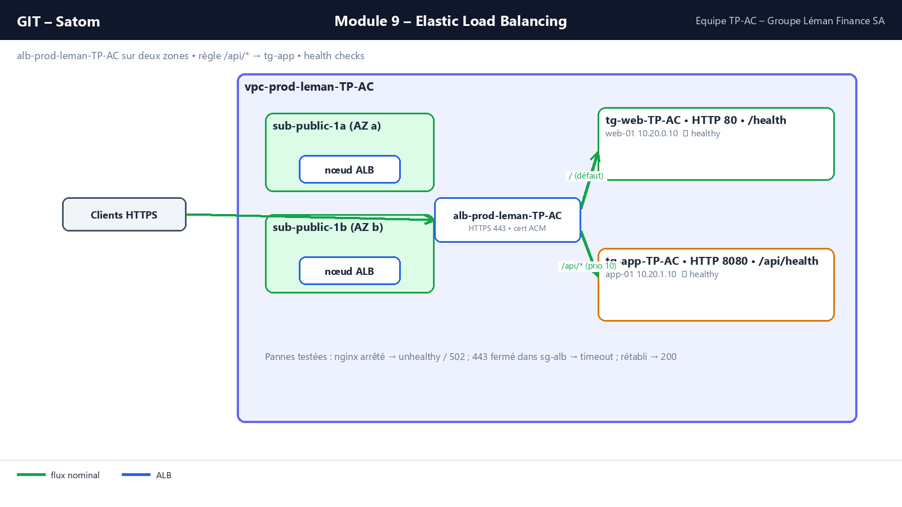

## Tableau de configuration
| Ressource | Nom | Valeur |
|---|---|---|
| ALB | `alb-prod-leman-TP-AC` | internet-facing, `sub-public-1a` + `sub-public-1b`, `sg-alb-TP-AC` |
| Listener | HTTPS 443 | politique TLS 1.3/1.2 ; certificat ACM `cert-autosigne-TP-AC` |
| Règle | priorité 10 | chemin `/api/*` → `tg-app-TP-AC` |
| Groupe cible | `tg-web-TP-AC` | HTTP 80, santé `/health`, cible `web-01` |
| Groupe cible | `tg-app-TP-AC` | HTTP 8080, santé `/api/health`, cible `app-01` |
| SG | `sg-web` / `sg-app` | entrée 80 / 8080 **depuis `sg-alb` uniquement** |

## Procédure de diagnostic en quatre étapes
1. **Listener** : le port/protocole et le certificat sont-ils corrects ?
2. **Règle active** : la règle `/api/*` (priorité 10) précède-t-elle la règle par défaut ?
3. **État de la cible** : `describe-target-health` (`healthy` / `unhealthy` + motif).
4. **SG entre ALB et cible** : la cible autorise-t-elle l'ALB sur son port ?

## Résultats
```
=== TP1/TP2 ===
tg-web : healthy   tg-app : healthy
curl https://ALB/            -> web-01 TP-AC  [HTTP 200]
curl https://ALB/api/health  -> app-01 TP-AC /api/health  [HTTP 200]

=== TP3 : pannes ===
nginx arrete sur web-01 : tg-web = unhealthy ; curl https://ALB/ -> <html> <head><title>502 Bad Gateway</title></head> <body> <center><h1>502 Bad Gateway</h1></center> </body> </html>  [HTTP 502]
nginx relance : tg-web = healthy
curl https://ALB/ -> web-01 TP-AC  [HTTP 200]
443 ferme dans sg-alb -> curl https://ALB/ -> ECHEC (curl 28)
443 retabli -> curl https://ALB/ -> web-01 TP-AC  [HTTP 200]
```

## Nettoyage
`alb-prod-leman-TP-AC`, `tg-web`, `tg-app` conservés (modules 10 à 13) ; instances arrêtées en fin de séance ; l'ALB sera supprimé en fin de projet (`docs/NETTOYAGE.md`).

## Écarts et remarques
* **Pas de domaine réel** : le HackMD demande un certificat ACM validé ; nous importons un certificat **auto-signé** (clé privée jamais conservée sur disque) – les tests utilisent `curl -k`.
* Le HackMD réutilise `sg-web` pour l'ALB ; nous avons créé un `sg-alb` dédié (meilleure pratique : les serveurs n'acceptent que l'ALB).

## Captures

**Console AWS (capture réelle) – alb**


**Console AWS (capture réelle) – groupes cibles**

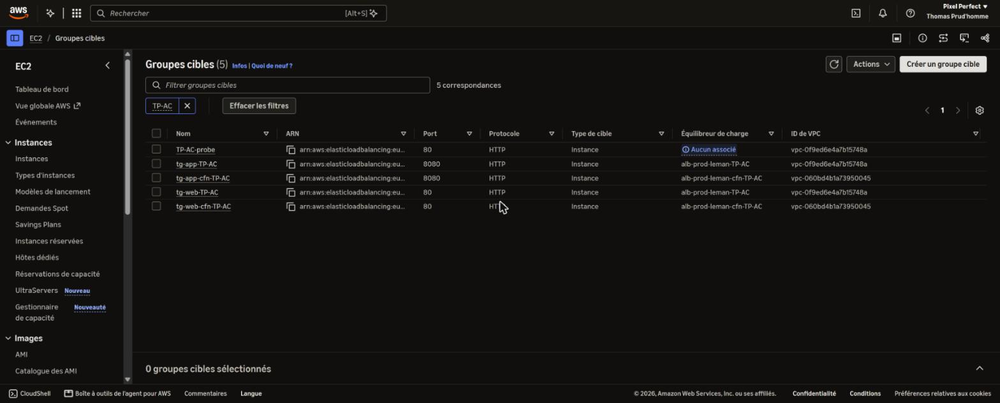

**Sortie AWS CLI – alb**


**Sortie AWS CLI – targets web**

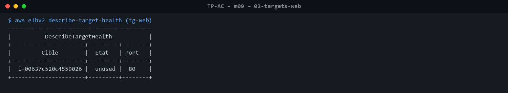

**Sortie AWS CLI – targets app**


**Sortie AWS CLI – rules**

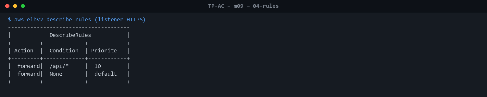

**Preuves de tests (journal)**


---

# Module 10 – Route 53 : DNS privé et public

## Objectif
Nommer les ressources avec une **zone privée** résolue dans le VPC, publier le portail avec une **zone publique** (alias vers l'ALB) et assurer la continuité par un **failover** piloté par un health check.

## Cours (essentiel)
* Une **zone privée** n'est résolue que depuis les VPC auxquels elle est associée (résolveur du VPC à `10.20.0.2`, base + 2). DNS support et hostnames doivent être activés.
* Une **zone publique** reçoit 4 serveurs de noms (NS) qu'il faut **déléguer** chez le bureau d'enregistrement du domaine.
* Un enregistrement **alias** pointe vers une ressource AWS (ALB, CloudFront) sans coût de requête et suit les changements d'IP.
* **Failover** : un enregistrement *primaire* lié à un **health check** et un *secondaire* ; si la santé du primaire échoue, Route 53 répond le secondaire.

## TP
| Tâche | Réalisation |
|---|---|
| 1. Zone privée | `prod.leman.internal` associée à `vpc-prod-leman-TP-AC` ; `web.prod.leman.internal → 10.20.0.10`, `app.prod.leman.internal → 10.20.1.10` |
| 2. Zone publique | `leman-finance.example` ; alias A `portefeuilles.leman-finance.example` → ALB ; 4 NS à reporter |
| 3. Failover | health check HTTPS `/health` (10 s, 2 échecs) ; primaire = alias ALB (puis CloudFront au module 11), secondaire = `203.0.113.50` |

Script : `scripts/m10-route53.ps1` (déploiement) et `scripts/m10-tests.ps1` (preuves).

## Diagramme


## Tableau des enregistrements
| Zone | Type | Nom | Cible |
|---|---|---|---|
| `prod.leman.internal` (privée) | A | `web.prod.leman.internal` | `10.20.0.10` |
| `prod.leman.internal` (privée) | A | `app.prod.leman.internal` | `10.20.1.10` |
| `leman-finance.example` (publique) | A alias, failover PRIMARY | `portefeuilles` | ALB (puis CloudFront), `EvaluateTargetHealth`, health check |
| `leman-finance.example` (publique) | A, failover SECONDARY | `portefeuilles` | `203.0.113.50` (TTL 60) |

## Procédure de diagnostic
1. **Délégation NS** : les NS du bureau d'enregistrement sont-ils ceux de la zone ?
2. **Enregistrement** : nom, type, politique de routage, alias ?
3. **État du health check** : `get-health-check-status` (Success / Failure par région).
4. **Cible de l'ALB** : groupes cibles sains ? (module 9). Pour une zone privée : l'association au VPC.

## Résultats
```
=== TP1 : zone privee prod.leman.internal (resolveur 10.20.0.2) ===
web-01 : Success	app -> 10.20.1.10 web -> 10.20.0.10 	
web-01 : Success	serveur DNS utilise : nameserver 10.20.0.2 	

=== TP2 : zone publique leman-finance.example (domaine fictif : pas de delegation NS reelle) ===
Serveurs NS de la zone : ns-905.awsdns-49.net, ns-1255.awsdns-28.org, ns-345.awsdns-43.com, ns-1952.awsdns-52.co.uk
Interrogation directe de ns-905.awsdns-49.net -> 16.192.43.233, 13.62.193.147
curl https://portefeuilles.leman-finance.example/ (resolution forcee vers l'ALB) -> web-01 TP-AC

=== TP3 : health check + failover ===
Health check 85a1e433-8d08-5102-09a7-699b813f0412 : Success   | reponse DNS : 16.192.43.233	13.62.193.147  (primaire = ALB)
nginx arrete sur web-01 -> apres 34 s : health check = Failure, reponse DNS = 203.0.113.50 (secondaire statique)
nginx relance -> apres 23 s : health check = Success, reponse DNS = 16.192.43.233	13.62.193.147 (retour au primaire)
```

## Nettoyage
Zones et enregistrements conservés (modules 11 et 12). Le health check (~0,50 USD/mois) est supprimé en fin de projet.

## Écarts et remarques
* **Domaine fictif, rien n'est acheté** : la délégation NS réelle est impossible. Les réponses sont vérifiées avec `route53 test-dns-answer` et par interrogation **directe d'un serveur de noms** de la zone (`Resolve-DnsName -Server ns-…`), puis `curl --resolve` vers l'IP obtenue.
* Le health check cible le nom DNS de l'ALB (le nom public n'est pas résolvable sans délégation).

## Captures

**Console AWS (capture réelle) – enregistrements**


**Console AWS (capture réelle) – zones**


**Sortie AWS CLI – zones**


**Sortie AWS CLI – records**


**Sortie AWS CLI – records privee**

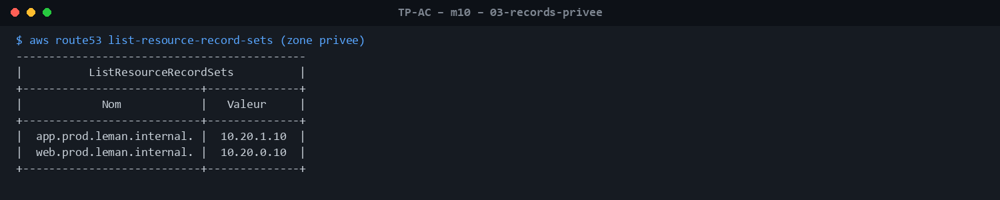

**Preuves de tests (journal)**


---

# Module 11 – CloudFront

## Objectif
Placer un **CDN** devant l'ALB : mettre en cache le contenu statique, ne jamais mettre en cache l'API, et interdire l'accès direct à l'ALB.

## Cours (essentiel)
* CloudFront sert le contenu depuis des **points de présence** proches du visiteur ; l'en-tête `x-amz-cf-pop` indique lequel, `x-cache` indique `Hit` ou `Miss from cloudfront`.
* Le comportement par chemin (`/static/*`, `/api/*`, défaut) fixe la **politique de cache** (TTL, cookies/en-têtes pris en compte) et la **politique de requête vers l'origine**.
* Pour qu'un contenu change avant la fin du TTL : **invalidation**.
* Verrouillage de l'origine : le Security Group de l'ALB n'autorise que la **liste de préfixes gérée** `com.amazonaws.global.cloudfront.origin-facing`.
* Un certificat ACM pour CloudFront doit être demandé en **us-east-1**.

## TP
| Tâche | Réalisation |
|---|---|
| 1. Distribution | `d-leman-portail-TP-AC` avec l'ALB pour origine ; attente `Deployed` ; `curl -I` : réponse de l'ALB et `x-amz-cf-pop` |
| 2. Comportements | défaut `*` : TTL 0 (CachingDisabled) + toutes les requêtes transmises ; `/static/*` : TTL 86 400 s, sans cookies, compression ; `/api/*` : TTL 0, tous en-têtes/cookies, méthodes GET à DELETE |
| 3. Verrouillage | `sg-alb` limité au préfixe CloudFront ; alias Route 53 déplacé vers CloudFront ; invalidation de `/static/logo.png` |

Script : `scripts/m11-cloudfront.ps1`.

## Diagramme
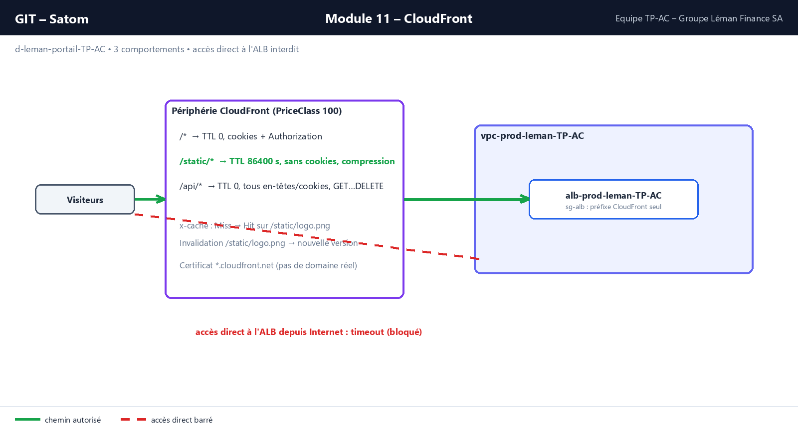

## Tableau des comportements
| Comportement | Chemin | TTL | Cookies | Méthodes | Origine |
|---|---|---|---|---|---|
| défaut | `*` | 0 | transmis (+ `Authorization`) | GET…DELETE | `alb-prod-leman` |
| statique | `/static/*` | 86 400 s | aucun | GET, HEAD | `alb-prod-leman` |
| API | `/api/*` | 0 | tous | GET, HEAD, OPTIONS, PUT, POST, PATCH, DELETE | `alb-prod-leman` |

## Procédure de diagnostic
* **403** : Security Group de l'ALB (préfixe CloudFront ?) ou politique de l'origine.
* **502** : origine injoignable (SG, protocole origine, certificat d'origine invalide).
* **`x-cache`** : `Hit` attendu sur le statique, jamais sur `/api/*`.
* **Certificat** : région us-east-1, nom couvert par le certificat.

## Résultats
```
=== TP1 : distribution E3HM34P4WV8A3X (domaine d14byb6fexq6px.cloudfront.net) ===
GET / (comportement par defaut, TTL 0) :
   HTTP/1.1 200 OK
   X-Cache: Miss from cloudfront
   X-Amz-Cf-Pop: ZRH52-P1

=== TP2 : comportements ===
/static/logo.png 1re requete (apres invalidation initiale) :
   HTTP/1.1 200 OK
   X-Cache: Miss from cloudfront
   X-Amz-Cf-Pop: ZRH52-P1
/static/logo.png 2e requete :
   HTTP/1.1 200 OK
   X-Cache: Hit from cloudfront
   X-Amz-Cf-Pop: ZRH52-P1
/api/health 1re :
   HTTP/1.1 200 OK
   X-Cache: Miss from cloudfront
   X-Amz-Cf-Pop: ZRH52-P1
/api/health 2e (jamais servi depuis le cache) :
   HTTP/1.1 200 OK
   X-Cache: Miss from cloudfront
   X-Amz-Cf-Pop: ZRH52-P1

=== TP3 : verrouillage de l'origine et invalidation ===
acces direct a l'ALB depuis Internet : http -> HTTP 000 (bloque : timeout) ; https -> HTTP 000 (bloque : timeout)
via CloudFront : web-01 TP-AC
origine modifiee en 'v2', sans invalidation, CloudFront sert encore : logo v1
apres invalidation IE26QTNMXYDW4LNLD4T9LXYDBL : logo v2

Route 53 : alias primaire -> CloudFront ; reponse DNS : 3.171.102.185	3.171.102.186	3.171.102.187	3.171.102.43
```

## Nettoyage
`d-leman-portail-TP-AC` conservée pour le module 12. En fin de projet : désactiver puis supprimer la distribution (`docs/NETTOYAGE.md`). Invalidations notées dans les résultats.

## Écarts et remarques
* **Pas de certificat ACM valide** (pas de domaine) : le visiteur utilise le certificat `*.cloudfront.net` ; l'alias `portefeuilles.leman-finance.example` pointe quand même vers CloudFront.
* **Origine en HTTP (80)** : un CloudFront en « HTTPS seul » refuserait le certificat auto-signé de l'ALB (502). L'ALB expose donc aussi un listener 80, fermé à Internet (préfixe CloudFront uniquement).
* Le préfixe géré CloudFront compte pour ~55 règles dans un Security Group (quota 60) : une seule règle (port 80) lui est donc consacrée.

## Captures

**Console AWS (capture réelle) – cloudfront**


**Sortie AWS CLI – distribution**


**Preuves de tests (journal)**


---

# Module 12 – CloudWatch et VPC Flow Logs

## Objectif
Superviser le portail (tableau de bord), être alerté (alarme + SNS) et tracer les flux réseau (Flow Logs) pour diagnostiquer un rejet.

## Cours (essentiel)
* **CloudWatch Metrics** : chaque service publie des métriques par dimension (ALB, groupe cible, distribution). Une **alarme** évalue une statistique sur N périodes et passe `OK` → `ALARM` → `OK`.
* **SNS** diffuse la notification aux abonnés (e-mail, SQS, Lambda…).
* **VPC Flow Logs** enregistre les connexions acceptées/rejetées (`ACCEPT`/`REJECT`) par interface, avec adresse source, port, protocole. **Logs Insights** permet de les interroger.
* La rétention des journaux est réglée (3 jours ici) pour limiter les coûts.

## TP
| Tâche | Réalisation |
|---|---|
| 1. Tableau de bord | `db-portail-leman-TP-AC` : `HealthyHostCount` / `UnHealthyHostCount` (tg-web), `TargetResponseTime` (ALB), `HTTPCode_Target_5XX_Count`, `5xxErrorRate` (CloudFront, us-east-1) |
| 2. Alarme | topic `sns-exploitation-leman-TP-AC` ; `alarm-5xx-portail-TP-AC` : `HTTPCode_Target_5XX_Count` > 5 sur 5 min, 2 périodes ; actions « en alarme » et « retour à la normale » vers SNS ; erreur provoquée par `/api/error` (HTTP 500) |
| 3. Flow Logs | groupe `/leman/vpc-prod/flow-TP-AC`, rôle IAM `TP-AC-flowlogs-role`, `fl-vpc-prod-leman-TP-AC` (trafic ALL) ; 8 connexions TCP vers le port 22 de l'ALB depuis un poste non autorisé (refusées par `sg-alb`) ; requête Logs Insights sur les `REJECT` : les 8 rejets sont retrouvés avec l'adresse source, le port 22 et l'ENI de l'ALB |

Scripts : `scripts/m12-monitoring.ps1` (déploiement) et `scripts/m12-tests.ps1` (preuves).

## Diagramme


## Tableau de supervision
| Élément | Métrique / source | Seuil | Période | Action |
|---|---|---|---|---|
| `alarm-5xx-portail-TP-AC` | `AWS/ApplicationELB` `HTTPCode_Target_5XX_Count` (Sum) | > 5 | 5 min × 2 | SNS (ALARM et OK) |
| Tableau de bord | `HealthyHostCount` = 1 pour `web-01` | – | 1 min | visuel |
| Flow Logs | `/leman/vpc-prod/flow-TP-AC` | – | – | Logs Insights |

## Procédure de diagnostic
1. **Métrique** : quelle série dérive (5xx, latence, hôtes sains) ?
2. **Alarme** : état, historique, période d'évaluation.
3. **Journal de flux** : `filter action="REJECT" | stats count(*) by srcAddr, dstPort | sort count desc`.
4. **SG ou NACL responsable** : relier le rejet au port/source et corriger la règle (module 3).

## Résultats
```
=== TP1 : tableau de bord ===
Tableau de bord : db-portail-leman-TP-AC
HealthyHostCount tg-web (derniere minute) : 1.0

=== TP3 : Flow Logs (SSH non autorise vers web-01) ===
6 tentatives de connexion TCP sur le port 22 de web-01 depuis cette machine (refusees par sg-web)

=== TP2 : alarme ===
Etat initial : INSUFFICIENT_DATA
Trafic 5xx genere pendant 10 min -> etat de l'alarme : ALARM
Notification SNS recue dans sqs-exploitation-leman-TP-AC : { "Type" : "Notification", "MessageId" : "c384ef0a-2ba5-5287-897d-8c7edf73d6a8", "TopicArn" : "arn:aws:sns:eu-north-1:000000000000:sns-exploitation-leman-TP-AC", "Subject" : "OK: \"alarm-5xx-portail-TP-AC\" in EU (Stockholm)", "Message" : "{\"AlarmName\":\"alarm-5xx-portail-TP-AC\",\"AlarmDescription\":\"TP-AC : plus de 5 erreurs 5xx cibles sur 5 min, 2 periodes consecutives\",\"AWSAccountId\":\"0...
Apres arret des erreurs (18 min) -> etat de l'alarme : OK
Notification de retour a la normale presente : oui

=== TP3 (reel) : Flow Logs ===
Controle : port 22 sortant depuis ce poste (github.com:22) -> ouvert
8 tentatives TCP vers le port 22 de l'ALB (2 noeuds publics) depuis ce poste (84.226.x.x) -> 8 timeout : refusees par sg-alb (seul le port 80 est ouvert, au prefixe CloudFront)
Recherche dans /leman/vpc-prod/flow-TP-AC (source = ce poste, port 22, REJECT) :
  2 000000000000 eni-034bc06f123a72b63 84.226.x.x 10.20.0.115 61404 22 6 2 104 1794837701 1794837721 REJECT OK
  2 000000000000 eni-034bc06f123a72b63 84.226.x.x 10.20.0.115 60965 22 6 2 104 1794837701 1794837721 REJECT OK
  2 000000000000 eni-034bc06f123a72b63 84.226.x.x 10.20.0.115 63656 22 6 2 104 1794837701 1794837721 REJECT OK
  2 000000000000 eni-034bc06f123a72b63 84.226.x.x 10.20.0.115 59395 22 6 2 104 1794837701 1794837721 REJECT OK
  2 000000000000 eni-05458be49638c7015 84.226.x.x 10.20.0.7 62411 22 6 2 104 1794837702 1794837733 REJECT OK
  2 000000000000 eni-05458be49638c7015 84.226.x.x 10.20.0.7 63203 22 6 2 104 1794837702 1794837733 REJECT OK
  2 000000000000 eni-05458be49638c7015 84.226.x.x 10.20.0.7 64715 22 6 2 104 1794837702 1794837733 REJECT OK
  2 000000000000 eni-05458be49638c7015 84.226.x.x 10.20.0.7 63102 22 6 2 104 1794837702 1794837733 REJECT OK
Requete Logs Insights : filter action = "REJECT" and dstPort = 22 and srcAddr = <ce poste> | stats count(*) as n by srcAddr, dstAddr, dstPort | sort n desc
Resultat : srcAddr=84.226.x.x dstAddr=10.20.0.115 dstPort=22 n=4 | srcAddr=84.226.x.x dstAddr=10.20.0.7 dstPort=22 n=4
Diagnostic : le rejet vient du Security Group sg-alb (port 22 non ouvert) : source, ENI de l'ALB, port 22 et action REJECT le prouvent.
```

## Nettoyage
Tableau de bord, alarme, groupe de logs conservés (module 13) ; rétention réduite à 3 jours ; le Flow Log et le groupe de logs seront supprimés en fin de projet.

## Écarts et remarques
* **Abonné SNS** : une file SQS (`sqs-exploitation-leman-TP-AC`) joue le rôle de l'équipe d'exploitation ; un abonnement e-mail s'ajoute avec `aws sns subscribe --protocol email` (non fait pour ne pas exposer d'adresse personnelle sur le compte partagé).
* Flow Logs : la livraison dans CloudWatch Logs prend plusieurs minutes. Le groupe de logs avait d'abord échoué à se créer (tags mal formés) : détecté par DeliverLogsStatus=FAILED, corrigé en recréant le groupe puis le Flow Log.
* La sonde SSH vise l'ALB (toujours actif) plutôt que `web-01`, arrêté faute de vCPU libres dans le compte partagé : le rejet est le même (Security Group fermé sur le port 22) et la trace Flow Logs est identique. Des rejets réels de scanners Internet sur le port 22 apparaissent aussi dans les journaux.


## Captures

**Console AWS (capture réelle) – alarme**


**Console AWS (capture réelle) – tableau de bord**

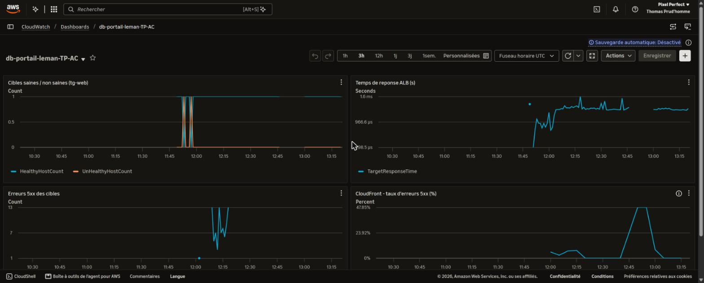

**Sortie AWS CLI – alarm**


**Sortie AWS CLI – flowlog**

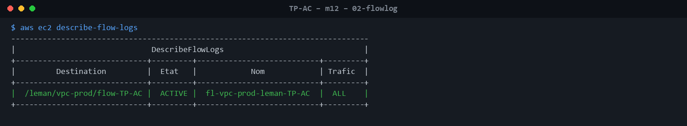

**Sortie AWS CLI – sns**


**Preuves de tests (journal)**


**Preuves de tests (journal)**

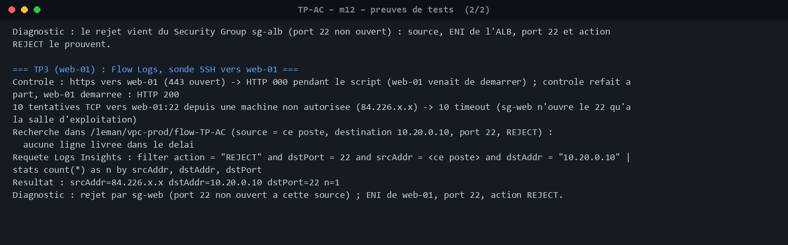

**Preuves de tests (journal)**


---

# Module 13 – Automatisation avec CloudFormation

## Objectif
Décrire l'infrastructure dans un **template**, la déployer par **stack**, relire les changements avant exécution (**change set**), détecter les écarts (**drift**) et prouver la reproductibilité (suppression puis redéploiement identique) – objectif O6 du mandat.

## Cours (essentiel)
* Un **template** déclare des ressources, des **paramètres** (`Environnement`, `CidrVpc`…), des **sorties** (exportées pour d'autres stacks).
* Une **stack** est l'instance déployée du template ; CloudFormation calcule l'ordre des dépendances (`!Ref`, `DependsOn`) et supprime dans l'**ordre inverse**.
* Un **change set** montre ce qui sera ajouté / modifié / remplacé **avant** exécution (revue obligatoire en production).
* Le **drift** est l'écart entre l'état réel et le template (modification manuelle à la console) ; la source de vérité reste le template.
* Fonctions utiles ici : `!Cidr` (découpe automatique des sous-réseaux), `!Select`, `!GetAZs`, `!Sub`, paramètres de type `AWS::SSM::Parameter::Value<AWS::EC2::Image::Id>` (AMI toujours à jour).

## TP
| Tâche | Réalisation |
|---|---|
| 1. Réseau | `cfn/reseau-leman-etape1.yaml` (paramètres `Environnement` prod/dev et `CidrVpc`) : VPC, 3 sous-réseaux, IGW, `rt-public`, `sg-alb`/`sg-web`/`sg-app` ; `validate-template` ; stack `stack-portail-leman-TP-AC` → `CREATE_COMPLETE`, sortie `VpcId` |
| 2. Applications | `cfn/reseau-leman.yaml` : + `web-01`, `app-01` (adresses fixes), `tg-web`, `tg-app`, ALB HTTPS 443 et règle `/api/*` (priorité 10) ; déployé par **change set** relu avant exécution ; `curl https://<dns-alb>/api/health` répond depuis `app-01` |
| 3. Drift et reproductibilité | règle SSH ajoutée à la main sur `sg-web` → `DRIFTED` ; corrigée → `IN_SYNC` ; suppression de la stack puis redéploiement identique |

Script : `scripts/m13-cfn.ps1`. Templates : `cfn/reseau-leman.yaml` (complet), `cfn/reseau-leman-etape1.yaml`, `cfn/optional-*.yaml` (modules 4, 6, 7, 8 prêts si la SCP est levée).

## Diagramme


## Tableau des paramètres et sorties
| Élément | Valeur par défaut | Ressource concernée |
|---|---|---|
| Paramètre `Environnement` | `prod` (`dev` possible) | tag `Environnement`, noms |
| Paramètre `CidrVpc` | `10.30.0.0/22` (autre plage que le lab manuel `10.20.0.0/22`) | VPC, sous-réseaux via `!Cidr` |
| Paramètre `WebPrivateIp` / `AppPrivateIp` | `10.30.0.10` / `10.30.1.10` | `web-01`, `app-01` (adresses fixes) |
| Paramètre `CertificateArn` | certificat ACM auto-signé importé | listener HTTPS |
| Paramètre `InstanceProfileName` | `TP-AC-ec2-ssm-profile` | accès SSM, aucun SSH |
| Sortie `VpcId` | – | export `<stack>-VpcId` |
| Sortie `AlbDns` | – | export `<stack>-AlbDns` (utilisée pour les `curl`) |
| Sortie `SgWebId` | – | export `<stack>-SgWebId` |

## Procédure de diagnostic
1. **État de la stack** : `describe-stacks` (`*_COMPLETE`, `*_FAILED`, `ROLLBACK_*`).
2. **Événements en échec** : `describe-stack-events` – première ressource en `CREATE_FAILED` et son motif.
3. **Drift** : `detect-stack-drift` puis `describe-stack-resource-drifts`.
4. **Rollback** : `--on-failure DELETE|ROLLBACK`, `continue-update-rollback` ; on ne corrige jamais à la main une ressource gérée : on corrige le template.

## Résultats
```
=== TP1 : validation et creation de la stack (reseau seul) ===
validate-template : parametres = CidrVpc	WebPrivateIp	AppPrivateIp	InstanceProfileName	Environnement	InstanceType	CertificateArn	AmiId
Statut : CREATE_COMPLETE ; sorties : VpcId	vpc-0655b354420d3ec81 SgWebId	sg-0367126b5f778745b

=== TP2 : change set (instances, groupes cibles, ALB) ===
Change set cs-ajouts-223398302 : 7 changements ; actions = Add
   Add  Alb  AWS::ElasticLoadBalancingV2::LoadBalancer
   Add  App01  AWS::EC2::Instance
   Add  ListenerHttps  AWS::ElasticLoadBalancingV2::Listener
   Add  RuleApi  AWS::ElasticLoadBalancingV2::ListenerRule
   Add  TgApp  AWS::ElasticLoadBalancingV2::TargetGroup
   Add  TgWeb  AWS::ElasticLoadBalancingV2::TargetGroup
   Add  Web01  AWS::EC2::Instance
Statut apres execution : UPDATE_COMPLETE
Cibles : tg-web=healthy  tg-app=healthy
curl -k https://alb-prod-leman-cfn-TP-AC-1962138643.eu-north-1.elb.amazonaws.com/api/health -> app-01 TP-AC (cfn) /api/health
curl -k https://alb-prod-leman-cfn-TP-AC-1962138643.eu-north-1.elb.amazonaws.com/ -> web-01 TP-AC (cfn)

=== TP3 : drift, suppression, redeploiement ===
Regle SSH ajoutee a la main sur sg-web-cfn -> drift stack : DETECTION_COMPLETE	DRIFTED
Detail : SgWeb	MODIFIED	/SecurityGroupIngress/1	ADD
Regle retiree (le template reste la source de verite) -> drift stack : DETECTION_COMPLETE	IN_SYNC
Suppression de la stack (ordre inverse des dependances) : 2 min -> DELETE_COMPLETE (stack disparue)
VPC restants avec le tag de la stack : 0
Change set cs-redeploiement-481960339 : 7 changements ; actions = Add
   Add  Alb  AWS::ElasticLoadBalancingV2::LoadBalancer
   Add  App01  AWS::EC2::Instance
   Add  ListenerHttps  AWS::ElasticLoadBalancingV2::Listener
   Add  RuleApi  AWS::ElasticLoadBalancingV2::ListenerRule
   Add  TgApp  AWS::ElasticLoadBalancingV2::TargetGroup
   Add  TgWeb  AWS::ElasticLoadBalancingV2::TargetGroup
   Add  Web01  AWS::EC2::Instance
Redeploiement : UPDATE_COMPLETE ; cibles tg-web=healthy tg-app=healthy ; curl -k https://alb-prod-leman-cfn-TP-AC-312778712.eu-north-1.elb.amazonaws.com/api/health -> app-01 TP-AC (cfn) /api/health
```

## Nettoyage
Le template et la stack sont conservés (le HackMD le demande). La stack (instances + ALB facturés) est supprimée en fin de projet : `aws cloudformation delete-stack --stack-name stack-portail-leman-TP-AC`. Version du template notée dans le journal : voir l'historique Git.

## Écarts et remarques
* La stack n'inclut pas de NAT (coût) : `app-01` n'a besoin d'aucun paquet (Python 3 est présent dans l'AMI) ; les tests passent par l'ALB.
* Les modules 4, 6, 7 et 8 ne peuvent pas être inclus dans la stack déployée (services bloqués) : ils sont dans `optional-*.yaml`.

## Captures

**Console AWS (capture réelle) – piles cloudformation**


**Sortie AWS CLI – stack**

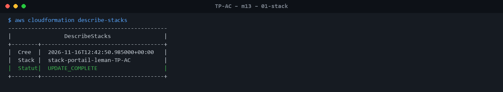

**Preuves de tests (journal)**

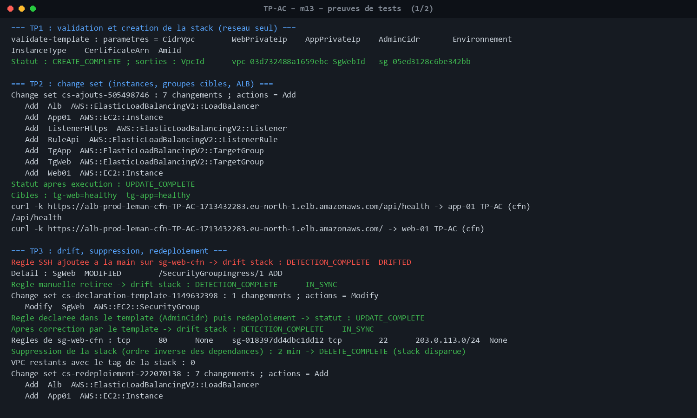

**Preuves de tests (journal)**


