# Satom Cloud Network – Dossier du binôme TP-AC

Projet réalisé par Thomas Prud'homme et Abderahmane Chaouche pour le client fictif Groupe Léman Finance SA (formation AWS niveau 300, Geneva Institute of Technology, promo E3, semaine du 16 au 20 novembre 2026).

Tout est fait dans la région de Stockholm (`eu-north-1`). Nos ressources portent le suffixe `-TP-AC` et les tags `Projet=SatomCloudNetwork`, `Equipe=TP-AC` et `Environnement=prod` ou `dev`.

Les modules 9, 10 et 11 utilisent un domaine réel : le sous-domaine `leman.thomastp.ch`, délégué à Route 53, avec des certificats publics ACM validés par DNS.

## Vidéo


Vidéo complète du tutoriel (34 minutes, voix de Thomas et d'Abderahmane), refaite à la main dans la console AWS, modules 0 à 13, avec un vrai domaine pour les modules 9 à 11 : [https://youtu.be/emZqnBNtOjM](https://youtu.be/emZqnBNtOjM) (non répertoriée : seules les personnes qui ont le lien peuvent la voir).

## Où nous en sommes
| Module | Sujet | Ce que nous avons fait |
|---|---|---|
| 0 | Cadrage et plan d'adressage | fait |
| 1 | VPC et sous-réseaux | déployé et testé |
| 2 | Routage, IGW et NAT | déployé et testé |
| 3 | Security Groups et NACL | déployé et testé |
| 4 | Network Firewall | déployé et testé (service débloqué le 17/11) |
| 5 | VPC Peering | déployé et testé, puis remplacé par le Transit Gateway au module 6 |
| 6 | Transit Gateway | déployé et testé |
| 7 | VPN site à site | vrai VPN AWS, 2 tunnels par site ; les deux sites sont des routeurs strongSwan simulés |
| 8 | Direct Connect | vrai Direct Connect Gateway associé au Transit Gateway ; la liaison dédiée est simulée (GRE et BGP) |
| 9 | Load balancer | déployé et testé |
| 10 | Route 53 | déployé et testé |
| 11 | CloudFront | déployé et testé |
| 12 | CloudWatch et Flow Logs | déployé et testé |
| 13 | CloudFormation | déployé et testé |

Au début de la semaine, Network Firewall, Transit Gateway, VPN et Direct Connect étaient refusés par une règle de l'organisation AWS du formateur. Cette règle a été levée le 17/11/2026, et nous avons alors fait les modules 4, 6, 7 et 8 pour de vrai. Les erreurs relevées avant cette date sont dans le fichier `docs/01-services-bloques.md` du dépôt.


Tout le code (scripts AWS CLI, templates CloudFormation), les preuves et les captures sont dans le dépôt GitHub public `Thomas-TP/satom-cloud-network-TP-AC`.


# Module 0 – Cadrage et plan d'adressage

## Le projet
Léman Finance veut un réseau AWS sécurisé qui sépare la production du développement, relie le siège de Genève et l'agence de Lausanne, garde une trace des accès et reste maîtrisé en coût. Tout doit pouvoir être redéployé depuis un template.

Nous sommes deux sur le projet. Le sujet prévoit une répartition en binômes avec des rôles (architecte, sécurité, exploitation…) ; nous ne l'avons pas appliquée et avons traité tous les modules ensemble.

## Ce qui a changé par rapport au sujet
Le compte AWS est partagé avec toute la classe et l'organisation du formateur impose des limites. Voilà ce que nous avons dû adapter.

- **Région** : le sujet parle de Zurich, mais seule Stockholm est utilisable (Zurich n'est pas activée, Francfort est refusée).
- **Services bloqués** : Network Firewall, Transit Gateway, VPN et Direct Connect étaient refusés par l'organisation jusqu'au 17/11/2026 ; ils sont maintenant autorisés (voir `01-services-bloques.md`).
- **Budget** : le sujet annonce 150 CHF par équipe, mais le compte dispose de 100 USD de crédits partagés. Nous avons créé un budget de 100 USD par mois avec une alerte à 80 %.
- **Domaine et certificats** : nous utilisons un domaine réel, `thomastp.ch` (le portfolio de Thomas, qui n'est pas modifié). Le sous-domaine `leman.thomastp.ch` est délégué à Route 53 (quatre enregistrements NS ajoutés chez Cloudflare, qui héberge le DNS de `thomastp.ch`), et les certificats sont des certificats publics ACM validés par DNS.
- **Adresses IP** : les autres équipes utilisent déjà `10.0.0.0/16`, et le prof nous a dit qu'un /16 était trop grand. Nous avons pris des plages plus petites.
- **Accès aux machines** : pas de SSH ni de clé, nous passons par AWS Systems Manager (SSM).

## Plan d'adressage
| Réseau | Plage | Contenu |
|---|---|---|
| vpc-prod-leman-TP-AC | 10.20.0.0/22 | production |
| sub-public-1a | 10.20.0.0/26 | web-01 (10.20.0.10), NAT |
| sub-public-1b | 10.20.0.64/26 | deuxième zone du load balancer, routeur rtr-aws (10.20.0.74) |
| sub-prive-1a | 10.20.1.0/26 | app-01 (10.20.1.10) |
| sub-fw-1a | 10.20.2.0/28 | endpoint du pare-feu (prévu, non créé) |
| réservé | 10.20.3.0/26 | base de données (non créé) |
| vpc-dev-leman-TP-AC | 10.21.0.0/24 | développement, dev-01 (10.21.0.10) |
| siège (simulé) | 192.168.10.0/24 | selon le sujet |
| agence (simulée) | 192.168.20.0/24 | selon le sujet |


## Crédits et budget
Le compte part avec 100 USD. Les activités « Gagnez des crédits AWS » nous ont rapporté 100 USD de plus (EC2, Lambda, DynamoDB, RDS et Budgets). Nous les avons faites en ligne de commande et supprimé les ressources juste après. L'écran de la console affichait encore 180 USD au dernier contrôle ; le report des derniers crédits peut prendre du temps.

Le budget `budget-TP-AC-satom` envoie son alerte à 80 % vers le topic SNS d'exploitation.

## Questions au client
Pour son rôle, chacun de nous a écrit trois questions, qui doivent permettre de vérifier si l'exigence est mesurable, qui décide, et quel est le risque. Le client est fictif : nous n'avons pas de réponses, et le binôme de contrôle doit encore valider cette liste en classe.

**Architecte réseau**
1. Combien d'utilisateurs, au siège et à l'agence, et quel débit maximal faut-il prévoir vers le cloud (c'est ce qui décide du dimensionnement des liaisons) ?
2. Qui décide de la région définitive (Zurich ou Francfort) et de la date à laquelle l'application quitte la salle serveur ?
3. Quelle durée de coupure est tolérable si une liaison tombe, et qui accepte ce risque ?

**Ingénieur sécurité**
1. Quelles règles précises s'appliquent à ces données (FINMA, LPD…), et combien de temps faut-il conserver les journaux pour le prouver ?
2. Qui valide l'ajout d'un nouveau domaine autorisé dans le pare-feu, et dans quel délai ?
3. Que se passe-t-il si un accès du développement atteint la production : quelle est la séparation minimale exigée (réseaux seulement, ou comptes séparés) ?

## Estimation du budget
Nous avons relevé les tarifs de la région de Stockholm avec l'API de prix d'AWS (le calculateur en ligne n'a pas été utilisé : c'est la même source). L'API ne donne pas le prix de l'attachement Transit Gateway ni du VPN pour Stockholm : nous prenons le tarif public de 0,05 USD de l'heure. Le taux de change retenu est 1 USD = 0,90 CHF (hypothèse).

| Poste | USD par heure | USD par mois (730 h) | Source |
|---|---|---|---|
| Instances `t3.micro` (8) | 0.0864 | 63 |  API de prix |
| NAT Gateway | 0.0460 | 34 |  API de prix |
| Load balancer (ALB) | 0.0239 | 17 |  API de prix |
| Network Firewall (1 endpoint) | 0.3950 | 288 |  API de prix |
| Transit Gateway (4 attachements) | 0.2000 | 146 |  tarif public |
| VPN (2 connexions) | 0.1000 | 73 |  tarif public |
| Adresses IPv4 publiques (9) | 0.0450 | 33 |  API de prix |
| **Total** | **0.90** | **654** | |

* Allumé en permanence, l'ensemble coûte environ **654 USD par mois, soit 589 CHF** : bien au-delà des 150 CHF de budget.
* Allumé seulement pendant les séances (environ 40 heures par semaine), il coûte environ **36 USD, soit 32 CHF** : c'est tenable.
* Notre réduction : le pare-feu, le Transit Gateway et les VPN (plus de 90 % du coût) ne tournent que le temps des tests et des captures, puis nous les supprimons. Les routeurs et les instances sont arrêtés hors séance.

## Méthode
Nous avons tout scripté avec l'AWS CLI (un script par module dans `scripts/`). Chaque test écrit son résultat dans un fichier du dépôt, que l'on retrouve dans la partie « Résultats des tests » de chaque module.

## Captures

**Console AWS – budgets**


**Console AWS – credits**


**Console AWS – quetes credits**


**Terminal**

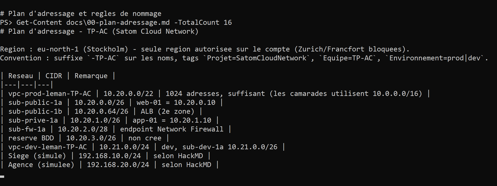

**Terminal**

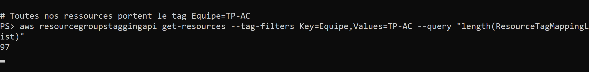


---

# Module 1 – VPC et sous-réseaux

## Objectif
Créer le réseau de production, un sous-réseau public et un privé, deux serveurs, et vérifier qu'ils se parlent.

## Ce qu'il faut savoir
Un VPC est un réseau isolé dans une région, avec une plage d'adresses (CIDR). Un sous-réseau vit dans une seule zone de disponibilité et AWS y réserve 5 adresses, donc un /26 offre 59 adresses utilisables. Au départ, la table de routage ne contient que la route locale : les machines du VPC se voient, mais rien ne sort.

Le sujet propose un /16. Le prof nous a dit que c'était trop large pour deux serveurs, nous avons pris un /22.

## Ce que nous avons fait
- Le VPC `vpc-prod-leman-TP-AC` en `10.20.0.0/22`.
- Un sous-réseau public `10.20.0.0/26` et un privé `10.20.1.0/26`, tous les deux en `eu-north-1a`.
- Deux instances `t3.micro` sous Amazon Linux 2023 : `web-01` (`10.20.0.10`, public) et `app-01` (`10.20.1.10`, privé).
- Un rôle IAM pour que les instances soient administrables par SSM, sans SSH.
- Un test de chevauchement : créer `10.20.0.0/27` dans un /26 existant est refusé.
- La plage `10.20.3.0/26` est réservée pour une future base de données.

Script : `scripts/m01-vpc.ps1`.


| Ressource | Valeur |
|---|---|
| VPC | `vpc-prod-leman-TP-AC`, `10.20.0.0/22` |
| Sous-réseau public | `sub-public-1a-TP-AC`, `10.20.0.0/26` |
| Sous-réseau privé | `sub-prive-1a-TP-AC`, `10.20.1.0/26` |
| web-01 / app-01 | `10.20.0.10` / `10.20.1.10` |

## Comment nous testons
Nous vérifions les CIDR et la zone de chaque sous-réseau, nous essayons de créer un sous-réseau qui chevauche (AWS doit refuser), et nous faisons un ping de `web-01` vers `app-01`. Pour la sortie vers Internet, nous avons lancé une petite instance de test dans un sous-réseau sans route par défaut : elle a lancé un ping et un `curl` au démarrage et nous avons lu le résultat dans la console série.

## Résultats des tests
```
=== Module 1 : VPC et sous-reseaux (region eu-north-1) ===
Creation du VPC vpc-prod-leman-TP-AC 10.20.0.0/22, sub-public-1a-TP-AC 10.20.0.0/26 et sub-prive-1a-TP-AC 10.20.1.0/26 (eu-north-1a)
Adresses disponibles apres lancement des instances (un /26 = 64 adresses, 5 reservees par AWS = 59 utilisables, moins 1 instance = 58 libres) :
  sub-prive-1a-TP-AC  10.20.1.0/26  58 adresses libres
  sub-public-1a-TP-AC 10.20.0.0/26  58 adresses libres

Test de chevauchement : create-subnet --cidr-block 10.20.0.0/27 (inclus dans 10.20.0.0/26)
  -> aws: [ERROR]: An error occurred (InvalidSubnet.Conflict) when calling the CreateSubnet operation: The CIDR '10.20.0.0/27' conflicts with another subnet

Joignabilite web-01 (10.20.0.10) -> app-01 (10.20.1.10) : ping 3/3 recus, 0 % de perte, rtt moyen 0,25 ms (route locale du VPC)
TEST REEL (instance de test sans route par defaut, sous-reseau prive 10.20.3.0/26, resultat lu dans la console serie) :
  ip-10-20-3-20 login: TPAC-TEST table de routage :
  default via 10.20.3.1 dev ens5 proto dhcp src 10.20.3.20 metric 512
  TPAC-TEST ping 8.8.8.8 :
  3 packets transmitted, 0 received, 100% packet loss, time 2077ms
  code retour ping = 1
  TPAC-TEST curl :
  code retour curl = 28
  TPAC-TEST-FIN
Note : l'outil Reachability Analyzer (tiros:CreateQuery) est bloque par l'organisation ; les tests de ping ont donc ete faits via SSM apres le module 2.
```

## Nettoyage
Nous arrêtons `web-01` et `app-01` après chaque séance. Le VPC et les sous-réseaux restent.

## Problèmes rencontrés
L'outil Reachability Analyzer est bloqué par l'organisation. Et SSM a besoin d'un accès Internet pour fonctionner : le ping entre `web-01` et `app-01` n'a donc été possible qu'après le module 2.

## Captures

**Console AWS – instances**


**Console AWS – sous reseaux**

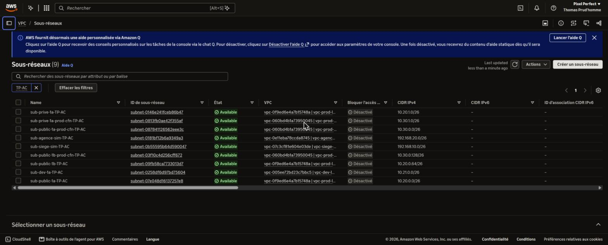

**Console AWS – vpcs**

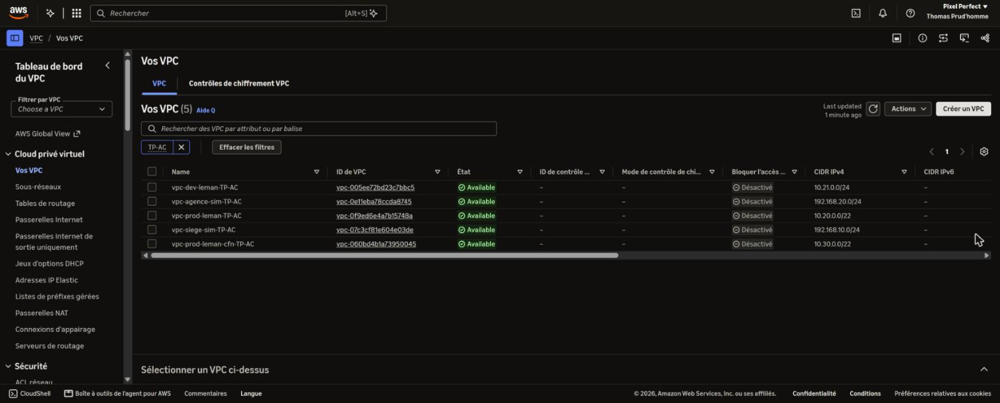

**Terminal**

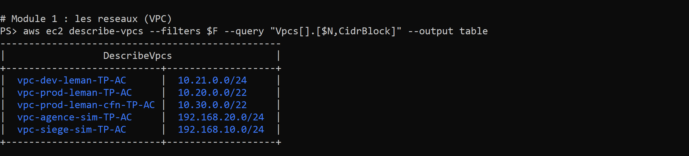

**Terminal**

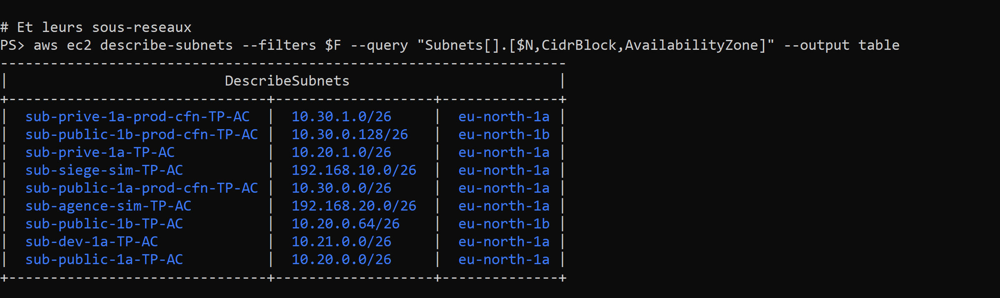

**Terminal – journal du test**

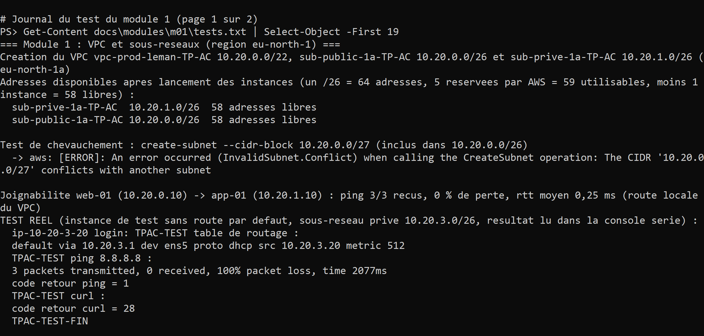

**Terminal – journal du test**

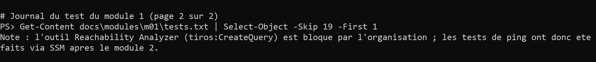


---

# Module 2 – Routage : IGW et NAT

## Objectif
Donner un accès Internet au sous-réseau public, un accès sortant seulement au privé, et savoir trouver une panne de route.

## Ce qu'il faut savoir
Un sous-réseau est public quand sa table de routage envoie `0.0.0.0/0` vers une Internet Gateway (et que l'instance a une IP publique). Pour un sous-réseau privé, on met une NAT Gateway dans le sous-réseau public : les machines privées peuvent sortir, mais personne ne peut entrer. La NAT coûte environ 0,045 USD de l'heure, ce qui compte avec un budget limité. Quand plusieurs routes correspondent, la plus précise gagne.

## Ce que nous avons fait
- Une Internet Gateway `igw-prod-leman-TP-AC`, et une table `rt-public-leman-TP-AC` avec `0.0.0.0/0` vers l'IGW, associée aux sous-réseaux publics.
- Une Elastic IP sur `web-01`.
- Une NAT Gateway `nat-prod-leman-TP-AC` dans le sous-réseau public, et une table `rt-prive-leman-TP-AC` avec `0.0.0.0/0` vers la NAT.
- Un test de panne : nous avons supprimé la route par défaut du privé pendant que `app-01` pinguait `8.8.8.8` chaque seconde, puis nous l'avons remise.

Script : `scripts/m02-routage.ps1`.

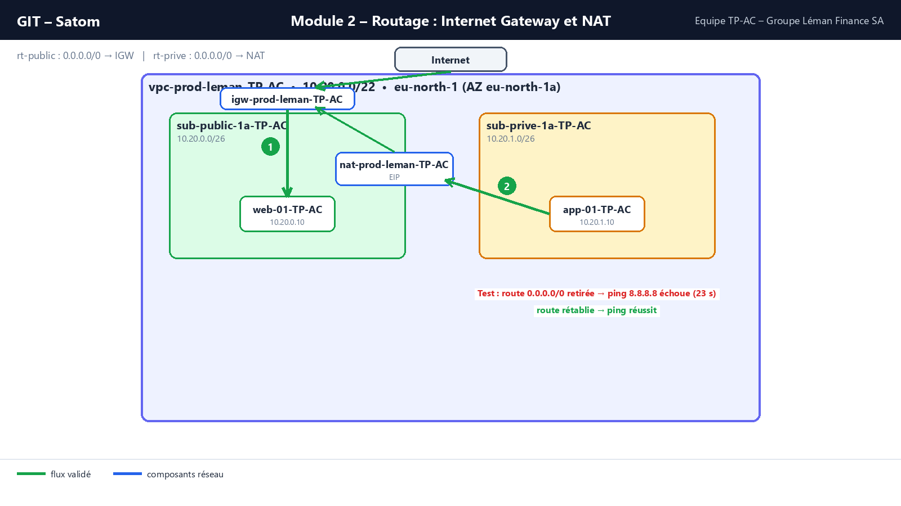

| Table | Routes |
|---|---|
| rt-public-leman-TP-AC | `10.20.0.0/22` local ; `0.0.0.0/0` vers l'IGW |
| rt-prive-leman-TP-AC | `10.20.0.0/22` local ; `0.0.0.0/0` vers la NAT |

## Si ça ne marche pas : quatre vérifications
1. Le sous-réseau est-il associé à la bonne table de routage ?
2. La route par défaut existe-t-elle ?
3. Pointe-t-elle vers la bonne cible (IGW ou NAT) ?
4. La cible est-elle en bon état (NAT `available`, IGW attachée, IP publique sur l'instance) ?

## Résultats des tests
```
=== Module 2 : routage ===
TP1 - IGW + rt-public (0.0.0.0/0 -> igw) + IP publique (Elastic IP) sur web-01
  web-01 -> ping 8.8.8.8 : 2/2 recus (ttl 119, ~3 ms)
  web-01 -> app-01 ping 10.20.1.10 : 3/3 recus
TP2 - NAT nat-prod-leman-TP-AC + rt-prive (0.0.0.0/0 -> nat)
  app-01 -> ping 8.8.8.8 : 2/2 recus (~4 ms) ; curl https://checkip.amazonaws.com -> IP de la NAT (l'adresse de app-01 reste privee)
  app-01 n'a aucune adresse IP publique (describe-instances : PublicIpAddress = None) : il n'est pas joignable depuis Internet
TP3 - route par defaut retiree puis retablie (ping 8.8.8.8 chaque seconde depuis app-01, heures UTC de l'instance) :
  10:49:04 a 10:49:18  OK    (route 0.0.0.0/0 -> NAT presente)
  10:49:19 a 10:49:37  ECHEC (route retiree a 10:49:20 UTC, soit 19 s d'echec)
  10:49:39 a 10:49:59  OK    (route retablie a 10:49:39 UTC)
Tables de routage finales :
  rt-public-leman-TP-AC : 10.20.0.0/22 local | 0.0.0.0/0 -> igw-prod-leman-TP-AC
  rt-prive-leman-TP-AC  : 10.20.0.0/22 local | 0.0.0.0/0 -> nat-prod-leman-TP-AC
```

## Nettoyage
Le sujet demande de supprimer la NAT en fin de séance. Nous la gardons pour l'instant, car elle donne à `app-01` l'accès SSM, et nous la supprimerons à la fin du cours.

## Problèmes rencontrés
Le compte n'autorise que 5 Elastic IP pour toute la classe. Les autres machines du projet utilisent donc des IP publiques automatiques.

## Captures

**Console AWS – passerelle nat**


**Console AWS – passerelles internet**

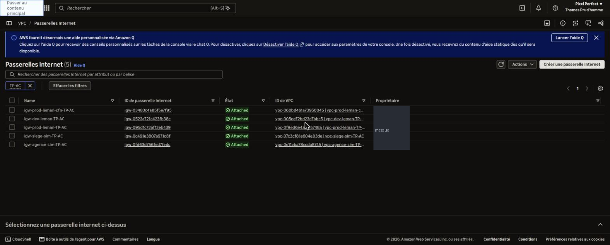

**Console AWS – tables routage**

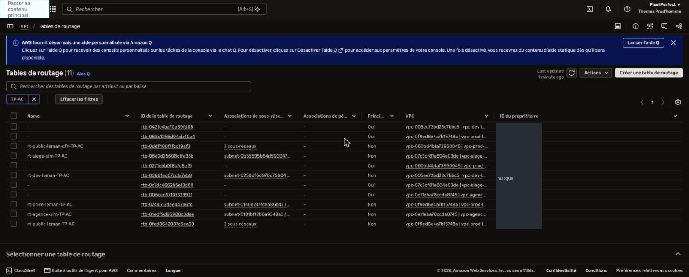

**Terminal – journal du test**

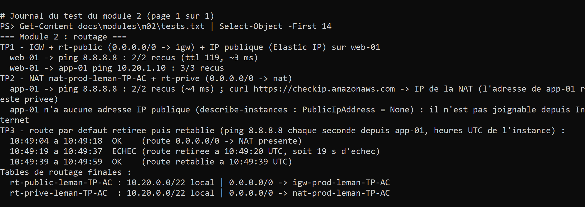


---

# Module 3 – Security Groups et NACL

## Objectif
Filtrer le trafic à deux endroits : sur chaque instance (Security Group) et sur chaque sous-réseau (NACL), et savoir dire lequel bloque.

## Ce qu'il faut savoir
Un Security Group garde l'état des connexions : si l'aller est autorisé, le retour l'est aussi. Il ne contient que des autorisations. Une NACL ne garde pas l'état : il faut autoriser l'aller et le retour (les ports éphémères 1024-65535). Elle accepte des refus, et ses règles sont lues par numéro croissant : la première qui correspond gagne.

## Ce que nous avons fait
- `sg-web-TP-AC` : 443 ouvert à tous, 22 ouvert seulement à une plage de test. Le sujet parle de l'adresse de la « salle d'exploitation » sans la donner ; nous avons mis `203.0.113.0/24` (plage réservée à la documentation).
- `sg-app-TP-AC` : 8080, 22 et ICMP autorisés seulement depuis `sg-web`.
- Un petit nginx (80 et 443 avec certificat auto-signé) sur `web-01`, et une mini-API Python sur le port 8080 de `app-01`.
- Une NACL `nacl-public-TP-AC` sur le sous-réseau public : entrée 443 et ports éphémères, sortie 443 et ports éphémères, plus tout le trafic interne du VPC.
- Trois pannes volontaires : retirer la règle de retour de la NACL, retirer le 8080 de `sg-app`, et placer un refus explicite avant l'autorisation (règle 50 contre règle 100).

Scripts : `scripts/m03-securite.ps1` et `scripts/m03-tests.ps1`.

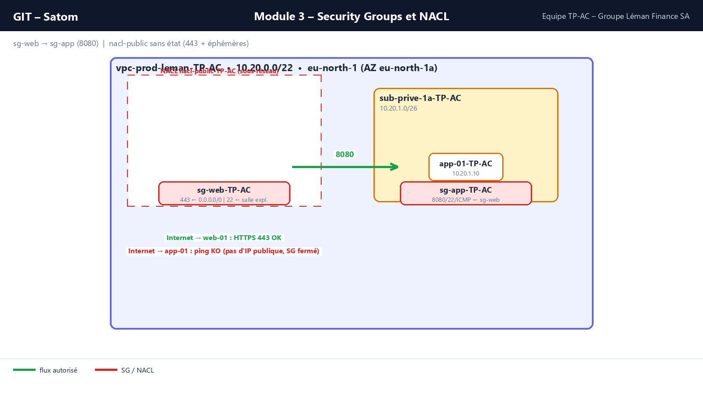

| Groupe | Sens | Port | Source |
|---|---|---|---|
| sg-web | entrée | 443 | tout Internet |
| sg-web | entrée | 22 | 203.0.113.0/24 |
| sg-app | entrée | 8080, 22, ICMP | sg-web |

NACL : entrée 100 (TCP 443, tous), 110 (TCP 1024-65535, tous), 120 (tout, VPC) ; sortie 100, 110 et 120 identiques.

## Si ça ne marche pas : quatre vérifications
1. Le Security Group de la cible ouvre-t-il le port pour cette source ?
2. La source de la règle est-elle correcte (une plage ou un autre groupe) ?
3. La NACL du sous-réseau autorise-t-elle l'aller et le retour, dans le bon ordre ?
4. La route de retour existe-t-elle ?

## Résultats des tests
```
=== TP1 : Security Groups ===
curl https depuis Internet vers web-01 : HTTP 200
ping depuis Internet vers web-01 (ICMP non autorise) : pas de reponse (attendu)
app-01 n'a pas d'IP publique : None

=== TP2 : SG (avec etat) vs NACL (sans etat) ===
web-01 -> app-01:8080 : Success	app-01 TP-AC /api/health 	
NACL : regle de retour (sortie ephemere 1024-65535) retiree -> curl externe : HTTP 000 ECHEC (code curl 28 : timeout/refus)
NACL : regle de retour retablie -> curl externe : HTTP 200

=== TP3 : diagnostic ===
8080 retire de sg-app -> web-01 -> app-01:8080 : Success	ECHEC 	
8080 retabli -> web-01 -> app-01:8080 : Success	app-01 TP-AC /api/health 	
NACL : refus explicite regle 50 (avant l'autorisation 100) -> curl externe : HTTP 000 ECHEC (code curl 28 : timeout/refus)  [la regle au numero le plus bas gagne]
refus supprime -> curl externe : HTTP 200
```

## Nettoyage
Nous gardons les deux groupes et la NACL, et arrêtons les instances après chaque séance.

## Problèmes rencontrés
AWS interdit les noms de groupe qui commencent par `sg-`. Le nom `sg-web-TP-AC` est donc dans le tag `Name`, et le groupe s'appelle `web-TP-AC`. Le port 22 est ouvert pour respecter le sujet, mais nous administrons par SSM.

## Captures

**Console AWS – groupes securite**


**Console AWS – nacl**


**Terminal – journal du test**

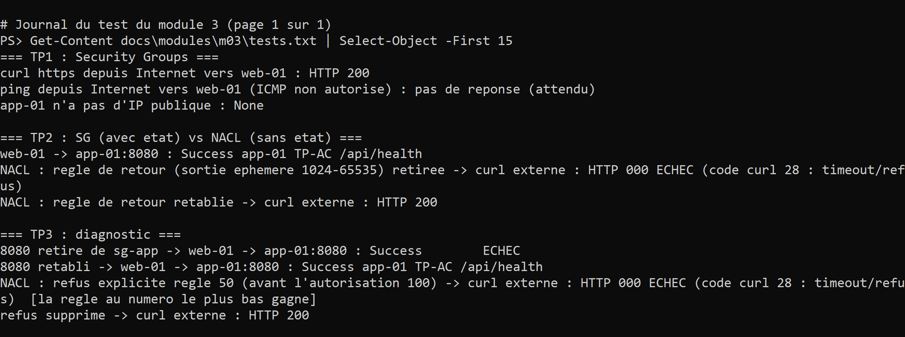


---

# Module 4 – Network Firewall

> Ce module a d'abord été refusé par l'organisation AWS (`network-firewall:*`). Ce blocage a été levé le 17/11/2026 (nous ne savons pas qui l’a levé) : nous avons alors réalisé et testé le module pour de vrai.

## Objectif
Filtrer ce qui sort du sous-réseau privé : n'autoriser que des dépôts de mises à jour, bloquer le reste du web et garder les alertes dans CloudWatch Logs.

## Ce qu'il faut savoir
Network Firewall est un pare-feu managé placé dans un sous-réseau à part. On y envoie le trafic avec des routes qui visent son endpoint. Il a un moteur sans état (par paquet) et un moteur avec état (domaines HTTP et TLS, règles Suricata). Il faut que le retour d'un flux repasse par le même endpoint, sinon le pare-feu perd l'état. Il coûte environ 0,40 USD de l'heure : on le supprime après les tests.

## Ce que nous avons fait
Le trafic de `app-01` passe par l'endpoint du pare-feu (`sub-fw-1a`, `10.20.2.0/28`), puis vers la NAT, puis vers Internet. Au retour, une route dans la table publique renvoie le trafic vers le pare-feu.

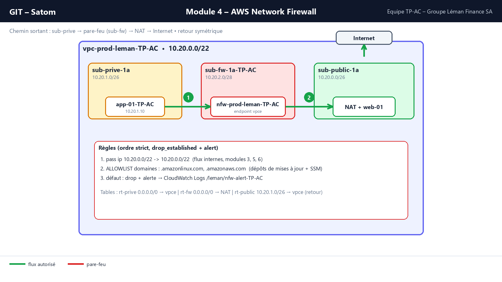

Règles, en ordre strict :
1. laisser passer tout le trafic interne du VPC (`10.20.0.0/22`) pour ne pas casser les autres modules ;
2. autoriser seulement `.amazonlinux.com` et `.amazonaws.com` ;
3. par défaut, bloquer et journaliser (`drop_established` et `alert_established`) dans `/leman/nfw-alert-TP-AC` ;
4. un second journal, `/leman/nfw-flow-TP-AC`, garde **tous** les flux vus par le pare-feu, y compris ceux qu'il autorise : c'est lui qui montre le flux autorisé, car une alerte n'est émise que pour ce qui est bloqué.

Les routes sont : `rt-prive` avec `0.0.0.0/0` vers l'endpoint ; `rt-fw` avec `0.0.0.0/0` vers la NAT ; `rt-public` avec `10.20.1.0/26` vers l'endpoint pour le retour ; et, dans `rt-prive`, `10.20.0.0/26` et `10.20.0.64/26` vers l'endpoint (les deux sous-réseaux publics), pour que les réponses du privé vers le public traversent aussi le pare-feu.

Le pare-feu que montrent les tests est **déployé par le modèle CloudFormation** `cfn/interconnexion-leman.yaml` (voir le module 13). Le script `scripts/m04-firewall.ps1` (déploiement par la ligne de commande) nous a servi pour le premier essai.

## Résultats des tests
```
=== Module 4 : pare-feu deploye par la stack stack-interconnexion-leman-TP-AC ===
Pare-feu nfw-prod-leman-TP-AC : statut READY, endpoint vpce-0951ba9169b5e0399 dans le sous-reseau sub-fw-1a-TP-AC (10.20.2.0/28)
Routes : rt-prive 0.0.0.0/0 -> vpce-0951ba9169b5e0399 (endpoint du pare-feu)
[autorise] curl https://cdn.amazonlinux.com/ -> HTTP 403
[bloque]   curl https://example.com/        -> Failed	curl: (28) Connection timed out after 10002 milliseconds HTTP 000	failed to run commands: exit status 28
[bloque]   curl https://www.wikipedia.org/  -> Failed	curl: (28) Connection timed out after 10003 milliseconds HTTP 000	failed to run commands: exit status 28
[interne]   web-01 -> app-01:8080 (trafic interne, autorise par la regle 1 du pare-feu) -> Success	app-01 TP-AC /api/health 	

Journal des alertes /leman/nfw-alert-TP-AC (flux bloques) :
  47 alertes ; exemples :
  src 10.20.1.10 -> dst 13.40.182.125:123 | proto ntp | action blocked | aws:alert_established action
  src 10.20.1.10 -> dst 18.133.139.197:123 | proto ntp | action blocked | aws:alert_established action
  src 10.20.1.10 -> dst 104.20.23.154:443 | proto tls | action blocked | aws:alert_established action

Journal des flux /leman/nfw-flow-TP-AC (tous les flux vus par le pare-feu, dont le flux autorise) :
  128 flux vus (app-01 et web-01 vers app-01) ; exemples :
  src 10.20.0.115:40388 -> dst 10.20.1.10:8080 | proto TCP | octets 180
  src 10.20.0.19:41222 -> dst 10.20.1.10:8080 | proto TCP | octets 180
  src 10.20.0.115:14054 -> dst 10.20.1.10:8080 | proto TCP | octets 180
  src 10.20.0.19:25106 -> dst 10.20.1.10:8080 | proto TCP | octets 180
```

## Ce que nous avons vérifié
1. Le pare-feu passe à `Ready` et son endpoint apparaît dans la zone.
2. Depuis `app-01`, `curl https://cdn.amazonlinux.com` fonctionne, `curl https://example.com` échoue.
3. Les deux tests apparaissent dans les journaux : l'alerte du flux bloqué dans le journal des alertes, le flux autorisé (avec son nombre d'octets) dans le journal des flux.

## Ce qui a moins bien marché
Au premier essai, par la ligne de commande, le pare-feu a été créé mais trois étapes ont échoué : le groupe de journaux (les étiquettes passées à la création), la journalisation qui en dépend, et les routes (l'identifiant d'endpoint n'avait pas été lu). Nous avons corrigé ces étapes à la main. AWS a aussi refusé de supprimer le pare-feu tant qu'une journalisation était configurée : il faut la retirer d'abord. Le modèle CloudFormation gère cet ordre tout seul.

Le sujet demande que le flux autorisé et le flux bloqué apparaissent tous les deux dans les journaux. Notre premier essai ne journalisait que les alertes : nous avons ajouté le journal des flux.

## Un défaut que le sujet ne mentionne pas
Notre première version ne mettait que la route de retour dans la table publique, comme le sujet le demande. Résultat : **`web-01` ne joignait plus `app-01`**. La NAT est dans le même sous-réseau que `web-01` : la route de retour `10.20.1.0/26` vers le pare-feu s'applique donc aussi à tout ce que `web-01` envoie vers `app-01`. La requête passait par le pare-feu, mais la réponse revenait directement, et le pare-feu, qui ne voyait qu'un sens de l'échange, coupait la suite.

Nous avons d'abord ajouté, dans `rt-prive`, les routes `10.20.0.0/26` et `10.20.0.64/26` vers l'endpoint, pour que la réponse repasse aussi par le pare-feu. Cela ne suffisait pas : le flux était bien vu par le pare-feu (il apparaît dans le journal des flux), mais n'arrivait pas à `app-01`. La cause : dans `sg-app`, les règles de `web-01` et de `rtr-aws` étaient écrites « depuis le groupe de sécurité X ». Quand le trafic traverse l'endpoint du pare-feu, AWS ne le rattache plus à ce groupe, et la règle ne correspond plus. Les flux du développement et des sites marchaient, car leurs règles sont écrites par plage d'adresses. Nous avons donc écrit ces règles par plage (`10.20.0.0/26` pour `web-01`, `10.20.0.74/32` pour `rtr-aws`).

Ce qu'il faut retenir : avec un pare-feu au milieu d'un VPC, il faut que le trafic soit **symétrique**, et que les Security Groups autorisent par **adresses** plutôt que par référence de groupe.

## Nettoyage
Supprimer d'abord le pare-feu, puis la politique et les groupes de règles, et remettre `0.0.0.0/0` vers la NAT dans `rt-prive`.

## Captures

**Console AWS – paquets bloques**

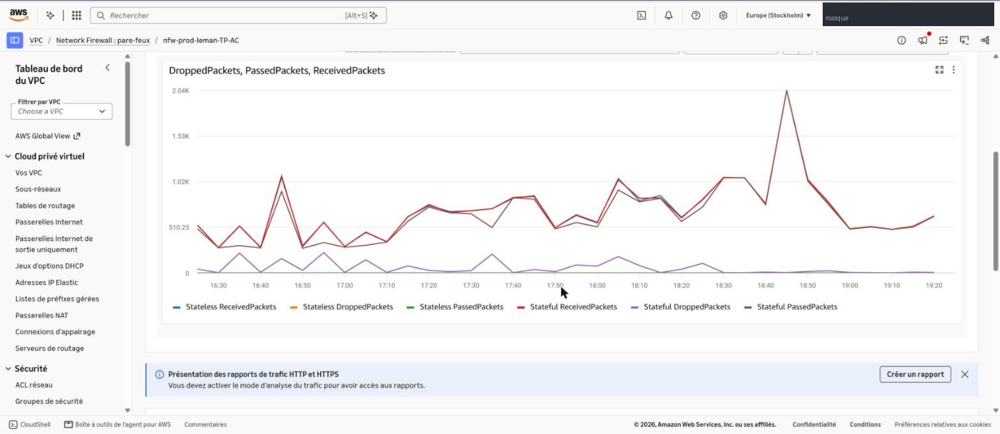

**Console AWS – pare feu details**

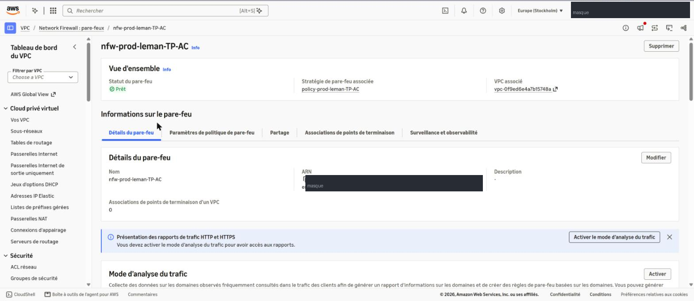

**Console AWS – pare feux**

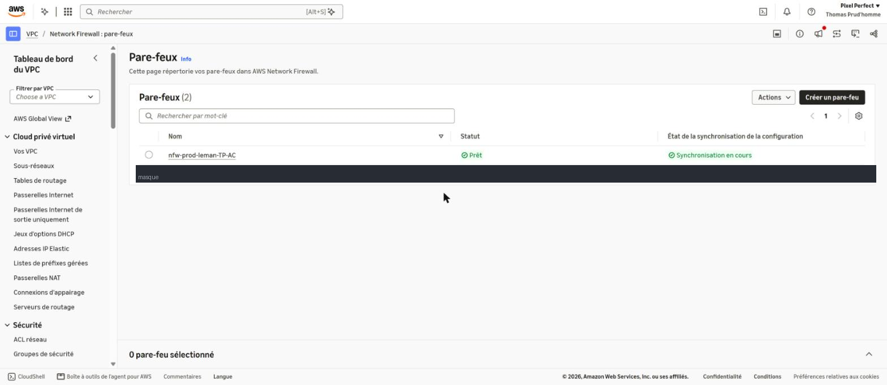

**Console AWS – politique regles**

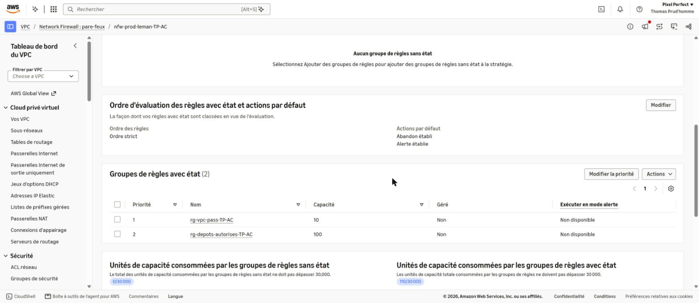

**Terminal**

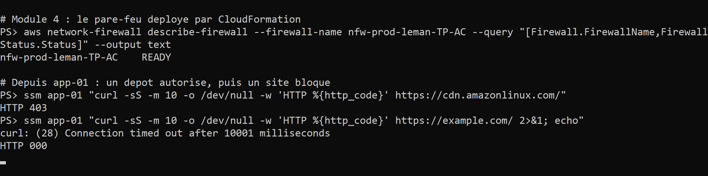

**Terminal**

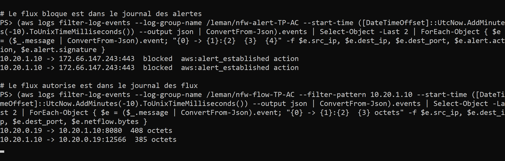

**Terminal – journal du test**

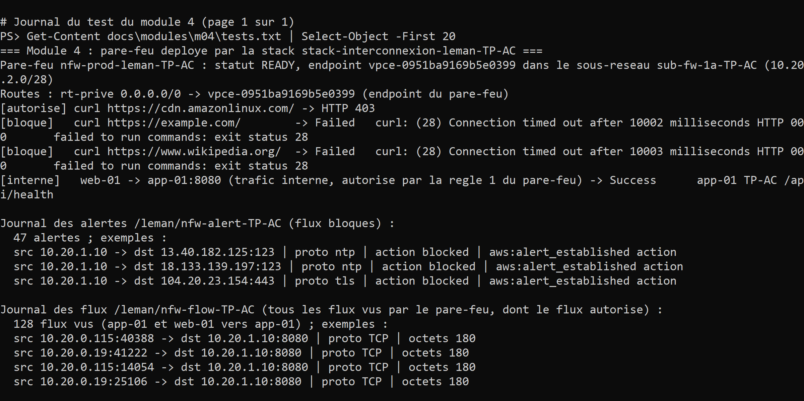


---

# Module 5 – VPC Peering

## Objectif
Créer un VPC de développement, le relier à la production pour le seul port 8080, et comprendre les limites du peering.

## Ce qu'il faut savoir
Un peering relie deux VPC par le réseau privé d'AWS. Il faut faire la demande, l'accepter, ajouter les routes dans les deux sens et ouvrir ce qu'il faut dans les Security Groups. Les plages ne doivent pas se chevaucher (AWS accepte la demande, puis la met en échec à l'acceptation). Le peering n'est pas transitif : si A parle à B et B à C, A ne parle pas à C.

## Ce que nous avons fait
- Le VPC `vpc-dev-leman-TP-AC` en `10.21.0.0/24`, un sous-réseau `10.21.0.0/26`, une instance `dev-01` (`10.21.0.10`). Elle a une IP publique pour joindre SSM, et son groupe de sécurité n'autorise aucune entrée.
- Le peering `pcx-lab-TP-AC` entre la prod et le dev, les routes dans les deux tables, et le port 8080 ouvert dans `sg-app` pour `10.21.0.0/24`.
- Un VPC volontairement en `10.20.0.0/24` pour tenter un peering avec la prod : il passe en échec.
- Un troisième VPC `10.22.0.0/24` relié seulement à la prod : `app-01` le joint, `dev-01` non.

Scripts : `scripts/m05-peering.ps1` et `scripts/m05-tests.ps1`.

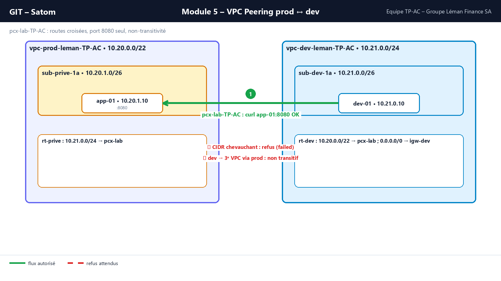

| Élément | Valeur |
|---|---|
| Peering | prod `10.20.0.0/22` avec dev `10.21.0.0/24` |
| Table du dev | `10.20.0.0/22` vers le peering, `0.0.0.0/0` vers l'IGW du dev |
| Table du privé (prod) | `10.21.0.0/24` vers le peering |
| sg-app | TCP 8080 depuis `10.21.0.0/24` |

## Comment nous testons
Depuis `dev-01`, un `curl` sur `app-01:8080` doit répondre et le port 22 doit rester fermé. Le peering avec la plage qui chevauche doit échouer. Et `dev-01` ne doit pas joindre le VPC relié seulement à la prod, alors qu'`app-01` le joint.

## Résultats des tests
```
dev-01 SSM en ligne : True
=== TP2 : peering pcx-lab (prod <-> dev) ===
dev-01 -> app-01:8080 : Success	app-01 TP-AC /api/health 	
dev-01 -> app-01:22 (non ouvert depuis dev) : Success	FERME 	

=== TP3 : limites du peering ===
Acceptation du peering avec un VPC en 10.20.0.0/24 (chevauche 10.20.0.0/22) -> aws: [ERROR]: An error occurred (InvalidStateTransition) when calling the AcceptVpcPeeringConnection operation: Invalid state transition for pcx-0b30499bae7844bdf, attempted to transition from failed to provisioning
app-01 (prod, peering direct) -> tiers-01 10.22.0.10 : Success	2 packets transmitted, 2 received, 0% packet loss, time 1002ms rtt min/avg/max/mdev = 0.170/0.294/0.419/0.124 ms 	
dev-01 (via prod = transit, NON transitif) -> tiers-01 10.22.0.10 : Success	2 packets transmitted, 0 received, 100% packet loss, time 1043ms  exit=0
```

## Nettoyage
Comme le sujet le demande, le peering `pcx-lab-TP-AC` est supprimé au module 6 : le Transit Gateway relie ensuite la prod et le dev. `dev-01` est arrêtée après les tests, les VPC de test sont supprimés.

## Captures

**Console AWS – peering**

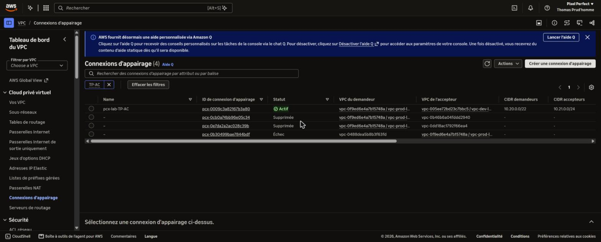

**Terminal**

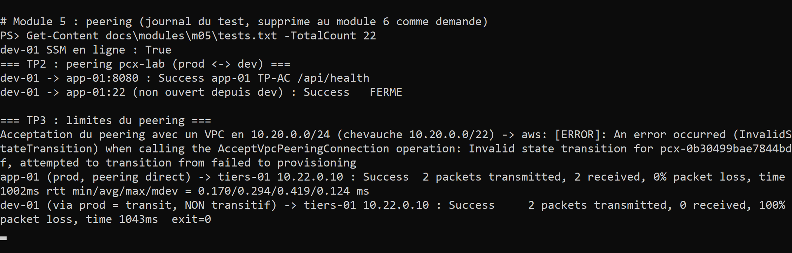

**Terminal – journal du test**

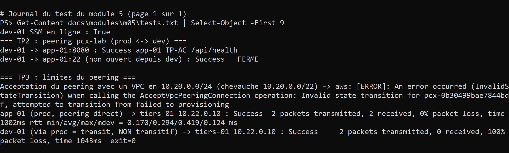


---

# Module 6 – Transit Gateway

> Le Transit Gateway était d'abord refusé par l'organisation AWS (`ec2:CreateTransitGateway`). Le blocage a été levé le 17/11/2026 : nous avons alors fait le module pour de vrai.

## Objectif
Remplacer le peering du module 5 par un point central : `tgw-leman-TP-AC` relie la prod et le dev, avec une table de routage par environnement, puis accueille les VPN du module 7.

## Ce qu'il faut savoir
Chaque VPC se branche au Transit Gateway par un attachement. Avec le peering il faut un lien par paire de réseaux ; avec le Transit Gateway, un seul par réseau. Un attachement est associé à **une** table de routage (celle qui décide où il peut aller) et peut publier sa plage dans d'autres tables (propagation). Nous avons coupé l'association et la propagation par défaut, pour décider à la main qui voit qui. Les routes dans les tables des VPC restent nécessaires. Chaque attachement coûte environ 0,05 USD de l'heure.

## Ce que nous avons fait
- `tgw-leman-TP-AC` (ASN 64512), association et propagation par défaut désactivées.
- Deux attachements : `tgwa-prod-TP-AC` (sous-réseau `sub-prive-1a`) et `tgwa-dev-TP-AC` (sous-réseau `sub-dev-1a`).
- Deux tables : `tgw-rt-prod-TP-AC` (associée à la prod, elle apprend le CIDR du dev) et `tgw-rt-dev-TP-AC` (associée au dev, elle apprend le CIDR de la prod).
- Dans les VPC : `10.21.0.0/24` vers le Transit Gateway dans `rt-prive`, et `10.20.0.0/22` vers le Transit Gateway dans la table du dev. Le peering `pcx-lab` a ensuite été supprimé.

Le Transit Gateway que montrent les tests est **déployé par le modèle CloudFormation** `cfn/interconnexion-leman.yaml` (module 13) ; ses attachements `tgwa-prod-TP-AC` et `tgwa-dev-TP-AC` utilisent un sous-réseau de chaque VPC (pour la prod : `sub-prive-1a` et `sub-public-1b`, afin que le routeur AWS du module 8 joigne le Transit Gateway). Le script `scripts/m06-tgw.ps1` nous a servi pour le premier essai, et `scripts/m06-tests.ps1` rejoue les tests. Nos plages sont `10.20.0.0/22` (prod) et `10.21.0.0/24` (dev), pas les `10.0.0.0/16` et `10.1.0.0/16` du sujet.

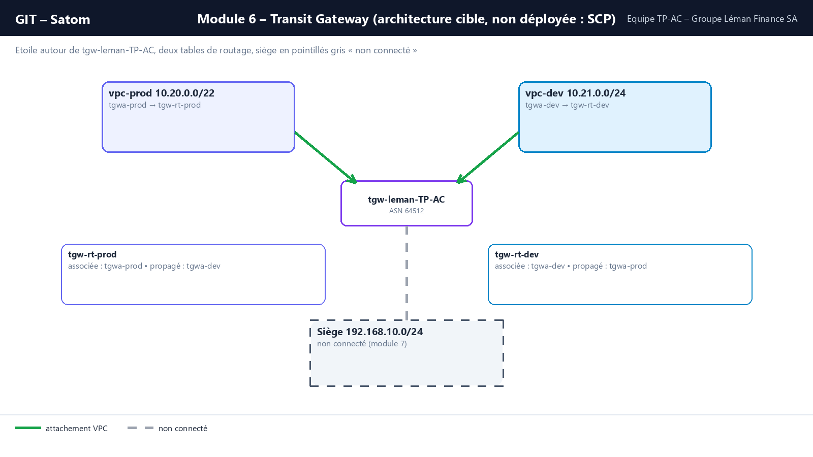

| Élément | Valeur |
|---|---|
| Transit Gateway | `tgw-leman-TP-AC`, ASN 64512 |
| Attachements | `tgwa-prod-TP-AC`, `tgwa-dev-TP-AC` |
| Tables | `tgw-rt-prod-TP-AC`, `tgw-rt-dev-TP-AC` (plus `tgw-rt-sites-TP-AC` au module 7) |
| Coût | environ 0,05 USD de l'heure par attachement |

## Si ça ne marche pas : quatre vérifications
1. L'association de l'attachement : à quelle table de routage est-il rattaché ?
2. La route propagée dans la table de **l'autre** environnement : le chemin de retour existe-t-il ?
3. La route dans la table du VPC, qui vise le Transit Gateway.
4. Le Security Group de la cible (ici `sg-app`, port 8080).

## Résultats des tests
```
=== Module 6 : Transit Gateway deploye par la stack stack-interconnexion-leman-TP-AC ===
Attachements : tgwa-prod-TP-AC	vpc	available | tgwa-dev-TP-AC	vpc	available | None	vpn	available | tgwa-vpn-agence-TP-AC	vpn	available | None	direct-connect-gateway	available
Peering pcx-lab encore actif ? : 0 (0 = supprime)
Tables : tgw-rt-prod-TP-AC	available | tgw-rt-dev-TP-AC	available | tgw-rt-sites-TP-AC	available
Routes tgw-rt-prod : 10.21.0.0/24	propagated | 192.168.10.0/24	static | 192.168.20.0/24	static
Routes tgw-rt-dev  : 10.20.0.0/22	propagated
dev-01 -> app-01:8080 par le Transit Gateway : Success	app-01 TP-AC /api/health 	

=== TP3 : propagation de tgwa-dev vers tgw-rt-prod retiree ===
Routes tgw-rt-prod apres retrait : 192.168.10.0/24	static | 192.168.20.0/24	static
dev-01 -> app-01:8080 (la reponse n'a plus de route) : Success	ECHEC 	
Propagation retablie : Success	app-01 TP-AC /api/health
```
Quand nous retirons la propagation de `tgwa-dev` vers `tgw-rt-prod`, le `curl` depuis `dev-01` échoue : la requête arrive jusqu'à `app-01`, mais la réponse n'a plus de route pour revenir. Dès que la propagation est remise, il refonctionne.

## Ce qui a mal tourné
Notre script attendait la fin de la création avec une requête mal écrite et tournait sans fin. Sa deuxième exécution a créé un **second** Transit Gateway au lieu de reprendre le premier. Nous avons supprimé le doublon (et ses deux attachements) et rendu le script capable de reprendre sur ce qui existe déjà.

## Nettoyage
Facturé à l'heure : nous supprimons les attachements, puis les tables, puis le Transit Gateway à la fin du projet.

## Captures

**Console AWS – attachements**

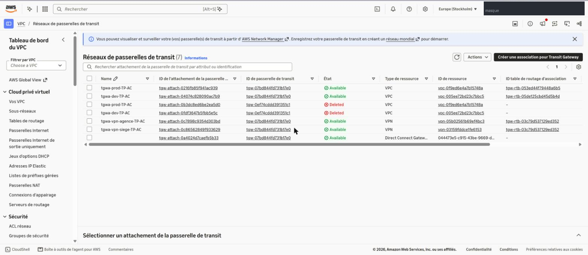

**Console AWS – passerelle transit**

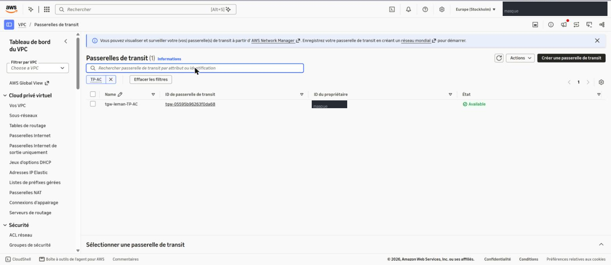

**Console AWS – routes tgw prod**

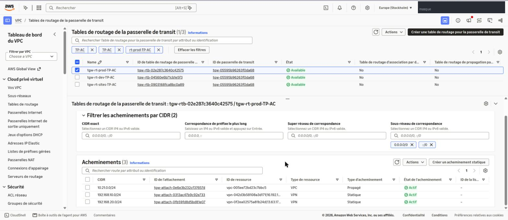

**Console AWS – tables tgw**

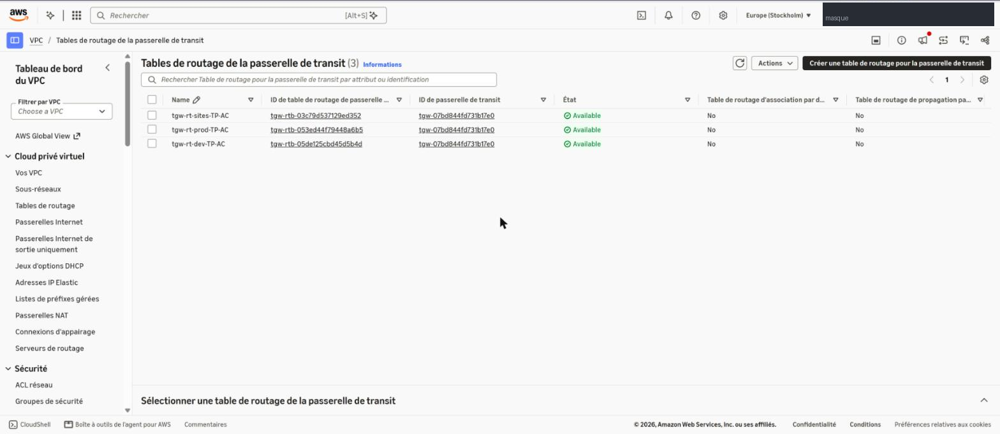

**Terminal**

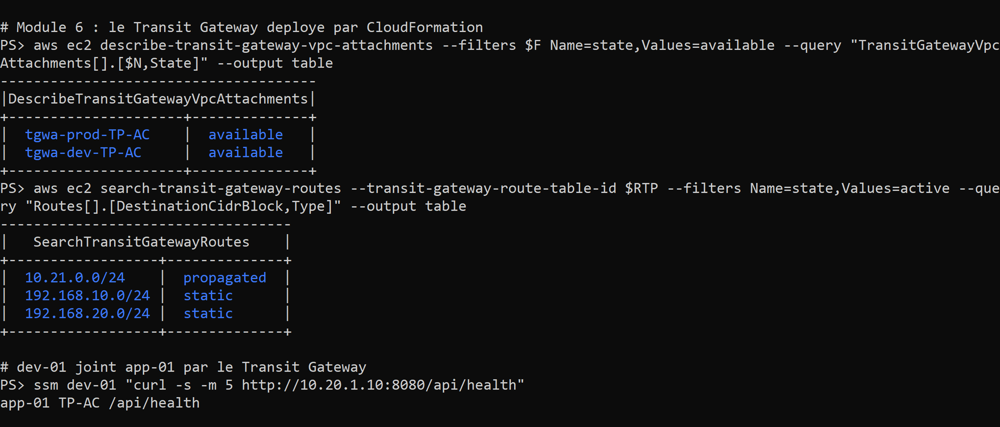

**Terminal – journal du test**

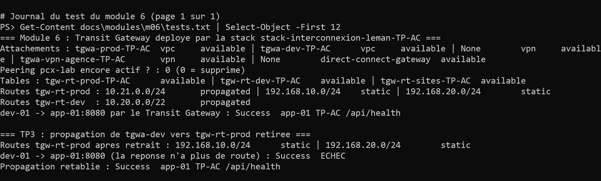


---

# Module 7 – VPN site à site (siège et agence)

> Les trois actions du VPN (`CreateCustomerGateway`, `CreateVpnGateway`, `CreateVpnConnection`) étaient refusées par l'organisation AWS. Le blocage a été levé le 17/11/2026 : nous avons refait ce module avec le **vrai VPN d'AWS**. Les deux « sites » restent simulés : ce sont deux instances EC2 avec strongSwan qui jouent l'équipement du client.

## Objectif
Relier le siège (`192.168.10.0/24`) et l'agence (`192.168.20.0/24`) au cloud par des tunnels chiffrés qui passent par `tgw-leman-TP-AC`. Le siège et l'agence joignent `app-01` sur le port 8080 (le siège peut aussi pinger), et aucun des deux ne voit le dev.

## Ce qu'il faut savoir
Une connexion VPN AWS donne **deux tunnels** IPsec, vers deux adresses publiques d'AWS, avec des adresses de tunnel en `169.254.x.x/30`. Du côté du client, il faut un équipement qui parle IPsec : le Customer Gateway n'est que sa description (son adresse publique). Nous utilisons le routage statique. Pour un VPN rattaché à un Transit Gateway, les routes statiques ne se déclarent pas sur le VPN mais dans la table de routage du Transit Gateway : AWS nous l'a rappelé par une erreur. Les clés partagées ne doivent jamais traîner dans un document : les nôtres sont dans Secrets Manager (`Projet/SatomCloudNetwork/vpn`), une par tunnel, et les routeurs les lisent avec leur rôle IAM.

## Ce que nous avons fait
- Deux Elastic IP, une par routeur (`rtr-siege-TP-AC`, `rtr-agence-TP-AC`) : c'est l'adresse de chaque Customer Gateway (`cgw-siege-TP-AC`, `cgw-agence-TP-AC`). Les adresses du sujet (`203.0.113.10`) sont des adresses de documentation, inutilisables pour un vrai tunnel.
- Deux connexions `vpn-siege-TP-AC` et `vpn-agence-TP-AC`, en routage statique, rattachées au Transit Gateway (IKEv2, AES-256, SHA-256, groupe Diffie-Hellman 14).
- Une table `tgw-rt-sites-TP-AC` pour les deux attachements VPN : elle ne contient que la prod, donc les sites ne voient pas le dev. Les routes `192.168.10.0/24` et `192.168.20.0/24` sont dans `tgw-rt-prod-TP-AC`, avec les attachements VPN comme cible. `tgw-rt-dev-TP-AC` n'en reçoit aucune.
- Dans `rt-prive`, les deux plages des sites visent le Transit Gateway.
- Chaque routeur monte ses deux tunnels (`xfrm-siege1` et `xfrm-siege2`, `xfrm-agence1` et `xfrm-agence2`). Le premier tunnel a la préférence (métrique 100), le second sert de secours (200).
- Dans `sg-app` : ping et 8080 pour le siège, 8080 seulement pour l'agence.

Les ressources AWS (Elastic IP, Customer Gateways, connexions VPN, attachements, routes) sont **déployées par le modèle CloudFormation** `cfn/interconnexion-leman.yaml` (voir le module 13). Les clés partagées viennent de Secrets Manager par référence dynamique : elles n'apparaissent dans aucun fichier. Le script `scripts/m07-vpn-aws.ps1` configure ensuite les routeurs et mesure : `-Stage 2` (strongSwan et tests de flux), `-Stage 3` (bascule du siège) et `-Stage 4` (bascule de l'agence). Le premier essai, créé à la main par la ligne de commande, nous a servi à comprendre les paramètres ; le modèle l'a remplacé.

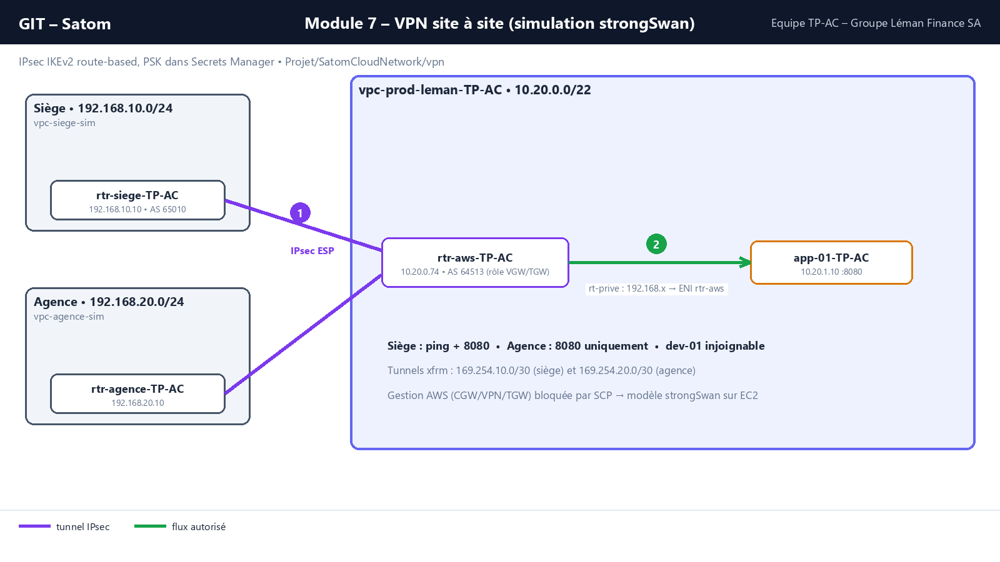

| Élément | Valeur |
|---|---|
| IKE et ESP | IKEv2, `aes256-sha256-modp2048`, clé partagée |
| Routage | statique, routes déclarées dans `tgw-rt-prod-TP-AC` |
| Tunnels | 2 par site, 4 en tout, tous `UP` |
| ASN du Customer Gateway | 65000 (obligatoire à la création, sans effet en statique) |

## Si ça ne marche pas : quatre vérifications
1. L'état des tunnels : `UP` dans la console (ou `describe-vpn-connections`), et `swanctl --list-sas` doit afficher `ESTABLISHED`.
2. Les paramètres IPsec : mêmes propositions et même clé des deux côtés.
3. La route `192.168.x.0/24` dans `tgw-rt-prod`, et la route retour dans `rt-prive`.
4. Le Security Group de la cible (`sg-app`) et ceux des routeurs (UDP 500 et 4500 depuis les quatre adresses AWS).

## Résultats des tests
```
=== Module 7 - etape 1 : VPN crees par la stack, avant configuration des routeurs ===
vpn-siege-TP-AC : available	ipsec.1	True
  tunnels (adresse AWS, etat) : 16.16.69.252	DOWN | 16.192.162.35	DOWN
vpn-agence-TP-AC : available	ipsec.1	True
  tunnels (adresse AWS, etat) : 13.61.98.78	DOWN | 13.63.173.212	DOWN
tgw-rt-prod : 10.21.0.0/24	propagated	active | 192.168.10.0/24	static	blackhole | 192.168.20.0/24	static	blackhole

=== Module 7 - etape 2 : tunnels, flux et segmentation ===
siege : swanctl --list-sas (cote routeur)
siege-t2: #2, ESTABLISHED, IKEv2, 35f033fe3ecf3ca4_i* 67e0bc1592994c7c_r
  siege-t2: #2, reqid 2, INSTALLED, TUNNEL-in-UDP, ESP:AES_CBC-256/HMAC_SHA2_256_128
siege-t1: #1, ESTABLISHED, IKEv2, c4c613fa152a7cd4_i* d1219417c5494da4_r
  siege-t1: #1, reqid 1, INSTALLED, TUNNEL-in-UDP, ESP:AES_CBC-256/HMAC_SHA2_256_128

agence : swanctl --list-sas (cote routeur)
agence-t2: #2, ESTABLISHED, IKEv2, e2e49f4e64242dc5_i* 2f6ae7a044ccede0_r
  agence-t2: #2, reqid 2, INSTALLED, TUNNEL-in-UDP, ESP:AES_CBC-256/HMAC_SHA2_256_128
agence-t1: #1, ESTABLISHED, IKEv2, dd2a0ff6e93c4d51_i* 01379b4f96a3567f_r
  agence-t1: #1, reqid 1, INSTALLED, TUNNEL-in-UDP, ESP:AES_CBC-256/HMAC_SHA2_256_128

vpn-siege-TP-AC, etat des tunnels vu par AWS : 16.16.69.252	UP	 | 16.192.162.35	UP	
vpn-agence-TP-AC, etat des tunnels vu par AWS : 13.61.98.78	UP	 | 13.63.173.212	UP	
tgw-rt-prod (routes actives) : 10.21.0.0/24	propagated	vpc | 192.168.10.0/24	static	vpn | 192.168.20.0/24	static	vpn
tgw-rt-dev  (routes actives) : 10.20.0.0/22	propagated
tgw-rt-sites (routes actives) : 10.20.0.0/22	propagated

-- siege -> app-01 (10.20.1.10)
ping : --- 10.20.1.10 ping statistics ---
3 packets transmitted, 3 received, 0% packet loss, time 2004ms
rtt min/avg/max/mdev = 2.645/2.703/2.818/0.081 ms
	
8080 : app-01 TP-AC /api/health
	

-- agence -> app-01 (seul le 8080 est autorise)
8080 : app-01 TP-AC /api/health
	
ping (doit echouer) : 2 packets transmitted, 0 received, 100% packet loss, time 1014ms

	

-- segmentation : aucun site ne joint dev-01 (10.21.0.10), dev-01 ne joint pas les sites (dev-01 SSM : Online)
siege -> dev-01 : 3 packets transmitted, 0 received, 100% packet loss, time 2048ms

	
agence -> dev-01 : 3 packets transmitted, 0 received, 100% packet loss, time 2050ms

	
dev-01 -> siege : 3 packets transmitted, 0 received, 100% packet loss, time 2119ms

	
dev-01 -> agence : 3 packets transmitted, 0 received, 100% packet loss, time 2114ms

=== Module 7 - etape 3 : bascule entre les deux tunnels du siege ===
avant le test : tunnels vus par AWS = UP	UP
T+10 s : panne silencieuse du tunnel 1 (les paquets vers 16.16.69.252 sont perdus, comme une vraie coupure)

T+15 s : route : 10.20.1.10 from 192.168.10.10 dev xfrm-siege1 uid 0 

T+60 s : route : 10.20.1.10 from 192.168.10.10 dev xfrm-siege2 uid 0  ; tunnels etablis cote routeur : 1

T+90 s : le tunnel 1 est retabli (paquets de nouveau acceptes, IKE relance)

T+130 s : route : 10.20.1.10 from 192.168.10.10 dev xfrm-siege1 uid 0 

--- resultat des requetes curl sur le port 8080 (une toutes les 0,3 s)

interruption de 29.2 s, de T+9.9 s a T+39.0 s

sessions IKE etablies : 2

	

etat vu par AWS : 16.16.69.252	DOWN | 16.192.162.35	UP

=== Module 7 - etape 4 : bascule entre les deux tunnels de l'agence ===
avant le test : tunnels vus par AWS = UP	UP
T+10 s : panne silencieuse du tunnel 1 (les paquets vers 13.61.98.78 sont perdus, comme une vraie coupure)

T+15 s : route : 10.20.1.10 from 192.168.20.10 dev xfrm-agence1 uid 0 

T+60 s : route : 10.20.1.10 from 192.168.20.10 dev xfrm-agence2 uid 0  ; tunnels etablis cote routeur : 1

T+90 s : le tunnel 1 est retabli (paquets de nouveau acceptes, IKE relance)

T+130 s : route : 10.20.1.10 from 192.168.20.10 dev xfrm-agence1 uid 0 

--- resultat des requetes curl sur le port 8080 (une toutes les 0,3 s)

interruption de 33.5 s, de T+9.7 s a T+43.2 s

sessions IKE etablies : 2

	
etat vu par AWS : 13.61.98.78	UP | 13.63.173.212	UP
```

## Bascule entre les deux tunnels
Pour imiter une vraie panne, nous ne coupons pas l'interface : nous **supprimons les paquets** vers l'adresse AWS du premier tunnel (une perte silencieuse, comme une coupure de ligne). Une requête `curl` est envoyée toutes les 0,3 s (une nouvelle connexion à chaque fois, comme de vrais clients). Nous mesurons le plus long silence :

| Site | Interruption mesurée |
|---|---|
| Siège | **29,2 s** |
| Agence | **33,5 s** |

C'est le délai pendant lequel AWS croit encore que le premier tunnel est vivant ; ensuite, tout passe par le second. Quand nous rendons le premier, rien ne se coupe. Cette durée n'est pas fixe : sur d'autres essais, nous avons mesuré entre 26 et 34 secondes. Le sujet parle d'une bascule « sans coupure » : ce n'est pas possible avec un VPN IPsec (voir `docs/02-ecarts-au-sujet.md`).

Nos premières mesures étaient trompeuses : (1) en coupant l'interface, la bascule semblait immédiate, ce qui n'arrive jamais en vrai ; (2) avec un `ping`, le même flux ICMP restait collé au tunnel mort et la mesure atteignait 81 s, alors que de nouvelles connexions repartent après 30 s environ. Le `curl` toutes les 0,3 s est donc plus représentatif.

## Limites de notre réalisation
- Les sites sont simulés : deux instances EC2 dans deux petits VPC (`vpc-siege-sim`, `vpc-agence-sim`), pas du vrai matériel ni du GNS3.
- Nous avons un premier essai avec une simulation complète de la passerelle AWS (strongSwan des deux côtés) : ses résultats sont dans `docs/modules/m07/tests-simulation-initiale.txt`. Il n'est plus utilisé.

## Nettoyage
Les deux connexions VPN sont facturées à l'heure : nous les supprimons à la fin du projet avec leurs Customer Gateways et leurs Elastic IP (`scripts/m06-m08-cleanup.ps1`).

## Captures

**Console AWS – connexions vpn**

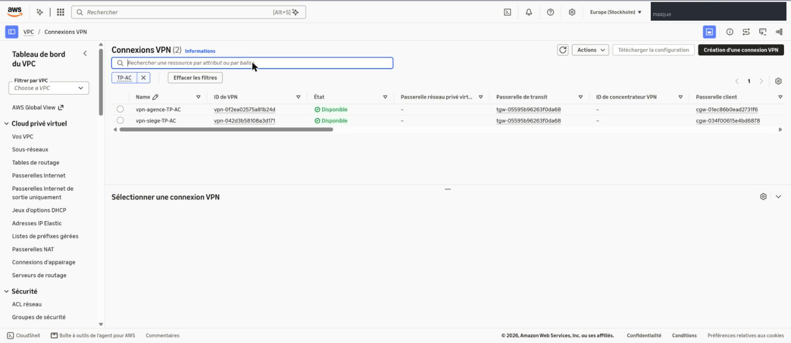

**Console AWS – secret vpn**

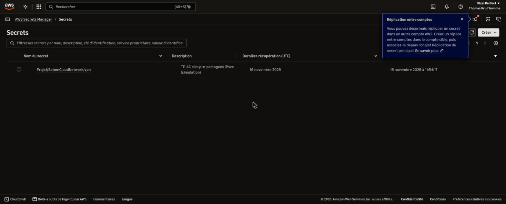

**Console AWS – tunnels vpn**

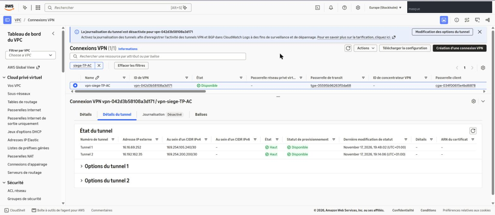

**Terminal**

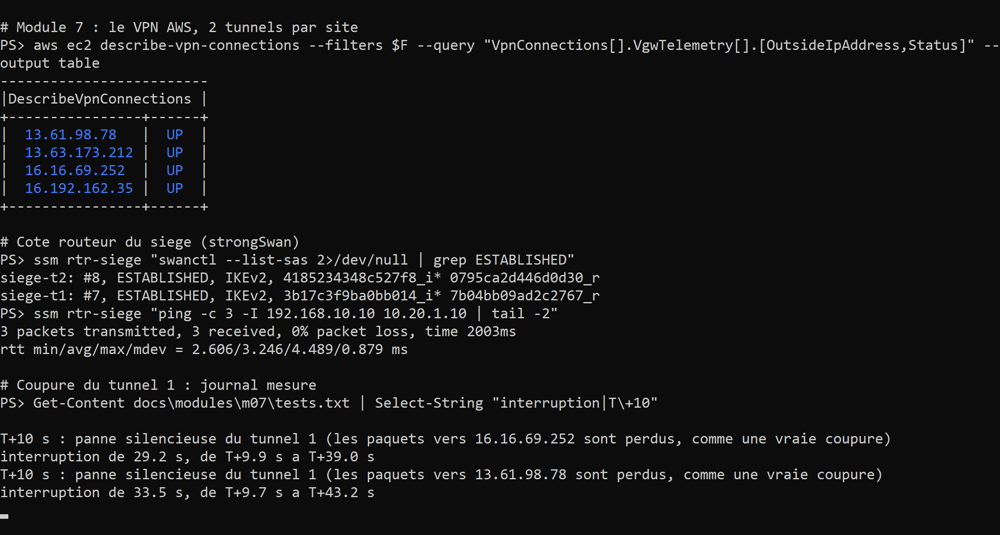

**Terminal – journal du test**

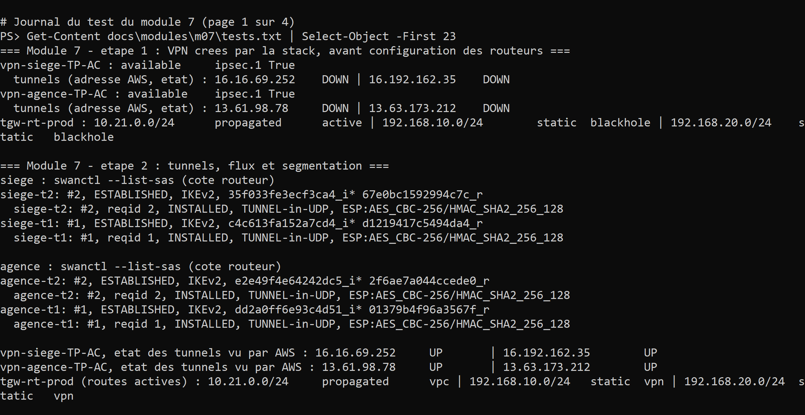

**Terminal – journal du test**

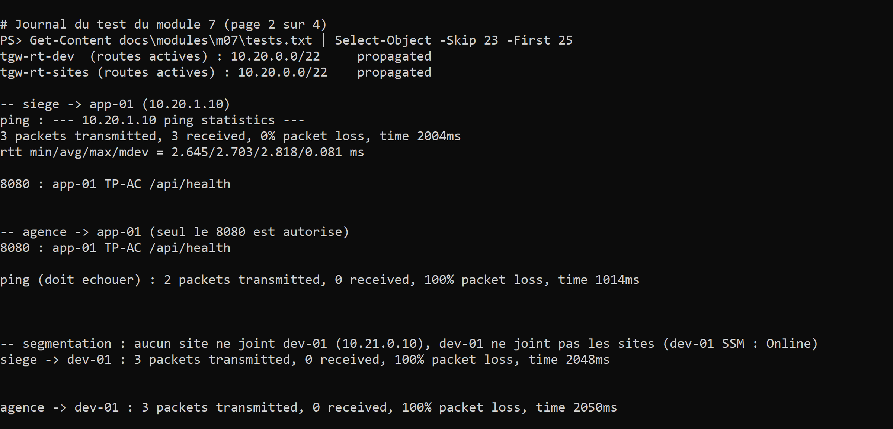

**Terminal – journal du test**

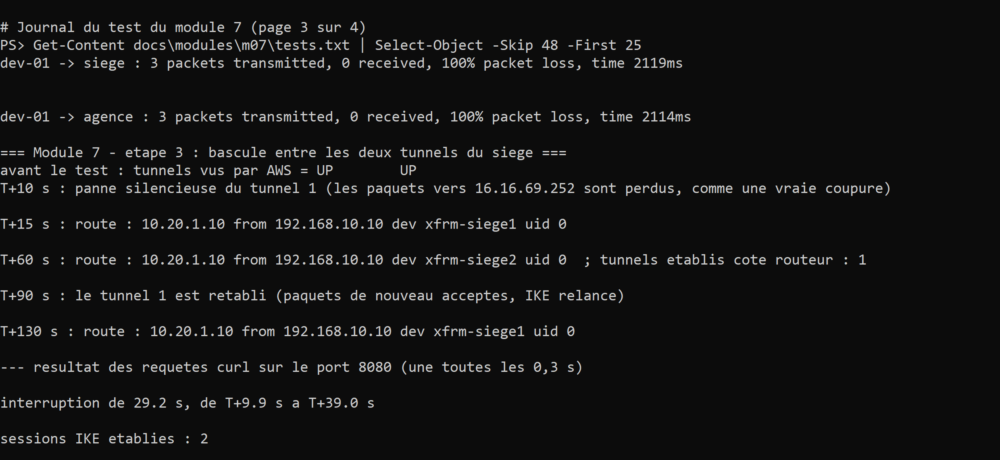

**Terminal – journal du test**

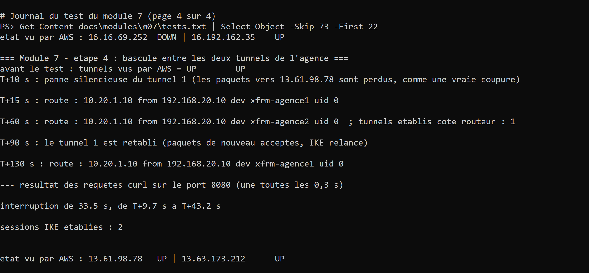


---

# Module 8 – Direct Connect

> Direct Connect était d'abord refusé par l'organisation AWS. Le blocage a été levé le 17/11/2026 : nous avons créé le **vrai Direct Connect Gateway** et l'avons associé au Transit Gateway. Comme nous ne commandons pas de fibre, la liaison elle-même est **simulée** par un tunnel GRE et du BGP, comme le sujet le prévoit.

## Objectif
Comprendre une liaison dédiée (dimensionnement, passerelle, BGP) et la bascule entre une liaison principale et un secours.

## Ce qu'il faut savoir
Direct Connect est un lien physique entre le siège et un point de présence d'AWS (1, 10 ou 100 Gbit/s). Une interface virtuelle y porte la session BGP vers AWS ; derrière, un Direct Connect Gateway se branche sur un Transit Gateway. En BGP, le chemin avec la préférence locale (local-pref) la plus haute gagne ; pour décourager un chemin, on allonge son AS-path (le « prepend »). Ici : local-pref 200 sur la liaison dédiée, et un prepend de 3 sur le chemin VPN.

## Dimensionnement
Nous devons transférer 2 To en 8 heures : 16 000 Gbit sur 28 800 s, soit environ 0,56 Gbit/s. Une liaison de 1 Gbit/s suffit avec une marge d'environ 44 %. Parmi les emplacements Direct Connect de notre région, nous retenons **EQSK1** (Equinix Sweden SK1), qui propose du 1 Gbit/s. Nous ne commandons rien. Il n'y a pas d'emplacement près de Genève dans la région de Stockholm.

## Ce que nous avons fait
**Partie réelle :**
- `dxgw-leman-TP-AC`, ASN 64513. Il n'existe pas de type CloudFormation pour un Direct Connect Gateway : le modèle `cfn/interconnexion-leman.yaml` le crée avec une **ressource personnalisée** (une petite fonction Lambda). Notre premier essai avait pris par erreur le même ASN que le Transit Gateway (64512), et AWS refuse alors l'association : nous l'avons supprimé et recréé avec le bon ASN.
- L'association de `dxgw-leman-TP-AC` à `tgw-leman-TP-AC`, avec les préfixes autorisés `10.20.0.0/22` et `192.168.10.0/24`. Elle passe à `associated`, et AWS crée de lui-même un attachement « Direct Connect Gateway » dans le Transit Gateway.

**Partie simulée :**
- Un tunnel GRE `gre-dx` (`169.254.100.0/30`) sur Internet entre `rtr-siege-TP-AC` (AS 65010) et `rtr-aws-TP-AC` (AS 64513, qui joue l'équipement côté AWS) : c'est notre « fibre ».
- Un second tunnel GRE `gre-vpn` (`169.254.101.0/30`) qui traverse **le vrai VPN** du module 7 : c'est le chemin de secours. Un VPN statique ne parle pas BGP, c'est pourquoi nous faisons passer la session BGP dans ce GRE, ce qui nous permet de montrer un vrai prepend.
- Deux sessions BGP, timers 3 s / 9 s. Le siège annonce `192.168.10.0/24`, la prod annonce `10.20.0.0/22`.
- `local-pref 200` sur ce qui arrive par `gre-dx`, et un prepend de `65010` trois fois en plus sur ce qui part par `gre-vpn`.
- `rtr-aws` traduit l'adresse source (NAT) pour que `app-01` réponde au routeur, sans toucher aux tables des VPC.

Les routeurs tournent avec FRRouting sur Ubuntu. Le sujet propose GNS3 : nous ne l'avons pas utilisé.

Script : `scripts/m08-dx-sim.ps1` (configuration des routeurs et tests ; option `-TestOnly` pour rejouer seulement les tests, à condition que les routeurs soient déjà configurés par ce même script).

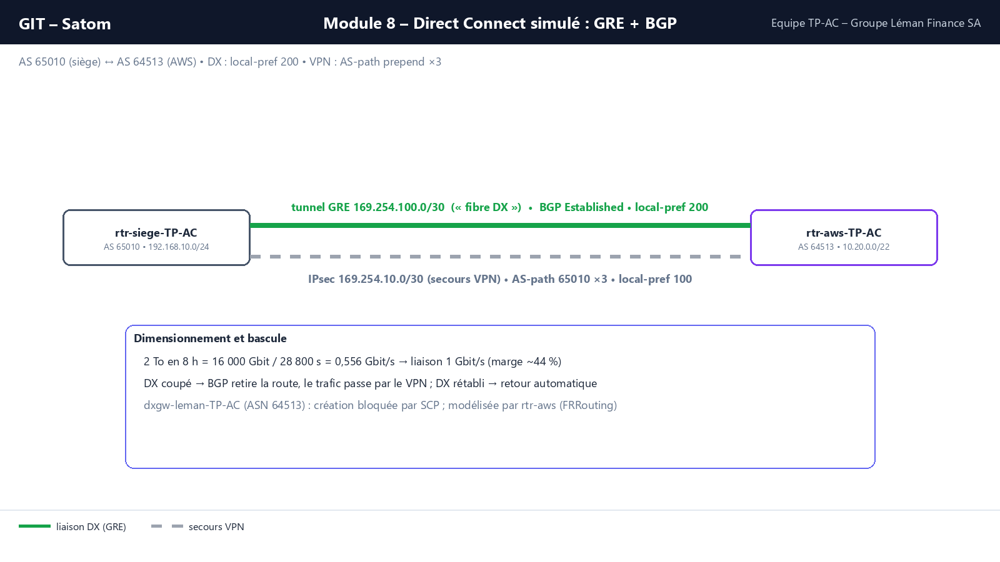

| Élément | rtr-siege | rtr-aws |
|---|---|---|
| ASN | 65010 | 64513 |
| GRE « DX » | `169.254.100.2/30` | `169.254.100.1/30` |
| GRE dans le VPN | `169.254.101.2/30` | `169.254.101.1/30` |
| Annonce | `192.168.10.0/24` | `10.20.0.0/22` |
| Timers BGP | 3 s / 9 s | 3 s / 9 s |

| Politique | Valeur |
|---|---|
| Direct Connect (`gre-dx`) | `local-pref 200` |
| VPN (`gre-vpn`) | prepend `65010` ×3 à l'envoi |
| Préfixes autorisés du DXGW | `10.20.0.0/22`, `192.168.10.0/24` |

## Si ça ne marche pas : quatre vérifications
1. L'état de BGP : `show bgp summary` doit afficher le nombre de préfixes reçus (pas `Active` ni `Connect`).
2. Les préfixes annoncés et reçus des deux côtés.
3. La local-pref : `show ip bgp 10.20.0.0/22` montre le meilleur chemin (« best »).
4. La route dans `tgw-rt-prod` côté AWS, et `ip route get` sur le routeur.

## Résultats des tests
```
=== TP1 : dimensionnement et Direct Connect Gateway (reel) ===
2 To en 8 h = 16 000 Gbit / 28 800 s = 0,556 Gbit/s -> liaison 1 Gbit/s (marge ~44 %)
Emplacement retenu (non commande) : EQSK1, Equinix Sweden SK1 (vitesses 1G / 10G / 100G), le plus proche disponible dans la region eu-north-1
dxgw : dxgw-leman-TP-AC	64513	available
association avec tgw-leman : associated 192.168.10.0/24	10.20.0.0/22

=== TP2 : GRE + BGP ===
rtr-aws : traduction d'adresse (NAT) pour app-01 :
-P POSTROUTING ACCEPT
-A POSTROUTING -s 192.168.10.0/24 -o ens5 -j MASQUERADE
	

rtr-siege : show bgp summary

IPv4 Unicast Summary (VRF default):
BGP router identifier 192.168.10.10, local AS number 65010 vrf-id 0
BGP table version 2
RIB entries 3, using 576 bytes of memory
Peers 2, using 1448 KiB of memory

Neighbor        V         AS   MsgRcvd   MsgSent   TblVer  InQ OutQ  Up/Down State/PfxRcd   PfxSnt Desc
169.254.100.1   4      64513        20        21        0    0    0 00:00:34            1        2 DX-simule-GRE
169.254.101.1   4      64513        20        23        0    0    0 00:00:34            1        2 VPN-GRE-dans-IPsec

Total number of neighbors 2
	

rtr-aws : show ip bgp (prefixes recus du siege)
BGP table version is 4, local router ID is 10.20.0.74, vrf id 0
Default local pref 100, local AS 64513
Status codes:  s suppressed, d damped, h history, * valid, > best, = multipath,
               i internal, r RIB-failure, S Stale, R Removed
Nexthop codes: @NNN nexthop's vrf id, < announce-nh-self
Origin codes:  i - IGP, e - EGP, ? - incomplete
RPKI validation codes: V valid, I invalid, N Not found

   Network          Next Hop            Metric LocPrf Weight Path
*> 10.20.0.0/22     0.0.0.0                  0         32768 i
*  192.168.10.0/24  169.254.101.2            0             0 65010 65010 65010 65010 i
*>                  169.254.100.2            0             0 65010 i

Displayed  2 routes and 3 total paths
	

siege -> app-01 (chemin choisi) :
10.20.1.10 from 192.168.10.50 via 169.254.100.1 dev gre-dx uid 0 
    cache 
--- 10.20.1.10 ping statistics ---
3 packets transmitted, 3 received, 0% packet loss, time 2003ms
rtt min/avg/max/mdev = 2.663/2.984/3.323/0.269 ms
app-01 TP-AC /api/health
	

=== TP3 : politique et bascule ===
rtr-siege : show ip bgp 10.20.0.0/22 (local-pref 200 sur DX, 100 sur VPN)
BGP routing table entry for 10.20.0.0/22, version 2
Paths: (2 available, best #2, table default)
  Advertised to non peer-group peers:
  169.254.100.1 169.254.101.1
  64513
    169.254.101.1 from 169.254.101.1 (10.20.0.74)
      Origin IGP, metric 0, valid, external
      Last update: Tue Nov 17 18:48:40 2026
  64513
    169.254.100.1 from 169.254.100.1 (10.20.0.74)
      Origin IGP, metric 0, localpref 200, valid, external, best (Local Pref)
      Last update: Tue Nov 17 18:48:40 2026
	

rtr-aws : show ip bgp 192.168.10.0/24 (le chemin VPN arrive avec AS-path prepend x3)
BGP routing table entry for 192.168.10.0/24, version 4
Paths: (2 available, best #2, table default)
  Advertised to non peer-group peers:
  169.254.100.2 169.254.101.2
  65010 65010 65010 65010
    169.254.101.2 from 169.254.101.2 (192.168.10.10)
      Origin IGP, metric 0, valid, external
      Last update: Tue Nov 17 18:48:39 2026
  65010
    169.254.100.2 from 169.254.100.2 (192.168.10.10)
      Origin IGP, metric 0, valid, external, best (AS Path)
      Last update: Tue Nov 17 18:48:39 2026
	

T+10 s : panne de la liaison DX (le GRE vers 56.228.132.92 est perdu, sans coupure de l'interface)
route : 10.20.1.10 from 192.168.10.50 via 169.254.100.1 dev gre-dx uid 0 
T+40 s (DX en panne) route : 10.20.1.10 from 192.168.10.50 via 169.254.101.1 dev gre-vpn uid 0 
Neighbor        V         AS   MsgRcvd   MsgSent   TblVer  InQ OutQ  Up/Down State/PfxRcd   PfxSnt Desc
169.254.100.1   4      64513        33        38        0    0    0 00:00:22      Connect        0 DX-simule-GRE
169.254.101.1   4      64513        44        47        0    0    0 00:01:43            1        2 VPN-GRE-dans-IPsec
T+40 s : liaison DX retablie
T+70 s (DX retablie) route : 10.20.1.10 from 192.168.10.50 via 169.254.100.1 dev gre-dx uid 0 
--- ping horodate depuis 192.168.10.50 (une sonde toutes les 0,5 s, 180 sondes)
180 packets transmitted, 162 received, 10% packet loss, time 89755ms
rtt min/avg/max/mdev = 2.636/3.564/19.321/1.658 ms
interruption de 9.6 s, de T+9.5 s a T+19.1 s (sondes 21 a 38 perdues)
```

## Mesure de la bascule
Pour simuler une vraie panne, nous supprimons les paquets GRE du chemin DX **sans couper l'interface** : BGP doit s'en apercevoir lui-même. Sur un ping horodaté (une sonde toutes les 0,5 s, depuis un poste du LAN du siège), l'interruption dure **9,6 secondes** (8,1 s sur un autre essai) : c'est le temps de détection de BGP (délai de 9 s). Le trafic passe alors par le chemin VPN. Quand nous rétablissons le GRE, le trafic revient seul sur la liaison dédiée, sans nouvelle coupure.

Au premier essai nous avions pingué depuis l'adresse du routeur lui-même, qui répond par une route directe : la mesure était trop belle (une seule sonde perdue) et ne passait pas par BGP. Nous l'avons refaite depuis un poste du LAN.

## Ce qui a mal tourné
Sur la pile déployée par CloudFormation, la bascule durait d'abord **45 secondes** et la session BGP du VPN tombait à chaque panne du DX. Les captures de paquets ont montré pourquoi : la réponse du chemin VPN revenait **à l'intérieur** du tunnel GRE de la liaison dédiée. Sur `rtr-aws`, la route vers l'extrémité GRE du siège (`192.168.10.10`) était recouverte par la route BGP apprise `192.168.10.0/24` via `gre-dx` : le secours dépendait donc de la liaison qu'il devait remplacer (un routage « récursif »). Une route statique `192.168.10.10/32` vers le routeur du sous-réseau, déclarée dans FRRouting, règle le problème : la bascule tombe à 8-10 s et la session BGP du VPN reste établie.

## Console AWS
La console Direct Connect affiche un bandeau d'erreur (`DescribeLocations` refusé) : elle appelle un point d'accès global situé dans une région que l'organisation interdit. Le service fonctionne bien par la ligne de commande.

## Nettoyage
Le Direct Connect Gateway ne coûte rien ; son association au Transit Gateway ajoute un attachement facturé 0,05 USD de l'heure. Les routeurs sont des instances EC2 arrêtées après les tests.

## Captures

**Console AWS – dx gateway**

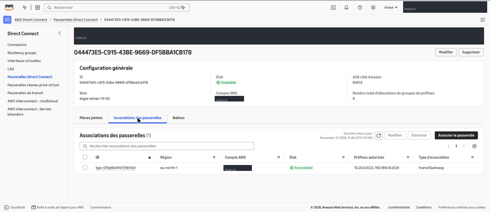

**Terminal**

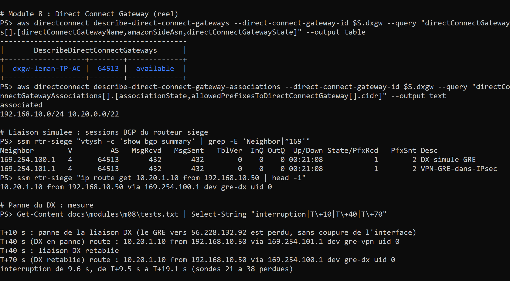

**Terminal – journal du test**

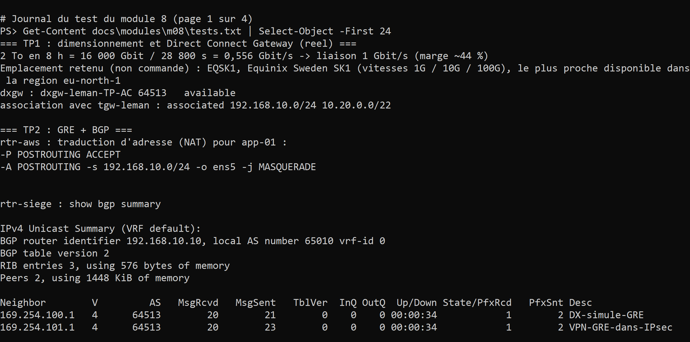

**Terminal – journal du test**

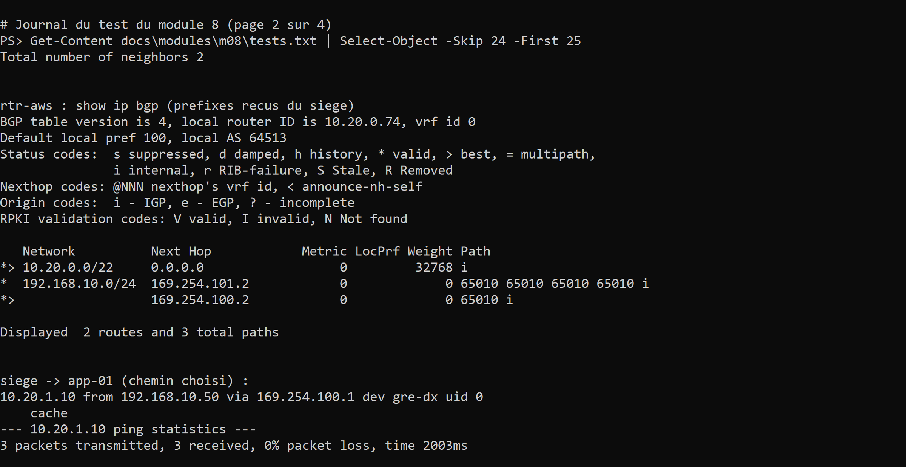

**Terminal – journal du test**

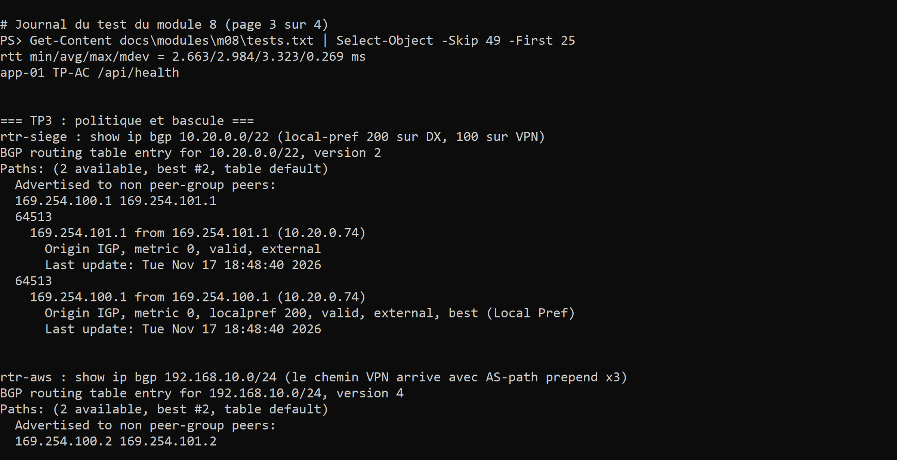

**Terminal – journal du test**

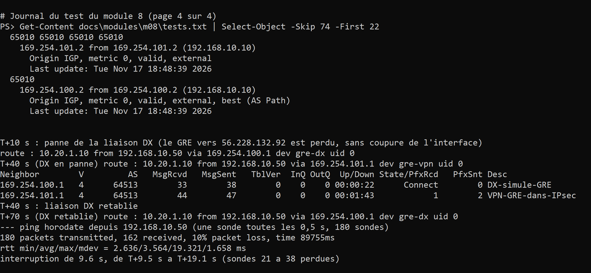


---

# Module 9 – Load balancer

## Objectif
Publier le site derrière un Application Load Balancer en HTTPS sur deux zones, avec un vrai certificat ACM et un chemin `/api/*` vers l'API, et savoir diagnostiquer une panne.

## Ce qu'il faut savoir
L'ALB travaille au niveau applicatif et a un nœud par zone de disponibilité : il faut donc deux sous-réseaux dans deux zones. Un listener (ici le 443) applique des règles (chemin, nom d'hôte) qui envoient vers des groupes cibles. Le contrôle de santé retire tout seul une cible qui ne répond plus ; sans cible saine, le client reçoit une erreur 502 ou 503. Un certificat ACM public est gratuit et se renouvelle seul, mais il faut prouver qu'on contrôle le domaine : la validation DNS consiste à créer un enregistrement CNAME dans la zone ; avec Route 53, la console le crée en un clic. Le certificat doit couvrir le nom que les visiteurs tapent. Les serveurs ne doivent accepter que l'ALB, pas Internet. L'ALB coûte environ 0,03 USD de l'heure.

## Ce que nous avons fait
- Un deuxième sous-réseau public `10.20.0.64/26` dans `eu-north-1b`.
- Deux groupes cibles : `tg-web` (HTTP 80, santé `/health`, cible `web-01`) et `tg-app` (HTTP 8080, santé `/api/health`, cible `app-01`).
- L'ALB `alb-prod-leman-TP-AC` sur les deux zones, avec son propre Security Group `sg-alb` (443 ouvert).
- Un vrai certificat public ACM, demandé dans la console pour `leman.thomastp.ch` et `*.leman.thomastp.ch` (sous-domaine de `thomastp.ch`, déjà délégué à la zone Route 53 décrite au module 10), avec la validation DNS : l'enregistrement CNAME est créé en un clic dans la zone Route 53, et le certificat est émis après quelques minutes. En parallèle, un certificat ACM identique en `us-east-1` (Virginie), car CloudFront n'accepte que ceux de cette région (module 11).
- Un listener HTTPS 443 avec ce certificat, qui envoie par défaut vers `tg-web` ; une règle de priorité 10 envoie `/api/*` vers `tg-app`.
- Un alias Route 53 `origin.leman.thomastp.ch` vers l'ALB : le nom DNS d'un ALB (`….elb.amazonaws.com`) ne figure pas sur le certificat, il faut donc un nom de notre domaine pour que le certificat corresponde.
- Les tests se font avec le vrai nom, sans désactiver la vérification du certificat et sans avertissement du navigateur.
- Trois pannes : nginx arrêté sur `web-01`, port 443 fermé dans `sg-alb`, puis tout remis.

Le scénario a été exécuté dans la console AWS, puis filmé. Le script `scripts/m09-alb.ps1` est la première version en AWS CLI (sans domaine réel) : il n'a pas été adapté au domaine réel.


| Élément | Valeur |
|---|---|
| Listener | HTTPS 443, politique TLS 1.3/1.2, certificat ACM public `leman.thomastp.ch` + `*.leman.thomastp.ch` |
| Nom de l'ALB | `origin.leman.thomastp.ch` (alias Route 53) |
| Règle | priorité 10, chemin `/api/*` vers `tg-app` |
| Santé | 10 s d'intervalle, 2 échecs pour retirer, 2 réussites pour remettre |
| sg-web / sg-app | acceptent le 80 / le 8080 uniquement depuis `sg-alb` |

## Si ça ne marche pas : quatre vérifications
1. Le listener : bon port et bon certificat ? Le certificat est-il émis (validation DNS terminée) et couvre-t-il le nom utilisé ?
2. La règle `/api/*` passe-t-elle avant la règle par défaut ?
3. L'état de la cible : `describe-target-health` donne `healthy` ou `unhealthy` avec la raison.
4. Le Security Group de la cible autorise-t-il l'ALB ?

## Résultats des tests
```
=== Domaine reel (20/11/2026) : tests sans -k, certificat verifie ===
--- curl.exe sans -k (certificat verifie) :
https://portefeuilles.leman.thomastp.ch/ -> web-01 TP-AC (cfn)
 [HTTP 200, verif certificat : 0]
https://portefeuilles.leman.thomastp.ch/api/health -> app-01 TP-AC (cfn) /api/health
 [HTTP 200, verif certificat : 0]
--- certificat :
subject=CN=leman.thomastp.ch
issuer=C=US, O=Amazon, CN=Amazon RSA 2048 S21
notBefore=Nov 20 07:47:39 2026 GMT
notAfter=Jun  6 08:47:39 2027 GMT

=== Pannes (premiere execution, avant le passage au domaine reel) ===
nginx arrete sur web-01 : tg-web = unhealthy ; curl https://ALB/ -> <html> <head><title>502 Bad Gateway</title></head> <body> <center><h1>502 Bad Gateway</h1></center> </body> </html>  [HTTP 502]
nginx relance : tg-web = healthy
curl https://ALB/ -> web-01 TP-AC  [HTTP 200]
443 ferme dans sg-alb -> curl https://ALB/ -> ECHEC (curl 28)
443 retabli -> curl https://ALB/ -> web-01 TP-AC  [HTTP 200]
```

## Nettoyage
Nous gardons l'ALB et les groupes cibles pour les modules suivants. L'ALB, les certificats ACM et l'alias `origin` seront supprimés avec le reste de ce qui a été créé pour le tournage (voir `docs/NETTOYAGE.md`).

## Ce qui diffère du sujet
Pour le certificat, le sujet est respecté avec un domaine réel (voir l'écart n°9 de `docs/02-ecarts-au-sujet.md`). Le sujet réutilise `sg-web` pour l'ALB ; nous avons préféré un groupe séparé pour que les serveurs n'acceptent que l'ALB.

## Captures

**Console AWS – alb**

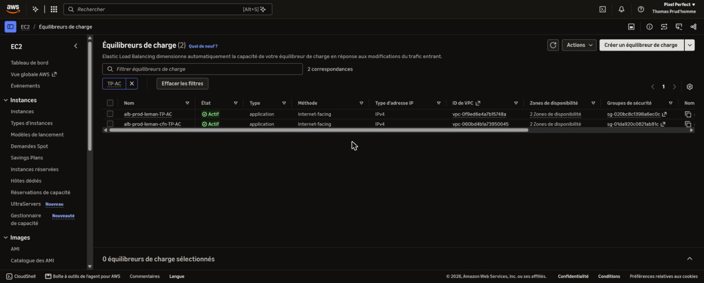

**Console AWS – groupes cibles**


**Terminal**


**Terminal – journal du test**


---

# Module 10 – Route 53

## Objectif
Donner des noms à nos machines avec une zone privée, publier le site avec une vraie zone publique déléguée depuis un domaine réel, et prévoir une bascule automatique si le site tombe.

## Ce qu'il faut savoir
Une zone privée n'est visible que depuis les VPC auxquels on l'associe (le résolveur du VPC est à l'adresse base + 2, ici `10.20.0.2`). Une zone publique donne quatre serveurs de noms qu'il faut déclarer chez celui qui héberge le DNS du domaine parent : c'est la délégation. Un enregistrement « alias » pointe vers une ressource AWS. Pour le failover, on relie l'enregistrement principal à une surveillance de l'état (health check) et on prévoit un enregistrement de secours.

## Ce que nous avons fait
- La zone privée `prod.leman.internal` associée au VPC de prod, avec `web.prod.leman.internal` (`10.20.0.10`) et `app.prod.leman.internal` (`10.20.1.10`).
- La zone publique `leman.thomastp.ch`, sous-domaine de notre domaine réel `thomastp.ch` (le portfolio de Thomas, qui n'est pas modifié). Le DNS de `thomastp.ch` est hébergé chez Cloudflare : nous y avons ajouté uniquement les quatre enregistrements NS du sous-domaine `leman`, qui délèguent `leman.thomastp.ch` à Route 53.
- L'alias `origin.leman.thomastp.ch` vers l'ALB (créé au module 9), sur lequel porte la surveillance.
- Une surveillance de l'état HTTPS (port 443) sur `origin.leman.thomastp.ch`, toutes les 10 s, avec un seuil de 2 échecs.
- Deux enregistrements de basculement pour `portefeuilles.leman.thomastp.ch` : le principal est un alias vers l'ALB, lié à la surveillance ; le secondaire est un enregistrement A vers `203.0.113.50`, une adresse réservée à la documentation (voir l'écart n°9).
- Le test depuis `web-01` : un `dig` qui interroge directement un serveur de noms AWS de la zone, pendant qu'on arrête puis relance nginx.

Le scénario a été exécuté dans la console AWS, puis filmé. Les scripts `scripts/m10-route53.ps1` et `scripts/m10-tests.ps1` sont la première version en AWS CLI (sans domaine réel) : ils n'ont pas été adaptés au domaine réel. Les mesures complètes du domaine réel (modules 9 à 11) sont dans `docs/modules/m10/tests-domaine-reel.txt`.


| Zone | Nom | Cible |
|---|---|---|
| privée | `web.prod.leman.internal` | `10.20.0.10` |
| privée | `app.prod.leman.internal` | `10.20.1.10` |
| publique | `origin.leman.thomastp.ch` | alias vers l'ALB |
| publique | `portefeuilles.leman.thomastp.ch` (principal) | alias vers l'ALB, avec la surveillance de l'état |
| publique | `portefeuilles.leman.thomastp.ch` (secours) | `203.0.113.50` (adresse de documentation) |
| publique | `cdn.leman.thomastp.ch` | alias vers CloudFront (module 11) |

## Si ça ne marche pas : quatre vérifications
1. La délégation : les quatre enregistrements NS chez Cloudflare sont-ils ceux de la zone Route 53 ?
2. L'enregistrement : nom, type, politique de routage, alias.
3. L'état du contrôle de santé (`get-health-check-status`).
4. La cible : les groupes cibles de l'ALB sont-ils sains, et le port 443 de `origin.leman.thomastp.ch` répond-il ?

## Résultats des tests
```
=== TP1 : zone privee prod.leman.internal (resolveur 10.20.0.2) ===
web-01 : Success	app -> 10.20.1.10 web -> 10.20.0.10
web-01 : Success	serveur DNS utilise : nameserver 10.20.0.2

=== Domaine reel (20/11/2026) : basculement Route 53 (primaire ALB -> secours statique 203.0.113.50) ===
12:26:03 arret de nginx sur web-01 : Success	11:26:05
etat de la cible tg-web : unhealthy
12:30:09 reponse DNS avant relance : 203.0.113.50 (secours)
12:30:10 relance de nginx : Success	11:30:12
12:30:44 la reponse DNS publique est revenue a l'equilibreur (13.62.60.176) apres 34 s
web-01 TP-AC (cfn)
 [HTTP 200]
12:31:14 2e mesure - arret de nginx : Success	11:31:15
12:32:22 la reponse DNS publique est devenue le secours (203.0.113.50) apres 70 s
```

## Nettoyage
Nous gardons les zones et les enregistrements pour les modules 11 et 12. La surveillance de l'état (environ 0,50 USD par mois) et la zone publique seront supprimées avec le reste de ce qui a été créé pour le tournage (voir `docs/NETTOYAGE.md`) ; les quatre enregistrements NS chez Cloudflare devront alors être retirés aussi.

## Ce qui diffère du sujet
La délégation est réelle : le sujet est respecté avec un sous-domaine d'un domaine existant (écart n°9). Deux points restent différents : le secours du basculement est une adresse statique de documentation (`203.0.113.50`), qui ne mène à aucun serveur réel, car nous n'avons pas de second site de secours ; et nos mesures interrogent directement un serveur de noms AWS depuis `web-01`, ce qui évite les caches des résolveurs et donne le temps réel de la bascule.

## Captures

**Console AWS – enregistrements**


**Console AWS – zones**


**Terminal**


**Terminal – journal du test**


---

# Module 11 – CloudFront

## Objectif
Mettre un CDN devant l'ALB : garder en cache le contenu statique, ne jamais mettre l'API en cache, servir le tout sous un nom de notre domaine avec un vrai certificat, et empêcher l'accès direct à l'ALB.

## Ce qu'il faut savoir
CloudFront sert le contenu depuis un point de présence proche du visiteur. Les en-têtes de la réponse le montrent : `x-amz-cf-pop` donne le point de présence, `x-cache` indique `Hit` ou `Miss`. Chaque chemin (`/static/*`, `/api/*`, le reste) a sa politique de cache. Pour changer un fichier avant la fin du délai de cache, on lance une invalidation. Pour utiliser un nom de domaine propre (nom alternatif), la distribution a besoin d'un certificat ACM émis en `us-east-1`. Pour fermer l'ALB au reste du monde, son Security Group n'accepte que la liste de préfixes gérée par AWS pour CloudFront.

## Ce que nous avons fait
- Une distribution CloudFront en paiement à l'utilisation, sans WAF, avec comme origine `origin.leman.thomastp.ch` (l'ALB), en HTTPS seulement (le réglage recommandé de la console) : le certificat de l'ALB est valide pour ce nom, CloudFront l'accepte.
- Le nom alternatif `cdn.leman.thomastp.ch`, avec le certificat ACM de `us-east-1` (module 9). Nous avons posé ce réglage avec la ligne de commande (`aws cloudfront update-distribution`) parce que la liste de certificats de la console ne proposait pas le certificat ; le résultat se vérifie dans les paramètres de la distribution.
- Un alias Route 53 `cdn.leman.thomastp.ch` vers la distribution.
- Deux comportements en plus de celui par défaut : `/static/*` avec la politique de cache `CachingOptimized`, et `/api/*` avec `CachingDisabled` et la politique de requête à l'origine `AllViewer` (tous les en-têtes, cookies et paramètres sont transmis).
- Un fichier `/static/logo.png` sur `web-01`, qu'on modifie ensuite pour tester l'invalidation.
- `sg-alb` : la règle HTTPS ouverte à tous est remplacée par le 443 depuis la liste de préfixes gérée `com.amazonaws.global.cloudfront.origin-facing`. Il n'y a plus de listener sur le port 80 ni de règle NACL supplémentaire : l'origine est en HTTPS.

Le scénario a été exécuté dans la console AWS (sauf le réglage du nom alternatif, voir plus haut), puis filmé. Les scripts `scripts/m11-cloudfront.ps1` et `scripts/m11-tests.ps1` sont la première version en AWS CLI (sans domaine réel, origine en HTTP) : ils n'ont pas été adaptés. Les mesures complètes du domaine réel sont dans `docs/modules/m10/tests-domaine-reel.txt`.


| Comportement | Chemin | Politique de cache | Politique de requête à l'origine |
|---|---|---|---|
| statique | `/static/*` | `CachingOptimized` | celle par défaut |
| API | `/api/*` | `CachingDisabled` | `AllViewer` |

## Si ça ne marche pas : quatre vérifications
1. Une erreur 403 : le Security Group de l'ALB laisse-t-il passer CloudFront ?
2. Une erreur 502 : l'origine répond-elle (Security Group, protocole, certificat valide pour `origin.leman.thomastp.ch`) ?
3. L'en-tête `x-cache` : `Hit` attendu sur le statique, jamais sur l'API.
4. Le certificat : il doit couvrir le nom utilisé (`cdn.leman.thomastp.ch`) et être en `us-east-1`.

## Résultats des tests
```
=== Domaine reel (20/11/2026) : CloudFront (cdn.leman.thomastp.ch, origine HTTPS origin.leman.thomastp.ch) ===
1er appel /static/logo.png : HTTP/1.1 200 OK X-Cache: Miss from cloudfront
2e appel  /static/logo.png : HTTP/1.1 200 OK X-Cache: Hit from cloudfront
contenu : logo v1
API 1 : HTTP/1.1 200 OK X-Cache: Miss from cloudfront
API 2 : HTTP/1.1 200 OK X-Cache: Miss from cloudfront
fichier modifie sur web-01 (v2) ; le cache sert encore : logo v1 (HTTP/1.1 200 OK X-Cache: Hit from cloudfront )
apres invalidation (Completed) : logo v2 (HTTP/1.1 200 OK X-Cache: Hit from cloudfront )

=== ALB verrouille : seul CloudFront (liste de prefixes geree par AWS) peut le joindre ===
acces direct a l'ALB (origin.leman.thomastp.ch) : HTTP 000 (delai depasse attendu)
via CloudFront (cdn.leman.thomastp.ch/api/health) : app-01 TP-AC (cfn) /api/health
 [HTTP 200]
```

## Nettoyage
Nous gardons la distribution pour le module 12. Elle sera désactivée puis supprimée avec le reste de ce qui a été créé pour le tournage (voir `docs/NETTOYAGE.md`).

## Ce qui diffère du sujet
Le sujet est respecté avec un domaine réel (écart n°9). Seul le nom alternatif a été réglé avec la ligne de commande, parce que la console ne proposait pas le certificat dans sa liste. Le préfixe CloudFront compte pour environ 55 règles dans un Security Group (limite 60) : nous ne pouvons l'utiliser qu'une fois, pour le port 443.

## Captures

**Console AWS – cloudfront**


**Terminal**


**Terminal – journal du test**


**Terminal – journal du test**


---

# Module 12 – CloudWatch et Flow Logs

## Objectif
Surveiller le site avec un tableau de bord, être prévenu par une alarme, et garder la trace des flux réseau pour comprendre un rejet.

## Ce qu'il faut savoir
Chaque service envoie des métriques à CloudWatch. Une alarme regarde une statistique sur plusieurs périodes et passe de `OK` à `ALARM` quand le seuil est franchi ; SNS envoie alors le message à ses abonnés. Les Flow Logs enregistrent chaque connexion acceptée (`ACCEPT`) ou refusée (`REJECT`) avec la source, le port et le protocole, et Logs Insights permet de les interroger. Nous gardons les journaux 3 jours pour limiter les coûts.

## Ce que nous avons fait
- Le tableau de bord `db-portail-leman-TP-AC` : cibles saines et non saines, temps de réponse de l'ALB, erreurs 5xx des cibles, taux d'erreurs 5xx de CloudFront.
- Le topic SNS `sns-exploitation-leman-TP-AC`, avec deux abonnés : une adresse e-mail de l'équipe et une file SQS qui nous sert de preuve de réception.
- L'alarme `alarm-5xx-portail-TP-AC` : plus de 5 erreurs 5xx en 5 minutes, pendant 2 périodes de suite ; elle prévient en passant en alarme et en revenant à la normale. Pour la tester, notre API renvoie une erreur 500 sur `/api/error`.
- Le groupe de logs `/leman/vpc-prod/flow-TP-AC`, un rôle IAM d'écriture et le Flow Log `fl-vpc-prod-leman-TP-AC` (tout le trafic).
- Une sonde TCP sur le port 22 depuis une machine non autorisée, retrouvée dans les journaux avec Logs Insights.

Scripts : `scripts/m12-monitoring.ps1` (mise en place) et `m12-tests.ps1`, `m12-flowlogs3.ps1`, `m12-flowlogs4.ps1` (preuves).


| Élément | Réglage |
|---|---|
| Alarme | `HTTPCode_Target_5XX_Count` supérieur à 5, période de 5 min, 2 périodes |
| Action | message SNS en alarme et au retour à la normale |
| Flow Log | tout le trafic, vers CloudWatch Logs, rétention 3 jours |

## Si ça ne marche pas : quatre vérifications
1. Quelle métrique dérive : erreurs 5xx, lenteur, cibles saines ?
2. L'état et l'historique de l'alarme.
3. Les journaux de flux : `filter action="REJECT" | stats count(*) by srcAddr, dstPort`.
4. Quelle règle de Security Group ou de NACL a refusé, d'après le port et l'interface.

## Résultats des tests
```
=== TP1 : tableau de bord ===
Tableau de bord : db-portail-leman-TP-AC
HealthyHostCount tg-web (derniere minute) : 1.0

=== TP3 : Flow Logs (SSH non autorise vers web-01) ===
6 tentatives de connexion TCP sur le port 22 de web-01 depuis cette machine (refusees par sg-web)

=== TP2 : alarme ===
Etat initial : INSUFFICIENT_DATA
Trafic 5xx genere pendant 10 min -> etat de l'alarme : ALARM
Notification SNS recue dans sqs-exploitation-leman-TP-AC : { "Type" : "Notification", "MessageId" : "c384ef0a-2ba5-5287-897d-8c7edf73d6a8", "TopicArn" : "arn:aws:sns:eu-north-1:000000000000:sns-exploitation-leman-TP-AC", "Subject" : "OK: \"alarm-5xx-portail-TP-AC\" in EU (Stockholm)", "Message" : "{\"AlarmName\":\"alarm-5xx-portail-TP-AC\",\"AlarmDescription\":\"TP-AC : plus de 5 erreurs 5xx cibles sur 5 min, 2 periodes consecutives\",\"AWSAccountId\":\"0...
Apres arret des erreurs (18 min) -> etat de l'alarme : OK
Notification de retour a la normale presente : oui

=== TP3 (reel) : Flow Logs ===
Controle : port 22 sortant depuis ce poste (github.com:22) -> ouvert
8 tentatives TCP vers le port 22 de l'ALB (2 noeuds publics) depuis ce poste (84.226.x.x) -> 8 timeout : refusees par sg-alb (seul le port 80 est ouvert, au prefixe CloudFront)
Recherche dans /leman/vpc-prod/flow-TP-AC (source = ce poste, port 22, REJECT) :
  2 000000000000 eni-034bc06f123a72b63 84.226.x.x 10.20.0.115 61404 22 6 2 104 1794837701 1794837721 REJECT OK
  2 000000000000 eni-034bc06f123a72b63 84.226.x.x 10.20.0.115 60965 22 6 2 104 1794837701 1794837721 REJECT OK
  2 000000000000 eni-034bc06f123a72b63 84.226.x.x 10.20.0.115 63656 22 6 2 104 1794837701 1794837721 REJECT OK
  2 000000000000 eni-034bc06f123a72b63 84.226.x.x 10.20.0.115 59395 22 6 2 104 1794837701 1794837721 REJECT OK
  2 000000000000 eni-05458be49638c7015 84.226.x.x 10.20.0.7 62411 22 6 2 104 1794837702 1794837733 REJECT OK
  2 000000000000 eni-05458be49638c7015 84.226.x.x 10.20.0.7 63203 22 6 2 104 1794837702 1794837733 REJECT OK
  2 000000000000 eni-05458be49638c7015 84.226.x.x 10.20.0.7 64715 22 6 2 104 1794837702 1794837733 REJECT OK
  2 000000000000 eni-05458be49638c7015 84.226.x.x 10.20.0.7 63102 22 6 2 104 1794837702 1794837733 REJECT OK
Requete Logs Insights : filter action = "REJECT" and dstPort = 22 and srcAddr = <ce poste> | stats count(*) as n by srcAddr, dstAddr, dstPort | sort n desc
Resultat : srcAddr=84.226.x.x dstAddr=10.20.0.115 dstPort=22 n=4 | srcAddr=84.226.x.x dstAddr=10.20.0.7 dstPort=22 n=4
Diagnostic : le rejet vient du Security Group sg-alb (port 22 non ouvert) : source, ENI de l'ALB, port 22 et action REJECT le prouvent.

=== TP3 (web-01) : Flow Logs, sonde SSH vers web-01 ===
Controle : https vers web-01 (443 ouvert) -> HTTP 000 pendant le script (web-01 venait de demarrer) ; controle refait a part, web-01 demarree : HTTP 200
10 tentatives TCP vers web-01:22 depuis une machine non autorisee (84.226.x.x) -> 10 timeout (sg-web n'ouvre le 22 qu'a la salle d'exploitation)
Recherche dans /leman/vpc-prod/flow-TP-AC (source = ce poste, destination 10.20.0.10, port 22, REJECT) :
  aucune ligne livree dans le delai
Requete Logs Insights : filter action = "REJECT" and dstPort = 22 and srcAddr = <ce poste> and dstAddr = "10.20.0.10" | stats count(*) as n by srcAddr, dstAddr, dstPort
Resultat : srcAddr=84.226.x.x dstAddr=10.20.0.10 dstPort=22 n=1
Diagnostic : rejet par sg-web (port 22 non ouvert a cette source) ; ENI de web-01, port 22, action REJECT.
```

## Nettoyage
Nous gardons le tableau de bord, l'alarme et le groupe de logs pour le module 13, puis nous supprimerons le Flow Log et les journaux à la fin du cours.

## Problèmes rencontrés
- Notre premier groupe de logs n'avait pas été créé (une erreur de notre script) ; le Flow Log affichait `DeliverLogsStatus=FAILED`. Nous avons recréé le groupe puis le Flow Log.
- La livraison dans CloudWatch Logs prend plusieurs minutes.
- Une adresse e-mail d'abonné SNS doit être confirmée par un clic sur le message reçu : sans cela, l'abonnement reste en attente.

## Captures

**Console AWS – alarme**


**Console AWS – tableau de bord**


**Terminal**


**Terminal – journal du test**


**Terminal – journal du test**


---

# Module 13 – CloudFormation

## Objectif
Décrire le réseau dans un template, le déployer en stack, relire les changements avant de les appliquer, détecter les écarts avec la réalité (drift) et prouver qu'on peut tout supprimer puis tout recréer à l'identique.

## Ce qu'il faut savoir
Un template contient des ressources, des paramètres (`Environnement`, `CidrVpc`…) et des sorties. La stack est le template déployé ; CloudFormation calcule l'ordre de création et supprime dans l'ordre inverse. Un change set montre ce qui sera ajouté, modifié ou remplacé avant d'exécuter. Le drift est l'écart entre ce qui existe vraiment et le template, par exemple après une modification à la main dans la console.

## Ce que nous avons fait
- `cfn/reseau-leman-etape1.yaml` : le VPC, trois sous-réseaux, l'IGW, la table publique et les trois Security Groups, avec les paramètres `Environnement` (prod ou dev) et `CidrVpc`. Nous l'avons validé avec `validate-template`, puis créé la stack `stack-portail-leman-TP-AC`.
- `cfn/reseau-leman.yaml` : le template complet, avec en plus `web-01`, `app-01` (adresses fixes), les deux groupes cibles, l'ALB (HTTPS 443, règle `/api/*`) et le rôle IAM des instances. Nous l'avons appliqué avec un change set que nous avons relu avant de l'exécuter.
- Un test de drift : une règle SSH ajoutée à la main sur le Security Group web est détectée (`DRIFTED`). Nous retirons la règle manuelle (la pile est de nouveau `IN_SYNC`), puis nous la déclarons dans le template (paramètre `AdminCidr`) et nous redéployons par change set : la règle appartient maintenant à la pile et la pile reste `IN_SYNC`. Un premier essai, où nous déclarions la règle sans retirer la manuelle, laissait la pile en `DRIFTED` (la règle existante n'avait pas la même description).
- La stack est supprimée, puis recréée à l'identique.

Scripts : `scripts/m13-cfn.ps1` (le scénario complet) et `scripts/m13-deploy.ps1` (tout déployer en une commande, certificat compris).


| Paramètre | Valeur par défaut |
|---|---|
| `Environnement` | `prod` (ou `dev`) |
| `CidrVpc` | `10.30.0.0/22` (nous avons gardé `10.20.0.0/22` pour le lab fait à la main) |
| `WebPrivateIp` / `AppPrivateIp` | `10.30.0.10` / `10.30.1.10` |
| `AdminCidr` | vide (pas de règle SSH) |
| `CertificateArn` | à fournir (le script de déploiement l'importe) |

Sorties : `VpcId`, `AlbDns` et `SgWebId`.

## Si ça ne marche pas : quatre vérifications
1. L'état de la stack (`*_COMPLETE`, `*_FAILED`, `ROLLBACK_*`).
2. Les événements : la première ressource en `CREATE_FAILED` donne la raison.
3. Le drift : `detect-stack-drift` puis `describe-stack-resource-drifts`.
4. Le rollback : on corrige le template, jamais la ressource à la main.

## Résultats des tests
```
=== TP1 : validation et creation de la stack (reseau seul) ===
validate-template : parametres = CidrVpc	WebPrivateIp	AppPrivateIp	AdminCidr	CleSSH	Environnement	InstanceType	CertificateArn	AmiId
Statut : CREATE_COMPLETE ; sorties : VpcId	vpc-0310d32aa87687c10 SgWebId	sg-06d62e0ec61238041

=== TP2 : change set (instances, groupes cibles, ALB) ===
Change set cs-ajouts-912889504 : 7 changements ; actions = Add
   Add  Alb  AWS::ElasticLoadBalancingV2::LoadBalancer
   Add  App01  AWS::EC2::Instance
   Add  ListenerHttps  AWS::ElasticLoadBalancingV2::Listener
   Add  RuleApi  AWS::ElasticLoadBalancingV2::ListenerRule
   Add  TgApp  AWS::ElasticLoadBalancingV2::TargetGroup
   Add  TgWeb  AWS::ElasticLoadBalancingV2::TargetGroup
   Add  Web01  AWS::EC2::Instance
Statut apres execution : UPDATE_COMPLETE
Cibles : tg-web=healthy  tg-app=healthy
curl -k https://alb-prod-leman-cfn-TP-AC-1508405322.eu-north-1.elb.amazonaws.com/api/health -> app-01 TP-AC (cfn) /api/health
curl -k https://alb-prod-leman-cfn-TP-AC-1508405322.eu-north-1.elb.amazonaws.com/ -> web-01 TP-AC (cfn)

=== TP3 : drift, suppression, redeploiement ===
Regle SSH ajoutee a la main sur sg-web-cfn -> drift stack : DETECTION_COMPLETE	DRIFTED
Detail : SgWeb	MODIFIED	/SecurityGroupIngress/1	ADD
Regle manuelle retiree -> drift stack : DETECTION_COMPLETE	IN_SYNC
Change set cs-declaration-template-2112251803 : 1 changements ; actions = Modify
   Modify  SgWeb  AWS::EC2::SecurityGroup
Regle declaree dans le template (AdminCidr) puis redeploiement -> statut : UPDATE_COMPLETE
Apres correction par le template -> drift stack : DETECTION_COMPLETE	IN_SYNC
Regles de sg-web-cfn : tcp	80	None	sg-0517516cc80d5f705 tcp	22	203.0.113.0/24	None
Suppression de la stack (ordre inverse des dependances) : 2 min -> DELETE_COMPLETE (stack disparue)
VPC restants avec le tag de la stack : 0
Change set cs-redeploiement-1694842148 : 7 changements ; actions = Add
   Add  Alb  AWS::ElasticLoadBalancingV2::LoadBalancer
   Add  App01  AWS::EC2::Instance
   Add  ListenerHttps  AWS::ElasticLoadBalancingV2::Listener
   Add  RuleApi  AWS::ElasticLoadBalancingV2::ListenerRule
   Add  TgApp  AWS::ElasticLoadBalancingV2::TargetGroup
   Add  TgWeb  AWS::ElasticLoadBalancingV2::TargetGroup
   Add  Web01  AWS::EC2::Instance
Redeploiement : UPDATE_COMPLETE ; cibles tg-web=healthy tg-app=healthy ; curl -k https://alb-prod-leman-cfn-TP-AC-1090625744.eu-north-1.elb.amazonaws.com/api/health -> app-01 TP-AC (cfn) /api/health
```

## Le second modèle : l'interconnexion
Le sujet demande pour ce module le réseau du portail (`reseau-leman.yaml`). Comme le critère final parle de « tout redéployable depuis le modèle », nous avons ajouté `cfn/interconnexion-leman.yaml`, qui s'applique **par-dessus** le réseau existant (les identifiants des VPC, sous-réseaux et tables sont des paramètres). Il déploie 52 ressources :

| Module | Ressources |
|---|---|
| 4, pare-feu | sous-réseau et table du pare-feu, 2 groupes de règles, la politique, le pare-feu, 2 groupes de journaux (alertes et flux), les routes qui passent par son endpoint |
| 6, Transit Gateway | le Transit Gateway, 2 attachements (la prod sur deux zones), 3 tables, les associations, les propagations et les routes des VPC |
| 7, VPN | 3 Elastic IP et leur association aux routeurs, 2 Customer Gateways, 2 connexions VPN (clés lues dans Secrets Manager par référence dynamique), les routes statiques des sites, les règles de `sg-app` |
| 8, Direct Connect | la Direct Connect Gateway et son association au Transit Gateway |

Deux choses n'ont pas de ressource CloudFormation : l'attachement d'un VPN au Transit Gateway (aucun attribut ne le donne) et la Direct Connect Gateway. Une petite fonction Lambda (ressource personnalisée, dans le modèle) retrouve les attachements et crée la passerelle. Les sites eux-mêmes (les routeurs strongSwan), leur configuration, la liaison GRE et le BGP restent **hors modèle** : ce sont des équipements « chez le client », configurés par `scripts/m07-vpn-aws.ps1` et `scripts/m08-dx-sim.ps1`.

Le script `scripts/m13-interconnexion.ps1` retire les versions manuelles de ce que le modèle va gérer, crée la stack et importe ses sorties. **Preuve de redéploiement :** nous avons supprimé la stack (environ 10 minutes, sans ressource orpheline : plus de Transit Gateway, de VPN ni de pare-feu), puis redéployé le même modèle sans aucune modification : `CREATE_COMPLETE` en 6 minutes 13 secondes, tunnels VPN `DOWN` tant que les routeurs ne sont pas configurés, puis `UP`. Tous les tests des modules 4, 6, 7 et 8 de ce dossier ont été rejoués sur ce second déploiement.

## Nettoyage
Nous gardons le template et la stack. La stack contient des instances et un ALB (facturés) : nous la supprimerons à la fin du cours avec `aws cloudformation delete-stack`.

## Problèmes rencontrés
Deux erreurs de notre part : les descriptions des Security Groups ne peuvent pas contenir d'apostrophes ni d'accents, et notre premier calcul des sous-réseaux avec `!Cidr` donnait au sous-réseau privé une plage qui ne contenait pas l'adresse fixe d'`app-01`. Nous n'avons pas mis de NAT dans la stack (coût) : `app-01` n'a pas besoin de paquets, mais elle n'est donc pas joignable par SSM.

Pour le second modèle, cinq problèmes, tous réglés :
1. **Conflit de nom** : le groupe de journaux `/leman/nfw-alert-TP-AC` créé à la main au test du module 4 existait encore. CloudFormation l'a vu avant de créer quoi que ce soit (« NAME_CONFLICT_VALIDATION ») ; nous l'avons supprimé.
2. **Elastic IP restées associées** : notre script de nettoyage n'avait pas dissocié les anciennes adresses des routeurs avant de les libérer (l'erreur n'était pas affichée). CloudFormation a répondu `AlreadyExists` à l'association. Nous les avons dissociées puis libérées, et corrigé le script.
3. **Fonction Lambda sans réponse** : en Python 3.12, le module `cfnresponse` n'est pas disponible dans le code intégré au modèle. La fonction plantait avant de répondre, et CloudFormation attend alors une heure avant d'échouer. La restauration a ensuite attendu une seconde heure pour la même raison, jusqu'à ce que nous remplacions le code de la fonction pendant la restauration. Le modèle envoie maintenant lui-même la réponse, avec un délai de 20 minutes.
4. **Deux variables du même nom** : notre script d'import écrasait les options du profil AWS (`$P` et `$p` sont la même variable en PowerShell).
5. **Un mot réservé** : la fonction `Try` de notre script de nettoyage des modules 6 à 8 n'a jamais pu s'exécuter, car `Try` est un mot réservé de PowerShell.

Le portail (`reseau-leman.yaml`) a aussi reçu le paramètre `CleSSH` que le sujet demande : il est vide par défaut, car nous administrons par SSM et n'ouvrons aucun SSH. Nous l'avons rejoué en entier (étape réseau, change set, dérive, suppression, redéploiement).

## Captures

**Console AWS – piles cloudformation**


**Terminal**


**Terminal – journal du test**


**Terminal – journal du test**


---

# Points du sujet impossibles, incohérents ou réalisés autrement

Le sujet a été rédigé avec l'aide d'une IA : certaines consignes ne peuvent pas être suivies à la lettre, ou se contredisent. Cette liste dit, pour chacune, ce que nous avons fait à la place et pourquoi. Elle est destinée au formateur.

| # | Module | Ce que dit le sujet | Pourquoi ce n'est pas possible tel quel | Ce que nous avons fait |
|---|---|---|---|---|
| 1 | 8 | Une liaison Direct Connect près de Genève | Il n'existe aucun emplacement Direct Connect près de Genève dans la région de Stockholm (Zurich n'est pas activée sur le compte, Francfort est refusée). Et nous ne commandons pas de fibre. | Emplacement retenu sur le papier : EQSK1 (Equinix Sweden SK1, 1 Gbit/s). Direct Connect Gateway réel et associé au Transit Gateway ; la liaison est simulée par un tunnel GRE et BGP (FRRouting). |
| 2 | 7 | Une bascule entre deux tunnels VPN « sans coupure » | Un VPN IPsec ne peut pas basculer sans coupure : AWS met un certain temps à constater qu'un tunnel est mort avant d'utiliser l'autre. Nous avons mesuré entre 26 et 34 secondes (valeurs exactes au module 7). | Mesure honnête, avec une vraie panne silencieuse (paquets perdus, sans couper l'interface). |
| 3 | 8 | Une bascule Direct Connect vers VPN en quelques secondes, avec un prepend | Un VPN statique ne parle pas BGP : le prepend n'aurait aucun effet. | Le BGP du chemin « VPN » passe dans un tunnel GRE à l'intérieur du vrai VPN. Bascule mesurée au module 8. |
| 4 | 7 | Customer Gateways en `203.0.113.10` et `198.51.100.10` | Ce sont des adresses réservées à la documentation : aucun tunnel ne s'établit vers elles. | Une Elastic IP par routeur de site (`rtr-siege-TP-AC`, `rtr-agence-TP-AC`). |
| 5 | 6, 7 | Plages `10.0.0.0/16` et `10.1.0.0/16` | Le compte est partagé par toute la classe : ces plages recouvrent celles des autres. | `10.20.0.0/22` (prod) et `10.21.0.0/24` (dev). |
| 6 | 7 | Déclarer les routes statiques sur la connexion VPN | Pour un VPN rattaché à un Transit Gateway, AWS refuse : les routes se déclarent dans la table de routage du Transit Gateway. | Routes dans `tgw-rt-prod-TP-AC`. |
| 7 | 4 | Ne mettre que la route de retour `10.20.1.0/26` dans la table publique | Cela casse `web-01` vers `app-01` : la requête passe par le pare-feu, pas la réponse, et le pare-feu perd l'état. Les Security Groups « depuis un groupe » ne correspondent plus au trafic qui sort d'un endpoint de pare-feu. | Routes symétriques, et règles de `sg-app` par plage d'adresses (module 4). |
| 8 | 4 | Le flux autorisé doit apparaître dans les journaux | Un journal d'alertes ne contient que ce qui est bloqué. | Second journal, de type flux (`/leman/nfw-flow-TP-AC`). |
| 9 | 10, 11 | Zone publique et certificat ACM validé par DNS pour le domaine du client | Le nom d'exemple du sujet n'est pas un domaine que nous possédons : on ne peut ni le déléguer, ni y valider un certificat. Au début, nous n'avions pas de domaine. | Le sujet est maintenant respecté avec un domaine réel : le sous-domaine `leman.thomastp.ch` (domaine `thomastp.ch`, jamais modifié) est délégué à une zone publique Route 53 par quatre enregistrements NS ajoutés chez Cloudflare. Certificat public ACM validé par DNS (`leman.thomastp.ch` et `*.leman.thomastp.ch`, plus un en `us-east-1` pour CloudFront), listener HTTPS de l'ALB, nom alternatif `cdn.leman.thomastp.ch` sur CloudFront, tests avec la vérification du certificat activée. Écarts restants : le secours du basculement Route 53 est une adresse statique de documentation (`203.0.113.50`), pas un vrai site de secours ; le nom alternatif de CloudFront a été posé avec la ligne de commande (`aws cloudfront update-distribution`), parce que la liste de certificats de la console ne proposait pas le certificat. |
| 10 | 0 | Un module « cadrage » sans client joignable | Nous ne pouvons pas poser nos questions au client. | Questions et budget rédigés par nos soins, à relire (module 0). |
| 11 | 1 | Région Zurich | `eu-central-2` n'est pas activée (`AuthFailure`), Francfort est refusée par l'organisation. | Stockholm (`eu-north-1`), acceptée avec le formateur. |
| 12 | 8 | Console Direct Connect | La console affiche une erreur `DescribeLocations` : elle appelle un point d'accès global situé dans une région interdite. | Le service est utilisé par la ligne de commande. |
| 13 | 4, 6, 7, 8 | Services autorisés | L'organisation refusait Network Firewall, Transit Gateway, VPN et Direct Connect jusqu'au 17/11/2026 (voir `01-services-bloques.md`). | Modules refaits en réel après la levée, et redéployés depuis un modèle CloudFormation. |

## Ce qui reste simulé malgré tout
- Les deux sites (siège, agence) sont des instances EC2 avec strongSwan, pas du matériel réel.
- La « fibre » Direct Connect est un tunnel GRE sur Internet : il n'y a pas d'interface virtuelle physique.
- Le basculement Route 53 mène à une adresse de documentation (`203.0.113.50`), pas à un second site réel.
- GNS3 n'est pas utilisé : les routeurs sont des instances EC2 avec FRRouting.
