# Satom Cloud Network (TP-AC) – Partie 1 : modules 0 à 4

[Sommaire]({{URL_sommaire}}) · **Partie 1** · [Partie 2]({{URL_partie2}}) · [Partie 3]({{URL_partie3}})

[TOC]

---

# Module 0 – Cadrage et plan d'adressage

## Objectif
Poser le cadre avant de créer le moindre serveur : un projet décrit en quelques lignes, des noms et des balises communs, un plan d'adresses écrit à l'avance, un budget qui nous prévient quand la dépense monte, et les questions que nous poserions au client. Dans la console AWS, la seule ressource de ce module est le budget.

## Ce qu'il faut savoir
**Le projet.** Le Groupe Léman Finance SA (client fictif) veut un réseau AWS qui sépare la production du développement, relie le siège de Genève et l'agence de Lausanne, garde une trace des accès et reste maîtrisé en coût. Tout doit pouvoir être redéployé depuis un template (module 13).

**Nos conventions.** Le compte AWS est partagé avec toute la classe. Pour retrouver nos ressources, et ne toucher à aucune autre, chaque nom se termine par `-TP-AC` et chaque ressource qui accepte des balises reçoit les trois mêmes : `Projet=SatomCloudNetwork`, `Equipe=TP-AC` et `Environnement=prod` ou `dev`. Nous supprimons en fin de projet en nous appuyant sur cette balise.

**Un budget AWS n'arrête rien.** Il compare la dépense à un montant et envoie un message quand un seuil est franchi (sur le coût réel ou sur le coût prévu). Il ne coupe aucune ressource. Autre détail à connaître : AWS envoie un message de vérification à chaque nouveau destinataire, et un destinataire non vérifié ne reçoit aucune alerte.

## Ce que nous avons fait
Nous avons créé le budget dans la console, dans *Facturation et gestion des coûts > Budgets*.
1. Bouton *Créer un budget*, puis *Personnaliser (avancé)* à la place du modèle simplifié, et le type *Budget de coûts*.
2. Nom `budget-TP-AC-satom`, période mensuelle, budget récurrent, montant de `100` USD. La portée reste celle par défaut : tous les services AWS.
3. Une alerte : seuil de `80` % du montant budgété, déclencheur *Réel*, destinataire `budget-tp-ac@example.com`. L'adresse est fictive (voir les pièges plus bas).
4. L'étape facultative *Attacher des actions* est passée sans rien ajouter.
5. Page *Vérification*, puis *Créer un budget*. La console confirme « Votre budget budget-TP-AC-satom a été créé » et la liste le montre à 100,00 USD, état *Sain*.

## Captures
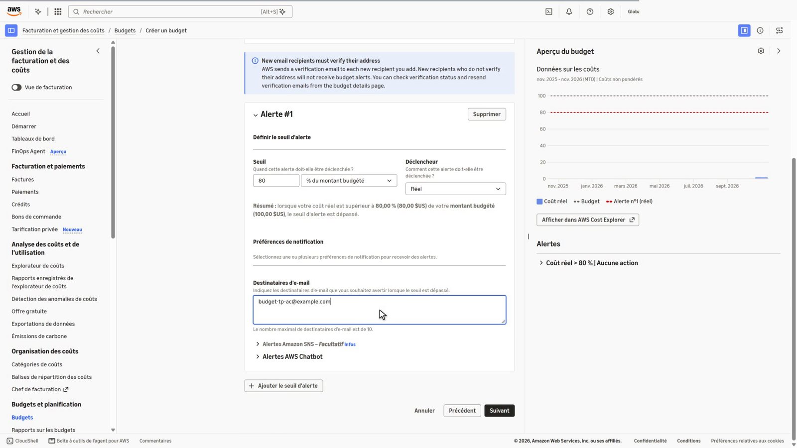

Le seuil est réglé à 80 % du montant budgété (80,00 USD d'après le résumé de la console), sur le coût réel. Le bandeau bleu du haut est l'avertissement d'AWS sur la vérification des adresses.

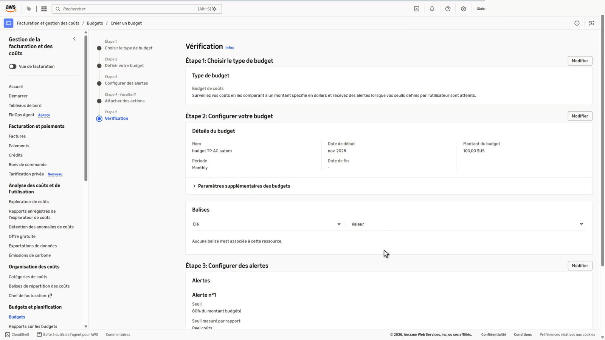

Avant de créer, la page de vérification résume le budget : `budget-TP-AC-satom`, période *Monthly*, début en novembre 2026, 100,00 USD. Le tableau *Balises* est vide : nous n'avons pas étiqueté le budget.

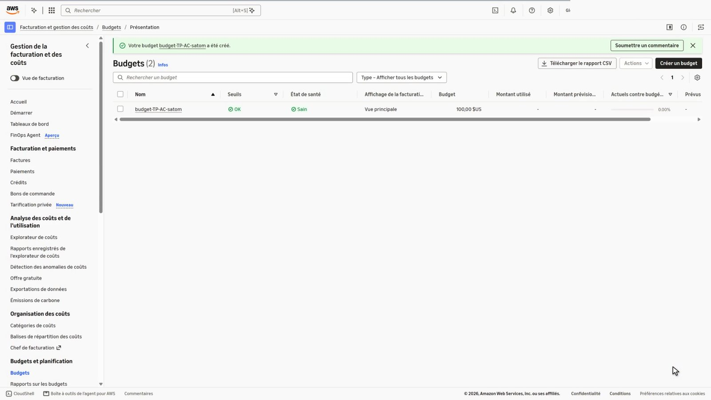

Le budget apparaît dans la liste avec l'état *Sain*. Le compteur indique deux budgets : l'autre appartient à quelqu'un d'autre sur le compte partagé, et sa ligne est masquée sur la capture.

## Plan d'adressage
| Réseau | Plage | Contenu |
|---|---|---|
| `vpc-prod-leman-TP-AC` | `10.20.0.0/22` | production |
| `sub-public-1a-TP-AC` | `10.20.0.0/26` | `web-01-TP-AC` (`10.20.0.10`) |
| `sub-public-1b-TP-AC` | `10.20.0.64/26` | NAT (module 2), routeur `rtr-aws-TP-AC` (`10.20.0.74`), deuxième zone du load balancer |
| `sub-prive-1a-TP-AC` | `10.20.1.0/26` | `app-01-TP-AC` (`10.20.1.10`) |
| `sub-fw-1a-TP-AC` | `10.20.2.0/28` | endpoint du pare-feu (module 4) |
| réservé | `10.20.3.0/26` | base de données (jamais créé) |
| `vpc-dev-leman-TP-AC` | `10.21.0.0/24` | développement, `dev-01-TP-AC` (`10.21.0.10`) dans `sub-dev-1a-TP-AC` (`10.21.0.0/26`) |
| siège (simulé) | `192.168.10.0/24` | plage donnée par le sujet |
| agence (simulée) | `192.168.20.0/24` | plage donnée par le sujet |


Le schéma montre l'ensemble une fois les modules 1 à 13 en place. Les routeurs du siège et de l'agence sont des instances EC2 avec strongSwan et FRRouting, et la liaison Direct Connect est simulée par un tunnel GRE avec BGP (voir les modules 7 et 8). Le reste est réel.

## Tableau récapitulatif
| Élément | Valeur |
|---|---|
| Région | Stockholm, `eu-north-1` |
| Suffixe des noms | `-TP-AC` |
| Balises | `Projet=SatomCloudNetwork`, `Equipe=TP-AC`, `Environnement=prod` ou `dev` |
| Budget | `budget-TP-AC-satom`, type coûts, mensuel, 100 USD |
| Alerte | 80 % du montant, coût réel, vers `budget-tp-ac@example.com` (fictive) |
| Accès aux machines | Session Manager (SSM), sans SSH ni paire de clés |
| Domaine (modules 9 à 11) | `leman.thomastp.ch`, délégué à Route 53 |

## Crédits et estimation du budget
Le compte part avec 100 USD de crédits. Les activités « Gagnez des crédits AWS » nous en ont rapporté 100 de plus ; nous les avons faites avant le tournage et supprimé les ressources de test juste après (voir `NETTOYAGE.md`). Notre plan de tournage comptait avec environ 180 USD de crédits disponibles.

Avant de commencer, nous avons chiffré l'architecture complète, allumée en permanence. Les tarifs de l'EC2 `t3.micro`, de la NAT Gateway et de l'ALB viennent de l'API de prix d'AWS pour Stockholm (`prix_aws.py`, résultat dans `docs/modules/m00/prix.json`). L'API ne nous a rien renvoyé pour le pare-feu, le Transit Gateway, le VPN et l'adresse IPv4 publique : ces quatre lignes sont des tarifs publics que nous avons repris à la main, à contrôler sur la facture. Taux de change retenu : 1 USD = 0,90 CHF (hypothèse).

| Poste | USD par heure | USD par mois (730 h) | Origine du tarif |
|---|---|---|---|
| Instances `t3.micro` (8) | 0,0864 | 63 | API de prix |
| NAT Gateway | 0,0460 | 34 | API de prix |
| Load balancer (ALB) | 0,0239 | 17 | API de prix |
| Network Firewall (1 endpoint) | 0,3950 | 288 | tarif public, repris à la main |
| Transit Gateway (4 attachements) | 0,2000 | 146 | tarif public (0,05 USD par attachement) |
| VPN (2 connexions) | 0,1000 | 73 | tarif public (0,05 USD par connexion) |
| Adresses IPv4 publiques (9) | 0,0450 | 33 | tarif public (0,005 USD par adresse) |
| **Total** | **0,90** | **654** | |

* Allumé en permanence, l'ensemble coûterait environ **654 USD par mois, soit 589 CHF**, très au-dessus des 150 CHF par équipe annoncés dans le sujet.
* Allumé 40 heures (une semaine de cours), il coûte environ **36 USD, soit 32 CHF**.
* Nos réponses : le pare-feu, le Transit Gateway et les VPN pèsent plus de 90 % du total, nous ne les gardons que le temps des tests et des captures. La NAT et l'ALB suivent le même principe. Tout est supprimé à la fin du projet.

## Questions au client
Chacun de nous a écrit trois questions pour son rôle. Elles servent à vérifier que l'exigence est mesurable, à savoir qui décide, et quel est le risque. Le client est fictif : nous n'avons pas de réponses, et le binôme de contrôle doit encore valider cette liste en classe.

**Architecte réseau**
1. Combien d'utilisateurs, au siège et à l'agence, et quel débit maximal faut-il prévoir vers le cloud ? C'est ce qui décide du dimensionnement des liaisons.
2. Qui décide de la région définitive (Zurich ou Francfort) et de la date à laquelle l'application quitte la salle serveur ?
3. Quelle durée de coupure est tolérable si une liaison tombe, et qui accepte ce risque ?

**Ingénieur sécurité**
1. Quelles règles précises s'appliquent à ces données (FINMA, LPD…), et combien de temps faut-il conserver les journaux pour le prouver ?
2. Qui valide l'ajout d'un nouveau domaine autorisé dans le pare-feu, et dans quel délai ?
3. Que se passe-t-il si un accès du développement atteint la production : quelle séparation minimale exige-t-on, réseaux seulement ou comptes séparés ?

## Pièges rencontrés
* **L'adresse de l'alerte est fictive.** Nous n'avons pas voulu mettre une vraie boîte aux lettres dans un dossier public. Conséquence : AWS ne peut pas vérifier l'adresse, donc l'alerte ne partirait nulle part. Pour un vrai client, il faudrait une adresse réelle, vérifiée dès la création.
* **Le budget n'est pas étiqueté.** Le formulaire propose des balises ; nous n'en avons pas mis (la page de vérification le montre). C'est le seul objet du projet qui ne porte pas nos trois balises.

## Ce qui diffère du sujet
* **Région.** Le sujet parle de Zurich. Cette région n'est pas activée sur le compte (`AuthFailure`) et Francfort est refusée par l'organisation du formateur. Nous travaillons à Stockholm.
* **Budget.** Le sujet annonce 150 CHF par équipe. Le compte dispose de crédits partagés ; nous avons fixé 100 USD par mois avec une alerte à 80 %.
* **Services bloqués jusqu'au 17/11/2026.** Network Firewall, Transit Gateway, VPN et Direct Connect étaient refusés par une règle de l'organisation (détail dans `01-services-bloques.md`). Ils sont autorisés depuis le 17/11, et nous avons refait les modules concernés.
* **Domaine et certificats.** Le nom d'exemple du sujet n'est pas un domaine que nous possédons. Nous utilisons `leman.thomastp.ch`, un sous-domaine de `thomastp.ch` (le portfolio de Thomas, qui n'est pas modifié), délégué à Route 53 par quatre enregistrements NS ajoutés chez Cloudflare. Les certificats sont des certificats publics ACM validés par DNS.
* **Adresses IP.** Les autres équipes utilisent déjà `10.0.0.0/16`, et le prof nous a dit qu'un /16 était beaucoup trop grand. Nos plages sont plus petites (voir le plan).
* **Rôles du binôme.** Le sujet prévoit une répartition par rôles. Nous ne l'avons pas appliquée : nous avons traité tous les modules ensemble, et dans la vidéo nous nous partageons la voix.
* **Méthode.** Une première version a été construite avec l'AWS CLI et PowerShell (dossier `scripts/`) puis avec des templates CloudFormation (`cfn/`). Nous avons ensuite tout refait à la main dans la console du 18 au 20 novembre, en filmant. Le dossier décrit ce deuxième passage, et les captures en viennent.

## Nettoyage
Le budget fait partie du nettoyage de fin de projet. L'ordre complet des suppressions est dans `NETTOYAGE.md`. Une seule ressource du projet reste côté AWS : le Network Firewall `nfw-prod-leman-TP-AC` du module 4, dont la suppression échoue côté service (un cas AWS Support est ouvert). Son endpoint est dans `sub-public-1b-TP-AC`, créé au module 2 : la suppression de ce sous-réseau et de son VPC dépend donc de ce déblocage.


---

# Module 1 – VPC et sous-réseaux

## Objectif
Créer le réseau de production et y poser deux serveurs : `web-01-TP-AC` dans un sous-réseau public et `app-01-TP-AC` dans un sous-réseau privé. À la fin du module, rien ne sort encore du VPC : c'est le travail du module 2.

## Ce qu'il faut savoir
Un VPC est un réseau isolé, propre à notre compte et à une région, avec une plage d'adresses (un CIDR). Un sous-réseau découpe cette plage et vit dans une seule zone de disponibilité. AWS garde cinq adresses dans chaque sous-réseau : un /26 compte 64 adresses, 59 sont utilisables, et la console l'affiche (« Adresses IP disponibles : 59 »).

Deux sous-réseaux d'un même VPC ne peuvent pas se recouvrir. Un sous-réseau n'est pas « public » ou « privé » par nature : ce qui change, c'est sa table de routage (module 2). Pour l'instant, nos deux sous-réseaux suivent la table principale du VPC, qui ne contient que la route locale. Les machines du VPC se voient entre elles, mais aucune route ne mène vers l'extérieur.

Le sujet propose un /16 pour le VPC. Nous avons pris un `/22`, soit 1024 adresses : le compte est partagé avec la classe, les autres équipes utilisent déjà `10.0.0.0/16`, et deux serveurs n'ont pas besoin de plus.

Dernier point : nous administrons les serveurs avec Session Manager (SSM), sans SSH ni paire de clés. Il faut pour cela un rôle IAM que les instances peuvent endosser. L'agent SSM de l'instance appelle AWS vers l'extérieur : il lui faudra donc un chemin vers Internet, que nous n'avons pas encore.

## Ce que nous avons fait
**Le VPC.** Dans *VPC > Vos VPC*, bouton *Créer un VPC*, option *VPC uniquement*. Nom `vpc-prod-leman-TP-AC`, saisie manuelle du CIDR IPv4 `10.20.0.0/22`, pas d'IPv6, puis les balises `Projet`, `Equipe` et `Environnement=prod` (la balise `Name` vient du champ de nom). La console affiche le VPC à l'état *Available* avec une seule table de routage, la principale.

**Les deux sous-réseaux.** Dans *Sous-réseaux > Créer un sous-réseau*, nous choisissons le VPC et ajoutons deux sous-réseaux dans le même formulaire, tous deux en zone `eu-north-1a` :
* `sub-public-1a-TP-AC`, `10.20.0.0/26`
* `sub-prive-1a-TP-AC`, `10.20.1.0/26`

Chacun reçoit les trois balises du projet. Les deux passent à *Available*.

**Le test de chevauchement.** Nous rouvrons le même formulaire et saisissons un sous-réseau `sub-test-chevauchement` en `10.20.0.0/27`, une plage qui se trouve à l'intérieur de `10.20.0.0/26`. La console écrit en rouge que le CIDR chevauche celui du sous-réseau existant, et le bouton *Créer un sous-réseau* ne crée rien.

**Le rôle pour SSM.** Dans *IAM > Rôles > Créer un rôle* : entité de confiance *Service AWS*, cas d'utilisation *EC2*, politique `AmazonSSMManagedInstanceCore`, nom `TP-AC-ec2-ssm-role`. En créant le rôle pour EC2, la console crée aussi le profil d'instance du même nom, que nous retrouvons dans le formulaire de lancement. Nous n'avons pas mis de balises sur ce rôle.

**`web-01-TP-AC`.** Dans *EC2 > Lancer une instance* :
* nom `web-01-TP-AC`, avec les trois balises ;
* image Amazon Linux 2023, type `t3.micro`, *Continuer sans paire de clés* ;
* réseau : VPC `vpc-prod-leman-TP-AC`, sous-réseau `sub-public-1a-TP-AC`, attribution automatique d'une adresse IP publique *Activer* ;
* groupe de sécurité : nous sélectionnons le groupe existant `default` du VPC ;
* configuration réseau avancée : adresse IP principale `10.20.0.10` ;
* détails avancés : profil d'instance IAM `TP-AC-ec2-ssm-role`.

**`app-01-TP-AC`.** Même recette, avec trois différences :
* le sous-réseau est `sub-prive-1a-TP-AC`, et l'attribution d'une adresse publique est sur *Désactiver* : personne ne peut joindre cette machine depuis Internet ;
* l'adresse privée fixe est `10.20.1.10` ;
* dans les *Données utilisateur*, un petit script qui démarre au premier lancement. Il écrit un serveur HTTP Python (`/opt/app.py`) qui écoute sur le port `8080` et répond `app-01 TP-AC /api/health`, et il en fait un service systemd nommé `app`. C'est la « mini API » que nous interrogerons à partir du module 3.

Les deux instances utilisent le groupe `default`, qui laisse passer le trafic entre ses membres. Nous le remplaçons par des groupes dédiés au module 3.

## Captures
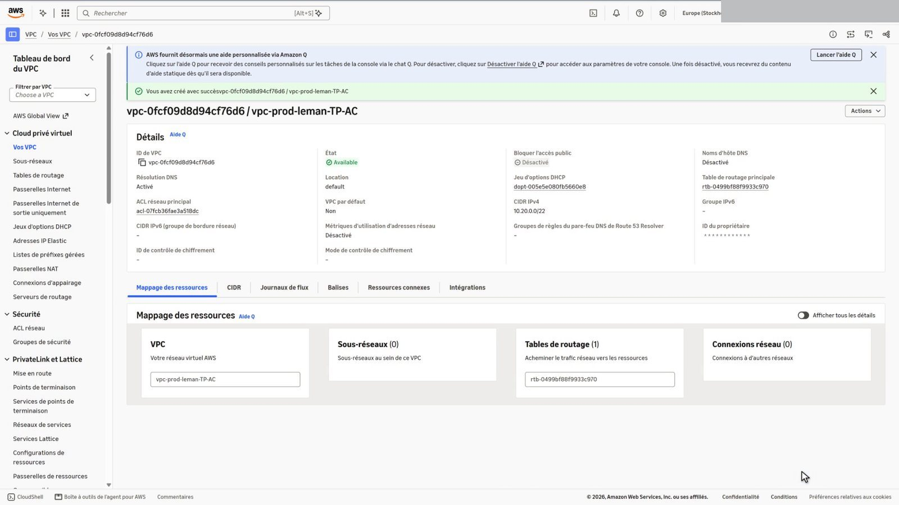

Le VPC existe : état *Available*, CIDR `10.20.0.0/22`. Le « Mappage des ressources » en bas montre zéro sous-réseau et une table de routage, la principale. (L'identifiant du propriétaire est masqué sur cette capture et sur les suivantes.)

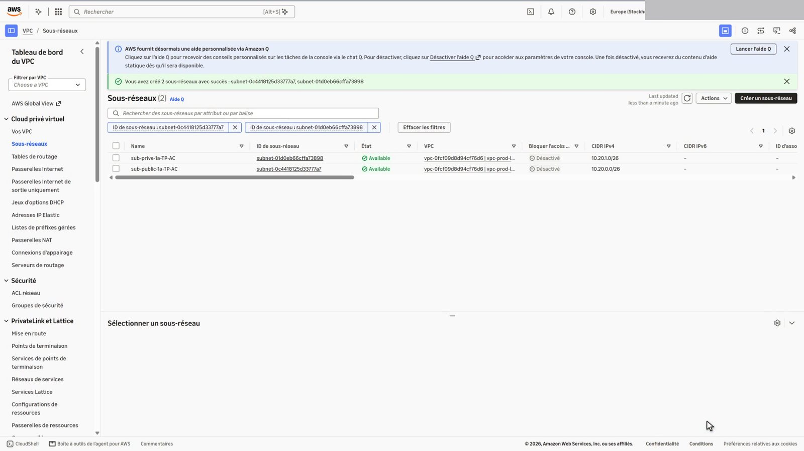

Les deux sous-réseaux sont créés d'un coup, à l'état *Available*, avec les plages `10.20.1.0/26` et `10.20.0.0/26`.

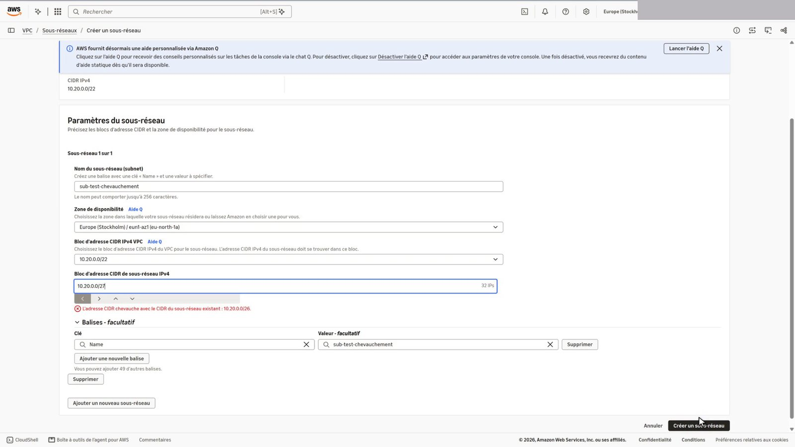

Le test de chevauchement : la console refuse `10.20.0.0/27` et nomme le sous-réseau qui est déjà là, `10.20.0.0/26`.

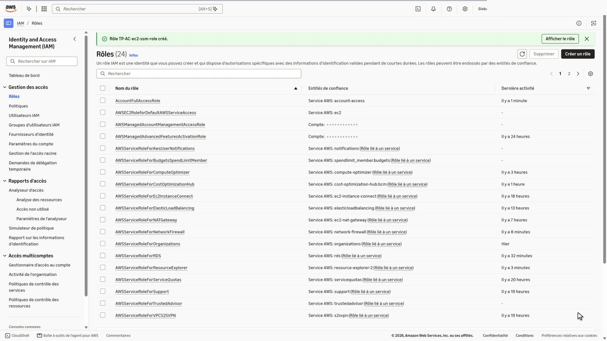

Le rôle `TP-AC-ec2-ssm-role` est créé. (Les numéros de compte de deux rôles préexistants sont masqués.)

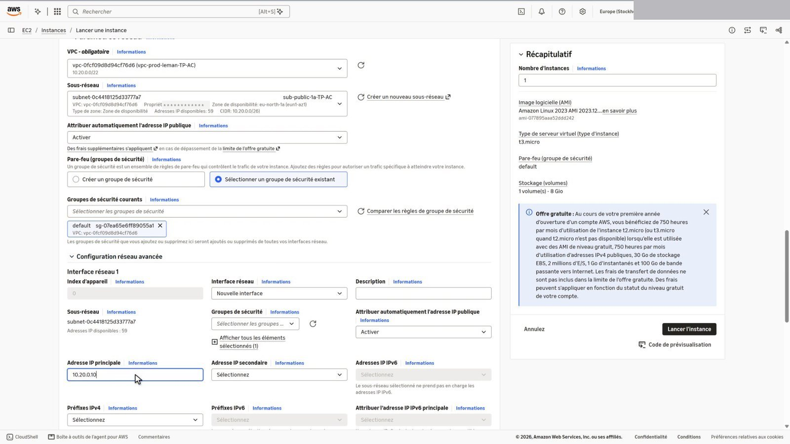

Le réseau de `web-01-TP-AC` : sous-réseau `sub-public-1a-TP-AC`, adresse publique automatique *Activer*, groupe `default`, adresse principale `10.20.0.10`.

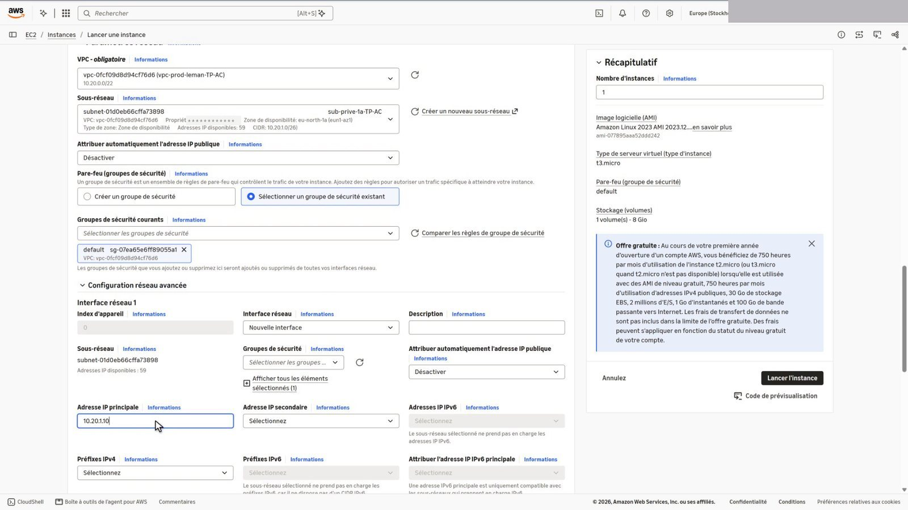

Le même écran pour `app-01-TP-AC` : sous-réseau `sub-prive-1a-TP-AC`, adresse publique *Désactiver*, adresse principale `10.20.1.10`.

## Tableau récapitulatif
| Ressource | Valeur |
|---|---|
| VPC | `vpc-prod-leman-TP-AC`, `10.20.0.0/22` |
| Sous-réseau public | `sub-public-1a-TP-AC`, `10.20.0.0/26`, `eu-north-1a` |
| Sous-réseau privé | `sub-prive-1a-TP-AC`, `10.20.1.0/26`, `eu-north-1a` |
| Rôle IAM | `TP-AC-ec2-ssm-role`, politique `AmazonSSMManagedInstanceCore` |
| `web-01-TP-AC` | `t3.micro`, Amazon Linux 2023, `10.20.0.10`, adresse publique automatique |
| `app-01-TP-AC` | `t3.micro`, Amazon Linux 2023, `10.20.1.10`, aucune adresse publique, API sur le port `8080` |
| Groupe de sécurité | `default` du VPC (remplacé au module 3) |
| Accès | Session Manager, pas de paire de clés |

## Résultats des tests
Ce que nous avons vu à l'écran pendant le tournage. Les autres vérifications (ping entre les deux serveurs, accès à Internet) viennent aux modules 2 et 3.

```
=== Module 1 : VPC et sous-réseaux (relevé sur le tournage dans la console, région eu-north-1) ===
VPC créé : vpc-prod-leman-TP-AC (vpc-0fcf09d8d94cf76d6), CIDR 10.20.0.0/22, état Available.
Sous-réseaux créés (état Available) :
  sub-public-1a-TP-AC  subnet-0c4418125d33777a7  10.20.0.0/26  eu-north-1a
  sub-prive-1a-TP-AC   subnet-01d0eb66cffa73898  10.20.1.0/26  eu-north-1a
Adresses IP disponibles affichées par la console au lancement des instances : 59 dans chacun des deux /26 (64 moins les 5 adresses réservées par AWS).

Test de chevauchement : création de sub-test-chevauchement, VPC vpc-prod-leman-TP-AC, eu-north-1a, CIDR 10.20.0.0/27
  -> message de la console : "L'adresse CIDR chevauche avec le CIDR du sous-réseau existant : 10.20.0.0/26."
  -> la page reste ouverte avec l'erreur, aucun sous-réseau n'est créé (la liste des sous-réseaux du VPC n'en compte que deux au module 2).

Rôle IAM créé : TP-AC-ec2-ssm-role (entité de confiance : service EC2, politique AmazonSSMManagedInstanceCore).

Instances lancées (t3.micro, Amazon Linux 2023, sans paire de clés, groupe de sécurité default, profil TP-AC-ec2-ssm-role) :
  web-01-TP-AC  sub-public-1a-TP-AC  10.20.0.10  adresse publique automatique : activée
  app-01-TP-AC  sub-prive-1a-TP-AC   10.20.1.10  adresse publique automatique : désactivée
Dans Session Manager (module 2), les deux instances apparaissent "Online", et sur app-01-TP-AC la commande hostname -I répond 10.20.1.10.

Non testé dans ce module : le ping de web-01-TP-AC vers app-01-TP-AC (fait au module 3, avec les Security Groups) et l'accès à Internet (module 2).
```

## Pièges rencontrés
* **Une ligne de balise vide bloque la création.** Dans le formulaire des sous-réseaux, un champ « Entrer la clé » resté vide affiche « Vous devez spécifier une clé de balise » et la console refuse de continuer. Nous l'avons rencontré en filmant ; il faut supprimer la ligne vide.
* **La saisie des balises propose les valeurs des autres équipes.** Dans la liste de suggestions, à côté de `prod`, apparaît `prod-MF` : c'est l'étiquette d'un camarade. Nous tapons la valeur en entier plutôt que de cliquer une suggestion.
* **Les serveurs ne sont pas joignables par SSM dans ce module.** Ni `web-01-TP-AC` ni `app-01-TP-AC` n'ont de route vers Internet pour l'instant. Nous n'ouvrons donc pas de session ici : la première session SSM est au module 2. Le ping entre les deux machines est testé au module 3.
* **Le groupe `default` est un raccourci.** Il suffit pour ce module, mais il ne distingue pas le web de l'application. Il disparaît des instances au module 3.

## Ce qui diffère du sujet
* **Plage du VPC.** `10.20.0.0/22` à la place du /16 du sujet (compte partagé, plages des autres équipes).
* **Région.** Stockholm à la place de Zurich (voir le module 0).
* **Un seul sous-réseau par rôle dans ce module.** Un deuxième sous-réseau public, en zone B, arrive au module 2 parce que la zone A ne peut plus accueillir de NAT.
* **Test de chevauchement.** Dans la console, le refus s'affiche en rouge sous le champ du CIDR. En ligne de commande, notre première version recevait l'erreur `InvalidSubnet.Conflict`.
* **Pas de Reachability Analyzer.** L'outil était refusé par l'organisation jusqu'au 17/11 et nous ne l'avons pas utilisé pendant le tournage.
* **Première version.** Notre premier passage, fait avec l'AWS CLI, avait un ping `web-01` vers `app-01` dès ce module. Dans la version filmée, ce test est reporté au module 3.

## Nettoyage
Rien n'est supprimé pendant le tournage. Le VPC, les sous-réseaux, le rôle et les deux instances sont supprimés à la fin du projet (voir `NETTOYAGE.md`). La seule ressource du projet qui reste côté AWS est le Network Firewall du module 4, dont la suppression est bloquée côté service ; son endpoint est dans un sous-réseau du VPC, dont la suppression dépend donc de ce déblocage.


---

# Module 2 – Routage : IGW et NAT

## Objectif
Donner un accès à Internet au sous-réseau public, un accès sortant seulement au sous-réseau privé, le prouver depuis le serveur privé, puis provoquer une panne de route pour apprendre à la retrouver.

## Ce qu'il faut savoir
Un sous-réseau est public quand sa table de routage envoie `0.0.0.0/0` vers une passerelle Internet (IGW) et que l'instance a une adresse publique. Une IGW se crée puis s'attache à un VPC : tant qu'elle n'est pas attachée, elle ne sert à rien.

Un sous-réseau privé n'a pas de route vers l'IGW. Pour que ses machines puissent quand même sortir (mises à jour, agent SSM), on place une passerelle NAT dans un sous-réseau public. La NAT remplace l'adresse privée de la machine par sa propre adresse Elastic : l'extérieur ne voit que la NAT et ne peut rien initier vers l'intérieur. La NAT a un prix : AWS la facture à chaque heure où elle existe (0,046 USD de l'heure à Stockholm d'après l'API de prix), plus chaque Go traité.

Quand plusieurs routes correspondent à une destination, la plus précise gagne. Ici, la route `10.20.0.0/22` (locale) passe avant `0.0.0.0/0`.

## Ce que nous avons fait
Tout se passe dans *VPC*, sauf la preuve, qui se fait dans *Systems Manager*.

1. **Passerelle Internet.** *Passerelles Internet > Créer* : nom `igw-prod-leman-TP-AC`, balises du projet. Elle est créée à l'état *Detached*. *Actions > Attacher au VPC*, VPC `vpc-prod-leman-TP-AC` : l'état passe à *Attached*.
2. **Table publique.** *Tables de routage > Créer* : `rt-public-leman-TP-AC`, dans le VPC de production, avec les balises. Elle ne contient que la route locale. Onglet *Routes > Modifier des routes > Ajouter une route* : destination `0.0.0.0/0`, cible *Passerelle Internet*, `igw-prod-leman-TP-AC`. Puis onglet *Associations de sous-réseau* : nous cochons `sub-public-1a-TP-AC`. C'est cette association qui rend le sous-réseau public.
3. **Table privée.** Même création pour `rt-prive-leman-TP-AC`, associée à `sub-prive-1a-TP-AC`. Elle n'a que la route locale : rien ne sort.
4. **Un deuxième sous-réseau public, en zone B.** `sub-public-1b-TP-AC`, `10.20.0.64/26`, zone `eu-north-1b`, avec les balises, puis association à `rt-public-leman-TP-AC` (la table publique a donc deux sous-réseaux). Nous savions que la zone A avait atteint sa limite de passerelles NAT, le compte étant partagé avec la classe ; l'explication est dans l'étape suivante.
5. **Passerelle NAT.** *Passerelles NAT > Créer* : nom `nat-prod-leman-TP-AC`, mode *Selon la zone* (la console propose aussi un mode *Régional*, que nous n'avons pas pris), sous-réseau `sub-public-1a-TP-AC`, connectivité *Publique*, bouton *Allouer une adresse IP Elastic*, balises. Au clic sur *Créer*, la console refuse : « Performing this operation would exceed the limit of 5 NAT gateways ». Nous avons tenté la zone A d'abord, ce qui montre l'erreur à l'écran. Nous changeons le sous-réseau pour `sub-public-1b-TP-AC`, nous allouons une nouvelle adresse Elastic et la création passe. La NAT reste *Pending* un peu plus d'une minute, puis devient *Available*.
6. **Route privée.** Dans `rt-prive-leman-TP-AC`, *Modifier des routes*, nouvelle route `0.0.0.0/0`, cible *Passerelle NAT*, `nat-prod-leman-TP-AC`. La table compte désormais deux routes.
7. **Preuve par Session Manager.** *Systems Manager > Session Manager > Démarrer une session*, instance `app-01-TP-AC`. Dans le terminal du navigateur : `whoami`, `hostname -I`, puis `curl -s https://checkip.amazonaws.com`. La machine n'a pas d'adresse publique, mais Internet la voit avec l'adresse Elastic de la NAT.
8. **Panne volontaire.** Dans la même session, nous lançons une boucle qui interroge `checkip.amazonaws.com` chaque seconde (`while true; do curl -s -m 2 https://checkip.amazonaws.com || echo ECHEC; sleep 1; done`). Dans la console, nous supprimons la route `0.0.0.0/0` de `rt-prive-leman-TP-AC` et nous enregistrons. Les requêtes échouent. Nous remettons la route vers la NAT et l'adresse revient.

`web-01-TP-AC` n'a pas d'Elastic IP : il garde l'adresse publique automatique reçue au module 1, qui change si on arrête l'instance.

## Captures
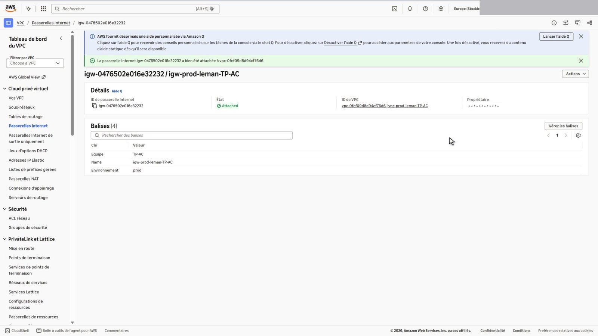

La passerelle Internet est attachée au VPC de production : état *Attached*, et le bandeau vert confirme l'attachement. Les balises du projet sont visibles en bas.

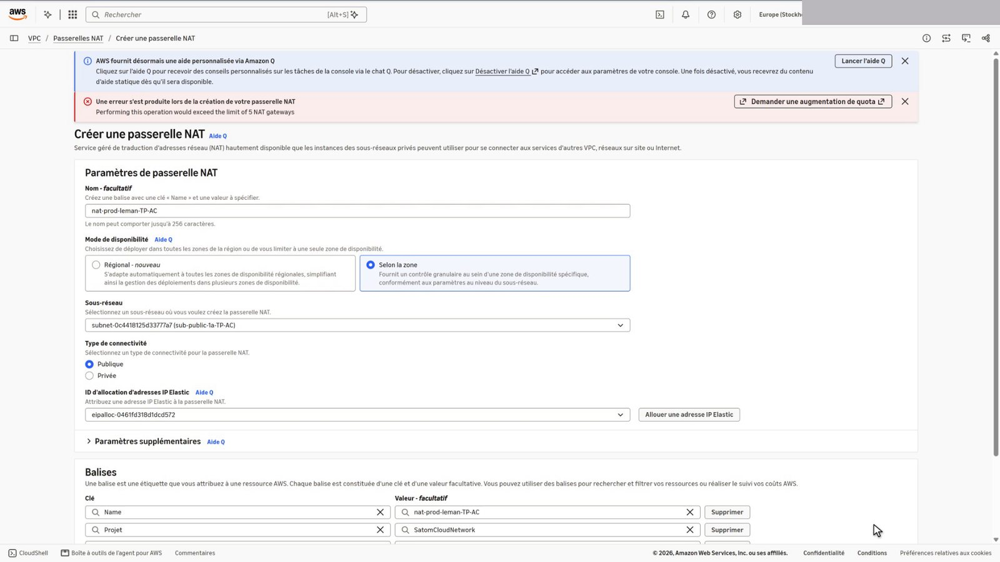

Premier essai de la NAT, dans la zone A : le bandeau rouge dit que l'opération dépasserait la limite de 5 passerelles NAT. Le bouton *Demander une augmentation de quota* est proposé à côté.

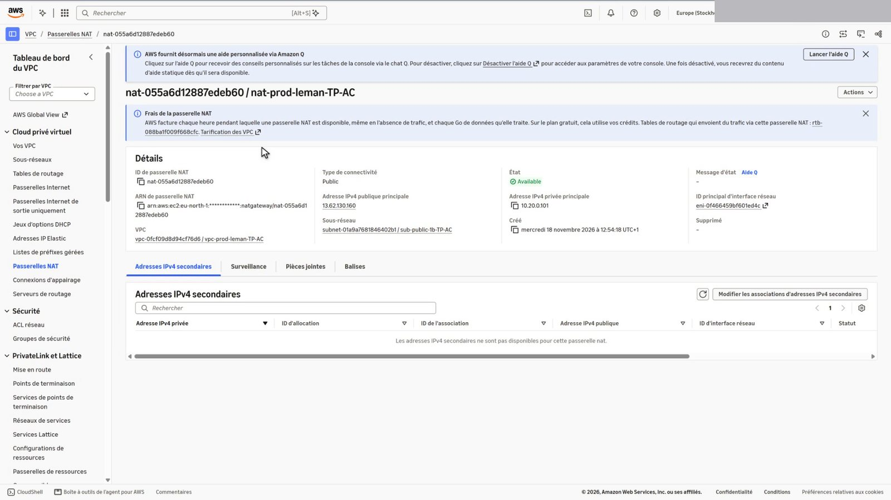

Second essai, dans la zone B : la NAT est *Available*, dans `sub-public-1b-TP-AC`, avec l'adresse privée `10.20.0.101` et l'adresse publique `13.62.130.160`.

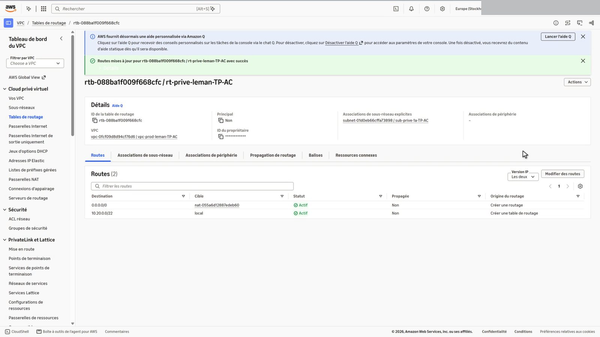

La table privée après enregistrement : `0.0.0.0/0` vers `nat-055a6d12887edeb60`, et la route locale. Le sous-réseau associé est `sub-prive-1a-TP-AC`.

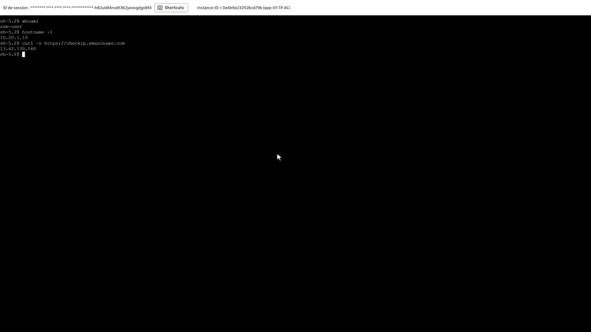

La preuve : sur `app-01-TP-AC`, `hostname -I` répond `10.20.1.10` (adresse privée seulement), et `curl` sur `checkip.amazonaws.com` répond `13.62.130.160`, l'adresse de la NAT. (L'identifiant de session est en partie masqué par la console elle-même.)

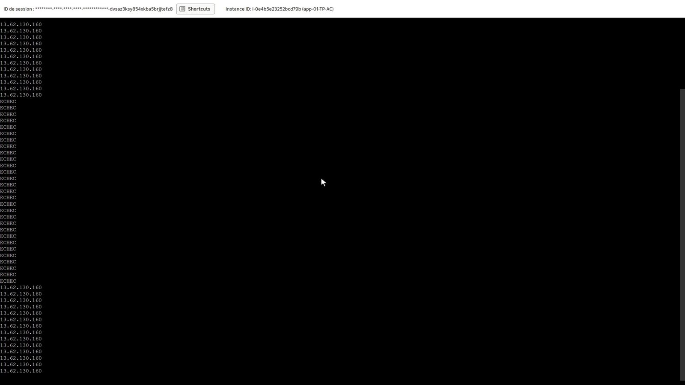

La panne et la reprise sur une seule image : la boucle affiche l'adresse de la NAT, puis 29 lignes `ECHEC` pendant que la route est retirée, puis l'adresse revient dès que nous la remettons.

## Tableau récapitulatif
| Ressource | Valeur |
|---|---|
| `igw-prod-leman-TP-AC` | `igw-0476502e016e32232`, attachée à `vpc-prod-leman-TP-AC` |
| `rt-public-leman-TP-AC` | `10.20.0.0/22` local ; `0.0.0.0/0` vers l'IGW ; associée à `sub-public-1a-TP-AC` et `sub-public-1b-TP-AC` |
| `rt-prive-leman-TP-AC` | `10.20.0.0/22` local ; `0.0.0.0/0` vers la NAT ; associée à `sub-prive-1a-TP-AC` |
| `sub-public-1b-TP-AC` | `10.20.0.64/26`, `eu-north-1b` |
| `nat-prod-leman-TP-AC` | `nat-055a6d12887edeb60`, dans `sub-public-1b-TP-AC`, adresse privée `10.20.0.101`, adresse Elastic `13.62.130.160` |

## Si ça ne marche pas : quatre vérifications
Nous les avons dites en vidéo pendant la panne, dans cet ordre :
1. Le sous-réseau est-il associé à la bonne table de routage ?
2. La route par défaut existe-t-elle dans cette table ?
3. Pointe-t-elle vers la bonne cible (IGW ou NAT) ?
4. La cible est-elle en bon état (NAT *Available*, IGW *Attached*, adresse publique sur l'instance pour un serveur public) ?

## Résultats des tests
Ce que nous avons vu à l'écran pendant le tournage.

```
=== Module 2 : routage, passerelle Internet et NAT (relevé sur le tournage dans la console, région eu-north-1) ===
Passerelle Internet igw-prod-leman-TP-AC (igw-0476502e016e32232) : état Attached au VPC vpc-prod-leman-TP-AC.

Tables de routage :
  rt-public-leman-TP-AC (rtb-06d51c36561985d79) : 10.20.0.0/22 local ; 0.0.0.0/0 -> igw-0476502e016e32232
      associée à sub-public-1a-TP-AC et sub-public-1b-TP-AC
  rt-prive-leman-TP-AC  (rtb-088ba1f009f668cfc) : 10.20.0.0/22 local ; 0.0.0.0/0 -> nat-055a6d12887edeb60
      associée à sub-prive-1a-TP-AC

Passerelle NAT, premier essai dans sub-public-1a-TP-AC (eu-north-1a) :
  -> erreur : "Performing this operation would exceed the limit of 5 NAT gateways"
Passerelle NAT, second essai dans sub-public-1b-TP-AC (eu-north-1b, 10.20.0.64/26) :
  nat-prod-leman-TP-AC (nat-055a6d12887edeb60), connectivité publique, adresse privée 10.20.0.101, adresse Elastic 13.62.130.160
  état Pending à la création, Available un peu plus d'une minute plus tard

Session Manager, instances en ligne : app-01-TP-AC et web-01-TP-AC (Ping status : Online).
Session Manager sur app-01-TP-AC (aucune adresse publique) :
  sh-5.2$ whoami
  ssm-user
  sh-5.2$ hostname -I
  10.20.1.10
  sh-5.2$ curl -s https://checkip.amazonaws.com
  13.62.130.160            <- l'adresse Elastic de la NAT, pas celle d'app-01

Panne volontaire (boucle : while true; do curl -s -m 2 https://checkip.amazonaws.com || echo ECHEC; sleep 1; done) :
  13.62.130.160 (route 0.0.0.0/0 -> NAT présente)
  route 0.0.0.0/0 supprimée de rt-prive-leman-TP-AC
  ECHEC x 29 (une tentative dure au plus 3 s : 2 s de délai de curl et 1 s de pause)
  route 0.0.0.0/0 -> NAT remise
  13.62.130.160 (la sortie repart)
Pendant la coupure, la fenêtre de Session Manager est restée figée : les lignes ECHEC ne se sont affichées qu'une fois la route remise.
```

## Pièges rencontrés
* **Quota de NAT atteint dans la zone A.** Le compte est partagé : cinq NAT par zone de disponibilité, et celles de la classe comptent aussi. C'est pour cela que la NAT est dans `sub-public-1b-TP-AC`. Pour que cela fonctionne, le sous-réseau de la NAT doit lui-même avoir une route vers l'IGW : c'est la raison de l'association de la zone B à `rt-public-leman-TP-AC`.
* **Une Elastic IP de trop.** Le premier essai, refusé, avait déjà alloué une adresse Elastic. Pour le second, nous en avons alloué une autre. La première n'est associée à aucune NAT : elle doit être relâchée avec le reste, sinon elle est facturée comme toute adresse IPv4 publique.
* **Session Manager refusait de démarrer.** Au clic sur *Démarrer la session*, la console a affiché, lors de deux tentatives, « l'instance n'est pas configurée pour être utilisée avec AWS Systems Manager », alors que `app-01-TP-AC` et `web-01-TP-AC` apparaissaient *Online* dans la liste. Nous avons recommencé la scène et la session s'est ouverte ; la cause exacte n'est pas dans nos notes.
* **La fenêtre de session se fige pendant la panne.** Tant que la route est retirée, aucune nouvelle ligne ne s'affiche. C'est logique : la session Session Manager passe elle aussi par la NAT. Les 29 lignes `ECHEC` sont apparues d'un seul coup une fois la route remise. Notre commentaire de la vidéo dit que les requêtes « échouent aussitôt » : c'est vrai pour la boucle sur la machine, mais l'écran ne le montre qu'après coup. Une tentative durant au plus trois secondes (deux de délai, une de pause), 29 échecs correspondent à une coupure d'environ une minute et demie, soit le temps de revenir dans la console et de remettre la route.

## Ce qui diffère du sujet
* **NAT en zone B.** Le schéma habituel place la NAT dans le sous-réseau public de la zone A. À cause du quota, nous avons créé un second sous-réseau public en zone B pour l'héberger.
* **Pas d'Elastic IP sur `web-01-TP-AC`.** Notre première version, avec l'AWS CLI, plaçait une Elastic IP sur `web-01` et la NAT en zone A. La version filmée garde l'adresse publique automatique et la NAT en zone B.
* **Test de panne.** Notre première version pinguait `8.8.8.8` chaque seconde et mesurait 19 secondes de coupure. La version filmée interroge `checkip.amazonaws.com` avec `curl`, ce qui prouve en plus par quelle adresse nous sortons. Elle ne chiffre pas la coupure : elle dure le temps de revenir dans la console.
* **Suppression de la NAT.** Le sujet demande de la supprimer en fin de séance. Nous la gardons pendant tout le tournage, car l'agent SSM d'`app-01-TP-AC` en dépend, et nous la supprimons à la fin du projet.

## Nettoyage
La NAT, son adresse Elastic, l'IGW, les tables de routage et le sous-réseau `sub-public-1b-TP-AC` sont supprimés à la fin du projet, comme le reste (voir `NETTOYAGE.md`). La NAT est la première ressource à retirer, puisqu'elle est facturée à l'heure. Une seule ressource du projet reste côté AWS : le Network Firewall `nfw-prod-leman-TP-AC` du module 4, dont la suppression est bloquée côté service. Son endpoint se trouve dans `sub-public-1b-TP-AC` : ce sous-réseau, et le VPC qui le contient, ne peuvent partir qu'une fois le pare-feu débloqué.


---

# Module 3 – Security Groups et NACL

## Objectif
Poser deux niveaux de filtrage sur le VPC de production : un Security Group par rôle (web, application) et une NACL sur le sous-réseau public. Le but est de savoir dire, devant une connexion qui échoue, si c'est le groupe ou la NACL qui bloque.

## Ce qu'il faut savoir
Un Security Group se pose sur l'instance. Il garde l'état des connexions : si l'aller est autorisé, la réponse repart sans règle de plus. Il ne contient que des autorisations, tout le reste est refusé. La source d'une règle peut être une adresse, une plage ou un autre groupe, c'est-à-dire « toutes les instances qui portent ce groupe ».

Une NACL se pose sur un sous-réseau. Elle ne garde aucun état : il faut autoriser l'aller et le retour. La réponse d'un serveur HTTPS revient vers un port éphémère du client, d'où la plage 1024-65535. Ses règles sont numérotées et lues par ordre croissant, la première qui correspond gagne. Elle accepte les refus, et une règle `*` refuse tout ce qui n'a pas été prévu.

Un paquet entrant passe d'abord la NACL du sous-réseau, puis le groupe de l'instance. Il faut que les deux disent oui.

## Ce que nous avons fait
Tout se fait dans la console, dans *EC2* pour les groupes, dans *VPC* pour la NACL, dans *Systems Manager* pour les tests.

1. **Groupe web.** *EC2 > Groupes de sécurité > Créer*. Nom `web-TP-AC`, description « Web : 443 public, 22 plage de test », VPC `vpc-prod-leman-TP-AC`. Deux règles entrantes : TCP 443 depuis `0.0.0.0/0` (« HTTPS public ») et TCP 22 depuis `203.0.113.0/24` (« SSH plage de test »). Nous laissons la règle sortante par défaut (tout). Balises du projet, plus `Name = sg-web-TP-AC`.
2. **Groupe application.** Même écran : `app-TP-AC`, description « App : 8080, 22 et ICMP depuis le groupe web ». Trois règles entrantes, et pour chacune la source n'est pas une adresse mais le groupe `web-TP-AC` (nous tapons `web-TP` dans le champ et nous le choisissons dans la liste) : TCP 8080 (« API depuis web »), SSH 22 (« SSH depuis web »), *Tous les ICMP - IPv4* (« ping depuis web »). Balise `Name = sg-app-TP-AC`.
3. **Brancher les groupes.** Dans *Instances*, nous cochons l'instance, puis *Actions > Sécurité > Modifier les groupes de sécurité* : `web-01-TP-AC` reçoit `web-TP-AC`, `app-01-TP-AC` reçoit `app-TP-AC`, et dans les deux cas nous retirons le groupe `default`. (Dans la vidéo, nous ouvrons le même écran par son adresse directe.)
4. **Premier test, depuis `web-01`.** *Systems Manager > Session Manager*, session sur `web-01-TP-AC`. `ping -c 3 10.20.1.10` : trois réponses sur trois, environ 0,2 ms. `curl -s http://10.20.1.10:8080/api/health` répond `app-01 TP-AC /api/health`. Le groupe de l'application laisse donc passer le ping et le 8080 venant du groupe web.
5. **nginx sur `web-01`.** Pour avoir quelque chose qui répond sur le 443, nous installons nginx (`sudo dnf -y install nginx`, quelques dizaines de secondes) avec un certificat auto-signé : `openssl req -x509 -nodes -newkey rsa:2048 -days 365`, sujet `CN=portefeuilles.leman-finance.example`, clé et certificat dans `/etc/pki/nginx`. Le fichier `/etc/nginx/conf.d/web.conf` écoute sur `443 ssl`, répond `web-01 TP-AC` à la racine et relaie `/api/` vers `http://10.20.1.10:8080`. Après `nginx -t` et `systemctl enable --now nginx`, `curl -sk https://localhost/` répond `web-01 TP-AC` et `curl -sk https://localhost/api/health` répond `app-01 TP-AC /api/health`. Le certificat est auto-signé parce que ce nom n'est pas un domaine à nous : le vrai domaine n'arrive qu'aux modules 9 à 11.
6. **La NACL.** *VPC > ACL réseau > Créer* : `nacl-public-TP-AC`, VPC de production, balises du projet. Une NACL neuve refuse tout. Règles entrantes : 100 TCP 443 depuis `0.0.0.0/0`, 110 TCP 1024-65535 depuis `0.0.0.0/0`, 120 *Tout le trafic* depuis `10.20.0.0/22` (le VPC), toutes en *Autoriser*. Règles sortantes : les mêmes trois, vers les mêmes destinations. Onglet *Associations de sous-réseau > Modifier* : nous cochons `sub-public-1a-TP-AC` seulement. Les deux autres sous-réseaux (`sub-public-1b-TP-AC` et `sub-prive-1a-TP-AC`) restent sur la NACL par défaut.
7. **Panne volontaire du groupe.** Dans une session sur `web-01`, une boucle interroge l'API chaque seconde : `while true; do curl -s -m 2 http://10.20.1.10:8080/api/health || echo ECHEC; echo; sleep 1; done`. Dans la console, nous retirons la règle 8080 du groupe `app-TP-AC` : la boucle devrait passer à `ECHEC`. Puis nous remettons la règle (TCP 8080, source `web-TP-AC`). Ce qui s'est réellement passé à l'écran est raconté dans « Pièges rencontrés ».

## Captures
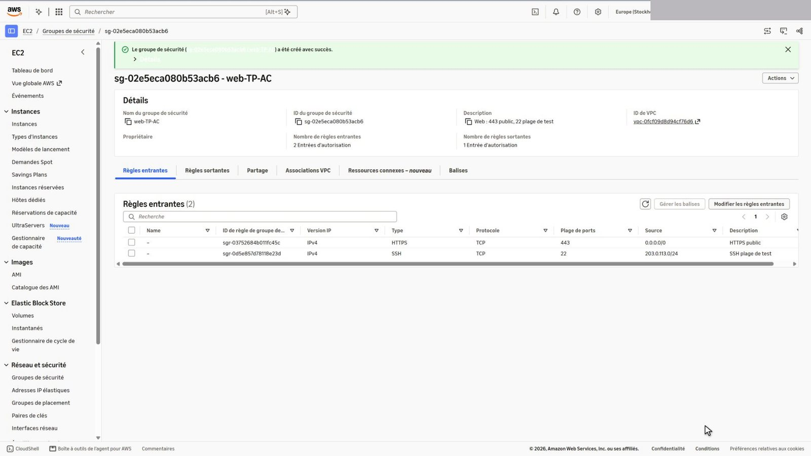

Le groupe `web-TP-AC` vient d'être créé (bandeau vert). Ses deux règles entrantes : HTTPS depuis tout Internet, SSH depuis `203.0.113.0/24`. Le numéro de propriétaire du compte est masqué sur cette image.

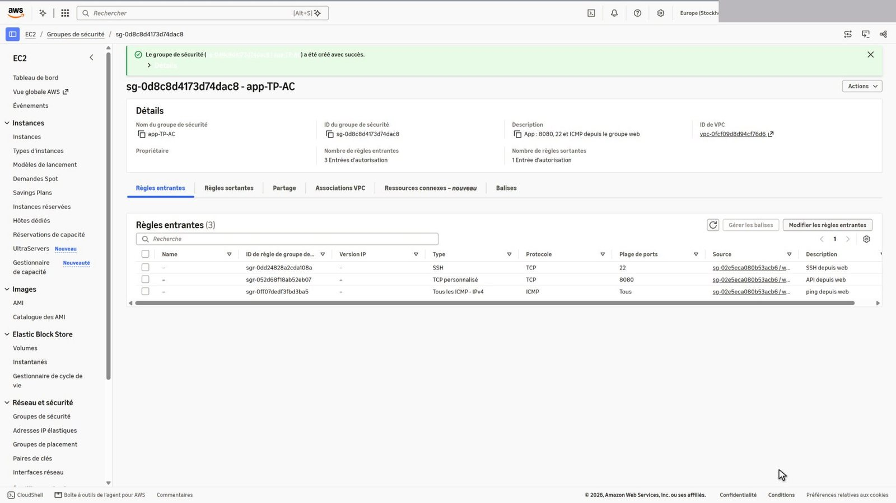

Le groupe `app-TP-AC` : trois règles, SSH 22, TCP 8080 et ICMP, toutes avec pour source le groupe `web-TP-AC` (colonne *Source*, identifiant `sg-02e5eca080b53acb6`) et non une adresse.

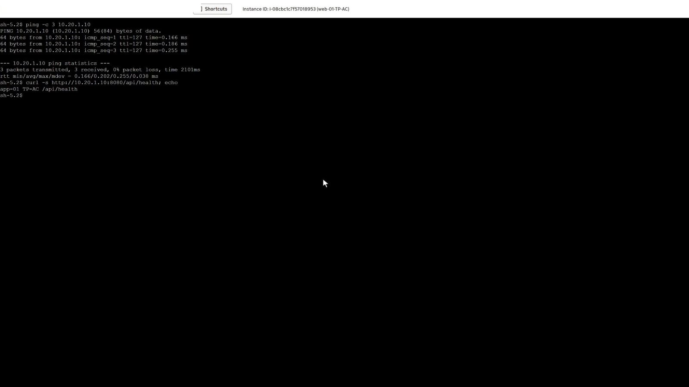

Depuis `web-01-TP-AC` : trois pings sur trois, puis la réponse de l'API de `app-01`. L'identifiant de session, en haut à gauche, est masqué.

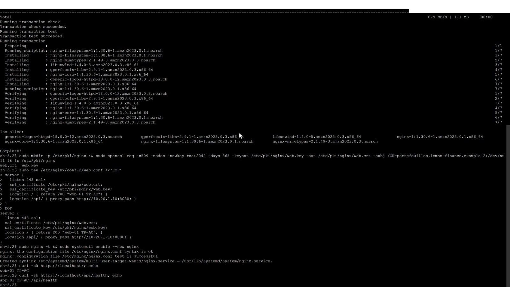

La fin de l'installation de nginx, la configuration en HTTPS, `nginx -t` qui annonce `test is successful`, et les deux `curl -sk` : la page du serveur web, puis l'API de `app-01` relayée par nginx.

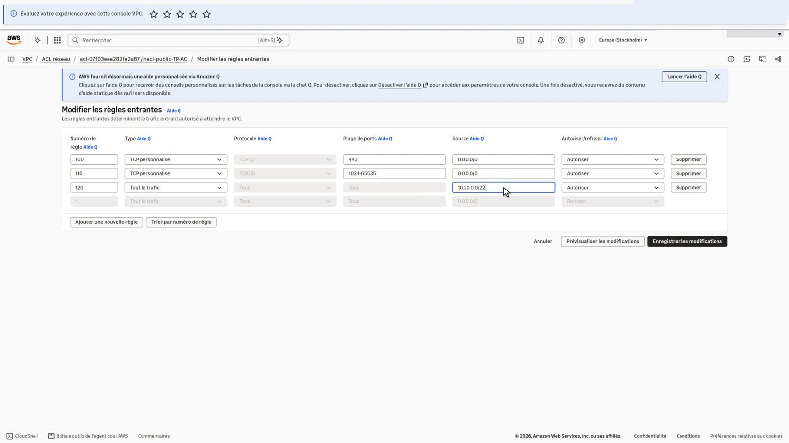

L'éditeur des règles entrantes de `nacl-public-TP-AC`, avant l'enregistrement. Les trois règles 100, 110 et 120 sont en *Autoriser* ; la ligne grisée `*` est la règle par défaut, qui refuse. Les règles sortantes ont la même forme.

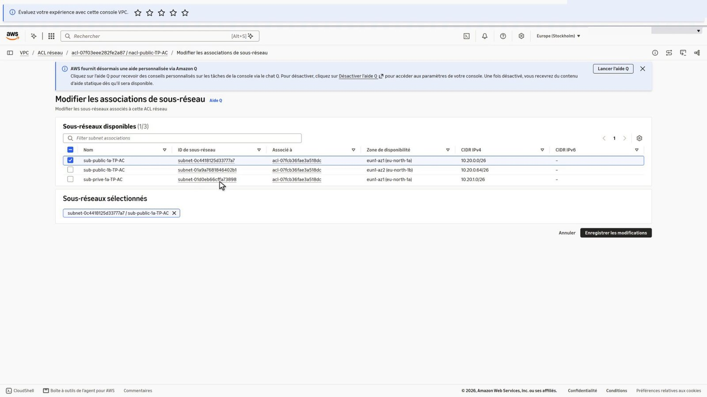

L'association de la NACL : seul `sub-public-1a-TP-AC` (`10.20.0.0/26`, zone `eu-north-1a`) est coché. Les deux autres sous-réseaux sont encore sur la NACL par défaut (colonne *Associé à*).

## Tableau récapitulatif
| Élément | Valeur |
|---|---|
| `web-TP-AC` | `sg-02e5eca080b53acb6`, tag `Name = sg-web-TP-AC` ; entrée TCP 443 depuis `0.0.0.0/0`, TCP 22 depuis `203.0.113.0/24` ; sortie libre |
| `app-TP-AC` | `sg-0d8c8d4173d74dac8`, tag `Name = sg-app-TP-AC` ; entrée TCP 8080, TCP 22 et ICMP, source `web-TP-AC` ; sortie libre |
| `web-01-TP-AC` | groupe `web-TP-AC` (le groupe `default` est retiré) |
| `app-01-TP-AC` | groupe `app-TP-AC` (le groupe `default` est retiré) |
| `nacl-public-TP-AC` | `acl-07f03eee282fe2a87`, associée à `sub-public-1a-TP-AC` |
| NACL, entrée | 100 TCP 443 `0.0.0.0/0` ; 110 TCP 1024-65535 `0.0.0.0/0` ; 120 tout `10.20.0.0/22` ; `*` refuser |
| NACL, sortie | 100 TCP 443 ; 110 TCP 1024-65535 ; 120 tout `10.20.0.0/22` (mêmes destinations) ; `*` refuser |

## Résultats des tests
Ces sorties viennent de notre première exécution, faite en ligne de commande avant le tournage, sur les mêmes groupes et la même NACL. La vidéo reprend le test de `web-01` vers `app-01` (captures ci-dessus) et la panne du 8080, mais pas les essais de la NACL : retrait de la règle de retour, puis refus explicite numéro 50 placé avant l'autorisation numéro 100. Dans cet essai, c'est la règle au numéro le plus bas qui gagne.

```
=== TP1 : Security Groups ===
curl https depuis Internet vers web-01 : HTTP 200
ping depuis Internet vers web-01 (ICMP non autorise) : pas de reponse (attendu)
app-01 n'a pas d'IP publique : None

=== TP2 : SG (avec etat) vs NACL (sans etat) ===
web-01 -> app-01:8080 : Success	app-01 TP-AC /api/health 	
NACL : regle de retour (sortie ephemere 1024-65535) retiree -> curl externe : HTTP 000 ECHEC (code curl 28 : timeout/refus)
NACL : regle de retour retablie -> curl externe : HTTP 200

=== TP3 : diagnostic ===
8080 retire de sg-app -> web-01 -> app-01:8080 : Success	ECHEC 	
8080 retabli -> web-01 -> app-01:8080 : Success	app-01 TP-AC /api/health 	
NACL : refus explicite regle 50 (avant l'autorisation 100) -> curl externe : HTTP 000 ECHEC (code curl 28 : timeout/refus)  [la regle au numero le plus bas gagne]
refus supprime -> curl externe : HTTP 200
```

## Pièges rencontrés
* **Le nom du groupe.** AWS interdit un nom de groupe qui commence par `sg-`. Le groupe s'appelle donc `web-TP-AC`, et c'est la balise `Name` (`sg-web-TP-AC`) qui s'affiche dans la liste.
* **La source d'une règle.** Quand on tape `web-TP` dans le champ *Source* sans choisir le groupe dans la liste, la console affiche en rouge « Un bloc d'adresse CIDR, un ID de groupe de sécurité ou une liste de préfixes doit être spécifié » et refuse d'enregistrer.
* **La panne du 8080, telle que filmée.** Dans la vidéo, la boucle de `web-01` reste verte : aucun `ECHEC`. Au moment de supprimer la règle 8080 du groupe `app-TP-AC`, le clic est tombé à côté, d'après l'enregistrement : c'est la source de la règle SSH qui s'est vidée, la console a refusé d'enregistrer (le message rouge ci-dessus) et le groupe n'a pas changé. La règle ajoutée ensuite aurait de toute façon fait doublon, et la liste des règles que montre le module 5 contient encore les trois règles d'origine (SSH, 8080 et ICMP depuis le groupe web). Nous n'avons pas refait cette prise. La panne elle-même est prouvée par la sortie de la première exécution, plus haut : après retrait du 8080, le `curl` de `web-01` échoue ; une fois la règle remise, il répond.
* **Des prises refaites.** Cinq des six scènes de ce module ont demandé au moins une reprise. À chaque fois, la console n'a pas réagi comme le geste prévu l'attendait : une liste déroulante restée ouverte, une source de règle non validée.
* **Le port 22 est fermé deux fois.** Le groupe web l'ouvre depuis `203.0.113.0/24`, mais la NACL n'autorise ni le 22 ni l'ICMP depuis l'extérieur. Cela ne gêne pas : nous administrons les machines par Session Manager, sans SSH.

## Ce qui diffère du sujet
* **L'adresse de la « salle d'exploitation ».** Le sujet parle de cette adresse sans la donner. Nous avons mis `203.0.113.0/24`, une plage réservée à la documentation : personne ne peut s'en servir, ce qui convient pour un port d'administration dont nous ne nous servons pas.
* **Les noms.** Le groupe porte le nom `web-TP-AC` et non `sg-web-TP-AC`, pour la raison ci-dessus.
* **Les autres groupes.** Les groupes du load balancer et du développement ne sont pas dans ce module : celui du développement arrive au module 5, celui du load balancer au module 9.
* **Les tests de la NACL.** Ils n'ont pas été refilmés. Les résultats viennent de la première exécution en ligne de commande, et la vidéo ne montre que la création de la NACL et son association.

## Nettoyage
Les deux groupes et la NACL ne coûtent rien. Ils ont été supprimés à la fin du tournage avec le reste du réseau, dans l'ordre décrit dans `docs/NETTOYAGE.md` (les instances d'abord, puis les groupes et la NACL), à l'exception de ce qui retient encore le pare-feu du module 4 : voir ce module.


---

# Module 4 – Network Firewall

> Ce module a d'abord été refusé par l'organisation AWS (`network-firewall:*`). Le blocage a été levé le 17/11/2026, sans que nous sachions qui l'a levé. Notre premier essai, en ligne de commande, date de ce jour-là ; le module a ensuite été refait à la main dans la console et filmé le 18/11/2026. Le pare-feu est réel, pas simulé.

## Objectif
Contrôler ce qui sort du sous-réseau privé : n'autoriser que les dépôts de mises à jour Amazon Linux et les services AWS, bloquer tout le reste et garder une trace des flux, bloqués comme autorisés, dans CloudWatch Logs.

## Ce qu'il faut savoir
AWS Network Firewall est un pare-feu managé. AWS le déploie sous forme d'un *endpoint* posé dans un sous-réseau à part. Rien n'y passe tout seul : c'est à nous d'écrire des routes qui envoient le trafic vers cet endpoint.

Il a deux moteurs de règles. Le moteur sans état regarde chaque paquet isolément. Le moteur avec état suit la connexion et sait lire le nom d'un site dans une requête HTTP ou TLS : c'est lui qui applique notre liste de domaines. La politique du pare-feu règle l'ordre d'évaluation et l'action par défaut. Nous avons pris l'ordre strict (les règles sont lues dans l'ordre) et l'action « abandon établi » : le pare-feu laisse passer l'établissement de la connexion TCP, puis abandonne la suite dès que le nom du site n'est dans aucune règle d'autorisation. Chaque abandon génère une alerte.

Le pare-feu doit voir les deux sens d'une connexion. Si l'aller passe par l'endpoint et que le retour le contourne, il ne voit qu'un côté de l'échange et coupe. Toute la partie routage du module sert à obtenir cette symétrie. Le service est facturé environ 0,40 USD de l'heure : on ne le laisse pas tourner.

## Ce que nous avons fait
Le chemin voulu est : serveur privé, pare-feu, NAT, Internet. Tout se fait dans *VPC* (menus *Sous-réseaux*, *Tables de routage*, *Network Firewall*) et dans *CloudWatch*.

1. **Sous-réseau du pare-feu.** `sub-fw-1a-TP-AC`, VPC de production, zone `eu-north-1a`, plage `10.20.2.0/28`, balises du projet. C'est le plus petit sous-réseau qu'AWS accepte : 16 adresses. Il passe à *Available* tout de suite.
2. **Deux tables de routage**, pour construire le chemin de sortie :
   * `rt-fw-leman-TP-AC` : route `0.0.0.0/0` vers la passerelle NAT `nat-prod-leman-TP-AC`, associée à `sub-fw-1a-TP-AC`. Ce que le pare-feu laisse passer part donc vers la NAT.
   * `rt-nat-leman-TP-AC` : route `0.0.0.0/0` vers la passerelle Internet `igw-prod-leman-TP-AC`, associée à `sub-public-1b-TP-AC`. C'est le sous-réseau de la NAT, en zone B (la zone A avait atteint la limite de NAT au module 2). Il quitte ainsi `rt-public-leman-TP-AC` et prend cette table à lui.
3. **Groupe de règles.** *Network Firewall > Groupes de règles > Créer* : `rg-depots-autorises-TP-AC`, description « Autorise les depots de mises a jour et les services AWS ». Version *Classique*, type *Groupe de règles avec état*, format *Générateur visuel de règles*, puis *Liste de domaines*, ordre strict. Domaines : `.amazonlinux.com` et `.amazonaws.com`, protocoles HTTP et HTTPS, action *Autoriser*. Capacité 100 : AWS la fixe à la création, on ne peut plus la changer.
4. **Politique.** *Stratégies de pare-feu > Créer* : `policy-prod-leman-TP-AC`, version *Classique*, sans la « défense active contre les menaces » (option payante). Ordre d'évaluation *Ordre strict*, action d'abandon *Abandon établi*, action d'alerte *Alerte établie*. Nous ajoutons `rg-depots-autorises-TP-AC` en priorité 1.
5. **Pare-feu.** *Pare-feu > Créer* : `nfw-prod-leman-TP-AC`. Type de capacité *Routed firewall* (la console l'affiche en anglais ; l'autre choix, *Routed firewall, NAT and explicit proxy*, fait créer des NAT par AWS, alors que nous avons déjà la nôtre), attachement au VPC `vpc-prod-leman-TP-AC`, zone `eu-north-1a`, sous-réseau `sub-fw-1a-TP-AC`, adresses IPv4, politique existante `policy-prod-leman-TP-AC`, balises. Dans le récapitulatif, la console active par défaut la protection contre la suppression et celle contre les changements de sous-réseau. Le statut passe de *Mise en service* à *Prêt* au bout de quelques minutes (accéléré dans la vidéo).
6. **Deux groupes de journaux.** *CloudWatch > Groupes de journaux > Créer* : `/leman/nfw-alert-TP-AC` et `/leman/nfw-flow-TP-AC` (classe *Standard*, conservation illimitée). Puis, dans la page du pare-feu, *Journalisation > Modifier* : type *Alert* vers `/leman/nfw-alert-TP-AC`, type *Flow* vers `/leman/nfw-flow-TP-AC`, destination *CloudWatch log group* pour les deux. Il faut deux journaux parce qu'une alerte n'est émise que pour ce qui est bloqué : pour voir passer le flux autorisé, il faut le journal des flux.
7. **Route par défaut du privé.** Dans `rt-prive-leman-TP-AC`, nous modifions la route `0.0.0.0/0` : la cible *Passerelle NAT* devient *Point de terminaison de l'équilibreur de charge de passerelle* (c'est le nom que la console donne à l'endpoint d'un pare-feu), `vpce-02fcd420fb34607b8`. Tout ce que `app-01` envoie vers Internet passe maintenant par le pare-feu.
8. **Route de retour.** Dans `rt-nat-leman-TP-AC`, nous ajoutons `10.20.1.0/26` (le sous-réseau privé) vers le même endpoint. Sans elle, la NAT répondrait à `app-01` directement, par la route locale du VPC, et le pare-feu ne verrait jamais le retour.
9. **Le test, depuis `app-01`.** Session Manager sur `app-01-TP-AC`, trois `curl -sS -m 10 -o /dev/null -w "HTTP %{http_code}"` : sur `https://cdn.amazonlinux.com/`, sur `https://example.com/` et sur `https://www.wikipedia.org/`.
10. **Les journaux.** Dans CloudWatch, nous ouvrons le flux de `/leman/nfw-alert-TP-AC` et celui de `/leman/nfw-flow-TP-AC`.

La NAT est en zone B et l'endpoint en zone A : le trafic de sortie traverse donc deux zones. Ce serait à éviter en production (coût et dépendance), nous l'acceptons pour ce montage.

## Captures
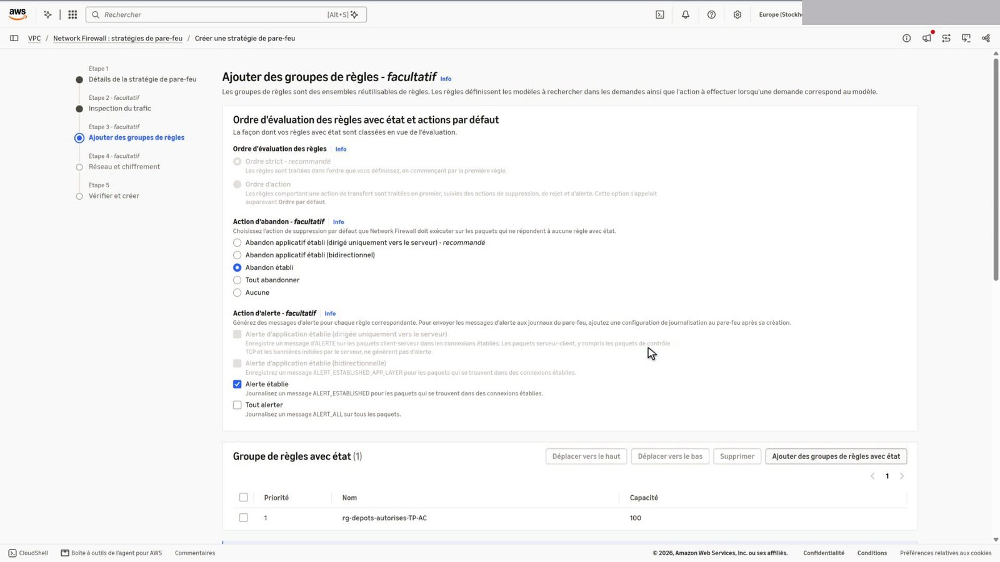

La politique `policy-prod-leman-TP-AC` avant sa création. L'ordre strict est celui du groupe de règles. L'action d'abandon par défaut est *Abandon établi*, l'alerte est *Alerte établie*. En bas, le groupe `rg-depots-autorises-TP-AC` est en priorité 1.

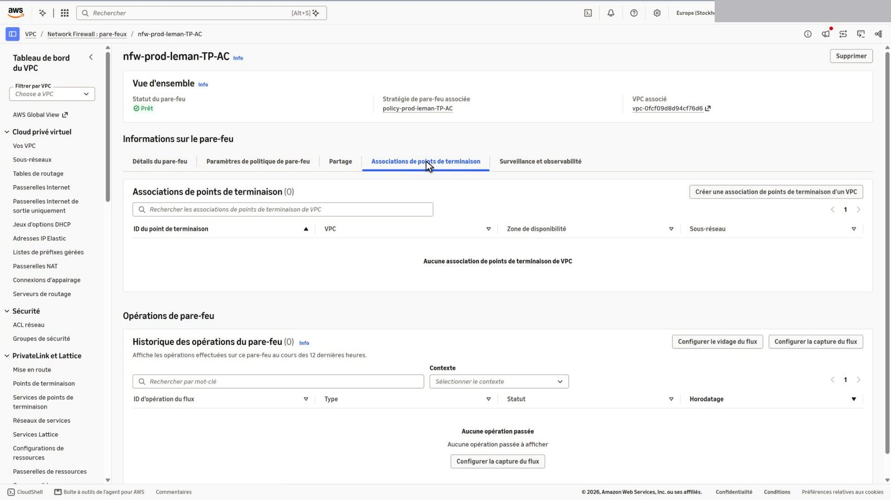

Le pare-feu `nfw-prod-leman-TP-AC` est au statut *Prêt*, avec sa politique. L'onglet ouvert ici, *Associations de points de terminaison*, est vide : il ne liste que les associations ajoutées à la main depuis d'autres VPC. L'endpoint créé avec le pare-feu, lui, se repère dans les routes (capture suivante).

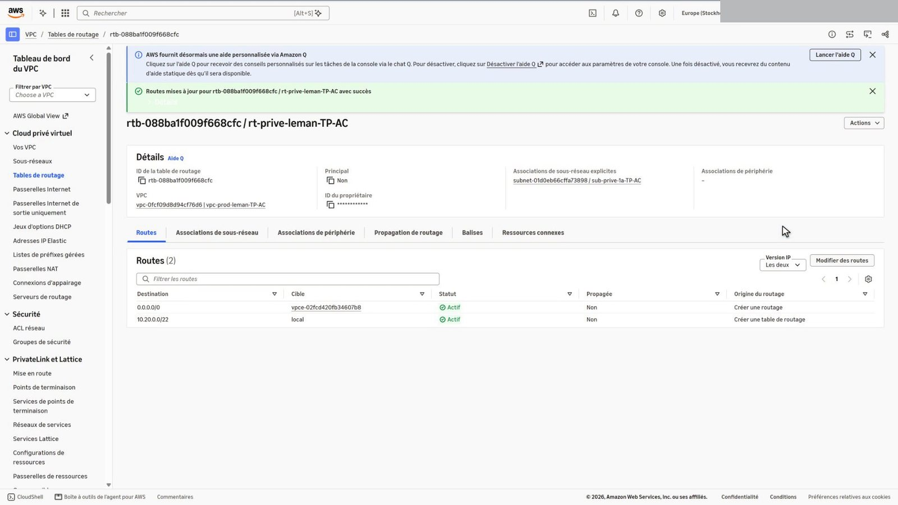

La table du sous-réseau privé après modification : la route par défaut `0.0.0.0/0` pointe vers `vpce-02fcd420fb34607b8`, l'endpoint du pare-feu, et non plus vers la NAT. La route locale `10.20.0.0/22` est inchangée.

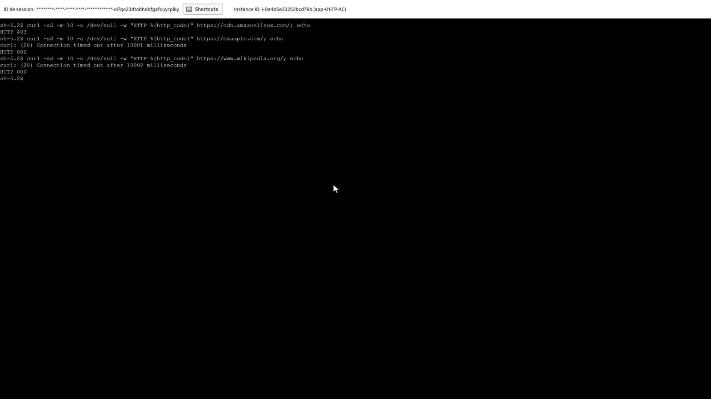

Le test depuis `app-01-TP-AC`. `cdn.amazonlinux.com` répond `HTTP 403` : c'est la réponse du site, la connexion a donc traversé le pare-feu. `example.com` et `www.wikipedia.org` ne sont pas dans la liste : après dix secondes, `curl: (28) Connection timed out` et `HTTP 000`.

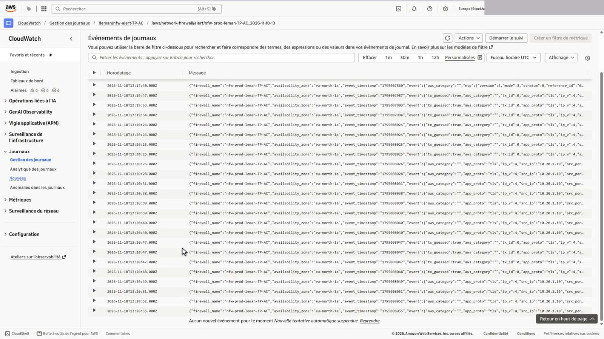

Le journal des alertes, avec une ligne JSON par événement. On lit le nom du pare-feu, la zone `eu-north-1a`, le protocole `tls` et l'adresse source `10.20.1.10`, celle d'`app-01`. La première ligne, de 13:17 UTC, est une requête NTP (`ntp`) : l'instance sort aussi sur le port 123, que la politique abandonne et signale. Les lignes suivantes sont des alertes TLS. La liste s'arrête à 13:20:55 UTC, avant nos trois `curl` : ce sont des alertes sur le trafic que `app-01` émet sans qu'on le lui demande. Pour une alerte sur un `curl` bloqué, voir la sortie du pare-feu CloudFormation plus bas (`proto tls`, `action blocked`).

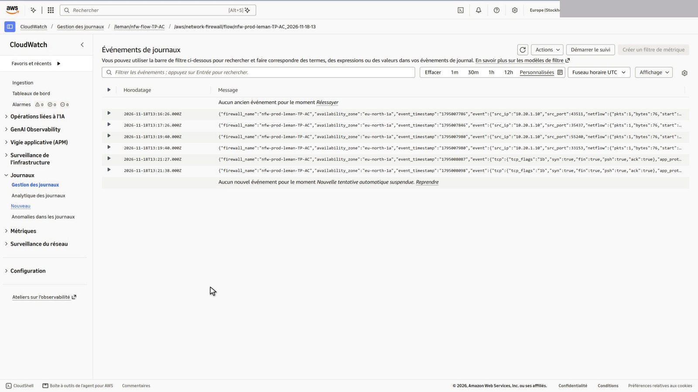

Le journal des flux : six enregistrements. Les quatre premiers portent la source `10.20.1.10` et des compteurs `netflow` (paquets, octets), les deux derniers, de 13:21 UTC, des drapeaux TCP : l'heure concorde avec celle de nos `curl`, ce sont sans doute leurs connexions. Les lignes sont tronquées à droite par la largeur de la page ; la console les déplie au clic.

## Tableau récapitulatif
| Élément | Valeur |
|---|---|
| Sous-réseau du pare-feu | `sub-fw-1a-TP-AC`, `10.20.2.0/28`, `eu-north-1a` |
| `rt-fw-leman-TP-AC` | `0.0.0.0/0` vers `nat-prod-leman-TP-AC` ; associée à `sub-fw-1a-TP-AC` |
| `rt-nat-leman-TP-AC` | `0.0.0.0/0` vers `igw-prod-leman-TP-AC` ; `10.20.1.0/26` vers l'endpoint ; associée à `sub-public-1b-TP-AC` |
| `rt-prive-leman-TP-AC` | `0.0.0.0/0` vers l'endpoint `vpce-02fcd420fb34607b8` ; `10.20.0.0/22` local |
| Groupe de règles | `rg-depots-autorises-TP-AC`, avec état, liste de domaines `.amazonlinux.com` et `.amazonaws.com`, HTTP et HTTPS, autoriser, capacité 100 |
| Politique | `policy-prod-leman-TP-AC`, ordre strict, abandon établi, alerte établie |
| Pare-feu | `nfw-prod-leman-TP-AC`, endpoint dans `sub-fw-1a-TP-AC` |
| Journaux | `/leman/nfw-alert-TP-AC` (alertes), `/leman/nfw-flow-TP-AC` (flux) |

## Résultats des tests
Ces sorties viennent du pare-feu que le modèle CloudFormation du module 13 a déployé le 17/11. Ce n'est pas le pare-feu fait à la main de la vidéo : son endpoint porte un autre identifiant (`vpce-0951ba9169b5e0399`), et il a un groupe de règles de plus, qui laisse passer le trafic interne du VPC. Les résultats sont les mêmes que ceux de la vidéo (voir la capture du test) : `cdn.amazonlinux.com` répond `HTTP 403`, `example.com` et Wikipédia expirent.

```
=== Module 4 : pare-feu deploye par la stack stack-interconnexion-leman-TP-AC ===
Pare-feu nfw-prod-leman-TP-AC : statut READY, endpoint vpce-0951ba9169b5e0399 dans le sous-reseau sub-fw-1a-TP-AC (10.20.2.0/28)
Routes : rt-prive 0.0.0.0/0 -> vpce-0951ba9169b5e0399 (endpoint du pare-feu)
[autorise] curl https://cdn.amazonlinux.com/ -> HTTP 403
[bloque]   curl https://example.com/        -> Failed	curl: (28) Connection timed out after 10002 milliseconds HTTP 000	failed to run commands: exit status 28
[bloque]   curl https://www.wikipedia.org/  -> Failed	curl: (28) Connection timed out after 10003 milliseconds HTTP 000	failed to run commands: exit status 28
[interne]   web-01 -> app-01:8080 (trafic interne, autorise par la regle 1 du pare-feu) -> Success	app-01 TP-AC /api/health 	

Journal des alertes /leman/nfw-alert-TP-AC (flux bloques) :
  47 alertes ; exemples :
  src 10.20.1.10 -> dst 13.40.182.125:123 | proto ntp | action blocked | aws:alert_established action
  src 10.20.1.10 -> dst 18.133.139.197:123 | proto ntp | action blocked | aws:alert_established action
  src 10.20.1.10 -> dst 104.20.23.154:443 | proto tls | action blocked | aws:alert_established action

Journal des flux /leman/nfw-flow-TP-AC (tous les flux vus par le pare-feu, dont le flux autorise) :
  128 flux vus (app-01 et web-01 vers app-01) ; exemples :
  src 10.20.0.115:40388 -> dst 10.20.1.10:8080 | proto TCP | octets 180
  src 10.20.0.19:41222 -> dst 10.20.1.10:8080 | proto TCP | octets 180
  src 10.20.0.115:14054 -> dst 10.20.1.10:8080 | proto TCP | octets 180
  src 10.20.0.19:25106 -> dst 10.20.1.10:8080 | proto TCP | octets 180
```

## Pièges rencontrés
* **Le service était refusé.** Jusqu'au 17/11, toute création Network Firewall échouait avec un refus de l'organisation (voir `docs/01-services-bloques.md`). Nous avons d'abord rédigé le module sans le réaliser, puis l'avons refait pour de vrai après la levée du blocage.
* **Un `403` est un succès.** `cdn.amazonlinux.com` répond 403 parce que nous ne demandons pas une page qui existe. Le bon signe est que le serveur répond : le pare-feu a laissé passer.
* **La NAT en zone B.** À cause de la limite de NAT par zone (module 2), la NAT n'est pas dans la même zone que l'endpoint. Il a fallu une table de routage dédiée à `sub-public-1b-TP-AC` pour y poser la route de retour sans toucher au sous-réseau de `web-01`.
* **L'onglet vide.** *Associations de points de terminaison* affiche « Aucune association » alors que le pare-feu est prêt. Ce n'est pas une erreur : l'endpoint se trouve dans les routes.
* **Les prises à refaire.** Cinq scènes sur onze ont été refaites au moins une fois (groupe de règles, politique, journalisation, routes, journaux) : la console n'a pas réagi comme le geste prévu l'attendait.
* **Le pare-feu ne se laisse plus supprimer.** Voir « Nettoyage ».
* **Ce que nous avons appris du premier essai.** En ligne de commande, trois étapes ont échoué (groupe de journaux, journalisation, routes). Nous avons aussi constaté que `web-01` ne joignait plus `app-01` quand la route de retour était posée dans la table du sous-réseau de `web-01`, et qu'une règle de groupe de sécurité écrite « depuis un groupe » ne correspond plus au trafic qui sort d'un endpoint de pare-feu. Dans la version filmée, ces deux défauts ne se voient pas : la NAT est seule dans `sub-public-1b-TP-AC`, et le trafic entre `web-01` et `app-01` ne passe pas par le pare-feu. Il faut en retenir que le pare-feu au milieu d'un VPC impose un trafic symétrique et des règles de groupe par adresses plutôt que par groupe.

## Ce qui diffère du sujet
* **La route de retour.** Le sujet demande une route de retour dans la table publique. Nous l'avons mise dans une table à part, `rt-nat-leman-TP-AC`, pour ne pas toucher à `web-01` (voir ci-dessus et `docs/02-ecarts-au-sujet.md`).
* **Le flux autorisé dans les journaux.** Le sujet demande de voir le flux autorisé et le flux bloqué. Un journal d'alertes ne contient que ce qui est bloqué : nous avons ajouté le journal des flux.
* **Un seul groupe de règles dans la vidéo.** La version filmée a une seule liste de domaines. La version CloudFormation en a deux (la seconde laisse passer le trafic interne du VPC).
* **Pas de défense active.** L'option payante de détection des menaces est désactivée, et nous n'inspectons pas le contenu chiffré.

## Nettoyage
Tout ce que nous avons créé pour ce module a été supprimé, sauf le pare-feu lui-même. `nfw-prod-leman-TP-AC` reste bloqué côté AWS : la suppression échoue depuis la console comme en ligne de commande avec `InternalServerError: Internal failure`. Nous avons vérifié et écarté les causes habituelles : protection contre la suppression désactivée, plus aucune route vers l'endpoint, plus de journalisation. En essayant de le contourner, nous avons déplacé l'endpoint dans `sub-public-1b-TP-AC` ; l'ancien endpoint a disparu d'EC2, mais l'attachement reste en suppression côté Network Firewall. Nous avons ouvert un cas AWS Support (*Compte et facturation*, plan Basic) pour obtenir la suppression et l'arrêt de la facturation. La politique `policy-prod-leman-TP-AC` et le groupe de règles `rg-depots-autorises-TP-AC` restent avec lui tant qu'il existe, et ne coûtent rien. Le pare-feu, lui, est facturé environ 0,40 USD de l'heure : c'est la ressource facturée qu'il nous reste à faire disparaître (voir `docs/NETTOYAGE.md`).


---

[Sommaire]({{URL_sommaire}}) · **Partie 1** · [Partie 2]({{URL_partie2}}) · [Partie 3]({{URL_partie3}})
