# Satom Cloud Network (TP-AC) – Partie 2 : modules 5 à 8

[Sommaire]({{URL_sommaire}}) · [Partie 1]({{URL_partie1}}) · **Partie 2** · [Partie 3]({{URL_partie3}})

[TOC]

---

# Module 5 – VPC Peering

## Objectif
Créer un VPC de développement, le relier à la production par un peering en n'ouvrant que le port 8080, et vérifier ce que le peering ne permet pas : relier deux VPC aux plages qui se chevauchent, ou passer par un VPC intermédiaire.

## Ce qu'il faut savoir
Un peering est une liaison privée entre deux VPC, sur le réseau d'AWS. L'un fait la demande (le *demandeur*), l'autre l'accepte (l'*accepteur*). Quand les deux VPC sont dans le même compte et la même région, nous acceptons nous-mêmes. Une demande non acceptée expire au bout de sept jours.

La connexion ne suffit pas. Il faut ajouter une route dans chaque VPC vers la plage de l'autre, puis ouvrir ce qu'on veut laisser passer dans les Security Groups. Les deux plages ne doivent pas se chevaucher, sinon AWS ne sait pas où envoyer un paquet. Enfin, le peering n'est pas transitif : si A est relié à B et B à C, A ne joint pas C.

Il y a une autre limite, qui explique le module 6 : chaque nouvelle paire de VPC demande sa propre connexion et ses propres routes. Avec un Transit Gateway, un seul point de raccordement suffit.

## Ce que nous avons fait
Il y a deux parties : construire le VPC de développement, puis le relier. Tout se fait dans la console, dans *VPC* et *EC2*.

**Le VPC de développement**

1. **VPC.** *VPC > Créer un VPC*, option *VPC uniquement* : nom `vpc-dev-leman-TP-AC`, bloc IPv4 saisi à la main `10.21.0.0/24`, pas d'IPv6, balises du projet avec `Environnement = dev`. La console annonce la création, l'état passe à *Available*. Le VPC arrive avec sa table de routage principale et sa NACL par défaut, sans sous-réseau.
2. **Sous-réseau.** `sub-dev-1a-TP-AC`, zone `eu-north-1a`, plage `10.21.0.0/26`. Une plage modeste suffit : un seul serveur y vivra.
3. **Passerelle Internet.** `igw-dev-leman-TP-AC`, créée à l'état *Detached*, puis *Actions > Attacher au VPC* vers `vpc-dev-leman-TP-AC`. Elle donne au développement sa sortie vers Internet.
4. **Table de routage.** `rt-dev-leman-TP-AC`, dans le VPC de développement : route `0.0.0.0/0` vers `igw-dev-leman-TP-AC`, associée à `sub-dev-1a-TP-AC`. Ce sont les mêmes gestes qu'au module 2.
5. **Security Group.** `dev-TP-AC` (balise `Name = sg-dev-TP-AC`), description « Dev : aucune entree, sortie libre », dans le VPC de développement. Aucune règle entrante : personne ne peut entrer. La sortie reste libre.
6. **Instance.** *EC2 > Lancer une instance* : `dev-01-TP-AC`, Amazon Linux 2023, `t3.micro`, sans paire de clés, VPC `vpc-dev-leman-TP-AC`, sous-réseau `sub-dev-1a-TP-AC`, adresse IP publique automatique *Activer*, groupe existant `dev-TP-AC`, adresse principale `10.21.0.10`, profil d'instance IAM `TP-AC-ec2-ssm-role` (celui du module 1, pour Session Manager). Nous lui laissons une adresse publique parce que ce VPC n'a pas de NAT : c'est le chemin de l'agent SSM vers le service.

**Le peering**

7. **La demande.** *VPC > Connexions d'appairage > Créer* : nom `pcx-lab-TP-AC`, VPC local (demandeur) `vpc-prod-leman-TP-AC` (`10.20.0.0/22`), puis *Ce compte*, *Cette région (eu-north-1)*, VPC accepteur `vpc-dev-leman-TP-AC` (`10.21.0.0/24`), balises du projet. La connexion apparaît *En attente d'acceptation*.
8. **L'acceptation.** *Actions > Accepter la demande*, puis *Accepter la demande* dans la fenêtre de confirmation. L'état passe à *Active*. Un bandeau propose *Modifier mes tables de routage maintenant*.
9. **Les routes, des deux côtés.** Dans `rt-prive-leman-TP-AC` : `10.21.0.0/24` vers *Connexion d'appairage*, `pcx-lab-TP-AC`. Dans `rt-dev-leman-TP-AC` : `10.20.0.0/22` vers la même connexion. Nous n'avons rien posé dans `rt-public-leman-TP-AC` : `web-01` ne joint donc pas le développement.
10. **Le 8080, et rien d'autre.** Dans `app-TP-AC`, nouvelle règle entrante TCP 8080, source `10.21.0.0/24` (une plage, pas un groupe), description « API depuis le VPC de dev ». Le groupe a maintenant quatre règles.
11. **Le test, depuis `dev-01`.** Session Manager sur `dev-01-TP-AC` : `hostname -I` donne `10.21.0.10` ; `curl -s -m 5 http://10.20.1.10:8080/api/health` répond `app-01 TP-AC /api/health` ; `ping -c 2 -W 2 10.20.1.10` reste sans réponse ; le port 22 de `app-01` est fermé.
12. **La plage qui chevauche.** Nous créons un VPC `vpc-chevauche-TP-AC` en `10.20.0.0/24` (AWS le permet : c'est un VPC à part), puis nous tentons un peering `pcx-chevauche-TP-AC` entre la production et ce VPC.

La connexion `pcx-lab-TP-AC` est supprimée au module 6, comme le demande le sujet : le Transit Gateway prend sa place.

## Captures
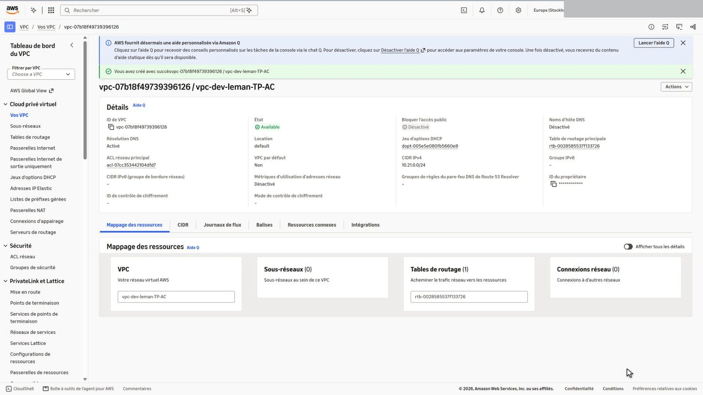

Le VPC de développement vient d'être créé : état *Available*, CIDR `10.21.0.0/24`. Le mappage en bas confirme qu'il n'a encore aucun sous-réseau (0) et une seule table de routage, la principale.

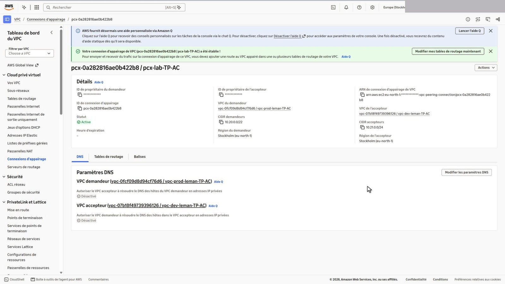

La connexion `pcx-lab-TP-AC` est *Active*. À gauche le demandeur, `vpc-prod-leman-TP-AC` en `10.20.0.0/22`, à droite l'accepteur, `vpc-dev-leman-TP-AC` en `10.21.0.0/24`. Les identifiants de compte sont masqués par la console. Le bandeau vert rappelle qu'il reste à ajouter les routes.

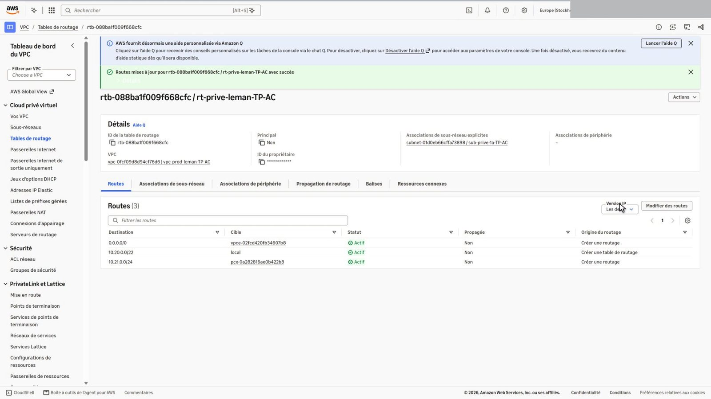

La table du sous-réseau privé de la production après l'ajout de la route : `10.21.0.0/24` part vers `pcx-0a282816ae0b422b8`. On voit aussi la route par défaut vers l'endpoint du pare-feu, posée au module 4.

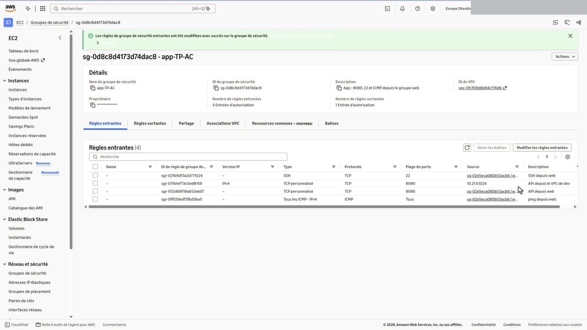

Le groupe `app-TP-AC` après l'ajout : quatre règles entrantes. La nouvelle est la deuxième ligne : TCP 8080, source `10.21.0.0/24`. Les trois autres viennent du module 3 (source : le groupe web).

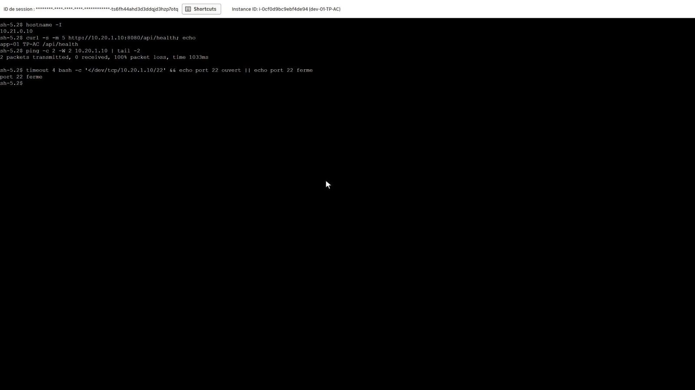

Le test depuis `dev-01-TP-AC` : adresse `10.21.0.10`, réponse de l'API sur le 8080, ping à `100% packet loss`, puis `port 22 ferme`. Ce qui n'est pas ouvert dans `app-TP-AC` ne passe pas, même avec le peering en place.

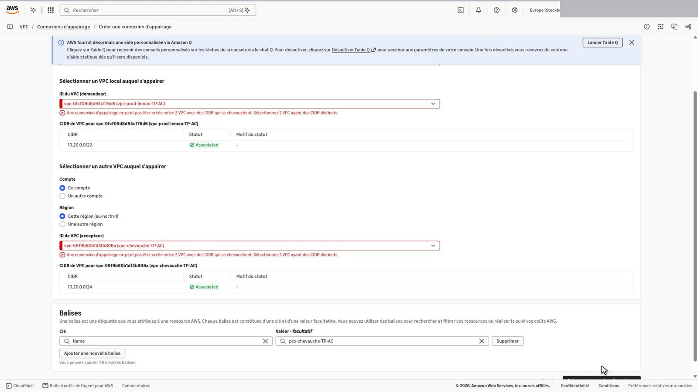

La demande de peering avec le VPC en `10.20.0.0/24` : la console affiche un message rouge sous chaque liste de VPC, « Une connexion d'appairage ne peut pas être créée entre 2 VPC avec des CIDR qui se chevauchent. Sélectionnez 2 VPC ayant des CIDR distincts. » La page ne passe pas à la connexion créée.

## Tableau récapitulatif
| Élément | Valeur |
|---|---|
| `vpc-dev-leman-TP-AC` | `vpc-07b18f49739396126`, `10.21.0.0/24` |
| `sub-dev-1a-TP-AC` | `10.21.0.0/26`, `eu-north-1a` |
| `igw-dev-leman-TP-AC` | attachée à `vpc-dev-leman-TP-AC` |
| `rt-dev-leman-TP-AC` | `0.0.0.0/0` vers l'IGW du dev ; `10.20.0.0/22` vers le peering ; `10.21.0.0/24` local ; associée à `sub-dev-1a-TP-AC` |
| `dev-TP-AC` | tag `Name = sg-dev-TP-AC` ; aucune règle entrante ; sortie libre |
| `dev-01-TP-AC` | `t3.micro`, Amazon Linux 2023, `10.21.0.10`, adresse publique automatique |
| `pcx-lab-TP-AC` | `pcx-0a282816ae0b422b8`, production `10.20.0.0/22` avec développement `10.21.0.0/24`, statut *Active* |
| `rt-prive-leman-TP-AC` (prod) | `10.21.0.0/24` vers `pcx-lab-TP-AC` |
| `app-TP-AC` | nouvelle règle : TCP 8080 depuis `10.21.0.0/24` |

## Résultats des tests
Ces sorties viennent de notre première exécution, en ligne de commande. Pour l'API sur le 8080 et le port 22 fermé, elles disent la même chose que la vidéo. Trois points diffèrent. Le ping refusé n'est pas dans ces sorties, il n'est que dans la vidéo (capture ci-dessus). Pour le chevauchement, AWS acceptait alors la demande puis la faisait échouer à l'acceptation, alors que la console refuse tout de suite. Enfin, le test de non-transitivité (le troisième VPC `10.22.0.0/24` et `tiers-01`) n'a été fait que dans cette première exécution : il n'est pas filmé.

```
dev-01 SSM en ligne : True
=== TP2 : peering pcx-lab (prod <-> dev) ===
dev-01 -> app-01:8080 : Success	app-01 TP-AC /api/health 	
dev-01 -> app-01:22 (non ouvert depuis dev) : Success	FERME 	

=== TP3 : limites du peering ===
Acceptation du peering avec un VPC en 10.20.0.0/24 (chevauche 10.20.0.0/22) -> aws: [ERROR]: An error occurred (InvalidStateTransition) when calling the AcceptVpcPeeringConnection operation: Invalid state transition for pcx-0b30499bae7844bdf, attempted to transition from failed to provisioning
app-01 (prod, peering direct) -> tiers-01 10.22.0.10 : Success	2 packets transmitted, 2 received, 0% packet loss, time 1002ms rtt min/avg/max/mdev = 0.170/0.294/0.419/0.124 ms 	
dev-01 (via prod = transit, NON transitif) -> tiers-01 10.22.0.10 : Success	2 packets transmitted, 0 received, 100% packet loss, time 1043ms  exit=0
```

Les deux dernières lignes se lisent ainsi : `app-01`, relié directement au troisième VPC, le joint (2 paquets sur 2) ; `dev-01`, qui n'y est relié que par la production, ne le joint pas (0 sur 2, 100 % de perte). Le peering ne transmet pas.

## Pièges rencontrés
* **Le chevauchement selon l'outil.** En ligne de commande, la demande passait puis échouait à l'acceptation (`InvalidStateTransition`, de l'état `failed` à `provisioning`). Dans la console, la validation du formulaire la bloque avant. Même règle, deux moments.
* **Le ping refusé n'est pas une panne.** `app-TP-AC` n'ouvre l'ICMP qu'au groupe web, et depuis le développement seulement le 8080. Ping et SSH échouent donc, c'est voulu.
* **Une adresse publique sur `dev-01`.** Sans NAT dans le VPC de développement, l'agent SSM ne joint pas Systems Manager. Nous avons gardé une adresse publique, avec un groupe sans aucune règle entrante.
* **Les quotas.** Le compte est partagé avec la classe. Pour les VPC, la limite est de 5 par région ; nous avons demandé une hausse à 15 (voir `docs/00-plan-adressage.md`). Pour les instances, le 16/11 les 16 vCPU du compte étaient saturés par la classe et nous ne pouvions plus démarrer nos machines. La limite a été portée à 48 vCPU le 17/11.
* **Une demande qui expire.** Tant que le peering n'est pas accepté, il reste en attente, et la console affiche une date limite : le 25/11/2026 pour la nôtre, sept jours après la création.

## Ce qui diffère du sujet
* **Les plages.** Les plages du sujet (`10.0.0.0/16` et `10.1.0.0/16`, voir `docs/02-ecarts-au-sujet.md`) recouvrent celles des autres équipes du compte partagé : nous avons pris `10.20.0.0/22` et `10.21.0.0/24`.
* **Le peering est temporaire.** Comme le sujet le demande, `pcx-lab-TP-AC` est supprimé au module 6, et les routes du dev et du privé passent au Transit Gateway. Cette suppression est filmée au module 6.
* **La non-transitivité n'est pas filmée.** Elle a été vérifiée à la première exécution (sortie ci-dessus), pas refaite dans la console.

## Nettoyage
Le peering `pcx-lab-TP-AC` est supprimé au module 6. Le VPC `vpc-dev-leman-TP-AC` avec son sous-réseau, sa passerelle Internet, sa table, son groupe de sécurité et `dev-01-TP-AC`, ainsi que le VPC de test `vpc-chevauche-TP-AC`, ont été supprimés à la fin du tournage avec le reste (voir `docs/NETTOYAGE.md`). Il ne reste rien de ce module côté AWS.


---

# Module 6 – Transit Gateway

## Objectif
Remplacer le peering du module 5 par un point central, `tgw-leman-TP-AC`, qui relie la prod et le dev. Chaque environnement a sa propre table de routage sur le Transit Gateway, pour que nous décidions à la main qui voit qui. Le même Transit Gateway accueillera ensuite les deux VPN du module 7.

## Ce qu'il faut savoir
Avec un peering, chaque paire de VPC a son propre lien. À trois réseaux, cela fait trois liens, à quatre réseaux six. Un Transit Gateway inverse la logique : chaque VPC se branche une seule fois, par un **attachement**, et le Transit Gateway se charge du reste.

Il faut distinguer deux choses dans ses tables de routage :
- l'**association** : l'attachement est rattaché à une seule table, celle qu'AWS consulte pour les paquets qui arrivent de ce VPC ;
- la **propagation** : l'attachement publie sa plage d'adresses dans une ou plusieurs tables, pour que d'autres sachent comment le joindre.

À la création, AWS propose d'associer et de propager automatiquement tout le monde dans une table par défaut. Nous avons décoché les deux options pour construire les tables nous-mêmes. Dernier point : un attachement n'envoie du trafic que dans les zones de disponibilité où il possède un sous-réseau, et les tables de routage des VPC doivent encore pointer vers le Transit Gateway. Un attachement et une table coûtent de l'argent à l'heure (environ 0,05 USD par attachement).

## Ce que nous avons fait
Tout a été fait à la main dans la console, dans la région Stockholm (`eu-north-1`). Les noms portent le suffixe `-TP-AC` et les balises `Projet=SatomCloudNetwork`, `Equipe=TP-AC`, `Environnement`.

1. **Le Transit Gateway** : `tgw-leman-TP-AC`, description « Transit Gateway du projet Satom Cloud Network », ASN Amazon 64512. Support DNS et support ECMP VPN laissés cochés, association et propagation par défaut décochées. Il met environ quatre minutes à passer de `Pending` à `Available`.
2. **L'attachement de la prod** : `tgwa-prod-TP-AC`, sur `vpc-prod-leman-TP-AC`, avec un sous-réseau dans chacune des deux zones où le VPC en possède un : `sub-prive-1a-TP-AC` en `eu-north-1a`, et celui de `eu-north-1b` (`sub-public-1b` dans notre plan d'adressage).
3. **L'attachement du dev** : `tgwa-dev-TP-AC`, sur `vpc-dev-leman-TP-AC`, avec son seul sous-réseau (`sub-dev-1a-TP-AC`).
4. **Deux tables de routage** : `tgw-rt-prod-TP-AC` et `tgw-rt-dev-TP-AC`. Pourquoi deux ? Pour que chaque environnement ne voie que ce que nous décidons.
5. **Associations** : `tgwa-prod-TP-AC` dans `tgw-rt-prod-TP-AC`, `tgwa-dev-TP-AC` dans `tgw-rt-dev-TP-AC`.
6. **Propagations croisées** : `tgwa-dev-TP-AC` propage dans `tgw-rt-prod-TP-AC` (la prod apprend `10.21.0.0/24`) et `tgwa-prod-TP-AC` propage dans `tgw-rt-dev-TP-AC` (le dev apprend `10.20.0.0/22`). Chaque table ne connaît donc que l'autre côté.
7. **Routes dans les VPC** : dans `rt-prive-leman-TP-AC` (prod), la route `10.21.0.0/24` qui visait le peering vise maintenant `tgw-leman-TP-AC`. Même geste dans `rt-dev-leman-TP-AC` pour `10.20.0.0/22`.
8. **Suppression du peering** `pcx-lab-TP-AC`, devenu inutile (la console demande de taper « supprimer » pour confirmer).
9. **Test et panne volontaire** depuis `dev-01-TP-AC` (voir plus bas).

## Captures
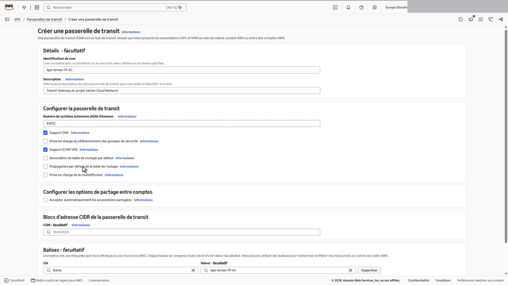

Le formulaire de création. On y voit les deux cases « Association de table de routage par défaut » et « Propagation par défaut de la table de routage » décochées.


La table de la prod : une seule route, `10.21.0.0/24`, de type « Propagé », qui vient de l'attachement du VPC de dev. Elle ne sait rien d'autre.

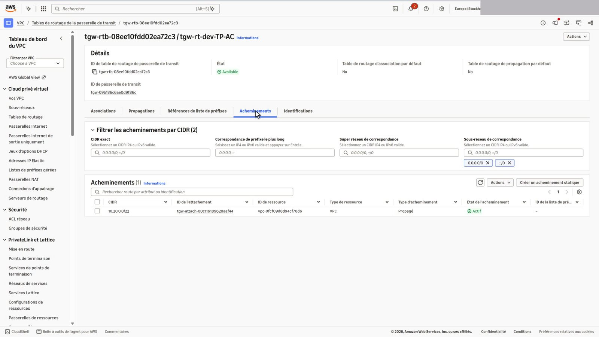

La table du dev, symétrique : seule la plage de la prod, `10.20.0.0/22`, y figure.

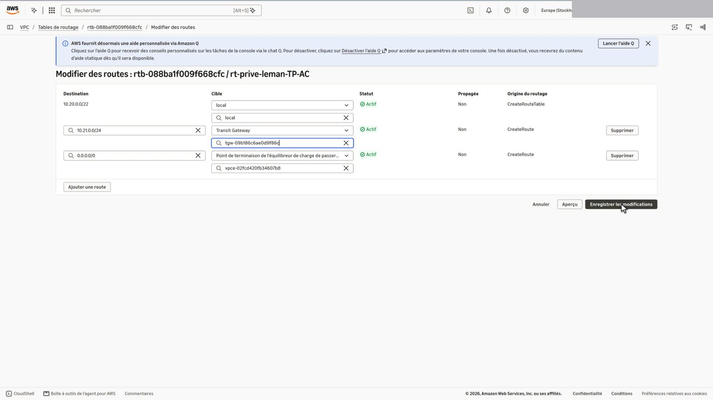

La table privée de la prod pendant la modification : `10.21.0.0/24` a pour cible « Transit Gateway ». La route `0.0.0.0/0` (vers le point de terminaison du pare-feu du module 4) n'a pas bougé.

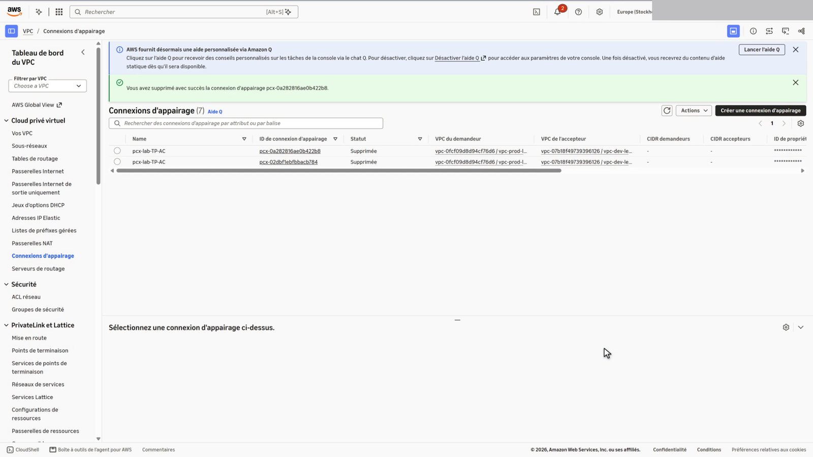

Le peering `pcx-lab-TP-AC` supprimé : AWS affiche « Supprimée » et le bandeau vert confirme. La ligne du dessous est un ancien peering du même nom, déjà supprimé lors d'un essai précédent.

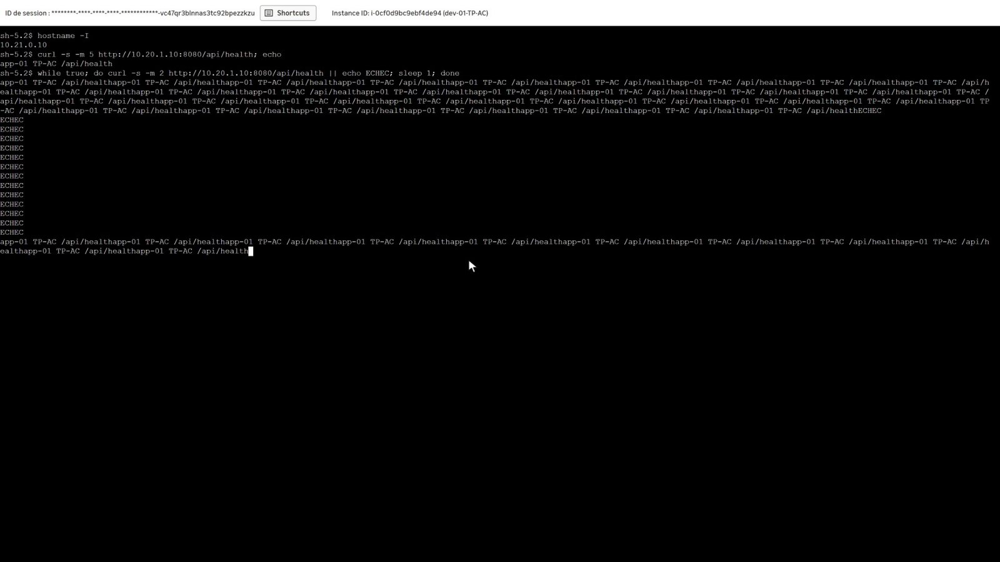

Le test depuis `dev-01-TP-AC` (adresse `10.21.0.10`). Le premier `curl` vers `app-01` (`10.20.1.10:8080`) répond « app-01 TP-AC /api/health ». Dans la boucle, la rangée de `ECHEC` correspond au moment où nous avons retiré la propagation ; les réponses reviennent après que nous l'avons remise.

## Récapitulatif
| Élément | Valeur |
|---|---|
| Transit Gateway | `tgw-leman-TP-AC`, ASN 64512, association et propagation par défaut désactivées |
| Attachements | `tgwa-prod-TP-AC` (deux zones), `tgwa-dev-TP-AC` (une zone) |
| Tables | `tgw-rt-prod-TP-AC`, `tgw-rt-dev-TP-AC` (une troisième, `tgw-rt-sites-TP-AC`, vient au module 7) |
| Ce que chaque table apprend | prod : `10.21.0.0/24` ; dev : `10.20.0.0/22` |
| Routes dans les VPC | `rt-prive-leman-TP-AC` : `10.21.0.0/24` vers le Transit Gateway ; `rt-dev-leman-TP-AC` : `10.20.0.0/22` vers le Transit Gateway |
| Coût | environ 0,05 USD de l'heure par attachement |

## Résultats des tests
Le test de la vidéo est simple : depuis `dev-01`, un `curl` sur `http://10.20.1.10:8080/api/health` répond par le Transit Gateway, puis nous cassons la route de retour en retirant la propagation, les requêtes échouent, et tout repart quand nous la remettons (voir la dernière capture).

Le bloc ci-dessous est le relevé de notre **première version** de ce module, faite à la ligne de commande et déployée par le modèle CloudFormation du module 13. Il dit la même chose que la vidéo (réponse par le Transit Gateway, puis échec quand la propagation est retirée). Il liste aussi des attachements des modules 7 et 8 (VPN, Direct Connect Gateway) et la table `tgw-rt-sites-TP-AC`, qui n'existaient pas encore au moment de ce module dans la version refaite en console.

```
=== Module 6 : Transit Gateway deploye par la stack stack-interconnexion-leman-TP-AC ===
Attachements : tgwa-prod-TP-AC	vpc	available | tgwa-dev-TP-AC	vpc	available | None	vpn	available | tgwa-vpn-agence-TP-AC	vpn	available | None	direct-connect-gateway	available
Peering pcx-lab encore actif ? : 0 (0 = supprime)
Tables : tgw-rt-prod-TP-AC	available | tgw-rt-dev-TP-AC	available | tgw-rt-sites-TP-AC	available
Routes tgw-rt-prod : 10.21.0.0/24	propagated | 192.168.10.0/24	static | 192.168.20.0/24	static
Routes tgw-rt-dev  : 10.20.0.0/22	propagated
dev-01 -> app-01:8080 par le Transit Gateway : Success	app-01 TP-AC /api/health 	

=== TP3 : propagation de tgwa-dev vers tgw-rt-prod retiree ===
Routes tgw-rt-prod apres retrait : 192.168.10.0/24	static | 192.168.20.0/24	static
dev-01 -> app-01:8080 (la reponse n'a plus de route) : Success	ECHEC 	
Propagation retablie : Success	app-01 TP-AC /api/health
```

## Pièges rencontrés
- **Un Transit Gateway est lent à naître.** Il reste `Pending` environ quatre minutes, et les attachements et les tables passent aussi par `Pending` avant `Available`. Il faut attendre l'état `Available` avant d'associer ou de propager. Une de nos prises de vue s'est d'ailleurs arrêtée sur une page d'erreur de la console (« table de routage introuvable »).
- **Un doublon par notre faute.** Lors de la première version (ligne de commande), notre script a créé un second Transit Gateway avec ses deux attachements ; nous les avons supprimés le 17/11/2026 (journal dans `docs/NETTOYAGE.md`). Faire les gestes à la main nous a évité ce piège.
- **Une propagation oubliée casse dans un seul sens.** Sans la route du dev dans la table de la prod, la requête de `dev-01` arrive à `app-01`, mais la réponse n'a nulle part où aller. C'est exactement ce que montrent les `ECHEC` de la capture : le symptôme est un délai dépassé, pas un refus.
- **Le quota de vCPU de la classe.** Le compte est partagé et la limite de vCPU a souvent été atteinte (elle a été montée de 16 à 48 sur notre demande). Il nous est arrivé d'arrêter `dev-01` pour libérer de la place : il faut le relancer avant ce test, sinon il n'apparaît pas dans Session Manager.
- **La session de la console expire.** Plusieurs fois, la console est revenue sur une page blanche de reconnexion. Nous nous reconnectons et reprenons l'étape.

## Ce qui diffère du sujet
- Nos plages sont `10.20.0.0/22` (prod) et `10.21.0.0/24` (dev), pas `10.0.0.0/16` et `10.1.0.0/16` : le compte est partagé par toute la classe et ces plages recouvrent celles des autres équipes.
- Le Transit Gateway était refusé par l'organisation AWS jusqu'au 17/11/2026 (action `ec2:CreateTransitGateway`). Nous avons d'abord fait le module à la ligne de commande après la levée du blocage, puis nous l'avons refait entièrement à la main dans la console, ce que montre la vidéo.
- Le peering est supprimé à la fin du module, comme le sujet le demande.

## Nettoyage
Le Transit Gateway est facturé à l'heure par attachement. Tout a été supprimé à la fin du projet (attachements, tables, Transit Gateway) ; la seule ressource que nous n'avons pas pu supprimer est le Network Firewall `nfw-prod-leman-TP-AC`, bloqué côté AWS (voir `docs/NETTOYAGE.md`).


---

# Module 7 – VPN site à site (siège et agence)

## Objectif
Relier le siège (`192.168.10.0/24`, Genève) et l'agence (`192.168.20.0/24`, Lausanne) au cloud par des tunnels IPsec qui aboutissent sur `tgw-leman-TP-AC`. Les deux sites doivent joindre `app-01` sur le port 8080, et aucun des deux ne doit voir le VPC de dev. Nous testons aussi ce qui se passe quand un tunnel tombe.

Ce qui est **réel** : les deux connexions VPN côté AWS (`vpn-siege-TP-AC` et `vpn-agence-TP-AC`), avec deux tunnels IPsec chacune, soit quatre tunnels, ainsi que les passerelles clientes, le Transit Gateway et toutes ses routes. Ce qui est **simulé** : le siège et l'agence n'existent pas. Chacun est un petit VPC avec une instance Ubuntu, `rtr-siege-TP-AC` ou `rtr-agence-TP-AC`, sur laquelle tourne strongSwan, un logiciel IPsec libre. Cette instance joue le routeur du client.

## Ce qu'il faut savoir
Une connexion VPN d'AWS donne **deux tunnels** IPsec, vers deux adresses publiques différentes d'AWS. Chaque tunnel a son adresse interne en `169.254.x.x/30` et sa **clé pré-partagée** (PSK), un secret que les deux extrémités doivent connaître. Du côté du client, AWS ne fournit rien : il faut un équipement qui parle IPsec. La **passerelle cliente** (Customer Gateway) n'est que la description de cet équipement, c'est-à-dire son adresse publique. Il faut donc que chaque routeur ait une adresse publique fixe, une Elastic IP.

Nous utilisons le **routage statique**. Pour un VPN rattaché à un Transit Gateway, les routes statiques ne se déclarent pas sur la connexion VPN : elles vont dans une table de routage du Transit Gateway. AWS refuse de les déclarer ailleurs (nous l'avons appris par une erreur lors de la première version).

Sur le routeur, strongSwan est configuré en **IKEv2**, avec des échanges chiffrés `aes256-sha256-modp2048` (AES 256, SHA-256, groupe Diffie-Hellman 14), des sélecteurs de trafic `0.0.0.0/0` et une interface virtuelle par tunnel (`xfrm-siege1`, `xfrm-siege2`, `xfrm-agence1`, `xfrm-agence2`). Le tunnel 1 est le tunnel préféré (route de métrique 100) et le tunnel 2 le secours (métrique 200). Un petit script ne garde la route d'un tunnel que s'il est établi.

Une règle d'hygiène : les clés partagées n'apparaissent dans aucun fichier du dépôt ni dans le dossier. Elles sont dans AWS Secrets Manager, et les routeurs les lisent au moment de la configuration, sans jamais les afficher.

## Ce que nous avons fait
Tout a été fait à la main dans la console AWS, région Stockholm, avec le suffixe `-TP-AC` partout et les balises habituelles. Voici l'ordre de la vidéo.

**1. Les secrets**
- Dans Secrets Manager, un secret `Projet/SatomCloudNetwork/vpn` de type « Autre type de secret », avec quatre paires clé/valeur : `siege1`, `siege2`, `agence1`, `agence2` (une clé par tunnel). Les valeurs sont saisies dans des champs masqués. Clé de chiffrement par défaut (`aws/secretsmanager`), pas de rotation.
- Sur le rôle `TP-AC-ec2-ssm-role` (celui des instances), une politique en ligne `lire-cles-vpn-TP-AC` : `secretsmanager:GetSecretValue` sur ce secret seulement, et `ec2:DescribeVpnConnections`. Le routeur a besoin de la seconde pour lire la description de son VPN.

**2. Les deux sites simulés**
- `vpc-siege-TP-AC` (`192.168.10.0/24`) avec `sub-siege-TP-AC` (`192.168.10.0/26`), `igw-siege-TP-AC` et `rt-siege-TP-AC` (route `0.0.0.0/0` vers la passerelle Internet, associée au sous-réseau). Même chose pour l'agence : `vpc-agence-TP-AC` (`192.168.20.0/24`), `sub-agence-TP-AC`, `igw-agence-TP-AC`, `rt-agence-TP-AC`.
- Les deux plages ne se recouvrent ni entre elles ni avec nos VPC AWS (`10.20.0.0/22` et `10.21.0.0/24`) : sans cela, un VPN ne peut pas router correctement.
- Un Security Group par routeur, `rtr-siege-TP-AC` et `rtr-agence-TP-AC`, créé **sans aucune règle entrante** : nous ne connaissons pas encore les adresses des tunnels.
- Les routeurs : instances `rtr-siege-TP-AC` et `rtr-agence-TP-AC`, Ubuntu Server 26.04 LTS en `t3.micro`, sans paire de clés (nous y accédons par Session Manager grâce au profil `TP-AC-ec2-ssm-role`), adresses privées fixes `192.168.10.10` et `192.168.20.10`.
- Une Elastic IP par routeur (`eip-rtr-siege-TP-AC`, `eip-rtr-agence-TP-AC`), allouée puis associée à l'instance.

**3. Côté AWS**
- Deux passerelles clientes, `cgw-siege-TP-AC` et `cgw-agence-TP-AC`, qui décrivent chaque routeur par son Elastic IP. Le numéro d'AS (65000) est obligatoire dans le formulaire mais n'a aucun effet en routage statique.
- Deux connexions VPN, `vpn-siege-TP-AC` et `vpn-agence-TP-AC` : cible « Passerelle de transit » `tgw-leman-TP-AC`, passerelle cliente existante, routage **statique**, stockage des clés « Standard » (nous tapons les clés nous-mêmes, masquées), options des tunnels par défaut sauf la clé de chaque tunnel. Au total, AWS prépare quatre tunnels. La création prend quelques minutes.
- Sur le Transit Gateway, une troisième table, `tgw-rt-sites-TP-AC`. Les deux VPN y sont **associés**, et seul l'attachement de la prod (`tgwa-prod-TP-AC`) s'y **propage** : les sites apprennent `10.20.0.0/22` et jamais le dev.
- Dans `tgw-rt-prod-TP-AC`, une route statique par site, vers le VPN correspondant : `192.168.10.0/24` vers `vpn-siege-TP-AC` et `192.168.20.0/24` vers `vpn-agence-TP-AC`. C'est le chemin de retour des réponses. `tgw-rt-dev-TP-AC` n'en reçoit aucune.
- Dans `rt-prive-leman-TP-AC`, les deux plages des sites ont pour cible le Transit Gateway.
- Dans `sg-app` (le groupe `app-TP-AC`), le port 8080 est ouvert depuis `192.168.10.0/24` (« API depuis siege ») et `192.168.20.0/24` (« API depuis agence »). Rien d'autre pour les sites : pas de ping.
- Dans chaque Security Group de routeur, deux règles « Tout le trafic » en entrée, depuis les deux adresses publiques des tunnels AWS en `/32` (« Tunnel 1 AWS » et « Tunnel 2 AWS »). Toute autre adresse est ignorée. Ces adresses ne sont connues qu'après la création du VPN, d'où l'ordre.

**4. La configuration des routeurs** (Session Manager, `sudo -i`), même recette pour les deux :
- installation de `strongswan-swanctl`, `charon-systemd` et `awscli` ;
- lecture des clés dans Secrets Manager vers un fichier `psk.json` en `chmod 600`, et de la description du VPN (`describe-vpn-connections`, champ `CustomerGatewayConfiguration`) vers `vpn.xml` ;
- un petit script Python, `gen.py`, lit ces deux fichiers et écrit `/etc/swanctl/conf.d/siege.conf` (ou `agence.conf`) : deux connexions IKEv2 (`siege-t1`, `siege-t2`), détection de pair mort toutes les 10 secondes, redémarrage automatique du tunnel, et un identifiant d'interface (11 et 12 pour le siège, 21 et 22 pour l'agence). Il écrit aussi le script qui crée les interfaces `xfrm-…` avec les adresses internes `169.254.x.x/30` ;
- routage IP activé, filtrage de chemin inverse (`rp_filter`) désactivé, `systemctl restart strongswan` et `swanctl --load-all` (deux connexions chargées) ;
- un script `watch.sh`, lancé en arrière-plan, qui toutes les secondes pose la route `10.20.0.0/22` vers `xfrm-siege1` (métrique 100) ou `xfrm-siege2` (métrique 200) selon que le tunnel est établi, et la retire sinon.

**5. Vérifications et tests**
- Console : les quatre tunnels sont « Haut », et `tgw-rt-prod-TP-AC` contient les trois routes (le dev propagé, les deux sites en statique).
- Depuis chaque routeur, avec l'adresse du site comme source (`--interface 192.168.10.10`) : `curl` sur `app-01:8080`, `ping` vers `app-01`, `ping` vers `dev-01`.
- Panne d'un tunnel du siège (voir plus bas).

## Captures
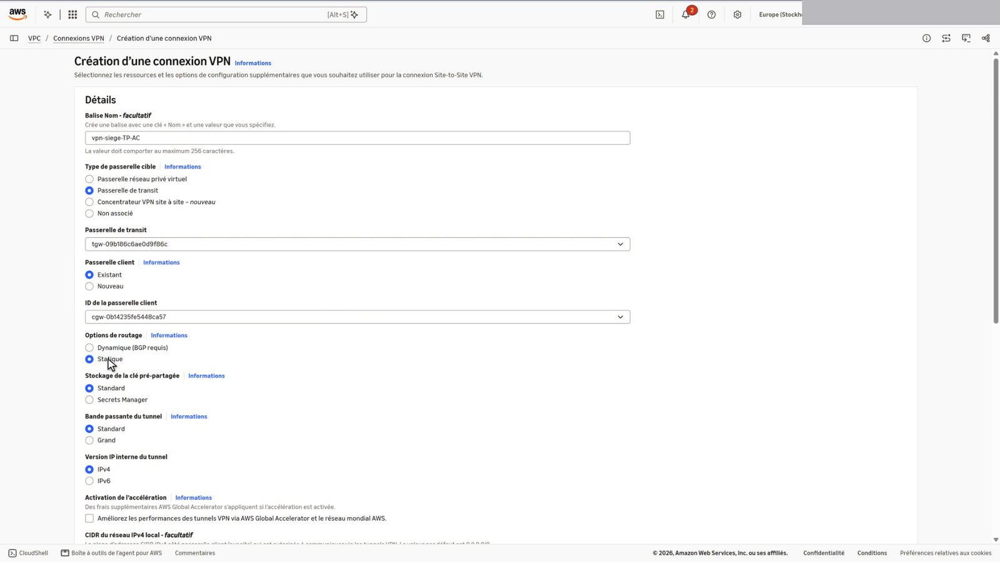

La création de `vpn-siege-TP-AC` : cible « Passerelle de transit », passerelle cliente existante, options de routage « Statique ». Les clés des tunnels, plus bas dans la page, sont saisies dans des champs masqués ; nous n'avons pas gardé de capture de cette partie.

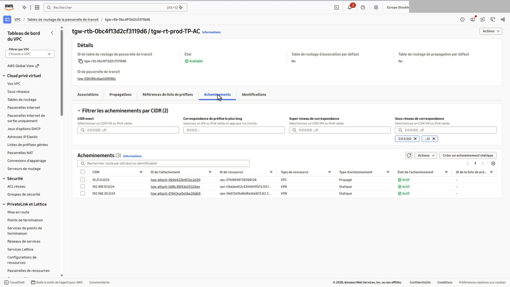

La table de routage de la prod, une fois les tunnels montés : le dev (propagé depuis un VPC) et les deux sites (statiques, ressource de type VPN), tous « Actif ».

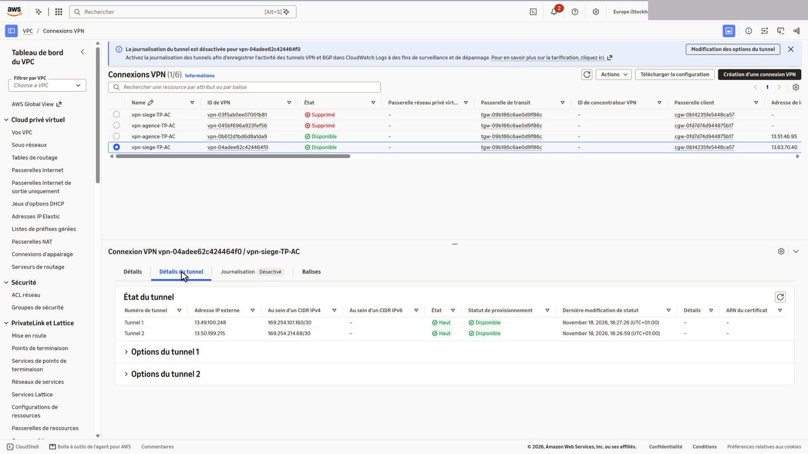

L'onglet « Détails du tunnel » de `vpn-siege-TP-AC` : les deux tunnels sont « Haut », avec leurs adresses externes et leurs adresses internes en `169.254.x.x/30`. Les deux lignes « Supprimé » du dessus sont les connexions du même nom de notre première version. `vpn-agence-TP-AC` montre le même résultat.

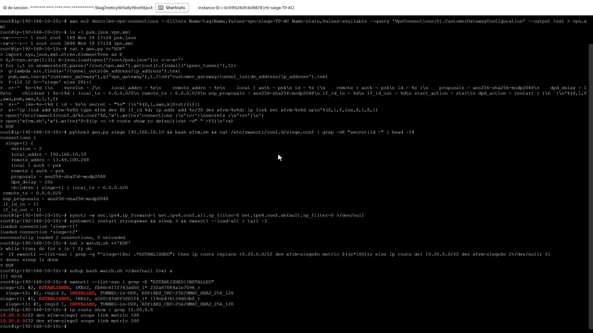

La configuration du routeur du siège par Session Manager : le script de génération (il lit les clés dans `psk.json`, donc aucune clé n'apparaît), un extrait de `siege.conf`, puis `swanctl --list-sas` qui montre `siege-t1` et `siege-t2` `ESTABLISHED` en IKEv2 avec `ESP:AES_CBC-256/HMAC_SHA2_256_128`. Les deux dernières lignes sont les routes `10.20.0.0/22` : métrique 100 par `xfrm-siege1`, 200 par `xfrm-siege2`.

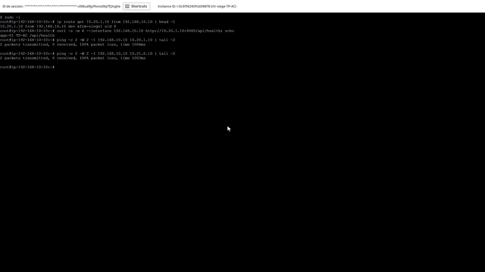

Les tests depuis le siège. `ip route get` montre que le trafic passe par `xfrm-siege1`. Le `curl` sur le port 8080 répond « app-01 TP-AC /api/health ». Le `ping` vers `app-01` échoue (pas de règle ICMP pour les sites), et celui vers `dev-01` (`10.21.0.10`) aussi : le dev reste injoignable.

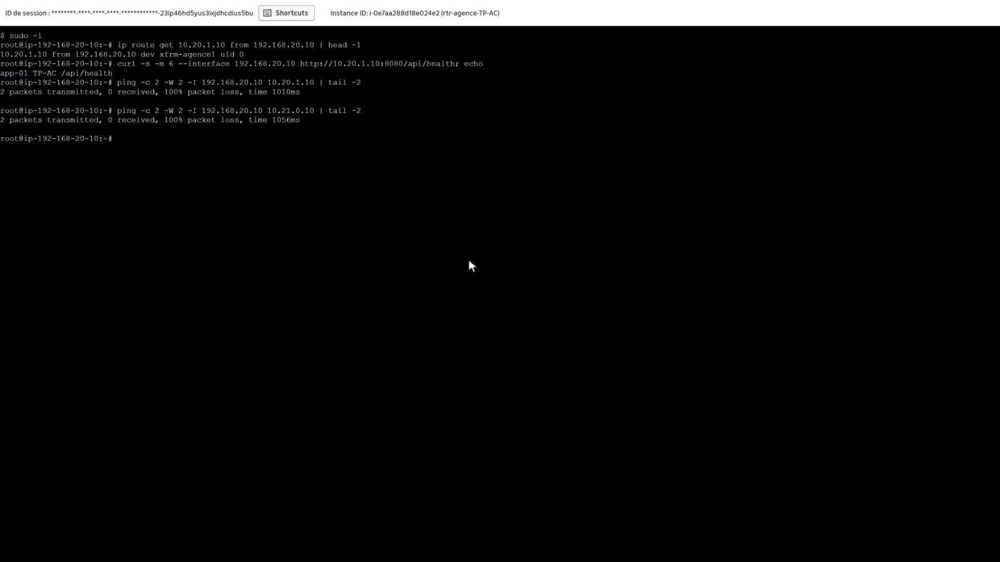

Les mêmes tests depuis l'agence, par `xfrm-agence1` : l'API répond, le ping et le dev sont refusés.

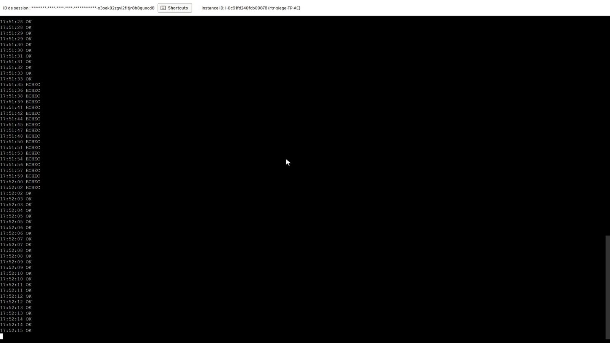

La panne du tunnel 1 du siège. La boucle envoie une requête vers l'API toutes les demi-secondes. Dernière réponse à 17:51:33, premier `ECHEC` à 17:51:35, retour des réponses à 17:52:02 : environ 29 secondes sans service.

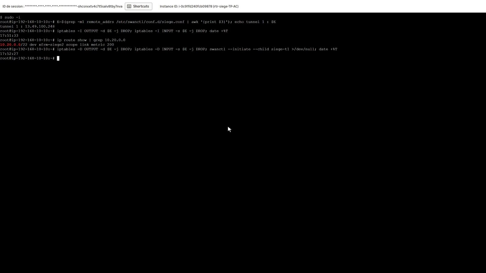

La seconde session, côté commandes : adresse du tunnel 1, règles `iptables` qui jettent les paquets (17:51:33), puis la route `10.20.0.0/22` qui passe par `xfrm-siege2` avec la métrique 200, enfin le retrait des règles et la relance du tunnel 1 à 17:52:27.

## Récapitulatif
| Élément | Valeur |
|---|---|
| Connexions VPN | `vpn-siege-TP-AC`, `vpn-agence-TP-AC`, routage statique, cible `tgw-leman-TP-AC` |
| Passerelles clientes | `cgw-siege-TP-AC`, `cgw-agence-TP-AC` (une Elastic IP chacune, ASN 65000 sans effet) |
| Tunnels | deux par site, quatre en tout, tous « Haut » |
| IKE et ESP | IKEv2, `aes256-sha256-modp2048`, clé pré-partagée par tunnel |
| Routeurs simulés | `rtr-siege-TP-AC` (`192.168.10.10`), `rtr-agence-TP-AC` (`192.168.20.10`), strongSwan, interfaces `xfrm-…` |
| Table du Transit Gateway pour les sites | `tgw-rt-sites-TP-AC` : VPN associés, seule la prod propagée |
| Chemin retour | `192.168.10.0/24` et `192.168.20.0/24` statiques dans `tgw-rt-prod-TP-AC`, et dans `rt-prive-leman-TP-AC` vers le Transit Gateway |
| Ce que les sites peuvent faire | TCP 8080 vers `app-01` ; ni ping, ni accès au dev |
| Clés partagées | secret `Projet/SatomCloudNetwork/vpn` (Secrets Manager), jamais écrites ailleurs |
| Coût | environ 0,05 USD de l'heure par connexion VPN et par attachement |

## Résultats des tests
Ce que montre la vidéo, mesuré par nous : les quatre tunnels sont `ESTABLISHED` côté routeur et « Haut » côté AWS ; depuis chaque site, `curl` sur `app-01:8080` répond ; le ping vers `app-01` et vers `dev-01` ne passe pas ; la panne du tunnel 1 du siège coupe le service pendant environ 29 secondes, puis tout passe par le tunnel 2, et le retour du tunnel 1 ne coupe rien. La panne de l'agence n'a pas été refilmée.

Le bloc ci-dessous est le relevé de notre **première version** (ligne de commande, VPN déployés par le modèle CloudFormation du module 13). Il faut le lire avec ces différences :
- les adresses des tunnels sont celles de ces anciens VPN ;
- le siège pouvait alors **pinger** `app-01` (trois paquets sur trois), parce que la règle ICMP existait ; dans la version refaite à la main, nous n'avons ouvert que le 8080 et le ping échoue ;
- la panne a été mesurée pour le siège (29,2 s) **et** pour l'agence (33,5 s), avec un `curl` toutes les 0,3 s ; la vidéo ne refait que le siège, avec un `curl` toutes les 0,5 s (1 s d'attente au plus) et un réglage IKE plus serré ;
- les essais depuis `dev-01` vers les sites ne figurent que dans ce relevé.

```
=== Module 7 - etape 1 : VPN crees par la stack, avant configuration des routeurs ===
vpn-siege-TP-AC : available	ipsec.1	True
  tunnels (adresse AWS, etat) : 16.16.69.252	DOWN | 16.192.162.35	DOWN
vpn-agence-TP-AC : available	ipsec.1	True
  tunnels (adresse AWS, etat) : 13.61.98.78	DOWN | 13.63.173.212	DOWN
tgw-rt-prod : 10.21.0.0/24	propagated	active | 192.168.10.0/24	static	blackhole | 192.168.20.0/24	static	blackhole

=== Module 7 - etape 2 : tunnels, flux et segmentation ===
siege : swanctl --list-sas (cote routeur)
siege-t2: #2, ESTABLISHED, IKEv2, 35f033fe3ecf3ca4_i* 67e0bc1592994c7c_r
  siege-t2: #2, reqid 2, INSTALLED, TUNNEL-in-UDP, ESP:AES_CBC-256/HMAC_SHA2_256_128
siege-t1: #1, ESTABLISHED, IKEv2, c4c613fa152a7cd4_i* d1219417c5494da4_r
  siege-t1: #1, reqid 1, INSTALLED, TUNNEL-in-UDP, ESP:AES_CBC-256/HMAC_SHA2_256_128

agence : swanctl --list-sas (cote routeur)
agence-t2: #2, ESTABLISHED, IKEv2, e2e49f4e64242dc5_i* 2f6ae7a044ccede0_r
  agence-t2: #2, reqid 2, INSTALLED, TUNNEL-in-UDP, ESP:AES_CBC-256/HMAC_SHA2_256_128
agence-t1: #1, ESTABLISHED, IKEv2, dd2a0ff6e93c4d51_i* 01379b4f96a3567f_r
  agence-t1: #1, reqid 1, INSTALLED, TUNNEL-in-UDP, ESP:AES_CBC-256/HMAC_SHA2_256_128

vpn-siege-TP-AC, etat des tunnels vu par AWS : 16.16.69.252	UP	 | 16.192.162.35	UP	
vpn-agence-TP-AC, etat des tunnels vu par AWS : 13.61.98.78	UP	 | 13.63.173.212	UP	
tgw-rt-prod (routes actives) : 10.21.0.0/24	propagated	vpc | 192.168.10.0/24	static	vpn | 192.168.20.0/24	static	vpn
tgw-rt-dev  (routes actives) : 10.20.0.0/22	propagated
tgw-rt-sites (routes actives) : 10.20.0.0/22	propagated

-- siege -> app-01 (10.20.1.10)
ping : --- 10.20.1.10 ping statistics ---
3 packets transmitted, 3 received, 0% packet loss, time 2004ms
rtt min/avg/max/mdev = 2.645/2.703/2.818/0.081 ms
	
8080 : app-01 TP-AC /api/health
	

-- agence -> app-01 (seul le 8080 est autorise)
8080 : app-01 TP-AC /api/health
	
ping (doit echouer) : 2 packets transmitted, 0 received, 100% packet loss, time 1014ms

	

-- segmentation : aucun site ne joint dev-01 (10.21.0.10), dev-01 ne joint pas les sites (dev-01 SSM : Online)
siege -> dev-01 : 3 packets transmitted, 0 received, 100% packet loss, time 2048ms

	
agence -> dev-01 : 3 packets transmitted, 0 received, 100% packet loss, time 2050ms

	
dev-01 -> siege : 3 packets transmitted, 0 received, 100% packet loss, time 2119ms

	
dev-01 -> agence : 3 packets transmitted, 0 received, 100% packet loss, time 2114ms

=== Module 7 - etape 3 : bascule entre les deux tunnels du siege ===
avant le test : tunnels vus par AWS = UP	UP
T+10 s : panne silencieuse du tunnel 1 (les paquets vers 16.16.69.252 sont perdus, comme une vraie coupure)

T+15 s : route : 10.20.1.10 from 192.168.10.10 dev xfrm-siege1 uid 0 

T+60 s : route : 10.20.1.10 from 192.168.10.10 dev xfrm-siege2 uid 0  ; tunnels etablis cote routeur : 1

T+90 s : le tunnel 1 est retabli (paquets de nouveau acceptes, IKE relance)

T+130 s : route : 10.20.1.10 from 192.168.10.10 dev xfrm-siege1 uid 0 

--- resultat des requetes curl sur le port 8080 (une toutes les 0,3 s)

interruption de 29.2 s, de T+9.9 s a T+39.0 s

sessions IKE etablies : 2

	

etat vu par AWS : 16.16.69.252	DOWN | 16.192.162.35	UP

=== Module 7 - etape 4 : bascule entre les deux tunnels de l'agence ===
avant le test : tunnels vus par AWS = UP	UP
T+10 s : panne silencieuse du tunnel 1 (les paquets vers 13.61.98.78 sont perdus, comme une vraie coupure)

T+15 s : route : 10.20.1.10 from 192.168.20.10 dev xfrm-agence1 uid 0 

T+60 s : route : 10.20.1.10 from 192.168.20.10 dev xfrm-agence2 uid 0  ; tunnels etablis cote routeur : 1

T+90 s : le tunnel 1 est retabli (paquets de nouveau acceptes, IKE relance)

T+130 s : route : 10.20.1.10 from 192.168.20.10 dev xfrm-agence1 uid 0 

--- resultat des requetes curl sur le port 8080 (une toutes les 0,3 s)

interruption de 33.5 s, de T+9.7 s a T+43.2 s

sessions IKE etablies : 2

	
etat vu par AWS : 13.61.98.78	UP | 13.63.173.212	UP
```

## Bascule entre les deux tunnels
Pour imiter une vraie panne, nous ne coupons pas l'interface : nous jetons les paquets échangés avec l'adresse AWS du tunnel 1 (`iptables -I OUTPUT -d … -j DROP` et `iptables -I INPUT -s … -j DROP`). C'est une perte silencieuse, comme une ligne coupée.

Avant le test, nous avons resserré la détection de strongSwan (`retransmit_tries = 3`, `retransmit_timeout = 2.0` dans `/etc/strongswan.d/tpac.conf`) et relancé le service. Pour la mesure, une requête vers l'API toutes les 0,5 s depuis l'adresse du siège, avec une attente de 1 s au plus. Résultat de la vidéo : environ **29 secondes** d'échecs, puis tout passe par le tunnel 2 (route `xfrm-siege2`, métrique 200). Quand nous retirons les règles et relançons le tunnel 1, aucune requête n'échoue.

Ce délai est celui que prennent le routeur pour constater la panne (détection de pair mort toutes les 10 s, puis les retransmissions) et le script pour déplacer la route. Côté AWS, la détection a ses propres délais, que nous ne maîtrisons pas. La durée n'est pas fixe : à la ligne de commande nous avions mesuré entre 26 et 34 secondes. Le sujet parle d'une bascule « sans coupure » : avec un VPN IPsec, ce n'est pas possible (voir `docs/02-ecarts-au-sujet.md`), et nous préférons le dire plutôt que de le cacher.

## Pièges rencontrés
- **Quota d'Elastic IP et de vCPU.** Le compte est partagé : cinq Elastic IP pour toute la classe, et une limite de vCPU souvent atteinte. Notre premier essai du module 7 (16/11/2026) a échoué à cause de l'un ou l'autre. Il faut deux Elastic IP pour les deux routeurs, et parfois arrêter une instance (`dev-01`) pour libérer des vCPU.
- **Les Security Groups des routeurs ne peuvent pas être finis tout de suite.** Les adresses publiques des tunnels AWS ne sont connues qu'une fois le VPN créé. D'où un groupe vide au début, rempli plus tard.
- **Des lignes « Supprimé » du même nom.** Dans la liste des connexions VPN, `vpn-siege-TP-AC` et `vpn-agence-TP-AC` apparaissent deux fois : les anciennes sont à l'état « Supprimé ». Il faut sélectionner celles qui sont « Disponible ».
- **Une route statique créée mais invisible.** Juste après sa création, le tableau des acheminements reste vide, avec un bandeau d'AWS qui dit que la propagation peut prendre quelques instants. À la première version, les routes des sites étaient `blackhole` tant que les tunnels n'étaient pas montés.
- **Le ping qui échoue n'est pas une panne.** Seul le 8080 est ouvert aux sites. Nous testons donc l'API avec `curl`, et nous gardons le ping pour montrer ce qui est refusé.
- **Associer une Elastic IP.** Lors d'un essai, le formulaire a répondu « Aucune adresse IP publique trouvée » ; à notre avis parce que l'adresse n'était pas sélectionnée dans la liste avant « Actions, Associer ». Nous avons refait la scène en sélectionnant d'abord la ligne.
- **La session de la console expire.** À plusieurs reprises, la console est revenue sur une page blanche de reconnexion. Nous nous reconnectons et reprenons l'étape.
- **Nos premières mesures de panne étaient trompeuses** (première version). En coupant l'interface, la bascule semblait immédiate, ce qui n'arrive jamais en vrai ; avec un `ping`, le même flux restait collé au tunnel mort et la mesure atteignait 81 s. Des requêtes `curl` qui ouvrent chaque fois une nouvelle connexion sont plus représentatives.
- **Les clés ne doivent traîner nulle part.** Les quatre clés sont saisies deux fois (dans le secret, puis dans les formulaires des deux VPN), toujours dans des champs masqués, et conservées hors du dépôt. Le dépôt est public : une clé écrite dans un fichier y serait publiée.

## Ce qui diffère du sujet
- **Adresses des passerelles clientes.** Le sujet donne `203.0.113.10` et `198.51.100.10` : ce sont des adresses réservées à la documentation, aucun tunnel ne peut s'établir vers elles. Nous utilisons une Elastic IP par routeur.
- **Routes statiques.** Elles sont dans la table de routage du Transit Gateway (`tgw-rt-prod-TP-AC`), pas sur la connexion VPN.
- **Bascule « sans coupure ».** Impossible avec IPsec : nous mesurons environ 29 secondes d'interruption.
- **Les sites sont simulés** par deux instances EC2 avec strongSwan, pas par du matériel ni par GNS3. Nos tests partent des routeurs eux-mêmes, avec l'adresse du site comme adresse source : aucun poste n'est derrière.
- **Plages.** Nos VPC AWS sont en `10.20.0.0/22` et `10.21.0.0/24` plutôt que `10.0.0.0/16` et `10.1.0.0/16`, déjà utilisées par d'autres équipes du compte.
- **Ping depuis le siège.** Notre première version l'autorisait ; dans la version filmée, nous n'avons ouvert que le port 8080 pour les deux sites.
- Les actions VPN étaient refusées par l'organisation AWS jusqu'au 17/11/2026 ; ce module a ensuite été fait avec le vrai VPN d'AWS.

## Nettoyage
Les connexions VPN et les attachements sont facturés à l'heure : nous avons tout supprimé à la fin du projet (connexions VPN, passerelles clientes, Elastic IP, routes, tables et attachements du Transit Gateway, routeurs, VPC du siège et de l'agence, secret `Projet/SatomCloudNetwork/vpn`). La seule ressource qui reste est le Network Firewall `nfw-prod-leman-TP-AC`, dont la suppression est bloquée côté AWS (cas ouvert auprès du Support, voir `docs/NETTOYAGE.md`).


---

# Module 8 – Direct Connect

## Objectif
Comprendre comment le siège serait relié à AWS par une liaison dédiée, la dimensionner, puis montrer ce qui se passe quand elle tombe : le trafic doit passer tout seul par le VPN du module 7, et revenir sur la liaison dédiée dès qu'elle remarche.

Ce qui est **réel** : le Direct Connect Gateway `dxgw-leman-TP-AC` et son association au Transit Gateway `tgw-leman-TP-AC`, avec les préfixes autorisés. AWS crée de lui-même un attachement de type « Direct Connect Gateway » dans le Transit Gateway. Ce qui est **simulé** : la liaison dédiée elle-même. Nous ne commandons pas de fibre : elle est remplacée par un tunnel GRE entre deux routeurs (`rtr-siege-TP-AC` et `rtr-aws-TP-AC`), qui échangent leurs routes par BGP. Le chemin de secours est un second tunnel GRE qui passe dans le vrai VPN du module 7.

## Ce qu'il faut savoir
Direct Connect est un câble loué entre le siège du client et un point de présence d'AWS (1, 10 ou 100 Gbit/s). Sur ce câble, une interface virtuelle porte une session BGP avec AWS. Derrière, un Direct Connect Gateway se branche sur un Transit Gateway, qui distribue les routes aux VPC.

BGP choisit le chemin avec la préférence locale (local-pref) la plus haute. Pour décourager un chemin, on l'allonge : c'est le « prepend », qui répète le numéro d'AS dans le chemin annoncé, et BGP préfère le chemin le plus court. Ici, la liaison dédiée reçoit une local-pref de 200 et le chemin par le VPN part avec trois répétitions de plus.

Un VPN statique, comme celui du module 7, ne parle pas BGP : un prepend n'aurait aucun effet dessus. Nous faisons donc passer une session BGP dans un tunnel GRE à l'intérieur du VPN. Le tunnel GRE est transporté comme n'importe quel paquet, et c'est lui qui donne un second chemin à BGP.

## Dimensionnement
Nous devons transférer 2 To en 8 heures : 16 000 Gbit sur 28 800 s, soit environ 0,56 Gbit/s. Une liaison de 1 Gbit/s suffit, avec une marge d'environ 44 %. Parmi les emplacements Direct Connect de la région, nous retenons sur le papier **EQSK1** (Equinix Sweden SK1), qui propose du 1 Gbit/s. Nous ne commandons rien. Il n'y a pas d'emplacement près de Genève dans la région de Stockholm.

## Ce que nous avons fait
Tout a été fait dans la console, le 18/11/2026, avec le suffixe `-TP-AC` et les balises habituelles. Voici l'ordre de la vidéo.

**1. La partie réelle**
- Console Direct Connect, « Passerelles Direct Connect », puis « Créer une passerelle » : `dxgw-leman-TP-AC`, ASN côté Amazon **64513**. Nous avons choisi un numéro différent de celui du Transit Gateway (64512). Un premier essai fait par la ligne de commande avec 64512 avait été refusé à l'association.
- Dans les détails de la passerelle, onglet « Associations des passerelles », « Associer la passerelle » : `tgw-leman-TP-AC` et les préfixes autorisés `10.20.0.0/22,192.168.10.0/24`. L'association reste « Associating » pendant quelques minutes, puis passe à « Associated » (nous avons accéléré l'attente dans la vidéo).
- Dans la console VPC, le Transit Gateway montre alors un nouvel attachement de type « Direct Connect Gateway ». AWS l'a créé tout seul.

**2. Ce qu'il faut préparer pour le routeur côté AWS**
- Une route `192.168.10.0/24` vers `tgw-leman-TP-AC` dans `rt-public-leman-TP-AC`, puis la même dans `rt-nat-leman-TP-AC`, la table du sous-réseau `sub-public-1b-TP-AC` où le routeur va vivre. Cette route sert au tunnel GRE qui passe dans le VPN.
- Le Security Group `rtr-aws-TP-AC` (description « Routeur cote AWS : GRE depuis le siege », balise `Name` = `sg-rtr-aws-TP-AC`), d'abord sans règle.
- L'instance `rtr-aws-TP-AC` : Ubuntu Server en `t3.micro`, dans `sub-public-1b-TP-AC` (zone B), adresse privée fixe `10.20.0.74`, adresse publique automatique, sans paire de clés, profil `TP-AC-ec2-ssm-role` pour entrer par Session Manager. Le lancement a échoué la première fois (voir les pièges). Nous avons arrêté `dev-01-TP-AC`, puis relancé.
- L'attachement du VPC de production au Transit Gateway (`tgwa-prod-TP-AC`) ne couvrait que la zone A. Nous avons ajouté `eu-north-1b` avec le sous-réseau de la zone B, puis attendu un peu plus d'une minute que la modification soit appliquée.

**3. Les règles de sécurité**
- `rtr-aws-TP-AC` : le protocole 47 (GRE) depuis l'Elastic IP de `rtr-siege-TP-AC` (« GRE Direct Connect simule ») et depuis `192.168.10.0/24` (« GRE dans le VPN »).
- `rtr-siege-TP-AC` : le protocole 47 depuis l'adresse publique de `rtr-aws-TP-AC` et depuis `10.20.0.74/32`.
- `app-TP-AC` : le port 8080 depuis `10.20.0.74/32` (« API depuis rtr-aws »). Sans cette règle, `app-01` ne répond pas au routeur.

**4. Les deux routeurs**
Sur chacun, par Session Manager : installation de FRRouting (`frr`) et activation du démon `bgpd`.
- `rtr-aws-TP-AC` : le routage IPv4 est activé et `rp_filter` désactivé. Deux tunnels GRE : `gre-dx` (`169.254.100.1/30`, vers l'Elastic IP du siège, c'est notre « fibre » sur Internet) et `gre-vpn` (`169.254.101.1/30`, vers `192.168.10.10`, qui passe dans le VPN). BGP AS 64513, annonce de `10.20.0.0/22`, voisins `169.254.100.2` et `169.254.101.2` (AS 65010), timers 3 s / 9 s. Une règle de traduction d'adresse (NAT, `MASQUERADE`) pour `192.168.10.0/24` : `app-01` répond ainsi au routeur, sans que nous touchions aux tables des VPC. Une route statique `192.168.10.10/32` vers la passerelle du sous-réseau (`10.20.0.65`) garantit que le tunnel `gre-vpn` ne dépend pas de la liaison qu'il doit remplacer.
- `rtr-siege-TP-AC` (le routeur du module 7) : les mêmes tunnels vus de l'autre côté (`169.254.100.2/30` et `169.254.101.2/30`, `gre-dx` vers l'adresse publique de `rtr-aws`, `gre-vpn` vers `10.20.0.74`), BGP AS 65010 et annonce de `192.168.10.0/24`. Une route-map `DX-IN` met `local-preference 200` sur ce qui arrive par `gre-dx`. Une route-map `VPN-OUT` ajoute trois fois `65010` au chemin annoncé par `gre-vpn`. Les routes que strongSwan avait posées vers `10.20.0.0/22` sont remplacées par des routes statiques « flottantes » (distance 150 et 160) : BGP, à 20, l'emporte. Un petit script garde une route `10.20.0.74/32` vers le tunnel IPsec qui est monté, pour que `gre-vpn` ait toujours un chemin.

Le sujet propose GNS3. Nous ne l'avons pas utilisé : les routeurs sont des instances EC2 avec FRRouting. Dans le dépôt, le modèle `cfn/interconnexion-leman.yaml` (module 13) crée le Direct Connect Gateway avec une ressource personnalisée (une petite fonction Lambda), parce qu'il n'existe pas de type CloudFormation natif. Ce modèle n'a été essayé qu'en ligne de commande.

## Captures
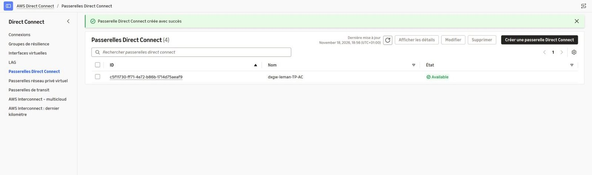

La passerelle `dxgw-leman-TP-AC` vient d'être créée (bandeau vert) et son état est « Available ».

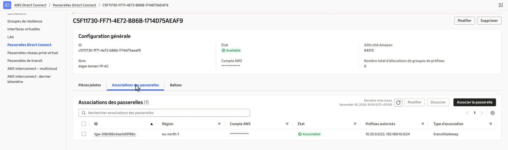

L'association au Transit Gateway est active : ASN 64513, préfixes autorisés `10.20.0.0/22` et `192.168.10.0/24`, type `transitGateway`.

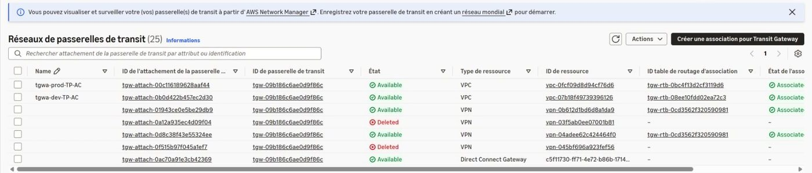

Dans la console VPC, le Transit Gateway a un attachement de type « Direct Connect Gateway », créé par AWS. Deux lignes « Deleted » sont des attachements VPN de nos essais précédents.


Le premier lancement de `rtr-aws-TP-AC` est refusé : la limite de 48 vCPU de l'ensemble de la classe est atteinte.

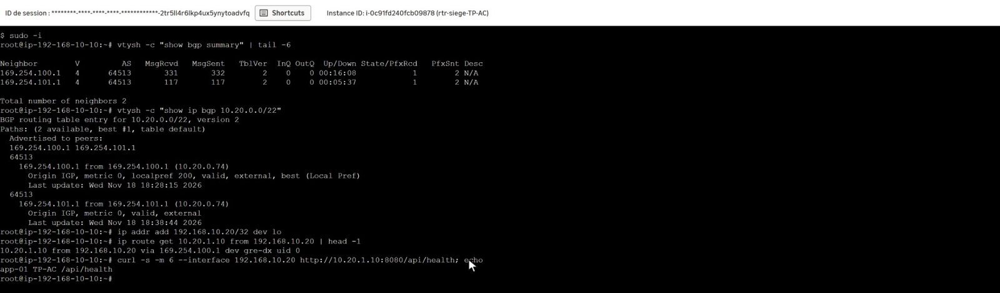

Sur `rtr-siege-TP-AC` : deux sessions BGP établies, avec un préfixe reçu chacune. Le meilleur chemin vers `10.20.0.0/22` passe par `169.254.100.1` avec `localpref 200`. L'API de `app-01` répond par `gre-dx`, depuis l'adresse `192.168.10.20` que nous avons ajoutée sur l'interface `lo` pour jouer un poste du LAN.

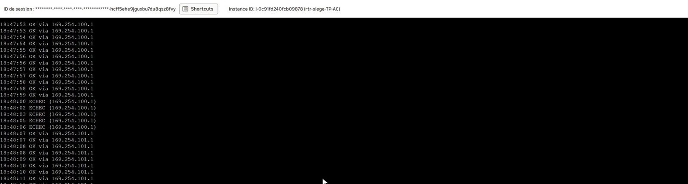

La coupure de la liaison. Une boucle interroge l'API toutes les demi-secondes et affiche par où passe le trafic. Elle répond par `169.254.100.1` (la liaison) jusqu'à 18:47:59. Cinq tentatives échouent entre 18:48:00 et 18:48:06. À 18:48:07, les réponses viennent par `169.254.101.1` (le VPN).

## Tableau récapitulatif
| Élément | rtr-siege-TP-AC | rtr-aws-TP-AC |
|---|---|---|
| ASN | 65010 | 64513 |
| Adresse dans le réseau | `192.168.10.10` | `10.20.0.74` |
| GRE « liaison dédiée » (`gre-dx`) | `169.254.100.2/30` | `169.254.100.1/30` |
| GRE dans le VPN (`gre-vpn`) | `169.254.101.2/30` | `169.254.101.1/30` |
| Annonce BGP | `192.168.10.0/24` | `10.20.0.0/22` |
| Timers BGP | 3 s / 9 s | 3 s / 9 s |

| Politique | Valeur |
|---|---|
| Liaison dédiée (`gre-dx`), à la réception | `local-preference 200` |
| VPN (`gre-vpn`), à l'envoi par le siège | prepend `65010` trois fois en plus |
| Préfixes autorisés du Direct Connect Gateway | `10.20.0.0/22`, `192.168.10.0/24` |
| Direct Connect Gateway | `dxgw-leman-TP-AC`, ASN 64513, associé à `tgw-leman-TP-AC` |

## Résultats des tests
Le journal ci-dessous vient du premier passage, fait avec la ligne de commande sur le même schéma. La vidéo refait les mêmes contrôles dans la console : mêmes valeurs de local-pref et de prepend, mêmes timers.

```
=== TP1 : dimensionnement et Direct Connect Gateway (reel) ===
2 To en 8 h = 16 000 Gbit / 28 800 s = 0,556 Gbit/s -> liaison 1 Gbit/s (marge ~44 %)
Emplacement retenu (non commande) : EQSK1, Equinix Sweden SK1 (vitesses 1G / 10G / 100G), le plus proche disponible dans la region eu-north-1
dxgw : dxgw-leman-TP-AC	64513	available
association avec tgw-leman : associated 192.168.10.0/24	10.20.0.0/22

=== TP2 : GRE + BGP ===
rtr-aws : traduction d'adresse (NAT) pour app-01 :
-P POSTROUTING ACCEPT
-A POSTROUTING -s 192.168.10.0/24 -o ens5 -j MASQUERADE
	

rtr-siege : show bgp summary

IPv4 Unicast Summary (VRF default):
BGP router identifier 192.168.10.10, local AS number 65010 vrf-id 0
BGP table version 2
RIB entries 3, using 576 bytes of memory
Peers 2, using 1448 KiB of memory

Neighbor        V         AS   MsgRcvd   MsgSent   TblVer  InQ OutQ  Up/Down State/PfxRcd   PfxSnt Desc
169.254.100.1   4      64513        20        21        0    0    0 00:00:34            1        2 DX-simule-GRE
169.254.101.1   4      64513        20        23        0    0    0 00:00:34            1        2 VPN-GRE-dans-IPsec

Total number of neighbors 2
	

rtr-aws : show ip bgp (prefixes recus du siege)
BGP table version is 4, local router ID is 10.20.0.74, vrf id 0
Default local pref 100, local AS 64513
Status codes:  s suppressed, d damped, h history, * valid, > best, = multipath,
               i internal, r RIB-failure, S Stale, R Removed
Nexthop codes: @NNN nexthop's vrf id, < announce-nh-self
Origin codes:  i - IGP, e - EGP, ? - incomplete
RPKI validation codes: V valid, I invalid, N Not found

   Network          Next Hop            Metric LocPrf Weight Path
*> 10.20.0.0/22     0.0.0.0                  0         32768 i
*  192.168.10.0/24  169.254.101.2            0             0 65010 65010 65010 65010 i
*>                  169.254.100.2            0             0 65010 i

Displayed  2 routes and 3 total paths
	

siege -> app-01 (chemin choisi) :
10.20.1.10 from 192.168.10.50 via 169.254.100.1 dev gre-dx uid 0 
    cache 
--- 10.20.1.10 ping statistics ---
3 packets transmitted, 3 received, 0% packet loss, time 2003ms
rtt min/avg/max/mdev = 2.663/2.984/3.323/0.269 ms
app-01 TP-AC /api/health
	

=== TP3 : politique et bascule ===
rtr-siege : show ip bgp 10.20.0.0/22 (local-pref 200 sur DX, 100 sur VPN)
BGP routing table entry for 10.20.0.0/22, version 2
Paths: (2 available, best #2, table default)
  Advertised to non peer-group peers:
  169.254.100.1 169.254.101.1
  64513
    169.254.101.1 from 169.254.101.1 (10.20.0.74)
      Origin IGP, metric 0, valid, external
      Last update: Tue Nov 17 18:48:40 2026
  64513
    169.254.100.1 from 169.254.100.1 (10.20.0.74)
      Origin IGP, metric 0, localpref 200, valid, external, best (Local Pref)
      Last update: Tue Nov 17 18:48:40 2026
	

rtr-aws : show ip bgp 192.168.10.0/24 (le chemin VPN arrive avec AS-path prepend x3)
BGP routing table entry for 192.168.10.0/24, version 4
Paths: (2 available, best #2, table default)
  Advertised to non peer-group peers:
  169.254.100.2 169.254.101.2
  65010 65010 65010 65010
    169.254.101.2 from 169.254.101.2 (192.168.10.10)
      Origin IGP, metric 0, valid, external
      Last update: Tue Nov 17 18:48:39 2026
  65010
    169.254.100.2 from 169.254.100.2 (192.168.10.10)
      Origin IGP, metric 0, valid, external, best (AS Path)
      Last update: Tue Nov 17 18:48:39 2026
	

T+10 s : panne de la liaison DX (le GRE vers 56.228.132.92 est perdu, sans coupure de l'interface)
route : 10.20.1.10 from 192.168.10.50 via 169.254.100.1 dev gre-dx uid 0 
T+40 s (DX en panne) route : 10.20.1.10 from 192.168.10.50 via 169.254.101.1 dev gre-vpn uid 0 
Neighbor        V         AS   MsgRcvd   MsgSent   TblVer  InQ OutQ  Up/Down State/PfxRcd   PfxSnt Desc
169.254.100.1   4      64513        33        38        0    0    0 00:00:22      Connect        0 DX-simule-GRE
169.254.101.1   4      64513        44        47        0    0    0 00:01:43            1        2 VPN-GRE-dans-IPsec
T+40 s : liaison DX retablie
T+70 s (DX retablie) route : 10.20.1.10 from 192.168.10.50 via 169.254.100.1 dev gre-dx uid 0 
--- ping horodate depuis 192.168.10.50 (une sonde toutes les 0,5 s, 180 sondes)
180 packets transmitted, 162 received, 10% packet loss, time 89755ms
rtt min/avg/max/mdev = 2.636/3.564/19.321/1.658 ms
interruption de 9.6 s, de T+9.5 s a T+19.1 s (sondes 21 a 38 perdues)
```

## Mesure de la bascule
Pour simuler une vraie panne, nous supprimons les paquets GRE de la liaison dédiée avec `iptables`, **sans couper l'interface**. BGP doit s'en apercevoir lui-même.
- **Dans la vidéo (console, 18/11)** : cinq tentatives échouent, de 18:48:00 à 18:48:06, soit sept secondes environ. Le trafic passe ensuite par le VPN. Nous retirons la règle `iptables` : la session BGP de la liaison revient et, à 18:48:49, les réponses repassent par `169.254.100.1` sans aucune tentative perdue.
- **Premier passage (ligne de commande)** : 9,6 secondes d'interruption (une sonde toutes les 0,5 s, 180 sondes, voir le journal).

Les deux valeurs sont cohérentes avec les timers 3 s / 9 s : BGP déclare le voisin mort quand il n'a rien reçu pendant 9 s, et la dernière keepalive date de zéro à trois secondes avant la panne. Quant au retour, il n'y a pas de coupure parce que le VPN reste en service tant que la liaison dédiée n'est pas revenue.

La source du test est une adresse supplémentaire du LAN (`192.168.10.20`), pas celle du routeur. Au premier passage nous avions pingué depuis l'adresse du routeur lui-même, qui répond par une route directe : la mesure ne passait pas par BGP et ne montrait presque rien.

## Pièges rencontrés
- **Limite de vCPU de la classe.** Le lancement de `rtr-aws-TP-AC` a été refusé : « You have requested more vCPU capacity than your current vCPU limit of 48 ». Le compte est partagé par toute la classe. Nous avons arrêté `dev-01-TP-AC`, dont nous n'avions pas besoin à ce moment, puis relancé avec la même configuration : cette fois, le lancement a réussi.
- **L'attachement du VPC ne couvrait que la zone A.** Un attachement au Transit Gateway ne livre du trafic que dans les zones où il a un sous-réseau. Le routeur étant en zone B, il fallait ajouter `sub-public-1b-TP-AC` à `tgwa-prod-TP-AC`.
- **Une route de plus dans une autre table.** La table du sous-réseau de la zone B est `rt-nat-leman-TP-AC`, pas `rt-public-leman-TP-AC`. La route vers le siège devait donc être posée aux deux endroits.
- **Routage récursif (premier passage, ligne de commande).** Au début, la bascule durait 45 secondes et la session BGP du VPN tombait à chaque panne. Des captures de paquets ont montré que la réponse du chemin de secours revenait à l'intérieur du tunnel de la liaison dédiée : sur `rtr-aws`, la route vers l'extrémité GRE du siège (`192.168.10.10`) était recouverte par la route BGP `192.168.10.0/24` apprise par `gre-dx`. Le secours dépendait donc de la liaison qu'il devait remplacer. Une route statique `192.168.10.10/32` vers le routeur du sous-réseau règle le problème. Dans la version filmée, elle est dans la configuration dès le départ.
- **Mauvais ASN (premier passage).** Un Direct Connect Gateway créé avec le même ASN que le Transit Gateway (64512) est refusé à l'association. Nous l'avons recréé en 64513.
- **Bandeaux rouges dans la console.** La console Direct Connect, et par moments d'autres pages, affichent des erreurs `AccessDeniedException` (par exemple `DescribeLocations`) avec la mention « explicit deny in a service control policy ». C'est l'organisation AWS qui bloque ces lectures : la liste des emplacements n'est pas consultable. Les actions dont nous avions besoin (créer la passerelle, l'associer) ont fonctionné malgré les bandeaux.

## Ce qui diffère du sujet
- **Pas de vraie liaison.** Le sujet parle d'une liaison Direct Connect près de Genève. Il n'y a aucun emplacement près de Genève dans la région de Stockholm, et nous ne commandons pas de fibre. Emplacement retenu sur le papier : EQSK1 (1 Gbit/s).
- **Bascule vers le VPN.** Avec un VPN statique, le prepend du sujet n'aurait aucun effet, faute de BGP sur ce chemin. Nous avons fait passer le BGP dans un tunnel GRE à l'intérieur du vrai VPN du module 7.
- **Les routeurs** sont des instances EC2 avec FRRouting, pas des appareils GNS3.
- **Le test** part d'une adresse supplémentaire sur `rtr-siege-TP-AC`, pas d'un vrai poste du LAN du siège.
- Direct Connect était refusé par l'organisation AWS jusqu'au 17/11/2026 (voir `01-services-bloques.md`). Le Direct Connect Gateway et son association sont réels depuis cette date.

## Nettoyage
Le Direct Connect Gateway ne coûte rien. Son association au Transit Gateway ajoute un attachement facturé 0,05 USD de l'heure, et les instances des routeurs sont facturées à l'heure aussi. Tout a été supprimé à la fin du projet (association, passerelle, routeurs, routes ajoutées, règles de sécurité de ce module). La seule ressource qui reste est le Network Firewall `nfw-prod-leman-TP-AC` du module 4, dont la suppression est bloquée côté AWS (voir `docs/NETTOYAGE.md`).


---

[Sommaire]({{URL_sommaire}}) · [Partie 1]({{URL_partie1}}) · **Partie 2** · [Partie 3]({{URL_partie3}})
