# Satom Cloud Network (TP-AC) – Partie 3 : modules 9 à 13

[Sommaire]({{URL_sommaire}}) · [Partie 1]({{URL_partie1}}) · [Partie 2]({{URL_partie2}}) · **Partie 3**

[TOC]

---

# Module 9 – Load balancer

## Objectif
Publier le site derrière un Application Load Balancer (ALB) en HTTPS, sur deux zones de disponibilité, avec un vrai certificat ACM et une règle qui envoie `/api/*` vers l'API. Puis provoquer une panne et voir comment l'ALB la signale.

## Ce qu'il faut savoir
Un ALB travaille au niveau de l'application (HTTP, HTTPS) et a un nœud par zone de disponibilité : il lui faut donc des sous-réseaux dans au moins deux zones. Il écoute sur un **listener** (ici le port 443). Le listener a une action par défaut et des **règles** (chemin, nom d'hôte, en-tête) qui envoient les requêtes vers des **groupes cibles**. Chaque groupe cible contrôle la santé de ses cibles : une cible qui ne répond plus est marquée « non saine » et ne reçoit plus de trafic.

Pour servir du HTTPS, le listener a besoin d'un certificat. Un certificat public d'AWS Certificate Manager (ACM) est gratuit et se renouvelle seul, à une condition : il faut prouver qu'on contrôle le domaine. C'est la **validation par DNS** : on crée un enregistrement CNAME, fourni par ACM, dans la zone du domaine. Quand le domaine est dans Route 53, la console le crée en un clic. Le certificat ne vaut que pour les noms qu'il contient : le nom `….elb.amazonaws.com` d'un ALB n'y figure pas, il faut donc un nom de notre domaine qui pointe vers l'ALB.

L'ALB coûte environ 0,03 USD de l'heure.

## Environnement
Le réseau construit à la main aux modules 1 à 3 avait été supprimé après le premier tournage. Pour les modules 9 à 11 (tournés le 20/11/2026), nous avons redéployé un environnement avec un modèle CloudFormation, la pile `env-m9-m11-TP-AC` : même nom (`vpc-prod-leman-TP-AC`), mêmes plages (`10.20.0.0/22`, sous-réseaux publics `10.20.0.0/26` en zone A et `10.20.0.64/26` en zone B, sous-réseau privé `10.20.1.0/26`), `web-01-TP-AC` (`10.20.0.10`, nginx en HTTPS sur le port 443 avec un certificat auto-signé), `app-01-TP-AC` (`10.20.1.10`, l'API sur le port 8080), et les Security Groups `web-TP-AC` et `app-TP-AC`. Le modèle ne contient ni ALB, ni groupes cibles, ni Security Group pour l'ALB : tout cela est fait dans la console, ci-dessous.

Le domaine est réel : `leman.thomastp.ch`, un sous-domaine délégué à une zone publique Route 53 (voir le module 10). Cette zone existait déjà avant le tournage.

## Ce que nous avons fait
Voici l'ordre de la vidéo.

**1. Le certificat (ACM, région Stockholm)**
- « Demander un certificat », type public. Noms : `leman.thomastp.ch` et `*.leman.thomastp.ch`. Validation par DNS, clé RSA 2048, exportation désactivée (valeurs par défaut de la console). Balises habituelles, plus `Name` = `cert-leman-TP-AC`.
- Dans les détails du certificat, « Création d'enregistrements dans Route 53 » : la console place le CNAME de validation dans la zone `leman.thomastp.ch`.
- Le certificat passe à « Émis » en une minute et demie : demandé à 12:52:23, émis à 12:53:54. Il est valable jusqu'au 6 juin 2027.

**2. Les deux groupes cibles**
- `tg-web-TP-AC` : protocole **HTTPS**, port 443, VPC `vpc-prod-leman-TP-AC`, contrôle de santé HTTPS sur `/`, cible `web-01-TP-AC`.
- `tg-app-TP-AC` : protocole **HTTP**, port 8080, contrôle de santé HTTP sur `/api/health`, cible `app-01-TP-AC`.
- Nous n'avons pas touché aux « Paramètres avancés de vérification de l'état » : ce sont les valeurs par défaut de la console.

**3. Le Security Group de l'ALB**
- `alb-TP-AC` (description « ALB : 443 public », balise `Name` = `sg-alb-TP-AC`) : une seule règle entrante, le port 443 en TCP depuis `0.0.0.0/0`. Il laisse entrer les clients, et rien d'autre.

**4. L'ALB**
- `alb-prod-leman-TP-AC`, accessible depuis Internet, IPv4, dans `vpc-prod-leman-TP-AC`. Zones `eu-north-1a` (`sub-public-1a-TP-AC`) et `eu-north-1b` (`sub-public-1b-TP-AC`). Le groupe `default` est retiré et remplacé par `alb-TP-AC`.
- Listener : le protocole HTTPS, donc le port 443, avec l'action par défaut « transmettre à `tg-web-TP-AC` ». Le certificat vient d'ACM : `leman.thomastp.ch`. La politique de sécurité est celle que la console recommande (TLS 1.3 et 1.2).
- Après la création, l'ALB est « Mise en service » (provisioning) ; il faut attendre quelques minutes. Nous avons accéléré l'attente dans la vidéo.

**5. Un nom pour l'ALB**
- Dans la zone `leman.thomastp.ch` de Route 53, un enregistrement `origin`, de type A, alias vers « l'application et Classic Load Balancer », région Stockholm, l'ALB `alb-prod-leman-TP-AC`. Le certificat couvre ce nom, ce qui n'est pas le cas du nom `….elb.amazonaws.com`.

**6. Les règles du trafic**
- `app-TP-AC` : une règle entrante de plus, le port 8080 depuis le groupe `alb-TP-AC` (« API depuis alb »). La règle d'origine (8080 depuis `web-TP-AC`) reste.
- Sur le listener HTTPS:443 : une règle de priorité **10** avec la condition « chemin = `/api/*` » et l'action « transmettre à `tg-app-TP-AC` ». Tout le reste va à `tg-web-TP-AC`.

**7. Les tests**
- Les deux groupes cibles affichent une cible saine.
- Dans un navigateur, `https://origin.leman.thomastp.ch/` répond `web-01 TP-AC` et `https://origin.leman.thomastp.ch/api/health` répond `app-01 TP-AC /api/health`, sans avertissement de certificat.
- Depuis `web-01-TP-AC` (Session Manager), la panne : `systemctl stop nginx`, puis `curl` sur l'ALB.

## Captures
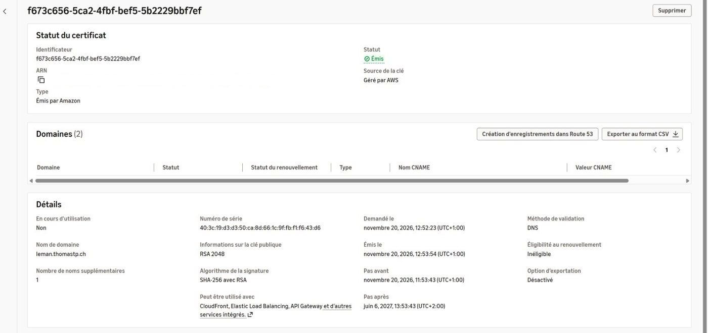

Le certificat ACM est « Émis ». La validation par DNS a pris une minute et demie.

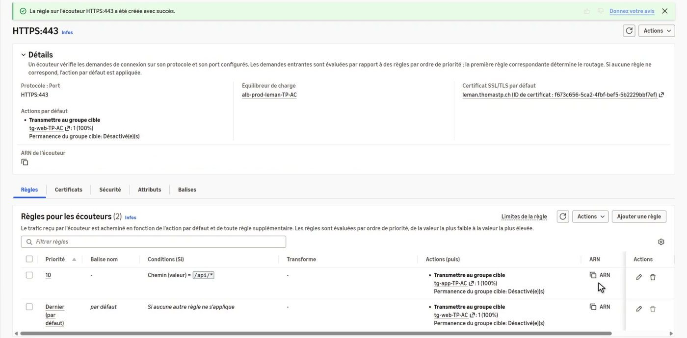

Le listener HTTPS:443 de `alb-prod-leman-TP-AC` avec le certificat `leman.thomastp.ch` et ses deux règles : `/api/*` vers `tg-app-TP-AC` (priorité 10), tout le reste vers `tg-web-TP-AC`.

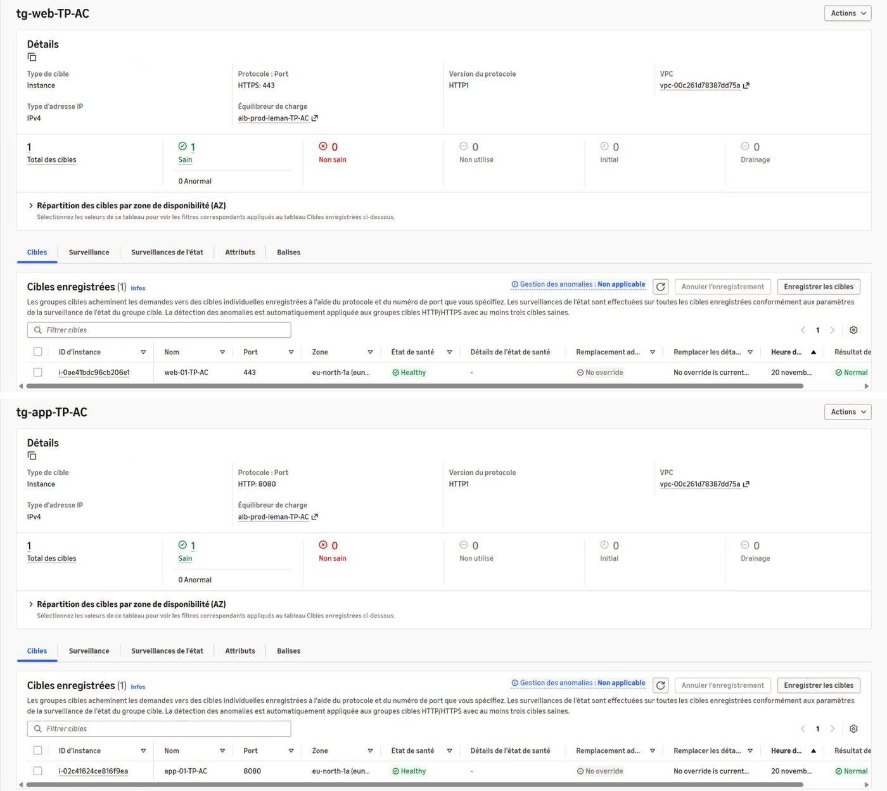

Les deux groupes cibles sont sains : `web-01-TP-AC` sur HTTPS 443 et `app-01-TP-AC` sur HTTP 8080.

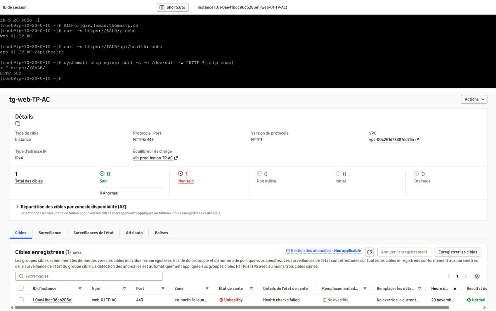

La panne : nginx est arrêté sur `web-01`, l'ALB répond `HTTP 502`, et la cible de `tg-web-TP-AC` passe à « Unhealthy » avec le détail « Health checks failed ».

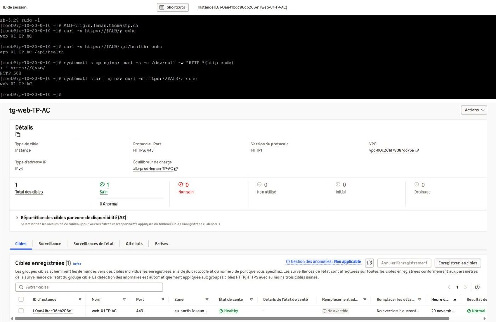

Après `systemctl start nginx`, la page revient (`web-01 TP-AC`) et, quelques minutes plus tard, la cible est de nouveau « Healthy ».

## Tableau récapitulatif
| Élément | Valeur |
|---|---|
| ALB | `alb-prod-leman-TP-AC`, Internet, IPv4, zones A et B (`sub-public-1a-TP-AC`, `sub-public-1b-TP-AC`) |
| Security Group de l'ALB | `alb-TP-AC` : 443 depuis `0.0.0.0/0` |
| Listener | HTTPS 443, certificat ACM public `leman.thomastp.ch` + `*.leman.thomastp.ch` |
| Nom de l'ALB | `origin.leman.thomastp.ch` (alias Route 53) |
| `tg-web-TP-AC` | HTTPS 443, santé HTTPS `/`, cible `web-01-TP-AC` |
| `tg-app-TP-AC` | HTTP 8080, santé HTTP `/api/health`, cible `app-01-TP-AC` |
| Règle du listener | priorité 10, chemin `/api/*` vers `tg-app-TP-AC` ; défaut vers `tg-web-TP-AC` |
| `app-TP-AC` | 8080 depuis `web-TP-AC` (d'origine) et depuis `alb-TP-AC` (ajouté) |

## Résultats des tests
Le journal ci-dessous vient du premier passage, fait avec la ligne de commande sur un environnement équivalent. Il contient deux essais que la vidéo ne montre pas : le test avec le certificat vérifié (`curl` sans `-k`) sur `portefeuilles.leman.thomastp.ch`, et la fermeture du port 443 dans `alb-TP-AC` (le client n'obtient aucune réponse, `curl` sort en erreur 28). La vidéo montre, dans la console, le 502 et la reprise.

```
=== Domaine reel (20/11/2026) : tests sans -k, certificat verifie ===
--- curl.exe sans -k (certificat verifie) :
https://portefeuilles.leman.thomastp.ch/ -> web-01 TP-AC (cfn)
 [HTTP 200, verif certificat : 0]
https://portefeuilles.leman.thomastp.ch/api/health -> app-01 TP-AC (cfn) /api/health
 [HTTP 200, verif certificat : 0]
--- certificat :
subject=CN=leman.thomastp.ch
issuer=C=US, O=Amazon, CN=Amazon RSA 2048 S21
notBefore=Nov 20 07:47:39 2026 GMT
notAfter=Jun  6 08:47:39 2027 GMT

=== Pannes (premiere execution, avant le passage au domaine reel) ===
nginx arrete sur web-01 : tg-web = unhealthy ; curl https://ALB/ -> <html> <head><title>502 Bad Gateway</title></head> <body> <center><h1>502 Bad Gateway</h1></center> </body> </html>  [HTTP 502]
nginx relance : tg-web = healthy
curl https://ALB/ -> web-01 TP-AC  [HTTP 200]
443 ferme dans sg-alb -> curl https://ALB/ -> ECHEC (curl 28)
443 retabli -> curl https://ALB/ -> web-01 TP-AC  [HTTP 200]
```

## Pièges rencontrés
- **Un 502, pas un 503.** Quand nginx s'arrête, l'ALB reçoit « connexion refusée » de la cible et répond 502 (Bad Gateway). Le contrôle de santé n'est pas instantané : il faut plusieurs contrôles ratés d'affilée. Dans la vidéo, nous avons attendu un peu plus de deux minutes avant de voir la cible « Unhealthy » dans la console.
- **La page revient avant la cible.** Juste après `systemctl start nginx`, le `curl` obtient déjà `web-01 TP-AC` alors que la cible était encore « Unhealthy » à la dernière vérification. Nous l'expliquons ainsi : quand aucune cible d'un groupe n'est saine, l'ALB envoie quand même le trafic aux cibles qui existent, plutôt que de renvoyer une erreur. La cible repasse à « Healthy » seulement après plusieurs contrôles réussis d'affilée (valeurs par défaut des paramètres avancés, que nous n'avons pas changées). Nous n'avons pas mesuré cette durée à la seconde.
- **Le groupe cible web est en HTTPS alors que nginx a un certificat auto-signé.** Le contrôle de santé de l'ALB ne vérifie pas le certificat de la cible, donc la cible est saine quand même.
- **Un nginx qui fait télécharger la page.** Sans type de contenu, nginx envoie le texte en `application/octet-stream` et le navigateur propose de télécharger le fichier au lieu de l'afficher. La configuration de `web-01` contient donc `default_type text/plain` : c'est ce qui permet à nos tests de lire `web-01 TP-AC` dans le navigateur.
- **Le certificat doit correspondre au nom.** Avec le nom `….elb.amazonaws.com` de l'ALB, `curl` refuse le certificat. D'où l'alias `origin.leman.thomastp.ch`, qui est couvert par le certificat, et le fait que nous testons sans `-k`.
- **La limite de vCPU de la classe.** Le déploiement de l'environnement de tournage a échoué plusieurs fois avant le tournage pour la même raison qu'au module 8 (la classe atteint la limite de 48 vCPU). Nous avons attendu qu'une place se libère, puis redéployé.
- **L'attente.** ACM (une minute et demie) et l'ALB (quelques minutes) demandent du temps ; dans la vidéo, ces attentes sont accélérées.

## Ce qui diffère du sujet
- **Certificat.** Le sujet est respecté avec un domaine réel (écart n°9 de `docs/02-ecarts-au-sujet.md`) : certificat public validé par DNS, listener HTTPS, test sans désactiver la vérification.
- **Un Security Group séparé pour l'ALB.** Le sujet réutilise `sg-web` ; nous avons créé `alb-TP-AC`. En revanche `web-TP-AC` reste ouvert sur le port 443, comme au module 3 : nous n'avons pas limité les serveurs web à l'ALB. Seul `app-TP-AC` a reçu une règle pour l'ALB.
- **Le groupe cible web est en HTTPS 443** (pas en HTTP 80), parce que nginx de `web-01` ne sert que le HTTPS depuis le module 3.
- **Environnement de tournage.** Les modules 9 à 11 ont été filmés dans un environnement redéployé avec un modèle CloudFormation (voir plus haut), pas dans le réseau fait à la main aux modules 1 à 3.

## Nettoyage
Tout ce qui a été créé pour ce module a été supprimé le 20/11/2026 : l'ALB `alb-prod-leman-TP-AC` et son listener, les groupes cibles `tg-web-TP-AC` et `tg-app-TP-AC`, le Security Group `alb-TP-AC` (avec la règle 8080 qui y faisait référence), l'enregistrement `origin`, le certificat ACM et la pile `env-m9-m11-TP-AC` (voir `docs/NETTOYAGE.md`). La seule ressource qui reste de notre projet est le Network Firewall `nfw-prod-leman-TP-AC` du module 4, dont la suppression est bloquée côté AWS.


---

# Module 10 – Route 53

## Objectif
Donner des noms à nos machines avec une zone privée, publier le site sous un vrai nom de domaine avec une zone publique, et prévoir une bascule automatique : si le site tombe, le DNS doit répondre avec une adresse de secours.

## Ce qu'il faut savoir
Une **zone privée** n'est visible que depuis les VPC auxquels on l'associe. Les instances l'interrogent par le résolveur du VPC, à l'adresse « base + 2 » : ici `10.20.0.2`. Pour qu'une zone privée fonctionne, le VPC doit avoir la résolution DNS et les noms d'hôte DNS activés.

Une **zone publique** reçoit quatre serveurs de noms d'AWS. Pour qu'Internet la connaisse, il faut les déclarer chez celui qui héberge le DNS du domaine parent : c'est la **délégation**. Notre domaine `thomastp.ch` est hébergé chez Cloudflare. Nous n'y avons ajouté que quatre enregistrements NS pour le sous-domaine `leman`, qui délèguent `leman.thomastp.ch` à Route 53. Le reste de la zone de `thomastp.ch` (le portfolio de Thomas) n'a jamais été touché.

Un enregistrement **alias** pointe vers une ressource AWS (ici l'ALB). Pour un **basculement** (failover), on crée deux enregistrements du même nom : le principal, relié à une **surveillance de l'état** (health check), et un secondaire, que Route 53 renvoie quand la surveillance dit que le principal est en panne.

## Ce que nous avons fait
Tournage du 20/11/2026, dans l'environnement décrit au module 9. Voici l'ordre de la vidéo.

**1. La zone privée**
- Route 53, « Créer une zone hébergée » : `prod.leman.internal`, description « Noms internes du VPC de production », type **privée**, région Stockholm, VPC `vpc-prod-leman-TP-AC`, balises habituelles. La console rappelle que le VPC doit avoir `enableDnsHostnames` et `enableDnsSupport` à `true`.
- Deux enregistrements A : `web` vers `10.20.0.10` et `app` vers `10.20.1.10`.
- Dans la console VPC, « Modifier les paramètres du VPC » sur `vpc-prod-leman-TP-AC` : nous cochons « Activer les noms d'hôte DNS ». La résolution DNS était déjà activée. Le modèle CloudFormation du module 9 avait laissé les noms d'hôte désactivés.
- Depuis `web-01-TP-AC` (Session Manager) : `getent hosts web.prod.leman.internal`, `getent hosts app.prod.leman.internal`, `grep nameserver /etc/resolv.conf` (voir les pièges : dans la vidéo, la résolution n'a rien répondu).

**2. La zone publique `leman.thomastp.ch`**
- La zone et la délégation chez Cloudflare ont été préparées avant le tournage. La vidéo montre la zone : ses détails donnent les quatre serveurs de noms (les mêmes que ceux déclarés chez Cloudflare) et l'enregistrement `origin`, créé au module 9, qui pointe vers l'ALB.

**3. La surveillance de l'état**
- « Créer une surveillance de l'état » : `hc-portail-TP-AC`, point de terminaison public, par nom de domaine, protocole **HTTPS**, `origin.leman.thomastp.ch`, port 443, chemin `/`.
- Intervalle **Rapide (10 secondes)** et seuil d'échec **2** : deux contrôles ratés d'affilée et le point de terminaison est déclaré en panne.
- L'indication du nom du serveur (SNI) reste cochée : Route 53 envoie le nom `origin.leman.thomastp.ch` dans la négociation TLS, et l'ALB présente le bon certificat.

**4. Les enregistrements de basculement**
- Dans `leman.thomastp.ch`, deux enregistrements `portefeuilles` :
  - **principal** : type A, alias vers l'ALB `alb-prod-leman-TP-AC` (Stockholm), politique de routage « Basculement », type « Principale », surveillance `hc-portail-TP-AC`, identifiant `portefeuilles-principal`, « Évaluer l'état de la cible » activé ;
  - **secondaire** : type A, valeur `203.0.113.50` (une adresse réservée à la documentation), durée de vie 300 s, politique « Basculement », type « Secondaire », identifiant `portefeuilles-secours`, sans surveillance.

**5. Le test de basculement**
- Sur `web-01-TP-AC`, nous installons `bind-utils` (pour `dig`), puis nous interrogeons **directement** le premier serveur de noms de la zone, `ns-1673.awsdns-17.co.uk`, ce qui évite les caches des résolveurs : `dig +short @$NS portefeuilles.leman.thomastp.ch`.
- Une boucle pose la question toutes les trois secondes et affiche l'heure.
- Dans une seconde session, `systemctl stop nginx` sur `web-01`, puis, plus tard, `systemctl start nginx`.

## Captures
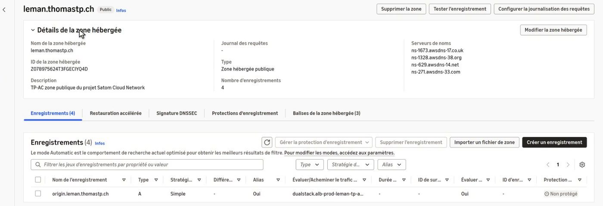

La zone publique `leman.thomastp.ch`, avec ses quatre serveurs de noms. Le compteur indique quatre enregistrements, mais la liste n'en montre qu'un (`origin`) : voir les pièges.

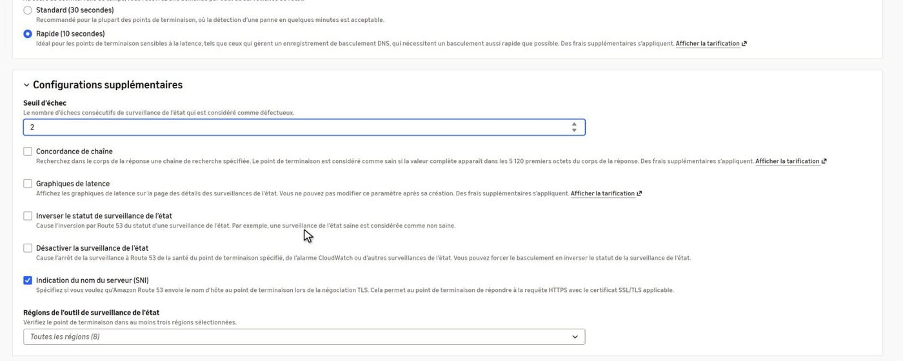

La surveillance de l'état avant sa création : intervalle « Rapide (10 secondes) », seuil d'échec `2`, SNI activé.

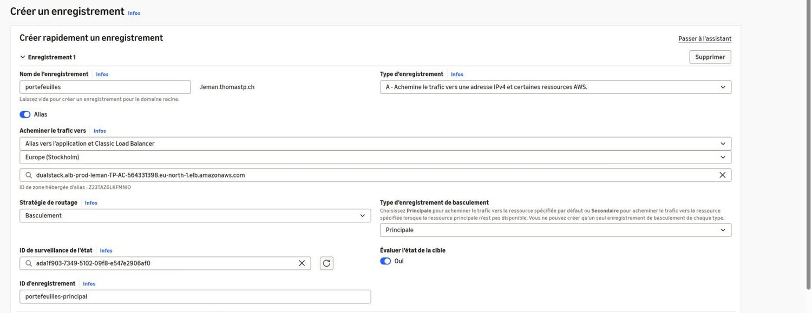

L'enregistrement principal de `portefeuilles` : alias vers l'ALB, routage « Basculement », type « Principale », relié à la surveillance `hc-portail-TP-AC`.

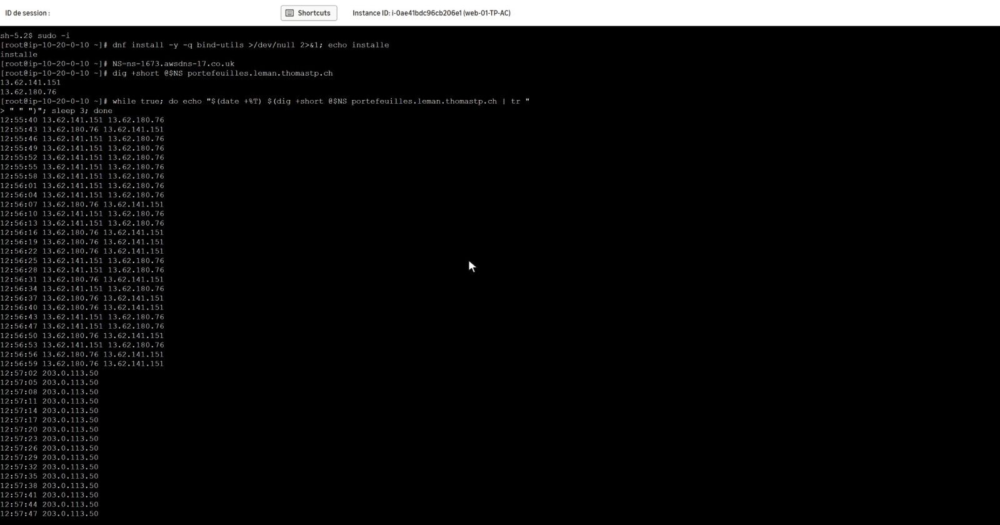

La boucle de `dig` pendant la panne. Tant que nginx tourne, la réponse contient les deux adresses de l'ALB (une par zone). Nous avons arrêté nginx à 12:56:29. À 12:57:02, la réponse devient `203.0.113.50`, l'adresse de secours : trente-trois secondes plus tard.

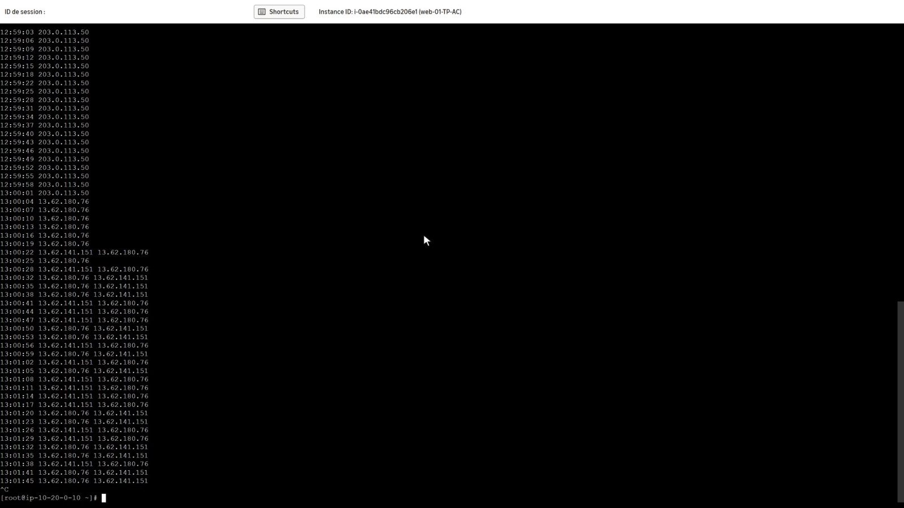

Le retour. Nous avons relancé nginx à 12:57:43. La réponse reste `203.0.113.50` jusqu'à 13:00:01 et revient à l'adresse de l'ALB à 13:00:04, après 141 secondes. Elle n'a d'abord qu'une seule adresse, puis les deux adresses de façon stable à partir de 13:00:28.

## Tableau récapitulatif
| Zone | Nom | Cible |
|---|---|---|
| privée | `web.prod.leman.internal` | `10.20.0.10` |
| privée | `app.prod.leman.internal` | `10.20.1.10` |
| publique | `origin.leman.thomastp.ch` | alias vers l'ALB |
| publique | `portefeuilles.leman.thomastp.ch` (principal) | alias vers l'ALB, surveillance `hc-portail-TP-AC` |
| publique | `portefeuilles.leman.thomastp.ch` (secours) | `203.0.113.50`, TTL 300 s |
| publique | `cdn.leman.thomastp.ch` | alias vers CloudFront (module 11) |

| Surveillance de l'état | Valeur |
|---|---|
| Nom | `hc-portail-TP-AC` |
| Point de terminaison | `https://origin.leman.thomastp.ch:443/` |
| Intervalle, seuil d'échec | 10 s, 2 échecs |

## Résultats des tests
Le journal ci-dessous vient du premier passage, fait avec la ligne de commande : la résolution de la zone privée (qui avait bien répondu) et, sous « Domaine réel », les mesures du basculement faites le 20/11/2026 avec la même configuration. Les mesures de la vidéo (console) sont dans les captures ci-dessus : **33 secondes** pour passer au secours, **141 secondes** pour revenir.

```
=== TP1 : zone privee prod.leman.internal (resolveur 10.20.0.2) ===
web-01 : Success	app -> 10.20.1.10 web -> 10.20.0.10
web-01 : Success	serveur DNS utilise : nameserver 10.20.0.2

=== Domaine reel (20/11/2026) : basculement Route 53 (primaire ALB -> secours statique 203.0.113.50) ===
12:26:03 arret de nginx sur web-01 : Success	11:26:05
etat de la cible tg-web : unhealthy
12:30:09 reponse DNS avant relance : 203.0.113.50 (secours)
12:30:10 relance de nginx : Success	11:30:12
12:30:44 la reponse DNS publique est revenue a l'equilibreur (13.62.60.176) apres 34 s
web-01 TP-AC (cfn)
 [HTTP 200]
12:31:14 2e mesure - arret de nginx : Success	11:31:15
12:32:22 la reponse DNS publique est devenue le secours (203.0.113.50) apres 70 s
```

Les mesures du premier passage sont de 70 s (aller, seconde mesure) et 34 s (retour). Elles diffèrent beaucoup de celles de la vidéo, surtout au retour. Un contrôle de 10 s avec deux échecs laisse attendre vingt à trente secondes à l'aller, ce qu'on voit dans la vidéo. Au retour, il faut d'abord que le groupe cible de l'ALB redevienne sain (module 9), puis que Route 53 constate deux contrôles réussis. Au premier passage, le groupe cible était réglé à 10 s d'intervalle et 2 réussites pour redevenir sain. Dans la console, nous avons gardé les valeurs par défaut des paramètres avancés (que nous n'avons pas relevées ; d'après la documentation d'AWS : 30 s et 5 réussites), ce qui explique sans doute un retour plus lent. Les valeurs détaillées du premier passage sont dans `docs/modules/m10/tests-domaine-reel.txt`.

## Pièges rencontrés
- **La résolution de la zone privée n'a rien répondu dans la vidéo.** Sur `web-01`, les deux commandes `getent hosts web.prod.leman.internal` et `getent hosts app.prod.leman.internal` n'affichent aucune ligne. Le résolveur du VPC (`nameserver 10.20.0.2`) est bien celui utilisé. Nous n'avons pas expliqué cet échec sur le moment et nous n'avons pas refait l'essai à l'écran. Deux pistes : le réglage « noms d'hôte DNS » du VPC venait d'être changé, ou la zone privée venait d'être créée. Au premier passage (ligne de commande), la résolution avait fonctionné (`web` vers `10.20.0.10`, `app` vers `10.20.1.10`, voir le journal).
- **Les noms d'hôte DNS du VPC.** Une zone privée associée à un VPC dont les noms d'hôte DNS sont désactivés ne se résout pas. La console le signale par un bandeau à la création de la zone, mais ne change rien toute seule : il faut cocher la case dans le VPC.
- **La console Route 53 n'affiche pas tout.** Les enregistrements NS et SOA créés avec la zone ne sont pas dans la liste par défaut : le compteur dit « Enregistrements (4) », la liste n'en montre qu'un (`origin`). Les quatre serveurs de noms se lisent dans « Détails de la zone hébergée ».
- **« Statut : Inconnu ».** Juste après sa création, la surveillance de l'état n'a pas encore de statut. Il faut attendre quelques contrôles avant que la console affiche « Sain ».
- **Une mesure qui dépend de la question.** Si nous interrogions notre résolveur habituel, les caches DNS cacheraient une partie du basculement. C'est pour cela que nous interrogeons directement un serveur de noms d'AWS.
- **Une adresse de secours qui ne mène nulle part.** `203.0.113.50` est une adresse de documentation : le test prouve que le DNS change de réponse, pas qu'un second site prend le relais.

## Ce qui diffère du sujet
- **Le domaine.** Le sujet est respecté avec un domaine réel : une zone publique déléguée depuis un sous-domaine d'un domaine existant (écart n°9 de `docs/02-ecarts-au-sujet.md`).
- **Le secours** est une adresse statique de documentation, pas un second site : nous n'avons pas de site de secours.
- **La mesure** interroge directement un serveur de noms d'AWS depuis `web-01`, pas un résolveur public. C'est la durée de réaction de Route 53, sans les caches.
- **La zone privée** : la vidéo ne montre pas de résolution réussie (voir les pièges). La preuve que la zone fonctionne est celle du premier passage.

## Nettoyage
Tout a été supprimé le 20/11/2026 : les zones `leman.thomastp.ch` (avec `origin`, les deux `portefeuilles`, `cdn` et le CNAME de validation d'ACM) et `prod.leman.internal`, puis la surveillance `hc-portail-TP-AC` (environ 0,50 USD par mois, un peu plus avec l'intervalle rapide). Les quatre enregistrements NS du sous-domaine `leman` ont été retirés du DNS de Cloudflare ; le reste de la zone `thomastp.ch` n'a jamais été modifié. Voir `docs/NETTOYAGE.md`.


---

# Module 11 – CloudFront

## Objectif
Mettre un CDN devant l'ALB : garder en cache le contenu statique, ne jamais mettre l'API en cache, servir le tout sous un nom de notre domaine avec un vrai certificat, et empêcher l'accès direct à l'ALB.

## Ce qu'il faut savoir
CloudFront sert le contenu depuis un point de présence proche du visiteur et ne va chercher le fichier à l'origine (ici l'ALB) que s'il ne l'a pas en cache. Les en-têtes de la réponse le montrent : `x-cache` indique `Hit` (servi par le cache) ou `Miss` (allé chercher à l'origine), et `x-amz-cf-pop` donne le point de présence.

Chaque chemin (`/static/*`, `/api/*`, le reste) a son **comportement** : une politique de cache et une politique de requête à l'origine. Un fichier modifié à l'origine reste servi dans son ancienne version jusqu'à la fin du délai de cache, sauf si on lance une **invalidation**.

Pour servir la distribution sous un nom de notre domaine (un « autre nom de domaine »), CloudFront demande un certificat ACM émis en **`us-east-1`** (Virginie), quelle que soit la région de l'ALB. Et pour qu'on ne puisse plus contourner CloudFront, le Security Group de l'ALB n'accepte que la **liste de préfixes** gérée par AWS pour CloudFront.

## Ce que nous avons fait
Tournage du 20/11/2026, dans l'environnement décrit au module 9. Voici l'ordre de la vidéo.

**1. Un fichier statique sur `web-01`**
- Sur `web-01-TP-AC` (Session Manager) : le fichier `/usr/share/nginx/html/static/logo.png`, qui contient le texte `logo v1`, et un bloc `location /static/` dans `/etc/nginx/conf.d/web.conf` (avec `default_type image/png`). Puis `nginx -t && systemctl reload nginx`.

**2. La distribution**
- CloudFront, « Créer une distribution ». Étape 1, le forfait : nous choisissons **le paiement à l'utilisation**. La console prévient en jaune qu'elle ne peut pas vérifier nos autorisations pour les forfaits à tarif unique.
- Étape 2 : nom `cf-portail-TP-AC`, description « Portail Leman Finance TP-AC (origine ALB, HTTPS) », « Configuration d'un seul site Web ».
- Étape 3, l'origine : type « Elastic Load Balancer », et nous tapons nous-mêmes le nom `origin.leman.thomastp.ch` (celui de l'alias du module 9), pas le nom `….elb.amazonaws.com` que propose le bouton « Browse load balancers ». Paramètres d'origine et de cache recommandés, qui imposent le **HTTPS** entre CloudFront et l'ALB : le certificat de l'ALB couvre `origin.leman.thomastp.ch`, CloudFront l'accepte.
- Étape 4 : pas de pare-feu applicatif (« Ne pas activer les protections de sécurité »). Puis vérification et création.

**3. Le nom `cdn.leman.thomastp.ch`**
- Le nom alternatif `cdn.leman.thomastp.ch` et le certificat ACM `leman.thomastp.ch` de `us-east-1` ont été posés **avec la ligne de commande** (`aws cloudfront update-distribution`) : la liste de certificats de la console ne proposait pas le nôtre. Le résultat se lit ensuite dans la console, dans les paramètres de la distribution. Ce certificat de `us-east-1` avait été demandé avant le tournage.
- Dans Route 53, zone `leman.thomastp.ch` : un enregistrement `cdn`, de type A, alias vers la distribution CloudFront (`….cloudfront.net`). Cette étape est faite dans la console.

**4. Les comportements**
Dans l'onglet « Comportements » de la distribution, deux comportements en plus de celui par défaut :
- `/static/*` vers l'origine de l'ALB : méthodes GET et HEAD, politique de cache `CachingOptimized` (durée de vie par défaut de 24 heures).
- `/api/*` : toutes les méthodes HTTP, politique de cache `CachingDisabled`, politique de requête à l'origine `AllViewerAndCloudFrontHeaders-2022-06` (tous les en-têtes, cookies et paramètres de la requête sont transmis à l'origine).

**5. L'ALB ne parle plus qu'à CloudFront**
- Dans `alb-TP-AC` : la règle HTTPS ouverte à tous est retirée et remplacée par le port 443 en TCP depuis la liste de préfixes gérée `com.amazonaws.global.cloudfront.origin-facing` (description « HTTPS depuis CloudFront »).

**6. Les tests**
Depuis `web-01-TP-AC`, avec `curl` sur `cdn.leman.thomastp.ch` (nous ne gardons que l'état HTTP et les en-têtes `x-cache` et `x-amz-cf-pop`) :
- `/static/logo.png` deux fois de suite : `Miss`, puis `Hit`.
- `/api/health` deux fois : `Miss` les deux fois.
- Nous remplaçons le fichier par `logo v2` sur `web-01` : CloudFront sert toujours `logo v1`.
- Dans la console, onglet « Invalidations » : création d'une invalidation pour `/static/*`. Moins d'une minute plus tard, CloudFront sert `logo v2`.
- Accès direct à l'ALB par `origin.leman.thomastp.ch` : `curl` sort après 6 secondes, sans réponse (`HTTP 000`).

## Captures
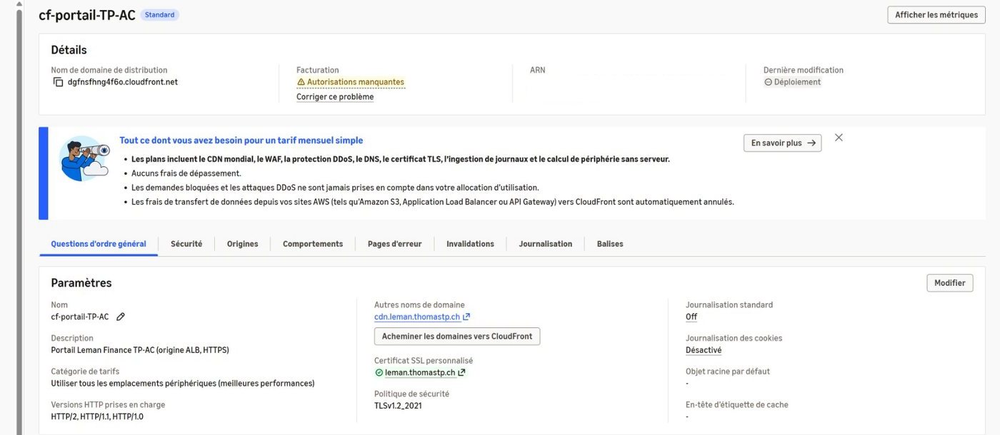

La distribution `cf-portail-TP-AC` porte le nom alternatif `cdn.leman.thomastp.ch` et le certificat ACM `leman.thomastp.ch` (coche verte), avec la politique de sécurité `TLSv1.2_2021`. L'avertissement « Facturation : Autorisations manquantes » est celui des forfaits (voir les pièges).

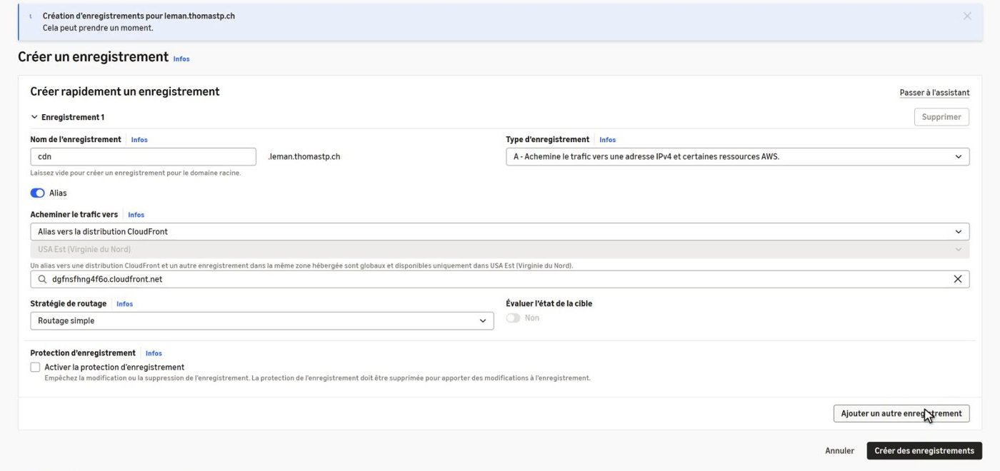

L'enregistrement `cdn.leman.thomastp.ch` : un alias vers la distribution CloudFront. La console grise la région (« USA Est (Virginie du Nord) »), car CloudFront est global.

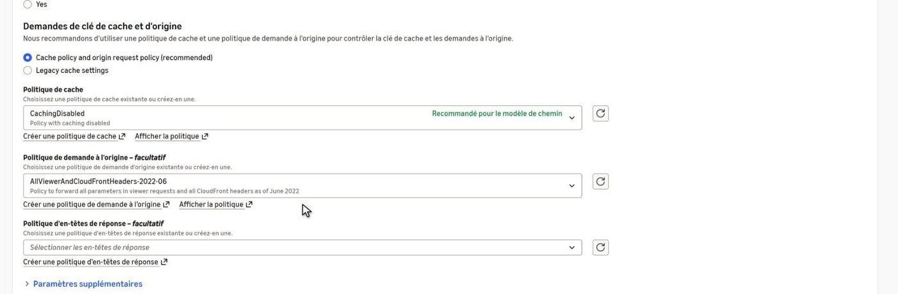

Le comportement `/api/*` : `CachingDisabled` pour la politique de cache et `AllViewerAndCloudFrontHeaders-2022-06` pour la requête à l'origine.

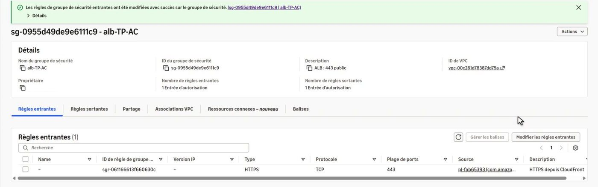

`alb-TP-AC` après la modification : une seule règle entrante, le port 443 depuis la liste de préfixes `pl-fab65393` (`com.amazonaws.global.cloudfront…`).

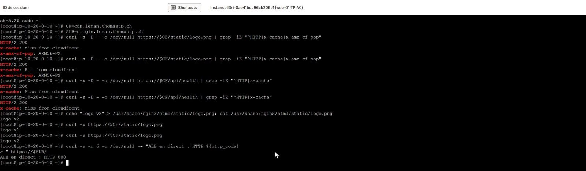

Tous les tests dans un seul terminal. `Miss` puis `Hit` sur le fichier statique (point de présence `ARN56-P2`), `Miss` à chaque appel sur l'API. Le fichier modifié sur `web-01` (`logo v2`) est servi en `logo v1` par le cache, puis en `logo v2` après l'invalidation. L'accès direct à l'ALB reste sans réponse (`HTTP 000`).

## Tableau récapitulatif
| Élément | Valeur |
|---|---|
| Distribution | `cf-portail-TP-AC`, paiement à l'utilisation, sans pare-feu applicatif |
| Origine | `origin.leman.thomastp.ch` (l'ALB), HTTPS seulement |
| Nom alternatif et certificat | `cdn.leman.thomastp.ch`, certificat ACM `leman.thomastp.ch` de `us-east-1` (posés par la CLI) |
| Alias Route 53 | `cdn.leman.thomastp.ch` vers la distribution |
| Comportement `/static/*` | `CachingOptimized`, GET et HEAD |
| Comportement `/api/*` | `CachingDisabled`, requête à l'origine `AllViewerAndCloudFrontHeaders-2022-06`, toutes les méthodes |
| `alb-TP-AC` | 443 depuis `com.amazonaws.global.cloudfront.origin-facing` seulement |

## Résultats des tests
Le journal ci-dessous vient du premier passage, fait avec la ligne de commande sur la même configuration (origine HTTPS, nom `cdn.leman.thomastp.ch`). La vidéo refait les mêmes tests dans la console : mêmes résultats, `Miss` puis `Hit`, l'API jamais en cache, l'ancienne version servie jusqu'à l'invalidation, l'ALB injoignable en direct.

```
=== Domaine reel (20/11/2026) : CloudFront (cdn.leman.thomastp.ch, origine HTTPS origin.leman.thomastp.ch) ===
1er appel /static/logo.png : HTTP/1.1 200 OK X-Cache: Miss from cloudfront
2e appel  /static/logo.png : HTTP/1.1 200 OK X-Cache: Hit from cloudfront
contenu : logo v1
API 1 : HTTP/1.1 200 OK X-Cache: Miss from cloudfront
API 2 : HTTP/1.1 200 OK X-Cache: Miss from cloudfront
fichier modifie sur web-01 (v2) ; le cache sert encore : logo v1 (HTTP/1.1 200 OK X-Cache: Hit from cloudfront )
apres invalidation (Completed) : logo v2 (HTTP/1.1 200 OK X-Cache: Hit from cloudfront )

=== ALB verrouille : seul CloudFront (liste de prefixes geree par AWS) peut le joindre ===
acces direct a l'ALB (origin.leman.thomastp.ch) : HTTP 000 (delai depasse attendu)
via CloudFront (cdn.leman.thomastp.ch/api/health) : app-01 TP-AC (cfn) /api/health
 [HTTP 200]
```

## Pièges rencontrés
- **Le certificat n'apparaissait pas dans la console.** Pour le nom alternatif, la liste de certificats de la console ne proposait pas notre certificat de `us-east-1`. Nous avons posé le nom et le certificat avec la ligne de commande ; tout le reste est fait dans la console.
- **« Autorisations manquantes ».** À l'étape du forfait, la console dit qu'elle ne peut pas vérifier nos autorisations pour les forfaits à tarif unique ; une fois la distribution créée, la ligne « Facturation » affiche le même avertissement avec un lien « Corriger ce problème ». Nous avons gardé le paiement à l'utilisation, qui fonctionne sans ces autorisations.
- **Le nom de l'origine.** Avec le nom `….elb.amazonaws.com` de l'ALB, le certificat de l'ALB ne correspond pas et CloudFront refuserait la connexion HTTPS. Nous tapons donc `origin.leman.thomastp.ch`.
- **Une distribution qui se déploie.** Juste après la création et après chaque modification, la distribution reste « Déploiement » pendant quelques minutes.
- **Le cache garde l'ancienne version.** Après la modification du fichier sur `web-01`, `curl` obtient encore `logo v1` : c'est le comportement attendu, jusqu'à l'invalidation.
- **L'API ne doit pas être mise en cache.** `Miss` à chaque appel sur `/api/health` confirme que `CachingDisabled` fonctionne. Si une requête de l'API était servie depuis le cache, un client pourrait recevoir la réponse d'un autre.

## Ce qui diffère du sujet
- **Le domaine et le certificat** sont réels (écart n°9 de `docs/02-ecarts-au-sujet.md`) : la distribution est servie sous `cdn.leman.thomastp.ch` avec un vrai certificat. Seul le réglage du nom alternatif a été fait en ligne de commande, parce que la console ne proposait pas le certificat.
- **L'origine est en HTTPS**, avec un vrai certificat sur l'ALB, comme le réglage recommandé de la console.
- **La politique de requête de `/api/*`** est `AllViewerAndCloudFrontHeaders-2022-06`, pas `AllViewer` : c'est le nom exact de la politique que nous avons choisie dans la liste.
- **Pas de pare-feu applicatif (WAF).**
- **Environnement de tournage** : voir le module 9.

## Nettoyage
La distribution a été désactivée après avoir retiré le nom alternatif et le certificat, puis supprimée le 20/11/2026, avec l'enregistrement `cdn`, le certificat de `us-east-1` et le reste de ce qui avait été créé pour les modules 9 à 11 (voir `docs/NETTOYAGE.md`). La seule ressource qui reste de notre projet est le Network Firewall `nfw-prod-leman-TP-AC` du module 4, dont la suppression est bloquée côté AWS.


---

# Module 12 – CloudWatch et Flow Logs

## Objectif
Savoir si le portail va bien sans fixer la console toute la journée : un tableau de bord pour voir, une alarme qui prévient quand le site renvoie des erreurs, et les journaux de flux du VPC pour comprendre pourquoi une connexion a été refusée.

## Ce qu'il faut savoir
**Métriques et alarmes.** Chaque service envoie ses mesures à CloudWatch, par exemple le nombre de réponses 5xx de l'ALB par minute. Une alarme prend une statistique (somme, moyenne…) sur une période, la compare à un seuil et se trouve dans l'un des trois états suivants : `OK`, `En alarme` ou `Données insuffisantes`. Le troisième est piégeux. Si l'ALB ne reçoit aucune requête pendant une minute, la métrique n'a tout simplement pas de point pour cette minute, et selon le réglage « traitement des données manquantes » l'alarme n'a rien à évaluer. Nous y reviendrons dans les résultats.

**SNS et SQS.** Une rubrique SNS diffuse chaque message à tous ses abonnés : une adresse e-mail, une file, une fonction Lambda… Une file SQS garde les messages jusqu'à ce que quelqu'un les lise. Comme l'adresse e-mail de notre rubrique est fictive et ne pourra jamais être confirmée, la file nous sert de preuve : si un message y arrive, c'est que l'alarme a bien parlé à la rubrique.

**Flow Logs.** Un journal de flux enregistre, pour chaque interface réseau du VPC, les connexions vues pendant une fenêtre (dix minutes par défaut) : adresse source et destination, ports, protocole, et surtout `ACCEPT` ou `REJECT`. On l'envoie dans un groupe de journaux CloudWatch, que l'on interroge ensuite avec Logs Insights.

## Ce que nous avons fait
Tout a été fait dans la console, région Europe (Stockholm). Les noms portent le suffixe `-TP-AC` et les balises habituelles (Projet, Equipe, Environnement).

1. **La rubrique SNS.** SNS, Rubriques, Créer : type Standard, nom `sns-exploitation-leman-TP-AC`, nom complet « Alertes exploitation Leman ». Ensuite un abonnement de protocole « Adresse de messagerie » vers `exploitation-tp-ac@example.com` (adresse fictive, choisie pour la vidéo). L'abonnement reste en « Confirmation en attente » : personne ne peut cliquer le lien de confirmation.
2. **La file SQS.** SQS, Créer une file d'attente : type Standard, nom `sqs-exploitation-leman-TP-AC`, réglages par défaut (chiffrement SSE-SQS compris).
3. **L'abonnement de la file à la rubrique.** Depuis la console SQS, onglet « Abonnements SNS », « Abonner à la rubrique Amazon SNS », choix de `sns-exploitation-leman-TP-AC`, Enregistrer. La console ajoute elle-même à la file l'autorisation qui permet à la rubrique d'y écrire.
4. **L'alarme.** CloudWatch, Alarmes, Créer une alarme. Métrique `HTTPCode_ELB_5XX_Count` de l'espace de noms `AWS/ApplicationELB`, pour l'ALB `alb-prod-leman-TP-AC`. La console propose par défaut la statistique « Moyenne » sur 5 minutes : nous passons à **Somme** sur **1 minute**, condition « Supérieur » au seuil **5**. Deux notifications vers la rubrique `sns-exploitation-leman-TP-AC` : une quand l'alarme passe **En alarme**, une quand elle passe **OK**. Nom : `alarm-5xx-portail-TP-AC`. À la création, la console signale que certains abonnements sont encore en attente de confirmation (celui de l'e-mail).
5. **Le tableau de bord `db-portail-leman-TP-AC`.** Nous le créons vide, puis « Actions » et l'édition de la source : au lieu d'ajouter les widgets un par un, nous collons un JSON de quatre graphiques en courbes (période 60 s) : « Cibles saines » (`HealthyHostCount` de `tg-web-TP-AC` et `tg-app-TP-AC`), « Cibles non saines » (`UnHealthyHostCount`, mêmes groupes), « Temps de reponse de l ALB » (`TargetResponseTime`) et « Erreurs 5xx de l ALB » (`HTTPCode_ELB_5XX_Count`, somme). « Mettre à jour », puis « Enregistrer ». (Dans le JSON, nous avons écrit les titres sans accent ni apostrophe.)
6. **Le journal de flux.** Console VPC, le VPC `vpc-prod-leman-TP-AC`, onglet « Journaux de flux », Créer : nom `fl-vpc-prod-leman-TP-AC`, filtre **Tout**, intervalle d'agrégation de 10 minutes (valeur par défaut), destination « Envoyer aux journaux CloudWatch », groupe `/leman/vpc-prod/flow-TP-AC` (saisi à la main : la console le crée), « Créer et utiliser un nouveau rôle de service » (la console le nomme `VPCFlowLogs-Cloudwatch-` suivi d'un numéro) et format par défaut.
7. **Du trafic refusé à retrouver.** Depuis une session Systems Manager sur `rtr-agence-TP-AC` (le routeur simulé de l'agence), nous lançons cinq tentatives de connexion TCP vers le port 22 de `web-01-TP-AC` (`timeout 3 bash -c "</dev/tcp/$WEB/22"`). Le terminal affiche cinq fois « port 22 refuse » : le Security Group de `web-01-TP-AC` n'ouvre pas le 22 à cette source.
8. **Logs Insights.** CloudWatch, Logs Insights, groupe `/leman/vpc-prod/flow-TP-AC`, plage d'une heure, requête :
   `filter action="REJECT" | stats count(*) as refus by srcAddr, dstPort | sort refus desc | limit 10`
9. **Le test de l'alarme.**
   - Sur `web-01-TP-AC`, session Systems Manager : `systemctl stop nginx`.
   - Sur `rtr-siege-TP-AC`, une boucle envoie soixante requêtes, une par seconde, à `https://<domaine CloudFront>/essai1` jusqu'à `/essai60` et affiche le code HTTP. Nous obtenons soixante fois **502** : CloudFront passe à l'ALB, qui ne joint plus nginx.
   - Nous rechargeons la page de l'alarme toutes les trente secondes environ, jusqu'à ce qu'elle passe **En alarme** (la vidéo accélère l'attente).
   - Nous relançons nginx (`systemctl start nginx`) et attendons encore quelques minutes sans envoyer de requête.
10. **La preuve de réception.** SQS, `sqs-exploitation-leman-TP-AC`, « Envoyer et recevoir des messages », « Rechercher des messages » : la file contient deux messages, que nous ouvrons.

## Captures
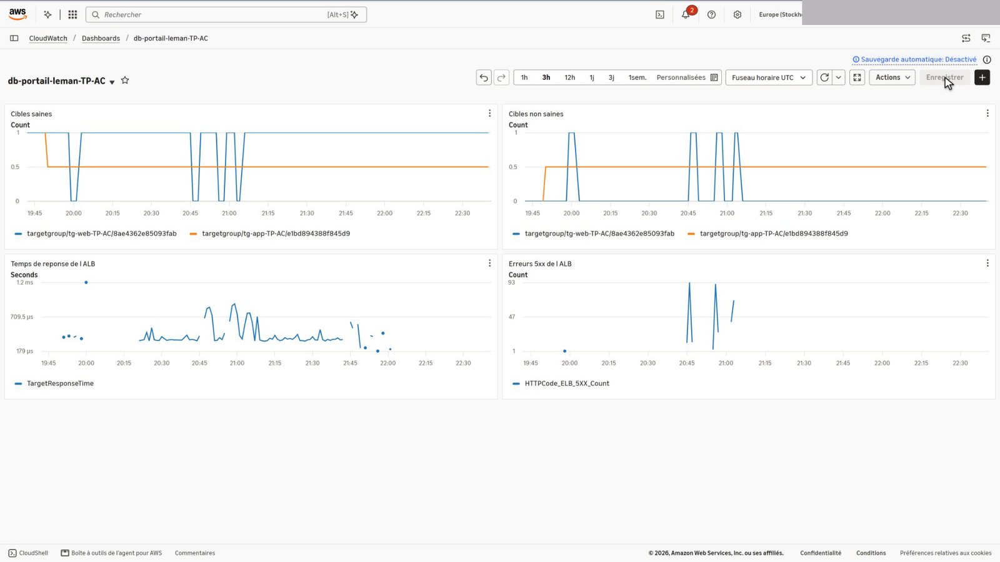

Le tableau de bord enregistré, avec les données déjà reçues de l'ALB. Les courbes gardent la trace des pannes provoquées aux modules précédents, comme l'arrêt de nginx du module 9 : cibles qui tombent, pics d'erreurs 5xx (jusqu'à 93 par minute).

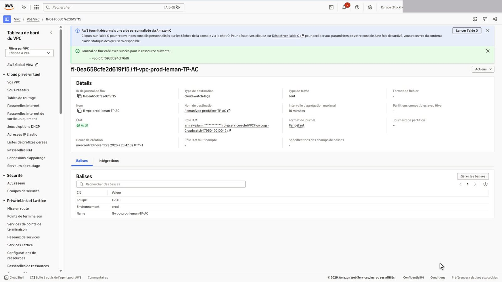

Le journal de flux juste après sa création : état « Actif », type de trafic « Tout », destination `/leman/vpc-prod/flow-TP-AC`, créé le 18 novembre 2026 à 23 h 47 (heure locale).

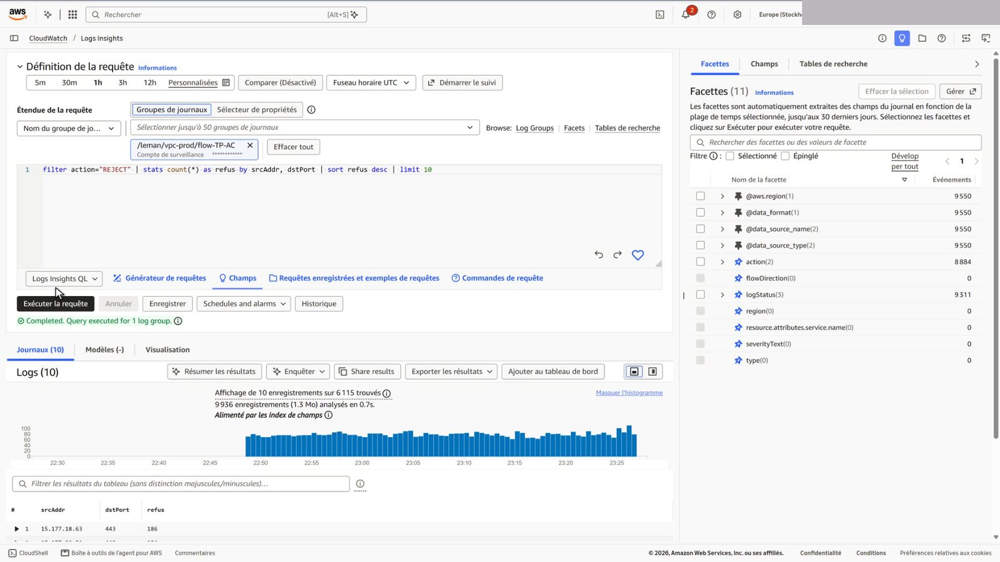

La requête Logs Insights a analysé 9 936 enregistrements de la dernière heure et en a trouvé 6 115 refusés. La première ligne du tableau est une adresse en `15.177.18.63` qui totalise 186 refus enregistrés sur le port 443.

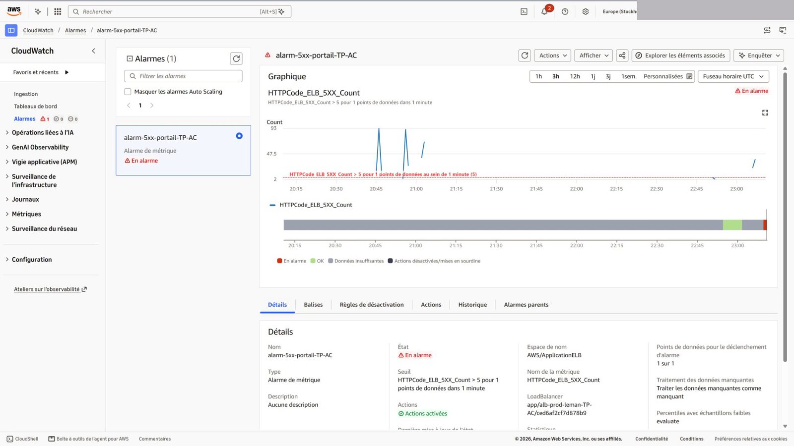

L'alarme après les soixante 502 : état « En alarme », seuil « `HTTPCode_ELB_5XX_Count` > 5 pour 1 points de données dans 1 minute », actions activées. La chronologie du dessous montre la bande verte (OK) d'avant, puis la bande rouge.

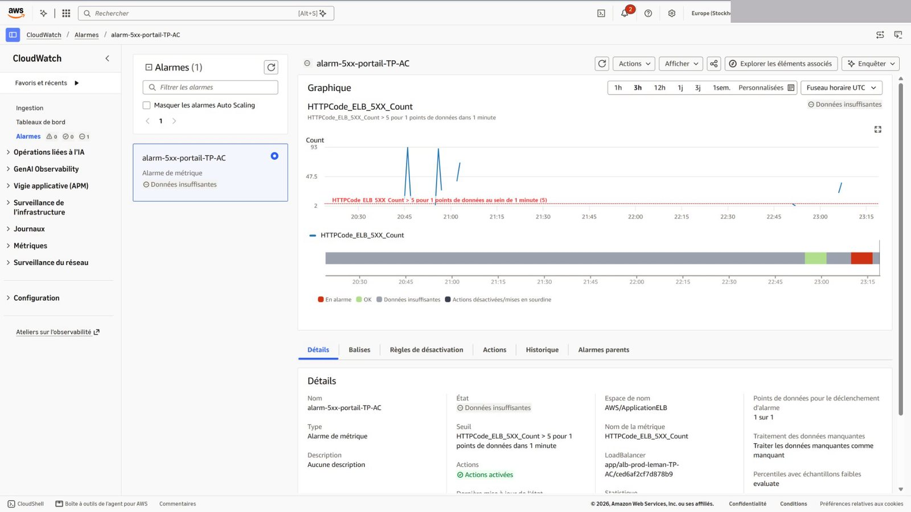

Quelques minutes après le redémarrage de nginx, la même alarme est sortie de l'alarme, mais elle affiche « Données insuffisantes », pas « OK » (voir les résultats et les pièges).

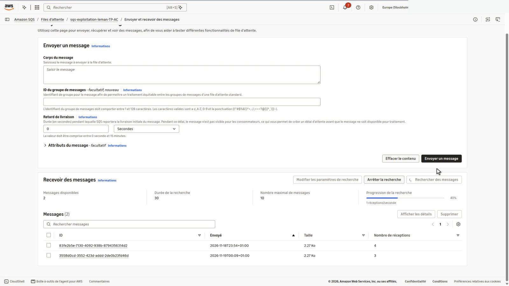

La file contient deux notifications de la rubrique, taille 2,27 Ko chacune. La console SQS affiche l'heure locale (UTC+1), alors que les graphiques CloudWatch sont en UTC.

## Tableau récapitulatif
| Élément | Nom | Réglage |
|---|---|---|
| Rubrique SNS | `sns-exploitation-leman-TP-AC` | Standard ; abonnés : e-mail fictif (jamais confirmé) et la file SQS |
| File SQS | `sqs-exploitation-leman-TP-AC` | Standard, réglages par défaut |
| Alarme | `alarm-5xx-portail-TP-AC` | `HTTPCode_ELB_5XX_Count` de `alb-prod-leman-TP-AC`, somme sur 1 minute, supérieur à 5, 1 point sur 1 ; données manquantes traitées comme manquantes |
| Actions de l'alarme | vers la rubrique SNS | au passage En alarme et au passage OK (rien pour « Données insuffisantes ») |
| Tableau de bord | `db-portail-leman-TP-AC` | 4 graphiques, période 60 s |
| Journal de flux | `fl-vpc-prod-leman-TP-AC` | tout le trafic, agrégation 10 min, vers CloudWatch Logs |
| Groupe de journaux | `/leman/vpc-prod/flow-TP-AC` | créé par la console, sans durée de conservation fixée |
| Rôle de service | `VPCFlowLogs-Cloudwatch-…` | créé par la console pour le journal de flux |

## Résultats des tests
Ce que la vidéo montre, dans l'ordre :

| Test | Résultat |
|---|---|
| Abonnement e-mail | « Confirmation en attente » (adresse fictive) |
| Abonnement de la file | créé, la console confirme « Abonnement à la rubrique … effectué avec succès » |
| Alarme juste après sa création et avant le test | « Données insuffisantes » |
| Journal de flux | état « Actif » |
| Sonde SSH vers `web-01-TP-AC` | 5 essais, 5 refus affichés par le terminal |
| Logs Insights | requête terminée : 10 lignes sur 6 115 refus ; en tête, `15.177.18.63` vers le port 443, 186 refus |
| 60 requêtes via CloudFront avec nginx arrêté | 60 codes 502 |
| Alarme après ces requêtes | **En alarme** |
| Alarme après le redémarrage de nginx et quelques minutes sans trafic | **Données insuffisantes** (pas OK) |
| File SQS | 2 messages, envoyés à 23 h 54 le 18 novembre et à 0 h 09 le 19 novembre (UTC+1) |

Sur ces deux messages, voici ce que nous pouvons affirmer. Leurs heures d'envoi correspondent à la chronologie de l'alarme : la bande verte (OK) commence vers 22 h 54 UTC, soit 23 h 54 à Genève, et la bande rouge (En alarme) vers 23 h 09 UTC, soit 0 h 09. Le premier message est donc le passage à OK, le second le passage en alarme. Dans la vidéo, nous n'avons pas fait défiler le texte des messages : la fenêtre n'en montre que les premières lignes (`"Type" : "Notification"`).

Le bloc ci-dessous est la sortie de notre première exécution, faite en ligne de commande avant que nous refassions tout à la main. Il garde son intérêt pour les mesures, mais l'alarme n'y avait pas les mêmes réglages (5 minutes sur 2 périodes, erreurs des cibles) ; le retour à OK qui y figure ne concerne donc pas l'alarme filmée.

```
=== TP1 : tableau de bord ===
Tableau de bord : db-portail-leman-TP-AC
HealthyHostCount tg-web (derniere minute) : 1.0

=== TP3 : Flow Logs (SSH non autorise vers web-01) ===
6 tentatives de connexion TCP sur le port 22 de web-01 depuis cette machine (refusees par sg-web)

=== TP2 : alarme ===
Etat initial : INSUFFICIENT_DATA
Trafic 5xx genere pendant 10 min -> etat de l'alarme : ALARM
Notification SNS recue dans sqs-exploitation-leman-TP-AC : { "Type" : "Notification", "MessageId" : "c384ef0a-2ba5-5287-897d-8c7edf73d6a8", "TopicArn" : "arn:aws:sns:eu-north-1:000000000000:sns-exploitation-leman-TP-AC", "Subject" : "OK: \"alarm-5xx-portail-TP-AC\" in EU (Stockholm)", "Message" : "{\"AlarmName\":\"alarm-5xx-portail-TP-AC\",\"AlarmDescription\":\"TP-AC : plus de 5 erreurs 5xx cibles sur 5 min, 2 periodes consecutives\",\"AWSAccountId\":\"0...
Apres arret des erreurs (18 min) -> etat de l'alarme : OK
Notification de retour a la normale presente : oui

=== TP3 (reel) : Flow Logs ===
Controle : port 22 sortant depuis ce poste (github.com:22) -> ouvert
8 tentatives TCP vers le port 22 de l'ALB (2 noeuds publics) depuis ce poste (84.226.x.x) -> 8 timeout : refusees par sg-alb (seul le port 80 est ouvert, au prefixe CloudFront)
Recherche dans /leman/vpc-prod/flow-TP-AC (source = ce poste, port 22, REJECT) :
  2 000000000000 eni-034bc06f123a72b63 84.226.x.x 10.20.0.115 61404 22 6 2 104 1794837701 1794837721 REJECT OK
  2 000000000000 eni-034bc06f123a72b63 84.226.x.x 10.20.0.115 60965 22 6 2 104 1794837701 1794837721 REJECT OK
  2 000000000000 eni-034bc06f123a72b63 84.226.x.x 10.20.0.115 63656 22 6 2 104 1794837701 1794837721 REJECT OK
  2 000000000000 eni-034bc06f123a72b63 84.226.x.x 10.20.0.115 59395 22 6 2 104 1794837701 1794837721 REJECT OK
  2 000000000000 eni-05458be49638c7015 84.226.x.x 10.20.0.7 62411 22 6 2 104 1794837702 1794837733 REJECT OK
  2 000000000000 eni-05458be49638c7015 84.226.x.x 10.20.0.7 63203 22 6 2 104 1794837702 1794837733 REJECT OK
  2 000000000000 eni-05458be49638c7015 84.226.x.x 10.20.0.7 64715 22 6 2 104 1794837702 1794837733 REJECT OK
  2 000000000000 eni-05458be49638c7015 84.226.x.x 10.20.0.7 63102 22 6 2 104 1794837702 1794837733 REJECT OK
Requete Logs Insights : filter action = "REJECT" and dstPort = 22 and srcAddr = <ce poste> | stats count(*) as n by srcAddr, dstAddr, dstPort | sort n desc
Resultat : srcAddr=84.226.x.x dstAddr=10.20.0.115 dstPort=22 n=4 | srcAddr=84.226.x.x dstAddr=10.20.0.7 dstPort=22 n=4
Diagnostic : le rejet vient du Security Group sg-alb (port 22 non ouvert) : source, ENI de l'ALB, port 22 et action REJECT le prouvent.

=== TP3 (web-01) : Flow Logs, sonde SSH vers web-01 ===
Controle : https vers web-01 (443 ouvert) -> HTTP 000 pendant le script (web-01 venait de demarrer) ; controle refait a part, web-01 demarree : HTTP 200
10 tentatives TCP vers web-01:22 depuis une machine non autorisee (84.226.x.x) -> 10 timeout (sg-web n'ouvre le 22 qu'a la salle d'exploitation)
Recherche dans /leman/vpc-prod/flow-TP-AC (source = ce poste, destination 10.20.0.10, port 22, REJECT) :
  aucune ligne livree dans le delai
Requete Logs Insights : filter action = "REJECT" and dstPort = 22 and srcAddr = <ce poste> and dstAddr = "10.20.0.10" | stats count(*) as n by srcAddr, dstAddr, dstPort
Resultat : srcAddr=84.226.x.x dstAddr=10.20.0.10 dstPort=22 n=1
Diagnostic : rejet par sg-web (port 22 non ouvert a cette source) ; ENI de web-01, port 22, action REJECT.
```

## Pièges rencontrés
- **Pas de retour à OK sans trafic.** Notre alarme est repassée à « Données insuffisantes », pas à « OK », et aucune notification de retour à la normale n'est donc partie. Sans requête, l'ALB n'émet pas de point de métrique, et nous avons laissé le réglage par défaut (données manquantes traitées comme manquantes). Pour obtenir un OK, il suffit d'envoyer quelques requêtes saines après la panne, ou de choisir « Traiter les données manquantes comme bonnes ». Nous ne l'avons pas fait dans la vidéo.
- **Statistique par défaut.** La console propose « Moyenne » sur 5 minutes. Pour compter des erreurs, il faut la somme, et une minute pour que l'alarme réagisse vite.
- **Deux ALB du même nom dans CloudWatch.** En filtrant sur `alb-prod-leman-TP-AC`, la console trouve deux répartiteurs (suffixes `0174805d…` et `ced6af2c…`), probablement parce que l'ALB a été recréé pendant les modules 9 à 11. L'alarme porte sur le second, `ced6af2c…`.
- **Un e-mail fictif ne se confirme pas.** L'abonnement e-mail reste « Confirmation en attente » ; sans la file SQS, nous n'aurions aucune preuve d'envoi.
- **Le journal de flux n'est pas instantané.** Les enregistrements arrivent par fenêtres de dix minutes et mettent quelques minutes à apparaître dans le groupe de journaux. Dans notre rush, l'histogramme de Logs Insights commence environ trois minutes après la création du journal.
- **La requête du haut du classement n'est pas notre sonde.** Dans l'heure analysée, la requête a trouvé 6 115 enregistrements de refus, sans doute du bruit d'Internet et des appels vers le port 443 de l'ALB, fermé à tout sauf à CloudFront depuis le module 11. Nos cinq essais SSH ne figurent pas parmi les lignes visibles à l'écran. Pour les isoler, il fallait ajouter `and dstPort = 22` au filtre ; nous ne l'avons pas fait dans la vidéo. Nous n'avons pas vérifié qui est derrière `15.177.18.63` (nous soupçonnons un service d'Amazon, par exemple les sondes de santé de Route 53).
- **Fuseaux horaires.** Les graphiques CloudWatch sont réglés en UTC, les consoles SQS et VPC affichent l'heure locale (UTC+1) : un décalage d'une heure qui peut faire croire à une erreur.

## Si ça ne marche pas : quatre vérifications
1. Quelle métrique dérive : erreurs 5xx, temps de réponse, cibles saines ? Le tableau de bord le dit en un coup d'œil.
2. L'état de l'alarme, son onglet « Historique » et le traitement des données manquantes.
3. Les abonnements de la rubrique : statut confirmé ? La file autorise-t-elle la rubrique à écrire ?
4. Les journaux de flux : la requête `filter action="REJECT" | stats count(*) by srcAddr, dstPort` donne la source et le port, puis la règle de Security Group ou de NACL à corriger.

## Ce qui diffère du sujet
- **E-mail.** L'adresse d'abonnement est fictive : aucune notification n'arrive dans une vraie boîte. La preuve de réception passe par la file SQS.
- **Alarme.** Nous surveillons les erreurs 5xx de l'ALB lui-même (`HTTPCode_ELB_5XX_Count`), celles qu'il renvoie quand plus aucune cible ne répond (502). La fenêtre est d'une minute, avec un seul point : l'alarme réagit vite, ce qui raccourcit le test, au prix d'une sensibilité plus grande aux pointes isolées. Notre première version, en ligne de commande, comptait les 5xx des cibles sur 5 minutes et deux périodes.
- **Déclenchement du test.** Nous provoquons l'erreur en arrêtant nginx et non par une route d'erreur de notre API.
- **Retour à la normale.** Il n'est pas démontré dans la vidéo (voir les pièges).
- **Conservation des journaux.** Nous n'avons pas fixé de durée de conservation sur le groupe `/leman/vpc-prod/flow-TP-AC` (notre première version la limitait à 3 jours). Le groupe aurait donc conservé les journaux indéfiniment sans notre nettoyage.
- **Logs Insights.** La capture montre le classement général des refus, pas le filtre précis sur le port 22 de notre sonde.

## Nettoyage
Le 20 novembre 2026, nous avons supprimé tout ce qui a été créé dans ce module : l'alarme `alarm-5xx-portail-TP-AC`, le tableau de bord `db-portail-leman-TP-AC`, la rubrique `sns-exploitation-leman-TP-AC` avec ses abonnements, la file `sqs-exploitation-leman-TP-AC`, le journal de flux `fl-vpc-prod-leman-TP-AC`, le groupe de journaux `/leman/vpc-prod/flow-TP-AC` et le rôle de service du journal de flux. Les requêtes Logs Insights ne laissent rien à supprimer. Voir `docs/NETTOYAGE.md` pour l'ensemble du projet, où seul le Network Firewall `nfw-prod-leman-TP-AC` reste bloqué côté AWS.


---

# Module 13 – CloudFormation

## Objectif
Décrire une partie du réseau dans un modèle CloudFormation, le déployer en pile depuis la console, constater une dérive quand quelqu'un modifie une ressource à la main, la corriger, puis supprimer la pile d'un seul geste.

## Ce qu'il faut savoir
Un **modèle** est un fichier (ici en YAML) qui décrit des ressources, des paramètres que l'on remplit au déploiement et des sorties. Une **pile** est ce modèle une fois déployé. CloudFormation calcule l'ordre de création d'après les dépendances et supprime dans l'ordre inverse : la pile ne retire que ce qu'elle a créé.

Un modèle qui crée un rôle IAM oblige à cocher une case de la console (« Je sais qu'AWS CloudFormation peut créer des ressources IAM »), ce qui correspond à la capacité `CAPABILITY_IAM`.

La **dérive** (drift) est l'écart entre ce que le modèle décrit et ce qui existe vraiment, par exemple après une modification faite à la main dans une autre console. CloudFormation la détecte ressource par ressource, mais seulement pour les types qui la gèrent : dans notre pile, douze ressources sur quinze.

Un **jeu de modifications** (change set) montre ce qu'une mise à jour va ajouter, modifier ou remplacer avant de l'exécuter. Nous l'avons utilisé lors de notre première version en ligne de commande, mais nous ne l'avons pas refait dans la console (voir plus bas).

## Ce que nous avons fait
Tout dans la console CloudFormation, région Europe (Stockholm), le 19 novembre 2026 après minuit.

1. **Le modèle.** Nous avons déployé `cfn/reseau-leman-etape1.yaml`. Il décrit **quinze ressources** : un VPC, trois sous-réseaux (public 1a, public 1b, privé 1a), une passerelle Internet et son attachement, une table de routage publique avec sa route par défaut et ses deux associations, trois Security Groups (ALB, web, app) et un rôle IAM avec son profil d'instance pour Systems Manager. Les noms portent `-cfn-TP-AC` (par exemple `sg-web-cfn-TP-AC`), pour ne pas les confondre avec le réseau fait à la main aux modules 1 à 3. Ce VPC est un second réseau à côté du premier : plage `10.30.0.0/22`, alors que le réseau de production du TP est en `10.20.0.0/22`.
2. **La création.** « Créer une pile », « Choisir un modèle existant », « Charger un fichier de modèle » : la console envoie le fichier dans un compartiment S3 qu'elle gère. Nom de la pile : `stack-portail-leman-TP-AC`. Les paramètres gardent leurs valeurs par défaut, sauf `CertificateArn`, obligatoire, que nous remplissons (la vidéo masque la valeur). Dans les options : balises Projet (`SatomCloudNetwork`), Equipe (`TP-AC`), Environnement (`prod`), et la case des capacités IAM. Puis « Soumettre ».
3. **L'état de la pile.** Créée à 0 h 37 min 25 s, elle passe en `CREATE_COMPLETE` à 0 h 40 min 01 s. L'onglet « Événements » montre l'ordre : le VPC et ses voisins d'abord, puis les routes, les Security Groups, et en dernier le profil d'instance, qui attend son rôle. L'onglet « Ressources » en liste quinze, toutes en `CREATE_COMPLETE`, et « Sorties » en donne deux : `VpcId` et `SgWebId`, exportées sous `stack-portail-leman-TP-AC-VpcId` et `stack-portail-leman-TP-AC-SgWebId`.
4. **La dérive.** Dans la console EC2, nous ouvrons le Security Group `sg-web-cfn-TP-AC` (créé par la pile) et nous ajoutons une règle entrante à la main : SSH (TCP 22) depuis `203.0.113.0/24`, description « SSH ajoute a la main ».
5. **La détection.** De retour dans la pile : « Actions de pile », « Détecter l'écart de pile ». Quelques dizaines de secondes plus tard, la pile est en `DRIFTED` (vérification de 0 h 45 min 56 s). Les résultats listent douze ressources : le `SgWeb` est en `MODIFIED`, toutes les autres lignes visibles à l'écran en `IN_SYNC`. Le détail de l'écart montre une différence, `SecurityGroupIngress.1`, de type `ADD`, avec les valeurs « attendue » (la règle du port 80 seulement) et « actuelle » (les deux règles, dont le SSH).
6. **La correction.** Nous supprimons la règle SSH dans EC2, puis nous relançons la détection. La pile repasse à `IN_SYNC` (vérification de 0 h 49 min 15 s).
7. **La suppression.** « Supprimer la pile », nous saisissons son nom pour confirmer (case « Mode Express » laissée décochée). La suppression démarre à 0 h 51 min 58 s et se termine à 0 h 52 min 20 s. Les événements montrent l'ordre inverse de la création : les Security Groups, la passerelle Internet, les sous-réseaux, la table de routage, et le VPC en dernier.

## Ce que la pile couvre, et ce qu'elle ne couvre pas
La vidéo n'installe pas tout le TP dans CloudFormation. Voici ce qui y est et ce qui n'y est pas.

| Dans la pile `stack-portail-leman-TP-AC` | Pas dans la pile filmée |
|---|---|
| VPC, trois sous-réseaux, passerelle Internet, table et route publiques | `web-01`, `app-01`, les groupes cibles et l'ALB |
| trois Security Groups, rôle IAM et profil SSM | Network Firewall, Transit Gateway, VPN, Direct Connect |
| deux sorties exportées | Route 53, CloudFront, surveillance |
| | aucun jeu de modifications, aucune recréation après suppression |

Le dépôt contient aussi `cfn/reseau-leman.yaml` (le même réseau, avec `web-01`, `app-01`, les groupes cibles et l'ALB en HTTPS) et `cfn/interconnexion-leman.yaml` (pare-feu, Transit Gateway, VPN, Direct Connect Gateway). Lors de notre première exécution en ligne de commande, nous avons déployé `reseau-leman.yaml` avec un jeu de modifications, testé la dérive, supprimé la pile puis redéployé (bloc des tests plus bas), et nous avons déployé, supprimé et redéployé `interconnexion-leman.yaml`. Nous n'avons rien rejoué de cela dans la console pour la vidéo.

Sur le certificat : la pile filmée n'importe aucun certificat. Le paramètre `CertificateArn` existe dans le modèle (il sert dans le modèle complet, pour le listener HTTPS de l'ALB), mais aucune des quinze ressources ne l'utilise, et l'étape que nous avons déployée n'a pas d'ALB. La description du paramètre parle encore d'un « certificat importé, auto-signé » : c'est un reste de la première version, où nous importions un certificat auto-signé faute de domaine. Dans la vidéo, nous avons saisi l'ARN d'un certificat ACM déjà présent dans le compte (valeur masquée).

## Captures
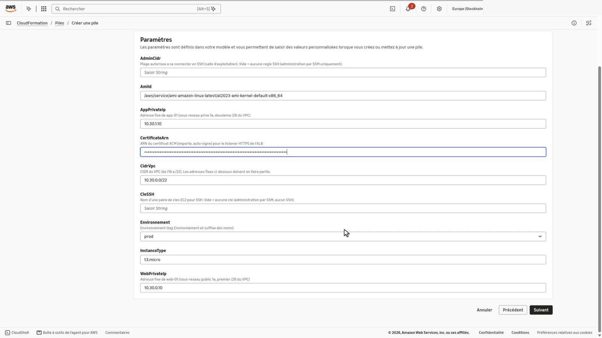

Les paramètres du modèle dans la console. Seul `CertificateArn` est rempli, et masqué à l'écran. `CidrVpc` vaut `10.30.0.0/22`, `Environnement` `prod`, `AdminCidr` et `CleSSH` restent vides : le modèle n'ouvre donc aucun SSH.

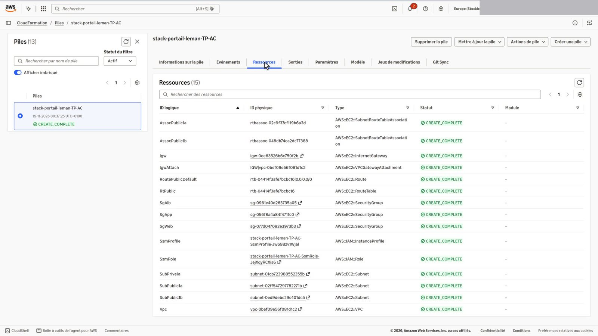

La pile `stack-portail-leman-TP-AC`, créée le 19 novembre 2026 à 0 h 37, en `CREATE_COMPLETE`, avec ses quinze ressources.

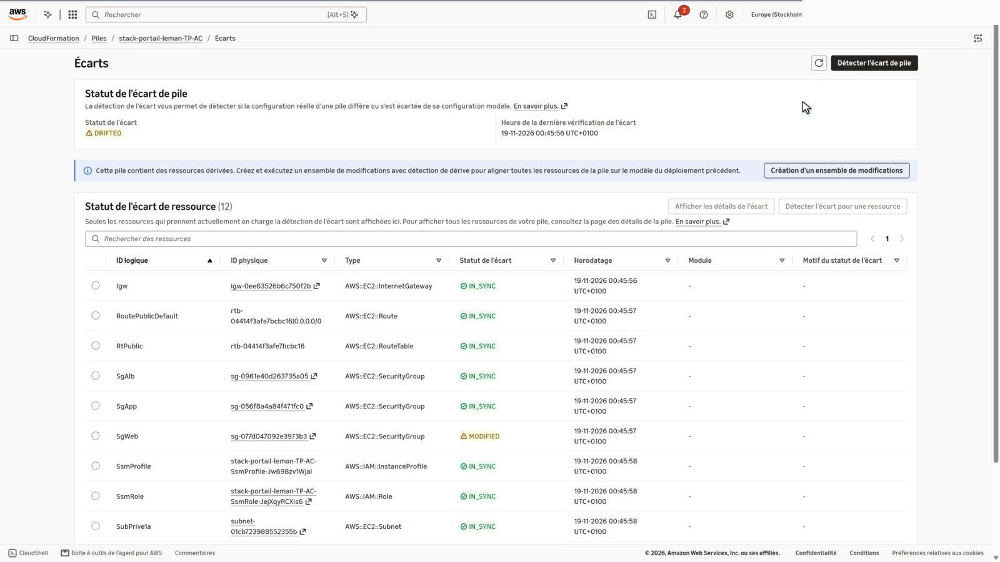

La détection de dérive : pile `DRIFTED`, `SgWeb` en `MODIFIED`, les autres lignes visibles en `IN_SYNC`.

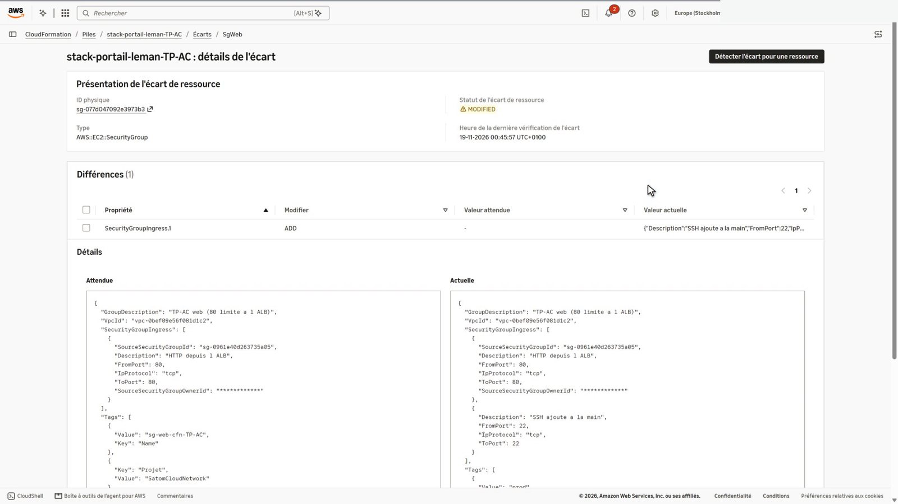

Le détail : propriété `SecurityGroupIngress.1`, modification `ADD`. À droite, la règle « SSH ajoute a la main », port 22, absente du modèle.

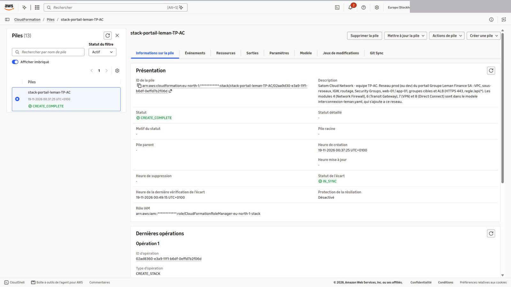

Après le retrait de la règle et une nouvelle détection : statut de l'écart `IN_SYNC`, dernière vérification à 0 h 49 min 15 s.

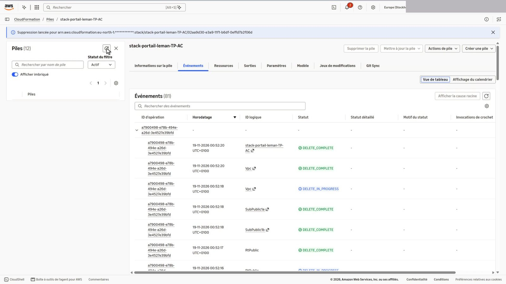

La suppression : les événements les plus récents en haut, `stack-portail-leman-TP-AC` en `DELETE_COMPLETE` à 0 h 52 min 20 s, juste après le VPC. La liste des piles du côté gauche est vide.

## Tableau récapitulatif
| Paramètre | Valeur utilisée |
|---|---|
| `Environnement` | `prod` (autre valeur permise : `dev`) |
| `CidrVpc` | `10.30.0.0/22` (le réseau fait à la main est en `10.20.0.0/22`) |
| `WebPrivateIp` / `AppPrivateIp` | `10.30.0.10` / `10.30.1.10` (non utilisés par cette étape) |
| `AdminCidr` | vide : pas de règle SSH |
| `CleSSH` | vide : administration par Systems Manager, pas de SSH |
| `InstanceType` / `AmiId` | `t3.micro` / Amazon Linux 2023 par paramètre SSM (non utilisés par cette étape) |
| `CertificateArn` | ARN d'un certificat ACM (masqué), non utilisé par cette étape |

| Élément | Valeur |
|---|---|
| Modèle | `cfn/reseau-leman-etape1.yaml`, quinze ressources |
| Pile | `stack-portail-leman-TP-AC`, `CREATE_COMPLETE` en environ deux minutes et demie |
| Sorties | `VpcId`, `SgWebId` |
| Dérive | règle SSH manuelle : `DRIFTED`, puis `IN_SYNC` une fois retirée |
| Suppression | une vingtaine de secondes, dans l'ordre inverse de la création |

## Résultats des tests
Ce que la vidéo montre :

| Test | Résultat |
|---|---|
| Création de la pile depuis le fichier téléversé | `CREATE_COMPLETE`, 15 ressources, 2 sorties |
| Règle SSH ajoutée à la main sur `sg-web-cfn-TP-AC` | pile `DRIFTED`, `SgWeb` `MODIFIED`, différence `SecurityGroupIngress.1` `ADD` |
| Règle retirée, nouvelle détection | pile `IN_SYNC` |
| Suppression de la pile | `DELETE_COMPLETE`, VPC supprimé en dernier |

Le bloc ci-dessous vient de notre première exécution, en ligne de commande et avant de tout refaire à la main. Il couvre ce que la vidéo ne montre pas : le jeu de modifications qui ajoute les instances et l'ALB, la règle SSH déclarée dans le modèle par le paramètre `AdminCidr`, la suppression complète puis le redéploiement. Il utilise le modèle complet, avec un certificat auto-signé (d'où les `curl -k`).

```
=== TP1 : validation et creation de la stack (reseau seul) ===
validate-template : parametres = CidrVpc	WebPrivateIp	AppPrivateIp	AdminCidr	CleSSH	Environnement	InstanceType	CertificateArn	AmiId
Statut : CREATE_COMPLETE ; sorties : VpcId	vpc-0310d32aa87687c10 SgWebId	sg-06d62e0ec61238041

=== TP2 : change set (instances, groupes cibles, ALB) ===
Change set cs-ajouts-912889504 : 7 changements ; actions = Add
   Add  Alb  AWS::ElasticLoadBalancingV2::LoadBalancer
   Add  App01  AWS::EC2::Instance
   Add  ListenerHttps  AWS::ElasticLoadBalancingV2::Listener
   Add  RuleApi  AWS::ElasticLoadBalancingV2::ListenerRule
   Add  TgApp  AWS::ElasticLoadBalancingV2::TargetGroup
   Add  TgWeb  AWS::ElasticLoadBalancingV2::TargetGroup
   Add  Web01  AWS::EC2::Instance
Statut apres execution : UPDATE_COMPLETE
Cibles : tg-web=healthy  tg-app=healthy
curl -k https://alb-prod-leman-cfn-TP-AC-1508405322.eu-north-1.elb.amazonaws.com/api/health -> app-01 TP-AC (cfn) /api/health
curl -k https://alb-prod-leman-cfn-TP-AC-1508405322.eu-north-1.elb.amazonaws.com/ -> web-01 TP-AC (cfn)

=== TP3 : drift, suppression, redeploiement ===
Regle SSH ajoutee a la main sur sg-web-cfn -> drift stack : DETECTION_COMPLETE	DRIFTED
Detail : SgWeb	MODIFIED	/SecurityGroupIngress/1	ADD
Regle manuelle retiree -> drift stack : DETECTION_COMPLETE	IN_SYNC
Change set cs-declaration-template-2112251803 : 1 changements ; actions = Modify
   Modify  SgWeb  AWS::EC2::SecurityGroup
Regle declaree dans le template (AdminCidr) puis redeploiement -> statut : UPDATE_COMPLETE
Apres correction par le template -> drift stack : DETECTION_COMPLETE	IN_SYNC
Regles de sg-web-cfn : tcp	80	None	sg-0517516cc80d5f705 tcp	22	203.0.113.0/24	None
Suppression de la stack (ordre inverse des dependances) : 2 min -> DELETE_COMPLETE (stack disparue)
VPC restants avec le tag de la stack : 0
Change set cs-redeploiement-1694842148 : 7 changements ; actions = Add
   Add  Alb  AWS::ElasticLoadBalancingV2::LoadBalancer
   Add  App01  AWS::EC2::Instance
   Add  ListenerHttps  AWS::ElasticLoadBalancingV2::Listener
   Add  RuleApi  AWS::ElasticLoadBalancingV2::ListenerRule
   Add  TgApp  AWS::ElasticLoadBalancingV2::TargetGroup
   Add  TgWeb  AWS::ElasticLoadBalancingV2::TargetGroup
   Add  Web01  AWS::EC2::Instance
Redeploiement : UPDATE_COMPLETE ; cibles tg-web=healthy tg-app=healthy ; curl -k https://alb-prod-leman-cfn-TP-AC-1090625744.eu-north-1.elb.amazonaws.com/api/health -> app-01 TP-AC (cfn) /api/health
```

## Pièges rencontrés
- **La description du modèle promet plus que le modèle.** La console affiche, dans la fiche de la pile, la description de `reseau-leman-etape1.yaml` : elle parle de `web-01`, `app-01`, de groupes cibles et d'un ALB, qui ne sont pas dans cette étape. C'est un reste de la première version du fichier.
- **Un paramètre obligatoire qui ne sert à rien.** `CertificateArn` n'a pas de valeur par défaut, donc la console l'exige, même si cette étape n'a pas d'ALB. Nous avons donné l'ARN d'un certificat existant.
- **La dérive n'est pas détectée partout.** Le tableau des écarts liste douze ressources, pas quinze : les deux associations de table de routage et l'attachement de la passerelle Internet ne participent pas à la détection.
- **La règle manuelle n'est pas « dans » la pile.** Tant que `AdminCidr` reste vide, le modèle ne contient aucune règle SSH : toute règle de ce genre ajoutée à la main est une dérive. Le retrait manuel ramène la pile en phase, mais ne documente rien. Pour que la règle appartienne à la pile, il faut la déclarer dans le modèle, ce que prévoit `AdminCidr` ; nous l'avons fait lors de la première version, pas dans la vidéo.
- **Le nom des ressources est généré.** CloudFormation nomme le rôle IAM et le Security Group avec un suffixe aléatoire (par exemple `stack-portail-leman-TP-AC-SgWeb-…`). Notre nom lisible, `sg-web-cfn-TP-AC`, est la balise `Name`.

## Si ça ne marche pas : quatre vérifications
1. L'état de la pile : `*_COMPLETE`, `*_FAILED` ou `ROLLBACK_*`.
2. Les événements : la première ressource en `CREATE_FAILED` donne la raison dans la colonne « Motif du statut ».
3. La dérive : « Détecter l'écart de pile », puis le détail de la ressource en `MODIFIED`.
4. Le retour en arrière : on corrige le modèle, jamais la ressource à la main.

## Ce qui diffère du sujet
Le module vise un réseau décrit dans un modèle, avec paramètres, jeu de modifications, détection de dérive et redéploiement identique. Notre vidéo n'en montre qu'une partie, et nous préférons le dire plutôt que de laisser croire à plus.

- **Étendue.** La pile filmée est l'étape 1 du modèle (réseau, Security Groups, rôle SSM). Les instances, l'ALB, le pare-feu, le Transit Gateway, les VPN et Direct Connect ne sont pas dans cette pile : ils existent dans les modèles `reseau-leman.yaml` et `interconnexion-leman.yaml`, essayés seulement en ligne de commande lors de la première exécution.
- **Pas de jeu de modifications** dans la vidéo : la pile a été créée directement.
- **Pas de recréation** : la pile est supprimée à la fin du module, pas redéployée ensuite. La preuve d'un redéploiement identique vient de la première exécution (bloc des tests).
- **Un second réseau, pas le premier.** La pile décrit un VPC `10.30.0.0/22` à côté de celui que nous avons construit à la main (`10.20.0.0/22`) ; nous ne reconstruisons pas le réseau des modules 1 à 3 depuis le modèle.
- **Pas de certificat importé** : le modèle ne crée aucun certificat. Voir l'encadré plus haut.

## Nettoyage
La pile `stack-portail-leman-TP-AC` a été supprimée dans la vidéo même, le 19 novembre 2026 à 0 h 52 : plus aucune ressource `-cfn-TP-AC` ne restait. Les modèles `cfn/*.yaml` restent dans le dépôt. Pour le reste du projet, voir `docs/NETTOYAGE.md` : tout a été supprimé le 20 novembre 2026, sauf le Network Firewall `nfw-prod-leman-TP-AC`, dont la suppression échoue côté AWS.


---

[Sommaire]({{URL_sommaire}}) · [Partie 1]({{URL_partie1}}) · [Partie 2]({{URL_partie2}}) · **Partie 3**
