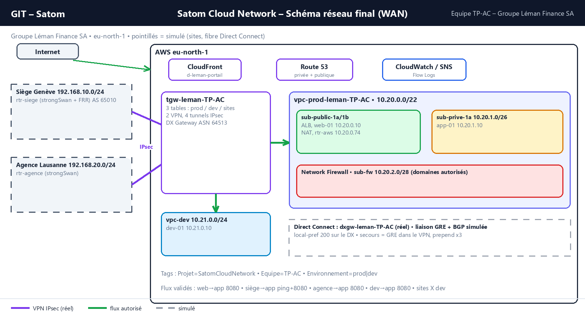

# Satom Cloud Network – Dossier du binôme TP-AC

Projet réalisé par Thomas Prud'homme et Abderahmane Chaouche pour le client fictif Groupe Léman Finance SA (formation AWS niveau 300, Geneva Institute of Technology, promo E3, semaine du 16 au 20 novembre 2026).

Tout le TP a été refait à la main dans la console AWS, puis filmé : les captures de ce dossier sont tirées de ces enregistrements (le bandeau avec le compte et le rôle est masqué, comme les identifiants de compte). Une première version avait été faite en ligne de commande (scripts du dépôt) ; quand un chapitre cite une mesure de cette première version, il le dit.

Tout est fait dans la région de Stockholm (`eu-north-1`). Nos ressources portent le suffixe `-TP-AC` et les tags `Projet=SatomCloudNetwork`, `Equipe=TP-AC` et `Environnement=prod` ou `dev`.

Les modules 9, 10 et 11 utilisent un domaine réel : le sous-domaine `leman.thomastp.ch`, délégué à Route 53, avec des certificats publics ACM validés par DNS.

## Vidéo


Vidéo complète du tutoriel (34 minutes, voix de Thomas et d'Abderahmane), refaite à la main dans la console AWS, modules 0 à 13, avec un vrai domaine pour les modules 9 à 11 : [https://youtu.be/emZqnBNtOjM](https://youtu.be/emZqnBNtOjM) (non répertoriée : seules les personnes qui ont le lien peuvent la voir).

## Où nous en sommes
| Module | Sujet | Ce que nous avons fait |
|---|---|---|
| 0 | Cadrage et plan d'adressage | fait |
| 1 | VPC et sous-réseaux | déployé et testé |
| 2 | Routage, IGW et NAT | déployé et testé |
| 3 | Security Groups et NACL | déployé et testé |
| 4 | Network Firewall | déployé et testé (service débloqué le 17/11) |
| 5 | VPC Peering | déployé et testé, puis remplacé par le Transit Gateway au module 6 |
| 6 | Transit Gateway | déployé et testé |
| 7 | VPN site à site | vrai VPN AWS, 2 tunnels par site ; les deux sites sont des routeurs strongSwan simulés |
| 8 | Direct Connect | vrai Direct Connect Gateway associé au Transit Gateway ; la liaison dédiée est simulée (GRE et BGP) |
| 9 | Load balancer | déployé et testé |
| 10 | Route 53 | déployé et testé |
| 11 | CloudFront | déployé et testé |
| 12 | CloudWatch et Flow Logs | déployé et testé |
| 13 | CloudFormation | déployé et testé |

Au début de la semaine, Network Firewall, Transit Gateway, VPN et Direct Connect étaient refusés par une règle de l'organisation AWS du formateur. Cette règle a été levée le 17/11/2026, et nous avons alors fait les modules 4, 6, 7 et 8 pour de vrai. Les erreurs relevées avant cette date sont dans le fichier `docs/01-services-bloques.md` du dépôt.

Tout le code (scripts AWS CLI, templates CloudFormation), les preuves et les captures sont dans le dépôt GitHub public `Thomas-TP/satom-cloud-network-TP-AC`.

## Comment lire le dossier
Le dossier est coupé en trois notes (limite de taille de HackMD). Chaque note a son propre sommaire en haut.

- [Partie 1 : modules 0 à 4]({{URL_partie1}}) : cadrage, réseaux, routage, sécurité, pare-feu
- [Partie 2 : modules 5 à 8]({{URL_partie2}}) : peering, Transit Gateway, VPN, Direct Connect
- [Partie 3 : modules 9 à 13]({{URL_partie3}}) : ALB, Route 53, CloudFront, surveillance, CloudFormation

Après les trois parties, cette note contient les écarts au sujet, le plan d'adressage, les services bloqués, le dossier client et le journal de nettoyage.

---

# Points du sujet impossibles, incohérents ou réalisés autrement

Le sujet a été rédigé avec l'aide d'une IA : certaines consignes ne peuvent pas être suivies à la lettre, ou se contredisent. Cette liste dit, pour chacune, ce que nous avons fait à la place et pourquoi. Elle est destinée au formateur.

| # | Module | Ce que dit le sujet | Pourquoi ce n'est pas possible tel quel | Ce que nous avons fait |
|---|---|---|---|---|
| 1 | 8 | Une liaison Direct Connect près de Genève | Il n'existe aucun emplacement Direct Connect près de Genève dans la région de Stockholm (Zurich n'est pas activée sur le compte, Francfort est refusée). Et nous ne commandons pas de fibre. | Emplacement retenu sur le papier : EQSK1 (Equinix Sweden SK1, 1 Gbit/s). Direct Connect Gateway réel et associé au Transit Gateway ; la liaison est simulée par un tunnel GRE et BGP (FRRouting). |
| 2 | 7 | Une bascule entre deux tunnels VPN « sans coupure » | Un VPN IPsec ne peut pas basculer sans coupure : AWS met un certain temps à constater qu'un tunnel est mort avant d'utiliser l'autre. Nous avons mesuré entre 26 et 34 secondes (valeurs exactes au module 7). | Mesure honnête, avec une vraie panne silencieuse (paquets perdus, sans couper l'interface). |
| 3 | 8 | Une bascule Direct Connect vers VPN en quelques secondes, avec un prepend | Un VPN statique ne parle pas BGP : le prepend n'aurait aucun effet. | Le BGP du chemin « VPN » passe dans un tunnel GRE à l'intérieur du vrai VPN. Bascule mesurée au module 8. |
| 4 | 7 | Customer Gateways en `203.0.113.10` et `198.51.100.10` | Ce sont des adresses réservées à la documentation : aucun tunnel ne s'établit vers elles. | Une Elastic IP par routeur de site (`rtr-siege-TP-AC`, `rtr-agence-TP-AC`). |
| 5 | 6, 7 | Plages `10.0.0.0/16` et `10.1.0.0/16` | Le compte est partagé par toute la classe : ces plages recouvrent celles des autres. | `10.20.0.0/22` (prod) et `10.21.0.0/24` (dev). |
| 6 | 7 | Déclarer les routes statiques sur la connexion VPN | Pour un VPN rattaché à un Transit Gateway, AWS refuse : les routes se déclarent dans la table de routage du Transit Gateway. | Routes dans `tgw-rt-prod-TP-AC`. |
| 7 | 4 | Ne mettre que la route de retour `10.20.1.0/26` dans la table publique | Cela casse `web-01` vers `app-01` : la requête passe par le pare-feu, pas la réponse, et le pare-feu perd l'état. Les Security Groups « depuis un groupe » ne correspondent plus au trafic qui sort d'un endpoint de pare-feu. | Routes symétriques, et règles de `sg-app` par plage d'adresses (module 4). |
| 8 | 4 | Le flux autorisé doit apparaître dans les journaux | Un journal d'alertes ne contient que ce qui est bloqué. | Second journal, de type flux (`/leman/nfw-flow-TP-AC`). |
| 9 | 10, 11 | Zone publique et certificat ACM validé par DNS pour le domaine du client | Le nom d'exemple du sujet n'est pas un domaine que nous possédons : on ne peut ni le déléguer, ni y valider un certificat. Au début, nous n'avions pas de domaine. | Le sujet est maintenant respecté avec un domaine réel : le sous-domaine `leman.thomastp.ch` (domaine `thomastp.ch`, jamais modifié) est délégué à une zone publique Route 53 par quatre enregistrements NS ajoutés chez Cloudflare. Certificat public ACM validé par DNS (`leman.thomastp.ch` et `*.leman.thomastp.ch`, plus un en `us-east-1` pour CloudFront), listener HTTPS de l'ALB, nom alternatif `cdn.leman.thomastp.ch` sur CloudFront, tests avec la vérification du certificat activée. Écarts restants : le secours du basculement Route 53 est une adresse statique de documentation (`203.0.113.50`), pas un vrai site de secours ; le nom alternatif de CloudFront a été posé avec la ligne de commande (`aws cloudfront update-distribution`), parce que la liste de certificats de la console ne proposait pas le certificat. |
| 10 | 0 | Un module « cadrage » sans client joignable | Nous ne pouvons pas poser nos questions au client. | Questions et budget rédigés par nos soins, à relire (module 0). |
| 11 | 1 | Région Zurich | `eu-central-2` n'est pas activée (`AuthFailure`), Francfort est refusée par l'organisation. | Stockholm (`eu-north-1`), acceptée avec le formateur. |
| 12 | 8 | Console Direct Connect | La page affiche un bandeau rouge `DescribeLocations` : « explicit deny in a service control policy ». L'organisation refuse la lecture de la liste des emplacements. | La console reste utilisable pour ce qui nous sert : nous y avons créé le Direct Connect Gateway et son association au Transit Gateway (module 8). La liste des emplacements n'est pas consultable. |
| 13 | 4, 6, 7, 8 | Services autorisés | L'organisation refusait Network Firewall, Transit Gateway, VPN et Direct Connect jusqu'au 17/11/2026 (voir `01-services-bloques.md`). | Modules refaits en réel après la levée, et redéployés depuis un modèle CloudFormation. |

## Ce qui reste simulé malgré tout
- Les deux sites (siège, agence) sont des instances EC2 avec strongSwan, pas du matériel réel.
- La « fibre » Direct Connect est un tunnel GRE sur Internet : il n'y a pas d'interface virtuelle physique.
- Le basculement Route 53 mène à une adresse de documentation (`203.0.113.50`), pas à un second site réel.
- GNS3 n'est pas utilisé : les routeurs sont des instances EC2 avec FRRouting.

---

# Plan d'adressage - TP-AC (Satom Cloud Network)

Region : eu-north-1 (Stockholm) - seule region utilisable sur le compte (Zurich non activee, Francfort refusee).
Convention : suffixe `-TP-AC` sur les noms, tags `Projet=SatomCloudNetwork`, `Equipe=TP-AC`, `Environnement=prod|dev`.

| Reseau | CIDR | Remarque |
|---|---|---|
| vpc-prod-leman-TP-AC | 10.20.0.0/22 | 1024 adresses, suffisant (les camarades utilisent 10.0.0.0/16) |
| sub-public-1a-TP-AC | 10.20.0.0/26 | web-01-TP-AC = 10.20.0.10 |
| sub-public-1b-TP-AC | 10.20.0.64/26 | NAT (module 2, 10.20.0.101), rtr-aws-TP-AC = 10.20.0.74, 2e zone de l'ALB |
| sub-prive-1a-TP-AC | 10.20.1.0/26 | app-01-TP-AC = 10.20.1.10 |
| sub-fw-1a-TP-AC | 10.20.2.0/28 | endpoint Network Firewall (module 4) |
| reserve BDD | 10.20.3.0/26 | jamais cree |
| vpc-dev-leman-TP-AC | 10.21.0.0/24 | dev, sub-dev-1a-TP-AC 10.21.0.0/26, dev-01-TP-AC = 10.21.0.10 |
| Siege (simule) | 192.168.10.0/24 | plage donnee par le sujet |
| Agence (simulee) | 192.168.20.0/24 | plage donnee par le sujet |

Un /26 compte 64 adresses, dont 5 reservees par AWS : 59 utilisables.

Contraintes : quota de 5 passerelles NAT par zone de disponibilite sur le compte partage (atteint en zone A : la NAT est en zone B).

---

# Services refusés par l'organisation AWS (Service Control Policy) : historique

Le compte de formation est rattaché à une AWS Organization dont des règles (SCP) refusent certaines actions. Le message AWS est : `... with an explicit deny in a service control policy`. Ces refus ne viennent pas des droits de notre rôle (`AccountFullAccessRole`) : ils sont posés au niveau de l'organisation, dans le compte de gestion du formateur.

## Relevé du 16/11/2026 (région eu-north-1, appels réels ou `--dry-run`)
| Module | Service / action | Résultat |
|---|---|---|
| 4 | AWS Network Firewall (`network-firewall:*`) | refusé |
| 6 | Transit Gateway (`ec2:CreateTransitGateway`) | refusé (lecture autorisée) |
| 7 | VPN site à site (`CreateCustomerGateway`, `CreateVpnGateway`, `CreateVpnConnection`) | refusé |
| 8 | AWS Direct Connect (`directconnect:*`) | refusé |
| 1-3, 5, 9-13 | VPC, EC2, SG, NACL, peering, ELB, Route 53, CloudFront, ACM, CloudWatch, SNS, Flow Logs, CloudFormation | autorisé |
| - | Région eu-central-1 (Francfort) | refusée |
| - | Région eu-central-2 (Zurich) | non activée (`AuthFailure`) |

À ce moment-là, nous avions fait les modules 4, 6, 7 et 8 en documentation et en simulation seulement.

## Levée du blocage le 17/11/2026
Nous avons demandé au formateur de retirer ces actions de la règle (liste de `network-firewall:*`, `ec2:*TransitGateway*`, `ec2:*Vpn*`, `ec2:*CustomerGateway*`, `directconnect:*`, `ec2:*NetworkInsights*`) et d'augmenter le quota de vCPU de 16 à 48. Le 17/11/2026, nos tests montrent :

| Service | Résultat |
|---|---|
| Network Firewall (création d'un groupe de règles, puis du pare-feu) | autorisé |
| Reachability Analyzer (`CreateNetworkInsightsPath` en simulation) | autorisé |
| Customer Gateway, VPN Gateway, Transit Gateway (simulation) | autorisé |
| Direct Connect Gateway (création et association) | autorisé |
| Quota de vCPU | 48 (demande approuvée) |

Nous ne savons pas quelle règle exacte a été modifiée. Il reste un refus : la page *Passerelles Direct Connect* de la **console** affiche un bandeau rouge, `AccessDeniedException ... directconnect:DescribeLocations with an explicit deny in a service control policy`. C'est la liste des emplacements Direct Connect qui est refusée par l'organisation. La page reste utilisable : nous avons créé et associé la passerelle Direct Connect directement dans la console.

Nous avons donc refait pour de vrai les modules 4, 6, 7 et 8. Une première fois le 17/11 avec des scripts (`scripts/`, `docs/modules/`), puis une seconde fois à la main dans la console du 18 au 20/11, filmée : c'est la version décrite dans le dossier.

---

# Groupe Léman Finance SA – Réseau cloud sécurisé sur AWS
**Dossier de présentation client** – Satom IT & Learning Solutions, équipe TP-AC – novembre 2026

---

## 1. Votre besoin
Un réseau AWS sécurisé qui sépare la production et le développement, relie le siège (Genève-Cornavin) et l'agence (Lausanne), journalise les accès et protège des données financières sensibles, avec un budget maîtrisé et une infrastructure reproductible.

## 2. Notre réponse en une page
| Objectif | Ce que nous avons livré | Preuve |
|---|---|---|
| Isoler prod / dev | Deux réseaux privés distincts (`10.20.0.0/22`, `10.21.0.0/24`) reliés par un Transit Gateway, avec une table de routage par environnement ; le dev n'atteint que le port 8080 de l'API | modules 5 et 6 |
| Relier siège et agence en chiffré | **VPN AWS site à site**, deux tunnels par site (IKEv2, AES-256, SHA-256) rattachés au Transit Gateway ; clés dans un coffre-fort de secrets ; le siège joint l'application, l'agence seulement l'API (8080) ; le réseau de développement n'est pas joignable depuis les sites | modules 7 et 8 |
| Filtrer et journaliser | Security Groups, NACL, pare-feu managé sur les domaines sortants, journaux de flux réseau, alarme sur erreurs applicatives | modules 3, 4 et 12 |
| Répartition de charge et DNS | Répartiteur HTTPS sur 2 zones avec un vrai certificat, routage `/api/*`, DNS privé/public sur un domaine réel avec bascule automatique, CDN | modules 9 à 11 |
| Maîtriser les coûts | Instances arrêtées hors séance ; NAT et répartiteurs conservés jusqu'à la fin du cours ; budget de 100 USD par mois avec alerte à 80 % | section 7 |
| Reproductibilité | Template CloudFormation : suppression puis redéploiement identique, sans étape manuelle | module 13 |

## 3. Architecture
* **Production** `vpc-prod-leman` (`10.20.0.0/22`, 1 024 adresses – dimensionnée au besoin réel) : sous-réseaux **public** (serveur web, répartiteur), **privé** (application, aucune adresse publique) ; accès Internet sortant par NAT ; accès d'administration par **AWS Systems Manager** (aucun port SSH exposé, aucune clé à gérer).
* **Développement** `vpc-dev-leman` (`10.21.0.0/24`) : isolé ; il n'atteint la production que sur `app-01:8080`, par le Transit Gateway.
* **Filtrage sortant** : un Network Firewall n'autorise que les dépôts de mises à jour et les services AWS ; le reste est bloqué et journalisé.
* **Publication** : CloudFront (CDN, `cdn.leman.thomastp.ch`) → ALB (HTTPS, `origin.leman.thomastp.ch`) → web et API ; l'ALB n'accepte **que** CloudFront. Le sous-domaine `leman.thomastp.ch` est délégué à Route 53 et les certificats sont des certificats publics ACM validés par DNS.
* **Sites** : siège `192.168.10.0/24` et agence `192.168.20.0/24` reliés par deux VPN AWS (quatre tunnels). Les sites sont des routeurs simulés. Le Direct Connect Gateway est créé et associé au Transit Gateway ; la liaison dédiée est simulée (GRE et BGP) avec bascule vers le VPN.

## 4. Sécurité
| Mesure | Détail |
|---|---|
| Moindre privilège | Security Groups par rôle : le web n'accepte que l'ALB, l'application que le web (et les sites autorisés) |
| Défense en profondeur | NACL sans état sur le sous-réseau public, ordre des règles maîtrisé |
| Secrets | clés IPsec dans AWS Secrets Manager (`Projet/SatomCloudNetwork/vpn`), jamais dans un document ni un dépôt |
| Aucun accès SSH | administration par SSM Session Manager, traçable |
| Chiffrement | TLS 1.2/1.3 sur le répartiteur avec un certificat public ACM, HTTPS jusqu'à l'origine de CloudFront, IPsec entre sites (quatre tunnels) |
| Traçabilité | VPC Flow Logs (acceptés/rejetés), tags `Projet`, `Equipe`, `Environnement` sur toutes les ressources |
| Origine protégée | accès direct à l'ALB depuis Internet impossible (liste de préfixes CloudFront seulement) |

## 5. Résultats des tests (extraits)
Les mesures viennent de la vidéo (tout refait à la main dans la console) ; quand une valeur vient de notre première exécution en ligne de commande, c'est écrit.

| Test | Résultat |
|---|---|
| VPC : création d'un sous-réseau chevauchant | refusée par AWS (`InvalidSubnet.Conflict`) |
| Prod : route par défaut retirée | échec immédiat du trafic sortant (19 s), rétabli dès la route restaurée |
| NACL : règle de retour retirée | flux HTTPS coupé (comportement sans état démontré) |
| Peering : CIDR chevauchant | état `failed` ; 3ᵉ VPC non joignable depuis dev (non-transitivité) |
| Pare-feu : domaines sortants | les dépôts autorisés répondent, `example.com` est bloqué, l'alerte est journalisée |
| Transit Gateway : propagation retirée | le test dev vers prod échoue (pas de route retour), puis réussit une fois la propagation remise |
| VPN : quatre tunnels | tous à l'état haut ; le siège joint l'application ; l'agence seulement le port 8080 ; aucun site ne joint le dev |
| VPN : panne du tunnel 1 | le trafic reprend sur le tunnel 2 après 29 s au siège (mesuré dans la vidéo) et 34 s à l'agence (1re exécution), selon la détection d'AWS |
| Direct Connect (liaison simulée) : panne du DX | bascule vers le VPN en environ 7 s (vidéo) et 10 s (1re exécution), retour automatique au rétablissement |
| ALB : serveur web arrêté | cible `unhealthy`, réponse 502, retour à `healthy` après redémarrage |
| Route 53 : serveur principal arrêté | bascule DNS vers le secours en **33 s** dans la vidéo (70 s à la 1re mesure), retour au primaire en **141 s** dans la vidéo (34 s à la 1re mesure), mesuré en interrogeant directement un serveur de noms AWS |
| CloudFront | contenu statique `Miss` puis `Hit` (mis en cache), API jamais mise en cache, ancienne version servie après modification puis nouvelle version après invalidation, accès direct à l'ALB bloqué (délai dépassé) |
| CloudFormation | dérive détectée (`DRIFTED`) puis corrigée (`IN_SYNC`) ; pile supprimée d'un geste. Le jeu de modifications et le redéploiement identique ont été essayés à la 1re exécution en ligne de commande, pas dans la vidéo |

## 6. Limites et écarts à connaître
| Sujet | Situation | Conséquence |
|---|---|---|
| Sites et liaison dédiée | les deux sites sont des routeurs strongSwan ; aucune fibre Direct Connect n'est commandée | le VPN et le Direct Connect Gateway sont ceux d'AWS ; la liaison dédiée est simulée en GRE et BGP. Bascule du VPN : 29 à 34 s (délai de détection d'AWS), pas « sans coupure » ; bascule liaison dédiée vers VPN : environ 10 s |
| Services refusés en début de semaine | Network Firewall, Transit Gateway, VPN, Direct Connect | levés le 17/11/2026 ; nous avons alors refait ces modules pour de vrai |
| Région | Stockholm (la région Zurich n'est pas activée sur la plateforme) | Pour la production réelle, Zurich/Francfort conviendrait à la localisation des données : il suffit de changer le paramètre de région |
| Domaine et certificats | domaine réel (sous-domaine `leman.thomastp.ch` délégué à Route 53), certificats ACM validés par DNS | le domaine est celui de Thomas, pas celui du client ; en production, la même démarche s'applique au domaine du client |
| Secours du basculement DNS | le secours est une adresse statique de documentation (`203.0.113.50`), pas un second site | à remplacer par un vrai site de secours en production |
| Nom alternatif CloudFront | posé avec la ligne de commande : la liste de certificats de la console ne proposait pas le certificat | aucun effet sur le résultat obtenu |
| Quotas du compte partagé | 16 vCPU au départ, 48 après demande | les deux sites et `app-01` ont pu fonctionner ensemble |

## 7. Coûts
| Poste | Ordre de grandeur |
|---|---|
| NAT Gateway | ~0,045 USD/h (supprimée hors usage) |
| ALB | ~0,03 USD/h |
| Instances `t3.micro` | ~0,01 USD/h chacune |
| CloudFront, Route 53, CloudWatch | négligeable à cette échelle |
| Network Firewall, Transit Gateway, VPN managé | ~0,40 USD/h, ~0,05 USD/h par attachement, ~0,05 USD/h par connexion : à budgéter en production (nous les avons supprimés après les tests) |

Estimation au 16/11 : de l'ordre de 2 à 4 USD pour la première journée (calcul par heures de ressources ; la facturation réelle n'était pas encore disponible, Cost Explorer a un retard d'environ 24 h). Les activités pédagogiques ont porté les crédits du compte à 180 USD.

## 8. Reproductibilité et exploitation
* **Code** : scripts PowerShell/AWS CLI (un par module), templates CloudFormation (`reseau-leman.yaml` pour le portail, `interconnexion-leman.yaml` pour le pare-feu, le Transit Gateway, les VPN et le Direct Connect Gateway), schémas et preuves dans le dépôt Git.
* **Déploiement complet** : une commande de création de stack (voir module 13) ; suppression propre en ordre inverse.
* **Exploitation** : tableau de bord CloudWatch, alarme 5xx → SNS, journaux de flux interrogeables avec Logs Insights, procédures de diagnostic en quatre étapes par module.

## 9. Recommandations
1. Raccorder le vrai matériel du siège et de l'agence aux Customer Gateways (les routeurs simulés disparaissent).
2. Commander la liaison Direct Connect (1 Gbit/s, marge ≈ 44 % pour 2 To transférés en 8 h) et créer l'interface virtuelle vers le Direct Connect Gateway déjà associé au Transit Gateway.
3. Reprendre la démarche du module 9 à 11 avec le domaine du client : déléguer un sous-domaine à Route 53, valider les certificats ACM par DNS, remplacer l'adresse de secours par un vrai site de secours.
4. Déployer en région Zurich ou Francfort (localisation des données), avec une deuxième zone de disponibilité pour l'application.
5. Mettre en place un budget AWS avec alerte à 80 % et un abonnement e-mail SNS pour l'équipe d'exploitation.

## 10. Prochaines étapes
Validation du dossier par Léman Finance → recette sur environnement de production → bascule des utilisateurs → transfert d'exploitation (procédures de diagnostic, tableau de bord, alarmes).

---

# Journal de projet et nettoyage (équipe TP-AC)

Le compte AWS est partagé avec toute la classe : nous ne touchons jamais aux ressources des autres équipes (suffixes `_bko`, `-TM`, `_af`, `-MF`, `-AA`, `-AM`, `-LL`…). Toutes nos ressources portent `-TP-AC` et le tag `Equipe=TP-AC`. Chaque suppression a été faite par ce tag ou par l'identifiant exact de la ressource, jamais par un nom approximatif.

## Où nous en sommes (20/11/2026)
Le TP est terminé et filmé. Tout ce qui était facturé à l'heure est supprimé, **sauf un Network Firewall que nous n'arrivons pas à supprimer** (voir plus bas). Il reste aussi quelques ressources gratuites ou presque.

### Ce qui reste, et pourquoi
| Ressource | Coût | Pourquoi elle reste |
|---|---|---|
| Network Firewall `nfw-prod-leman-TP-AC` | ~0,40 USD/h | `DeleteFirewall` répond `InternalServerError: Internal failure` : état bloqué côté AWS. Cas AWS Support n° 179508151300233 ouvert. |
| VPC `vpc-prod-leman-ancien-TP-AC` et le sous-réseau du pare-feu | gratuit | le point d'accès du pare-feu est dans `sub-public-1b-TP-AC` : ce sous-réseau et son VPC ne peuvent partir qu'avec lui |
| VPC `vpc-siege-TP-AC`, `vpc-agence-TP-AC`, `vpc-dev-leman-TP-AC` et leurs sous-réseaux | gratuit | vides ; supprimés avec le reste quand le pare-feu sera débloqué |
| 2 Customer Gateways | gratuit | idem |
| Rôle IAM `TP-AC-ec2-ssm-role` (accès Systems Manager des instances) | gratuit | pas facturé ; supprimé avec le reste |
| Secret `Projet/SatomCloudNetwork/vpn` | ~0,40 USD/mois | contient les clés des VPN (jamais copiées dans le dépôt) |
| Groupes de journaux CloudWatch (`/leman/vpc-prod/flow-TP-AC`, journaux du pare-feu) | négligeable | conservés tant que le pare-feu existe |

La politique `policy-prod-leman-TP-AC` et le groupe de règles `rg-depots-autorises-TP-AC` sont rattachés au pare-feu et partiront avec lui.

### Le Network Firewall bloqué
La suppression échoue depuis la console et depuis la CLI. Nous avons vérifié et écarté les causes habituelles : protection contre la suppression désactivée, plus aucune route vers l'endpoint, journalisation retirée, tag `AWSNetworkFirewallManaged` absent, rôle lié au service en place. Nous avons aussi essayé un contournement (ajouter un second sous-réseau, retirer le premier) : l'ancien endpoint disparaît d'EC2, mais l'attachement reste en `DELETING` côté Network Firewall et l'erreur revient. Le pare-feu est maintenant rattaché à `sub-public-1b-TP-AC`. Le cas AWS Support (Compte et facturation, plan Basic) demande la suppression et l'arrêt de la facturation. Dès qu'il est supprimé, il faut supprimer la politique et le groupe de règles, puis les VPC et les Customer Gateways de la liste ci-dessus.

## Ce qui a été supprimé à la fin du tournage (20/11/2026)
Pour les modules 9 à 11, refaits avec le vrai domaine `leman.thomastp.ch`, tout ce que nous avions créé a été supprimé, dans cet ordre :
1. Distribution CloudFront : alias et certificat retirés, désactivée, puis supprimée.
2. Zones Route 53 `leman.thomastp.ch` (avec `origin`, `portefeuilles` principal et secours, `cdn`, CNAME de validation ACM) et `prod.leman.internal`, puis la surveillance de l'état `hc-portail-TP-AC`.
3. ALB `alb-prod-leman-TP-AC`, groupes cibles `tg-web-TP-AC` et `tg-app-TP-AC`, Security Group `alb-TP-AC` (et la règle 8080 qui y faisait référence).
4. Pile CloudFormation de tournage `env-m9-m11-TP-AC` (VPC, sous-réseaux, passerelle Internet, `web-01-TP-AC`, `app-01-TP-AC`, rôle SSM).
5. Certificats ACM `leman.thomastp.ch` d'`eu-north-1` et d'`us-east-1`.
6. Chez Cloudflare : les quatre enregistrements NS du sous-domaine `leman` ont été retirés. Le reste de la zone `thomastp.ch` (le portfolio de Thomas) n'a jamais été modifié.

Avant cela, après la vidéo des modules 0 à 8 et 12 à 13 (journal du 19/11 ci-dessous), les instances, Elastic IP, NAT, VPN, Transit Gateway, Direct Connect Gateway, SNS/SQS, tableau de bord, alarme et Flow Log avaient déjà été supprimés. Nous avons vérifié le 20/11 qu'il ne reste aucune instance, NAT, Elastic IP, Transit Gateway, connexion VPN ni Direct Connect Gateway à notre nom.

## Journal des suppressions
| Date | Ressource | Justification |
|---|---|---|
| 16/11/2026 | Quêtes de crédits : instance EC2 de test, fonction Lambda + rôle + logs, table DynamoDB, base RDS `tp-ac-quest-db` | supprimées dès la quête validée (consigne) |
| 16/11/2026 | `sub-fw-1a`, `rt-fw-leman` | module 4 impossible (SCP), ressources inutiles |
| 16/11/2026 | VPC de test (chevauchement, tiers), peering de test, instance `tiers-01` | ressources de test supprimées après mesure |
| 16/11/2026 | Tentatives `m07` (routeur, groupes de sécurité) | échec quota Elastic IP / vCPU : recréé autrement |
| 17/11/2026 | Pare-feu `nfw-prod-leman-TP-AC`, sa politique, ses 2 groupes de règles, `sub-fw-1a`, `rt-fw-leman`, groupe de journaux conservé | tests du module 4 terminés (facturé à l'heure) |
| 17/11/2026 | 2e Transit Gateway créé par erreur par notre script (+ 2 attachements) | doublon, supprimé |
| 17/11/2026 | Direct Connect Gateway de test (ASN 64512) | mauvais ASN (même ASN que le Transit Gateway), recréé avec 64513 |
| 17/11/2026 | Peering `pcx-lab-TP-AC` | supprimé au module 6, comme demandé par le sujet |
| 17/11/2026 (nuit) | Stack `stack-interconnexion-leman-TP-AC` (pare-feu, Transit Gateway, 2 VPN, 2 Customer Gateways, DX Gateway, Elastic IP des routeurs), stack `stack-portail-leman-TP-AC` (instances + ALB), ALB `alb-prod-leman-TP-AC` et ses listeners, NAT Gateway + Elastic IP, Elastic IP de `web-01`, health check Route 53 | vidéo et dossier validés par Thomas ; plus aucune ressource facturée à l'heure |
| 19/11/2026 | Tout le TP refait à la main en console puis filmé : instances (6), Elastic IP (3), NAT, 2 VPN, Transit Gateway et attachements, ALB et groupes cibles, CloudFront, zones Route 53 et health check, DX Gateway, secret, SNS/SQS, tableau de bord, alarme, Flow Log, groupes de journaux | vidéo validée par Thomas, plus rien à filmer |
| 20/11/2026 | Distribution CloudFront, zones Route 53 (publique `leman.thomastp.ch` et privée `prod.leman.internal`), surveillance de l'état, ALB, groupes cibles, Security Group `alb-TP-AC`, pile `env-m9-m11-TP-AC`, certificats ACM, 4 enregistrements NS chez Cloudflare | fin du tournage des modules 9 à 11 avec le vrai domaine |

## Événements du 16/11/2026 à retenir
| Heure | Événement |
|---|---|
| 14:28 | `web-01-TP-AC` et `app-01-TP-AC` arrêtés par une autre session du rôle partagé (visible dans CloudTrail) ; les 16 vCPU du compte sont ensuite saturés par 8 instances de la classe : impossible de redémarrer nos instances tant que de la place n'est pas libérée |
| fin de journée | Instances TP-AC toutes à l'état `stopped` |

Le quota de vCPU du compte partagé est de 48. Une demande d'augmentation à 64 est restée ouverte, sans effet utile.

## Rejouer le projet
Pour rejouer le TP, il faudrait recréer l'environnement : les scripts `scripts/mNN-*.ps1` et les modèles `cfn/*.yaml` datent de notre première exécution en ligne de commande. Les scènes de tournage `video/shoot/*.py` décrivent, clic par clic, ce que nous avons fait dans la console.

