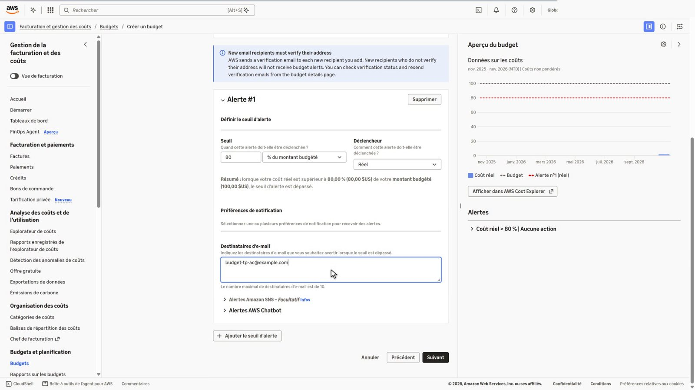
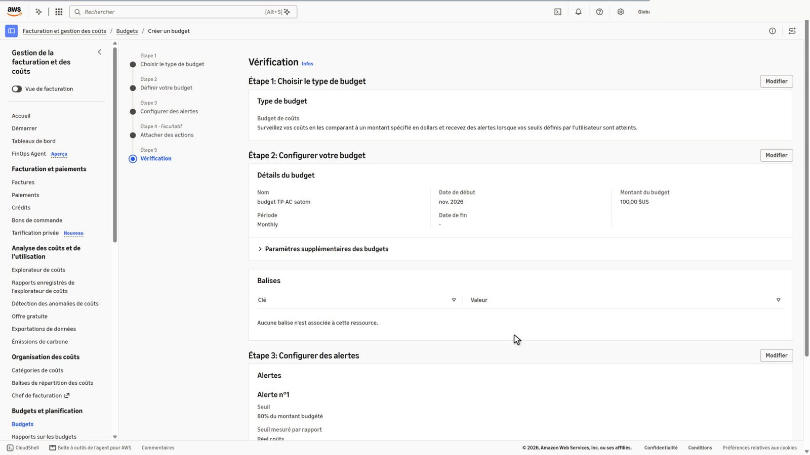
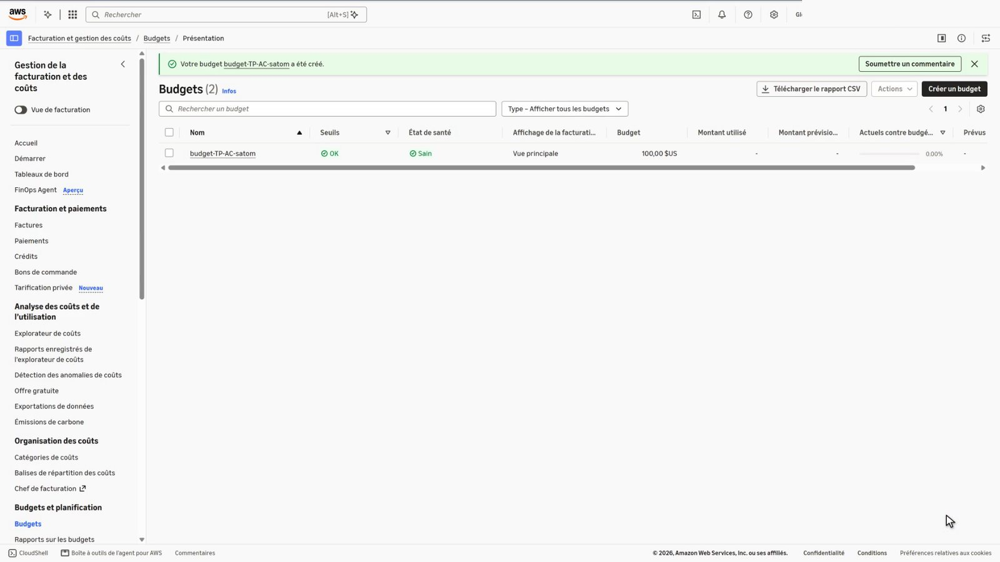

# Module 0 – Cadrage et plan d'adressage

## Objectif
Poser le cadre avant de créer le moindre serveur : un projet décrit en quelques lignes, des noms et des balises communs, un plan d'adresses écrit à l'avance, un budget qui nous prévient quand la dépense monte, et les questions que nous poserions au client. Dans la console AWS, la seule ressource de ce module est le budget.

## Ce qu'il faut savoir
**Le projet.** Le Groupe Léman Finance SA (client fictif) veut un réseau AWS qui sépare la production du développement, relie le siège de Genève et l'agence de Lausanne, garde une trace des accès et reste maîtrisé en coût. Tout doit pouvoir être redéployé depuis un template (module 13).

**Nos conventions.** Le compte AWS est partagé avec toute la classe. Pour retrouver nos ressources, et ne toucher à aucune autre, chaque nom se termine par `-TP-AC` et chaque ressource qui accepte des balises reçoit les trois mêmes : `Projet=SatomCloudNetwork`, `Equipe=TP-AC` et `Environnement=prod` ou `dev`. Nous supprimons en fin de projet en nous appuyant sur cette balise.

**Un budget AWS n'arrête rien.** Il compare la dépense à un montant et envoie un message quand un seuil est franchi (sur le coût réel ou sur le coût prévu). Il ne coupe aucune ressource. Autre détail à connaître : AWS envoie un message de vérification à chaque nouveau destinataire, et un destinataire non vérifié ne reçoit aucune alerte.

## Ce que nous avons fait
Nous avons créé le budget dans la console, dans *Facturation et gestion des coûts > Budgets*.
1. Bouton *Créer un budget*, puis *Personnaliser (avancé)* à la place du modèle simplifié, et le type *Budget de coûts*.
2. Nom `budget-TP-AC-satom`, période mensuelle, budget récurrent, montant de `100` USD. La portée reste celle par défaut : tous les services AWS.
3. Une alerte : seuil de `80` % du montant budgété, déclencheur *Réel*, destinataire `budget-tp-ac@example.com`. L'adresse est fictive (voir les pièges plus bas).
4. L'étape facultative *Attacher des actions* est passée sans rien ajouter.
5. Page *Vérification*, puis *Créer un budget*. La console confirme « Votre budget budget-TP-AC-satom a été créé » et la liste le montre à 100,00 USD, état *Sain*.

## Captures

Le seuil est réglé à 80 % du montant budgété (80,00 USD d'après le résumé de la console), sur le coût réel. Le bandeau bleu du haut est l'avertissement d'AWS sur la vérification des adresses.

Avant de créer, la page de vérification résume le budget : `budget-TP-AC-satom`, période *Monthly*, début en novembre 2026, 100,00 USD. Le tableau *Balises* est vide : nous n'avons pas étiqueté le budget.

Le budget apparaît dans la liste avec l'état *Sain*. Le compteur indique deux budgets : l'autre appartient à quelqu'un d'autre sur le compte partagé, et sa ligne est masquée sur la capture.

## Plan d'adressage
| Réseau | Plage | Contenu |
|---|---|---|
| `vpc-prod-leman-TP-AC` | `10.20.0.0/22` | production |
| `sub-public-1a-TP-AC` | `10.20.0.0/26` | `web-01-TP-AC` (`10.20.0.10`) |
| `sub-public-1b-TP-AC` | `10.20.0.64/26` | NAT (module 2), routeur `rtr-aws-TP-AC` (`10.20.0.74`), deuxième zone du load balancer |
| `sub-prive-1a-TP-AC` | `10.20.1.0/26` | `app-01-TP-AC` (`10.20.1.10`) |
| `sub-fw-1a-TP-AC` | `10.20.2.0/28` | endpoint du pare-feu (module 4) |
| réservé | `10.20.3.0/26` | base de données (jamais créé) |
| `vpc-dev-leman-TP-AC` | `10.21.0.0/24` | développement, `dev-01-TP-AC` (`10.21.0.10`) dans `sub-dev-1a-TP-AC` (`10.21.0.0/26`) |
| siège (simulé) | `192.168.10.0/24` | plage donnée par le sujet |
| agence (simulée) | `192.168.20.0/24` | plage donnée par le sujet |

Le schéma montre l'ensemble une fois les modules 1 à 13 en place. Les routeurs du siège et de l'agence sont des instances EC2 avec strongSwan et FRRouting, et la liaison Direct Connect est simulée par un tunnel GRE avec BGP (voir les modules 7 et 8). Le reste est réel.

## Tableau récapitulatif
| Élément | Valeur |
|---|---|
| Région | Stockholm, `eu-north-1` |
| Suffixe des noms | `-TP-AC` |
| Balises | `Projet=SatomCloudNetwork`, `Equipe=TP-AC`, `Environnement=prod` ou `dev` |
| Budget | `budget-TP-AC-satom`, type coûts, mensuel, 100 USD |
| Alerte | 80 % du montant, coût réel, vers `budget-tp-ac@example.com` (fictive) |
| Accès aux machines | Session Manager (SSM), sans SSH ni paire de clés |
| Domaine (modules 9 à 11) | `leman.thomastp.ch`, délégué à Route 53 |

## Crédits et estimation du budget
Le compte part avec 100 USD de crédits. Les activités « Gagnez des crédits AWS » nous en ont rapporté 100 de plus ; nous les avons faites avant le tournage et supprimé les ressources de test juste après (voir `NETTOYAGE.md`). Notre plan de tournage comptait avec environ 180 USD de crédits disponibles.

Avant de commencer, nous avons chiffré l'architecture complète, allumée en permanence. Les tarifs de l'EC2 `t3.micro`, de la NAT Gateway et de l'ALB viennent de l'API de prix d'AWS pour Stockholm (`prix_aws.py`, résultat dans `docs/modules/m00/prix.json`). L'API ne nous a rien renvoyé pour le pare-feu, le Transit Gateway, le VPN et l'adresse IPv4 publique : ces quatre lignes sont des tarifs publics que nous avons repris à la main, à contrôler sur la facture. Taux de change retenu : 1 USD = 0,90 CHF (hypothèse).

| Poste | USD par heure | USD par mois (730 h) | Origine du tarif |
|---|---|---|---|
| Instances `t3.micro` (8) | 0,0864 | 63 | API de prix |
| NAT Gateway | 0,0460 | 34 | API de prix |
| Load balancer (ALB) | 0,0239 | 17 | API de prix |
| Network Firewall (1 endpoint) | 0,3950 | 288 | tarif public, repris à la main |
| Transit Gateway (4 attachements) | 0,2000 | 146 | tarif public (0,05 USD par attachement) |
| VPN (2 connexions) | 0,1000 | 73 | tarif public (0,05 USD par connexion) |
| Adresses IPv4 publiques (9) | 0,0450 | 33 | tarif public (0,005 USD par adresse) |
| **Total** | **0,90** | **654** | |

* Allumé en permanence, l'ensemble coûterait environ **654 USD par mois, soit 589 CHF**, très au-dessus des 150 CHF par équipe annoncés dans le sujet.
* Allumé 40 heures (une semaine de cours), il coûte environ **36 USD, soit 32 CHF**.
* Nos réponses : le pare-feu, le Transit Gateway et les VPN pèsent plus de 90 % du total, nous ne les gardons que le temps des tests et des captures. La NAT et l'ALB suivent le même principe. Tout est supprimé à la fin du projet.

## Questions au client
Chacun de nous a écrit trois questions pour son rôle. Elles servent à vérifier que l'exigence est mesurable, à savoir qui décide, et quel est le risque. Le client est fictif : nous n'avons pas de réponses, et le binôme de contrôle doit encore valider cette liste en classe.

**Architecte réseau**
1. Combien d'utilisateurs, au siège et à l'agence, et quel débit maximal faut-il prévoir vers le cloud ? C'est ce qui décide du dimensionnement des liaisons.
2. Qui décide de la région définitive (Zurich ou Francfort) et de la date à laquelle l'application quitte la salle serveur ?
3. Quelle durée de coupure est tolérable si une liaison tombe, et qui accepte ce risque ?

**Ingénieur sécurité**
1. Quelles règles précises s'appliquent à ces données (FINMA, LPD…), et combien de temps faut-il conserver les journaux pour le prouver ?
2. Qui valide l'ajout d'un nouveau domaine autorisé dans le pare-feu, et dans quel délai ?
3. Que se passe-t-il si un accès du développement atteint la production : quelle séparation minimale exige-t-on, réseaux seulement ou comptes séparés ?

## Pièges rencontrés
* **L'adresse de l'alerte est fictive.** Nous n'avons pas voulu mettre une vraie boîte aux lettres dans un dossier public. Conséquence : AWS ne peut pas vérifier l'adresse, donc l'alerte ne partirait nulle part. Pour un vrai client, il faudrait une adresse réelle, vérifiée dès la création.
* **Le budget n'est pas étiqueté.** Le formulaire propose des balises ; nous n'en avons pas mis (la page de vérification le montre). C'est le seul objet du projet qui ne porte pas nos trois balises.

## Ce qui diffère du sujet
* **Région.** Le sujet parle de Zurich. Cette région n'est pas activée sur le compte (`AuthFailure`) et Francfort est refusée par l'organisation du formateur. Nous travaillons à Stockholm.
* **Budget.** Le sujet annonce 150 CHF par équipe. Le compte dispose de crédits partagés ; nous avons fixé 100 USD par mois avec une alerte à 80 %.
* **Services bloqués jusqu'au 17/11/2026.** Network Firewall, Transit Gateway, VPN et Direct Connect étaient refusés par une règle de l'organisation (détail dans `01-services-bloques.md`). Ils sont autorisés depuis le 17/11, et nous avons refait les modules concernés.
* **Domaine et certificats.** Le nom d'exemple du sujet n'est pas un domaine que nous possédons. Nous utilisons `leman.thomastp.ch`, un sous-domaine de `thomastp.ch` (le portfolio de Thomas, qui n'est pas modifié), délégué à Route 53 par quatre enregistrements NS ajoutés chez Cloudflare. Les certificats sont des certificats publics ACM validés par DNS.
* **Adresses IP.** Les autres équipes utilisent déjà `10.0.0.0/16`, et le prof nous a dit qu'un /16 était beaucoup trop grand. Nos plages sont plus petites (voir le plan).
* **Rôles du binôme.** Le sujet prévoit une répartition par rôles. Nous ne l'avons pas appliquée : nous avons traité tous les modules ensemble, et dans la vidéo nous nous partageons la voix.
* **Méthode.** Une première version a été construite avec l'AWS CLI et PowerShell (dossier `scripts/`) puis avec des templates CloudFormation (`cfn/`). Nous avons ensuite tout refait à la main dans la console du 18 au 20 novembre, en filmant. Le dossier décrit ce deuxième passage, et les captures en viennent.

## Nettoyage
Le budget fait partie du nettoyage de fin de projet. L'ordre complet des suppressions est dans `NETTOYAGE.md`. Une seule ressource du projet reste côté AWS : le Network Firewall `nfw-prod-leman-TP-AC` du module 4, dont la suppression échoue côté service (un cas AWS Support est ouvert). Son endpoint est dans `sub-public-1b-TP-AC`, créé au module 2 : la suppression de ce sous-réseau et de son VPC dépend donc de ce déblocage.
