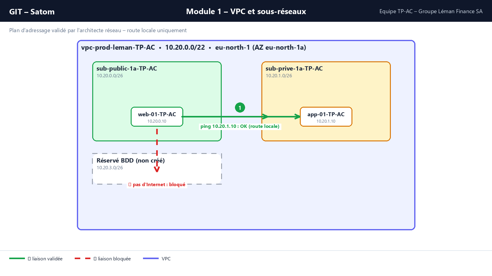
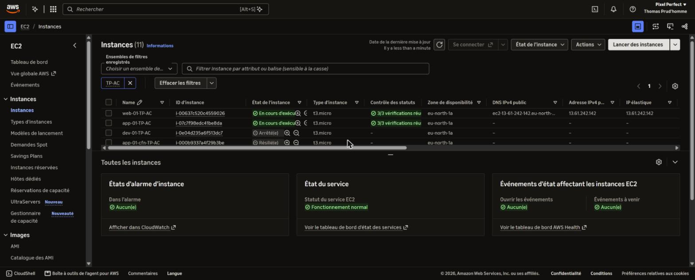
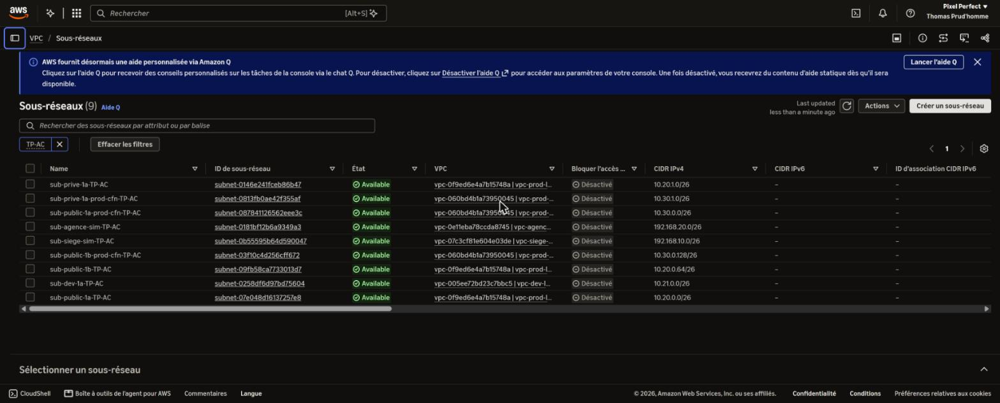
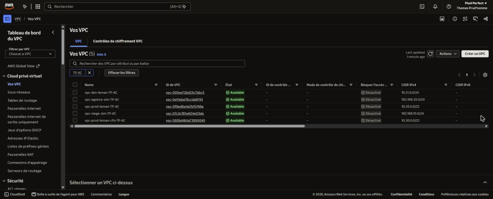
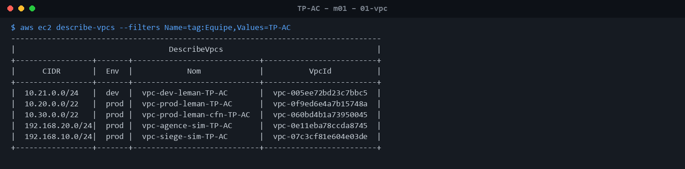
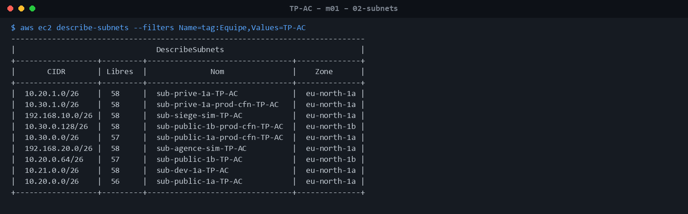
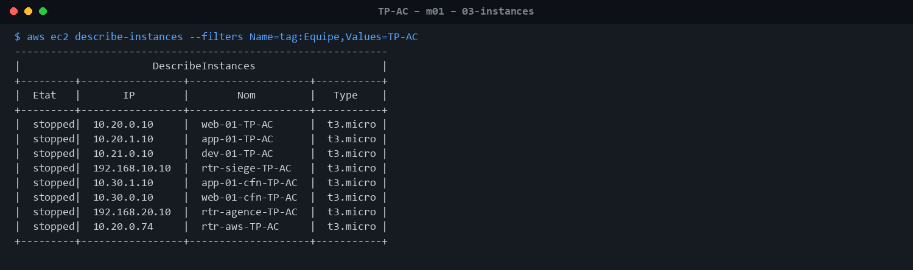
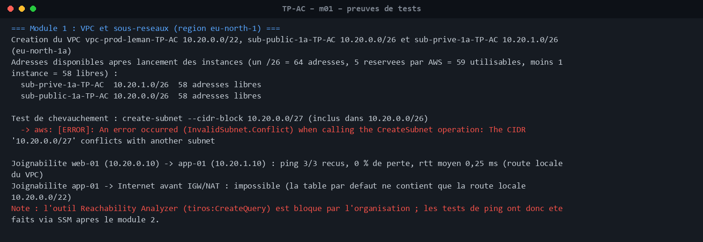

# Module 1 – VPC et sous-réseaux

## Objectif
Créer le réseau privé virtuel de production, découper l'espace d'adresses en sous-réseaux public et privé, et vérifier la communication interne.

## Cours (essentiel)
* Un **VPC** est un réseau IP isolé dans une région. Son CIDR (de /16 à /28) ne peut pas chevaucher celui d'un autre réseau que l'on voudra relier (peering, VPN).
* Un **sous-réseau** appartient à **une seule zone de disponibilité** ; AWS réserve **5 adresses** par sous-réseau (réseau, routeur VPC, DNS, futur usage, diffusion) : un /26 offre 59 adresses utilisables.
* Tant qu'on n'a rien ajouté, la table de routage du VPC ne contient que la **route locale** (`10.20.0.0/22 → local`) : les instances se parlent, mais rien ne sort.
* Dimensionnement : le HackMD propose un /16 (65 536 adresses). Pour deux serveurs, c'est surdimensionné et cela complique le peering ; nous avons retenu un **/22** (1 024 adresses) découpé en /26.

## Scénario
Léman Finance veut un environnement de production isolé. On crée `vpc-prod-leman-TP-AC`, un sous-réseau public (serveur web) et un sous-réseau privé (application).

## TP
| Tâche | Réalisation |
|---|---|
| 1. VPC et sous-réseaux | `vpc-prod-leman-TP-AC` `10.20.0.0/22` ; `sub-public-1a-TP-AC` `10.20.0.0/26` et `sub-prive-1a-TP-AC` `10.20.1.0/26` en `eu-north-1a` ; vérification : la table par défaut ne contient que la route locale |
| 2. Instances | `web-01-TP-AC` (`10.20.0.10`, public) et `app-01-TP-AC` (`10.20.1.10`, privé) ; Amazon Linux 2023, `t3.micro`, accès par **SSM** (rôle `TP-AC-ec2-ssm-role`) ; ping `web-01 → app-01` |
| 3. Limites | création de `10.20.0.0/27` refusée (chevauchement) ; réservation de `10.20.3.0/26` pour la base de données (non créé) |

Script : `scripts/m01-vpc.ps1`.

## Diagramme


## Tableau de configuration
| Ressource | Nom | Valeur |
|---|---|---|
| VPC | `vpc-prod-leman-TP-AC` | `10.20.0.0/22`, DNS hostnames activé |
| Sous-réseau public | `sub-public-1a-TP-AC` | `10.20.0.0/26`, `eu-north-1a` |
| Sous-réseau privé | `sub-prive-1a-TP-AC` | `10.20.1.0/26`, `eu-north-1a` |
| Instance web | `web-01-TP-AC` | `10.20.0.10`, `t3.micro` |
| Instance application | `app-01-TP-AC` | `10.20.1.10`, `t3.micro` |
| Rôle IAM | `TP-AC-ec2-ssm-role` | `AmazonSSMManagedInstanceCore` |

## Procédure de test
1. `aws ec2 describe-subnets` : CIDR et zone conformes au plan.
2. `aws ec2 describe-route-tables` : seule la route locale existe.
3. `aws ec2 create-subnet --cidr-block 10.20.0.0/27` doit échouer avec `InvalidSubnet.Conflict`.
4. Depuis `web-01` (SSM) : `ping -c 3 10.20.1.10` doit réussir.

## Résultats
```
=== Module 1 : VPC et sous-reseaux (region eu-north-1) ===
Creation du VPC vpc-prod-leman-TP-AC 10.20.0.0/22, sub-public-1a-TP-AC 10.20.0.0/26 et sub-prive-1a-TP-AC 10.20.1.0/26 (eu-north-1a)
Adresses disponibles apres lancement des instances (un /26 = 64 adresses, 5 reservees par AWS = 59 utilisables, moins 1 instance = 58 libres) :
  sub-prive-1a-TP-AC  10.20.1.0/26  58 adresses libres
  sub-public-1a-TP-AC 10.20.0.0/26  58 adresses libres

Test de chevauchement : create-subnet --cidr-block 10.20.0.0/27 (inclus dans 10.20.0.0/26)
  -> aws: [ERROR]: An error occurred (InvalidSubnet.Conflict) when calling the CreateSubnet operation: The CIDR '10.20.0.0/27' conflicts with another subnet

Joignabilite web-01 (10.20.0.10) -> app-01 (10.20.1.10) : ping 3/3 recus, 0 % de perte, rtt moyen 0,25 ms (route locale du VPC)
Joignabilite app-01 -> Internet avant IGW/NAT : impossible (la table par defaut ne contient que la route locale 10.20.0.0/22)
Note : l'outil Reachability Analyzer (tiros:CreateQuery) est bloque par l'organisation ; les tests de ping ont donc ete faits via SSM apres le module 2.
```

## Nettoyage
`web-01` et `app-01` sont **arrêtés** (non supprimés) en fin de séance ; le VPC et les sous-réseaux sont conservés. Les volumes EBS (8 Go chacun) restent facturés quelques centimes par mois.

## Écarts et remarques
* Le HackMD utilise SSH ; nous utilisons SSM Session Manager (aucun port 22 ouvert, aucune clé à stocker).
* L'outil *Reachability Analyzer* est bloqué par l'organisation (`tiros:CreateQuery`) ; les tests passent par de vrais pings.

## Captures

**Console AWS (capture réelle) – instances**



**Console AWS (capture réelle) – sous reseaux**



**Console AWS (capture réelle) – vpcs**



**Sortie AWS CLI – vpc**



**Sortie AWS CLI – subnets**



**Sortie AWS CLI – instances**



**Preuves de tests (journal)**


