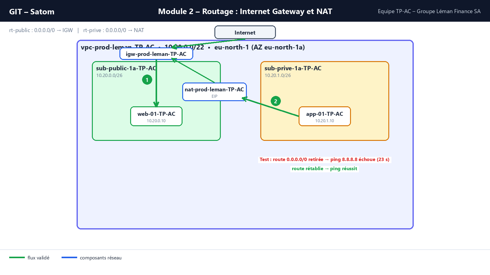
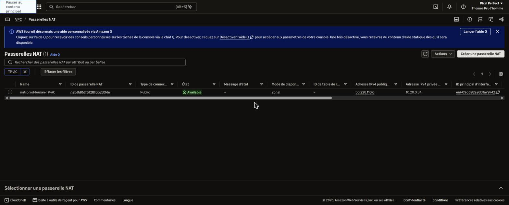
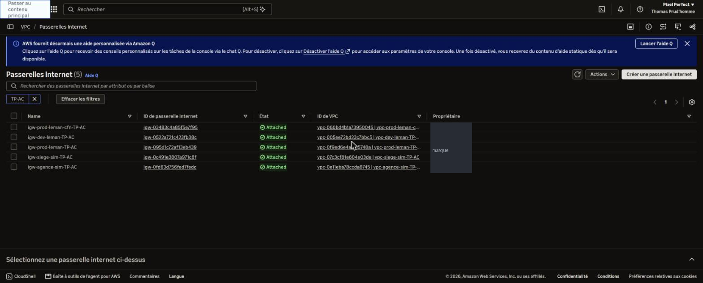
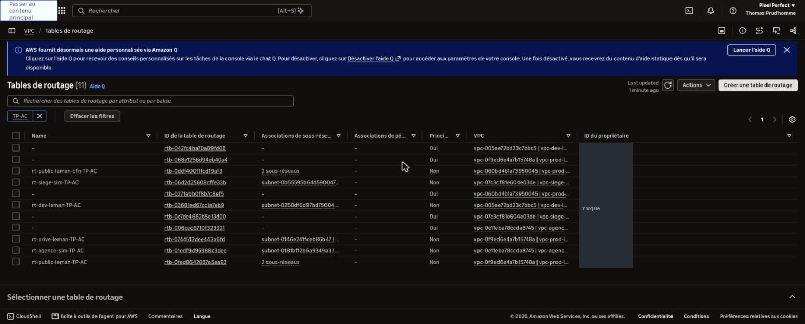
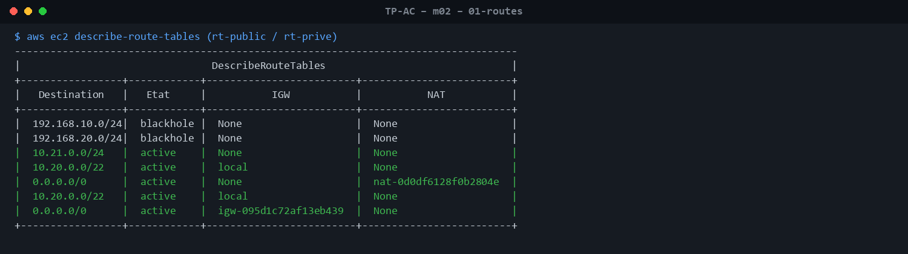
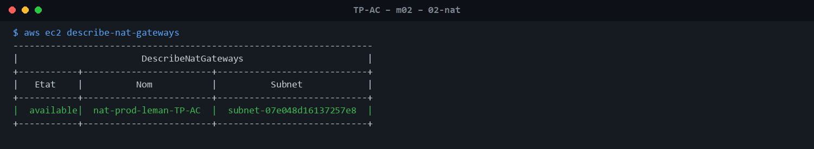
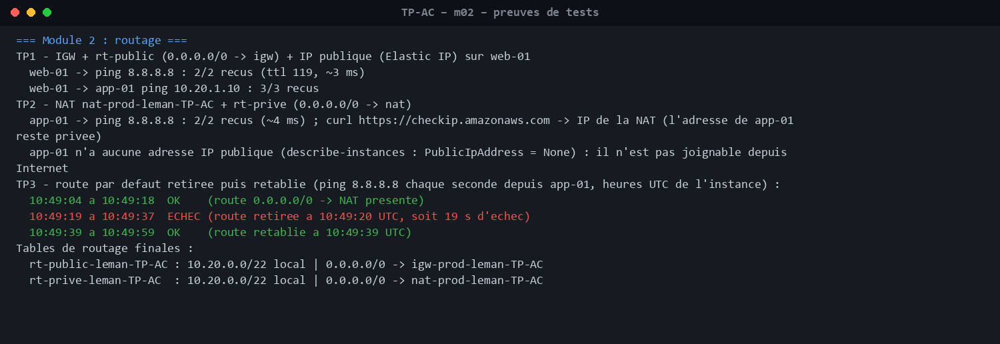

# Module 2 – Routage : IGW et NAT

## Objectif
Donner un accès Internet au sous-réseau public, un accès sortant seulement au privé, et savoir trouver une panne de route.

## Ce qu'il faut savoir
Un sous-réseau est public quand sa table de routage envoie `0.0.0.0/0` vers une Internet Gateway (et que l'instance a une IP publique). Pour un sous-réseau privé, on met une NAT Gateway dans le sous-réseau public : les machines privées peuvent sortir, mais personne ne peut entrer. La NAT coûte environ 0,045 USD de l'heure, ce qui compte avec un budget limité. Quand plusieurs routes correspondent, la plus précise gagne.

## Ce que nous avons fait
- Une Internet Gateway `igw-prod-leman-TP-AC`, et une table `rt-public-leman-TP-AC` avec `0.0.0.0/0` vers l'IGW, associée aux sous-réseaux publics.
- Une Elastic IP sur `web-01`.
- Une NAT Gateway `nat-prod-leman-TP-AC` dans le sous-réseau public, et une table `rt-prive-leman-TP-AC` avec `0.0.0.0/0` vers la NAT.
- Un test de panne : nous avons supprimé la route par défaut du privé pendant que `app-01` pinguait `8.8.8.8` chaque seconde, puis nous l'avons remise.

Script : `scripts/m02-routage.ps1`.



| Table | Routes |
|---|---|
| rt-public-leman-TP-AC | `10.20.0.0/22` local ; `0.0.0.0/0` vers l'IGW |
| rt-prive-leman-TP-AC | `10.20.0.0/22` local ; `0.0.0.0/0` vers la NAT |

## Si ça ne marche pas : quatre vérifications
1. Le sous-réseau est-il associé à la bonne table de routage ?
2. La route par défaut existe-t-elle ?
3. Pointe-t-elle vers la bonne cible (IGW ou NAT) ?
4. La cible est-elle en bon état (NAT `available`, IGW attachée, IP publique sur l'instance) ?

## Résultats des tests
```
=== Module 2 : routage ===
TP1 - IGW + rt-public (0.0.0.0/0 -> igw) + IP publique (Elastic IP) sur web-01
  web-01 -> ping 8.8.8.8 : 2/2 recus (ttl 119, ~3 ms)
  web-01 -> app-01 ping 10.20.1.10 : 3/3 recus
TP2 - NAT nat-prod-leman-TP-AC + rt-prive (0.0.0.0/0 -> nat)
  app-01 -> ping 8.8.8.8 : 2/2 recus (~4 ms) ; curl https://checkip.amazonaws.com -> IP de la NAT (l'adresse de app-01 reste privee)
  app-01 n'a aucune adresse IP publique (describe-instances : PublicIpAddress = None) : il n'est pas joignable depuis Internet
TP3 - route par defaut retiree puis retablie (ping 8.8.8.8 chaque seconde depuis app-01, heures UTC de l'instance) :
  10:49:04 a 10:49:18  OK    (route 0.0.0.0/0 -> NAT presente)
  10:49:19 a 10:49:37  ECHEC (route retiree a 10:49:20 UTC, soit 19 s d'echec)
  10:49:39 a 10:49:59  OK    (route retablie a 10:49:39 UTC)
Tables de routage finales :
  rt-public-leman-TP-AC : 10.20.0.0/22 local | 0.0.0.0/0 -> igw-prod-leman-TP-AC
  rt-prive-leman-TP-AC  : 10.20.0.0/22 local | 0.0.0.0/0 -> nat-prod-leman-TP-AC
```

## Nettoyage
Le sujet demande de supprimer la NAT en fin de séance. Nous la gardons pour l'instant, car elle donne à `app-01` l'accès SSM, et nous la supprimerons à la fin du cours.

## Problèmes rencontrés
Le compte n'autorise que 5 Elastic IP pour toute la classe. Les autres machines du projet utilisent donc des IP publiques automatiques.

## Captures

**Console AWS – passerelle nat**



**Console AWS – passerelles internet**



**Console AWS – tables routage**



**Terminal – routes**



**Terminal – nat**



**Journal des tests**


