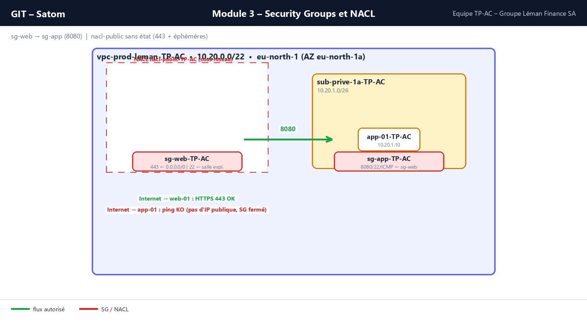
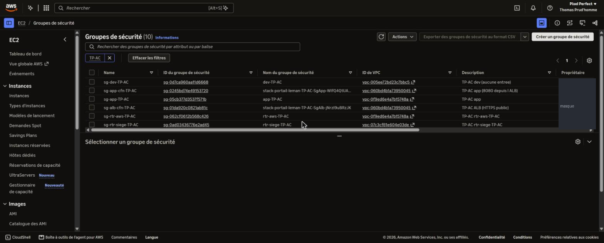
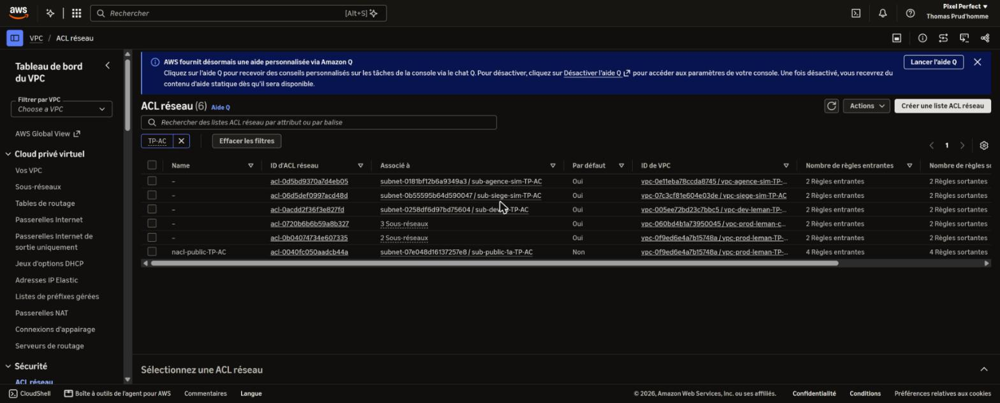
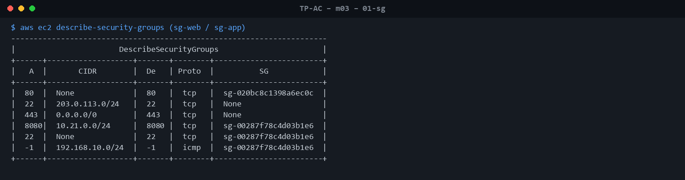
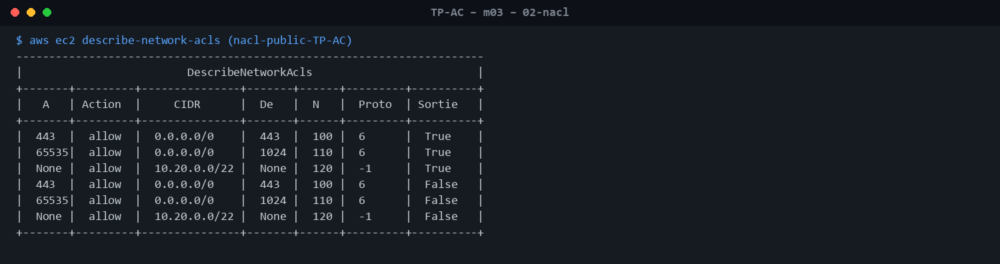
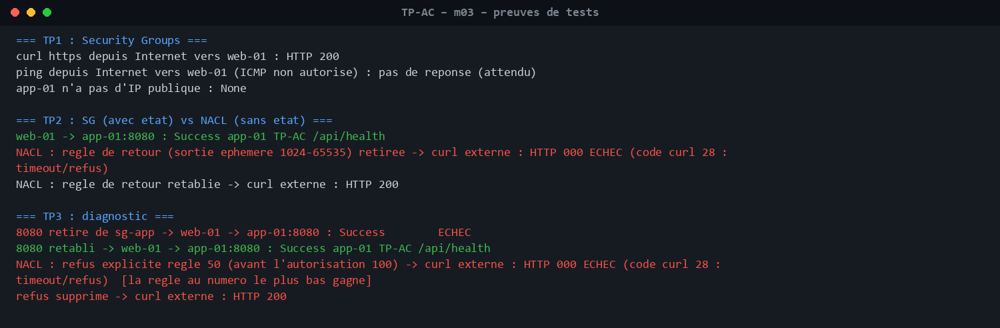

# Module 3 – Security Groups et NACL

## Objectif
Filtrer le trafic à deux endroits : sur chaque instance (Security Group) et sur chaque sous-réseau (NACL), et savoir dire lequel bloque.

## Ce qu'il faut savoir
Un Security Group garde l'état des connexions : si l'aller est autorisé, le retour l'est aussi. Il ne contient que des autorisations. Une NACL ne garde pas l'état : il faut autoriser l'aller et le retour (les ports éphémères 1024-65535). Elle accepte des refus, et ses règles sont lues par numéro croissant : la première qui correspond gagne.

## Ce que nous avons fait
- `sg-web-TP-AC` : 443 ouvert à tous, 22 ouvert seulement à une plage de test. Le sujet parle de l'adresse de la « salle d'exploitation » sans la donner ; nous avons mis `203.0.113.0/24` (plage réservée à la documentation).
- `sg-app-TP-AC` : 8080, 22 et ICMP autorisés seulement depuis `sg-web`.
- Un petit nginx (80 et 443 avec certificat auto-signé) sur `web-01`, et une mini-API Python sur le port 8080 de `app-01`.
- Une NACL `nacl-public-TP-AC` sur le sous-réseau public : entrée 443 et ports éphémères, sortie 443 et ports éphémères, plus tout le trafic interne du VPC.
- Trois pannes volontaires : retirer la règle de retour de la NACL, retirer le 8080 de `sg-app`, et placer un refus explicite avant l'autorisation (règle 50 contre règle 100).

Scripts : `scripts/m03-securite.ps1` et `scripts/m03-tests.ps1`.



| Groupe | Sens | Port | Source |
|---|---|---|---|
| sg-web | entrée | 443 | tout Internet |
| sg-web | entrée | 22 | 203.0.113.0/24 |
| sg-app | entrée | 8080, 22, ICMP | sg-web |

NACL : entrée 100 (TCP 443, tous), 110 (TCP 1024-65535, tous), 120 (tout, VPC) ; sortie 100, 110 et 120 identiques.

## Si ça ne marche pas : quatre vérifications
1. Le Security Group de la cible ouvre-t-il le port pour cette source ?
2. La source de la règle est-elle correcte (une plage ou un autre groupe) ?
3. La NACL du sous-réseau autorise-t-elle l'aller et le retour, dans le bon ordre ?
4. La route de retour existe-t-elle ?

## Résultats des tests
```
=== TP1 : Security Groups ===
curl https depuis Internet vers web-01 : HTTP 200
ping depuis Internet vers web-01 (ICMP non autorise) : pas de reponse (attendu)
app-01 n'a pas d'IP publique : None

=== TP2 : SG (avec etat) vs NACL (sans etat) ===
web-01 -> app-01:8080 : Success	app-01 TP-AC /api/health 	
NACL : regle de retour (sortie ephemere 1024-65535) retiree -> curl externe : HTTP 000 ECHEC (code curl 28 : timeout/refus)
NACL : regle de retour retablie -> curl externe : HTTP 200

=== TP3 : diagnostic ===
8080 retire de sg-app -> web-01 -> app-01:8080 : Success	ECHEC 	
8080 retabli -> web-01 -> app-01:8080 : Success	app-01 TP-AC /api/health 	
NACL : refus explicite regle 50 (avant l'autorisation 100) -> curl externe : HTTP 000 ECHEC (code curl 28 : timeout/refus)  [la regle au numero le plus bas gagne]
refus supprime -> curl externe : HTTP 200
```

## Nettoyage
Nous gardons les deux groupes et la NACL, et arrêtons les instances après chaque séance.

## Problèmes rencontrés
AWS interdit les noms de groupe qui commencent par `sg-`. Le nom `sg-web-TP-AC` est donc dans le tag `Name`, et le groupe s'appelle `web-TP-AC`. Le port 22 est ouvert pour respecter le sujet, mais nous administrons par SSM.

## Captures

**Console AWS – groupes securite**



**Console AWS – nacl**



**Terminal – sg**



**Terminal – nacl**



**Journal des tests**


