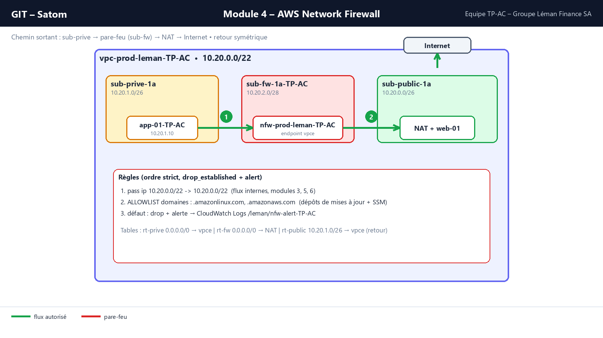
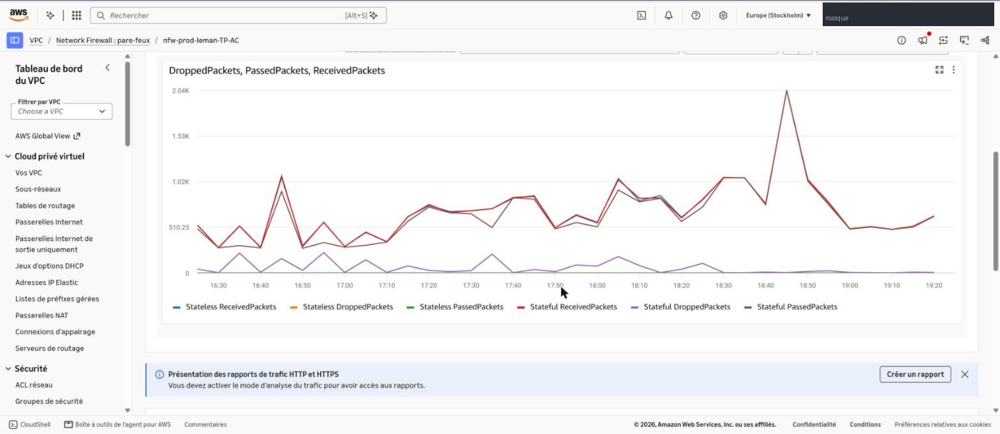
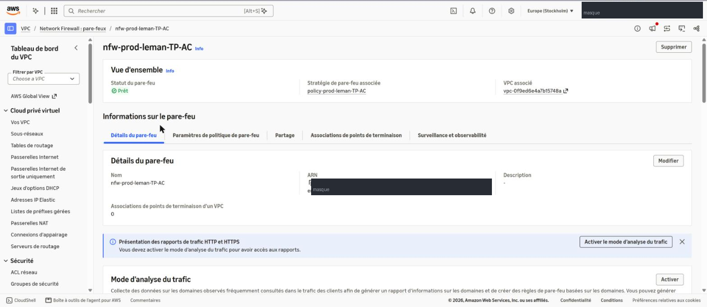
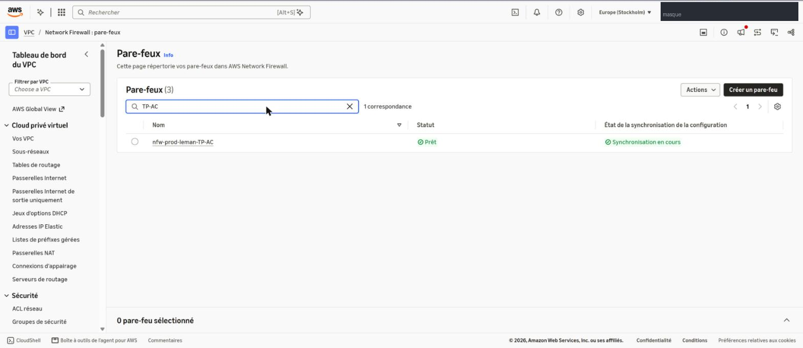
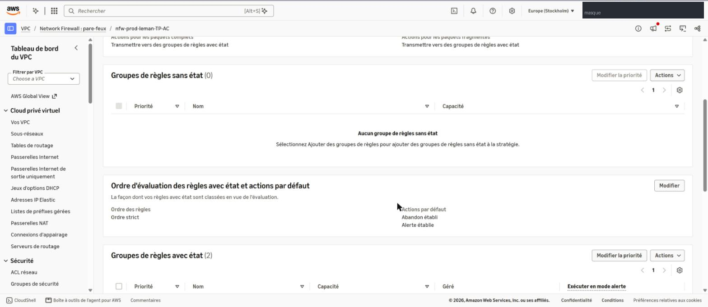
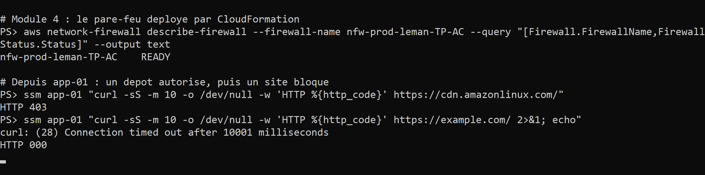
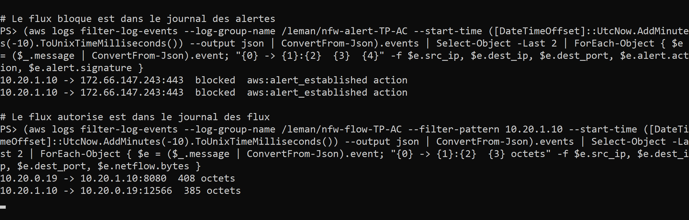
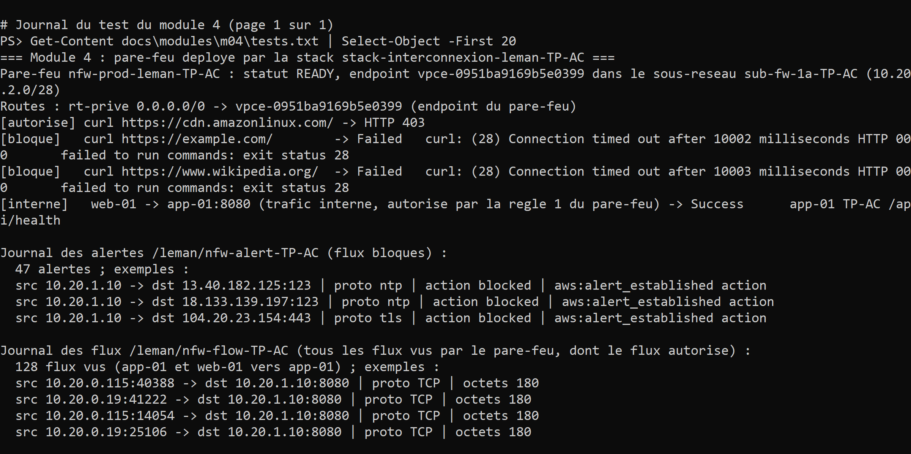

# Module 4 – Network Firewall

> Ce module a d'abord été refusé par l'organisation AWS (`network-firewall:*`). Ce blocage a été levé le 17/11/2026 (nous ne savons pas qui l’a levé) : nous avons alors réalisé et testé le module pour de vrai.

## Objectif
Filtrer ce qui sort du sous-réseau privé : n'autoriser que des dépôts de mises à jour, bloquer le reste du web et garder les alertes dans CloudWatch Logs.

## Ce qu'il faut savoir
Network Firewall est un pare-feu managé placé dans un sous-réseau à part. On y envoie le trafic avec des routes qui visent son endpoint. Il a un moteur sans état (par paquet) et un moteur avec état (domaines HTTP et TLS, règles Suricata). Il faut que le retour d'un flux repasse par le même endpoint, sinon le pare-feu perd l'état. Il coûte environ 0,40 USD de l'heure : on le supprime après les tests.

## Ce que nous avons fait
Le trafic de `app-01` passe par l'endpoint du pare-feu (`sub-fw-1a`, `10.20.2.0/28`), puis vers la NAT, puis vers Internet. Au retour, une route dans la table publique renvoie le trafic vers le pare-feu.



Règles, en ordre strict :
1. laisser passer tout le trafic interne du VPC (`10.20.0.0/22`) pour ne pas casser les autres modules ;
2. autoriser seulement `.amazonlinux.com` et `.amazonaws.com` ;
3. par défaut, bloquer et journaliser (`drop_established` et `alert_established`) dans `/leman/nfw-alert-TP-AC` ;
4. un second journal, `/leman/nfw-flow-TP-AC`, garde **tous** les flux vus par le pare-feu, y compris ceux qu'il autorise : c'est lui qui montre le flux autorisé, car une alerte n'est émise que pour ce qui est bloqué.

Les routes sont : `rt-prive` avec `0.0.0.0/0` vers l'endpoint ; `rt-fw` avec `0.0.0.0/0` vers la NAT ; `rt-public` avec `10.20.1.0/26` vers l'endpoint pour le retour ; et, dans `rt-prive`, `10.20.0.0/26` et `10.20.0.64/26` vers l'endpoint (les deux sous-réseaux publics), pour que les réponses du privé vers le public traversent aussi le pare-feu.

Le pare-feu que montrent les tests est **déployé par le modèle CloudFormation** `cfn/interconnexion-leman.yaml` (voir le module 13). Le script `scripts/m04-firewall.ps1` (déploiement par la ligne de commande) nous a servi pour le premier essai.

## Résultats des tests
```
=== Module 4 : pare-feu deploye par la stack stack-interconnexion-leman-TP-AC ===
Pare-feu nfw-prod-leman-TP-AC : statut READY, endpoint vpce-0951ba9169b5e0399 dans le sous-reseau sub-fw-1a-TP-AC (10.20.2.0/28)
Routes : rt-prive 0.0.0.0/0 -> vpce-0951ba9169b5e0399 (endpoint du pare-feu)
[autorise] curl https://cdn.amazonlinux.com/ -> HTTP 403
[bloque]   curl https://example.com/        -> Failed	curl: (28) Connection timed out after 10002 milliseconds HTTP 000	failed to run commands: exit status 28
[bloque]   curl https://www.wikipedia.org/  -> Failed	curl: (28) Connection timed out after 10003 milliseconds HTTP 000	failed to run commands: exit status 28
[interne]   web-01 -> app-01:8080 (trafic interne, autorise par la regle 1 du pare-feu) -> Success	app-01 TP-AC /api/health 	

Journal des alertes /leman/nfw-alert-TP-AC (flux bloques) :
  47 alertes ; exemples :
  src 10.20.1.10 -> dst 13.40.182.125:123 | proto ntp | action blocked | aws:alert_established action
  src 10.20.1.10 -> dst 18.133.139.197:123 | proto ntp | action blocked | aws:alert_established action
  src 10.20.1.10 -> dst 104.20.23.154:443 | proto tls | action blocked | aws:alert_established action

Journal des flux /leman/nfw-flow-TP-AC (tous les flux vus par le pare-feu, dont le flux autorise) :
  128 flux vus (app-01 et web-01 vers app-01) ; exemples :
  src 10.20.0.115:40388 -> dst 10.20.1.10:8080 | proto TCP | octets 180
  src 10.20.0.19:41222 -> dst 10.20.1.10:8080 | proto TCP | octets 180
  src 10.20.0.115:14054 -> dst 10.20.1.10:8080 | proto TCP | octets 180
  src 10.20.0.19:25106 -> dst 10.20.1.10:8080 | proto TCP | octets 180
```

## Ce que nous avons vérifié
1. Le pare-feu passe à `Ready` et son endpoint apparaît dans la zone.
2. Depuis `app-01`, `curl https://cdn.amazonlinux.com` fonctionne, `curl https://example.com` échoue.
3. Les deux tests apparaissent dans les journaux : l'alerte du flux bloqué dans le journal des alertes, le flux autorisé (avec son nombre d'octets) dans le journal des flux.

## Ce qui a moins bien marché
Au premier essai, par la ligne de commande, le pare-feu a été créé mais trois étapes ont échoué : le groupe de journaux (les étiquettes passées à la création), la journalisation qui en dépend, et les routes (l'identifiant d'endpoint n'avait pas été lu). Nous avons corrigé ces étapes à la main. AWS a aussi refusé de supprimer le pare-feu tant qu'une journalisation était configurée : il faut la retirer d'abord. Le modèle CloudFormation gère cet ordre tout seul.

Le sujet demande que le flux autorisé et le flux bloqué apparaissent tous les deux dans les journaux. Notre premier essai ne journalisait que les alertes : nous avons ajouté le journal des flux.

## Un défaut que le sujet ne mentionne pas
Notre première version ne mettait que la route de retour dans la table publique, comme le sujet le demande. Résultat : **`web-01` ne joignait plus `app-01`**. La NAT est dans le même sous-réseau que `web-01` : la route de retour `10.20.1.0/26` vers le pare-feu s'applique donc aussi à tout ce que `web-01` envoie vers `app-01`. La requête passait par le pare-feu, mais la réponse revenait directement, et le pare-feu, qui ne voyait qu'un sens de l'échange, coupait la suite.

Nous avons d'abord ajouté, dans `rt-prive`, les routes `10.20.0.0/26` et `10.20.0.64/26` vers l'endpoint, pour que la réponse repasse aussi par le pare-feu. Cela ne suffisait pas : le flux était bien vu par le pare-feu (il apparaît dans le journal des flux), mais n'arrivait pas à `app-01`. La cause : dans `sg-app`, les règles de `web-01` et de `rtr-aws` étaient écrites « depuis le groupe de sécurité X ». Quand le trafic traverse l'endpoint du pare-feu, AWS ne le rattache plus à ce groupe, et la règle ne correspond plus. Les flux du développement et des sites marchaient, car leurs règles sont écrites par plage d'adresses. Nous avons donc écrit ces règles par plage (`10.20.0.0/26` pour `web-01`, `10.20.0.74/32` pour `rtr-aws`).

Ce qu'il faut retenir : avec un pare-feu au milieu d'un VPC, il faut que le trafic soit **symétrique**, et que les Security Groups autorisent par **adresses** plutôt que par référence de groupe.

## Nettoyage
Supprimer d'abord le pare-feu, puis la politique et les groupes de règles, et remettre `0.0.0.0/0` vers la NAT dans `rt-prive`.

## Captures

**Console AWS – paquets bloques**



**Console AWS – pare feu details**



**Console AWS – pare feux**



**Console AWS – politique regles**



**Terminal**



**Terminal**



**Terminal – journal du test**


