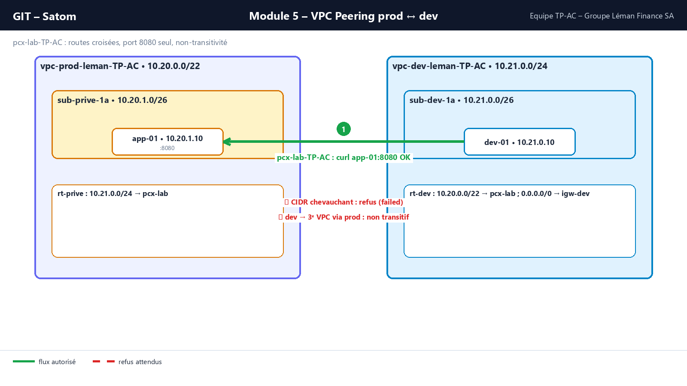
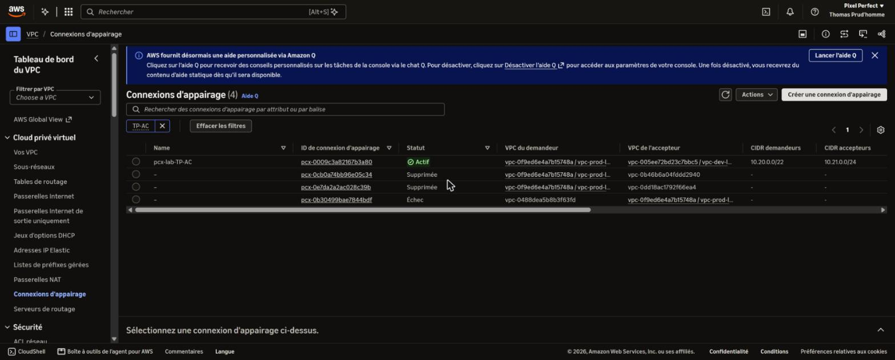
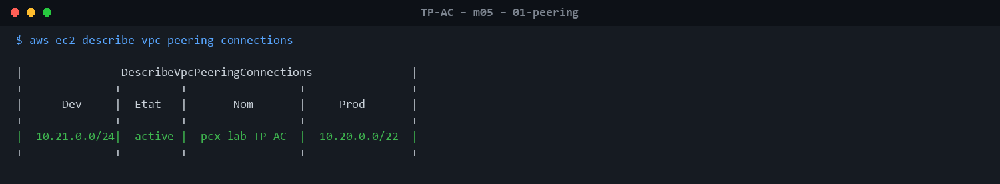
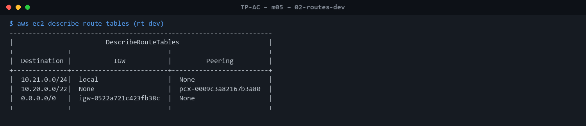
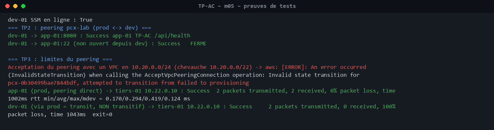

# Module 5 – VPC Peering

## Objectif
Créer un VPC de développement, le relier à la production pour le seul port 8080, et comprendre les limites du peering.

## Ce qu'il faut savoir
Un peering relie deux VPC par le réseau privé d'AWS. Il faut faire la demande, l'accepter, ajouter les routes dans les deux sens et ouvrir ce qu'il faut dans les Security Groups. Les plages ne doivent pas se chevaucher (AWS accepte la demande, puis la met en échec à l'acceptation). Le peering n'est pas transitif : si A parle à B et B à C, A ne parle pas à C.

## Ce que nous avons fait
- Le VPC `vpc-dev-leman-TP-AC` en `10.21.0.0/24`, un sous-réseau `10.21.0.0/26`, une instance `dev-01` (`10.21.0.10`). Elle a une IP publique pour joindre SSM, et son groupe de sécurité n'autorise aucune entrée.
- Le peering `pcx-lab-TP-AC` entre la prod et le dev, les routes dans les deux tables, et le port 8080 ouvert dans `sg-app` pour `10.21.0.0/24`.
- Un VPC volontairement en `10.20.0.0/24` pour tenter un peering avec la prod : il passe en échec.
- Un troisième VPC `10.22.0.0/24` relié seulement à la prod : `app-01` le joint, `dev-01` non.

Scripts : `scripts/m05-peering.ps1` et `scripts/m05-tests.ps1`.



| Élément | Valeur |
|---|---|
| Peering | prod `10.20.0.0/22` avec dev `10.21.0.0/24` |
| Table du dev | `10.20.0.0/22` vers le peering, `0.0.0.0/0` vers l'IGW du dev |
| Table du privé (prod) | `10.21.0.0/24` vers le peering |
| sg-app | TCP 8080 depuis `10.21.0.0/24` |

## Comment nous testons
Depuis `dev-01`, un `curl` sur `app-01:8080` doit répondre et le port 22 doit rester fermé. Le peering avec la plage qui chevauche doit échouer. Et `dev-01` ne doit pas joindre le VPC relié seulement à la prod, alors qu'`app-01` le joint.

## Résultats des tests
```
dev-01 SSM en ligne : True
=== TP2 : peering pcx-lab (prod <-> dev) ===
dev-01 -> app-01:8080 : Success	app-01 TP-AC /api/health 	
dev-01 -> app-01:22 (non ouvert depuis dev) : Success	FERME 	

=== TP3 : limites du peering ===
Acceptation du peering avec un VPC en 10.20.0.0/24 (chevauche 10.20.0.0/22) -> aws: [ERROR]: An error occurred (InvalidStateTransition) when calling the AcceptVpcPeeringConnection operation: Invalid state transition for pcx-0b30499bae7844bdf, attempted to transition from failed to provisioning
app-01 (prod, peering direct) -> tiers-01 10.22.0.10 : Success	2 packets transmitted, 2 received, 0% packet loss, time 1002ms rtt min/avg/max/mdev = 0.170/0.294/0.419/0.124 ms 	
dev-01 (via prod = transit, NON transitif) -> tiers-01 10.22.0.10 : Success	2 packets transmitted, 0 received, 100% packet loss, time 1043ms  exit=0
```

## Nettoyage
Comme le sujet le demande, le peering `pcx-lab-TP-AC` est supprimé au module 6 : le Transit Gateway relie ensuite la prod et le dev. `dev-01` est arrêtée après les tests, les VPC de test sont supprimés.

## Captures

**Console AWS – peering**



**Terminal – peering**



**Terminal – routes dev**



**Journal des tests**


