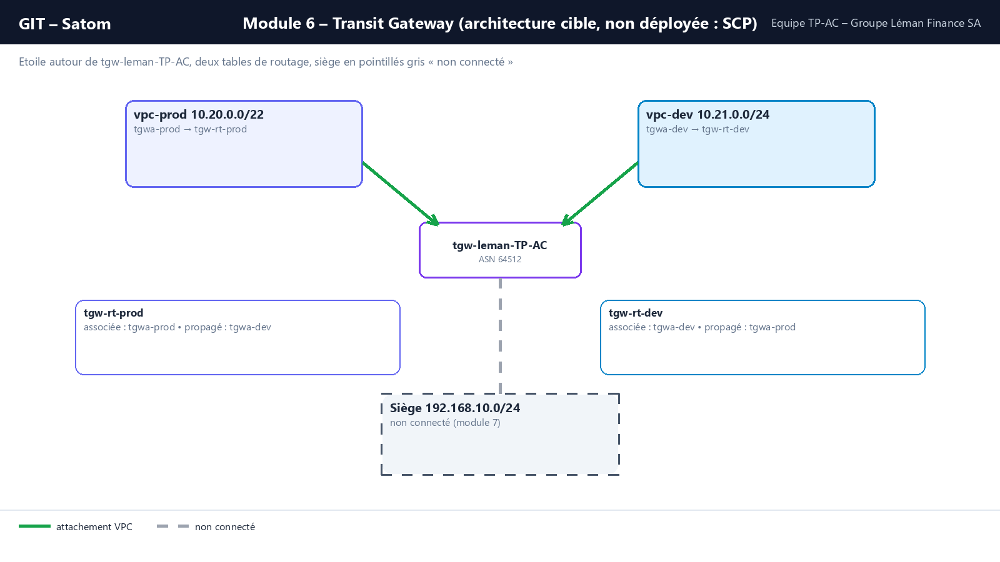

# Module 6 – Transit Gateway

> **Statut : non déployable sur la plateforme de formation.** `ec2:CreateTransitGateway` est refusé par la SCP de l'organisation (la lecture est autorisée). Ce module fournit le cours, l'architecture, un **template CloudFormation validé** (`cfn/optional-m06-m08-interconnexion.yaml`) et la procédure de test. La liaison prod/dev reste assurée par le peering du module 5.

## Objectif
Remplacer les liaisons point à point (peering) par un **hub** : un Transit Gateway relie plusieurs VPC et, plus tard, des sites distants, avec une table de routage par environnement.

## Cours (essentiel)
* Le **TGW** est un routeur régional managé : chaque VPC (ou VPN, Direct Connect) s'y connecte par un **attachement**. Le peering demande n(n-1)/2 liens ; le TGW en demande n.
* **Association** : un attachement est associé à **une** table de routage TGW (celle qui décide où il peut aller). **Propagation** : un attachement publie son CIDR dans une table. En désactivant l'association/propagation par défaut, on isole prod et dev et on décide explicitement qui voit qui.
* Les routes **dans les tables des VPC** (`10.21.0.0/24 → tgw`) sont toujours nécessaires.
* Facturation : ~0,05 USD/h **par attachement** + données traitées.

## Architecture cible

## Configuration prévue
| Ressource | Valeur |
|---|---|
| `tgw-leman-TP-AC` | ASN `64512`, association et propagation par défaut **désactivées** |
| `tgwa-prod-TP-AC` | VPC prod, sous-réseau `sub-prive-1a` |
| `tgwa-dev-TP-AC` | VPC dev, sous-réseau `sub-dev-1a` |
| `tgw-rt-prod-TP-AC` | associée à `tgwa-prod` ; propagation depuis `tgwa-dev` |
| `tgw-rt-dev-TP-AC` | associée à `tgwa-dev` ; propagation depuis `tgwa-prod` |
| `rt-prive-leman-TP-AC` | `10.21.0.0/24 → tgw-leman` (remplace la route du peering) |
| `rt-dev-leman-TP-AC` | `10.20.0.0/22 → tgw-leman` |

## Ce qui a été tenté
`aws ec2 create-transit-gateway` → `UnauthorizedOperation … explicit deny in a service control policy` (preuve dans `01-services-bloques.md`). Le script `scripts/m06-tgw.ps1` (création, attachements, tables, propagation, tests, test d'asymétrie) est prêt à rejouer.

## Procédure de test (à rejouer quand la SCP sera levée)
1. Deux attachements `available`, `pcx-lab` supprimé.
2. `dev-01` : `curl http://10.20.1.10:8080/api/health` réussit via le TGW.
3. Retirer la propagation `tgwa-dev → tgw-rt-prod` : le `curl` **échoue** (la prod ne sait plus répondre au dev : trafic asymétrique) ; rétablir : il réussit.
4. Procédure de diagnostic : **association** de l'attachement → **route propagée** dans la table TGW → **route dans la table du VPC** → **SG de la cible**.

## Nettoyage
Garder `tgw-leman` si le module 7 suit ; sinon supprimer les attachements puis le TGW et le noter dans le journal du projet. Dans notre cas rien n'est facturé, rien n'a été créé.

## Justification de l'écart
Service bloqué par l'organisation. Le comportement de routage (association, propagation, asymétrie) est étudié dans le module 5 (peering) et dans la simulation du module 7 (routeur `rtr-aws`).
