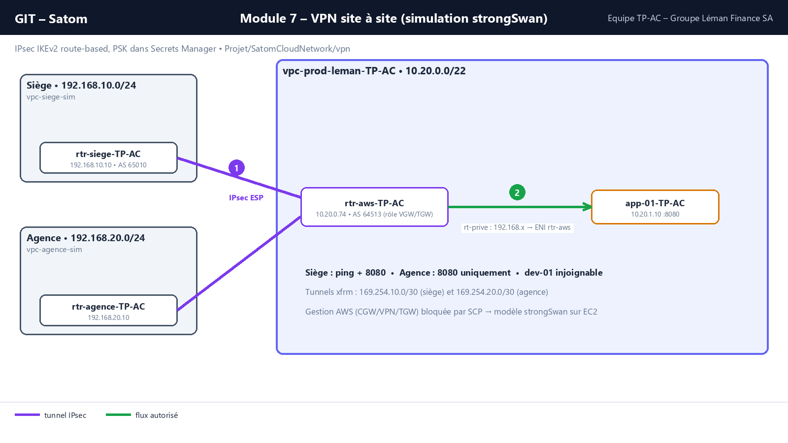
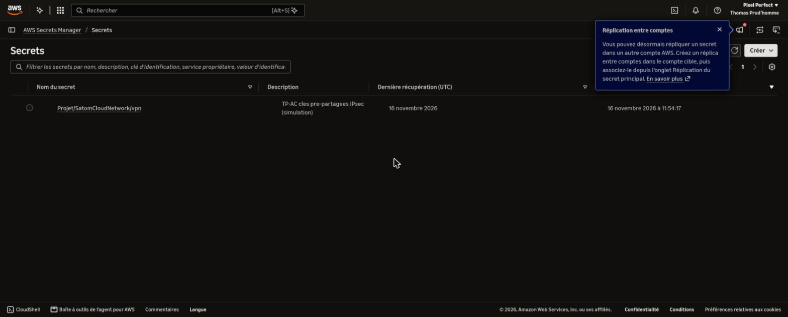
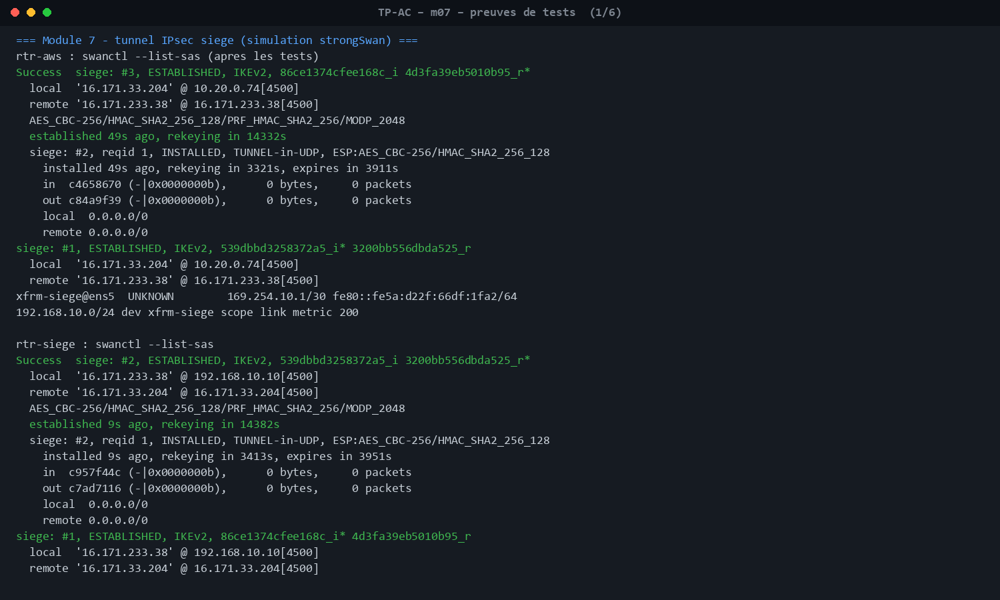
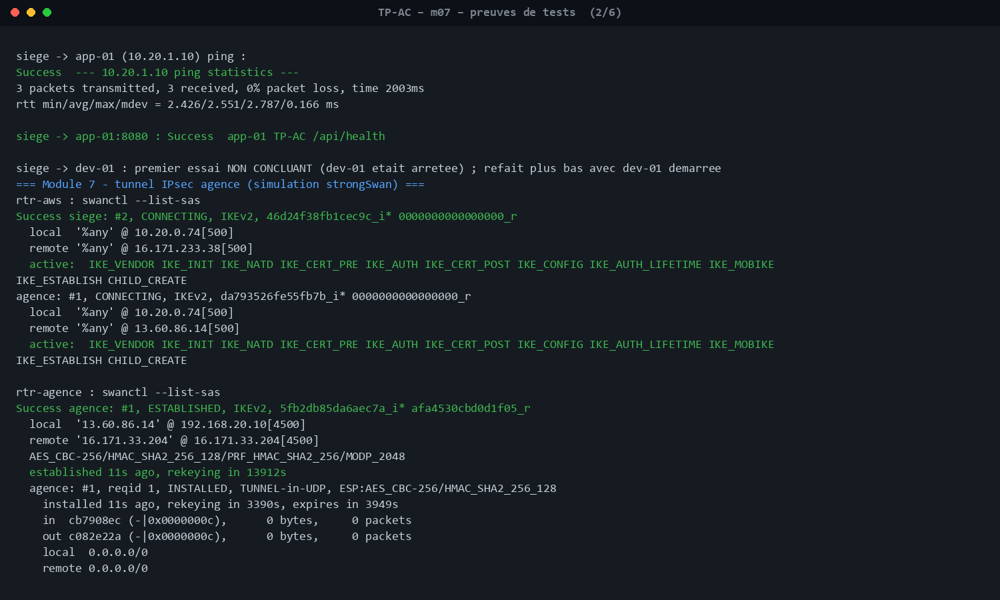
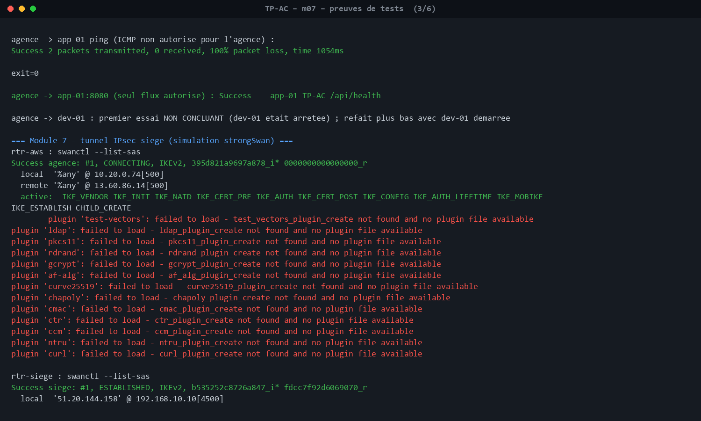
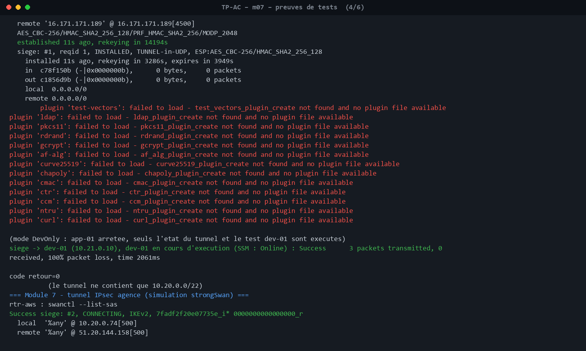
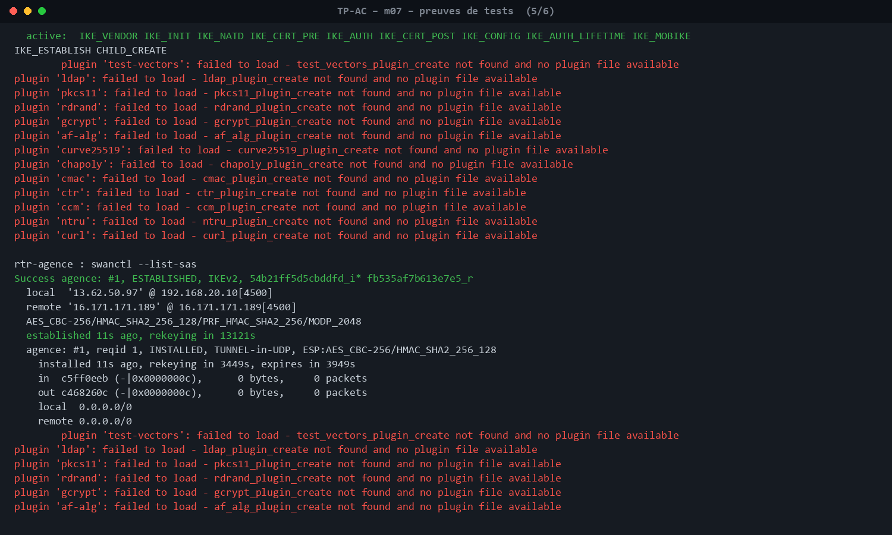
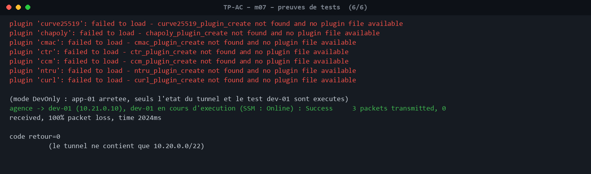

# Module 7 – VPN site à site (siège et agence)

> Le VPN géré d'AWS est bloqué par l'organisation (`CreateCustomerGateway`, `CreateVpnGateway` et `CreateVpnConnection` sont refusés, le Transit Gateway aussi). Nous avons donc **simulé** les trois routeurs avec strongSwan sur des instances EC2 : le tunnel IPsec est réel, mais ce n'est pas le service VPN d'AWS.

## Objectif
Relier le siège (`192.168.10.0/24`) et l'agence (`192.168.20.0/24`) au VPC de production par des tunnels chiffrés. Le siège doit pouvoir joindre `app-01` (ping et 8080), l'agence seulement le port 8080.

## Ce qu'il faut savoir
IPsec en version 2 fonctionne en deux temps : une phase d'authentification (ici une clé partagée et un échange Diffie-Hellman), puis un tunnel ESP qui chiffre le trafic (nous utilisons `aes256-sha256-modp2048`). Le VPN d'AWS fournit deux tunnels par connexion et des adresses de tunnel en `169.254.x.x/30`. Nous avons fait du « route-based » : le tunnel est une interface et ce sont les routes qui décident ce qui y passe. La clé partagée ne doit jamais traîner dans un document : la nôtre est dans Secrets Manager (`Projet/SatomCloudNetwork/vpn`), les routeurs la lisent avec leur rôle IAM.

## Ce que nous avons fait
- `rtr-aws-TP-AC` dans le sous-réseau public 1b (`10.20.0.74`), qui joue la passerelle côté AWS.
- `rtr-siege-TP-AC` (`192.168.10.10`) et `rtr-agence-TP-AC` (`192.168.20.10`), chacun dans son propre petit VPC simulé.
- Des routes dans `rt-prive` vers `192.168.10.0/24` et `192.168.20.0/24` qui passent par le routeur AWS.
- Dans `sg-app`, le ping et le 8080 pour le siège, le 8080 seulement pour l'agence.

Script : `scripts/m07-ipsec-sim.ps1 -Site siege` ou `-Site agence`.



| Élément | Valeur |
|---|---|
| IKE et ESP | `aes256-sha256-modp2048`, authentification par clé partagée |
| Interfaces de tunnel | `xfrm-siege` (`169.254.10.0/30`), `xfrm-agence` (`169.254.20.0/30`) |
| Adresses publiques | automatiques, car le quota d'Elastic IP du compte est plein |

## Si ça ne marche pas : quatre vérifications
1. L'état des tunnels : `swanctl --list-sas` doit afficher `ESTABLISHED`.
2. Les paramètres IPsec : mêmes propositions et même clé des deux côtés.
3. Les routes : `ip route get` côté site, et la route dans `rt-prive` côté AWS.
4. Les Security Groups : UDP 500 et 4500 et le protocole ESP doivent passer entre les routeurs, et `sg-app` doit autoriser la source.

## Résultats des tests
```
=== Module 7 - tunnel IPsec siege (simulation strongSwan) ===
rtr-aws : swanctl --list-sas (apres les tests)
Success  siege: #3, ESTABLISHED, IKEv2, 86ce1374cfee168c_i 4d3fa39eb5010b95_r*
  local  '16.171.33.204' @ 10.20.0.74[4500]
  remote '16.171.233.38' @ 16.171.233.38[4500]
  AES_CBC-256/HMAC_SHA2_256_128/PRF_HMAC_SHA2_256/MODP_2048
  established 49s ago, rekeying in 14332s
  siege: #2, reqid 1, INSTALLED, TUNNEL-in-UDP, ESP:AES_CBC-256/HMAC_SHA2_256_128
    installed 49s ago, rekeying in 3321s, expires in 3911s
    in  c4658670 (-|0x0000000b),      0 bytes,     0 packets
    out c84a9f39 (-|0x0000000b),      0 bytes,     0 packets
    local  0.0.0.0/0
    remote 0.0.0.0/0
siege: #1, ESTABLISHED, IKEv2, 539dbbd3258372a5_i* 3200bb556dbda525_r
  local  '16.171.33.204' @ 10.20.0.74[4500]
  remote '16.171.233.38' @ 16.171.233.38[4500]
xfrm-siege@ens5  UNKNOWN        169.254.10.1/30 fe80::fe5a:d22f:66df:1fa2/64 
192.168.10.0/24 dev xfrm-siege scope link metric 200 
  
rtr-siege : swanctl --list-sas
Success  siege: #2, ESTABLISHED, IKEv2, 539dbbd3258372a5_i 3200bb556dbda525_r*
  local  '16.171.233.38' @ 192.168.10.10[4500]
  remote '16.171.33.204' @ 16.171.33.204[4500]
  AES_CBC-256/HMAC_SHA2_256_128/PRF_HMAC_SHA2_256/MODP_2048
  established 9s ago, rekeying in 14382s
  siege: #2, reqid 1, INSTALLED, TUNNEL-in-UDP, ESP:AES_CBC-256/HMAC_SHA2_256_128
    installed 9s ago, rekeying in 3413s, expires in 3951s
    in  c957f44c (-|0x0000000b),      0 bytes,     0 packets
    out c7ad7116 (-|0x0000000b),      0 bytes,     0 packets
    local  0.0.0.0/0
    remote 0.0.0.0/0
siege: #1, ESTABLISHED, IKEv2, 86ce1374cfee168c_i* 4d3fa39eb5010b95_r
  local  '16.171.233.38' @ 192.168.10.10[4500]
  remote '16.171.33.204' @ 16.171.33.204[4500]

siege -> app-01 (10.20.1.10) ping : 
Success  --- 10.20.1.10 ping statistics ---
3 packets transmitted, 3 received, 0% packet loss, time 2003ms
rtt min/avg/max/mdev = 2.426/2.551/2.787/0.166 ms
  
siege -> app-01:8080 : Success  app-01 TP-AC /api/health
  
siege -> dev-01 : premier essai NON CONCLUANT (dev-01 etait arretee) ; refait plus bas avec dev-01 demarree
=== Module 7 - tunnel IPsec agence (simulation strongSwan) ===
rtr-aws : swanctl --list-sas
Success	siege: #2, CONNECTING, IKEv2, 46d24f38fb1cec9c_i* 0000000000000000_r
  local  '%any' @ 10.20.0.74[500]
  remote '%any' @ 16.171.233.38[500]
  active:  IKE_VENDOR IKE_INIT IKE_NATD IKE_CERT_PRE IKE_AUTH IKE_CERT_POST IKE_CONFIG IKE_AUTH_LIFETIME IKE_MOBIKE IKE_ESTABLISH CHILD_CREATE
agence: #1, CONNECTING, IKEv2, da793526fe55fb7b_i* 0000000000000000_r
  local  '%any' @ 10.20.0.74[500]
  remote '%any' @ 13.60.86.14[500]
  active:  IKE_VENDOR IKE_INIT IKE_NATD IKE_CERT_PRE IKE_AUTH IKE_CERT_POST IKE_CONFIG IKE_AUTH_LIFETIME IKE_MOBIKE IKE_ESTABLISH CHILD_CREATE

rtr-agence : swanctl --list-sas
Success	agence: #1, ESTABLISHED, IKEv2, 5fb2db85da6aec7a_i* afa4530cbd0d1f05_r
  local  '13.60.86.14' @ 192.168.20.10[4500]
  remote '16.171.33.204' @ 16.171.33.204[4500]
  AES_CBC-256/HMAC_SHA2_256_128/PRF_HMAC_SHA2_256/MODP_2048
  established 11s ago, rekeying in 13912s
  agence: #1, reqid 1, INSTALLED, TUNNEL-in-UDP, ESP:AES_CBC-256/HMAC_SHA2_256_128
    installed 11s ago, rekeying in 3390s, expires in 3949s
    in  cb7908ec (-|0x0000000c),      0 bytes,     0 packets
    out c082e22a (-|0x0000000c),      0 bytes,     0 packets
    local  0.0.0.0/0
    remote 0.0.0.0/0
	
agence -> app-01 ping (ICMP non autorise pour l'agence) : 
Success	2 packets transmitted, 0 received, 100% packet loss, time 1054ms

exit=0
	
agence -> app-01:8080 (seul flux autorise) : Success	app-01 TP-AC /api/health
	
agence -> dev-01 : premier essai NON CONCLUANT (dev-01 etait arretee) ; refait plus bas avec dev-01 demarree

=== Module 7 - tunnel IPsec siege (simulation strongSwan) ===
rtr-aws : swanctl --list-sas
Success	agence: #1, CONNECTING, IKEv2, 395d821a9697a878_i* 0000000000000000_r
  local  '%any' @ 10.20.0.74[500]
  remote '%any' @ 13.60.86.14[500]
  active:  IKE_VENDOR IKE_INIT IKE_NATD IKE_CERT_PRE IKE_AUTH IKE_CERT_POST IKE_CONFIG IKE_AUTH_LIFETIME IKE_MOBIKE IKE_ESTABLISH CHILD_CREATE
	plugin 'test-vectors': failed to load - test_vectors_plugin_create not found and no plugin file available
plugin 'ldap': failed to load - ldap_plugin_create not found and no plugin file available
plugin 'pkcs11': failed to load - pkcs11_plugin_create not found and no plugin file available
plugin 'rdrand': failed to load - rdrand_plugin_create not found and no plugin file available
plugin 'gcrypt': failed to load - gcrypt_plugin_create not found and no plugin file available
plugin 'af-alg': failed to load - af_alg_plugin_create not found and no plugin file available
plugin 'curve25519': failed to load - curve25519_plugin_create not found and no plugin file available
plugin 'chapoly': failed to load - chapoly_plugin_create not found and no plugin file available
plugin 'cmac': failed to load - cmac_plugin_create not found and no plugin file available
plugin 'ctr': failed to load - ctr_plugin_create not found and no plugin file available
plugin 'ccm': failed to load - ccm_plugin_create not found and no plugin file available
plugin 'ntru': failed to load - ntru_plugin_create not found and no plugin file available
plugin 'curl': failed to load - curl_plugin_create not found and no plugin file available

rtr-siege : swanctl --list-sas
Success	siege: #1, ESTABLISHED, IKEv2, b535252c8726a847_i* fdcc7f92d6069070_r
  local  '51.20.144.158' @ 192.168.10.10[4500]
  remote '16.171.171.189' @ 16.171.171.189[4500]
  AES_CBC-256/HMAC_SHA2_256_128/PRF_HMAC_SHA2_256/MODP_2048
  established 11s ago, rekeying in 14194s
  siege: #1, reqid 1, INSTALLED, TUNNEL-in-UDP, ESP:AES_CBC-256/HMAC_SHA2_256_128
    installed 11s ago, rekeying in 3286s, expires in 3949s
    in  c78f150b (-|0x0000000b),      0 bytes,     0 packets
    out c1856d9b (-|0x0000000b),      0 bytes,     0 packets
    local  0.0.0.0/0
    remote 0.0.0.0/0
	plugin 'test-vectors': failed to load - test_vectors_plugin_create not found and no plugin file available
plugin 'ldap': failed to load - ldap_plugin_create not found and no plugin file available
plugin 'pkcs11': failed to load - pkcs11_plugin_create not found and no plugin file available
plugin 'rdrand': failed to load - rdrand_plugin_create not found and no plugin file available
plugin 'gcrypt': failed to load - gcrypt_plugin_create not found and no plugin file available
plugin 'af-alg': failed to load - af_alg_plugin_create not found and no plugin file available
plugin 'curve25519': failed to load - curve25519_plugin_create not found and no plugin file available
plugin 'chapoly': failed to load - chapoly_plugin_create not found and no plugin file available
plugin 'cmac': failed to load - cmac_plugin_create not found and no plugin file available
plugin 'ctr': failed to load - ctr_plugin_create not found and no plugin file available
plugin 'ccm': failed to load - ccm_plugin_create not found and no plugin file available
plugin 'ntru': failed to load - ntru_plugin_create not found and no plugin file available
plugin 'curl': failed to load - curl_plugin_create not found and no plugin file available

(mode DevOnly : app-01 arretee, seuls l'etat du tunnel et le test dev-01 sont executes)
siege -> dev-01 (10.21.0.10), dev-01 en cours d'execution (SSM : Online) : Success	3 packets transmitted, 0 received, 100% packet loss, time 2061ms

code retour=0
	  (le tunnel ne contient que 10.20.0.0/22)
=== Module 7 - tunnel IPsec agence (simulation strongSwan) ===
rtr-aws : swanctl --list-sas
Success	siege: #2, CONNECTING, IKEv2, 7fadf2f20e07735e_i* 0000000000000000_r
  local  '%any' @ 10.20.0.74[500]
  remote '%any' @ 51.20.144.158[500]
  active:  IKE_VENDOR IKE_INIT IKE_NATD IKE_CERT_PRE IKE_AUTH IKE_CERT_POST IKE_CONFIG IKE_AUTH_LIFETIME IKE_MOBIKE IKE_ESTABLISH CHILD_CREATE
	plugin 'test-vectors': failed to load - test_vectors_plugin_create not found and no plugin file available
plugin 'ldap': failed to load - ldap_plugin_create not found and no plugin file available
plugin 'pkcs11': failed to load - pkcs11_plugin_create not found and no plugin file available
plugin 'rdrand': failed to load - rdrand_plugin_create not found and no plugin file available
plugin 'gcrypt': failed to load - gcrypt_plugin_create not found and no plugin file available
plugin 'af-alg': failed to load - af_alg_plugin_create not found and no plugin file available
plugin 'curve25519': failed to load - curve25519_plugin_create not found and no plugin file available
plugin 'chapoly': failed to load - chapoly_plugin_create not found and no plugin file available
plugin 'cmac': failed to load - cmac_plugin_create not found and no plugin file available
plugin 'ctr': failed to load - ctr_plugin_create not found and no plugin file available
plugin 'ccm': failed to load - ccm_plugin_create not found and no plugin file available
plugin 'ntru': failed to load - ntru_plugin_create not found and no plugin file available
plugin 'curl': failed to load - curl_plugin_create not found and no plugin file available

rtr-agence : swanctl --list-sas
Success	agence: #1, ESTABLISHED, IKEv2, 54b21ff5d5cbddfd_i* fb535af7b613e7e5_r
  local  '13.62.50.97' @ 192.168.20.10[4500]
  remote '16.171.171.189' @ 16.171.171.189[4500]
  AES_CBC-256/HMAC_SHA2_256_128/PRF_HMAC_SHA2_256/MODP_2048
  established 11s ago, rekeying in 13121s
  agence: #1, reqid 1, INSTALLED, TUNNEL-in-UDP, ESP:AES_CBC-256/HMAC_SHA2_256_128
    installed 11s ago, rekeying in 3449s, expires in 3949s
    in  c5ff0eeb (-|0x0000000c),      0 bytes,     0 packets
    out c468260c (-|0x0000000c),      0 bytes,     0 packets
    local  0.0.0.0/0
    remote 0.0.0.0/0
	plugin 'test-vectors': failed to load - test_vectors_plugin_create not found and no plugin file available
plugin 'ldap': failed to load - ldap_plugin_create not found and no plugin file available
plugin 'pkcs11': failed to load - pkcs11_plugin_create not found and no plugin file available
plugin 'rdrand': failed to load - rdrand_plugin_create not found and no plugin file available
plugin 'gcrypt': failed to load - gcrypt_plugin_create not found and no plugin file available
plugin 'af-alg': failed to load - af_alg_plugin_create not found and no plugin file available
plugin 'curve25519': failed to load - curve25519_plugin_create not found and no plugin file available
plugin 'chapoly': failed to load - chapoly_plugin_create not found and no plugin file available
plugin 'cmac': failed to load - cmac_plugin_create not found and no plugin file available
plugin 'ctr': failed to load - ctr_plugin_create not found and no plugin file available
plugin 'ccm': failed to load - ccm_plugin_create not found and no plugin file available
plugin 'ntru': failed to load - ntru_plugin_create not found and no plugin file available
plugin 'curl': failed to load - curl_plugin_create not found and no plugin file available

(mode DevOnly : app-01 arretee, seuls l'etat du tunnel et le test dev-01 sont executes)
agence -> dev-01 (10.21.0.10), dev-01 en cours d'execution (SSM : Online) : Success	3 packets transmitted, 0 received, 100% packet loss, time 2024ms

code retour=0
	  (le tunnel ne contient que 10.20.0.0/22)
```

## Limites de notre réalisation
- Un seul tunnel par site, alors que le VPN d'AWS en donne deux.
- Nous avons monté le siège puis l'agence l'un après l'autre : le compte est limité à 16 vCPU pour toute la classe.
- Pour vérifier que ni le siège ni l'agence ne voient `dev-01`, nous avons d'abord fait un test sans valeur (`dev-01` était arrêtée). Nous l'avons refait avec `dev-01` démarrée (SSM « Online ») : le ping vers `10.21.0.10` perd 100 % des paquets depuis le siège et depuis l'agence, car seule la plage `10.20.0.0/22` est dans les tunnels. Ces tests ont été faits un site à la fois, sans `app-01` allumée (manque de vCPU).

## Nettoyage
Le sujet est contradictoire sur ce point (garder ou supprimer le VPN). Nous gardons les routeurs jusqu'à la fin du cours, arrêtés quand nous ne les utilisons pas, et nous les supprimerons ensuite.


## Captures

**Console AWS – secret vpn**



**Journal des tests**



**Journal des tests**



**Journal des tests**



**Journal des tests**



**Journal des tests**



**Journal des tests**


