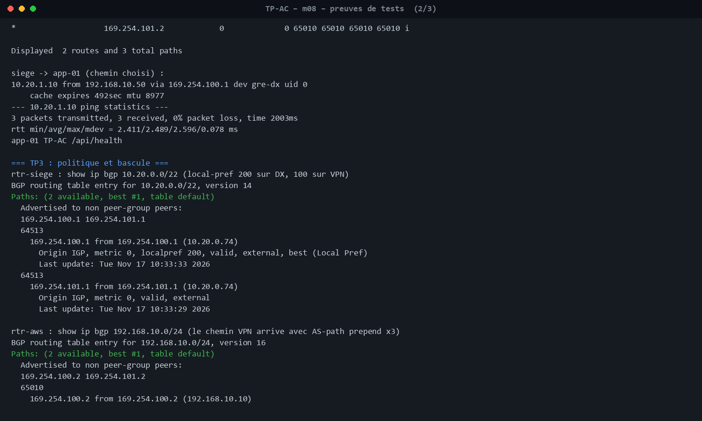

# Module 8 – Direct Connect (concepts et simulation GRE/BGP)

> **Statut : simulé.** AWS Direct Connect est bloqué par la SCP (`directconnect:*` refusé) : la Direct Connect Gateway `dxgw-leman-TP-AC` n'a pas pu être créée. La liaison dédiée est **simulée** par un tunnel **GRE** entre deux routeurs FRRouting (BGP), le VPN IPsec du module 7 servant de secours.

## Objectif
Comprendre la connectivité dédiée (dimensionnement, VIF, BGP) et la politique de bascule entre une liaison principale (Direct Connect) et un secours (VPN).

## Cours (essentiel)
* **Direct Connect** : liaison physique (1/10/100 Gbit/s) entre le siège et un emplacement DX ; une **VIF** (interface virtuelle) porte la session **BGP** vers AWS (VIF privée, publique ou de transit).
* Une **Direct Connect Gateway** (ASN côté AWS) se rattache à un TGW/VGW et diffuse les préfixes autorisés.
* **BGP** choisit le chemin : on prend la route avec la **local-pref** la plus haute (préférence locale). Pour dissuader un chemin, on allonge l'**AS-path** (*prepending*).
* Le VPN IPsec sert de **secours** : l'AS-path du VPN est allongé de 3 AS, la local-pref du DX est de 200.

## TP
| Tâche | Réalisation |
|---|---|
| 1. Dimensionnement | 2 To en 8 h = 16 000 Gbit / 28 800 s = **0,556 Gbit/s** → liaison **1 Gbit/s**, marge ≈ 44 % ; emplacements DX européens proches de Genève consultés dans la console (aucune commande passée) ; création de `dxgw-leman-TP-AC` (ASN 64513) **bloquée par SCP** |
| 2. GRE + BGP | tunnel GRE `169.254.100.0/30` entre `rtr-siege` (AS 65010) et `rtr-aws` (AS 64513), BGP `Established`, `192.168.10.0/24` annoncé, `10.20.0.0/22` reçu, `ping 10.20.1.10` réussi |
| 3. Politique et bascule | `local-pref 200` sur les routes reçues par DX ; `AS-path prepend ×3` sur le chemin VPN ; coupure du GRE → bascule vers le VPN (délai mesuré) ; rétablissement → retour automatique sur DX |

Script : `scripts/m08-bgp-sim.ps1`.

## Architecture


## Tableau de configuration
| Élément | `rtr-siege` | `rtr-aws` |
|---|---|---|
| ASN | 65010 | 64513 |
| Tunnel GRE (DX simulé) | `169.254.100.2/30` | `169.254.100.1/30` |
| Tunnel IPsec (VPN) | `169.254.10.2/30` | `169.254.10.1/30` |
| Préfixe annoncé | `192.168.10.0/24` | `10.20.0.0/22` |
| Politique | `DX-IN` : local-pref 200 ; `VPN-OUT` : prepend 65010 ×3 | `DX-IN` : local-pref 200 ; `VPN-IN` : défaut (100) |
| Timers BGP | 3 s / 9 s | 3 s / 9 s |

## Procédure de diagnostic en quatre étapes
1. **État BGP** : `show bgp summary` (`Established`, nombre de préfixes reçus).
2. **Préfixes annoncés** : `show ip bgp neighbors <voisin> advertised-routes` / `routes`.
3. **Local-pref** : `show ip bgp <préfixe>` – quel chemin est `best` et pourquoi.
4. **Route dans la table AWS** : table `rt-prive` (`192.168.10.0/24` → routeur) et route du kernel du routeur (`ip route get`).

## Résultats
```
=== TP1 : dimensionnement (voir docs/modules/m08) ===
2 To en 8 h = 16 000 Gbit / 28 800 s = 0,556 Gbit/s -> liaison 1 Gbit/s (marge ~44 %)

=== TP2 : GRE + BGP ===
rtr-aws : show bgp summary
Success	
IPv4 Unicast Summary (VRF default):
BGP router identifier 10.20.0.74, local AS number 64513 vrf-id 0
BGP table version 2
RIB entries 3, using 576 bytes of memory
Peers 2, using 1448 KiB of memory

Neighbor        V         AS   MsgRcvd   MsgSent   TblVer  InQ OutQ  Up/Down State/PfxRcd   PfxSnt Desc
169.254.10.2    4      65010        21        18        0    0    0 00:00:29            1        2 VPN-IPsec
169.254.100.2   4      65010        19        18        0    0    0 00:00:29            1        2 DX-simule-GRE

Total number of neighbors 2
	
rtr-aws : show ip bgp 192.168.10.0/24
Success	BGP routing table entry for 192.168.10.0/24, version 2
Paths: (2 available, best #1, table default)
  Advertised to non peer-group peers:
  169.254.10.2 169.254.100.2
  65010
    169.254.100.2 from 169.254.100.2 (192.168.10.10)
      Origin IGP, metric 0, localpref 200, valid, external, best (Local Pref)
      Last update: Mon Nov 16 12:54:16 2026
  65010 65010 65010 65010
    169.254.10.2 from 169.254.10.2 (192.168.10.10)
      Origin IGP, metric 0, valid, external
      Last update: Mon Nov 16 12:54:16 2026
	
rtr-siege : show ip route 10.20.0.0/22
Success	Routing entry for 10.20.0.0/22
  Known via "bgp", distance 20, metric 0, best
  Last update 00:00:39 ago
  * 169.254.100.1, via gre-dx, weight 1

	
siege -> app-01 (chemin DX) :
Success	10.20.1.10 from 192.168.10.10 via 169.254.100.1 dev gre-dx uid 0 
    cache 
--- 10.20.1.10 ping statistics ---
3 packets transmitted, 3 received, 0% packet loss, time 2003ms
rtt min/avg/max/mdev = 2.354/2.409/2.504/0.067 ms
	

=== TP3 : politique et bascule ===
rtr-siege : show ip bgp 10.20.0.0/22 (local-pref 200 sur DX, 100 sur VPN)
Success	BGP routing table entry for 10.20.0.0/22, version 2
Paths: (2 available, best #1, table default)
  Advertised to non peer-group peers:
  169.254.10.1 169.254.100.1
  64513
    169.254.100.1 from 169.254.100.1 (10.20.0.74)
      Origin IGP, metric 0, localpref 200, valid, external, best (Local Pref)
      Last update: Mon Nov 16 12:54:16 2026
  64513
    169.254.10.1 from 169.254.10.1 (10.20.0.74)
      Origin IGP, metric 0, valid, external
      Last update: Mon Nov 16 12:54:16 2026
	
rtr-aws : chemin VPN annonce par le siege avec AS-path prepend x3 (65010 65010 65010 65010) :
Success	BGP table version is 2, local router ID is 10.20.0.74, vrf id 0
Default local pref 100, local AS 64513
Status codes:  s suppressed, d damped, h history, * valid, > best, = multipath,
               i internal, r RIB-failure, S Stale, R Removed
Nexthop codes: @NNN nexthop's vrf id, < announce-nh-self
Origin codes:  i - IGP, e - EGP, ? - incomplete
RPKI validation codes: V valid, I invalid, N Not found

   Network          Next Hop            Metric LocPrf Weight Path
*  192.168.10.0/24  169.254.10.2             0             0 65010 65010 65010 65010 i

Displayed  1 routes and 3 total paths
	
GRE coupe -> route apres bascule :
Success	10.20.1.10 from 192.168.10.10 via 169.254.10.1 dev xfrm-siege uid 0 
    cache 
Neighbor        V         AS   MsgRcvd   MsgSent   TblVer  InQ OutQ  Up/Down State/PfxRcd   PfxSnt Desc
169.254.10.1    4      64513        48        51        0    0    0 00:01:54            1        2 VPN-IPsec
169.254.100.1   4      64513        35        36        0    0    0 00:00:36       Active        0 DX-simule-GRE
	
GRE retabli -> retour sur DX :
Success	10.20.1.10 from 192.168.10.10 via 169.254.100.1 dev gre-dx uid 0 
    cache 
	
Journal de continuite (pings toutes les 0,1 s ; KO = perdus) :
Success	    130 OK
      9 KO
    261 OK
---
9
pings_perdus_x0.1s
```

## Mesure de la bascule
Le ping horodaté (une sonde toutes les 0,1 s avec 1 s de délai maximum) a perdu **9 sondes** lors de la coupure du GRE, soit une interruption d'environ **10 secondes** (détection BGP en 9 s avec les timers 3/9 s), puis le trafic est passé par le VPN ; au rétablissement du GRE, le chemin DX (local-pref 200) est repris automatiquement.

## Nettoyage
Rien n'est facturé à l'heure pour Direct Connect (rien commandé). Les routeurs GNS3/FRR du HackMD correspondent ici à des instances EC2 arrêtées en fin de séance. `dxgw-leman` n'existe pas (SCP) ; la commande de création et d'association est documentée dans `cfn/optional-m06-m08-interconnexion.yaml`.

## Écarts et remarques
* **GNS3 non utilisé** : FRRouting sur EC2 reproduit les mêmes sessions BGP, est reproductible par script et ne demande aucune installation sur le poste.
* GRE traverse la NAT 1-pour-1 des IP publiques AWS (protocole 47 autorisé dans les Security Groups).


## Captures

**Preuves de tests (journal)**


**Preuves de tests (journal)**



**Preuves de tests (journal)**


