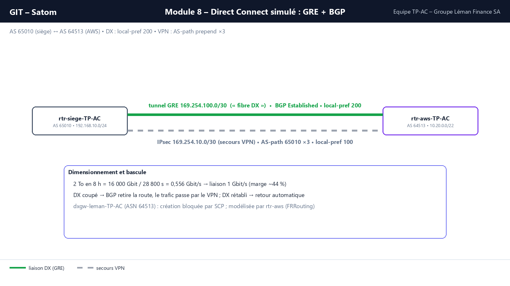
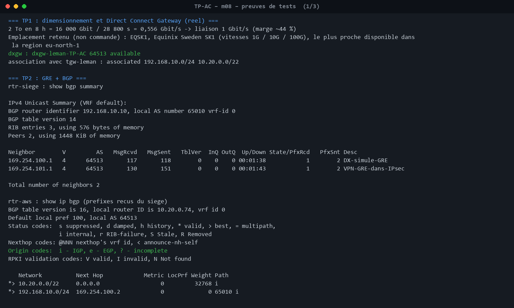
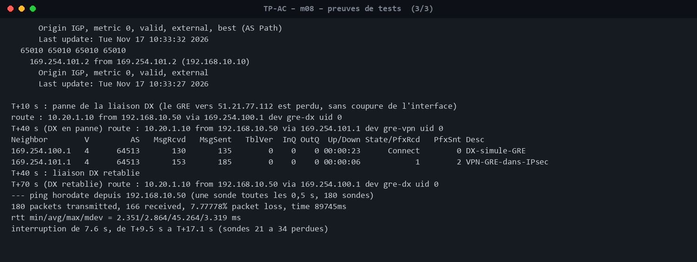

# Module 8 – Direct Connect

> Direct Connect est bloqué par l'organisation : nous avons testé `CreateDirectConnectGateway` et `DescribeLocations`, les deux sont refusés. Nous n'avons donc pas créé `dxgw-leman` et nous n'avons pas pu choisir d'emplacement. La liaison dédiée est **simulée** par un tunnel GRE entre deux routeurs qui parlent BGP, le VPN du module 7 servant de secours.

## Objectif
Comprendre une liaison dédiée (dimensionnement, interface virtuelle, BGP) et la bascule entre une liaison principale et un secours.

## Ce qu'il faut savoir
Direct Connect est un lien physique entre le siège et un point de présence d'AWS (1, 10 ou 100 Gbit/s). Une interface virtuelle y porte la session BGP vers AWS. En BGP, le chemin avec la préférence locale (local-pref) la plus haute gagne ; pour décourager un chemin, on allonge son AS-path. Ici : local-pref 200 sur la liaison dédiée, et l'AS-path du VPN allongé de 3.

## Dimensionnement
Nous devons transférer 2 To en 8 heures : 16 000 Gbit sur 28 800 s, soit environ 0,56 Gbit/s. Une liaison de 1 Gbit/s suffit avec une marge d'environ 44 %.

## Ce que nous avons fait
- Un tunnel GRE `169.254.100.0/30` entre `rtr-siege` (AS 65010) et `rtr-aws` (AS 64513), qui joue la « fibre ».
- Deux sessions BGP, une sur le GRE et une dans le tunnel IPsec du module 7. Le siège annonce `192.168.10.0/24`, la prod annonce `10.20.0.0/22`.
- `local-pref 200` sur ce qui arrive par le GRE, et un AS-path allongé (`65010` trois fois de plus) sur le chemin VPN.
- Le GRE est coupé puis remis pendant un ping horodaté, pour mesurer la bascule.

Les routeurs tournent avec FRRouting sur Ubuntu. Le sujet propose GNS3 : nous ne l'avons pas utilisé.

Script : `scripts/m08-bgp-sim.ps1`.



| Élément | rtr-siege | rtr-aws |
|---|---|---|
| ASN | 65010 | 64513 |
| Tunnel GRE | `169.254.100.2/30` | `169.254.100.1/30` |
| Tunnel IPsec | `169.254.10.2/30` | `169.254.10.1/30` |
| Annonce | `192.168.10.0/24` | `10.20.0.0/22` |
| Timers BGP | 3 s / 9 s | 3 s / 9 s |

## Si ça ne marche pas : quatre vérifications
1. L'état de BGP : `show bgp summary` doit afficher `Established`.
2. Les préfixes annoncés et reçus.
3. La local-pref : `show ip bgp <préfixe>` montre quel chemin est le meilleur.
4. La route dans `rt-prive` vers le routeur, et `ip route get` sur le routeur.

## Résultats des tests
```
=== TP1 : dimensionnement (voir docs/modules/m08) ===
2 To en 8 h = 16 000 Gbit / 28 800 s = 0,556 Gbit/s -> liaison 1 Gbit/s (marge ~44 %)

=== TP2 : GRE + BGP ===
rtr-aws : show bgp summary
Success	
IPv4 Unicast Summary (VRF default):
BGP router identifier 10.20.0.74, local AS number 64513 vrf-id 0
BGP table version 2
RIB entries 3, using 576 bytes of memory
Peers 2, using 1448 KiB of memory

Neighbor        V         AS   MsgRcvd   MsgSent   TblVer  InQ OutQ  Up/Down State/PfxRcd   PfxSnt Desc
169.254.10.2    4      65010        21        18        0    0    0 00:00:29            1        2 VPN-IPsec
169.254.100.2   4      65010        19        18        0    0    0 00:00:29            1        2 DX-simule-GRE

Total number of neighbors 2
	
rtr-aws : show ip bgp 192.168.10.0/24
Success	BGP routing table entry for 192.168.10.0/24, version 2
Paths: (2 available, best #1, table default)
  Advertised to non peer-group peers:
  169.254.10.2 169.254.100.2
  65010
    169.254.100.2 from 169.254.100.2 (192.168.10.10)
      Origin IGP, metric 0, localpref 200, valid, external, best (Local Pref)
      Last update: Mon Nov 16 12:54:16 2026
  65010 65010 65010 65010
    169.254.10.2 from 169.254.10.2 (192.168.10.10)
      Origin IGP, metric 0, valid, external
      Last update: Mon Nov 16 12:54:16 2026
	
rtr-siege : show ip route 10.20.0.0/22
Success	Routing entry for 10.20.0.0/22
  Known via "bgp", distance 20, metric 0, best
  Last update 00:00:39 ago
  * 169.254.100.1, via gre-dx, weight 1

	
siege -> app-01 (chemin DX) :
Success	10.20.1.10 from 192.168.10.10 via 169.254.100.1 dev gre-dx uid 0 
    cache 
--- 10.20.1.10 ping statistics ---
3 packets transmitted, 3 received, 0% packet loss, time 2003ms
rtt min/avg/max/mdev = 2.354/2.409/2.504/0.067 ms
	

=== TP3 : politique et bascule ===
rtr-siege : show ip bgp 10.20.0.0/22 (local-pref 200 sur DX, 100 sur VPN)
Success	BGP routing table entry for 10.20.0.0/22, version 2
Paths: (2 available, best #1, table default)
  Advertised to non peer-group peers:
  169.254.10.1 169.254.100.1
  64513
    169.254.100.1 from 169.254.100.1 (10.20.0.74)
      Origin IGP, metric 0, localpref 200, valid, external, best (Local Pref)
      Last update: Mon Nov 16 12:54:16 2026
  64513
    169.254.10.1 from 169.254.10.1 (10.20.0.74)
      Origin IGP, metric 0, valid, external
      Last update: Mon Nov 16 12:54:16 2026
	
rtr-aws : chemin VPN annonce par le siege avec AS-path prepend x3 (65010 65010 65010 65010) :
Success	BGP table version is 2, local router ID is 10.20.0.74, vrf id 0
Default local pref 100, local AS 64513
Status codes:  s suppressed, d damped, h history, * valid, > best, = multipath,
               i internal, r RIB-failure, S Stale, R Removed
Nexthop codes: @NNN nexthop's vrf id, < announce-nh-self
Origin codes:  i - IGP, e - EGP, ? - incomplete
RPKI validation codes: V valid, I invalid, N Not found

   Network          Next Hop            Metric LocPrf Weight Path
*  192.168.10.0/24  169.254.10.2             0             0 65010 65010 65010 65010 i

Displayed  1 routes and 3 total paths
	
GRE coupe -> route apres bascule :
Success	10.20.1.10 from 192.168.10.10 via 169.254.10.1 dev xfrm-siege uid 0 
    cache 
Neighbor        V         AS   MsgRcvd   MsgSent   TblVer  InQ OutQ  Up/Down State/PfxRcd   PfxSnt Desc
169.254.10.1    4      64513        48        51        0    0    0 00:01:54            1        2 VPN-IPsec
169.254.100.1   4      64513        35        36        0    0    0 00:00:36       Active        0 DX-simule-GRE
	
GRE retabli -> retour sur DX :
Success	10.20.1.10 from 192.168.10.10 via 169.254.100.1 dev gre-dx uid 0 
    cache 
	
Journal de continuite (pings toutes les 0,1 s ; KO = perdus) :
Success	    130 OK
      9 KO
    261 OK
---
9
pings_perdus_x0.1s
```

## Mesure de la bascule
Pendant la coupure du GRE, 9 sondes sur une série d'une sonde toutes les 0,1 s ont été perdues (chacune attend 1 s au plus) : l'interruption dure une dizaine de secondes, le temps que BGP détecte la perte (9 s). Le trafic passe alors par le VPN, et il revient sur la liaison principale quand le GRE est rétabli.

## Nettoyage
Rien n'est facturé à l'heure pour Direct Connect puisque nous n'avons rien commandé. Les routeurs sont des instances EC2 arrêtées après les tests.

## Captures

**Journal des tests**



**Journal des tests**


**Journal des tests**


