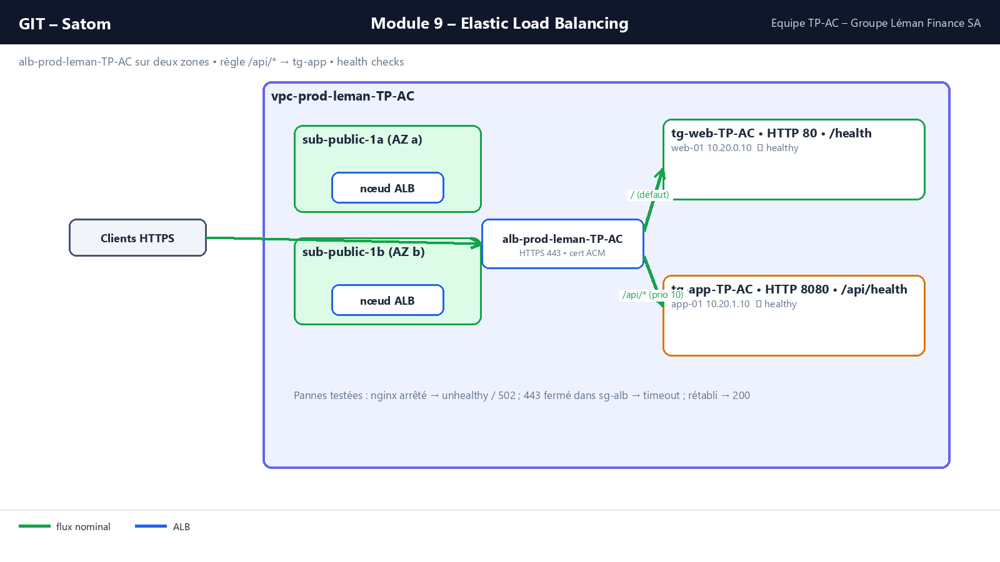
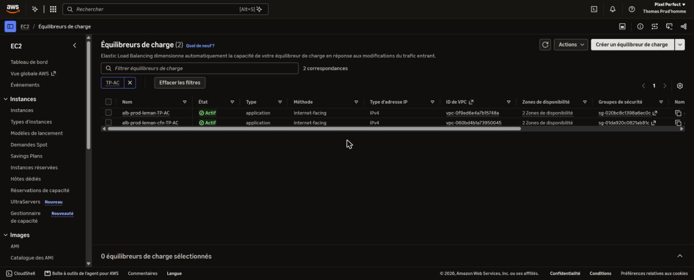
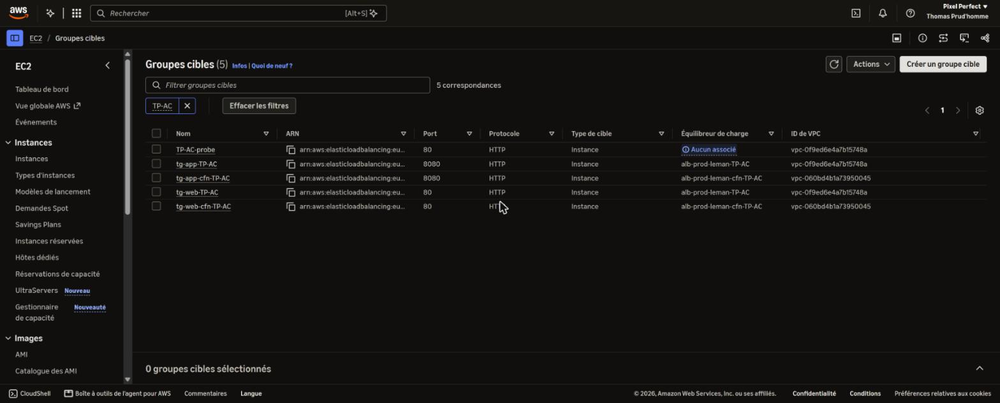
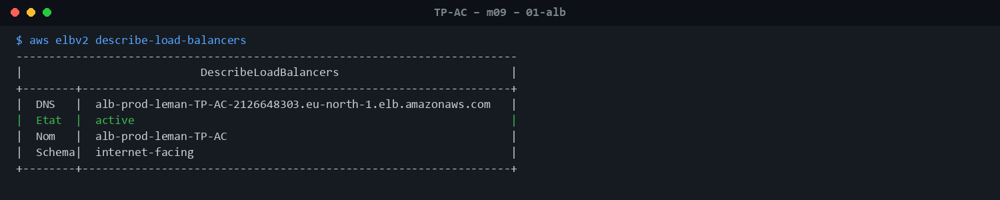
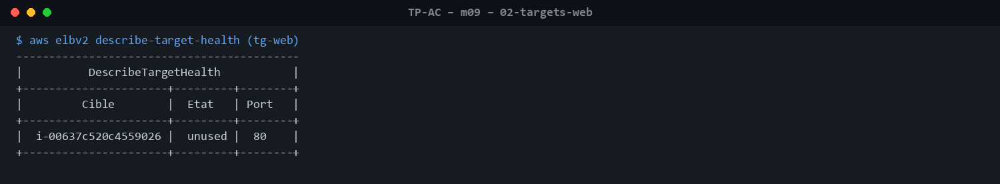
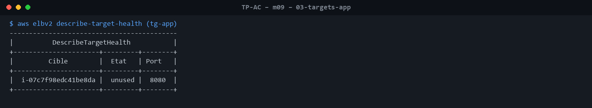
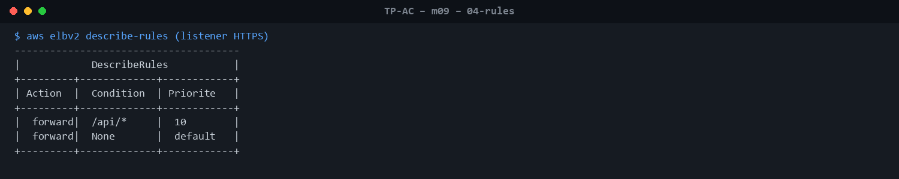
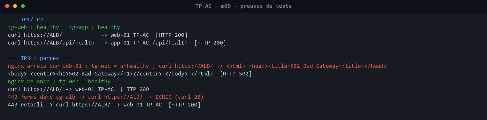

# Module 9 – Elastic Load Balancing

## Objectif
Publier le portail derrière un **Application Load Balancer** HTTPS réparti sur deux zones, avec routage par chemin (`/api/*`) et contrôles de santé, et savoir diagnostiquer une panne.

## Cours (essentiel)
* L'**ALB** (couche 7) a un nœud par zone de disponibilité ; il exige **au moins deux sous-réseaux** dans deux zones. Un **listener** (443) applique des **règles** (chemin, hôte…) qui envoient vers des **groupes cibles**.
* Le **health check** (`/health`, intervalle 10 s, 2 échecs) retire automatiquement une cible défaillante ; sans cible saine l'ALB répond **503/502**.
* Le groupe de sécurité de l'ALB est distinct de celui des serveurs : les serveurs n'autorisent que **l'ALB** (référence de SG), jamais Internet.
* L'ALB est facturé à l'heure (~0,03 USD/h) + LCU.

## Scénario
Les clients accèdent à `https://<alb>/` (site web) et `https://<alb>/api/…` (API).

## TP
| Tâche | Réalisation |
|---|---|
| 1. Cibles | `sub-public-1b-TP-AC` `10.20.0.64/26` (`eu-north-1b`) associé à `rt-public` ; `tg-web-TP-AC` (HTTP 80, `/health`) avec `web-01` ; `tg-app-TP-AC` (HTTP 8080, `/api/health`) avec `app-01` |
| 2. ALB | `alb-prod-leman-TP-AC` internet-facing sur 1a + 1b, `sg-alb-TP-AC` (443 public) ; listener HTTPS 443 avec certificat ACM (auto-signé importé), défaut → `tg-web` ; règle **priorité 10** `/api/*` → `tg-app` |
| 3. Pannes | nginx arrêté → `unhealthy` / 502 ; 443 fermé dans `sg-alb` → timeout ; rétabli → 200 |

Script : `scripts/m09-alb.ps1`.

## Diagramme


## Tableau de configuration
| Ressource | Nom | Valeur |
|---|---|---|
| ALB | `alb-prod-leman-TP-AC` | internet-facing, `sub-public-1a` + `sub-public-1b`, `sg-alb-TP-AC` |
| Listener | HTTPS 443 | politique TLS 1.3/1.2 ; certificat ACM `cert-autosigne-TP-AC` |
| Règle | priorité 10 | chemin `/api/*` → `tg-app-TP-AC` |
| Groupe cible | `tg-web-TP-AC` | HTTP 80, santé `/health`, cible `web-01` |
| Groupe cible | `tg-app-TP-AC` | HTTP 8080, santé `/api/health`, cible `app-01` |
| SG | `sg-web` / `sg-app` | entrée 80 / 8080 **depuis `sg-alb` uniquement** |

## Procédure de diagnostic en quatre étapes
1. **Listener** : le port/protocole et le certificat sont-ils corrects ?
2. **Règle active** : la règle `/api/*` (priorité 10) précède-t-elle la règle par défaut ?
3. **État de la cible** : `describe-target-health` (`healthy` / `unhealthy` + motif).
4. **SG entre ALB et cible** : la cible autorise-t-elle l'ALB sur son port ?

## Résultats
```
=== TP1/TP2 ===
tg-web : healthy   tg-app : healthy
curl https://ALB/            -> web-01 TP-AC  [HTTP 200]
curl https://ALB/api/health  -> app-01 TP-AC /api/health  [HTTP 200]

=== TP3 : pannes ===
nginx arrete sur web-01 : tg-web = unhealthy ; curl https://ALB/ -> <html> <head><title>502 Bad Gateway</title></head> <body> <center><h1>502 Bad Gateway</h1></center> </body> </html>  [HTTP 502]
nginx relance : tg-web = healthy
curl https://ALB/ -> web-01 TP-AC  [HTTP 200]
443 ferme dans sg-alb -> curl https://ALB/ -> ECHEC (curl 28)
443 retabli -> curl https://ALB/ -> web-01 TP-AC  [HTTP 200]
```

## Nettoyage
`alb-prod-leman-TP-AC`, `tg-web`, `tg-app` conservés (modules 10 à 13) ; instances arrêtées en fin de séance ; l'ALB sera supprimé en fin de projet (`docs/NETTOYAGE.md`).

## Écarts et remarques
* **Pas de domaine réel** : le HackMD demande un certificat ACM validé ; nous importons un certificat **auto-signé** (clé privée jamais conservée sur disque) – les tests utilisent `curl -k`.
* Le HackMD réutilise `sg-web` pour l'ALB ; nous avons créé un `sg-alb` dédié (meilleure pratique : les serveurs n'acceptent que l'ALB).

## Captures

**Console AWS – alb**



**Console AWS – groupes cibles**



**Terminal – alb**



**Terminal – targets web**



**Terminal – targets app**



**Terminal – rules**



**Journal des tests**


