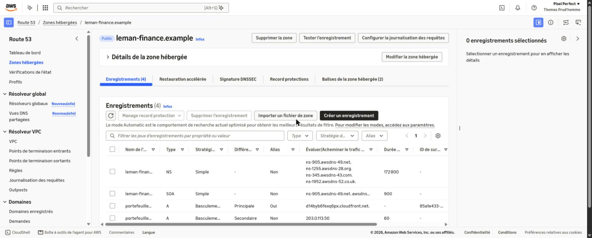
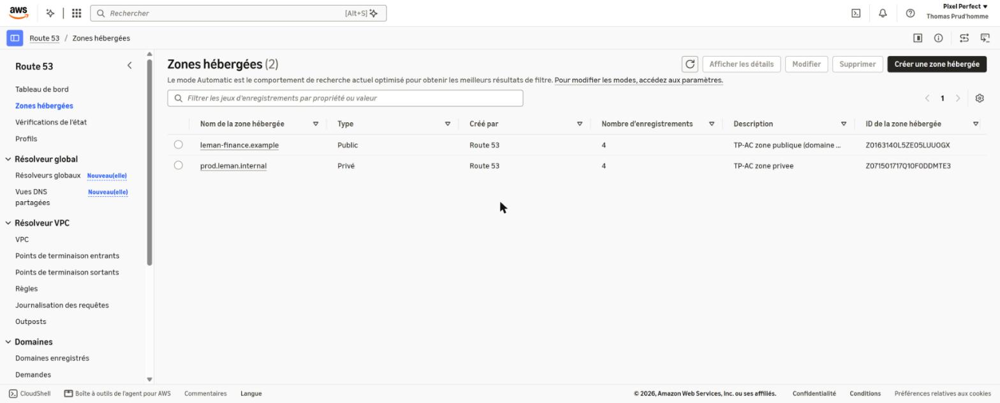
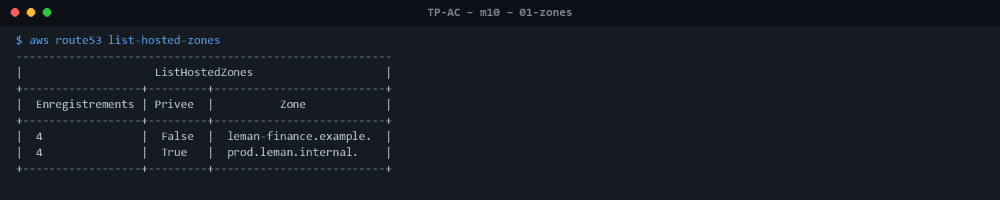
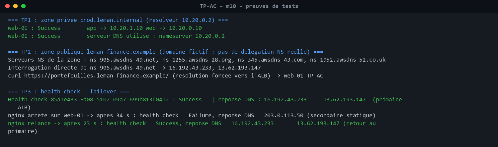

# Module 10 – Route 53

## Objectif
Donner des noms à nos machines avec une zone privée, publier le site avec une zone publique, et prévoir une bascule automatique si le site tombe.

## Ce qu'il faut savoir
Une zone privée n'est visible que depuis les VPC auxquels on l'associe (le résolveur du VPC est à l'adresse base + 2, ici `10.20.0.2`). Une zone publique donne quatre serveurs de noms qu'il faut déclarer chez le bureau d'enregistrement du domaine. Un enregistrement « alias » pointe vers une ressource AWS. Pour le failover, on relie l'enregistrement principal à un contrôle de santé et on prévoit un enregistrement de secours.

## Ce que nous avons fait
- La zone privée `prod.leman.internal` associée au VPC de prod, avec `web.prod.leman.internal` (`10.20.0.10`) et `app.prod.leman.internal` (`10.20.1.10`).
- La zone publique `leman-finance.example`, et un alias `portefeuilles.leman-finance.example` vers l'ALB.
- Un contrôle de santé HTTPS sur `/health` (toutes les 10 s, 2 échecs), l'alias principal qui en dépend, et un enregistrement de secours vers `203.0.113.50`.

Scripts : `scripts/m10-route53.ps1` et `scripts/m10-tests.ps1`.


| Zone | Nom | Cible |
|---|---|---|
| privée | `web.prod.leman.internal` | `10.20.0.10` |
| privée | `app.prod.leman.internal` | `10.20.1.10` |
| publique | `portefeuilles` (principal) | alias ALB, plus tard CloudFront, avec contrôle de santé |
| publique | `portefeuilles` (secours) | `203.0.113.50` |

## Si ça ne marche pas : quatre vérifications
1. La délégation : les serveurs de noms du bureau d'enregistrement sont-ils ceux de la zone ?
2. L'enregistrement : nom, type, politique de routage, alias.
3. L'état du contrôle de santé (`get-health-check-status`).
4. La cible : les groupes cibles de l'ALB sont-ils sains ?

## Résultats des tests
```
=== TP1 : zone privee prod.leman.internal (resolveur 10.20.0.2) ===
web-01 : Success	app -> 10.20.1.10 web -> 10.20.0.10 	
web-01 : Success	serveur DNS utilise : nameserver 10.20.0.2 	

=== TP2 : zone publique leman-finance.example (domaine fictif : pas de delegation NS reelle) ===
Serveurs NS de la zone : ns-905.awsdns-49.net, ns-1255.awsdns-28.org, ns-345.awsdns-43.com, ns-1952.awsdns-52.co.uk
Interrogation directe de ns-905.awsdns-49.net -> 16.192.43.233, 13.62.193.147
curl https://portefeuilles.leman-finance.example/ (resolution forcee vers l'ALB) -> web-01 TP-AC

=== TP3 : health check + failover ===
Health check 85a1e433-8d08-5102-09a7-699b813f0412 : Success   | reponse DNS : 16.192.43.233	13.62.193.147  (primaire = ALB)
nginx arrete sur web-01 -> apres 34 s : health check = Failure, reponse DNS = 203.0.113.50 (secondaire statique)
nginx relance -> apres 23 s : health check = Success, reponse DNS = 16.192.43.233	13.62.193.147 (retour au primaire)
```

## Nettoyage
Nous gardons les zones et les enregistrements pour les modules 11 et 12. Le contrôle de santé (environ 0,50 USD par mois) sera supprimé à la fin du cours.

## Ce qui diffère du sujet
Nous n'avons pas acheté de domaine, donc la délégation réelle est impossible. Nous interrogeons directement un serveur de noms de la zone (`Resolve-DnsName -Server ns-…`) et nous utilisons `route53 test-dns-answer` pour voir la réponse que Route 53 donnerait. Le contrôle de santé vise le nom DNS de l'ALB (puis de CloudFront), car notre nom public n'est pas résolvable.

## Captures

**Console AWS – enregistrements**



**Console AWS – zones**



**Terminal – zones**



**Terminal – records**


**Terminal – records privee**


**Journal des tests**


