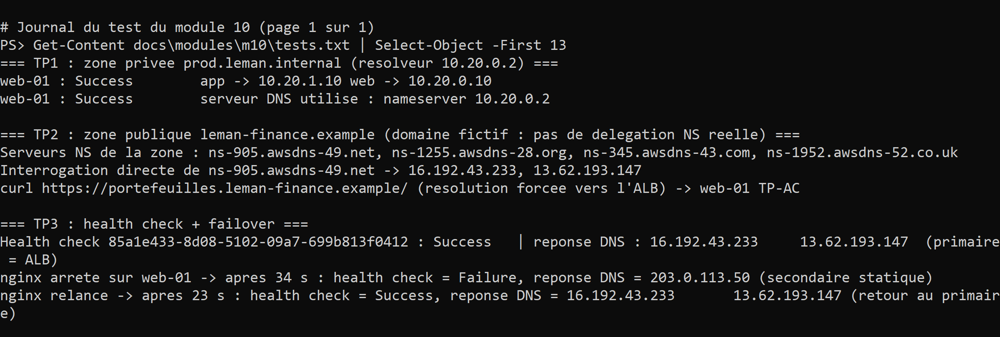

# Module 10 – Route 53

## Objectif
Donner des noms à nos machines avec une zone privée, publier le site avec une vraie zone publique déléguée depuis un domaine réel, et prévoir une bascule automatique si le site tombe.

## Ce qu'il faut savoir
Une zone privée n'est visible que depuis les VPC auxquels on l'associe (le résolveur du VPC est à l'adresse base + 2, ici `10.20.0.2`). Une zone publique donne quatre serveurs de noms qu'il faut déclarer chez celui qui héberge le DNS du domaine parent : c'est la délégation. Un enregistrement « alias » pointe vers une ressource AWS. Pour le failover, on relie l'enregistrement principal à une surveillance de l'état (health check) et on prévoit un enregistrement de secours.

## Ce que nous avons fait
- La zone privée `prod.leman.internal` associée au VPC de prod, avec `web.prod.leman.internal` (`10.20.0.10`) et `app.prod.leman.internal` (`10.20.1.10`).
- La zone publique `leman.thomastp.ch`, sous-domaine de notre domaine réel `thomastp.ch` (le portfolio de Thomas, qui n'est pas modifié). Le DNS de `thomastp.ch` est hébergé chez Cloudflare : nous y avons ajouté uniquement les quatre enregistrements NS du sous-domaine `leman`, qui délèguent `leman.thomastp.ch` à Route 53.
- L'alias `origin.leman.thomastp.ch` vers l'ALB (créé au module 9), sur lequel porte la surveillance.
- Une surveillance de l'état HTTPS (port 443) sur `origin.leman.thomastp.ch`, toutes les 10 s, avec un seuil de 2 échecs.
- Deux enregistrements de basculement pour `portefeuilles.leman.thomastp.ch` : le principal est un alias vers l'ALB, lié à la surveillance ; le secondaire est un enregistrement A vers `203.0.113.50`, une adresse réservée à la documentation (voir l'écart n°9).
- Le test depuis `web-01` : un `dig` qui interroge directement un serveur de noms AWS de la zone, pendant qu'on arrête puis relance nginx.

Le scénario a été exécuté dans la console AWS, puis filmé. Les scripts `scripts/m10-route53.ps1` et `scripts/m10-tests.ps1` sont la première version en AWS CLI (sans domaine réel) : ils n'ont pas été adaptés au domaine réel. Les mesures complètes du domaine réel (modules 9 à 11) sont dans `docs/modules/m10/tests-domaine-reel.txt`.


| Zone | Nom | Cible |
|---|---|---|
| privée | `web.prod.leman.internal` | `10.20.0.10` |
| privée | `app.prod.leman.internal` | `10.20.1.10` |
| publique | `origin.leman.thomastp.ch` | alias vers l'ALB |
| publique | `portefeuilles.leman.thomastp.ch` (principal) | alias vers l'ALB, avec la surveillance de l'état |
| publique | `portefeuilles.leman.thomastp.ch` (secours) | `203.0.113.50` (adresse de documentation) |
| publique | `cdn.leman.thomastp.ch` | alias vers CloudFront (module 11) |

## Si ça ne marche pas : quatre vérifications
1. La délégation : les quatre enregistrements NS chez Cloudflare sont-ils ceux de la zone Route 53 ?
2. L'enregistrement : nom, type, politique de routage, alias.
3. L'état du contrôle de santé (`get-health-check-status`).
4. La cible : les groupes cibles de l'ALB sont-ils sains, et le port 443 de `origin.leman.thomastp.ch` répond-il ?

## Résultats des tests
```
=== TP1 : zone privee prod.leman.internal (resolveur 10.20.0.2) ===
web-01 : Success	app -> 10.20.1.10 web -> 10.20.0.10
web-01 : Success	serveur DNS utilise : nameserver 10.20.0.2

=== Domaine reel (20/11/2026) : basculement Route 53 (primaire ALB -> secours statique 203.0.113.50) ===
12:26:03 arret de nginx sur web-01 : Success	11:26:05
etat de la cible tg-web : unhealthy
12:30:09 reponse DNS avant relance : 203.0.113.50 (secours)
12:30:10 relance de nginx : Success	11:30:12
12:30:44 la reponse DNS publique est revenue a l'equilibreur (13.62.60.176) apres 34 s
web-01 TP-AC (cfn)
 [HTTP 200]
12:31:14 2e mesure - arret de nginx : Success	11:31:15
12:32:22 la reponse DNS publique est devenue le secours (203.0.113.50) apres 70 s
```

## Nettoyage
Nous gardons les zones et les enregistrements pour les modules 11 et 12. La surveillance de l'état (environ 0,50 USD par mois) et la zone publique seront supprimées avec le reste de ce qui a été créé pour le tournage (voir `docs/NETTOYAGE.md`) ; les quatre enregistrements NS chez Cloudflare devront alors être retirés aussi.

## Ce qui diffère du sujet
La délégation est réelle : le sujet est respecté avec un sous-domaine d'un domaine existant (écart n°9). Deux points restent différents : le secours du basculement est une adresse statique de documentation (`203.0.113.50`), qui ne mène à aucun serveur réel, car nous n'avons pas de second site de secours ; et nos mesures interrogent directement un serveur de noms AWS depuis `web-01`, ce qui évite les caches des résolveurs et donne le temps réel de la bascule.

## Captures

**Console AWS – enregistrements**


**Console AWS – zones**


**Terminal**


**Terminal – journal du test**


