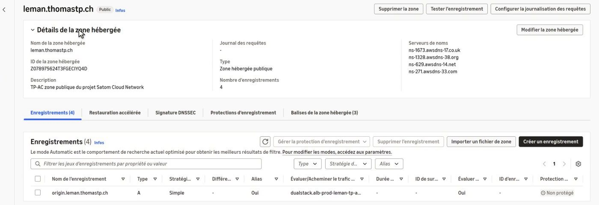
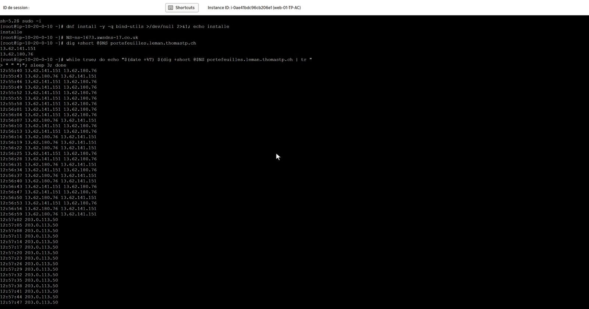
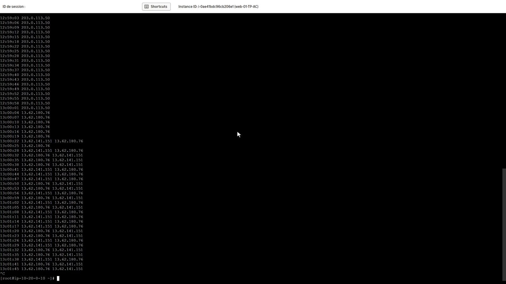

# Module 10 – Route 53

## Objectif
Donner des noms à nos machines avec une zone privée, publier le site sous un vrai nom de domaine avec une zone publique, et prévoir une bascule automatique : si le site tombe, le DNS doit répondre avec une adresse de secours.

## Ce qu'il faut savoir
Une **zone privée** n'est visible que depuis les VPC auxquels on l'associe. Les instances l'interrogent par le résolveur du VPC, à l'adresse « base + 2 » : ici `10.20.0.2`. Pour qu'une zone privée fonctionne, le VPC doit avoir la résolution DNS et les noms d'hôte DNS activés.

Une **zone publique** reçoit quatre serveurs de noms d'AWS. Pour qu'Internet la connaisse, il faut les déclarer chez celui qui héberge le DNS du domaine parent : c'est la **délégation**. Notre domaine `thomastp.ch` est hébergé chez Cloudflare. Nous n'y avons ajouté que quatre enregistrements NS pour le sous-domaine `leman`, qui délèguent `leman.thomastp.ch` à Route 53. Le reste de la zone de `thomastp.ch` (le portfolio de Thomas) n'a jamais été touché.

Un enregistrement **alias** pointe vers une ressource AWS (ici l'ALB). Pour un **basculement** (failover), on crée deux enregistrements du même nom : le principal, relié à une **surveillance de l'état** (health check), et un secondaire, que Route 53 renvoie quand la surveillance dit que le principal est en panne.

## Ce que nous avons fait
Tournage du 20/11/2026, dans l'environnement décrit au module 9. Voici l'ordre de la vidéo.

**1. La zone privée**
- Route 53, « Créer une zone hébergée » : `prod.leman.internal`, description « Noms internes du VPC de production », type **privée**, région Stockholm, VPC `vpc-prod-leman-TP-AC`, balises habituelles. La console rappelle que le VPC doit avoir `enableDnsHostnames` et `enableDnsSupport` à `true`.
- Deux enregistrements A : `web` vers `10.20.0.10` et `app` vers `10.20.1.10`.
- Dans la console VPC, « Modifier les paramètres du VPC » sur `vpc-prod-leman-TP-AC` : nous cochons « Activer les noms d'hôte DNS ». La résolution DNS était déjà activée. Le modèle CloudFormation du module 9 avait laissé les noms d'hôte désactivés.
- Depuis `web-01-TP-AC` (Session Manager) : `getent hosts web.prod.leman.internal`, `getent hosts app.prod.leman.internal`, `grep nameserver /etc/resolv.conf` (voir les pièges : dans la vidéo, la résolution n'a rien répondu).

**2. La zone publique `leman.thomastp.ch`**
- La zone et la délégation chez Cloudflare ont été préparées avant le tournage. La vidéo montre la zone : ses détails donnent les quatre serveurs de noms (les mêmes que ceux déclarés chez Cloudflare) et l'enregistrement `origin`, créé au module 9, qui pointe vers l'ALB.

**3. La surveillance de l'état**
- « Créer une surveillance de l'état » : `hc-portail-TP-AC`, point de terminaison public, par nom de domaine, protocole **HTTPS**, `origin.leman.thomastp.ch`, port 443, chemin `/`.
- Intervalle **Rapide (10 secondes)** et seuil d'échec **2** : deux contrôles ratés d'affilée et le point de terminaison est déclaré en panne.
- L'indication du nom du serveur (SNI) reste cochée : Route 53 envoie le nom `origin.leman.thomastp.ch` dans la négociation TLS, et l'ALB présente le bon certificat.

**4. Les enregistrements de basculement**
- Dans `leman.thomastp.ch`, deux enregistrements `portefeuilles` :
  - **principal** : type A, alias vers l'ALB `alb-prod-leman-TP-AC` (Stockholm), politique de routage « Basculement », type « Principale », surveillance `hc-portail-TP-AC`, identifiant `portefeuilles-principal`, « Évaluer l'état de la cible » activé ;
  - **secondaire** : type A, valeur `203.0.113.50` (une adresse réservée à la documentation), durée de vie 300 s, politique « Basculement », type « Secondaire », identifiant `portefeuilles-secours`, sans surveillance.

**5. Le test de basculement**
- Sur `web-01-TP-AC`, nous installons `bind-utils` (pour `dig`), puis nous interrogeons **directement** le premier serveur de noms de la zone, `ns-1673.awsdns-17.co.uk`, ce qui évite les caches des résolveurs : `dig +short @$NS portefeuilles.leman.thomastp.ch`.
- Une boucle pose la question toutes les trois secondes et affiche l'heure.
- Dans une seconde session, `systemctl stop nginx` sur `web-01`, puis, plus tard, `systemctl start nginx`.

## Captures


La zone publique `leman.thomastp.ch`, avec ses quatre serveurs de noms. Le compteur indique quatre enregistrements, mais la liste n'en montre qu'un (`origin`) : voir les pièges.


La surveillance de l'état avant sa création : intervalle « Rapide (10 secondes) », seuil d'échec `2`, SNI activé.


L'enregistrement principal de `portefeuilles` : alias vers l'ALB, routage « Basculement », type « Principale », relié à la surveillance `hc-portail-TP-AC`.



La boucle de `dig` pendant la panne. Tant que nginx tourne, la réponse contient les deux adresses de l'ALB (une par zone). Nous avons arrêté nginx à 12:56:29. À 12:57:02, la réponse devient `203.0.113.50`, l'adresse de secours : trente-trois secondes plus tard.



Le retour. Nous avons relancé nginx à 12:57:43. La réponse reste `203.0.113.50` jusqu'à 13:00:01 et revient à l'adresse de l'ALB à 13:00:04, après 141 secondes. Elle n'a d'abord qu'une seule adresse, puis les deux adresses de façon stable à partir de 13:00:28.

## Tableau récapitulatif
| Zone | Nom | Cible |
|---|---|---|
| privée | `web.prod.leman.internal` | `10.20.0.10` |
| privée | `app.prod.leman.internal` | `10.20.1.10` |
| publique | `origin.leman.thomastp.ch` | alias vers l'ALB |
| publique | `portefeuilles.leman.thomastp.ch` (principal) | alias vers l'ALB, surveillance `hc-portail-TP-AC` |
| publique | `portefeuilles.leman.thomastp.ch` (secours) | `203.0.113.50`, TTL 300 s |
| publique | `cdn.leman.thomastp.ch` | alias vers CloudFront (module 11) |

| Surveillance de l'état | Valeur |
|---|---|
| Nom | `hc-portail-TP-AC` |
| Point de terminaison | `https://origin.leman.thomastp.ch:443/` |
| Intervalle, seuil d'échec | 10 s, 2 échecs |

## Résultats des tests
Le journal ci-dessous vient du premier passage, fait avec la ligne de commande : la résolution de la zone privée (qui avait bien répondu) et, sous « Domaine réel », les mesures du basculement faites le 20/11/2026 avec la même configuration. Les mesures de la vidéo (console) sont dans les captures ci-dessus : **33 secondes** pour passer au secours, **141 secondes** pour revenir.

```
=== TP1 : zone privee prod.leman.internal (resolveur 10.20.0.2) ===
web-01 : Success	app -> 10.20.1.10 web -> 10.20.0.10
web-01 : Success	serveur DNS utilise : nameserver 10.20.0.2

=== Domaine reel (20/11/2026) : basculement Route 53 (primaire ALB -> secours statique 203.0.113.50) ===
12:26:03 arret de nginx sur web-01 : Success	11:26:05
etat de la cible tg-web : unhealthy
12:30:09 reponse DNS avant relance : 203.0.113.50 (secours)
12:30:10 relance de nginx : Success	11:30:12
12:30:44 la reponse DNS publique est revenue a l'equilibreur (13.62.60.176) apres 34 s
web-01 TP-AC (cfn)
 [HTTP 200]
12:31:14 2e mesure - arret de nginx : Success	11:31:15
12:32:22 la reponse DNS publique est devenue le secours (203.0.113.50) apres 70 s
```

Les mesures du premier passage sont de 70 s (aller, seconde mesure) et 34 s (retour). Elles diffèrent beaucoup de celles de la vidéo, surtout au retour. Un contrôle de 10 s avec deux échecs laisse attendre vingt à trente secondes à l'aller, ce qu'on voit dans la vidéo. Au retour, il faut d'abord que le groupe cible de l'ALB redevienne sain (module 9), puis que Route 53 constate deux contrôles réussis. Au premier passage, le groupe cible était réglé à 10 s d'intervalle et 2 réussites pour redevenir sain. Dans la console, nous avons gardé les valeurs par défaut des paramètres avancés (que nous n'avons pas relevées ; d'après la documentation d'AWS : 30 s et 5 réussites), ce qui explique sans doute un retour plus lent. Les valeurs détaillées du premier passage sont dans `docs/modules/m10/tests-domaine-reel.txt`.

## Pièges rencontrés
- **La résolution de la zone privée n'a rien répondu dans la vidéo.** Sur `web-01`, les deux commandes `getent hosts web.prod.leman.internal` et `getent hosts app.prod.leman.internal` n'affichent aucune ligne. Le résolveur du VPC (`nameserver 10.20.0.2`) est bien celui utilisé. Nous n'avons pas expliqué cet échec sur le moment et nous n'avons pas refait l'essai à l'écran. Deux pistes : le réglage « noms d'hôte DNS » du VPC venait d'être changé, ou la zone privée venait d'être créée. Au premier passage (ligne de commande), la résolution avait fonctionné (`web` vers `10.20.0.10`, `app` vers `10.20.1.10`, voir le journal).
- **Les noms d'hôte DNS du VPC.** Une zone privée associée à un VPC dont les noms d'hôte DNS sont désactivés ne se résout pas. La console le signale par un bandeau à la création de la zone, mais ne change rien toute seule : il faut cocher la case dans le VPC.
- **La console Route 53 n'affiche pas tout.** Les enregistrements NS et SOA créés avec la zone ne sont pas dans la liste par défaut : le compteur dit « Enregistrements (4) », la liste n'en montre qu'un (`origin`). Les quatre serveurs de noms se lisent dans « Détails de la zone hébergée ».
- **« Statut : Inconnu ».** Juste après sa création, la surveillance de l'état n'a pas encore de statut. Il faut attendre quelques contrôles avant que la console affiche « Sain ».
- **Une mesure qui dépend de la question.** Si nous interrogions notre résolveur habituel, les caches DNS cacheraient une partie du basculement. C'est pour cela que nous interrogeons directement un serveur de noms d'AWS.
- **Une adresse de secours qui ne mène nulle part.** `203.0.113.50` est une adresse de documentation : le test prouve que le DNS change de réponse, pas qu'un second site prend le relais.

## Ce qui diffère du sujet
- **Le domaine.** Le sujet est respecté avec un domaine réel : une zone publique déléguée depuis un sous-domaine d'un domaine existant (écart n°9 de `docs/02-ecarts-au-sujet.md`).
- **Le secours** est une adresse statique de documentation, pas un second site : nous n'avons pas de site de secours.
- **La mesure** interroge directement un serveur de noms d'AWS depuis `web-01`, pas un résolveur public. C'est la durée de réaction de Route 53, sans les caches.
- **La zone privée** : la vidéo ne montre pas de résolution réussie (voir les pièges). La preuve que la zone fonctionne est celle du premier passage.

## Nettoyage
Tout a été supprimé le 20/11/2026 : les zones `leman.thomastp.ch` (avec `origin`, les deux `portefeuilles`, `cdn` et le CNAME de validation d'ACM) et `prod.leman.internal`, puis la surveillance `hc-portail-TP-AC` (environ 0,50 USD par mois, un peu plus avec l'intervalle rapide). Les quatre enregistrements NS du sous-domaine `leman` ont été retirés du DNS de Cloudflare ; le reste de la zone `thomastp.ch` n'a jamais été modifié. Voir `docs/NETTOYAGE.md`.
