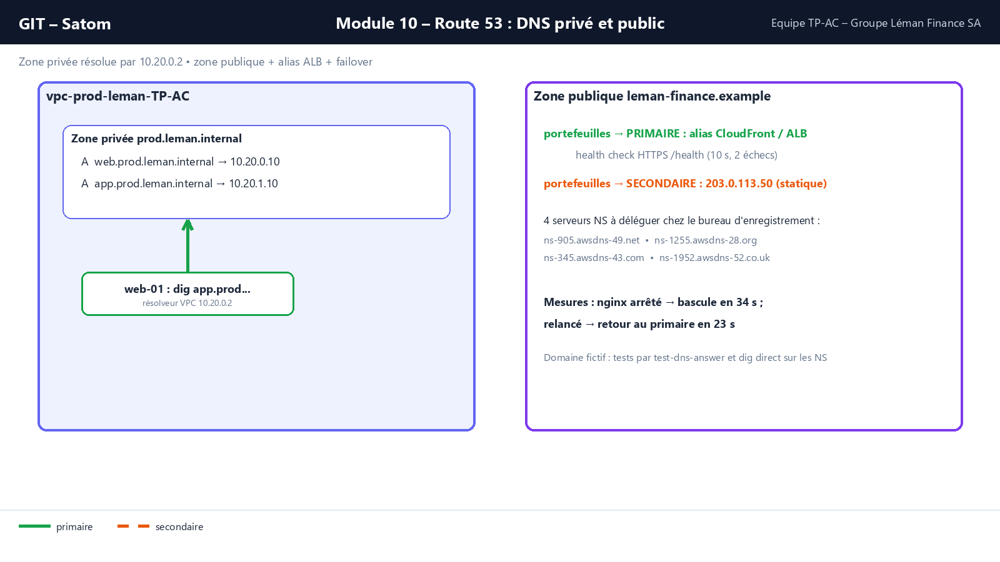
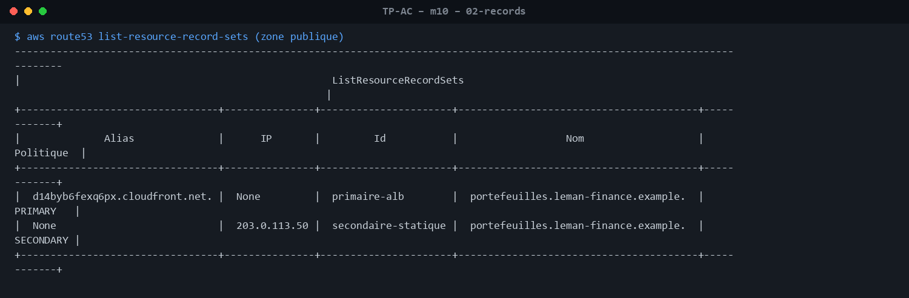
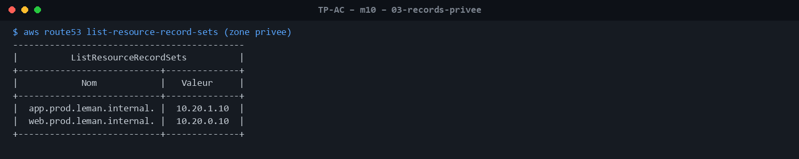

# Module 10 – Route 53 : DNS privé et public

## Objectif
Nommer les ressources avec une **zone privée** résolue dans le VPC, publier le portail avec une **zone publique** (alias vers l'ALB) et assurer la continuité par un **failover** piloté par un health check.

## Cours (essentiel)
* Une **zone privée** n'est résolue que depuis les VPC auxquels elle est associée (résolveur du VPC à `10.20.0.2`, base + 2). DNS support et hostnames doivent être activés.
* Une **zone publique** reçoit 4 serveurs de noms (NS) qu'il faut **déléguer** chez le bureau d'enregistrement du domaine.
* Un enregistrement **alias** pointe vers une ressource AWS (ALB, CloudFront) sans coût de requête et suit les changements d'IP.
* **Failover** : un enregistrement *primaire* lié à un **health check** et un *secondaire* ; si la santé du primaire échoue, Route 53 répond le secondaire.

## TP
| Tâche | Réalisation |
|---|---|
| 1. Zone privée | `prod.leman.internal` associée à `vpc-prod-leman-TP-AC` ; `web.prod.leman.internal → 10.20.0.10`, `app.prod.leman.internal → 10.20.1.10` |
| 2. Zone publique | `leman-finance.example` ; alias A `portefeuilles.leman-finance.example` → ALB ; 4 NS à reporter |
| 3. Failover | health check HTTPS `/health` (10 s, 2 échecs) ; primaire = alias ALB (puis CloudFront au module 11), secondaire = `203.0.113.50` |

Script : `scripts/m10-route53.ps1` (déploiement) et `scripts/m10-tests.ps1` (preuves).

## Diagramme


## Tableau des enregistrements
| Zone | Type | Nom | Cible |
|---|---|---|---|
| `prod.leman.internal` (privée) | A | `web.prod.leman.internal` | `10.20.0.10` |
| `prod.leman.internal` (privée) | A | `app.prod.leman.internal` | `10.20.1.10` |
| `leman-finance.example` (publique) | A alias, failover PRIMARY | `portefeuilles` | ALB (puis CloudFront), `EvaluateTargetHealth`, health check |
| `leman-finance.example` (publique) | A, failover SECONDARY | `portefeuilles` | `203.0.113.50` (TTL 60) |

## Procédure de diagnostic
1. **Délégation NS** : les NS du bureau d'enregistrement sont-ils ceux de la zone ?
2. **Enregistrement** : nom, type, politique de routage, alias ?
3. **État du health check** : `get-health-check-status` (Success / Failure par région).
4. **Cible de l'ALB** : groupes cibles sains ? (module 9). Pour une zone privée : l'association au VPC.

## Résultats
```
=== TP1 : zone privee prod.leman.internal (resolveur 10.20.0.2) ===
web-01 : Success	app -> 10.20.1.10 web -> 10.20.0.10 	
web-01 : Success	serveur DNS utilise : nameserver 10.20.0.2 	

=== TP2 : zone publique leman-finance.example (domaine fictif : pas de delegation NS reelle) ===
Serveurs NS de la zone : ns-905.awsdns-49.net, ns-1255.awsdns-28.org, ns-345.awsdns-43.com, ns-1952.awsdns-52.co.uk
Interrogation directe de ns-905.awsdns-49.net -> 16.192.43.233, 13.62.193.147
curl https://portefeuilles.leman-finance.example/ (resolution forcee vers l'ALB) -> web-01 TP-AC

=== TP3 : health check + failover ===
Health check 85a1e433-8d08-5102-09a7-699b813f0412 : Success   | reponse DNS : 16.192.43.233	13.62.193.147  (primaire = ALB)
nginx arrete sur web-01 -> apres 34 s : health check = Failure, reponse DNS = 203.0.113.50 (secondaire statique)
nginx relance -> apres 23 s : health check = Success, reponse DNS = 16.192.43.233	13.62.193.147 (retour au primaire)
```

## Nettoyage
Zones et enregistrements conservés (modules 11 et 12). Le health check (~0,50 USD/mois) est supprimé en fin de projet.

## Écarts et remarques
* **Domaine fictif, rien n'est acheté** : la délégation NS réelle est impossible. Les réponses sont vérifiées avec `route53 test-dns-answer` et par interrogation **directe d'un serveur de noms** de la zone (`Resolve-DnsName -Server ns-…`), puis `curl --resolve` vers l'IP obtenue.
* Le health check cible le nom DNS de l'ALB (le nom public n'est pas résolvable sans délégation).

## Captures

**Console AWS – enregistrements**


**Console AWS – zones**


**Terminal – zones**


**Terminal – records**



**Terminal – records privee**



**Journal des tests**


