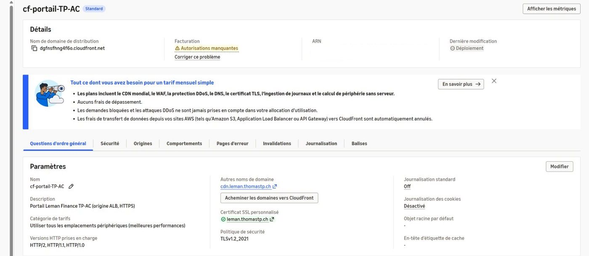
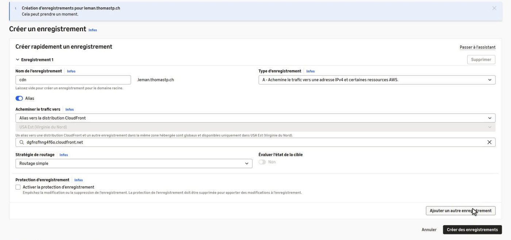
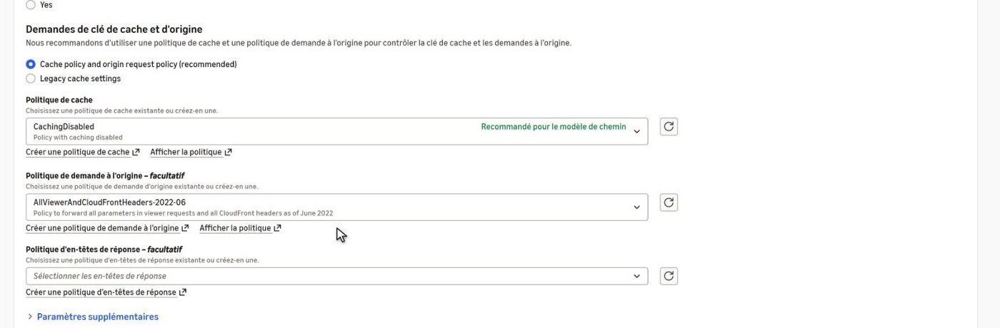
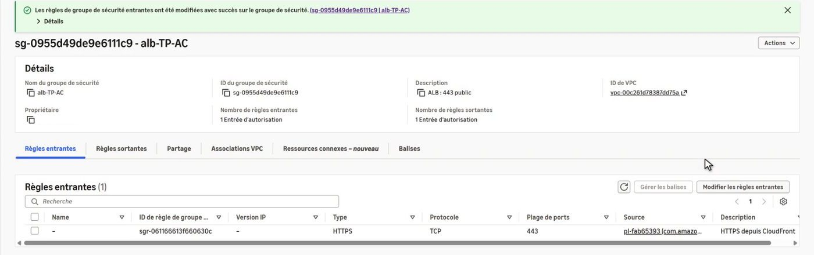
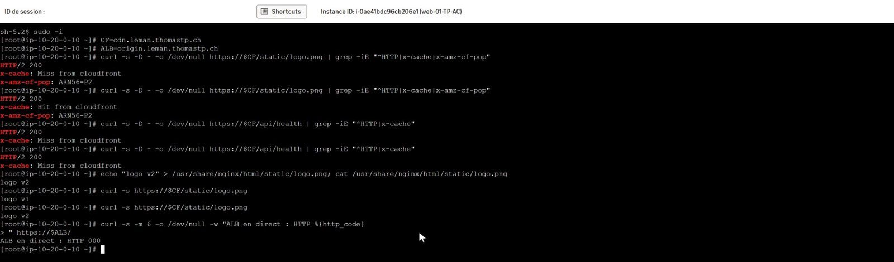

# Module 11 – CloudFront

## Objectif
Mettre un CDN devant l'ALB : garder en cache le contenu statique, ne jamais mettre l'API en cache, servir le tout sous un nom de notre domaine avec un vrai certificat, et empêcher l'accès direct à l'ALB.

## Ce qu'il faut savoir
CloudFront sert le contenu depuis un point de présence proche du visiteur et ne va chercher le fichier à l'origine (ici l'ALB) que s'il ne l'a pas en cache. Les en-têtes de la réponse le montrent : `x-cache` indique `Hit` (servi par le cache) ou `Miss` (allé chercher à l'origine), et `x-amz-cf-pop` donne le point de présence.

Chaque chemin (`/static/*`, `/api/*`, le reste) a son **comportement** : une politique de cache et une politique de requête à l'origine. Un fichier modifié à l'origine reste servi dans son ancienne version jusqu'à la fin du délai de cache, sauf si on lance une **invalidation**.

Pour servir la distribution sous un nom de notre domaine (un « autre nom de domaine »), CloudFront demande un certificat ACM émis en **`us-east-1`** (Virginie), quelle que soit la région de l'ALB. Et pour qu'on ne puisse plus contourner CloudFront, le Security Group de l'ALB n'accepte que la **liste de préfixes** gérée par AWS pour CloudFront.

## Ce que nous avons fait
Tournage du 20/11/2026, dans l'environnement décrit au module 9. Voici l'ordre de la vidéo.

**1. Un fichier statique sur `web-01`**
- Sur `web-01-TP-AC` (Session Manager) : le fichier `/usr/share/nginx/html/static/logo.png`, qui contient le texte `logo v1`, et un bloc `location /static/` dans `/etc/nginx/conf.d/web.conf` (avec `default_type image/png`). Puis `nginx -t && systemctl reload nginx`.

**2. La distribution**
- CloudFront, « Créer une distribution ». Étape 1, le forfait : nous choisissons **le paiement à l'utilisation**. La console prévient en jaune qu'elle ne peut pas vérifier nos autorisations pour les forfaits à tarif unique.
- Étape 2 : nom `cf-portail-TP-AC`, description « Portail Leman Finance TP-AC (origine ALB, HTTPS) », « Configuration d'un seul site Web ».
- Étape 3, l'origine : type « Elastic Load Balancer », et nous tapons nous-mêmes le nom `origin.leman.thomastp.ch` (celui de l'alias du module 9), pas le nom `….elb.amazonaws.com` que propose le bouton « Browse load balancers ». Paramètres d'origine et de cache recommandés, qui imposent le **HTTPS** entre CloudFront et l'ALB : le certificat de l'ALB couvre `origin.leman.thomastp.ch`, CloudFront l'accepte.
- Étape 4 : pas de pare-feu applicatif (« Ne pas activer les protections de sécurité »). Puis vérification et création.

**3. Le nom `cdn.leman.thomastp.ch`**
- Le nom alternatif `cdn.leman.thomastp.ch` et le certificat ACM `leman.thomastp.ch` de `us-east-1` ont été posés **avec la ligne de commande** (`aws cloudfront update-distribution`) : la liste de certificats de la console ne proposait pas le nôtre. Le résultat se lit ensuite dans la console, dans les paramètres de la distribution. Ce certificat de `us-east-1` avait été demandé avant le tournage.
- Dans Route 53, zone `leman.thomastp.ch` : un enregistrement `cdn`, de type A, alias vers la distribution CloudFront (`….cloudfront.net`). Cette étape est faite dans la console.

**4. Les comportements**
Dans l'onglet « Comportements » de la distribution, deux comportements en plus de celui par défaut :
- `/static/*` vers l'origine de l'ALB : méthodes GET et HEAD, politique de cache `CachingOptimized` (durée de vie par défaut de 24 heures).
- `/api/*` : toutes les méthodes HTTP, politique de cache `CachingDisabled`, politique de requête à l'origine `AllViewerAndCloudFrontHeaders-2022-06` (tous les en-têtes, cookies et paramètres de la requête sont transmis à l'origine).

**5. L'ALB ne parle plus qu'à CloudFront**
- Dans `alb-TP-AC` : la règle HTTPS ouverte à tous est retirée et remplacée par le port 443 en TCP depuis la liste de préfixes gérée `com.amazonaws.global.cloudfront.origin-facing` (description « HTTPS depuis CloudFront »).

**6. Les tests**
Depuis `web-01-TP-AC`, avec `curl` sur `cdn.leman.thomastp.ch` (nous ne gardons que l'état HTTP et les en-têtes `x-cache` et `x-amz-cf-pop`) :
- `/static/logo.png` deux fois de suite : `Miss`, puis `Hit`.
- `/api/health` deux fois : `Miss` les deux fois.
- Nous remplaçons le fichier par `logo v2` sur `web-01` : CloudFront sert toujours `logo v1`.
- Dans la console, onglet « Invalidations » : création d'une invalidation pour `/static/*`. Moins d'une minute plus tard, CloudFront sert `logo v2`.
- Accès direct à l'ALB par `origin.leman.thomastp.ch` : `curl` sort après 6 secondes, sans réponse (`HTTP 000`).

## Captures


La distribution `cf-portail-TP-AC` porte le nom alternatif `cdn.leman.thomastp.ch` et le certificat ACM `leman.thomastp.ch` (coche verte), avec la politique de sécurité `TLSv1.2_2021`. L'avertissement « Facturation : Autorisations manquantes » est celui des forfaits (voir les pièges).



L'enregistrement `cdn.leman.thomastp.ch` : un alias vers la distribution CloudFront. La console grise la région (« USA Est (Virginie du Nord) »), car CloudFront est global.



Le comportement `/api/*` : `CachingDisabled` pour la politique de cache et `AllViewerAndCloudFrontHeaders-2022-06` pour la requête à l'origine.



`alb-TP-AC` après la modification : une seule règle entrante, le port 443 depuis la liste de préfixes `pl-fab65393` (`com.amazonaws.global.cloudfront…`).



Tous les tests dans un seul terminal. `Miss` puis `Hit` sur le fichier statique (point de présence `ARN56-P2`), `Miss` à chaque appel sur l'API. Le fichier modifié sur `web-01` (`logo v2`) est servi en `logo v1` par le cache, puis en `logo v2` après l'invalidation. L'accès direct à l'ALB reste sans réponse (`HTTP 000`).

## Tableau récapitulatif
| Élément | Valeur |
|---|---|
| Distribution | `cf-portail-TP-AC`, paiement à l'utilisation, sans pare-feu applicatif |
| Origine | `origin.leman.thomastp.ch` (l'ALB), HTTPS seulement |
| Nom alternatif et certificat | `cdn.leman.thomastp.ch`, certificat ACM `leman.thomastp.ch` de `us-east-1` (posés par la CLI) |
| Alias Route 53 | `cdn.leman.thomastp.ch` vers la distribution |
| Comportement `/static/*` | `CachingOptimized`, GET et HEAD |
| Comportement `/api/*` | `CachingDisabled`, requête à l'origine `AllViewerAndCloudFrontHeaders-2022-06`, toutes les méthodes |
| `alb-TP-AC` | 443 depuis `com.amazonaws.global.cloudfront.origin-facing` seulement |

## Résultats des tests
Le journal ci-dessous vient du premier passage, fait avec la ligne de commande sur la même configuration (origine HTTPS, nom `cdn.leman.thomastp.ch`). La vidéo refait les mêmes tests dans la console : mêmes résultats, `Miss` puis `Hit`, l'API jamais en cache, l'ancienne version servie jusqu'à l'invalidation, l'ALB injoignable en direct.

```
=== Domaine reel (20/11/2026) : CloudFront (cdn.leman.thomastp.ch, origine HTTPS origin.leman.thomastp.ch) ===
1er appel /static/logo.png : HTTP/1.1 200 OK X-Cache: Miss from cloudfront
2e appel  /static/logo.png : HTTP/1.1 200 OK X-Cache: Hit from cloudfront
contenu : logo v1
API 1 : HTTP/1.1 200 OK X-Cache: Miss from cloudfront
API 2 : HTTP/1.1 200 OK X-Cache: Miss from cloudfront
fichier modifie sur web-01 (v2) ; le cache sert encore : logo v1 (HTTP/1.1 200 OK X-Cache: Hit from cloudfront )
apres invalidation (Completed) : logo v2 (HTTP/1.1 200 OK X-Cache: Hit from cloudfront )

=== ALB verrouille : seul CloudFront (liste de prefixes geree par AWS) peut le joindre ===
acces direct a l'ALB (origin.leman.thomastp.ch) : HTTP 000 (delai depasse attendu)
via CloudFront (cdn.leman.thomastp.ch/api/health) : app-01 TP-AC (cfn) /api/health
 [HTTP 200]
```

## Pièges rencontrés
- **Le certificat n'apparaissait pas dans la console.** Pour le nom alternatif, la liste de certificats de la console ne proposait pas notre certificat de `us-east-1`. Nous avons posé le nom et le certificat avec la ligne de commande ; tout le reste est fait dans la console.
- **« Autorisations manquantes ».** À l'étape du forfait, la console dit qu'elle ne peut pas vérifier nos autorisations pour les forfaits à tarif unique ; une fois la distribution créée, la ligne « Facturation » affiche le même avertissement avec un lien « Corriger ce problème ». Nous avons gardé le paiement à l'utilisation, qui fonctionne sans ces autorisations.
- **Le nom de l'origine.** Avec le nom `….elb.amazonaws.com` de l'ALB, le certificat de l'ALB ne correspond pas et CloudFront refuserait la connexion HTTPS. Nous tapons donc `origin.leman.thomastp.ch`.
- **Une distribution qui se déploie.** Juste après la création et après chaque modification, la distribution reste « Déploiement » pendant quelques minutes.
- **Le cache garde l'ancienne version.** Après la modification du fichier sur `web-01`, `curl` obtient encore `logo v1` : c'est le comportement attendu, jusqu'à l'invalidation.
- **L'API ne doit pas être mise en cache.** `Miss` à chaque appel sur `/api/health` confirme que `CachingDisabled` fonctionne. Si une requête de l'API était servie depuis le cache, un client pourrait recevoir la réponse d'un autre.

## Ce qui diffère du sujet
- **Le domaine et le certificat** sont réels (écart n°9 de `docs/02-ecarts-au-sujet.md`) : la distribution est servie sous `cdn.leman.thomastp.ch` avec un vrai certificat. Seul le réglage du nom alternatif a été fait en ligne de commande, parce que la console ne proposait pas le certificat.
- **L'origine est en HTTPS**, avec un vrai certificat sur l'ALB, comme le réglage recommandé de la console.
- **La politique de requête de `/api/*`** est `AllViewerAndCloudFrontHeaders-2022-06`, pas `AllViewer` : c'est le nom exact de la politique que nous avons choisie dans la liste.
- **Pas de pare-feu applicatif (WAF).**
- **Environnement de tournage** : voir le module 9.

## Nettoyage
La distribution a été désactivée après avoir retiré le nom alternatif et le certificat, puis supprimée le 20/11/2026, avec l'enregistrement `cdn`, le certificat de `us-east-1` et le reste de ce qui avait été créé pour les modules 9 à 11 (voir `docs/NETTOYAGE.md`). La seule ressource qui reste de notre projet est le Network Firewall `nfw-prod-leman-TP-AC` du module 4, dont la suppression est bloquée côté AWS.
