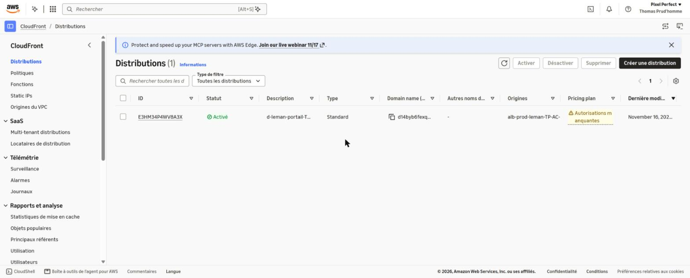
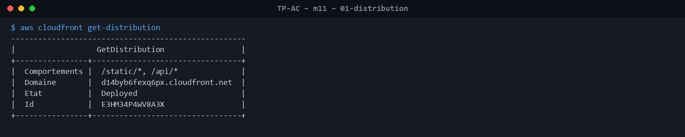
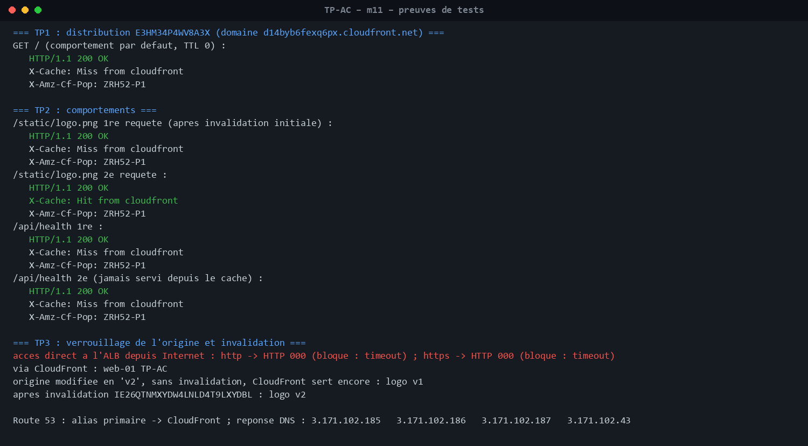

# Module 11 – CloudFront

## Objectif
Placer un **CDN** devant l'ALB : mettre en cache le contenu statique, ne jamais mettre en cache l'API, et interdire l'accès direct à l'ALB.

## Cours (essentiel)
* CloudFront sert le contenu depuis des **points de présence** proches du visiteur ; l'en-tête `x-amz-cf-pop` indique lequel, `x-cache` indique `Hit` ou `Miss from cloudfront`.
* Le comportement par chemin (`/static/*`, `/api/*`, défaut) fixe la **politique de cache** (TTL, cookies/en-têtes pris en compte) et la **politique de requête vers l'origine**.
* Pour qu'un contenu change avant la fin du TTL : **invalidation**.
* Verrouillage de l'origine : le Security Group de l'ALB n'autorise que la **liste de préfixes gérée** `com.amazonaws.global.cloudfront.origin-facing`.
* Un certificat ACM pour CloudFront doit être demandé en **us-east-1**.

## TP
| Tâche | Réalisation |
|---|---|
| 1. Distribution | `d-leman-portail-TP-AC` avec l'ALB pour origine ; attente `Deployed` ; `curl -I` : réponse de l'ALB et `x-amz-cf-pop` |
| 2. Comportements | défaut `*` : TTL 0 (CachingDisabled) + toutes les requêtes transmises ; `/static/*` : TTL 86 400 s, sans cookies, compression ; `/api/*` : TTL 0, tous en-têtes/cookies, méthodes GET à DELETE |
| 3. Verrouillage | `sg-alb` limité au préfixe CloudFront ; alias Route 53 déplacé vers CloudFront ; invalidation de `/static/logo.png` |

Script : `scripts/m11-cloudfront.ps1`.

## Diagramme


## Tableau des comportements
| Comportement | Chemin | TTL | Cookies | Méthodes | Origine |
|---|---|---|---|---|---|
| défaut | `*` | 0 | transmis (+ `Authorization`) | GET…DELETE | `alb-prod-leman` |
| statique | `/static/*` | 86 400 s | aucun | GET, HEAD | `alb-prod-leman` |
| API | `/api/*` | 0 | tous | GET, HEAD, OPTIONS, PUT, POST, PATCH, DELETE | `alb-prod-leman` |

## Procédure de diagnostic
* **403** : Security Group de l'ALB (préfixe CloudFront ?) ou politique de l'origine.
* **502** : origine injoignable (SG, protocole origine, certificat d'origine invalide).
* **`x-cache`** : `Hit` attendu sur le statique, jamais sur `/api/*`.
* **Certificat** : région us-east-1, nom couvert par le certificat.

## Résultats
```
=== TP1 : distribution E3HM34P4WV8A3X (domaine d14byb6fexq6px.cloudfront.net) ===
GET / (comportement par defaut, TTL 0) :
   HTTP/1.1 200 OK
   X-Cache: Miss from cloudfront
   X-Amz-Cf-Pop: ZRH52-P1

=== TP2 : comportements ===
/static/logo.png 1re requete (apres invalidation initiale) :
   HTTP/1.1 200 OK
   X-Cache: Miss from cloudfront
   X-Amz-Cf-Pop: ZRH52-P1
/static/logo.png 2e requete :
   HTTP/1.1 200 OK
   X-Cache: Hit from cloudfront
   X-Amz-Cf-Pop: ZRH52-P1
/api/health 1re :
   HTTP/1.1 200 OK
   X-Cache: Miss from cloudfront
   X-Amz-Cf-Pop: ZRH52-P1
/api/health 2e (jamais servi depuis le cache) :
   HTTP/1.1 200 OK
   X-Cache: Miss from cloudfront
   X-Amz-Cf-Pop: ZRH52-P1

=== TP3 : verrouillage de l'origine et invalidation ===
acces direct a l'ALB depuis Internet : http -> HTTP 000 (bloque : timeout) ; https -> HTTP 000 (bloque : timeout)
via CloudFront : web-01 TP-AC
origine modifiee en 'v2', sans invalidation, CloudFront sert encore : logo v1
apres invalidation IE26QTNMXYDW4LNLD4T9LXYDBL : logo v2

Route 53 : alias primaire -> CloudFront ; reponse DNS : 3.171.102.185	3.171.102.186	3.171.102.187	3.171.102.43
```

## Nettoyage
`d-leman-portail-TP-AC` conservée pour le module 12. En fin de projet : désactiver puis supprimer la distribution (`docs/NETTOYAGE.md`). Invalidations notées dans les résultats.

## Écarts et remarques
* **Pas de certificat ACM valide** (pas de domaine) : le visiteur utilise le certificat `*.cloudfront.net` ; l'alias `portefeuilles.leman-finance.example` pointe quand même vers CloudFront.
* **Origine en HTTP (80)** : un CloudFront en « HTTPS seul » refuserait le certificat auto-signé de l'ALB (502). L'ALB expose donc aussi un listener 80, fermé à Internet (préfixe CloudFront uniquement).
* Le préfixe géré CloudFront compte pour ~55 règles dans un Security Group (quota 60) : une seule règle (port 80) lui est donc consacrée.

## Captures

**Console AWS – cloudfront**



**Terminal – distribution**



**Journal des tests**


