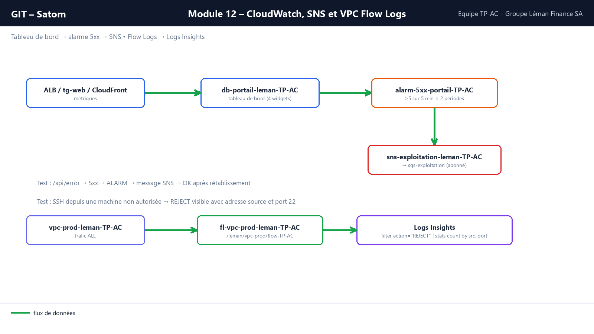
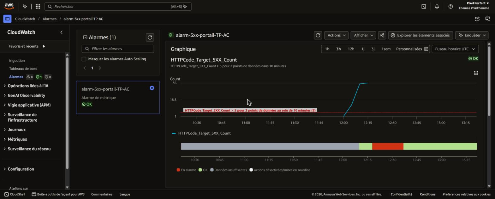
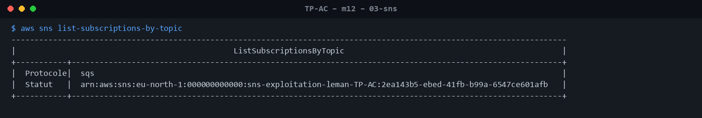

# Module 12 – CloudWatch et VPC Flow Logs

## Objectif
Superviser le portail (tableau de bord), être alerté (alarme + SNS) et tracer les flux réseau (Flow Logs) pour diagnostiquer un rejet.

## Cours (essentiel)
* **CloudWatch Metrics** : chaque service publie des métriques par dimension (ALB, groupe cible, distribution). Une **alarme** évalue une statistique sur N périodes et passe `OK` → `ALARM` → `OK`.
* **SNS** diffuse la notification aux abonnés (e-mail, SQS, Lambda…).
* **VPC Flow Logs** enregistre les connexions acceptées/rejetées (`ACCEPT`/`REJECT`) par interface, avec adresse source, port, protocole. **Logs Insights** permet de les interroger.
* La rétention des journaux est réglée (3 jours ici) pour limiter les coûts.

## TP
| Tâche | Réalisation |
|---|---|
| 1. Tableau de bord | `db-portail-leman-TP-AC` : `HealthyHostCount` / `UnHealthyHostCount` (tg-web), `TargetResponseTime` (ALB), `HTTPCode_Target_5XX_Count`, `5xxErrorRate` (CloudFront, us-east-1) |
| 2. Alarme | topic `sns-exploitation-leman-TP-AC` ; `alarm-5xx-portail-TP-AC` : `HTTPCode_Target_5XX_Count` > 5 sur 5 min, 2 périodes ; actions « en alarme » et « retour à la normale » vers SNS ; erreur provoquée par `/api/error` (HTTP 500) |
| 3. Flow Logs | groupe `/leman/vpc-prod/flow-TP-AC`, rôle IAM `TP-AC-flowlogs-role`, `fl-vpc-prod-leman-TP-AC` (trafic ALL) ; 8 connexions TCP vers le port 22 de l'ALB depuis un poste non autorisé (refusées par `sg-alb`) ; requête Logs Insights sur les `REJECT` : les 8 rejets sont retrouvés avec l'adresse source, le port 22 et l'ENI de l'ALB |

Scripts : `scripts/m12-monitoring.ps1` (déploiement) et `scripts/m12-tests.ps1` (preuves).

## Diagramme


## Tableau de supervision
| Élément | Métrique / source | Seuil | Période | Action |
|---|---|---|---|---|
| `alarm-5xx-portail-TP-AC` | `AWS/ApplicationELB` `HTTPCode_Target_5XX_Count` (Sum) | > 5 | 5 min × 2 | SNS (ALARM et OK) |
| Tableau de bord | `HealthyHostCount` = 1 pour `web-01` | – | 1 min | visuel |
| Flow Logs | `/leman/vpc-prod/flow-TP-AC` | – | – | Logs Insights |

## Procédure de diagnostic
1. **Métrique** : quelle série dérive (5xx, latence, hôtes sains) ?
2. **Alarme** : état, historique, période d'évaluation.
3. **Journal de flux** : `filter action="REJECT" | stats count(*) by srcAddr, dstPort | sort count desc`.
4. **SG ou NACL responsable** : relier le rejet au port/source et corriger la règle (module 3).

## Résultats
```
=== TP1 : tableau de bord ===
Tableau de bord : db-portail-leman-TP-AC
HealthyHostCount tg-web (derniere minute) : 1.0

=== TP3 : Flow Logs (SSH non autorise vers web-01) ===
6 tentatives de connexion TCP sur le port 22 de web-01 depuis cette machine (refusees par sg-web)

=== TP2 : alarme ===
Etat initial : INSUFFICIENT_DATA
Trafic 5xx genere pendant 10 min -> etat de l'alarme : ALARM
Notification SNS recue dans sqs-exploitation-leman-TP-AC : { "Type" : "Notification", "MessageId" : "c384ef0a-2ba5-5287-897d-8c7edf73d6a8", "TopicArn" : "arn:aws:sns:eu-north-1:000000000000:sns-exploitation-leman-TP-AC", "Subject" : "OK: \"alarm-5xx-portail-TP-AC\" in EU (Stockholm)", "Message" : "{\"AlarmName\":\"alarm-5xx-portail-TP-AC\",\"AlarmDescription\":\"TP-AC : plus de 5 erreurs 5xx cibles sur 5 min, 2 periodes consecutives\",\"AWSAccountId\":\"0...
Apres arret des erreurs (18 min) -> etat de l'alarme : OK
Notification de retour a la normale presente : oui

=== TP3 (reel) : Flow Logs ===
Controle : port 22 sortant depuis ce poste (github.com:22) -> ouvert
8 tentatives TCP vers le port 22 de l'ALB (2 noeuds publics) depuis ce poste (84.226.x.x) -> 8 timeout : refusees par sg-alb (seul le port 80 est ouvert, au prefixe CloudFront)
Recherche dans /leman/vpc-prod/flow-TP-AC (source = ce poste, port 22, REJECT) :
  2 000000000000 eni-034bc06f123a72b63 84.226.x.x 10.20.0.115 61404 22 6 2 104 1794837701 1794837721 REJECT OK
  2 000000000000 eni-034bc06f123a72b63 84.226.x.x 10.20.0.115 60965 22 6 2 104 1794837701 1794837721 REJECT OK
  2 000000000000 eni-034bc06f123a72b63 84.226.x.x 10.20.0.115 63656 22 6 2 104 1794837701 1794837721 REJECT OK
  2 000000000000 eni-034bc06f123a72b63 84.226.x.x 10.20.0.115 59395 22 6 2 104 1794837701 1794837721 REJECT OK
  2 000000000000 eni-05458be49638c7015 84.226.x.x 10.20.0.7 62411 22 6 2 104 1794837702 1794837733 REJECT OK
  2 000000000000 eni-05458be49638c7015 84.226.x.x 10.20.0.7 63203 22 6 2 104 1794837702 1794837733 REJECT OK
  2 000000000000 eni-05458be49638c7015 84.226.x.x 10.20.0.7 64715 22 6 2 104 1794837702 1794837733 REJECT OK
  2 000000000000 eni-05458be49638c7015 84.226.x.x 10.20.0.7 63102 22 6 2 104 1794837702 1794837733 REJECT OK
Requete Logs Insights : filter action = "REJECT" and dstPort = 22 and srcAddr = <ce poste> | stats count(*) as n by srcAddr, dstAddr, dstPort | sort n desc
Resultat : srcAddr=84.226.x.x dstAddr=10.20.0.115 dstPort=22 n=4 | srcAddr=84.226.x.x dstAddr=10.20.0.7 dstPort=22 n=4
Diagnostic : le rejet vient du Security Group sg-alb (port 22 non ouvert) : source, ENI de l'ALB, port 22 et action REJECT le prouvent.
```

## Nettoyage
Tableau de bord, alarme, groupe de logs conservés (module 13) ; rétention réduite à 3 jours ; le Flow Log et le groupe de logs seront supprimés en fin de projet.

## Écarts et remarques
* **Abonnés SNS** : la file SQS `sqs-exploitation-leman-TP-AC` (preuve de réception automatique) **et** un abonnement e-mail de l'équipe d'exploitation (`t…@git.swiss`, adresse masquée dans ce document), créé avec `aws sns subscribe --protocol email` ; l'abonnement reste `PendingConfirmation` tant que le destinataire n'a pas cliqué sur le lien de confirmation reçu par e-mail.
* Flow Logs : la livraison dans CloudWatch Logs prend plusieurs minutes. Le groupe de logs avait d'abord échoué à se créer (tags mal formés) : détecté par DeliverLogsStatus=FAILED, corrigé en recréant le groupe puis le Flow Log.
* La sonde SSH vise l'ALB (toujours actif) plutôt que `web-01`, arrêté faute de vCPU libres dans le compte partagé : le rejet est le même (Security Group fermé sur le port 22) et la trace Flow Logs est identique. Des rejets réels de scanners Internet sur le port 22 apparaissent aussi dans les journaux.


## Captures

**Console AWS (capture réelle) – alarme**



**Console AWS (capture réelle) – tableau de bord**


**Sortie AWS CLI – alarm**


**Sortie AWS CLI – flowlog**


**Sortie AWS CLI – sns**



**Preuves de tests (journal)**


**Preuves de tests (journal)**


**Preuves de tests (journal)**


