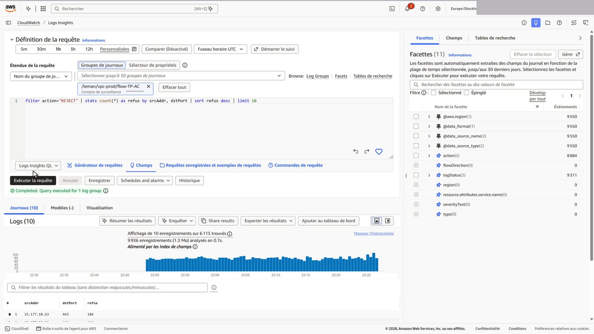

# Module 12 – CloudWatch et Flow Logs

## Objectif
Savoir si le portail va bien sans fixer la console toute la journée : un tableau de bord pour voir, une alarme qui prévient quand le site renvoie des erreurs, et les journaux de flux du VPC pour comprendre pourquoi une connexion a été refusée.

## Ce qu'il faut savoir
**Métriques et alarmes.** Chaque service envoie ses mesures à CloudWatch, par exemple le nombre de réponses 5xx de l'ALB par minute. Une alarme prend une statistique (somme, moyenne…) sur une période, la compare à un seuil et se trouve dans l'un des trois états suivants : `OK`, `En alarme` ou `Données insuffisantes`. Le troisième est piégeux. Si l'ALB ne reçoit aucune requête pendant une minute, la métrique n'a tout simplement pas de point pour cette minute, et selon le réglage « traitement des données manquantes » l'alarme n'a rien à évaluer. Nous y reviendrons dans les résultats.

**SNS et SQS.** Une rubrique SNS diffuse chaque message à tous ses abonnés : une adresse e-mail, une file, une fonction Lambda… Une file SQS garde les messages jusqu'à ce que quelqu'un les lise. Comme l'adresse e-mail de notre rubrique est fictive et ne pourra jamais être confirmée, la file nous sert de preuve : si un message y arrive, c'est que l'alarme a bien parlé à la rubrique.

**Flow Logs.** Un journal de flux enregistre, pour chaque interface réseau du VPC, les connexions vues pendant une fenêtre (dix minutes par défaut) : adresse source et destination, ports, protocole, et surtout `ACCEPT` ou `REJECT`. On l'envoie dans un groupe de journaux CloudWatch, que l'on interroge ensuite avec Logs Insights.

## Ce que nous avons fait
Tout a été fait dans la console, région Europe (Stockholm). Les noms portent le suffixe `-TP-AC` et les balises habituelles (Projet, Equipe, Environnement).

1. **La rubrique SNS.** SNS, Rubriques, Créer : type Standard, nom `sns-exploitation-leman-TP-AC`, nom complet « Alertes exploitation Leman ». Ensuite un abonnement de protocole « Adresse de messagerie » vers `exploitation-tp-ac@example.com` (adresse fictive, choisie pour la vidéo). L'abonnement reste en « Confirmation en attente » : personne ne peut cliquer le lien de confirmation.
2. **La file SQS.** SQS, Créer une file d'attente : type Standard, nom `sqs-exploitation-leman-TP-AC`, réglages par défaut (chiffrement SSE-SQS compris).
3. **L'abonnement de la file à la rubrique.** Depuis la console SQS, onglet « Abonnements SNS », « Abonner à la rubrique Amazon SNS », choix de `sns-exploitation-leman-TP-AC`, Enregistrer. La console ajoute elle-même à la file l'autorisation qui permet à la rubrique d'y écrire.
4. **L'alarme.** CloudWatch, Alarmes, Créer une alarme. Métrique `HTTPCode_ELB_5XX_Count` de l'espace de noms `AWS/ApplicationELB`, pour l'ALB `alb-prod-leman-TP-AC`. La console propose par défaut la statistique « Moyenne » sur 5 minutes : nous passons à **Somme** sur **1 minute**, condition « Supérieur » au seuil **5**. Deux notifications vers la rubrique `sns-exploitation-leman-TP-AC` : une quand l'alarme passe **En alarme**, une quand elle passe **OK**. Nom : `alarm-5xx-portail-TP-AC`. À la création, la console signale que certains abonnements sont encore en attente de confirmation (celui de l'e-mail).
5. **Le tableau de bord `db-portail-leman-TP-AC`.** Nous le créons vide, puis « Actions » et l'édition de la source : au lieu d'ajouter les widgets un par un, nous collons un JSON de quatre graphiques en courbes (période 60 s) : « Cibles saines » (`HealthyHostCount` de `tg-web-TP-AC` et `tg-app-TP-AC`), « Cibles non saines » (`UnHealthyHostCount`, mêmes groupes), « Temps de reponse de l ALB » (`TargetResponseTime`) et « Erreurs 5xx de l ALB » (`HTTPCode_ELB_5XX_Count`, somme). « Mettre à jour », puis « Enregistrer ». (Dans le JSON, nous avons écrit les titres sans accent ni apostrophe.)
6. **Le journal de flux.** Console VPC, le VPC `vpc-prod-leman-TP-AC`, onglet « Journaux de flux », Créer : nom `fl-vpc-prod-leman-TP-AC`, filtre **Tout**, intervalle d'agrégation de 10 minutes (valeur par défaut), destination « Envoyer aux journaux CloudWatch », groupe `/leman/vpc-prod/flow-TP-AC` (saisi à la main : la console le crée), « Créer et utiliser un nouveau rôle de service » (la console le nomme `VPCFlowLogs-Cloudwatch-` suivi d'un numéro) et format par défaut.
7. **Du trafic refusé à retrouver.** Depuis une session Systems Manager sur `rtr-agence-TP-AC` (le routeur simulé de l'agence), nous lançons cinq tentatives de connexion TCP vers le port 22 de `web-01-TP-AC` (`timeout 3 bash -c "</dev/tcp/$WEB/22"`). Le terminal affiche cinq fois « port 22 refuse » : le Security Group de `web-01-TP-AC` n'ouvre pas le 22 à cette source.
8. **Logs Insights.** CloudWatch, Logs Insights, groupe `/leman/vpc-prod/flow-TP-AC`, plage d'une heure, requête :
   `filter action="REJECT" | stats count(*) as refus by srcAddr, dstPort | sort refus desc | limit 10`
9. **Le test de l'alarme.**
   - Sur `web-01-TP-AC`, session Systems Manager : `systemctl stop nginx`.
   - Sur `rtr-siege-TP-AC`, une boucle envoie soixante requêtes, une par seconde, à `https://<domaine CloudFront>/essai1` jusqu'à `/essai60` et affiche le code HTTP. Nous obtenons soixante fois **502** : CloudFront passe à l'ALB, qui ne joint plus nginx.
   - Nous rechargeons la page de l'alarme toutes les trente secondes environ, jusqu'à ce qu'elle passe **En alarme** (la vidéo accélère l'attente).
   - Nous relançons nginx (`systemctl start nginx`) et attendons encore quelques minutes sans envoyer de requête.
10. **La preuve de réception.** SQS, `sqs-exploitation-leman-TP-AC`, « Envoyer et recevoir des messages », « Rechercher des messages » : la file contient deux messages, que nous ouvrons.

## Captures


Le tableau de bord enregistré, avec les données déjà reçues de l'ALB. Les courbes gardent la trace des pannes provoquées aux modules précédents, comme l'arrêt de nginx du module 9 : cibles qui tombent, pics d'erreurs 5xx (jusqu'à 93 par minute).


Le journal de flux juste après sa création : état « Actif », type de trafic « Tout », destination `/leman/vpc-prod/flow-TP-AC`, créé le 18 novembre 2026 à 23 h 47 (heure locale).



La requête Logs Insights a analysé 9 936 enregistrements de la dernière heure et en a trouvé 6 115 refusés. La première ligne du tableau est une adresse en `15.177.18.63` qui totalise 186 refus enregistrés sur le port 443.


L'alarme après les soixante 502 : état « En alarme », seuil « `HTTPCode_ELB_5XX_Count` > 5 pour 1 points de données dans 1 minute », actions activées. La chronologie du dessous montre la bande verte (OK) d'avant, puis la bande rouge.


Quelques minutes après le redémarrage de nginx, la même alarme est sortie de l'alarme, mais elle affiche « Données insuffisantes », pas « OK » (voir les résultats et les pièges).


La file contient deux notifications de la rubrique, taille 2,27 Ko chacune. La console SQS affiche l'heure locale (UTC+1), alors que les graphiques CloudWatch sont en UTC.

## Tableau récapitulatif
| Élément | Nom | Réglage |
|---|---|---|
| Rubrique SNS | `sns-exploitation-leman-TP-AC` | Standard ; abonnés : e-mail fictif (jamais confirmé) et la file SQS |
| File SQS | `sqs-exploitation-leman-TP-AC` | Standard, réglages par défaut |
| Alarme | `alarm-5xx-portail-TP-AC` | `HTTPCode_ELB_5XX_Count` de `alb-prod-leman-TP-AC`, somme sur 1 minute, supérieur à 5, 1 point sur 1 ; données manquantes traitées comme manquantes |
| Actions de l'alarme | vers la rubrique SNS | au passage En alarme et au passage OK (rien pour « Données insuffisantes ») |
| Tableau de bord | `db-portail-leman-TP-AC` | 4 graphiques, période 60 s |
| Journal de flux | `fl-vpc-prod-leman-TP-AC` | tout le trafic, agrégation 10 min, vers CloudWatch Logs |
| Groupe de journaux | `/leman/vpc-prod/flow-TP-AC` | créé par la console, sans durée de conservation fixée |
| Rôle de service | `VPCFlowLogs-Cloudwatch-…` | créé par la console pour le journal de flux |

## Résultats des tests
Ce que la vidéo montre, dans l'ordre :

| Test | Résultat |
|---|---|
| Abonnement e-mail | « Confirmation en attente » (adresse fictive) |
| Abonnement de la file | créé, la console confirme « Abonnement à la rubrique … effectué avec succès » |
| Alarme juste après sa création et avant le test | « Données insuffisantes » |
| Journal de flux | état « Actif » |
| Sonde SSH vers `web-01-TP-AC` | 5 essais, 5 refus affichés par le terminal |
| Logs Insights | requête terminée : 10 lignes sur 6 115 refus ; en tête, `15.177.18.63` vers le port 443, 186 refus |
| 60 requêtes via CloudFront avec nginx arrêté | 60 codes 502 |
| Alarme après ces requêtes | **En alarme** |
| Alarme après le redémarrage de nginx et quelques minutes sans trafic | **Données insuffisantes** (pas OK) |
| File SQS | 2 messages, envoyés à 23 h 54 le 18 novembre et à 0 h 09 le 19 novembre (UTC+1) |

Sur ces deux messages, voici ce que nous pouvons affirmer. Leurs heures d'envoi correspondent à la chronologie de l'alarme : la bande verte (OK) commence vers 22 h 54 UTC, soit 23 h 54 à Genève, et la bande rouge (En alarme) vers 23 h 09 UTC, soit 0 h 09. Le premier message est donc le passage à OK, le second le passage en alarme. Dans la vidéo, nous n'avons pas fait défiler le texte des messages : la fenêtre n'en montre que les premières lignes (`"Type" : "Notification"`).

Le bloc ci-dessous est la sortie de notre première exécution, faite en ligne de commande avant que nous refassions tout à la main. Il garde son intérêt pour les mesures, mais l'alarme n'y avait pas les mêmes réglages (5 minutes sur 2 périodes, erreurs des cibles) ; le retour à OK qui y figure ne concerne donc pas l'alarme filmée.

```
=== TP1 : tableau de bord ===
Tableau de bord : db-portail-leman-TP-AC
HealthyHostCount tg-web (derniere minute) : 1.0

=== TP3 : Flow Logs (SSH non autorise vers web-01) ===
6 tentatives de connexion TCP sur le port 22 de web-01 depuis cette machine (refusees par sg-web)

=== TP2 : alarme ===
Etat initial : INSUFFICIENT_DATA
Trafic 5xx genere pendant 10 min -> etat de l'alarme : ALARM
Notification SNS recue dans sqs-exploitation-leman-TP-AC : { "Type" : "Notification", "MessageId" : "c384ef0a-2ba5-5287-897d-8c7edf73d6a8", "TopicArn" : "arn:aws:sns:eu-north-1:000000000000:sns-exploitation-leman-TP-AC", "Subject" : "OK: \"alarm-5xx-portail-TP-AC\" in EU (Stockholm)", "Message" : "{\"AlarmName\":\"alarm-5xx-portail-TP-AC\",\"AlarmDescription\":\"TP-AC : plus de 5 erreurs 5xx cibles sur 5 min, 2 periodes consecutives\",\"AWSAccountId\":\"0...
Apres arret des erreurs (18 min) -> etat de l'alarme : OK
Notification de retour a la normale presente : oui

=== TP3 (reel) : Flow Logs ===
Controle : port 22 sortant depuis ce poste (github.com:22) -> ouvert
8 tentatives TCP vers le port 22 de l'ALB (2 noeuds publics) depuis ce poste (84.226.x.x) -> 8 timeout : refusees par sg-alb (seul le port 80 est ouvert, au prefixe CloudFront)
Recherche dans /leman/vpc-prod/flow-TP-AC (source = ce poste, port 22, REJECT) :
  2 000000000000 eni-034bc06f123a72b63 84.226.x.x 10.20.0.115 61404 22 6 2 104 1794837701 1794837721 REJECT OK
  2 000000000000 eni-034bc06f123a72b63 84.226.x.x 10.20.0.115 60965 22 6 2 104 1794837701 1794837721 REJECT OK
  2 000000000000 eni-034bc06f123a72b63 84.226.x.x 10.20.0.115 63656 22 6 2 104 1794837701 1794837721 REJECT OK
  2 000000000000 eni-034bc06f123a72b63 84.226.x.x 10.20.0.115 59395 22 6 2 104 1794837701 1794837721 REJECT OK
  2 000000000000 eni-05458be49638c7015 84.226.x.x 10.20.0.7 62411 22 6 2 104 1794837702 1794837733 REJECT OK
  2 000000000000 eni-05458be49638c7015 84.226.x.x 10.20.0.7 63203 22 6 2 104 1794837702 1794837733 REJECT OK
  2 000000000000 eni-05458be49638c7015 84.226.x.x 10.20.0.7 64715 22 6 2 104 1794837702 1794837733 REJECT OK
  2 000000000000 eni-05458be49638c7015 84.226.x.x 10.20.0.7 63102 22 6 2 104 1794837702 1794837733 REJECT OK
Requete Logs Insights : filter action = "REJECT" and dstPort = 22 and srcAddr = <ce poste> | stats count(*) as n by srcAddr, dstAddr, dstPort | sort n desc
Resultat : srcAddr=84.226.x.x dstAddr=10.20.0.115 dstPort=22 n=4 | srcAddr=84.226.x.x dstAddr=10.20.0.7 dstPort=22 n=4
Diagnostic : le rejet vient du Security Group sg-alb (port 22 non ouvert) : source, ENI de l'ALB, port 22 et action REJECT le prouvent.

=== TP3 (web-01) : Flow Logs, sonde SSH vers web-01 ===
Controle : https vers web-01 (443 ouvert) -> HTTP 000 pendant le script (web-01 venait de demarrer) ; controle refait a part, web-01 demarree : HTTP 200
10 tentatives TCP vers web-01:22 depuis une machine non autorisee (84.226.x.x) -> 10 timeout (sg-web n'ouvre le 22 qu'a la salle d'exploitation)
Recherche dans /leman/vpc-prod/flow-TP-AC (source = ce poste, destination 10.20.0.10, port 22, REJECT) :
  aucune ligne livree dans le delai
Requete Logs Insights : filter action = "REJECT" and dstPort = 22 and srcAddr = <ce poste> and dstAddr = "10.20.0.10" | stats count(*) as n by srcAddr, dstAddr, dstPort
Resultat : srcAddr=84.226.x.x dstAddr=10.20.0.10 dstPort=22 n=1
Diagnostic : rejet par sg-web (port 22 non ouvert a cette source) ; ENI de web-01, port 22, action REJECT.
```

## Pièges rencontrés
- **Pas de retour à OK sans trafic.** Notre alarme est repassée à « Données insuffisantes », pas à « OK », et aucune notification de retour à la normale n'est donc partie. Sans requête, l'ALB n'émet pas de point de métrique, et nous avons laissé le réglage par défaut (données manquantes traitées comme manquantes). Pour obtenir un OK, il suffit d'envoyer quelques requêtes saines après la panne, ou de choisir « Traiter les données manquantes comme bonnes ». Nous ne l'avons pas fait dans la vidéo.
- **Statistique par défaut.** La console propose « Moyenne » sur 5 minutes. Pour compter des erreurs, il faut la somme, et une minute pour que l'alarme réagisse vite.
- **Deux ALB du même nom dans CloudWatch.** En filtrant sur `alb-prod-leman-TP-AC`, la console trouve deux répartiteurs (suffixes `0174805d…` et `ced6af2c…`), probablement parce que l'ALB a été recréé pendant les modules 9 à 11. L'alarme porte sur le second, `ced6af2c…`.
- **Un e-mail fictif ne se confirme pas.** L'abonnement e-mail reste « Confirmation en attente » ; sans la file SQS, nous n'aurions aucune preuve d'envoi.
- **Le journal de flux n'est pas instantané.** Les enregistrements arrivent par fenêtres de dix minutes et mettent quelques minutes à apparaître dans le groupe de journaux. Dans notre rush, l'histogramme de Logs Insights commence environ trois minutes après la création du journal.
- **La requête du haut du classement n'est pas notre sonde.** Dans l'heure analysée, la requête a trouvé 6 115 enregistrements de refus, sans doute du bruit d'Internet et des appels vers le port 443 de l'ALB, fermé à tout sauf à CloudFront depuis le module 11. Nos cinq essais SSH ne figurent pas parmi les lignes visibles à l'écran. Pour les isoler, il fallait ajouter `and dstPort = 22` au filtre ; nous ne l'avons pas fait dans la vidéo. Nous n'avons pas vérifié qui est derrière `15.177.18.63` (nous soupçonnons un service d'Amazon, par exemple les sondes de santé de Route 53).
- **Fuseaux horaires.** Les graphiques CloudWatch sont réglés en UTC, les consoles SQS et VPC affichent l'heure locale (UTC+1) : un décalage d'une heure qui peut faire croire à une erreur.

## Si ça ne marche pas : quatre vérifications
1. Quelle métrique dérive : erreurs 5xx, temps de réponse, cibles saines ? Le tableau de bord le dit en un coup d'œil.
2. L'état de l'alarme, son onglet « Historique » et le traitement des données manquantes.
3. Les abonnements de la rubrique : statut confirmé ? La file autorise-t-elle la rubrique à écrire ?
4. Les journaux de flux : la requête `filter action="REJECT" | stats count(*) by srcAddr, dstPort` donne la source et le port, puis la règle de Security Group ou de NACL à corriger.

## Ce qui diffère du sujet
- **E-mail.** L'adresse d'abonnement est fictive : aucune notification n'arrive dans une vraie boîte. La preuve de réception passe par la file SQS.
- **Alarme.** Nous surveillons les erreurs 5xx de l'ALB lui-même (`HTTPCode_ELB_5XX_Count`), celles qu'il renvoie quand plus aucune cible ne répond (502). La fenêtre est d'une minute, avec un seul point : l'alarme réagit vite, ce qui raccourcit le test, au prix d'une sensibilité plus grande aux pointes isolées. Notre première version, en ligne de commande, comptait les 5xx des cibles sur 5 minutes et deux périodes.
- **Déclenchement du test.** Nous provoquons l'erreur en arrêtant nginx et non par une route d'erreur de notre API.
- **Retour à la normale.** Il n'est pas démontré dans la vidéo (voir les pièges).
- **Conservation des journaux.** Nous n'avons pas fixé de durée de conservation sur le groupe `/leman/vpc-prod/flow-TP-AC` (notre première version la limitait à 3 jours). Le groupe aurait donc conservé les journaux indéfiniment sans notre nettoyage.
- **Logs Insights.** La capture montre le classement général des refus, pas le filtre précis sur le port 22 de notre sonde.

## Nettoyage
Le 20 novembre 2026, nous avons supprimé tout ce qui a été créé dans ce module : l'alarme `alarm-5xx-portail-TP-AC`, le tableau de bord `db-portail-leman-TP-AC`, la rubrique `sns-exploitation-leman-TP-AC` avec ses abonnements, la file `sqs-exploitation-leman-TP-AC`, le journal de flux `fl-vpc-prod-leman-TP-AC`, le groupe de journaux `/leman/vpc-prod/flow-TP-AC` et le rôle de service du journal de flux. Les requêtes Logs Insights ne laissent rien à supprimer. Voir `docs/NETTOYAGE.md` pour l'ensemble du projet, où seul le Network Firewall `nfw-prod-leman-TP-AC` reste bloqué côté AWS.
