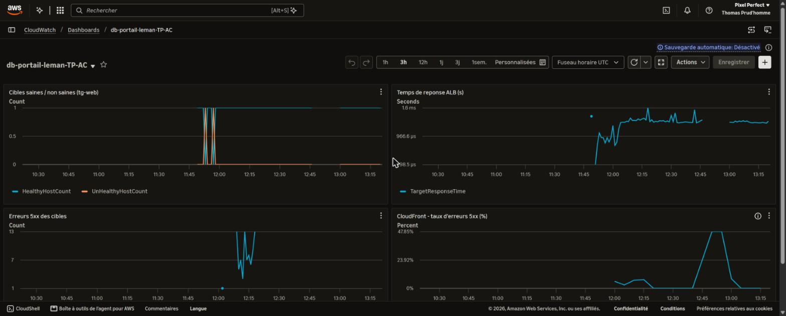
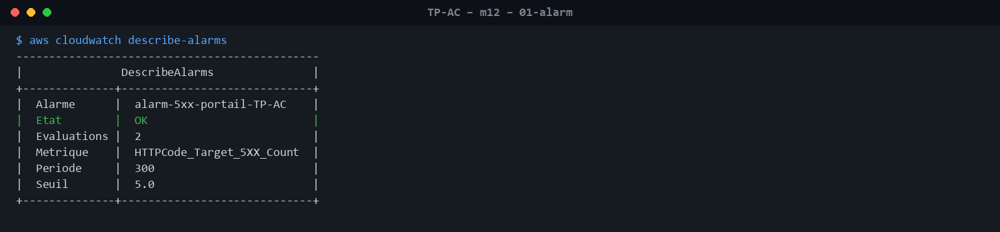
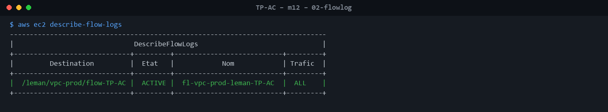
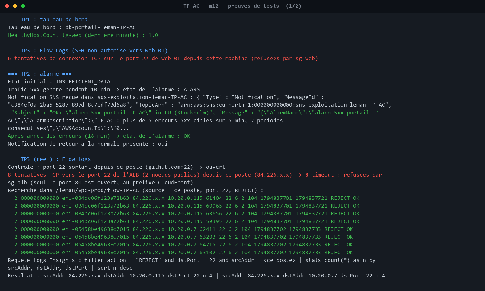
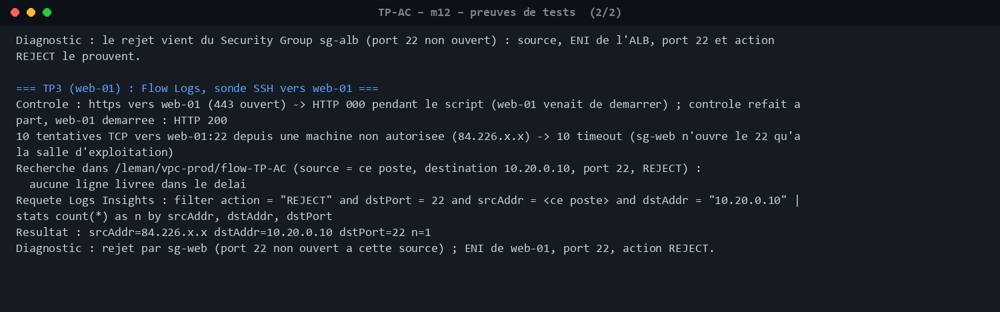
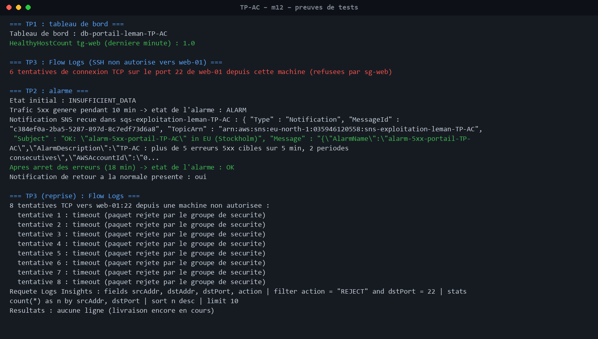

# Module 12 – CloudWatch et Flow Logs

## Objectif
Surveiller le site avec un tableau de bord, être prévenu par une alarme, et garder la trace des flux réseau pour comprendre un rejet.

## Ce qu'il faut savoir
Chaque service envoie des métriques à CloudWatch. Une alarme regarde une statistique sur plusieurs périodes et passe de `OK` à `ALARM` quand le seuil est franchi ; SNS envoie alors le message à ses abonnés. Les Flow Logs enregistrent chaque connexion acceptée (`ACCEPT`) ou refusée (`REJECT`) avec la source, le port et le protocole, et Logs Insights permet de les interroger. Nous gardons les journaux 3 jours pour limiter les coûts.

## Ce que nous avons fait
- Le tableau de bord `db-portail-leman-TP-AC` : cibles saines et non saines, temps de réponse de l'ALB, erreurs 5xx des cibles, taux d'erreurs 5xx de CloudFront.
- Le topic SNS `sns-exploitation-leman-TP-AC`, avec deux abonnés : une adresse e-mail de l'équipe et une file SQS qui nous sert de preuve de réception.
- L'alarme `alarm-5xx-portail-TP-AC` : plus de 5 erreurs 5xx en 5 minutes, pendant 2 périodes de suite ; elle prévient en passant en alarme et en revenant à la normale. Pour la tester, notre API renvoie une erreur 500 sur `/api/error`.
- Le groupe de logs `/leman/vpc-prod/flow-TP-AC`, un rôle IAM d'écriture et le Flow Log `fl-vpc-prod-leman-TP-AC` (tout le trafic).
- Une sonde TCP sur le port 22 depuis une machine non autorisée, retrouvée dans les journaux avec Logs Insights.

Scripts : `scripts/m12-monitoring.ps1` (mise en place) et `m12-tests.ps1`, `m12-flowlogs3.ps1`, `m12-flowlogs4.ps1` (preuves).


| Élément | Réglage |
|---|---|
| Alarme | `HTTPCode_Target_5XX_Count` supérieur à 5, période de 5 min, 2 périodes |
| Action | message SNS en alarme et au retour à la normale |
| Flow Log | tout le trafic, vers CloudWatch Logs, rétention 3 jours |

## Si ça ne marche pas : quatre vérifications
1. Quelle métrique dérive : erreurs 5xx, lenteur, cibles saines ?
2. L'état et l'historique de l'alarme.
3. Les journaux de flux : `filter action="REJECT" | stats count(*) by srcAddr, dstPort`.
4. Quelle règle de Security Group ou de NACL a refusé, d'après le port et l'interface.

## Résultats des tests
```
=== TP1 : tableau de bord ===
Tableau de bord : db-portail-leman-TP-AC
HealthyHostCount tg-web (derniere minute) : 1.0

=== TP3 : Flow Logs (SSH non autorise vers web-01) ===
6 tentatives de connexion TCP sur le port 22 de web-01 depuis cette machine (refusees par sg-web)

=== TP2 : alarme ===
Etat initial : INSUFFICIENT_DATA
Trafic 5xx genere pendant 10 min -> etat de l'alarme : ALARM
Notification SNS recue dans sqs-exploitation-leman-TP-AC : { "Type" : "Notification", "MessageId" : "c384ef0a-2ba5-5287-897d-8c7edf73d6a8", "TopicArn" : "arn:aws:sns:eu-north-1:000000000000:sns-exploitation-leman-TP-AC", "Subject" : "OK: \"alarm-5xx-portail-TP-AC\" in EU (Stockholm)", "Message" : "{\"AlarmName\":\"alarm-5xx-portail-TP-AC\",\"AlarmDescription\":\"TP-AC : plus de 5 erreurs 5xx cibles sur 5 min, 2 periodes consecutives\",\"AWSAccountId\":\"0...
Apres arret des erreurs (18 min) -> etat de l'alarme : OK
Notification de retour a la normale presente : oui

=== TP3 (reel) : Flow Logs ===
Controle : port 22 sortant depuis ce poste (github.com:22) -> ouvert
8 tentatives TCP vers le port 22 de l'ALB (2 noeuds publics) depuis ce poste (84.226.x.x) -> 8 timeout : refusees par sg-alb (seul le port 80 est ouvert, au prefixe CloudFront)
Recherche dans /leman/vpc-prod/flow-TP-AC (source = ce poste, port 22, REJECT) :
  2 000000000000 eni-034bc06f123a72b63 84.226.x.x 10.20.0.115 61404 22 6 2 104 1794837701 1794837721 REJECT OK
  2 000000000000 eni-034bc06f123a72b63 84.226.x.x 10.20.0.115 60965 22 6 2 104 1794837701 1794837721 REJECT OK
  2 000000000000 eni-034bc06f123a72b63 84.226.x.x 10.20.0.115 63656 22 6 2 104 1794837701 1794837721 REJECT OK
  2 000000000000 eni-034bc06f123a72b63 84.226.x.x 10.20.0.115 59395 22 6 2 104 1794837701 1794837721 REJECT OK
  2 000000000000 eni-05458be49638c7015 84.226.x.x 10.20.0.7 62411 22 6 2 104 1794837702 1794837733 REJECT OK
  2 000000000000 eni-05458be49638c7015 84.226.x.x 10.20.0.7 63203 22 6 2 104 1794837702 1794837733 REJECT OK
  2 000000000000 eni-05458be49638c7015 84.226.x.x 10.20.0.7 64715 22 6 2 104 1794837702 1794837733 REJECT OK
  2 000000000000 eni-05458be49638c7015 84.226.x.x 10.20.0.7 63102 22 6 2 104 1794837702 1794837733 REJECT OK
Requete Logs Insights : filter action = "REJECT" and dstPort = 22 and srcAddr = <ce poste> | stats count(*) as n by srcAddr, dstAddr, dstPort | sort n desc
Resultat : srcAddr=84.226.x.x dstAddr=10.20.0.115 dstPort=22 n=4 | srcAddr=84.226.x.x dstAddr=10.20.0.7 dstPort=22 n=4
Diagnostic : le rejet vient du Security Group sg-alb (port 22 non ouvert) : source, ENI de l'ALB, port 22 et action REJECT le prouvent.

=== TP3 (web-01) : Flow Logs, sonde SSH vers web-01 ===
Controle : https vers web-01 (443 ouvert) -> HTTP 000 pendant le script (web-01 venait de demarrer) ; controle refait a part, web-01 demarree : HTTP 200
10 tentatives TCP vers web-01:22 depuis une machine non autorisee (84.226.x.x) -> 10 timeout (sg-web n'ouvre le 22 qu'a la salle d'exploitation)
Recherche dans /leman/vpc-prod/flow-TP-AC (source = ce poste, destination 10.20.0.10, port 22, REJECT) :
  aucune ligne livree dans le delai
Requete Logs Insights : filter action = "REJECT" and dstPort = 22 and srcAddr = <ce poste> and dstAddr = "10.20.0.10" | stats count(*) as n by srcAddr, dstAddr, dstPort
Resultat : srcAddr=84.226.x.x dstAddr=10.20.0.10 dstPort=22 n=1
Diagnostic : rejet par sg-web (port 22 non ouvert a cette source) ; ENI de web-01, port 22, action REJECT.
```

## Nettoyage
Nous gardons le tableau de bord, l'alarme et le groupe de logs pour le module 13, puis nous supprimerons le Flow Log et les journaux à la fin du cours.

## Problèmes rencontrés
- Notre premier groupe de logs n'avait pas été créé (une erreur de notre script) ; le Flow Log affichait `DeliverLogsStatus=FAILED`. Nous avons recréé le groupe puis le Flow Log.
- La livraison dans CloudWatch Logs prend plusieurs minutes.
- Une adresse e-mail d'abonné SNS doit être confirmée par un clic sur le message reçu : sans cela, l'abonnement reste en attente.

## Captures

**Console AWS – alarme**


**Console AWS – tableau de bord**



**Terminal – alarm**



**Terminal – flowlog**



**Terminal – sns**


**Journal des tests**



**Journal des tests**



**Journal des tests**


