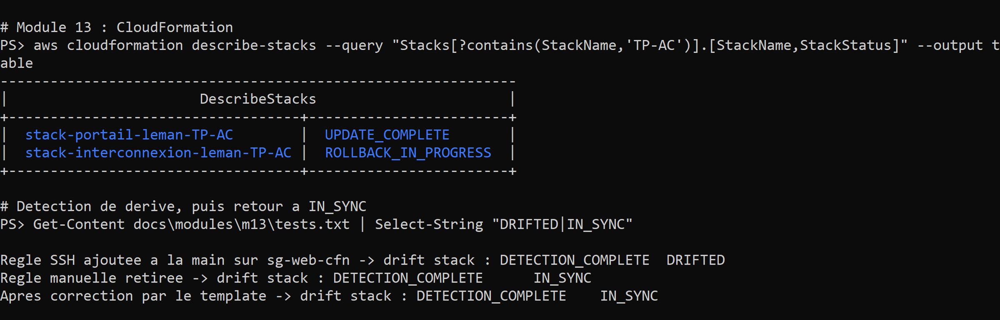

# Module 13 – CloudFormation

## Objectif
Décrire le réseau dans un template, le déployer en stack, relire les changements avant de les appliquer, détecter les écarts avec la réalité (drift) et prouver qu'on peut tout supprimer puis tout recréer à l'identique.

## Ce qu'il faut savoir
Un template contient des ressources, des paramètres (`Environnement`, `CidrVpc`…) et des sorties. La stack est le template déployé ; CloudFormation calcule l'ordre de création et supprime dans l'ordre inverse. Un change set montre ce qui sera ajouté, modifié ou remplacé avant d'exécuter. Le drift est l'écart entre ce qui existe vraiment et le template, par exemple après une modification à la main dans la console.

## Ce que nous avons fait
- `cfn/reseau-leman-etape1.yaml` : le VPC, trois sous-réseaux, l'IGW, la table publique et les trois Security Groups, avec les paramètres `Environnement` (prod ou dev) et `CidrVpc`. Nous l'avons validé avec `validate-template`, puis créé la stack `stack-portail-leman-TP-AC`.
- `cfn/reseau-leman.yaml` : le template complet, avec en plus `web-01`, `app-01` (adresses fixes), les deux groupes cibles, l'ALB (HTTPS 443, règle `/api/*`) et le rôle IAM des instances. Nous l'avons appliqué avec un change set que nous avons relu avant de l'exécuter.
- Un test de drift : une règle SSH ajoutée à la main sur le Security Group web est détectée (`DRIFTED`). Nous retirons la règle manuelle (la pile est de nouveau `IN_SYNC`), puis nous la déclarons dans le template (paramètre `AdminCidr`) et nous redéployons par change set : la règle appartient maintenant à la pile et la pile reste `IN_SYNC`. Un premier essai, où nous déclarions la règle sans retirer la manuelle, laissait la pile en `DRIFTED` (la règle existante n'avait pas la même description).
- La stack est supprimée, puis recréée à l'identique.

Scripts : `scripts/m13-cfn.ps1` (le scénario complet) et `scripts/m13-deploy.ps1` (tout déployer en une commande, certificat compris).


| Paramètre | Valeur par défaut |
|---|---|
| `Environnement` | `prod` (ou `dev`) |
| `CidrVpc` | `10.30.0.0/22` (nous avons gardé `10.20.0.0/22` pour le lab fait à la main) |
| `WebPrivateIp` / `AppPrivateIp` | `10.30.0.10` / `10.30.1.10` |
| `AdminCidr` | vide (pas de règle SSH) |
| `CertificateArn` | à fournir (le script de déploiement l'importe) |

Sorties : `VpcId`, `AlbDns` et `SgWebId`.

## Si ça ne marche pas : quatre vérifications
1. L'état de la stack (`*_COMPLETE`, `*_FAILED`, `ROLLBACK_*`).
2. Les événements : la première ressource en `CREATE_FAILED` donne la raison.
3. Le drift : `detect-stack-drift` puis `describe-stack-resource-drifts`.
4. Le rollback : on corrige le template, jamais la ressource à la main.

## Résultats des tests
```
=== TP1 : validation et creation de la stack (reseau seul) ===
validate-template : parametres = CidrVpc	WebPrivateIp	AppPrivateIp	AdminCidr	CleSSH	Environnement	InstanceType	CertificateArn	AmiId
Statut : CREATE_COMPLETE ; sorties : VpcId	vpc-0310d32aa87687c10 SgWebId	sg-06d62e0ec61238041

=== TP2 : change set (instances, groupes cibles, ALB) ===
Change set cs-ajouts-912889504 : 7 changements ; actions = Add
   Add  Alb  AWS::ElasticLoadBalancingV2::LoadBalancer
   Add  App01  AWS::EC2::Instance
   Add  ListenerHttps  AWS::ElasticLoadBalancingV2::Listener
   Add  RuleApi  AWS::ElasticLoadBalancingV2::ListenerRule
   Add  TgApp  AWS::ElasticLoadBalancingV2::TargetGroup
   Add  TgWeb  AWS::ElasticLoadBalancingV2::TargetGroup
   Add  Web01  AWS::EC2::Instance
Statut apres execution : UPDATE_COMPLETE
Cibles : tg-web=healthy  tg-app=healthy
curl -k https://alb-prod-leman-cfn-TP-AC-1508405322.eu-north-1.elb.amazonaws.com/api/health -> app-01 TP-AC (cfn) /api/health
curl -k https://alb-prod-leman-cfn-TP-AC-1508405322.eu-north-1.elb.amazonaws.com/ -> web-01 TP-AC (cfn)

=== TP3 : drift, suppression, redeploiement ===
Regle SSH ajoutee a la main sur sg-web-cfn -> drift stack : DETECTION_COMPLETE	DRIFTED
Detail : SgWeb	MODIFIED	/SecurityGroupIngress/1	ADD
Regle manuelle retiree -> drift stack : DETECTION_COMPLETE	IN_SYNC
Change set cs-declaration-template-2112251803 : 1 changements ; actions = Modify
   Modify  SgWeb  AWS::EC2::SecurityGroup
Regle declaree dans le template (AdminCidr) puis redeploiement -> statut : UPDATE_COMPLETE
Apres correction par le template -> drift stack : DETECTION_COMPLETE	IN_SYNC
Regles de sg-web-cfn : tcp	80	None	sg-0517516cc80d5f705 tcp	22	203.0.113.0/24	None
Suppression de la stack (ordre inverse des dependances) : 2 min -> DELETE_COMPLETE (stack disparue)
VPC restants avec le tag de la stack : 0
Change set cs-redeploiement-1694842148 : 7 changements ; actions = Add
   Add  Alb  AWS::ElasticLoadBalancingV2::LoadBalancer
   Add  App01  AWS::EC2::Instance
   Add  ListenerHttps  AWS::ElasticLoadBalancingV2::Listener
   Add  RuleApi  AWS::ElasticLoadBalancingV2::ListenerRule
   Add  TgApp  AWS::ElasticLoadBalancingV2::TargetGroup
   Add  TgWeb  AWS::ElasticLoadBalancingV2::TargetGroup
   Add  Web01  AWS::EC2::Instance
Redeploiement : UPDATE_COMPLETE ; cibles tg-web=healthy tg-app=healthy ; curl -k https://alb-prod-leman-cfn-TP-AC-1090625744.eu-north-1.elb.amazonaws.com/api/health -> app-01 TP-AC (cfn) /api/health
```

## Le second modèle : l'interconnexion
Le sujet demande pour ce module le réseau du portail (`reseau-leman.yaml`). Comme le critère final parle de « tout redéployable depuis le modèle », nous avons ajouté `cfn/interconnexion-leman.yaml`, qui s'applique **par-dessus** le réseau existant (les identifiants des VPC, sous-réseaux et tables sont des paramètres). Il déploie 52 ressources :

| Module | Ressources |
|---|---|
| 4, pare-feu | sous-réseau et table du pare-feu, 2 groupes de règles, la politique, le pare-feu, 2 groupes de journaux (alertes et flux), les routes qui passent par son endpoint |
| 6, Transit Gateway | le Transit Gateway, 2 attachements (la prod sur deux zones), 3 tables, les associations, les propagations et les routes des VPC |
| 7, VPN | 3 Elastic IP et leur association aux routeurs, 2 Customer Gateways, 2 connexions VPN (clés lues dans Secrets Manager par référence dynamique), les routes statiques des sites, les règles de `sg-app` |
| 8, Direct Connect | la Direct Connect Gateway et son association au Transit Gateway |

Deux choses n'ont pas de ressource CloudFormation : l'attachement d'un VPN au Transit Gateway (aucun attribut ne le donne) et la Direct Connect Gateway. Une petite fonction Lambda (ressource personnalisée, dans le modèle) retrouve les attachements et crée la passerelle. Les sites eux-mêmes (les routeurs strongSwan), leur configuration, la liaison GRE et le BGP restent **hors modèle** : ce sont des équipements « chez le client », configurés par `scripts/m07-vpn-aws.ps1` et `scripts/m08-dx-sim.ps1`.

Le script `scripts/m13-interconnexion.ps1` retire les versions manuelles de ce que le modèle va gérer, crée la stack et importe ses sorties. **Preuve de redéploiement :** nous avons supprimé la stack (environ 10 minutes, sans ressource orpheline : plus de Transit Gateway, de VPN ni de pare-feu), puis redéployé le même modèle sans aucune modification : `CREATE_COMPLETE` en 6 minutes 13 secondes, tunnels VPN `DOWN` tant que les routeurs ne sont pas configurés, puis `UP`. Tous les tests des modules 4, 6, 7 et 8 de ce dossier ont été rejoués sur ce second déploiement.

## Nettoyage
Nous gardons le template et la stack. La stack contient des instances et un ALB (facturés) : nous la supprimerons à la fin du cours avec `aws cloudformation delete-stack`.

## Problèmes rencontrés
Deux erreurs de notre part : les descriptions des Security Groups ne peuvent pas contenir d'apostrophes ni d'accents, et notre premier calcul des sous-réseaux avec `!Cidr` donnait au sous-réseau privé une plage qui ne contenait pas l'adresse fixe d'`app-01`. Nous n'avons pas mis de NAT dans la stack (coût) : `app-01` n'a pas besoin de paquets, mais elle n'est donc pas joignable par SSM.

Pour le second modèle, cinq problèmes, tous réglés :
1. **Conflit de nom** : le groupe de journaux `/leman/nfw-alert-TP-AC` créé à la main au test du module 4 existait encore. CloudFormation l'a vu avant de créer quoi que ce soit (« NAME_CONFLICT_VALIDATION ») ; nous l'avons supprimé.
2. **Elastic IP restées associées** : notre script de nettoyage n'avait pas dissocié les anciennes adresses des routeurs avant de les libérer (l'erreur n'était pas affichée). CloudFormation a répondu `AlreadyExists` à l'association. Nous les avons dissociées puis libérées, et corrigé le script.
3. **Fonction Lambda sans réponse** : en Python 3.12, le module `cfnresponse` n'est pas disponible dans le code intégré au modèle. La fonction plantait avant de répondre, et CloudFormation attend alors une heure avant d'échouer. La restauration a ensuite attendu une seconde heure pour la même raison, jusqu'à ce que nous remplacions le code de la fonction pendant la restauration. Le modèle envoie maintenant lui-même la réponse, avec un délai de 20 minutes.
4. **Deux variables du même nom** : notre script d'import écrasait les options du profil AWS (`$P` et `$p` sont la même variable en PowerShell).
5. **Un mot réservé** : la fonction `Try` de notre script de nettoyage des modules 6 à 8 n'a jamais pu s'exécuter, car `Try` est un mot réservé de PowerShell.

Le portail (`reseau-leman.yaml`) a aussi reçu le paramètre `CleSSH` que le sujet demande : il est vide par défaut, car nous administrons par SSM et n'ouvrons aucun SSH. Nous l'avons rejoué en entier (étape réseau, change set, dérive, suppression, redéploiement).

## Captures

**Console AWS – piles cloudformation**


**Terminal**



**Terminal – journal du test**


**Terminal – journal du test**


