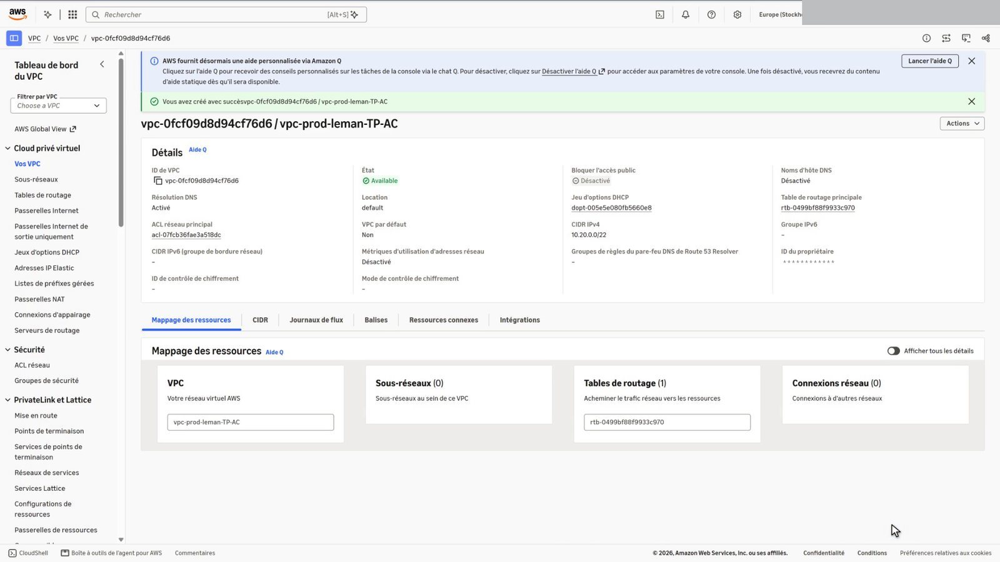
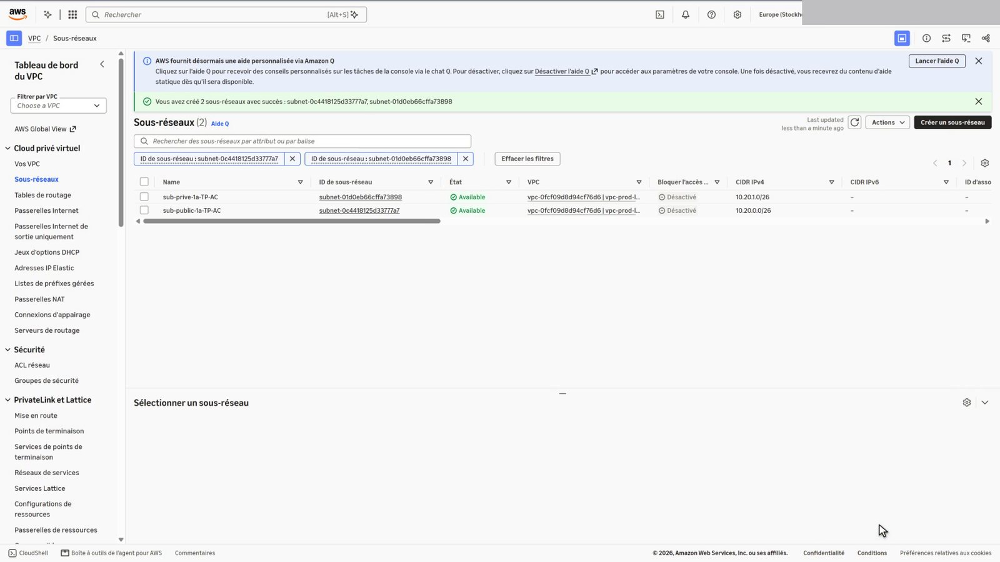
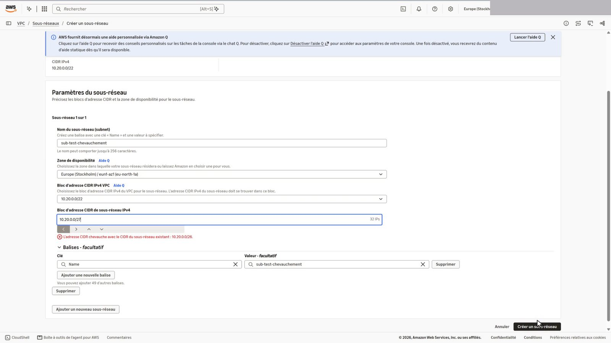
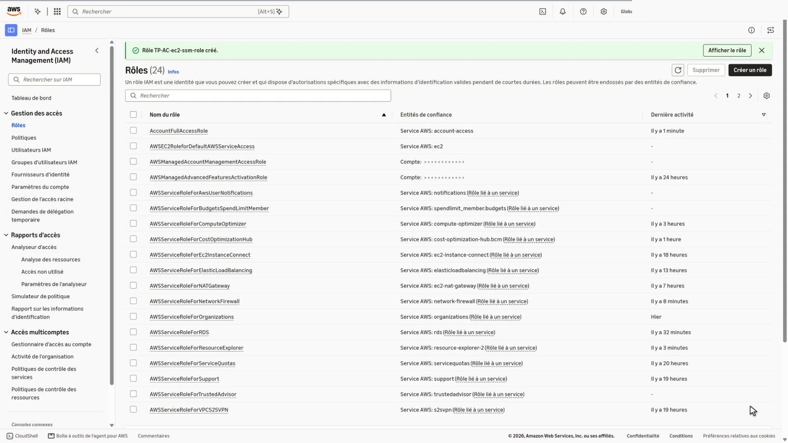
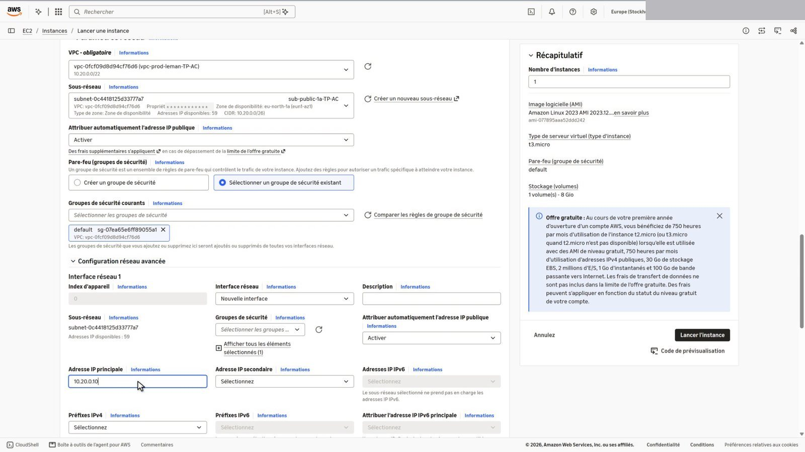
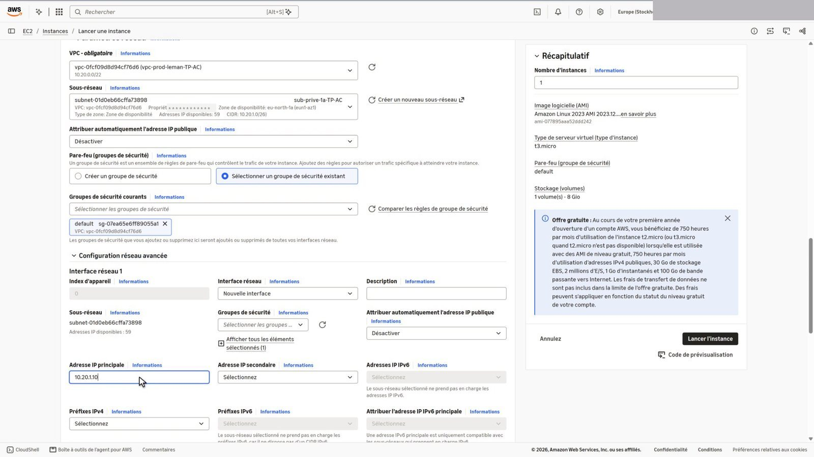

# Module 1 – VPC et sous-réseaux

## Objectif
Créer le réseau de production et y poser deux serveurs : `web-01-TP-AC` dans un sous-réseau public et `app-01-TP-AC` dans un sous-réseau privé. À la fin du module, rien ne sort encore du VPC : c'est le travail du module 2.

## Ce qu'il faut savoir
Un VPC est un réseau isolé, propre à notre compte et à une région, avec une plage d'adresses (un CIDR). Un sous-réseau découpe cette plage et vit dans une seule zone de disponibilité. AWS garde cinq adresses dans chaque sous-réseau : un /26 compte 64 adresses, 59 sont utilisables, et la console l'affiche (« Adresses IP disponibles : 59 »).

Deux sous-réseaux d'un même VPC ne peuvent pas se recouvrir. Un sous-réseau n'est pas « public » ou « privé » par nature : ce qui change, c'est sa table de routage (module 2). Pour l'instant, nos deux sous-réseaux suivent la table principale du VPC, qui ne contient que la route locale. Les machines du VPC se voient entre elles, mais aucune route ne mène vers l'extérieur.

Le sujet propose un /16 pour le VPC. Nous avons pris un `/22`, soit 1024 adresses : le compte est partagé avec la classe, les autres équipes utilisent déjà `10.0.0.0/16`, et deux serveurs n'ont pas besoin de plus.

Dernier point : nous administrons les serveurs avec Session Manager (SSM), sans SSH ni paire de clés. Il faut pour cela un rôle IAM que les instances peuvent endosser. L'agent SSM de l'instance appelle AWS vers l'extérieur : il lui faudra donc un chemin vers Internet, que nous n'avons pas encore.

## Ce que nous avons fait
**Le VPC.** Dans *VPC > Vos VPC*, bouton *Créer un VPC*, option *VPC uniquement*. Nom `vpc-prod-leman-TP-AC`, saisie manuelle du CIDR IPv4 `10.20.0.0/22`, pas d'IPv6, puis les balises `Projet`, `Equipe` et `Environnement=prod` (la balise `Name` vient du champ de nom). La console affiche le VPC à l'état *Available* avec une seule table de routage, la principale.

**Les deux sous-réseaux.** Dans *Sous-réseaux > Créer un sous-réseau*, nous choisissons le VPC et ajoutons deux sous-réseaux dans le même formulaire, tous deux en zone `eu-north-1a` :
* `sub-public-1a-TP-AC`, `10.20.0.0/26`
* `sub-prive-1a-TP-AC`, `10.20.1.0/26`

Chacun reçoit les trois balises du projet. Les deux passent à *Available*.

**Le test de chevauchement.** Nous rouvrons le même formulaire et saisissons un sous-réseau `sub-test-chevauchement` en `10.20.0.0/27`, une plage qui se trouve à l'intérieur de `10.20.0.0/26`. La console écrit en rouge que le CIDR chevauche celui du sous-réseau existant, et le bouton *Créer un sous-réseau* ne crée rien.

**Le rôle pour SSM.** Dans *IAM > Rôles > Créer un rôle* : entité de confiance *Service AWS*, cas d'utilisation *EC2*, politique `AmazonSSMManagedInstanceCore`, nom `TP-AC-ec2-ssm-role`. En créant le rôle pour EC2, la console crée aussi le profil d'instance du même nom, que nous retrouvons dans le formulaire de lancement. Nous n'avons pas mis de balises sur ce rôle.

**`web-01-TP-AC`.** Dans *EC2 > Lancer une instance* :
* nom `web-01-TP-AC`, avec les trois balises ;
* image Amazon Linux 2023, type `t3.micro`, *Continuer sans paire de clés* ;
* réseau : VPC `vpc-prod-leman-TP-AC`, sous-réseau `sub-public-1a-TP-AC`, attribution automatique d'une adresse IP publique *Activer* ;
* groupe de sécurité : nous sélectionnons le groupe existant `default` du VPC ;
* configuration réseau avancée : adresse IP principale `10.20.0.10` ;
* détails avancés : profil d'instance IAM `TP-AC-ec2-ssm-role`.

**`app-01-TP-AC`.** Même recette, avec trois différences :
* le sous-réseau est `sub-prive-1a-TP-AC`, et l'attribution d'une adresse publique est sur *Désactiver* : personne ne peut joindre cette machine depuis Internet ;
* l'adresse privée fixe est `10.20.1.10` ;
* dans les *Données utilisateur*, un petit script qui démarre au premier lancement. Il écrit un serveur HTTP Python (`/opt/app.py`) qui écoute sur le port `8080` et répond `app-01 TP-AC /api/health`, et il en fait un service systemd nommé `app`. C'est la « mini API » que nous interrogerons à partir du module 3.

Les deux instances utilisent le groupe `default`, qui laisse passer le trafic entre ses membres. Nous le remplaçons par des groupes dédiés au module 3.

## Captures


Le VPC existe : état *Available*, CIDR `10.20.0.0/22`. Le « Mappage des ressources » en bas montre zéro sous-réseau et une table de routage, la principale. (L'identifiant du propriétaire est masqué sur cette capture et sur les suivantes.)



Les deux sous-réseaux sont créés d'un coup, à l'état *Available*, avec les plages `10.20.1.0/26` et `10.20.0.0/26`.



Le test de chevauchement : la console refuse `10.20.0.0/27` et nomme le sous-réseau qui est déjà là, `10.20.0.0/26`.



Le rôle `TP-AC-ec2-ssm-role` est créé. (Les numéros de compte de deux rôles préexistants sont masqués.)



Le réseau de `web-01-TP-AC` : sous-réseau `sub-public-1a-TP-AC`, adresse publique automatique *Activer*, groupe `default`, adresse principale `10.20.0.10`.



Le même écran pour `app-01-TP-AC` : sous-réseau `sub-prive-1a-TP-AC`, adresse publique *Désactiver*, adresse principale `10.20.1.10`.

## Tableau récapitulatif
| Ressource | Valeur |
|---|---|
| VPC | `vpc-prod-leman-TP-AC`, `10.20.0.0/22` |
| Sous-réseau public | `sub-public-1a-TP-AC`, `10.20.0.0/26`, `eu-north-1a` |
| Sous-réseau privé | `sub-prive-1a-TP-AC`, `10.20.1.0/26`, `eu-north-1a` |
| Rôle IAM | `TP-AC-ec2-ssm-role`, politique `AmazonSSMManagedInstanceCore` |
| `web-01-TP-AC` | `t3.micro`, Amazon Linux 2023, `10.20.0.10`, adresse publique automatique |
| `app-01-TP-AC` | `t3.micro`, Amazon Linux 2023, `10.20.1.10`, aucune adresse publique, API sur le port `8080` |
| Groupe de sécurité | `default` du VPC (remplacé au module 3) |
| Accès | Session Manager, pas de paire de clés |

## Résultats des tests
Ce que nous avons vu à l'écran pendant le tournage. Les autres vérifications (ping entre les deux serveurs, accès à Internet) viennent aux modules 2 et 3.

```
{{TESTS}}
```

## Pièges rencontrés
* **Une ligne de balise vide bloque la création.** Dans le formulaire des sous-réseaux, un champ « Entrer la clé » resté vide affiche « Vous devez spécifier une clé de balise » et la console refuse de continuer. Nous l'avons rencontré en filmant ; il faut supprimer la ligne vide.
* **La saisie des balises propose les valeurs des autres équipes.** Dans la liste de suggestions, à côté de `prod`, apparaît `prod-MF` : c'est l'étiquette d'un camarade. Nous tapons la valeur en entier plutôt que de cliquer une suggestion.
* **Les serveurs ne sont pas joignables par SSM dans ce module.** Ni `web-01-TP-AC` ni `app-01-TP-AC` n'ont de route vers Internet pour l'instant. Nous n'ouvrons donc pas de session ici : la première session SSM est au module 2. Le ping entre les deux machines est testé au module 3.
* **Le groupe `default` est un raccourci.** Il suffit pour ce module, mais il ne distingue pas le web de l'application. Il disparaît des instances au module 3.

## Ce qui diffère du sujet
* **Plage du VPC.** `10.20.0.0/22` à la place du /16 du sujet (compte partagé, plages des autres équipes).
* **Région.** Stockholm à la place de Zurich (voir le module 0).
* **Un seul sous-réseau par rôle dans ce module.** Un deuxième sous-réseau public, en zone B, arrive au module 2 parce que la zone A ne peut plus accueillir de NAT.
* **Test de chevauchement.** Dans la console, le refus s'affiche en rouge sous le champ du CIDR. En ligne de commande, notre première version recevait l'erreur `InvalidSubnet.Conflict`.
* **Pas de Reachability Analyzer.** L'outil était refusé par l'organisation jusqu'au 17/11 et nous ne l'avons pas utilisé pendant le tournage.
* **Première version.** Notre premier passage, fait avec l'AWS CLI, avait un ping `web-01` vers `app-01` dès ce module. Dans la version filmée, ce test est reporté au module 3.

## Nettoyage
Rien n'est supprimé pendant le tournage. Le VPC, les sous-réseaux, le rôle et les deux instances sont supprimés à la fin du projet (voir `NETTOYAGE.md`). La seule ressource du projet qui reste côté AWS est le Network Firewall du module 4, dont la suppression est bloquée côté service ; son endpoint est dans un sous-réseau du VPC, dont la suppression dépend donc de ce déblocage.
