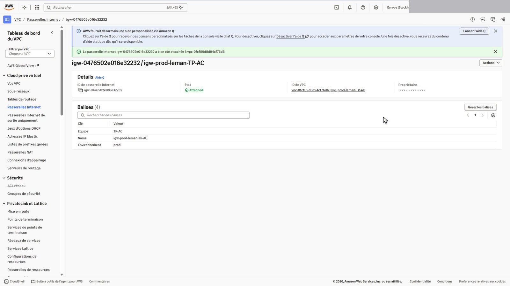
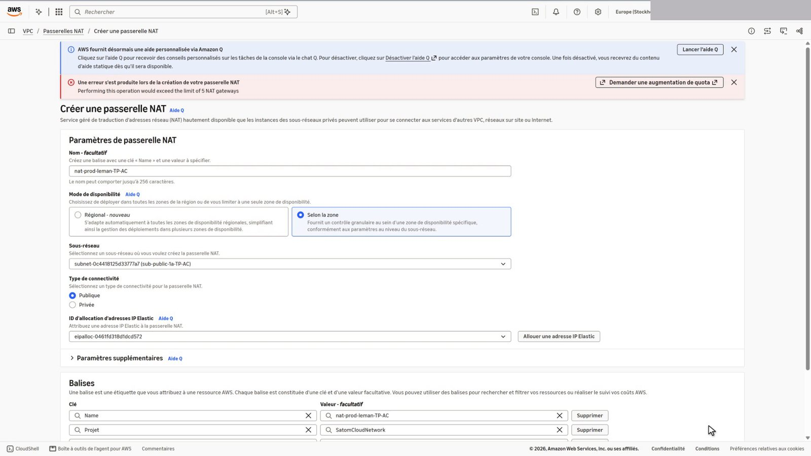
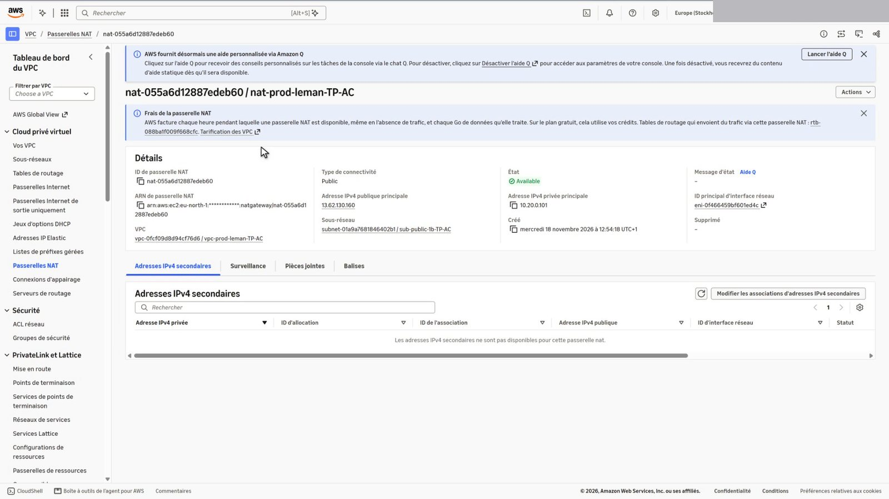
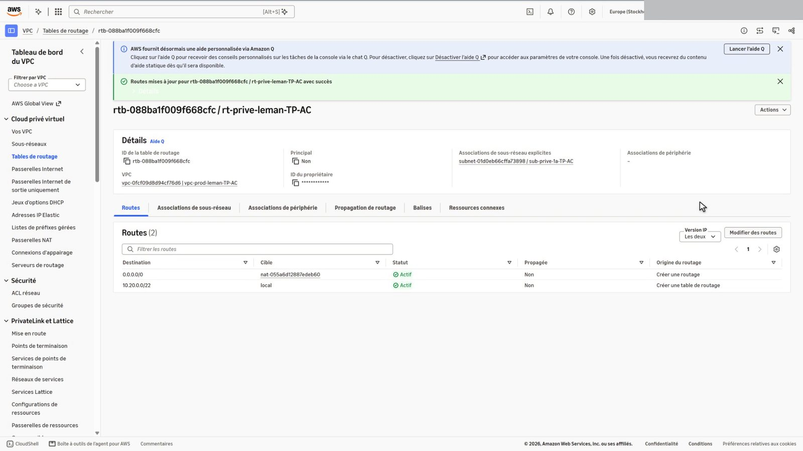
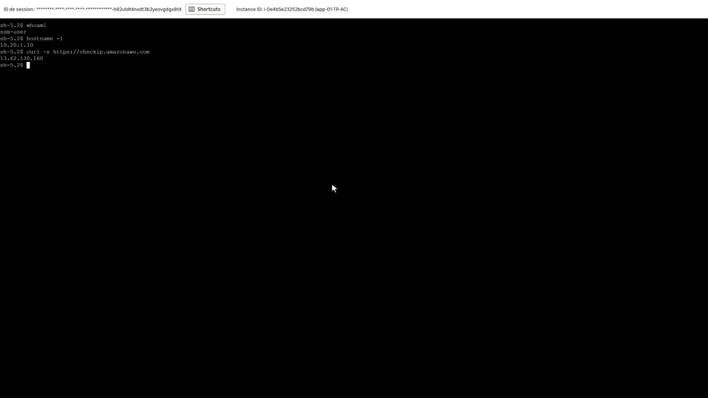
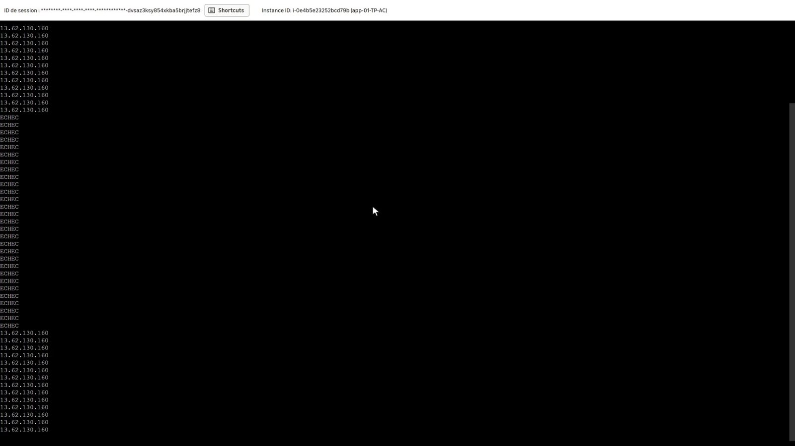

# Module 2 – Routage : IGW et NAT

## Objectif
Donner un accès à Internet au sous-réseau public, un accès sortant seulement au sous-réseau privé, le prouver depuis le serveur privé, puis provoquer une panne de route pour apprendre à la retrouver.

## Ce qu'il faut savoir
Un sous-réseau est public quand sa table de routage envoie `0.0.0.0/0` vers une passerelle Internet (IGW) et que l'instance a une adresse publique. Une IGW se crée puis s'attache à un VPC : tant qu'elle n'est pas attachée, elle ne sert à rien.

Un sous-réseau privé n'a pas de route vers l'IGW. Pour que ses machines puissent quand même sortir (mises à jour, agent SSM), on place une passerelle NAT dans un sous-réseau public. La NAT remplace l'adresse privée de la machine par sa propre adresse Elastic : l'extérieur ne voit que la NAT et ne peut rien initier vers l'intérieur. La NAT a un prix : AWS la facture à chaque heure où elle existe (0,046 USD de l'heure à Stockholm d'après l'API de prix), plus chaque Go traité.

Quand plusieurs routes correspondent à une destination, la plus précise gagne. Ici, la route `10.20.0.0/22` (locale) passe avant `0.0.0.0/0`.

## Ce que nous avons fait
Tout se passe dans *VPC*, sauf la preuve, qui se fait dans *Systems Manager*.

1. **Passerelle Internet.** *Passerelles Internet > Créer* : nom `igw-prod-leman-TP-AC`, balises du projet. Elle est créée à l'état *Detached*. *Actions > Attacher au VPC*, VPC `vpc-prod-leman-TP-AC` : l'état passe à *Attached*.
2. **Table publique.** *Tables de routage > Créer* : `rt-public-leman-TP-AC`, dans le VPC de production, avec les balises. Elle ne contient que la route locale. Onglet *Routes > Modifier des routes > Ajouter une route* : destination `0.0.0.0/0`, cible *Passerelle Internet*, `igw-prod-leman-TP-AC`. Puis onglet *Associations de sous-réseau* : nous cochons `sub-public-1a-TP-AC`. C'est cette association qui rend le sous-réseau public.
3. **Table privée.** Même création pour `rt-prive-leman-TP-AC`, associée à `sub-prive-1a-TP-AC`. Elle n'a que la route locale : rien ne sort.
4. **Un deuxième sous-réseau public, en zone B.** `sub-public-1b-TP-AC`, `10.20.0.64/26`, zone `eu-north-1b`, avec les balises, puis association à `rt-public-leman-TP-AC` (la table publique a donc deux sous-réseaux). Nous savions que la zone A avait atteint sa limite de passerelles NAT, le compte étant partagé avec la classe ; l'explication est dans l'étape suivante.
5. **Passerelle NAT.** *Passerelles NAT > Créer* : nom `nat-prod-leman-TP-AC`, mode *Selon la zone* (la console propose aussi un mode *Régional*, que nous n'avons pas pris), sous-réseau `sub-public-1a-TP-AC`, connectivité *Publique*, bouton *Allouer une adresse IP Elastic*, balises. Au clic sur *Créer*, la console refuse : « Performing this operation would exceed the limit of 5 NAT gateways ». Nous avons tenté la zone A d'abord, ce qui montre l'erreur à l'écran. Nous changeons le sous-réseau pour `sub-public-1b-TP-AC`, nous allouons une nouvelle adresse Elastic et la création passe. La NAT reste *Pending* un peu plus d'une minute, puis devient *Available*.
6. **Route privée.** Dans `rt-prive-leman-TP-AC`, *Modifier des routes*, nouvelle route `0.0.0.0/0`, cible *Passerelle NAT*, `nat-prod-leman-TP-AC`. La table compte désormais deux routes.
7. **Preuve par Session Manager.** *Systems Manager > Session Manager > Démarrer une session*, instance `app-01-TP-AC`. Dans le terminal du navigateur : `whoami`, `hostname -I`, puis `curl -s https://checkip.amazonaws.com`. La machine n'a pas d'adresse publique, mais Internet la voit avec l'adresse Elastic de la NAT.
8. **Panne volontaire.** Dans la même session, nous lançons une boucle qui interroge `checkip.amazonaws.com` chaque seconde (`while true; do curl -s -m 2 https://checkip.amazonaws.com || echo ECHEC; sleep 1; done`). Dans la console, nous supprimons la route `0.0.0.0/0` de `rt-prive-leman-TP-AC` et nous enregistrons. Les requêtes échouent. Nous remettons la route vers la NAT et l'adresse revient.

`web-01-TP-AC` n'a pas d'Elastic IP : il garde l'adresse publique automatique reçue au module 1, qui change si on arrête l'instance.

## Captures


La passerelle Internet est attachée au VPC de production : état *Attached*, et le bandeau vert confirme l'attachement. Les balises du projet sont visibles en bas.



Premier essai de la NAT, dans la zone A : le bandeau rouge dit que l'opération dépasserait la limite de 5 passerelles NAT. Le bouton *Demander une augmentation de quota* est proposé à côté.



Second essai, dans la zone B : la NAT est *Available*, dans `sub-public-1b-TP-AC`, avec l'adresse privée `10.20.0.101` et l'adresse publique `13.62.130.160`.



La table privée après enregistrement : `0.0.0.0/0` vers `nat-055a6d12887edeb60`, et la route locale. Le sous-réseau associé est `sub-prive-1a-TP-AC`.



La preuve : sur `app-01-TP-AC`, `hostname -I` répond `10.20.1.10` (adresse privée seulement), et `curl` sur `checkip.amazonaws.com` répond `13.62.130.160`, l'adresse de la NAT. (L'identifiant de session est en partie masqué par la console elle-même.)



La panne et la reprise sur une seule image : la boucle affiche l'adresse de la NAT, puis 29 lignes `ECHEC` pendant que la route est retirée, puis l'adresse revient dès que nous la remettons.

## Tableau récapitulatif
| Ressource | Valeur |
|---|---|
| `igw-prod-leman-TP-AC` | `igw-0476502e016e32232`, attachée à `vpc-prod-leman-TP-AC` |
| `rt-public-leman-TP-AC` | `10.20.0.0/22` local ; `0.0.0.0/0` vers l'IGW ; associée à `sub-public-1a-TP-AC` et `sub-public-1b-TP-AC` |
| `rt-prive-leman-TP-AC` | `10.20.0.0/22` local ; `0.0.0.0/0` vers la NAT ; associée à `sub-prive-1a-TP-AC` |
| `sub-public-1b-TP-AC` | `10.20.0.64/26`, `eu-north-1b` |
| `nat-prod-leman-TP-AC` | `nat-055a6d12887edeb60`, dans `sub-public-1b-TP-AC`, adresse privée `10.20.0.101`, adresse Elastic `13.62.130.160` |

## Si ça ne marche pas : quatre vérifications
Nous les avons dites en vidéo pendant la panne, dans cet ordre :
1. Le sous-réseau est-il associé à la bonne table de routage ?
2. La route par défaut existe-t-elle dans cette table ?
3. Pointe-t-elle vers la bonne cible (IGW ou NAT) ?
4. La cible est-elle en bon état (NAT *Available*, IGW *Attached*, adresse publique sur l'instance pour un serveur public) ?

## Résultats des tests
Ce que nous avons vu à l'écran pendant le tournage.

```
{{TESTS}}
```

## Pièges rencontrés
* **Quota de NAT atteint dans la zone A.** Le compte est partagé : cinq NAT par zone de disponibilité, et celles de la classe comptent aussi. C'est pour cela que la NAT est dans `sub-public-1b-TP-AC`. Pour que cela fonctionne, le sous-réseau de la NAT doit lui-même avoir une route vers l'IGW : c'est la raison de l'association de la zone B à `rt-public-leman-TP-AC`.
* **Une Elastic IP de trop.** Le premier essai, refusé, avait déjà alloué une adresse Elastic. Pour le second, nous en avons alloué une autre. La première n'est associée à aucune NAT : elle doit être relâchée avec le reste, sinon elle est facturée comme toute adresse IPv4 publique.
* **Session Manager refusait de démarrer.** Au clic sur *Démarrer la session*, la console a affiché, lors de deux tentatives, « l'instance n'est pas configurée pour être utilisée avec AWS Systems Manager », alors que `app-01-TP-AC` et `web-01-TP-AC` apparaissaient *Online* dans la liste. Nous avons recommencé la scène et la session s'est ouverte ; la cause exacte n'est pas dans nos notes.
* **La fenêtre de session se fige pendant la panne.** Tant que la route est retirée, aucune nouvelle ligne ne s'affiche. C'est logique : la session Session Manager passe elle aussi par la NAT. Les 29 lignes `ECHEC` sont apparues d'un seul coup une fois la route remise. Notre commentaire de la vidéo dit que les requêtes « échouent aussitôt » : c'est vrai pour la boucle sur la machine, mais l'écran ne le montre qu'après coup. Une tentative durant au plus trois secondes (deux de délai, une de pause), 29 échecs correspondent à une coupure d'environ une minute et demie, soit le temps de revenir dans la console et de remettre la route.

## Ce qui diffère du sujet
* **NAT en zone B.** Le schéma habituel place la NAT dans le sous-réseau public de la zone A. À cause du quota, nous avons créé un second sous-réseau public en zone B pour l'héberger.
* **Pas d'Elastic IP sur `web-01-TP-AC`.** Notre première version, avec l'AWS CLI, plaçait une Elastic IP sur `web-01` et la NAT en zone A. La version filmée garde l'adresse publique automatique et la NAT en zone B.
* **Test de panne.** Notre première version pinguait `8.8.8.8` chaque seconde et mesurait 19 secondes de coupure. La version filmée interroge `checkip.amazonaws.com` avec `curl`, ce qui prouve en plus par quelle adresse nous sortons. Elle ne chiffre pas la coupure : elle dure le temps de revenir dans la console.
* **Suppression de la NAT.** Le sujet demande de la supprimer en fin de séance. Nous la gardons pendant tout le tournage, car l'agent SSM d'`app-01-TP-AC` en dépend, et nous la supprimons à la fin du projet.

## Nettoyage
La NAT, son adresse Elastic, l'IGW, les tables de routage et le sous-réseau `sub-public-1b-TP-AC` sont supprimés à la fin du projet, comme le reste (voir `NETTOYAGE.md`). La NAT est la première ressource à retirer, puisqu'elle est facturée à l'heure. Une seule ressource du projet reste côté AWS : le Network Firewall `nfw-prod-leman-TP-AC` du module 4, dont la suppression est bloquée côté service. Son endpoint se trouve dans `sub-public-1b-TP-AC` : ce sous-réseau, et le VPC qui le contient, ne peuvent partir qu'une fois le pare-feu débloqué.
