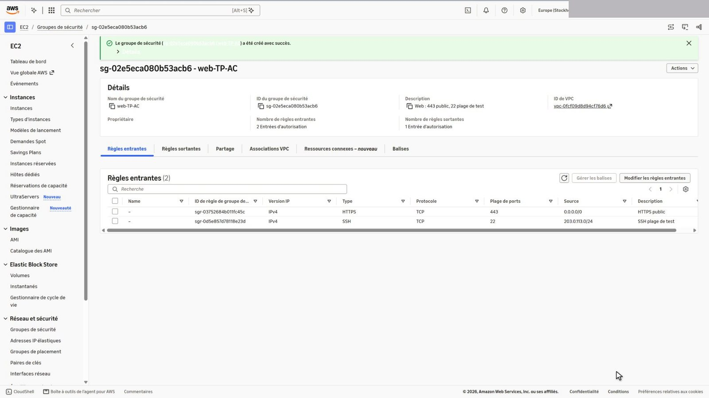
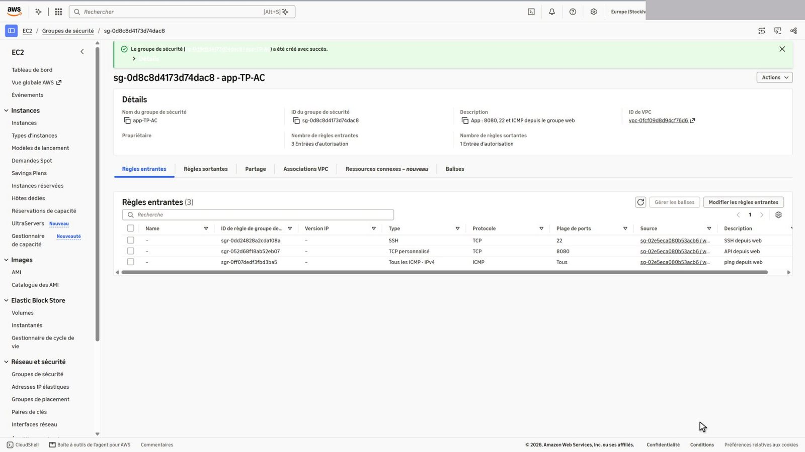
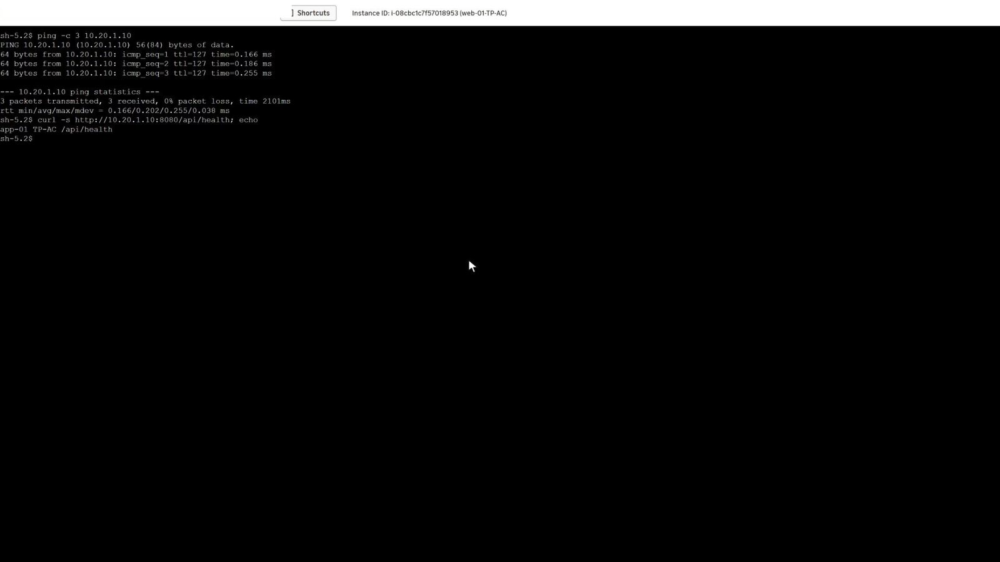
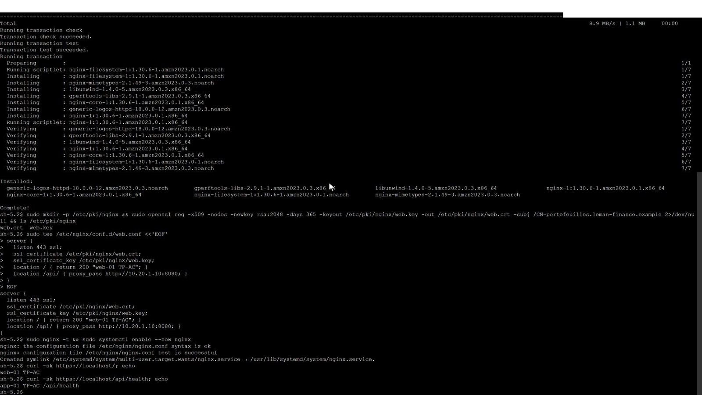
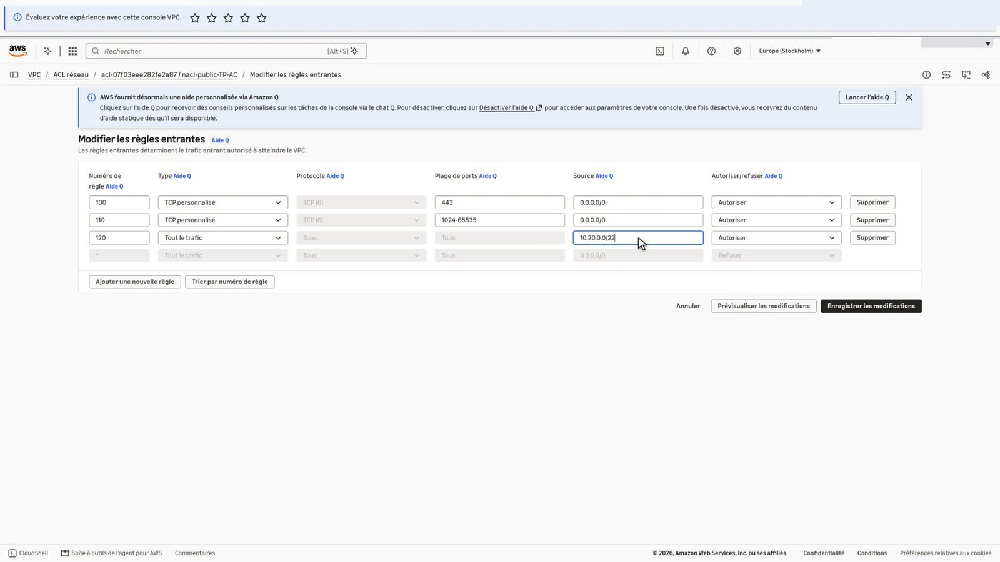
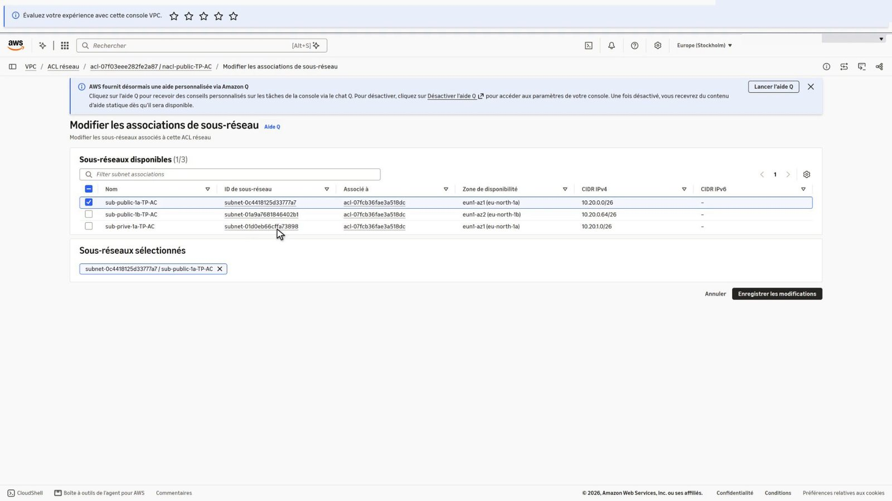

# Module 3 – Security Groups et NACL

## Objectif
Poser deux niveaux de filtrage sur le VPC de production : un Security Group par rôle (web, application) et une NACL sur le sous-réseau public. Le but est de savoir dire, devant une connexion qui échoue, si c'est le groupe ou la NACL qui bloque.

## Ce qu'il faut savoir
Un Security Group se pose sur l'instance. Il garde l'état des connexions : si l'aller est autorisé, la réponse repart sans règle de plus. Il ne contient que des autorisations, tout le reste est refusé. La source d'une règle peut être une adresse, une plage ou un autre groupe, c'est-à-dire « toutes les instances qui portent ce groupe ».

Une NACL se pose sur un sous-réseau. Elle ne garde aucun état : il faut autoriser l'aller et le retour. La réponse d'un serveur HTTPS revient vers un port éphémère du client, d'où la plage 1024-65535. Ses règles sont numérotées et lues par ordre croissant, la première qui correspond gagne. Elle accepte les refus, et une règle `*` refuse tout ce qui n'a pas été prévu.

Un paquet entrant passe d'abord la NACL du sous-réseau, puis le groupe de l'instance. Il faut que les deux disent oui.

## Ce que nous avons fait
Tout se fait dans la console, dans *EC2* pour les groupes, dans *VPC* pour la NACL, dans *Systems Manager* pour les tests.

1. **Groupe web.** *EC2 > Groupes de sécurité > Créer*. Nom `web-TP-AC`, description « Web : 443 public, 22 plage de test », VPC `vpc-prod-leman-TP-AC`. Deux règles entrantes : TCP 443 depuis `0.0.0.0/0` (« HTTPS public ») et TCP 22 depuis `203.0.113.0/24` (« SSH plage de test »). Nous laissons la règle sortante par défaut (tout). Balises du projet, plus `Name = sg-web-TP-AC`.
2. **Groupe application.** Même écran : `app-TP-AC`, description « App : 8080, 22 et ICMP depuis le groupe web ». Trois règles entrantes, et pour chacune la source n'est pas une adresse mais le groupe `web-TP-AC` (nous tapons `web-TP` dans le champ et nous le choisissons dans la liste) : TCP 8080 (« API depuis web »), SSH 22 (« SSH depuis web »), *Tous les ICMP - IPv4* (« ping depuis web »). Balise `Name = sg-app-TP-AC`.
3. **Brancher les groupes.** Dans *Instances*, nous cochons l'instance, puis *Actions > Sécurité > Modifier les groupes de sécurité* : `web-01-TP-AC` reçoit `web-TP-AC`, `app-01-TP-AC` reçoit `app-TP-AC`, et dans les deux cas nous retirons le groupe `default`. (Dans la vidéo, nous ouvrons le même écran par son adresse directe.)
4. **Premier test, depuis `web-01`.** *Systems Manager > Session Manager*, session sur `web-01-TP-AC`. `ping -c 3 10.20.1.10` : trois réponses sur trois, environ 0,2 ms. `curl -s http://10.20.1.10:8080/api/health` répond `app-01 TP-AC /api/health`. Le groupe de l'application laisse donc passer le ping et le 8080 venant du groupe web.
5. **nginx sur `web-01`.** Pour avoir quelque chose qui répond sur le 443, nous installons nginx (`sudo dnf -y install nginx`, quelques dizaines de secondes) avec un certificat auto-signé : `openssl req -x509 -nodes -newkey rsa:2048 -days 365`, sujet `CN=portefeuilles.leman-finance.example`, clé et certificat dans `/etc/pki/nginx`. Le fichier `/etc/nginx/conf.d/web.conf` écoute sur `443 ssl`, répond `web-01 TP-AC` à la racine et relaie `/api/` vers `http://10.20.1.10:8080`. Après `nginx -t` et `systemctl enable --now nginx`, `curl -sk https://localhost/` répond `web-01 TP-AC` et `curl -sk https://localhost/api/health` répond `app-01 TP-AC /api/health`. Le certificat est auto-signé parce que ce nom n'est pas un domaine à nous : le vrai domaine n'arrive qu'aux modules 9 à 11.
6. **La NACL.** *VPC > ACL réseau > Créer* : `nacl-public-TP-AC`, VPC de production, balises du projet. Une NACL neuve refuse tout. Règles entrantes : 100 TCP 443 depuis `0.0.0.0/0`, 110 TCP 1024-65535 depuis `0.0.0.0/0`, 120 *Tout le trafic* depuis `10.20.0.0/22` (le VPC), toutes en *Autoriser*. Règles sortantes : les mêmes trois, vers les mêmes destinations. Onglet *Associations de sous-réseau > Modifier* : nous cochons `sub-public-1a-TP-AC` seulement. Les deux autres sous-réseaux (`sub-public-1b-TP-AC` et `sub-prive-1a-TP-AC`) restent sur la NACL par défaut.
7. **Panne volontaire du groupe.** Dans une session sur `web-01`, une boucle interroge l'API chaque seconde : `while true; do curl -s -m 2 http://10.20.1.10:8080/api/health || echo ECHEC; echo; sleep 1; done`. Dans la console, nous retirons la règle 8080 du groupe `app-TP-AC` : la boucle devrait passer à `ECHEC`. Puis nous remettons la règle (TCP 8080, source `web-TP-AC`). Ce qui s'est réellement passé à l'écran est raconté dans « Pièges rencontrés ».

## Captures


Le groupe `web-TP-AC` vient d'être créé (bandeau vert). Ses deux règles entrantes : HTTPS depuis tout Internet, SSH depuis `203.0.113.0/24`. Le numéro de propriétaire du compte est masqué sur cette image.



Le groupe `app-TP-AC` : trois règles, SSH 22, TCP 8080 et ICMP, toutes avec pour source le groupe `web-TP-AC` (colonne *Source*, identifiant `sg-02e5eca080b53acb6`) et non une adresse.



Depuis `web-01-TP-AC` : trois pings sur trois, puis la réponse de l'API de `app-01`. L'identifiant de session, en haut à gauche, est masqué.



La fin de l'installation de nginx, la configuration en HTTPS, `nginx -t` qui annonce `test is successful`, et les deux `curl -sk` : la page du serveur web, puis l'API de `app-01` relayée par nginx.



L'éditeur des règles entrantes de `nacl-public-TP-AC`, avant l'enregistrement. Les trois règles 100, 110 et 120 sont en *Autoriser* ; la ligne grisée `*` est la règle par défaut, qui refuse. Les règles sortantes ont la même forme.



L'association de la NACL : seul `sub-public-1a-TP-AC` (`10.20.0.0/26`, zone `eu-north-1a`) est coché. Les deux autres sous-réseaux sont encore sur la NACL par défaut (colonne *Associé à*).

## Tableau récapitulatif
| Élément | Valeur |
|---|---|
| `web-TP-AC` | `sg-02e5eca080b53acb6`, tag `Name = sg-web-TP-AC` ; entrée TCP 443 depuis `0.0.0.0/0`, TCP 22 depuis `203.0.113.0/24` ; sortie libre |
| `app-TP-AC` | `sg-0d8c8d4173d74dac8`, tag `Name = sg-app-TP-AC` ; entrée TCP 8080, TCP 22 et ICMP, source `web-TP-AC` ; sortie libre |
| `web-01-TP-AC` | groupe `web-TP-AC` (le groupe `default` est retiré) |
| `app-01-TP-AC` | groupe `app-TP-AC` (le groupe `default` est retiré) |
| `nacl-public-TP-AC` | `acl-07f03eee282fe2a87`, associée à `sub-public-1a-TP-AC` |
| NACL, entrée | 100 TCP 443 `0.0.0.0/0` ; 110 TCP 1024-65535 `0.0.0.0/0` ; 120 tout `10.20.0.0/22` ; `*` refuser |
| NACL, sortie | 100 TCP 443 ; 110 TCP 1024-65535 ; 120 tout `10.20.0.0/22` (mêmes destinations) ; `*` refuser |

## Résultats des tests
Ces sorties viennent de notre première exécution, faite en ligne de commande avant le tournage, sur les mêmes groupes et la même NACL. La vidéo reprend le test de `web-01` vers `app-01` (captures ci-dessus) et la panne du 8080, mais pas les essais de la NACL : retrait de la règle de retour, puis refus explicite numéro 50 placé avant l'autorisation numéro 100. Dans cet essai, c'est la règle au numéro le plus bas qui gagne.

```
{{TESTS}}
```

## Pièges rencontrés
* **Le nom du groupe.** AWS interdit un nom de groupe qui commence par `sg-`. Le groupe s'appelle donc `web-TP-AC`, et c'est la balise `Name` (`sg-web-TP-AC`) qui s'affiche dans la liste.
* **La source d'une règle.** Quand on tape `web-TP` dans le champ *Source* sans choisir le groupe dans la liste, la console affiche en rouge « Un bloc d'adresse CIDR, un ID de groupe de sécurité ou une liste de préfixes doit être spécifié » et refuse d'enregistrer.
* **La panne du 8080, telle que filmée.** Dans la vidéo, la boucle de `web-01` reste verte : aucun `ECHEC`. Au moment de supprimer la règle 8080 du groupe `app-TP-AC`, le clic est tombé à côté, d'après l'enregistrement : c'est la source de la règle SSH qui s'est vidée, la console a refusé d'enregistrer (le message rouge ci-dessus) et le groupe n'a pas changé. La règle ajoutée ensuite aurait de toute façon fait doublon, et la liste des règles que montre le module 5 contient encore les trois règles d'origine (SSH, 8080 et ICMP depuis le groupe web). Nous n'avons pas refait cette prise. La panne elle-même est prouvée par la sortie de la première exécution, plus haut : après retrait du 8080, le `curl` de `web-01` échoue ; une fois la règle remise, il répond.
* **Des prises refaites.** Cinq des six scènes de ce module ont demandé au moins une reprise. À chaque fois, la console n'a pas réagi comme le geste prévu l'attendait : une liste déroulante restée ouverte, une source de règle non validée.
* **Le port 22 est fermé deux fois.** Le groupe web l'ouvre depuis `203.0.113.0/24`, mais la NACL n'autorise ni le 22 ni l'ICMP depuis l'extérieur. Cela ne gêne pas : nous administrons les machines par Session Manager, sans SSH.

## Ce qui diffère du sujet
* **L'adresse de la « salle d'exploitation ».** Le sujet parle de cette adresse sans la donner. Nous avons mis `203.0.113.0/24`, une plage réservée à la documentation : personne ne peut s'en servir, ce qui convient pour un port d'administration dont nous ne nous servons pas.
* **Les noms.** Le groupe porte le nom `web-TP-AC` et non `sg-web-TP-AC`, pour la raison ci-dessus.
* **Les autres groupes.** Les groupes du load balancer et du développement ne sont pas dans ce module : celui du développement arrive au module 5, celui du load balancer au module 9.
* **Les tests de la NACL.** Ils n'ont pas été refilmés. Les résultats viennent de la première exécution en ligne de commande, et la vidéo ne montre que la création de la NACL et son association.

## Nettoyage
Les deux groupes et la NACL ne coûtent rien. Ils ont été supprimés à la fin du tournage avec le reste du réseau, dans l'ordre décrit dans `docs/NETTOYAGE.md` (les instances d'abord, puis les groupes et la NACL), à l'exception de ce qui retient encore le pare-feu du module 4 : voir ce module.
