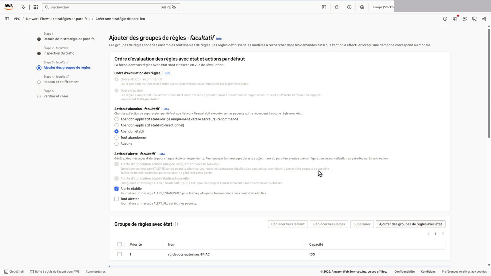
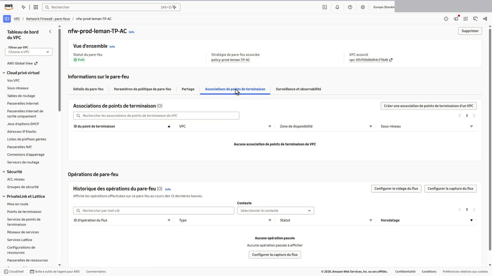
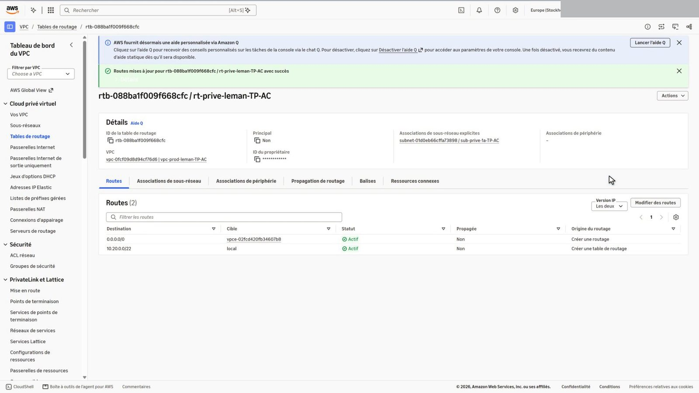
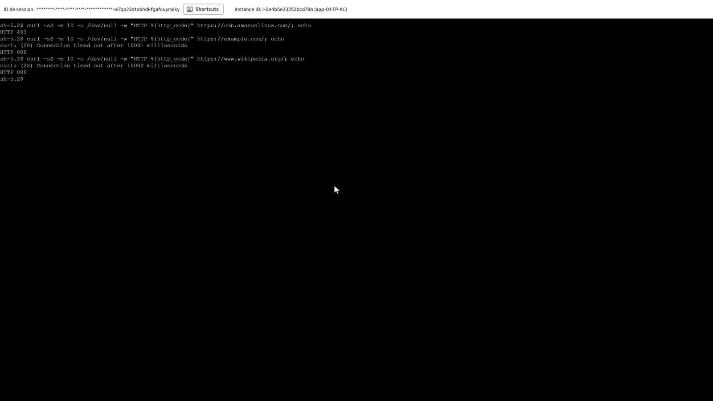
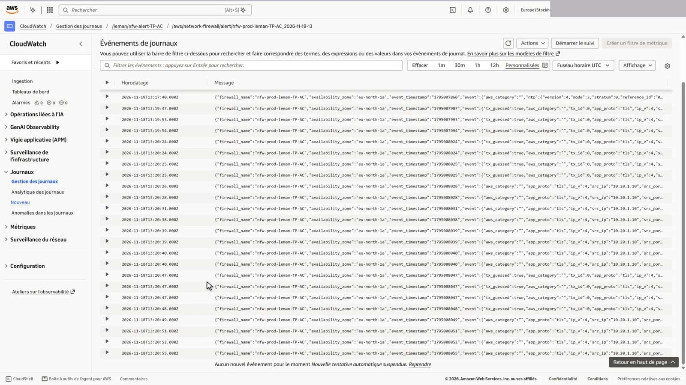
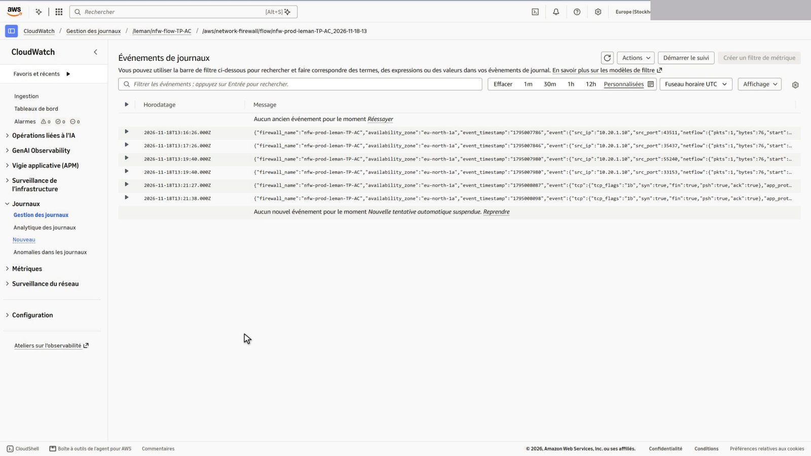

# Module 4 – Network Firewall

> Ce module a d'abord été refusé par l'organisation AWS (`network-firewall:*`). Le blocage a été levé le 17/11/2026, sans que nous sachions qui l'a levé. Notre premier essai, en ligne de commande, date de ce jour-là ; le module a ensuite été refait à la main dans la console et filmé le 18/11/2026. Le pare-feu est réel, pas simulé.

## Objectif
Contrôler ce qui sort du sous-réseau privé : n'autoriser que les dépôts de mises à jour Amazon Linux et les services AWS, bloquer tout le reste et garder une trace des flux, bloqués comme autorisés, dans CloudWatch Logs.

## Ce qu'il faut savoir
AWS Network Firewall est un pare-feu managé. AWS le déploie sous forme d'un *endpoint* posé dans un sous-réseau à part. Rien n'y passe tout seul : c'est à nous d'écrire des routes qui envoient le trafic vers cet endpoint.

Il a deux moteurs de règles. Le moteur sans état regarde chaque paquet isolément. Le moteur avec état suit la connexion et sait lire le nom d'un site dans une requête HTTP ou TLS : c'est lui qui applique notre liste de domaines. La politique du pare-feu règle l'ordre d'évaluation et l'action par défaut. Nous avons pris l'ordre strict (les règles sont lues dans l'ordre) et l'action « abandon établi » : le pare-feu laisse passer l'établissement de la connexion TCP, puis abandonne la suite dès que le nom du site n'est dans aucune règle d'autorisation. Chaque abandon génère une alerte.

Le pare-feu doit voir les deux sens d'une connexion. Si l'aller passe par l'endpoint et que le retour le contourne, il ne voit qu'un côté de l'échange et coupe. Toute la partie routage du module sert à obtenir cette symétrie. Le service est facturé environ 0,40 USD de l'heure : on ne le laisse pas tourner.

## Ce que nous avons fait
Le chemin voulu est : serveur privé, pare-feu, NAT, Internet. Tout se fait dans *VPC* (menus *Sous-réseaux*, *Tables de routage*, *Network Firewall*) et dans *CloudWatch*.

1. **Sous-réseau du pare-feu.** `sub-fw-1a-TP-AC`, VPC de production, zone `eu-north-1a`, plage `10.20.2.0/28`, balises du projet. C'est le plus petit sous-réseau qu'AWS accepte : 16 adresses. Il passe à *Available* tout de suite.
2. **Deux tables de routage**, pour construire le chemin de sortie :
   * `rt-fw-leman-TP-AC` : route `0.0.0.0/0` vers la passerelle NAT `nat-prod-leman-TP-AC`, associée à `sub-fw-1a-TP-AC`. Ce que le pare-feu laisse passer part donc vers la NAT.
   * `rt-nat-leman-TP-AC` : route `0.0.0.0/0` vers la passerelle Internet `igw-prod-leman-TP-AC`, associée à `sub-public-1b-TP-AC`. C'est le sous-réseau de la NAT, en zone B (la zone A avait atteint la limite de NAT au module 2). Il quitte ainsi `rt-public-leman-TP-AC` et prend cette table à lui.
3. **Groupe de règles.** *Network Firewall > Groupes de règles > Créer* : `rg-depots-autorises-TP-AC`, description « Autorise les depots de mises a jour et les services AWS ». Version *Classique*, type *Groupe de règles avec état*, format *Générateur visuel de règles*, puis *Liste de domaines*, ordre strict. Domaines : `.amazonlinux.com` et `.amazonaws.com`, protocoles HTTP et HTTPS, action *Autoriser*. Capacité 100 : AWS la fixe à la création, on ne peut plus la changer.
4. **Politique.** *Stratégies de pare-feu > Créer* : `policy-prod-leman-TP-AC`, version *Classique*, sans la « défense active contre les menaces » (option payante). Ordre d'évaluation *Ordre strict*, action d'abandon *Abandon établi*, action d'alerte *Alerte établie*. Nous ajoutons `rg-depots-autorises-TP-AC` en priorité 1.
5. **Pare-feu.** *Pare-feu > Créer* : `nfw-prod-leman-TP-AC`. Type de capacité *Routed firewall* (la console l'affiche en anglais ; l'autre choix, *Routed firewall, NAT and explicit proxy*, fait créer des NAT par AWS, alors que nous avons déjà la nôtre), attachement au VPC `vpc-prod-leman-TP-AC`, zone `eu-north-1a`, sous-réseau `sub-fw-1a-TP-AC`, adresses IPv4, politique existante `policy-prod-leman-TP-AC`, balises. Dans le récapitulatif, la console active par défaut la protection contre la suppression et celle contre les changements de sous-réseau. Le statut passe de *Mise en service* à *Prêt* au bout de quelques minutes (accéléré dans la vidéo).
6. **Deux groupes de journaux.** *CloudWatch > Groupes de journaux > Créer* : `/leman/nfw-alert-TP-AC` et `/leman/nfw-flow-TP-AC` (classe *Standard*, conservation illimitée). Puis, dans la page du pare-feu, *Journalisation > Modifier* : type *Alert* vers `/leman/nfw-alert-TP-AC`, type *Flow* vers `/leman/nfw-flow-TP-AC`, destination *CloudWatch log group* pour les deux. Il faut deux journaux parce qu'une alerte n'est émise que pour ce qui est bloqué : pour voir passer le flux autorisé, il faut le journal des flux.
7. **Route par défaut du privé.** Dans `rt-prive-leman-TP-AC`, nous modifions la route `0.0.0.0/0` : la cible *Passerelle NAT* devient *Point de terminaison de l'équilibreur de charge de passerelle* (c'est le nom que la console donne à l'endpoint d'un pare-feu), `vpce-02fcd420fb34607b8`. Tout ce que `app-01` envoie vers Internet passe maintenant par le pare-feu.
8. **Route de retour.** Dans `rt-nat-leman-TP-AC`, nous ajoutons `10.20.1.0/26` (le sous-réseau privé) vers le même endpoint. Sans elle, la NAT répondrait à `app-01` directement, par la route locale du VPC, et le pare-feu ne verrait jamais le retour.
9. **Le test, depuis `app-01`.** Session Manager sur `app-01-TP-AC`, trois `curl -sS -m 10 -o /dev/null -w "HTTP %{http_code}"` : sur `https://cdn.amazonlinux.com/`, sur `https://example.com/` et sur `https://www.wikipedia.org/`.
10. **Les journaux.** Dans CloudWatch, nous ouvrons le flux de `/leman/nfw-alert-TP-AC` et celui de `/leman/nfw-flow-TP-AC`.

La NAT est en zone B et l'endpoint en zone A : le trafic de sortie traverse donc deux zones. Ce serait à éviter en production (coût et dépendance), nous l'acceptons pour ce montage.

## Captures


La politique `policy-prod-leman-TP-AC` avant sa création. L'ordre strict est celui du groupe de règles. L'action d'abandon par défaut est *Abandon établi*, l'alerte est *Alerte établie*. En bas, le groupe `rg-depots-autorises-TP-AC` est en priorité 1.



Le pare-feu `nfw-prod-leman-TP-AC` est au statut *Prêt*, avec sa politique. L'onglet ouvert ici, *Associations de points de terminaison*, est vide : il ne liste que les associations ajoutées à la main depuis d'autres VPC. L'endpoint créé avec le pare-feu, lui, se repère dans les routes (capture suivante).



La table du sous-réseau privé après modification : la route par défaut `0.0.0.0/0` pointe vers `vpce-02fcd420fb34607b8`, l'endpoint du pare-feu, et non plus vers la NAT. La route locale `10.20.0.0/22` est inchangée.



Le test depuis `app-01-TP-AC`. `cdn.amazonlinux.com` répond `HTTP 403` : c'est la réponse du site, la connexion a donc traversé le pare-feu. `example.com` et `www.wikipedia.org` ne sont pas dans la liste : après dix secondes, `curl: (28) Connection timed out` et `HTTP 000`.



Le journal des alertes, avec une ligne JSON par événement. On lit le nom du pare-feu, la zone `eu-north-1a`, le protocole `tls` et l'adresse source `10.20.1.10`, celle d'`app-01`. La première ligne, de 13:17 UTC, est une requête NTP (`ntp`) : l'instance sort aussi sur le port 123, que la politique abandonne et signale. Les lignes suivantes sont des alertes TLS. La liste s'arrête à 13:20:55 UTC, avant nos trois `curl` : ce sont des alertes sur le trafic que `app-01` émet sans qu'on le lui demande. Pour une alerte sur un `curl` bloqué, voir la sortie du pare-feu CloudFormation plus bas (`proto tls`, `action blocked`).



Le journal des flux : six enregistrements. Les quatre premiers portent la source `10.20.1.10` et des compteurs `netflow` (paquets, octets), les deux derniers, de 13:21 UTC, des drapeaux TCP : l'heure concorde avec celle de nos `curl`, ce sont sans doute leurs connexions. Les lignes sont tronquées à droite par la largeur de la page ; la console les déplie au clic.

## Tableau récapitulatif
| Élément | Valeur |
|---|---|
| Sous-réseau du pare-feu | `sub-fw-1a-TP-AC`, `10.20.2.0/28`, `eu-north-1a` |
| `rt-fw-leman-TP-AC` | `0.0.0.0/0` vers `nat-prod-leman-TP-AC` ; associée à `sub-fw-1a-TP-AC` |
| `rt-nat-leman-TP-AC` | `0.0.0.0/0` vers `igw-prod-leman-TP-AC` ; `10.20.1.0/26` vers l'endpoint ; associée à `sub-public-1b-TP-AC` |
| `rt-prive-leman-TP-AC` | `0.0.0.0/0` vers l'endpoint `vpce-02fcd420fb34607b8` ; `10.20.0.0/22` local |
| Groupe de règles | `rg-depots-autorises-TP-AC`, avec état, liste de domaines `.amazonlinux.com` et `.amazonaws.com`, HTTP et HTTPS, autoriser, capacité 100 |
| Politique | `policy-prod-leman-TP-AC`, ordre strict, abandon établi, alerte établie |
| Pare-feu | `nfw-prod-leman-TP-AC`, endpoint dans `sub-fw-1a-TP-AC` |
| Journaux | `/leman/nfw-alert-TP-AC` (alertes), `/leman/nfw-flow-TP-AC` (flux) |

## Résultats des tests
Ces sorties viennent du pare-feu que le modèle CloudFormation du module 13 a déployé le 17/11. Ce n'est pas le pare-feu fait à la main de la vidéo : son endpoint porte un autre identifiant (`vpce-0951ba9169b5e0399`), et il a un groupe de règles de plus, qui laisse passer le trafic interne du VPC. Les résultats sont les mêmes que ceux de la vidéo (voir la capture du test) : `cdn.amazonlinux.com` répond `HTTP 403`, `example.com` et Wikipédia expirent.

```
{{TESTS}}
```

## Pièges rencontrés
* **Le service était refusé.** Jusqu'au 17/11, toute création Network Firewall échouait avec un refus de l'organisation (voir `docs/01-services-bloques.md`). Nous avons d'abord rédigé le module sans le réaliser, puis l'avons refait pour de vrai après la levée du blocage.
* **Un `403` est un succès.** `cdn.amazonlinux.com` répond 403 parce que nous ne demandons pas une page qui existe. Le bon signe est que le serveur répond : le pare-feu a laissé passer.
* **La NAT en zone B.** À cause de la limite de NAT par zone (module 2), la NAT n'est pas dans la même zone que l'endpoint. Il a fallu une table de routage dédiée à `sub-public-1b-TP-AC` pour y poser la route de retour sans toucher au sous-réseau de `web-01`.
* **L'onglet vide.** *Associations de points de terminaison* affiche « Aucune association » alors que le pare-feu est prêt. Ce n'est pas une erreur : l'endpoint se trouve dans les routes.
* **Les prises à refaire.** Cinq scènes sur onze ont été refaites au moins une fois (groupe de règles, politique, journalisation, routes, journaux) : la console n'a pas réagi comme le geste prévu l'attendait.
* **Le pare-feu ne se laisse plus supprimer.** Voir « Nettoyage ».
* **Ce que nous avons appris du premier essai.** En ligne de commande, trois étapes ont échoué (groupe de journaux, journalisation, routes). Nous avons aussi constaté que `web-01` ne joignait plus `app-01` quand la route de retour était posée dans la table du sous-réseau de `web-01`, et qu'une règle de groupe de sécurité écrite « depuis un groupe » ne correspond plus au trafic qui sort d'un endpoint de pare-feu. Dans la version filmée, ces deux défauts ne se voient pas : la NAT est seule dans `sub-public-1b-TP-AC`, et le trafic entre `web-01` et `app-01` ne passe pas par le pare-feu. Il faut en retenir que le pare-feu au milieu d'un VPC impose un trafic symétrique et des règles de groupe par adresses plutôt que par groupe.

## Ce qui diffère du sujet
* **La route de retour.** Le sujet demande une route de retour dans la table publique. Nous l'avons mise dans une table à part, `rt-nat-leman-TP-AC`, pour ne pas toucher à `web-01` (voir ci-dessus et `docs/02-ecarts-au-sujet.md`).
* **Le flux autorisé dans les journaux.** Le sujet demande de voir le flux autorisé et le flux bloqué. Un journal d'alertes ne contient que ce qui est bloqué : nous avons ajouté le journal des flux.
* **Un seul groupe de règles dans la vidéo.** La version filmée a une seule liste de domaines. La version CloudFormation en a deux (la seconde laisse passer le trafic interne du VPC).
* **Pas de défense active.** L'option payante de détection des menaces est désactivée, et nous n'inspectons pas le contenu chiffré.

## Nettoyage
Tout ce que nous avons créé pour ce module a été supprimé, sauf le pare-feu lui-même. `nfw-prod-leman-TP-AC` reste bloqué côté AWS : la suppression échoue depuis la console comme en ligne de commande avec `InternalServerError: Internal failure`. Nous avons vérifié et écarté les causes habituelles : protection contre la suppression désactivée, plus aucune route vers l'endpoint, plus de journalisation. En essayant de le contourner, nous avons déplacé l'endpoint dans `sub-public-1b-TP-AC` ; l'ancien endpoint a disparu d'EC2, mais l'attachement reste en suppression côté Network Firewall. Nous avons ouvert un cas AWS Support (*Compte et facturation*, plan Basic) pour obtenir la suppression et l'arrêt de la facturation. La politique `policy-prod-leman-TP-AC` et le groupe de règles `rg-depots-autorises-TP-AC` restent avec lui tant qu'il existe, et ne coûtent rien. Le pare-feu, lui, est facturé environ 0,40 USD de l'heure : c'est la ressource facturée qu'il nous reste à faire disparaître (voir `docs/NETTOYAGE.md`).
