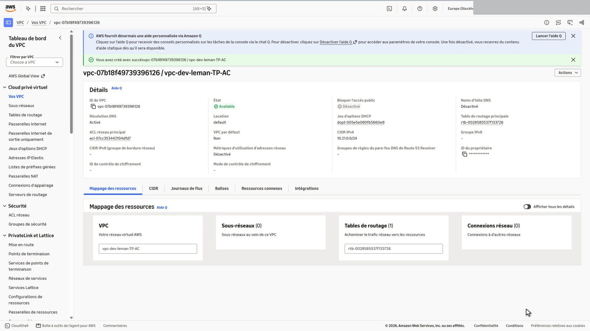
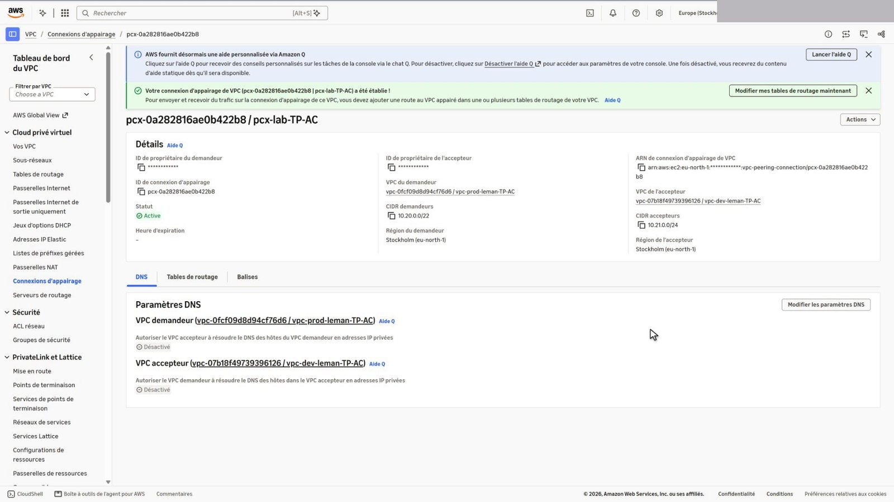
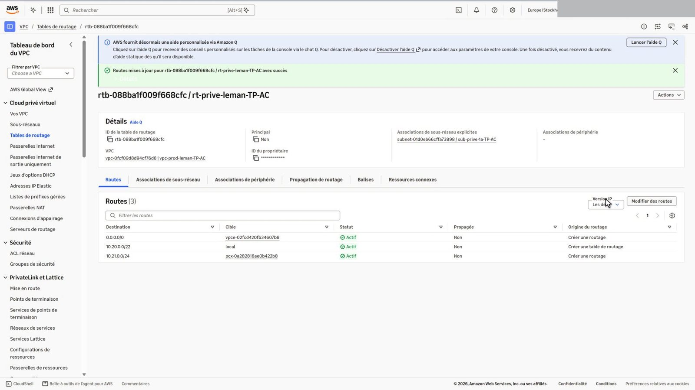
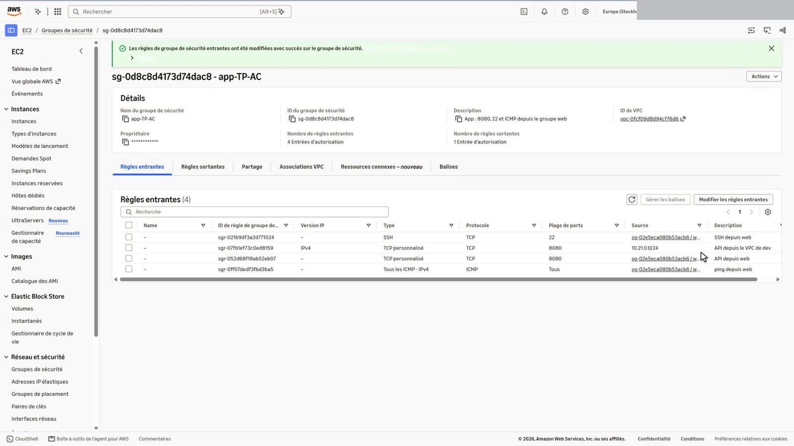
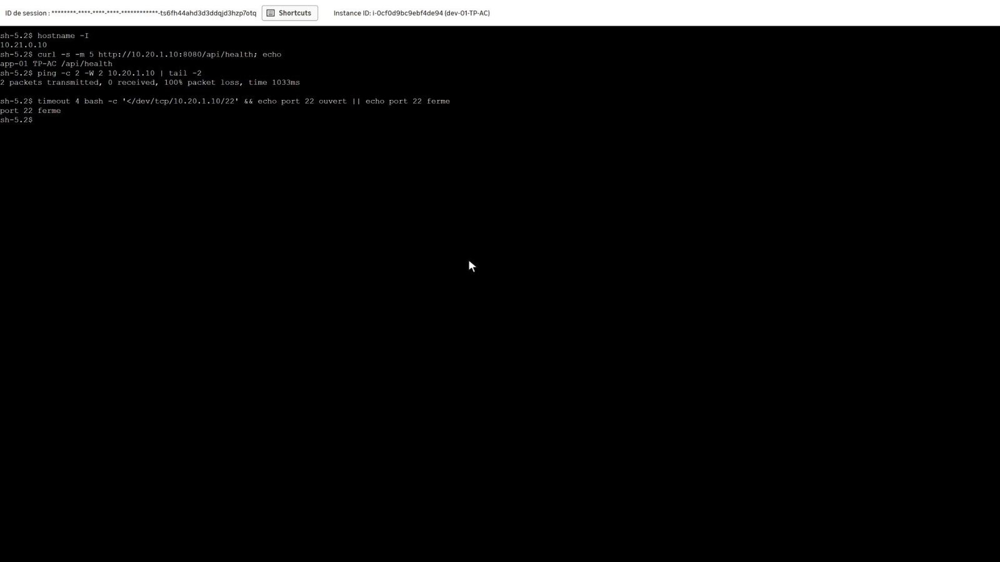
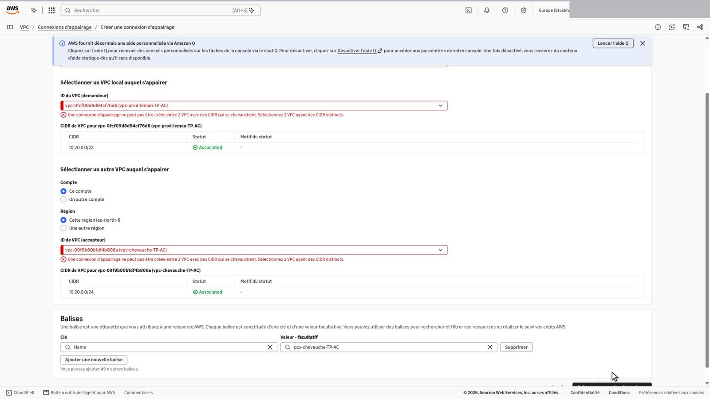

# Module 5 – VPC Peering

## Objectif
Créer un VPC de développement, le relier à la production par un peering en n'ouvrant que le port 8080, et vérifier ce que le peering ne permet pas : relier deux VPC aux plages qui se chevauchent, ou passer par un VPC intermédiaire.

## Ce qu'il faut savoir
Un peering est une liaison privée entre deux VPC, sur le réseau d'AWS. L'un fait la demande (le *demandeur*), l'autre l'accepte (l'*accepteur*). Quand les deux VPC sont dans le même compte et la même région, nous acceptons nous-mêmes. Une demande non acceptée expire au bout de sept jours.

La connexion ne suffit pas. Il faut ajouter une route dans chaque VPC vers la plage de l'autre, puis ouvrir ce qu'on veut laisser passer dans les Security Groups. Les deux plages ne doivent pas se chevaucher, sinon AWS ne sait pas où envoyer un paquet. Enfin, le peering n'est pas transitif : si A est relié à B et B à C, A ne joint pas C.

Il y a une autre limite, qui explique le module 6 : chaque nouvelle paire de VPC demande sa propre connexion et ses propres routes. Avec un Transit Gateway, un seul point de raccordement suffit.

## Ce que nous avons fait
Il y a deux parties : construire le VPC de développement, puis le relier. Tout se fait dans la console, dans *VPC* et *EC2*.

**Le VPC de développement**

1. **VPC.** *VPC > Créer un VPC*, option *VPC uniquement* : nom `vpc-dev-leman-TP-AC`, bloc IPv4 saisi à la main `10.21.0.0/24`, pas d'IPv6, balises du projet avec `Environnement = dev`. La console annonce la création, l'état passe à *Available*. Le VPC arrive avec sa table de routage principale et sa NACL par défaut, sans sous-réseau.
2. **Sous-réseau.** `sub-dev-1a-TP-AC`, zone `eu-north-1a`, plage `10.21.0.0/26`. Une plage modeste suffit : un seul serveur y vivra.
3. **Passerelle Internet.** `igw-dev-leman-TP-AC`, créée à l'état *Detached*, puis *Actions > Attacher au VPC* vers `vpc-dev-leman-TP-AC`. Elle donne au développement sa sortie vers Internet.
4. **Table de routage.** `rt-dev-leman-TP-AC`, dans le VPC de développement : route `0.0.0.0/0` vers `igw-dev-leman-TP-AC`, associée à `sub-dev-1a-TP-AC`. Ce sont les mêmes gestes qu'au module 2.
5. **Security Group.** `dev-TP-AC` (balise `Name = sg-dev-TP-AC`), description « Dev : aucune entree, sortie libre », dans le VPC de développement. Aucune règle entrante : personne ne peut entrer. La sortie reste libre.
6. **Instance.** *EC2 > Lancer une instance* : `dev-01-TP-AC`, Amazon Linux 2023, `t3.micro`, sans paire de clés, VPC `vpc-dev-leman-TP-AC`, sous-réseau `sub-dev-1a-TP-AC`, adresse IP publique automatique *Activer*, groupe existant `dev-TP-AC`, adresse principale `10.21.0.10`, profil d'instance IAM `TP-AC-ec2-ssm-role` (celui du module 1, pour Session Manager). Nous lui laissons une adresse publique parce que ce VPC n'a pas de NAT : c'est le chemin de l'agent SSM vers le service.

**Le peering**

7. **La demande.** *VPC > Connexions d'appairage > Créer* : nom `pcx-lab-TP-AC`, VPC local (demandeur) `vpc-prod-leman-TP-AC` (`10.20.0.0/22`), puis *Ce compte*, *Cette région (eu-north-1)*, VPC accepteur `vpc-dev-leman-TP-AC` (`10.21.0.0/24`), balises du projet. La connexion apparaît *En attente d'acceptation*.
8. **L'acceptation.** *Actions > Accepter la demande*, puis *Accepter la demande* dans la fenêtre de confirmation. L'état passe à *Active*. Un bandeau propose *Modifier mes tables de routage maintenant*.
9. **Les routes, des deux côtés.** Dans `rt-prive-leman-TP-AC` : `10.21.0.0/24` vers *Connexion d'appairage*, `pcx-lab-TP-AC`. Dans `rt-dev-leman-TP-AC` : `10.20.0.0/22` vers la même connexion. Nous n'avons rien posé dans `rt-public-leman-TP-AC` : `web-01` ne joint donc pas le développement.
10. **Le 8080, et rien d'autre.** Dans `app-TP-AC`, nouvelle règle entrante TCP 8080, source `10.21.0.0/24` (une plage, pas un groupe), description « API depuis le VPC de dev ». Le groupe a maintenant quatre règles.
11. **Le test, depuis `dev-01`.** Session Manager sur `dev-01-TP-AC` : `hostname -I` donne `10.21.0.10` ; `curl -s -m 5 http://10.20.1.10:8080/api/health` répond `app-01 TP-AC /api/health` ; `ping -c 2 -W 2 10.20.1.10` reste sans réponse ; le port 22 de `app-01` est fermé.
12. **La plage qui chevauche.** Nous créons un VPC `vpc-chevauche-TP-AC` en `10.20.0.0/24` (AWS le permet : c'est un VPC à part), puis nous tentons un peering `pcx-chevauche-TP-AC` entre la production et ce VPC.

La connexion `pcx-lab-TP-AC` est supprimée au module 6, comme le demande le sujet : le Transit Gateway prend sa place.

## Captures


Le VPC de développement vient d'être créé : état *Available*, CIDR `10.21.0.0/24`. Le mappage en bas confirme qu'il n'a encore aucun sous-réseau (0) et une seule table de routage, la principale.



La connexion `pcx-lab-TP-AC` est *Active*. À gauche le demandeur, `vpc-prod-leman-TP-AC` en `10.20.0.0/22`, à droite l'accepteur, `vpc-dev-leman-TP-AC` en `10.21.0.0/24`. Les identifiants de compte sont masqués par la console. Le bandeau vert rappelle qu'il reste à ajouter les routes.



La table du sous-réseau privé de la production après l'ajout de la route : `10.21.0.0/24` part vers `pcx-0a282816ae0b422b8`. On voit aussi la route par défaut vers l'endpoint du pare-feu, posée au module 4.



Le groupe `app-TP-AC` après l'ajout : quatre règles entrantes. La nouvelle est la deuxième ligne : TCP 8080, source `10.21.0.0/24`. Les trois autres viennent du module 3 (source : le groupe web).



Le test depuis `dev-01-TP-AC` : adresse `10.21.0.10`, réponse de l'API sur le 8080, ping à `100% packet loss`, puis `port 22 ferme`. Ce qui n'est pas ouvert dans `app-TP-AC` ne passe pas, même avec le peering en place.



La demande de peering avec le VPC en `10.20.0.0/24` : la console affiche un message rouge sous chaque liste de VPC, « Une connexion d'appairage ne peut pas être créée entre 2 VPC avec des CIDR qui se chevauchent. Sélectionnez 2 VPC ayant des CIDR distincts. » La page ne passe pas à la connexion créée.

## Tableau récapitulatif
| Élément | Valeur |
|---|---|
| `vpc-dev-leman-TP-AC` | `vpc-07b18f49739396126`, `10.21.0.0/24` |
| `sub-dev-1a-TP-AC` | `10.21.0.0/26`, `eu-north-1a` |
| `igw-dev-leman-TP-AC` | attachée à `vpc-dev-leman-TP-AC` |
| `rt-dev-leman-TP-AC` | `0.0.0.0/0` vers l'IGW du dev ; `10.20.0.0/22` vers le peering ; `10.21.0.0/24` local ; associée à `sub-dev-1a-TP-AC` |
| `dev-TP-AC` | tag `Name = sg-dev-TP-AC` ; aucune règle entrante ; sortie libre |
| `dev-01-TP-AC` | `t3.micro`, Amazon Linux 2023, `10.21.0.10`, adresse publique automatique |
| `pcx-lab-TP-AC` | `pcx-0a282816ae0b422b8`, production `10.20.0.0/22` avec développement `10.21.0.0/24`, statut *Active* |
| `rt-prive-leman-TP-AC` (prod) | `10.21.0.0/24` vers `pcx-lab-TP-AC` |
| `app-TP-AC` | nouvelle règle : TCP 8080 depuis `10.21.0.0/24` |

## Résultats des tests
Ces sorties viennent de notre première exécution, en ligne de commande. Pour l'API sur le 8080 et le port 22 fermé, elles disent la même chose que la vidéo. Trois points diffèrent. Le ping refusé n'est pas dans ces sorties, il n'est que dans la vidéo (capture ci-dessus). Pour le chevauchement, AWS acceptait alors la demande puis la faisait échouer à l'acceptation, alors que la console refuse tout de suite. Enfin, le test de non-transitivité (le troisième VPC `10.22.0.0/24` et `tiers-01`) n'a été fait que dans cette première exécution : il n'est pas filmé.

```
{{TESTS}}
```

Les deux dernières lignes se lisent ainsi : `app-01`, relié directement au troisième VPC, le joint (2 paquets sur 2) ; `dev-01`, qui n'y est relié que par la production, ne le joint pas (0 sur 2, 100 % de perte). Le peering ne transmet pas.

## Pièges rencontrés
* **Le chevauchement selon l'outil.** En ligne de commande, la demande passait puis échouait à l'acceptation (`InvalidStateTransition`, de l'état `failed` à `provisioning`). Dans la console, la validation du formulaire la bloque avant. Même règle, deux moments.
* **Le ping refusé n'est pas une panne.** `app-TP-AC` n'ouvre l'ICMP qu'au groupe web, et depuis le développement seulement le 8080. Ping et SSH échouent donc, c'est voulu.
* **Une adresse publique sur `dev-01`.** Sans NAT dans le VPC de développement, l'agent SSM ne joint pas Systems Manager. Nous avons gardé une adresse publique, avec un groupe sans aucune règle entrante.
* **Les quotas.** Le compte est partagé avec la classe. Pour les VPC, la limite est de 5 par région ; nous avons demandé une hausse à 15 (voir `docs/00-plan-adressage.md`). Pour les instances, le 16/11 les 16 vCPU du compte étaient saturés par la classe et nous ne pouvions plus démarrer nos machines. La limite a été portée à 48 vCPU le 17/11.
* **Une demande qui expire.** Tant que le peering n'est pas accepté, il reste en attente, et la console affiche une date limite : le 25/11/2026 pour la nôtre, sept jours après la création.

## Ce qui diffère du sujet
* **Les plages.** Les plages du sujet (`10.0.0.0/16` et `10.1.0.0/16`, voir `docs/02-ecarts-au-sujet.md`) recouvrent celles des autres équipes du compte partagé : nous avons pris `10.20.0.0/22` et `10.21.0.0/24`.
* **Le peering est temporaire.** Comme le sujet le demande, `pcx-lab-TP-AC` est supprimé au module 6, et les routes du dev et du privé passent au Transit Gateway. Cette suppression est filmée au module 6.
* **La non-transitivité n'est pas filmée.** Elle a été vérifiée à la première exécution (sortie ci-dessus), pas refaite dans la console.

## Nettoyage
Le peering `pcx-lab-TP-AC` est supprimé au module 6. Le VPC `vpc-dev-leman-TP-AC` avec son sous-réseau, sa passerelle Internet, sa table, son groupe de sécurité et `dev-01-TP-AC`, ainsi que le VPC de test `vpc-chevauche-TP-AC`, ont été supprimés à la fin du tournage avec le reste (voir `docs/NETTOYAGE.md`). Il ne reste rien de ce module côté AWS.
