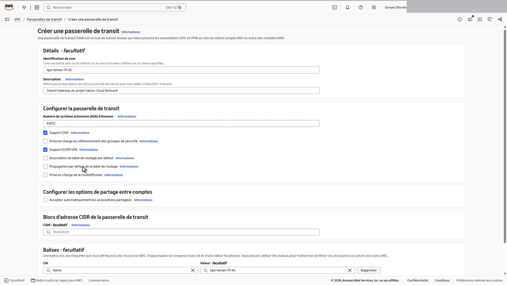
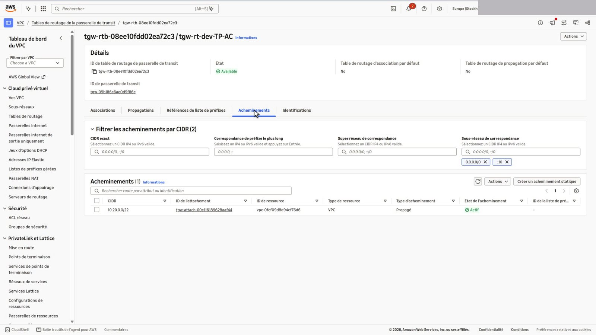
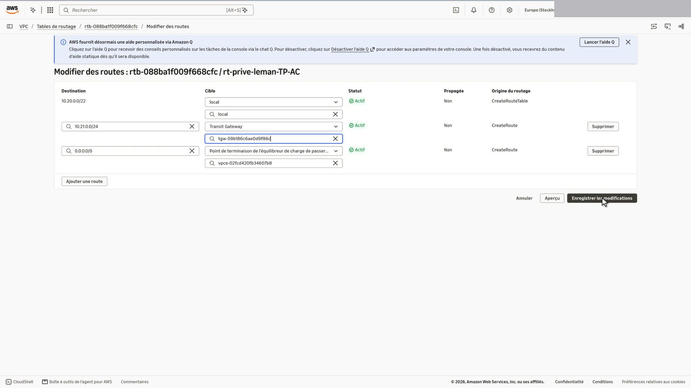
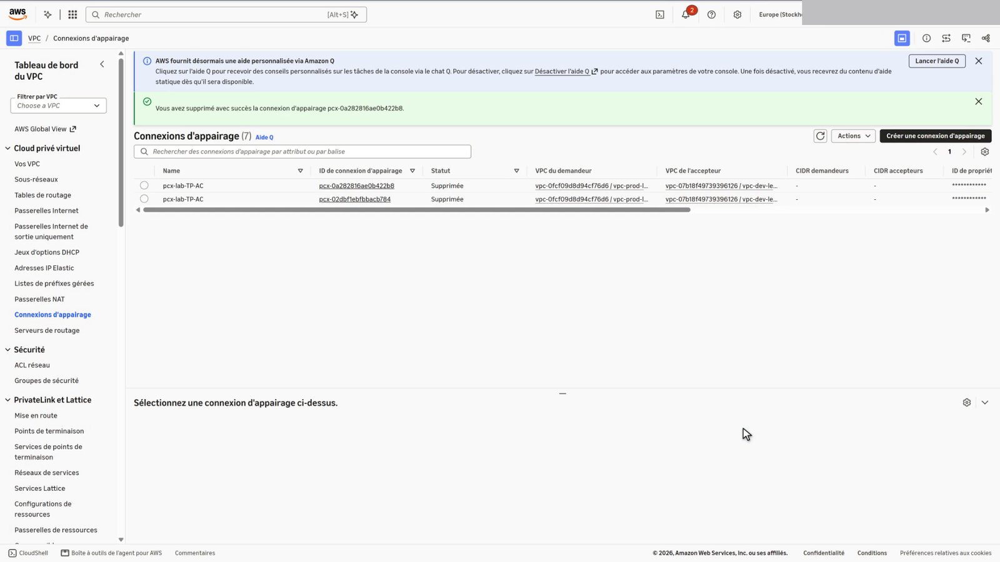
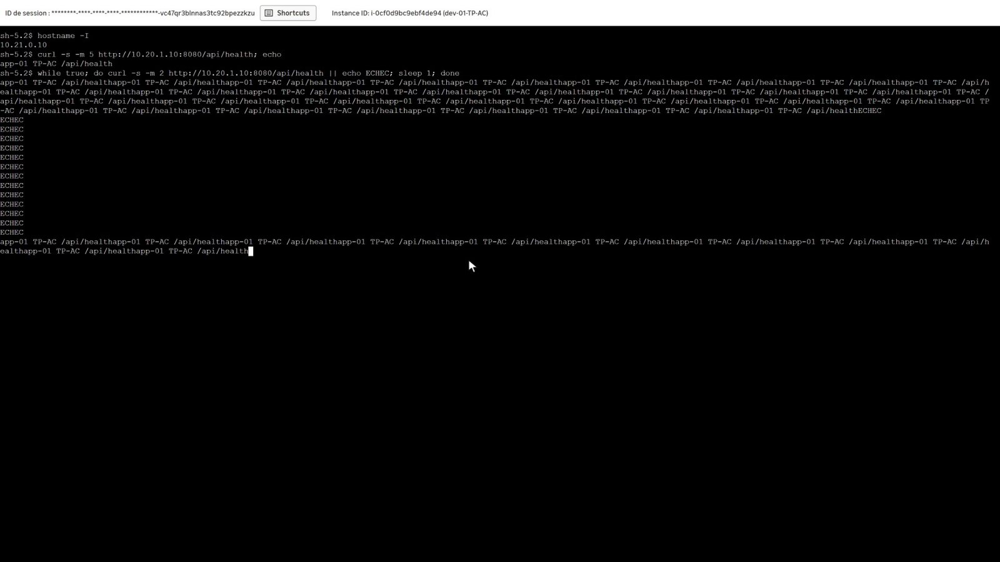

# Module 6 – Transit Gateway

## Objectif
Remplacer le peering du module 5 par un point central, `tgw-leman-TP-AC`, qui relie la prod et le dev. Chaque environnement a sa propre table de routage sur le Transit Gateway, pour que nous décidions à la main qui voit qui. Le même Transit Gateway accueillera ensuite les deux VPN du module 7.

## Ce qu'il faut savoir
Avec un peering, chaque paire de VPC a son propre lien. À trois réseaux, cela fait trois liens, à quatre réseaux six. Un Transit Gateway inverse la logique : chaque VPC se branche une seule fois, par un **attachement**, et le Transit Gateway se charge du reste.

Il faut distinguer deux choses dans ses tables de routage :
- l'**association** : l'attachement est rattaché à une seule table, celle qu'AWS consulte pour les paquets qui arrivent de ce VPC ;
- la **propagation** : l'attachement publie sa plage d'adresses dans une ou plusieurs tables, pour que d'autres sachent comment le joindre.

À la création, AWS propose d'associer et de propager automatiquement tout le monde dans une table par défaut. Nous avons décoché les deux options pour construire les tables nous-mêmes. Dernier point : un attachement n'envoie du trafic que dans les zones de disponibilité où il possède un sous-réseau, et les tables de routage des VPC doivent encore pointer vers le Transit Gateway. Un attachement et une table coûtent de l'argent à l'heure (environ 0,05 USD par attachement).

## Ce que nous avons fait
Tout a été fait à la main dans la console, dans la région Stockholm (`eu-north-1`). Les noms portent le suffixe `-TP-AC` et les balises `Projet=SatomCloudNetwork`, `Equipe=TP-AC`, `Environnement`.

1. **Le Transit Gateway** : `tgw-leman-TP-AC`, description « Transit Gateway du projet Satom Cloud Network », ASN Amazon 64512. Support DNS et support ECMP VPN laissés cochés, association et propagation par défaut décochées. Il met environ quatre minutes à passer de `Pending` à `Available`.
2. **L'attachement de la prod** : `tgwa-prod-TP-AC`, sur `vpc-prod-leman-TP-AC`, avec un sous-réseau dans chacune des deux zones où le VPC en possède un : `sub-prive-1a-TP-AC` en `eu-north-1a`, et celui de `eu-north-1b` (`sub-public-1b` dans notre plan d'adressage).
3. **L'attachement du dev** : `tgwa-dev-TP-AC`, sur `vpc-dev-leman-TP-AC`, avec son seul sous-réseau (`sub-dev-1a-TP-AC`).
4. **Deux tables de routage** : `tgw-rt-prod-TP-AC` et `tgw-rt-dev-TP-AC`. Pourquoi deux ? Pour que chaque environnement ne voie que ce que nous décidons.
5. **Associations** : `tgwa-prod-TP-AC` dans `tgw-rt-prod-TP-AC`, `tgwa-dev-TP-AC` dans `tgw-rt-dev-TP-AC`.
6. **Propagations croisées** : `tgwa-dev-TP-AC` propage dans `tgw-rt-prod-TP-AC` (la prod apprend `10.21.0.0/24`) et `tgwa-prod-TP-AC` propage dans `tgw-rt-dev-TP-AC` (le dev apprend `10.20.0.0/22`). Chaque table ne connaît donc que l'autre côté.
7. **Routes dans les VPC** : dans `rt-prive-leman-TP-AC` (prod), la route `10.21.0.0/24` qui visait le peering vise maintenant `tgw-leman-TP-AC`. Même geste dans `rt-dev-leman-TP-AC` pour `10.20.0.0/22`.
8. **Suppression du peering** `pcx-lab-TP-AC`, devenu inutile (la console demande de taper « supprimer » pour confirmer).
9. **Test et panne volontaire** depuis `dev-01-TP-AC` (voir plus bas).

## Captures


Le formulaire de création. On y voit les deux cases « Association de table de routage par défaut » et « Propagation par défaut de la table de routage » décochées.


La table de la prod : une seule route, `10.21.0.0/24`, de type « Propagé », qui vient de l'attachement du VPC de dev. Elle ne sait rien d'autre.



La table du dev, symétrique : seule la plage de la prod, `10.20.0.0/22`, y figure.



La table privée de la prod pendant la modification : `10.21.0.0/24` a pour cible « Transit Gateway ». La route `0.0.0.0/0` (vers le point de terminaison du pare-feu du module 4) n'a pas bougé.



Le peering `pcx-lab-TP-AC` supprimé : AWS affiche « Supprimée » et le bandeau vert confirme. La ligne du dessous est un ancien peering du même nom, déjà supprimé lors d'un essai précédent.



Le test depuis `dev-01-TP-AC` (adresse `10.21.0.10`). Le premier `curl` vers `app-01` (`10.20.1.10:8080`) répond « app-01 TP-AC /api/health ». Dans la boucle, la rangée de `ECHEC` correspond au moment où nous avons retiré la propagation ; les réponses reviennent après que nous l'avons remise.

## Récapitulatif
| Élément | Valeur |
|---|---|
| Transit Gateway | `tgw-leman-TP-AC`, ASN 64512, association et propagation par défaut désactivées |
| Attachements | `tgwa-prod-TP-AC` (deux zones), `tgwa-dev-TP-AC` (une zone) |
| Tables | `tgw-rt-prod-TP-AC`, `tgw-rt-dev-TP-AC` (une troisième, `tgw-rt-sites-TP-AC`, vient au module 7) |
| Ce que chaque table apprend | prod : `10.21.0.0/24` ; dev : `10.20.0.0/22` |
| Routes dans les VPC | `rt-prive-leman-TP-AC` : `10.21.0.0/24` vers le Transit Gateway ; `rt-dev-leman-TP-AC` : `10.20.0.0/22` vers le Transit Gateway |
| Coût | environ 0,05 USD de l'heure par attachement |

## Résultats des tests
Le test de la vidéo est simple : depuis `dev-01`, un `curl` sur `http://10.20.1.10:8080/api/health` répond par le Transit Gateway, puis nous cassons la route de retour en retirant la propagation, les requêtes échouent, et tout repart quand nous la remettons (voir la dernière capture).

Le bloc ci-dessous est le relevé de notre **première version** de ce module, faite à la ligne de commande et déployée par le modèle CloudFormation du module 13. Il dit la même chose que la vidéo (réponse par le Transit Gateway, puis échec quand la propagation est retirée). Il liste aussi des attachements des modules 7 et 8 (VPN, Direct Connect Gateway) et la table `tgw-rt-sites-TP-AC`, qui n'existaient pas encore au moment de ce module dans la version refaite en console.

```
{{TESTS}}
```

## Pièges rencontrés
- **Un Transit Gateway est lent à naître.** Il reste `Pending` environ quatre minutes, et les attachements et les tables passent aussi par `Pending` avant `Available`. Il faut attendre l'état `Available` avant d'associer ou de propager. Une de nos prises de vue s'est d'ailleurs arrêtée sur une page d'erreur de la console (« table de routage introuvable »).
- **Un doublon par notre faute.** Lors de la première version (ligne de commande), notre script a créé un second Transit Gateway avec ses deux attachements ; nous les avons supprimés le 17/11/2026 (journal dans `docs/NETTOYAGE.md`). Faire les gestes à la main nous a évité ce piège.
- **Une propagation oubliée casse dans un seul sens.** Sans la route du dev dans la table de la prod, la requête de `dev-01` arrive à `app-01`, mais la réponse n'a nulle part où aller. C'est exactement ce que montrent les `ECHEC` de la capture : le symptôme est un délai dépassé, pas un refus.
- **Le quota de vCPU de la classe.** Le compte est partagé et la limite de vCPU a souvent été atteinte (elle a été montée de 16 à 48 sur notre demande). Il nous est arrivé d'arrêter `dev-01` pour libérer de la place : il faut le relancer avant ce test, sinon il n'apparaît pas dans Session Manager.
- **La session de la console expire.** Plusieurs fois, la console est revenue sur une page blanche de reconnexion. Nous nous reconnectons et reprenons l'étape.

## Ce qui diffère du sujet
- Nos plages sont `10.20.0.0/22` (prod) et `10.21.0.0/24` (dev), pas `10.0.0.0/16` et `10.1.0.0/16` : le compte est partagé par toute la classe et ces plages recouvrent celles des autres équipes.
- Le Transit Gateway était refusé par l'organisation AWS jusqu'au 17/11/2026 (action `ec2:CreateTransitGateway`). Nous avons d'abord fait le module à la ligne de commande après la levée du blocage, puis nous l'avons refait entièrement à la main dans la console, ce que montre la vidéo.
- Le peering est supprimé à la fin du module, comme le sujet le demande.

## Nettoyage
Le Transit Gateway est facturé à l'heure par attachement. Tout a été supprimé à la fin du projet (attachements, tables, Transit Gateway) ; la seule ressource que nous n'avons pas pu supprimer est le Network Firewall `nfw-prod-leman-TP-AC`, bloqué côté AWS (voir `docs/NETTOYAGE.md`).
