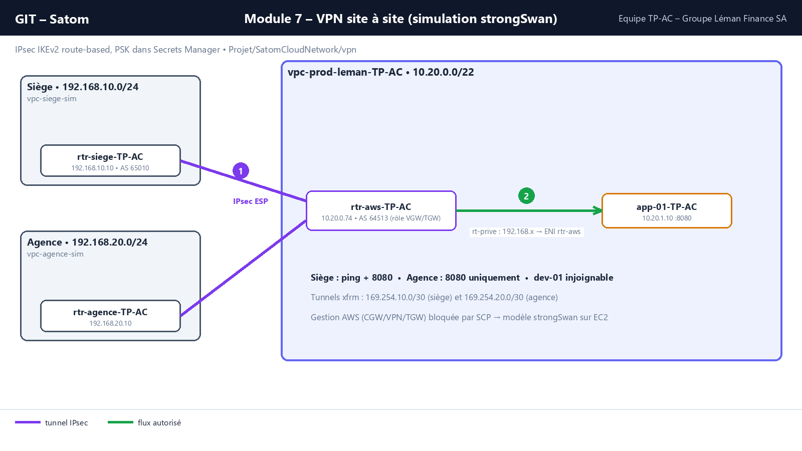

# Module 7 – VPN site à site (siège et agence)

> **Statut : réalisé par simulation.** Le service managé Site-to-Site VPN est bloqué par la SCP de l'organisation (`CreateCustomerGateway`, `CreateVpnGateway`, `CreateVpnConnection` refusés, Transit Gateway aussi). Le **tunnel IPsec IKEv2 réel** est donc monté avec **strongSwan** sur des instances EC2 qui jouent les rôles des routeurs du siège, de l'agence et de la passerelle côté AWS. Le template CloudFormation du service managé est fourni (`cfn/optional-m06-m08-interconnexion.yaml`).

## Objectif
Relier le siège (`192.168.10.0/24`) et l'agence (`192.168.20.0/24`) au VPC de production par des tunnels **chiffrés**, avec des droits différents : le siège joint `app-01` (ping + 8080), l'agence seulement le port 8080 ; ni l'un ni l'autre ne joint `dev-01`.

## Cours (essentiel)
* **IPsec IKEv2** : une phase d'authentification (clé pré-partagée, échange Diffie-Hellman) puis une association de sécurité **ESP** qui chiffre le trafic (`aes256-sha256-modp2048`).
* Le VPN géré AWS fournit **deux tunnels** par connexion (deux zones) et des adresses de tunnel `169.254.x.x/30` ; la **customer gateway** (CGW) décrit le routeur du site (IP publique, ASN).
* **Route-based** : le tunnel est une interface (`xfrm`/VTI) ; le routage (statique ou BGP) décide ce qui y passe. Plus souple qu'un VPN à politiques (selectors).
* La clé pré-partagée ne doit **jamais** être écrite dans un document ou un dépôt : elle est stockée dans **Secrets Manager** (`Projet/SatomCloudNetwork/vpn`) et lue par les routeurs via leur rôle IAM.

## Architecture de la simulation


| Rôle réel | Réalisation (simulation) |
|---|---|
| Passerelle VPN / TGW côté AWS | `rtr-aws-TP-AC` (Ubuntu 24.04, strongSwan) dans `sub-public-1b`, `10.20.0.74`, contrôle source/destination désactivé |
| Routeur du siège | `rtr-siege-TP-AC` `192.168.10.10` dans `vpc-siege-sim-TP-AC` (`192.168.10.0/24`) |
| Routeur de l'agence | `rtr-agence-TP-AC` `192.168.20.10` dans `vpc-agence-sim-TP-AC` (`192.168.20.0/24`) |
| Adresses des tunnels | siège `169.254.10.0/30` (AWS `.1`, site `.2`) ; agence `169.254.20.0/30` |
| Routes propagées | `rt-prive` : `192.168.10.0/24` et `192.168.20.0/24` → ENI de `rtr-aws` |

## TP
| Tâche | Réalisation |
|---|---|
| 1. Objets | équivalent des CGW/VPN : routeurs, IP publiques, groupes de sécurité (UDP 500, 4500, ESP limités à l'adresse du pair), clés dans Secrets Manager, tags sur toutes les ressources |
| 2. Tunnel siège | strongSwan route-based (`if_id 11`) ; tunnel `ESTABLISHED` ; `ping 10.20.1.10` depuis le siège réussit ; vérification de la route vers `192.168.10.0/24` dans `rt-prive` |
| 3. Agence | tunnel `if_id 12` ; l'agence joint `app-01` sur 8080 **uniquement** (ICMP refusé par `sg-app`) ; ni siège ni agence ne joignent `dev-01` (`10.21.0.10`, aucune route annoncée) |

Scripts : `scripts/m07-ipsec-sim.ps1 -Site siege|agence`.

## Tableau de configuration IPsec
| Paramètre | Valeur |
|---|---|
| IKE | IKEv2, `aes256-sha256-modp2048`, authentification PSK, DPD 10 s |
| ESP | `aes256-sha256-modp2048` (PFS), mode tunnel, `start_action = start`, `dpd_action = restart` |
| Interfaces | `xfrm-siege` (id 11), `xfrm-agence` (id 12) |
| Routage | site → `10.20.0.0/22` via tunnel ; AWS → `192.168.x.0/24` via tunnel |
| Autorisations | `sg-app` : siège ICMP + TCP 8080 ; agence TCP 8080 |

## Procédure de diagnostic en quatre étapes
1. **État des tunnels** : `swanctl --list-sas` (`ESTABLISHED`, octets chiffrés).
2. **Paramètres IPsec** : identifiants, proposals IKE/ESP identiques des deux côtés, PSK.
3. **Route** : `ip route get <app>` côté site, route `192.168.x.0/24` côté AWS (`rt-prive` → ENI).
4. **SG de la cible** : `sg-app` autorise-t-il la source (ICMP/8080) ? Les groupes des routeurs laissent-ils UDP 500/4500 et ESP ?

## Résultats
```
{{TESTS}}
```

## Nettoyage
Le HackMD est contradictoire (conserver / supprimer en fin de séance) : conformément à la consigne du binôme, les routeurs et réseaux simulés sont **conservés jusqu'à la fin du cours** ; ils sont arrêtés quand ils ne servent pas (vCPU partagés par la classe) et supprimés en fin de projet. Les clés restent dans Secrets Manager.

## Écarts et remarques
* Un seul tunnel par site (au lieu de deux) : le test de bascule entre tunnels du HackMD est remplacé par la bascule DX/VPN du module 8.
* Quota d'Elastic IP du compte atteint : les routeurs utilisent des IP publiques automatiques (elles changent à l'arrêt/redémarrage ; le script les relit).
* Quota de 16 vCPU pour toute la classe : un seul site simulé est actif à la fois.
