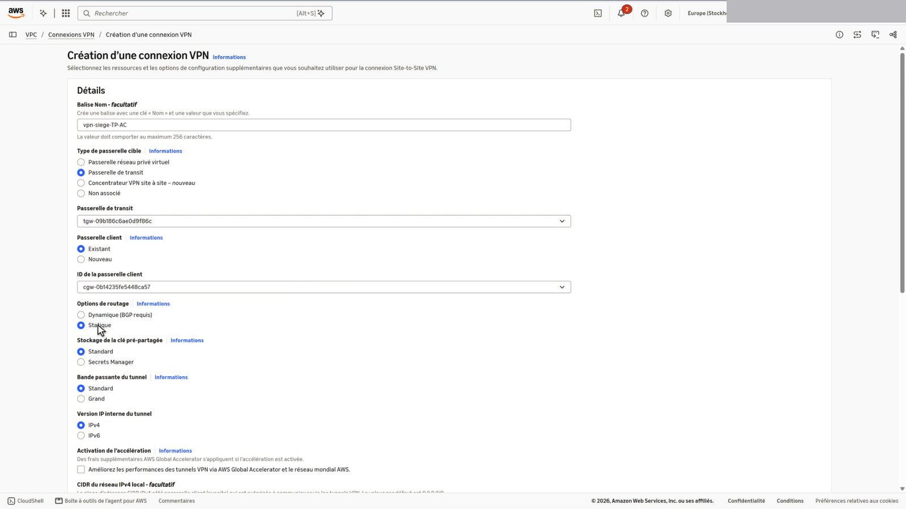
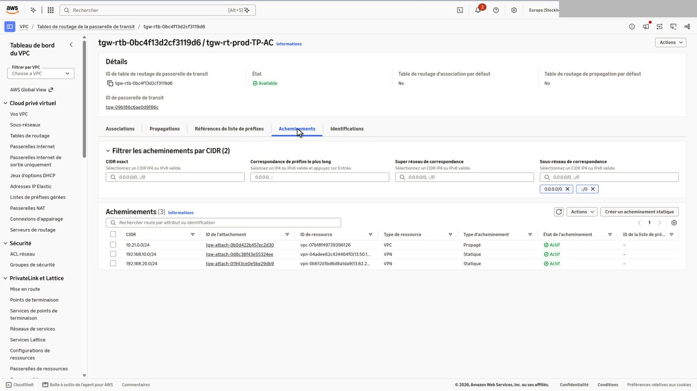
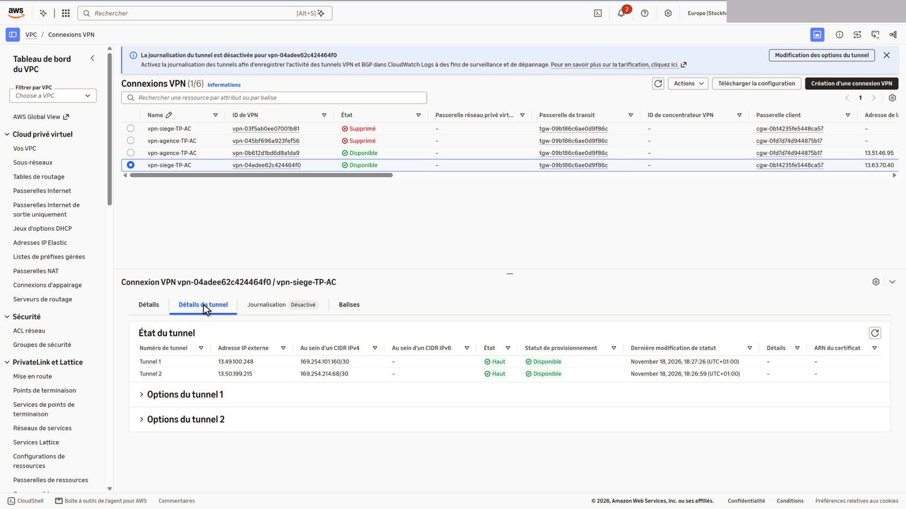
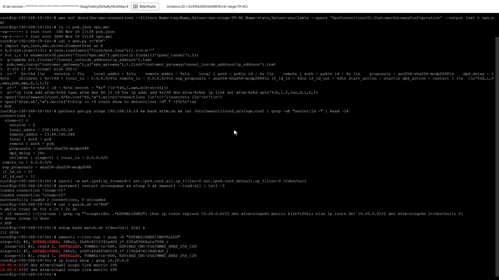
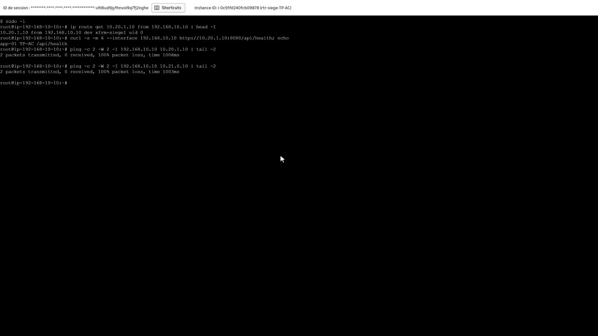
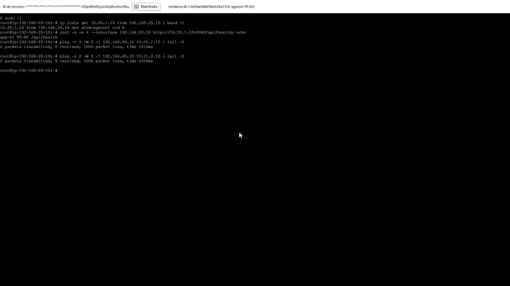
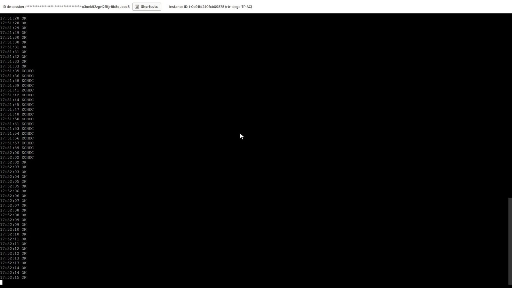
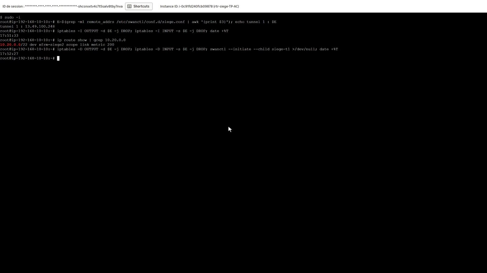

# Module 7 – VPN site à site (siège et agence)

## Objectif
Relier le siège (`192.168.10.0/24`, Genève) et l'agence (`192.168.20.0/24`, Lausanne) au cloud par des tunnels IPsec qui aboutissent sur `tgw-leman-TP-AC`. Les deux sites doivent joindre `app-01` sur le port 8080, et aucun des deux ne doit voir le VPC de dev. Nous testons aussi ce qui se passe quand un tunnel tombe.

Ce qui est **réel** : les deux connexions VPN côté AWS (`vpn-siege-TP-AC` et `vpn-agence-TP-AC`), avec deux tunnels IPsec chacune, soit quatre tunnels, ainsi que les passerelles clientes, le Transit Gateway et toutes ses routes. Ce qui est **simulé** : le siège et l'agence n'existent pas. Chacun est un petit VPC avec une instance Ubuntu, `rtr-siege-TP-AC` ou `rtr-agence-TP-AC`, sur laquelle tourne strongSwan, un logiciel IPsec libre. Cette instance joue le routeur du client.

## Ce qu'il faut savoir
Une connexion VPN d'AWS donne **deux tunnels** IPsec, vers deux adresses publiques différentes d'AWS. Chaque tunnel a son adresse interne en `169.254.x.x/30` et sa **clé pré-partagée** (PSK), un secret que les deux extrémités doivent connaître. Du côté du client, AWS ne fournit rien : il faut un équipement qui parle IPsec. La **passerelle cliente** (Customer Gateway) n'est que la description de cet équipement, c'est-à-dire son adresse publique. Il faut donc que chaque routeur ait une adresse publique fixe, une Elastic IP.

Nous utilisons le **routage statique**. Pour un VPN rattaché à un Transit Gateway, les routes statiques ne se déclarent pas sur la connexion VPN : elles vont dans une table de routage du Transit Gateway. AWS refuse de les déclarer ailleurs (nous l'avons appris par une erreur lors de la première version).

Sur le routeur, strongSwan est configuré en **IKEv2**, avec des échanges chiffrés `aes256-sha256-modp2048` (AES 256, SHA-256, groupe Diffie-Hellman 14), des sélecteurs de trafic `0.0.0.0/0` et une interface virtuelle par tunnel (`xfrm-siege1`, `xfrm-siege2`, `xfrm-agence1`, `xfrm-agence2`). Le tunnel 1 est le tunnel préféré (route de métrique 100) et le tunnel 2 le secours (métrique 200). Un petit script ne garde la route d'un tunnel que s'il est établi.

Une règle d'hygiène : les clés partagées n'apparaissent dans aucun fichier du dépôt ni dans le dossier. Elles sont dans AWS Secrets Manager, et les routeurs les lisent au moment de la configuration, sans jamais les afficher.

## Ce que nous avons fait
Tout a été fait à la main dans la console AWS, région Stockholm, avec le suffixe `-TP-AC` partout et les balises habituelles. Voici l'ordre de la vidéo.

**1. Les secrets**
- Dans Secrets Manager, un secret `Projet/SatomCloudNetwork/vpn` de type « Autre type de secret », avec quatre paires clé/valeur : `siege1`, `siege2`, `agence1`, `agence2` (une clé par tunnel). Les valeurs sont saisies dans des champs masqués. Clé de chiffrement par défaut (`aws/secretsmanager`), pas de rotation.
- Sur le rôle `TP-AC-ec2-ssm-role` (celui des instances), une politique en ligne `lire-cles-vpn-TP-AC` : `secretsmanager:GetSecretValue` sur ce secret seulement, et `ec2:DescribeVpnConnections`. Le routeur a besoin de la seconde pour lire la description de son VPN.

**2. Les deux sites simulés**
- `vpc-siege-TP-AC` (`192.168.10.0/24`) avec `sub-siege-TP-AC` (`192.168.10.0/26`), `igw-siege-TP-AC` et `rt-siege-TP-AC` (route `0.0.0.0/0` vers la passerelle Internet, associée au sous-réseau). Même chose pour l'agence : `vpc-agence-TP-AC` (`192.168.20.0/24`), `sub-agence-TP-AC`, `igw-agence-TP-AC`, `rt-agence-TP-AC`.
- Les deux plages ne se recouvrent ni entre elles ni avec nos VPC AWS (`10.20.0.0/22` et `10.21.0.0/24`) : sans cela, un VPN ne peut pas router correctement.
- Un Security Group par routeur, `rtr-siege-TP-AC` et `rtr-agence-TP-AC`, créé **sans aucune règle entrante** : nous ne connaissons pas encore les adresses des tunnels.
- Les routeurs : instances `rtr-siege-TP-AC` et `rtr-agence-TP-AC`, Ubuntu Server 26.04 LTS en `t3.micro`, sans paire de clés (nous y accédons par Session Manager grâce au profil `TP-AC-ec2-ssm-role`), adresses privées fixes `192.168.10.10` et `192.168.20.10`.
- Une Elastic IP par routeur (`eip-rtr-siege-TP-AC`, `eip-rtr-agence-TP-AC`), allouée puis associée à l'instance.

**3. Côté AWS**
- Deux passerelles clientes, `cgw-siege-TP-AC` et `cgw-agence-TP-AC`, qui décrivent chaque routeur par son Elastic IP. Le numéro d'AS (65000) est obligatoire dans le formulaire mais n'a aucun effet en routage statique.
- Deux connexions VPN, `vpn-siege-TP-AC` et `vpn-agence-TP-AC` : cible « Passerelle de transit » `tgw-leman-TP-AC`, passerelle cliente existante, routage **statique**, stockage des clés « Standard » (nous tapons les clés nous-mêmes, masquées), options des tunnels par défaut sauf la clé de chaque tunnel. Au total, AWS prépare quatre tunnels. La création prend quelques minutes.
- Sur le Transit Gateway, une troisième table, `tgw-rt-sites-TP-AC`. Les deux VPN y sont **associés**, et seul l'attachement de la prod (`tgwa-prod-TP-AC`) s'y **propage** : les sites apprennent `10.20.0.0/22` et jamais le dev.
- Dans `tgw-rt-prod-TP-AC`, une route statique par site, vers le VPN correspondant : `192.168.10.0/24` vers `vpn-siege-TP-AC` et `192.168.20.0/24` vers `vpn-agence-TP-AC`. C'est le chemin de retour des réponses. `tgw-rt-dev-TP-AC` n'en reçoit aucune.
- Dans `rt-prive-leman-TP-AC`, les deux plages des sites ont pour cible le Transit Gateway.
- Dans `sg-app` (le groupe `app-TP-AC`), le port 8080 est ouvert depuis `192.168.10.0/24` (« API depuis siege ») et `192.168.20.0/24` (« API depuis agence »). Rien d'autre pour les sites : pas de ping.
- Dans chaque Security Group de routeur, deux règles « Tout le trafic » en entrée, depuis les deux adresses publiques des tunnels AWS en `/32` (« Tunnel 1 AWS » et « Tunnel 2 AWS »). Toute autre adresse est ignorée. Ces adresses ne sont connues qu'après la création du VPN, d'où l'ordre.

**4. La configuration des routeurs** (Session Manager, `sudo -i`), même recette pour les deux :
- installation de `strongswan-swanctl`, `charon-systemd` et `awscli` ;
- lecture des clés dans Secrets Manager vers un fichier `psk.json` en `chmod 600`, et de la description du VPN (`describe-vpn-connections`, champ `CustomerGatewayConfiguration`) vers `vpn.xml` ;
- un petit script Python, `gen.py`, lit ces deux fichiers et écrit `/etc/swanctl/conf.d/siege.conf` (ou `agence.conf`) : deux connexions IKEv2 (`siege-t1`, `siege-t2`), détection de pair mort toutes les 10 secondes, redémarrage automatique du tunnel, et un identifiant d'interface (11 et 12 pour le siège, 21 et 22 pour l'agence). Il écrit aussi le script qui crée les interfaces `xfrm-…` avec les adresses internes `169.254.x.x/30` ;
- routage IP activé, filtrage de chemin inverse (`rp_filter`) désactivé, `systemctl restart strongswan` et `swanctl --load-all` (deux connexions chargées) ;
- un script `watch.sh`, lancé en arrière-plan, qui toutes les secondes pose la route `10.20.0.0/22` vers `xfrm-siege1` (métrique 100) ou `xfrm-siege2` (métrique 200) selon que le tunnel est établi, et la retire sinon.

**5. Vérifications et tests**
- Console : les quatre tunnels sont « Haut », et `tgw-rt-prod-TP-AC` contient les trois routes (le dev propagé, les deux sites en statique).
- Depuis chaque routeur, avec l'adresse du site comme source (`--interface 192.168.10.10`) : `curl` sur `app-01:8080`, `ping` vers `app-01`, `ping` vers `dev-01`.
- Panne d'un tunnel du siège (voir plus bas).

## Captures


La création de `vpn-siege-TP-AC` : cible « Passerelle de transit », passerelle cliente existante, options de routage « Statique ». Les clés des tunnels, plus bas dans la page, sont saisies dans des champs masqués ; nous n'avons pas gardé de capture de cette partie.



La table de routage de la prod, une fois les tunnels montés : le dev (propagé depuis un VPC) et les deux sites (statiques, ressource de type VPN), tous « Actif ».



L'onglet « Détails du tunnel » de `vpn-siege-TP-AC` : les deux tunnels sont « Haut », avec leurs adresses externes et leurs adresses internes en `169.254.x.x/30`. Les deux lignes « Supprimé » du dessus sont les connexions du même nom de notre première version. `vpn-agence-TP-AC` montre le même résultat.



La configuration du routeur du siège par Session Manager : le script de génération (il lit les clés dans `psk.json`, donc aucune clé n'apparaît), un extrait de `siege.conf`, puis `swanctl --list-sas` qui montre `siege-t1` et `siege-t2` `ESTABLISHED` en IKEv2 avec `ESP:AES_CBC-256/HMAC_SHA2_256_128`. Les deux dernières lignes sont les routes `10.20.0.0/22` : métrique 100 par `xfrm-siege1`, 200 par `xfrm-siege2`.



Les tests depuis le siège. `ip route get` montre que le trafic passe par `xfrm-siege1`. Le `curl` sur le port 8080 répond « app-01 TP-AC /api/health ». Le `ping` vers `app-01` échoue (pas de règle ICMP pour les sites), et celui vers `dev-01` (`10.21.0.10`) aussi : le dev reste injoignable.



Les mêmes tests depuis l'agence, par `xfrm-agence1` : l'API répond, le ping et le dev sont refusés.



La panne du tunnel 1 du siège. La boucle envoie une requête vers l'API toutes les demi-secondes. Dernière réponse à 17:51:33, premier `ECHEC` à 17:51:35, retour des réponses à 17:52:02 : environ 29 secondes sans service.



La seconde session, côté commandes : adresse du tunnel 1, règles `iptables` qui jettent les paquets (17:51:33), puis la route `10.20.0.0/22` qui passe par `xfrm-siege2` avec la métrique 200, enfin le retrait des règles et la relance du tunnel 1 à 17:52:27.

## Récapitulatif
| Élément | Valeur |
|---|---|
| Connexions VPN | `vpn-siege-TP-AC`, `vpn-agence-TP-AC`, routage statique, cible `tgw-leman-TP-AC` |
| Passerelles clientes | `cgw-siege-TP-AC`, `cgw-agence-TP-AC` (une Elastic IP chacune, ASN 65000 sans effet) |
| Tunnels | deux par site, quatre en tout, tous « Haut » |
| IKE et ESP | IKEv2, `aes256-sha256-modp2048`, clé pré-partagée par tunnel |
| Routeurs simulés | `rtr-siege-TP-AC` (`192.168.10.10`), `rtr-agence-TP-AC` (`192.168.20.10`), strongSwan, interfaces `xfrm-…` |
| Table du Transit Gateway pour les sites | `tgw-rt-sites-TP-AC` : VPN associés, seule la prod propagée |
| Chemin retour | `192.168.10.0/24` et `192.168.20.0/24` statiques dans `tgw-rt-prod-TP-AC`, et dans `rt-prive-leman-TP-AC` vers le Transit Gateway |
| Ce que les sites peuvent faire | TCP 8080 vers `app-01` ; ni ping, ni accès au dev |
| Clés partagées | secret `Projet/SatomCloudNetwork/vpn` (Secrets Manager), jamais écrites ailleurs |
| Coût | environ 0,05 USD de l'heure par connexion VPN et par attachement |

## Résultats des tests
Ce que montre la vidéo, mesuré par nous : les quatre tunnels sont `ESTABLISHED` côté routeur et « Haut » côté AWS ; depuis chaque site, `curl` sur `app-01:8080` répond ; le ping vers `app-01` et vers `dev-01` ne passe pas ; la panne du tunnel 1 du siège coupe le service pendant environ 29 secondes, puis tout passe par le tunnel 2, et le retour du tunnel 1 ne coupe rien. La panne de l'agence n'a pas été refilmée.

Le bloc ci-dessous est le relevé de notre **première version** (ligne de commande, VPN déployés par le modèle CloudFormation du module 13). Il faut le lire avec ces différences :
- les adresses des tunnels sont celles de ces anciens VPN ;
- le siège pouvait alors **pinger** `app-01` (trois paquets sur trois), parce que la règle ICMP existait ; dans la version refaite à la main, nous n'avons ouvert que le 8080 et le ping échoue ;
- la panne a été mesurée pour le siège (29,2 s) **et** pour l'agence (33,5 s), avec un `curl` toutes les 0,3 s ; la vidéo ne refait que le siège, avec un `curl` toutes les 0,5 s (1 s d'attente au plus) et un réglage IKE plus serré ;
- les essais depuis `dev-01` vers les sites ne figurent que dans ce relevé.

```
{{TESTS}}
```

## Bascule entre les deux tunnels
Pour imiter une vraie panne, nous ne coupons pas l'interface : nous jetons les paquets échangés avec l'adresse AWS du tunnel 1 (`iptables -I OUTPUT -d … -j DROP` et `iptables -I INPUT -s … -j DROP`). C'est une perte silencieuse, comme une ligne coupée.

Avant le test, nous avons resserré la détection de strongSwan (`retransmit_tries = 3`, `retransmit_timeout = 2.0` dans `/etc/strongswan.d/tpac.conf`) et relancé le service. Pour la mesure, une requête vers l'API toutes les 0,5 s depuis l'adresse du siège, avec une attente de 1 s au plus. Résultat de la vidéo : environ **29 secondes** d'échecs, puis tout passe par le tunnel 2 (route `xfrm-siege2`, métrique 200). Quand nous retirons les règles et relançons le tunnel 1, aucune requête n'échoue.

Ce délai est celui que prennent le routeur pour constater la panne (détection de pair mort toutes les 10 s, puis les retransmissions) et le script pour déplacer la route. Côté AWS, la détection a ses propres délais, que nous ne maîtrisons pas. La durée n'est pas fixe : à la ligne de commande nous avions mesuré entre 26 et 34 secondes. Le sujet parle d'une bascule « sans coupure » : avec un VPN IPsec, ce n'est pas possible (voir `docs/02-ecarts-au-sujet.md`), et nous préférons le dire plutôt que de le cacher.

## Pièges rencontrés
- **Quota d'Elastic IP et de vCPU.** Le compte est partagé : cinq Elastic IP pour toute la classe, et une limite de vCPU souvent atteinte. Notre premier essai du module 7 (16/11/2026) a échoué à cause de l'un ou l'autre. Il faut deux Elastic IP pour les deux routeurs, et parfois arrêter une instance (`dev-01`) pour libérer des vCPU.
- **Les Security Groups des routeurs ne peuvent pas être finis tout de suite.** Les adresses publiques des tunnels AWS ne sont connues qu'une fois le VPN créé. D'où un groupe vide au début, rempli plus tard.
- **Des lignes « Supprimé » du même nom.** Dans la liste des connexions VPN, `vpn-siege-TP-AC` et `vpn-agence-TP-AC` apparaissent deux fois : les anciennes sont à l'état « Supprimé ». Il faut sélectionner celles qui sont « Disponible ».
- **Une route statique créée mais invisible.** Juste après sa création, le tableau des acheminements reste vide, avec un bandeau d'AWS qui dit que la propagation peut prendre quelques instants. À la première version, les routes des sites étaient `blackhole` tant que les tunnels n'étaient pas montés.
- **Le ping qui échoue n'est pas une panne.** Seul le 8080 est ouvert aux sites. Nous testons donc l'API avec `curl`, et nous gardons le ping pour montrer ce qui est refusé.
- **Associer une Elastic IP.** Lors d'un essai, le formulaire a répondu « Aucune adresse IP publique trouvée » ; à notre avis parce que l'adresse n'était pas sélectionnée dans la liste avant « Actions, Associer ». Nous avons refait la scène en sélectionnant d'abord la ligne.
- **La session de la console expire.** À plusieurs reprises, la console est revenue sur une page blanche de reconnexion. Nous nous reconnectons et reprenons l'étape.
- **Nos premières mesures de panne étaient trompeuses** (première version). En coupant l'interface, la bascule semblait immédiate, ce qui n'arrive jamais en vrai ; avec un `ping`, le même flux restait collé au tunnel mort et la mesure atteignait 81 s. Des requêtes `curl` qui ouvrent chaque fois une nouvelle connexion sont plus représentatives.
- **Les clés ne doivent traîner nulle part.** Les quatre clés sont saisies deux fois (dans le secret, puis dans les formulaires des deux VPN), toujours dans des champs masqués, et conservées hors du dépôt. Le dépôt est public : une clé écrite dans un fichier y serait publiée.

## Ce qui diffère du sujet
- **Adresses des passerelles clientes.** Le sujet donne `203.0.113.10` et `198.51.100.10` : ce sont des adresses réservées à la documentation, aucun tunnel ne peut s'établir vers elles. Nous utilisons une Elastic IP par routeur.
- **Routes statiques.** Elles sont dans la table de routage du Transit Gateway (`tgw-rt-prod-TP-AC`), pas sur la connexion VPN.
- **Bascule « sans coupure ».** Impossible avec IPsec : nous mesurons environ 29 secondes d'interruption.
- **Les sites sont simulés** par deux instances EC2 avec strongSwan, pas par du matériel ni par GNS3. Nos tests partent des routeurs eux-mêmes, avec l'adresse du site comme adresse source : aucun poste n'est derrière.
- **Plages.** Nos VPC AWS sont en `10.20.0.0/22` et `10.21.0.0/24` plutôt que `10.0.0.0/16` et `10.1.0.0/16`, déjà utilisées par d'autres équipes du compte.
- **Ping depuis le siège.** Notre première version l'autorisait ; dans la version filmée, nous n'avons ouvert que le port 8080 pour les deux sites.
- Les actions VPN étaient refusées par l'organisation AWS jusqu'au 17/11/2026 ; ce module a ensuite été fait avec le vrai VPN d'AWS.

## Nettoyage
Les connexions VPN et les attachements sont facturés à l'heure : nous avons tout supprimé à la fin du projet (connexions VPN, passerelles clientes, Elastic IP, routes, tables et attachements du Transit Gateway, routeurs, VPC du siège et de l'agence, secret `Projet/SatomCloudNetwork/vpn`). La seule ressource qui reste est le Network Firewall `nfw-prod-leman-TP-AC`, dont la suppression est bloquée côté AWS (cas ouvert auprès du Support, voir `docs/NETTOYAGE.md`).
