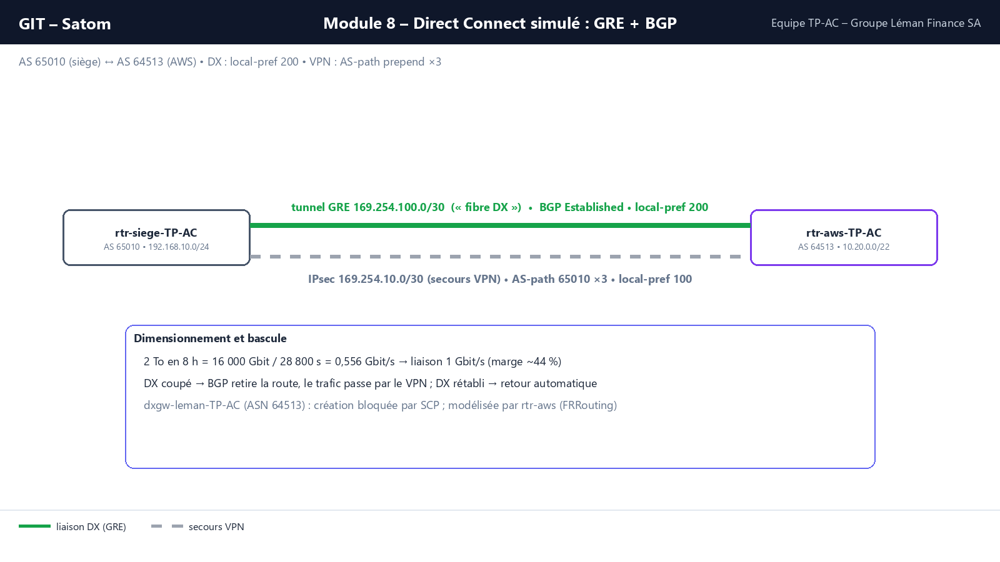

# Module 8 – Direct Connect

> Direct Connect était d'abord refusé par l'organisation AWS. Le blocage a été levé le 17/11/2026 : nous avons créé le **vrai Direct Connect Gateway** et l'avons associé au Transit Gateway. Comme nous ne commandons pas de fibre, la liaison elle-même est **simulée** par un tunnel GRE et du BGP, comme le sujet le prévoit.

## Objectif
Comprendre une liaison dédiée (dimensionnement, passerelle, BGP) et la bascule entre une liaison principale et un secours.

## Ce qu'il faut savoir
Direct Connect est un lien physique entre le siège et un point de présence d'AWS (1, 10 ou 100 Gbit/s). Une interface virtuelle y porte la session BGP vers AWS ; derrière, un Direct Connect Gateway se branche sur un Transit Gateway. En BGP, le chemin avec la préférence locale (local-pref) la plus haute gagne ; pour décourager un chemin, on allonge son AS-path (le « prepend »). Ici : local-pref 200 sur la liaison dédiée, et un prepend de 3 sur le chemin VPN.

## Dimensionnement
Nous devons transférer 2 To en 8 heures : 16 000 Gbit sur 28 800 s, soit environ 0,56 Gbit/s. Une liaison de 1 Gbit/s suffit avec une marge d'environ 44 %. Parmi les emplacements Direct Connect de notre région, nous retenons **EQSK1** (Equinix Sweden SK1), qui propose du 1 Gbit/s. Nous ne commandons rien. Il n'y a pas d'emplacement près de Genève dans la région de Stockholm.

## Ce que nous avons fait
**Partie réelle :**
- `dxgw-leman-TP-AC`, ASN 64513. Il n'existe pas de type CloudFormation pour un Direct Connect Gateway : le modèle `cfn/interconnexion-leman.yaml` le crée avec une **ressource personnalisée** (une petite fonction Lambda). Notre premier essai avait pris par erreur le même ASN que le Transit Gateway (64512), et AWS refuse alors l'association : nous l'avons supprimé et recréé avec le bon ASN.
- L'association de `dxgw-leman-TP-AC` à `tgw-leman-TP-AC`, avec les préfixes autorisés `10.20.0.0/22` et `192.168.10.0/24`. Elle passe à `associated`, et AWS crée de lui-même un attachement « Direct Connect Gateway » dans le Transit Gateway.

**Partie simulée :**
- Un tunnel GRE `gre-dx` (`169.254.100.0/30`) sur Internet entre `rtr-siege-TP-AC` (AS 65010) et `rtr-aws-TP-AC` (AS 64513, qui joue l'équipement côté AWS) : c'est notre « fibre ».
- Un second tunnel GRE `gre-vpn` (`169.254.101.0/30`) qui traverse **le vrai VPN** du module 7 : c'est le chemin de secours. Un VPN statique ne parle pas BGP, c'est pourquoi nous faisons passer la session BGP dans ce GRE, ce qui nous permet de montrer un vrai prepend.
- Deux sessions BGP, timers 3 s / 9 s. Le siège annonce `192.168.10.0/24`, la prod annonce `10.20.0.0/22`.
- `local-pref 200` sur ce qui arrive par `gre-dx`, et un prepend de `65010` trois fois en plus sur ce qui part par `gre-vpn`.
- `rtr-aws` traduit l'adresse source (NAT) pour que `app-01` réponde au routeur, sans toucher aux tables des VPC.

Les routeurs tournent avec FRRouting sur Ubuntu. Le sujet propose GNS3 : nous ne l'avons pas utilisé.

Script : `scripts/m08-dx-sim.ps1` (configuration des routeurs et tests ; option `-TestOnly` pour rejouer seulement les tests, à condition que les routeurs soient déjà configurés par ce même script).



| Élément | rtr-siege | rtr-aws |
|---|---|---|
| ASN | 65010 | 64513 |
| GRE « DX » | `169.254.100.2/30` | `169.254.100.1/30` |
| GRE dans le VPN | `169.254.101.2/30` | `169.254.101.1/30` |
| Annonce | `192.168.10.0/24` | `10.20.0.0/22` |
| Timers BGP | 3 s / 9 s | 3 s / 9 s |

| Politique | Valeur |
|---|---|
| Direct Connect (`gre-dx`) | `local-pref 200` |
| VPN (`gre-vpn`) | prepend `65010` ×3 à l'envoi |
| Préfixes autorisés du DXGW | `10.20.0.0/22`, `192.168.10.0/24` |

## Si ça ne marche pas : quatre vérifications
1. L'état de BGP : `show bgp summary` doit afficher le nombre de préfixes reçus (pas `Active` ni `Connect`).
2. Les préfixes annoncés et reçus des deux côtés.
3. La local-pref : `show ip bgp 10.20.0.0/22` montre le meilleur chemin (« best »).
4. La route dans `tgw-rt-prod` côté AWS, et `ip route get` sur le routeur.

## Résultats des tests
```
{{TESTS}}
```

## Mesure de la bascule
Pour simuler une vraie panne, nous supprimons les paquets GRE du chemin DX **sans couper l'interface** : BGP doit s'en apercevoir lui-même. Sur un ping horodaté (une sonde toutes les 0,5 s, depuis un poste du LAN du siège), l'interruption dure **9,6 secondes** (8,1 s sur un autre essai) : c'est le temps de détection de BGP (délai de 9 s). Le trafic passe alors par le chemin VPN. Quand nous rétablissons le GRE, le trafic revient seul sur la liaison dédiée, sans nouvelle coupure.

Au premier essai nous avions pingué depuis l'adresse du routeur lui-même, qui répond par une route directe : la mesure était trop belle (une seule sonde perdue) et ne passait pas par BGP. Nous l'avons refaite depuis un poste du LAN.

## Ce qui a mal tourné
Sur la pile déployée par CloudFormation, la bascule durait d'abord **45 secondes** et la session BGP du VPN tombait à chaque panne du DX. Les captures de paquets ont montré pourquoi : la réponse du chemin VPN revenait **à l'intérieur** du tunnel GRE de la liaison dédiée. Sur `rtr-aws`, la route vers l'extrémité GRE du siège (`192.168.10.10`) était recouverte par la route BGP apprise `192.168.10.0/24` via `gre-dx` : le secours dépendait donc de la liaison qu'il devait remplacer (un routage « récursif »). Une route statique `192.168.10.10/32` vers le routeur du sous-réseau, déclarée dans FRRouting, règle le problème : la bascule tombe à 8-10 s et la session BGP du VPN reste établie.

## Console AWS
La console Direct Connect affiche un bandeau d'erreur (`DescribeLocations` refusé) : elle appelle un point d'accès global situé dans une région que l'organisation interdit. Le service fonctionne bien par la ligne de commande.

## Nettoyage
Le Direct Connect Gateway ne coûte rien ; son association au Transit Gateway ajoute un attachement facturé 0,05 USD de l'heure. Les routeurs sont des instances EC2 arrêtées après les tests.
