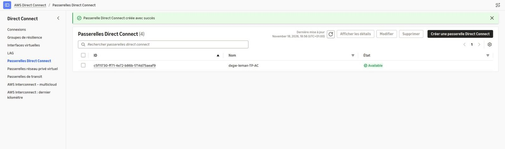
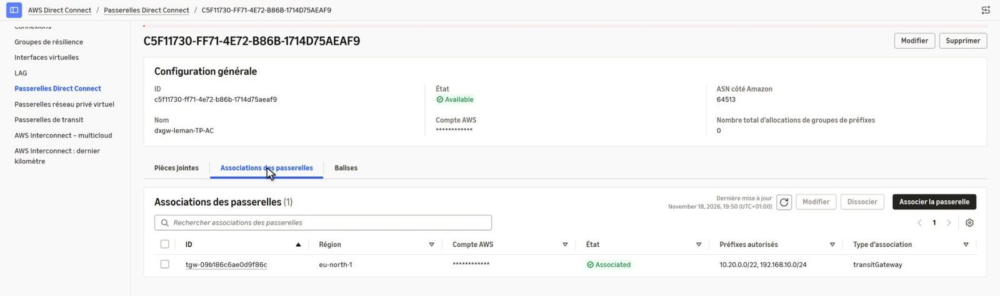
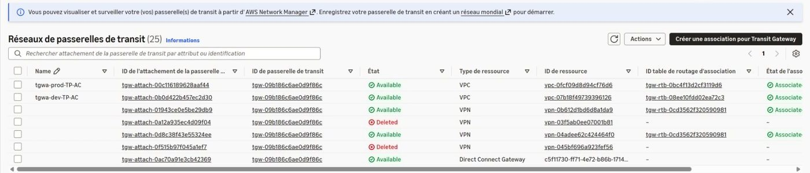
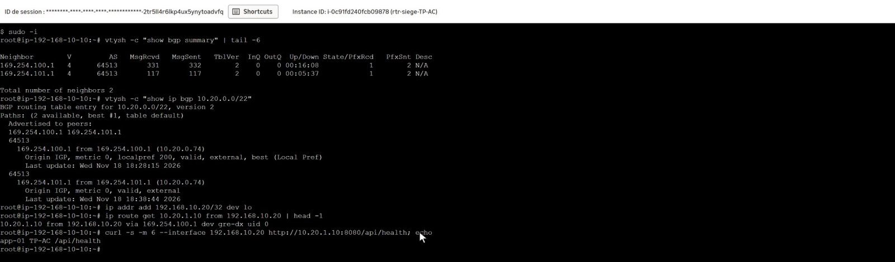
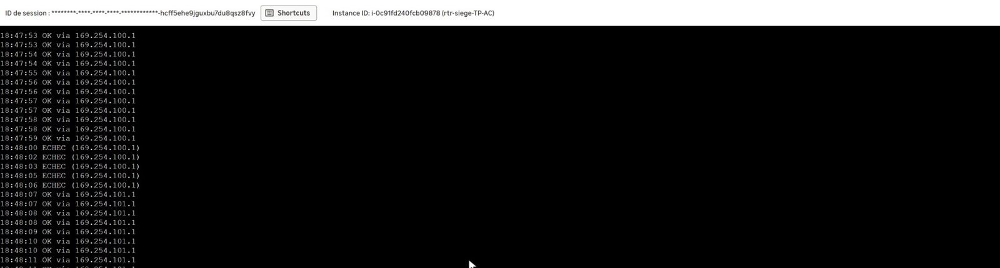

# Module 8 – Direct Connect

## Objectif
Comprendre comment le siège serait relié à AWS par une liaison dédiée, la dimensionner, puis montrer ce qui se passe quand elle tombe : le trafic doit passer tout seul par le VPN du module 7, et revenir sur la liaison dédiée dès qu'elle remarche.

Ce qui est **réel** : le Direct Connect Gateway `dxgw-leman-TP-AC` et son association au Transit Gateway `tgw-leman-TP-AC`, avec les préfixes autorisés. AWS crée de lui-même un attachement de type « Direct Connect Gateway » dans le Transit Gateway. Ce qui est **simulé** : la liaison dédiée elle-même. Nous ne commandons pas de fibre : elle est remplacée par un tunnel GRE entre deux routeurs (`rtr-siege-TP-AC` et `rtr-aws-TP-AC`), qui échangent leurs routes par BGP. Le chemin de secours est un second tunnel GRE qui passe dans le vrai VPN du module 7.

## Ce qu'il faut savoir
Direct Connect est un câble loué entre le siège du client et un point de présence d'AWS (1, 10 ou 100 Gbit/s). Sur ce câble, une interface virtuelle porte une session BGP avec AWS. Derrière, un Direct Connect Gateway se branche sur un Transit Gateway, qui distribue les routes aux VPC.

BGP choisit le chemin avec la préférence locale (local-pref) la plus haute. Pour décourager un chemin, on l'allonge : c'est le « prepend », qui répète le numéro d'AS dans le chemin annoncé, et BGP préfère le chemin le plus court. Ici, la liaison dédiée reçoit une local-pref de 200 et le chemin par le VPN part avec trois répétitions de plus.

Un VPN statique, comme celui du module 7, ne parle pas BGP : un prepend n'aurait aucun effet dessus. Nous faisons donc passer une session BGP dans un tunnel GRE à l'intérieur du VPN. Le tunnel GRE est transporté comme n'importe quel paquet, et c'est lui qui donne un second chemin à BGP.

## Dimensionnement
Nous devons transférer 2 To en 8 heures : 16 000 Gbit sur 28 800 s, soit environ 0,56 Gbit/s. Une liaison de 1 Gbit/s suffit, avec une marge d'environ 44 %. Parmi les emplacements Direct Connect de la région, nous retenons sur le papier **EQSK1** (Equinix Sweden SK1), qui propose du 1 Gbit/s. Nous ne commandons rien. Il n'y a pas d'emplacement près de Genève dans la région de Stockholm.

## Ce que nous avons fait
Tout a été fait dans la console, le 18/11/2026, avec le suffixe `-TP-AC` et les balises habituelles. Voici l'ordre de la vidéo.

**1. La partie réelle**
- Console Direct Connect, « Passerelles Direct Connect », puis « Créer une passerelle » : `dxgw-leman-TP-AC`, ASN côté Amazon **64513**. Nous avons choisi un numéro différent de celui du Transit Gateway (64512). Un premier essai fait par la ligne de commande avec 64512 avait été refusé à l'association.
- Dans les détails de la passerelle, onglet « Associations des passerelles », « Associer la passerelle » : `tgw-leman-TP-AC` et les préfixes autorisés `10.20.0.0/22,192.168.10.0/24`. L'association reste « Associating » pendant quelques minutes, puis passe à « Associated » (nous avons accéléré l'attente dans la vidéo).
- Dans la console VPC, le Transit Gateway montre alors un nouvel attachement de type « Direct Connect Gateway ». AWS l'a créé tout seul.

**2. Ce qu'il faut préparer pour le routeur côté AWS**
- Une route `192.168.10.0/24` vers `tgw-leman-TP-AC` dans `rt-public-leman-TP-AC`, puis la même dans `rt-nat-leman-TP-AC`, la table du sous-réseau `sub-public-1b-TP-AC` où le routeur va vivre. Cette route sert au tunnel GRE qui passe dans le VPN.
- Le Security Group `rtr-aws-TP-AC` (description « Routeur cote AWS : GRE depuis le siege », balise `Name` = `sg-rtr-aws-TP-AC`), d'abord sans règle.
- L'instance `rtr-aws-TP-AC` : Ubuntu Server en `t3.micro`, dans `sub-public-1b-TP-AC` (zone B), adresse privée fixe `10.20.0.74`, adresse publique automatique, sans paire de clés, profil `TP-AC-ec2-ssm-role` pour entrer par Session Manager. Le lancement a échoué la première fois (voir les pièges). Nous avons arrêté `dev-01-TP-AC`, puis relancé.
- L'attachement du VPC de production au Transit Gateway (`tgwa-prod-TP-AC`) ne couvrait que la zone A. Nous avons ajouté `eu-north-1b` avec le sous-réseau de la zone B, puis attendu un peu plus d'une minute que la modification soit appliquée.

**3. Les règles de sécurité**
- `rtr-aws-TP-AC` : le protocole 47 (GRE) depuis l'Elastic IP de `rtr-siege-TP-AC` (« GRE Direct Connect simule ») et depuis `192.168.10.0/24` (« GRE dans le VPN »).
- `rtr-siege-TP-AC` : le protocole 47 depuis l'adresse publique de `rtr-aws-TP-AC` et depuis `10.20.0.74/32`.
- `app-TP-AC` : le port 8080 depuis `10.20.0.74/32` (« API depuis rtr-aws »). Sans cette règle, `app-01` ne répond pas au routeur.

**4. Les deux routeurs**
Sur chacun, par Session Manager : installation de FRRouting (`frr`) et activation du démon `bgpd`.
- `rtr-aws-TP-AC` : le routage IPv4 est activé et `rp_filter` désactivé. Deux tunnels GRE : `gre-dx` (`169.254.100.1/30`, vers l'Elastic IP du siège, c'est notre « fibre » sur Internet) et `gre-vpn` (`169.254.101.1/30`, vers `192.168.10.10`, qui passe dans le VPN). BGP AS 64513, annonce de `10.20.0.0/22`, voisins `169.254.100.2` et `169.254.101.2` (AS 65010), timers 3 s / 9 s. Une règle de traduction d'adresse (NAT, `MASQUERADE`) pour `192.168.10.0/24` : `app-01` répond ainsi au routeur, sans que nous touchions aux tables des VPC. Une route statique `192.168.10.10/32` vers la passerelle du sous-réseau (`10.20.0.65`) garantit que le tunnel `gre-vpn` ne dépend pas de la liaison qu'il doit remplacer.
- `rtr-siege-TP-AC` (le routeur du module 7) : les mêmes tunnels vus de l'autre côté (`169.254.100.2/30` et `169.254.101.2/30`, `gre-dx` vers l'adresse publique de `rtr-aws`, `gre-vpn` vers `10.20.0.74`), BGP AS 65010 et annonce de `192.168.10.0/24`. Une route-map `DX-IN` met `local-preference 200` sur ce qui arrive par `gre-dx`. Une route-map `VPN-OUT` ajoute trois fois `65010` au chemin annoncé par `gre-vpn`. Les routes que strongSwan avait posées vers `10.20.0.0/22` sont remplacées par des routes statiques « flottantes » (distance 150 et 160) : BGP, à 20, l'emporte. Un petit script garde une route `10.20.0.74/32` vers le tunnel IPsec qui est monté, pour que `gre-vpn` ait toujours un chemin.

Le sujet propose GNS3. Nous ne l'avons pas utilisé : les routeurs sont des instances EC2 avec FRRouting. Dans le dépôt, le modèle `cfn/interconnexion-leman.yaml` (module 13) crée le Direct Connect Gateway avec une ressource personnalisée (une petite fonction Lambda), parce qu'il n'existe pas de type CloudFormation natif. Ce modèle n'a été essayé qu'en ligne de commande.

## Captures


La passerelle `dxgw-leman-TP-AC` vient d'être créée (bandeau vert) et son état est « Available ».



L'association au Transit Gateway est active : ASN 64513, préfixes autorisés `10.20.0.0/22` et `192.168.10.0/24`, type `transitGateway`.



Dans la console VPC, le Transit Gateway a un attachement de type « Direct Connect Gateway », créé par AWS. Deux lignes « Deleted » sont des attachements VPN de nos essais précédents.


Le premier lancement de `rtr-aws-TP-AC` est refusé : la limite de 48 vCPU de l'ensemble de la classe est atteinte.



Sur `rtr-siege-TP-AC` : deux sessions BGP établies, avec un préfixe reçu chacune. Le meilleur chemin vers `10.20.0.0/22` passe par `169.254.100.1` avec `localpref 200`. L'API de `app-01` répond par `gre-dx`, depuis l'adresse `192.168.10.20` que nous avons ajoutée sur l'interface `lo` pour jouer un poste du LAN.



La coupure de la liaison. Une boucle interroge l'API toutes les demi-secondes et affiche par où passe le trafic. Elle répond par `169.254.100.1` (la liaison) jusqu'à 18:47:59. Cinq tentatives échouent entre 18:48:00 et 18:48:06. À 18:48:07, les réponses viennent par `169.254.101.1` (le VPN).

## Tableau récapitulatif
| Élément | rtr-siege-TP-AC | rtr-aws-TP-AC |
|---|---|---|
| ASN | 65010 | 64513 |
| Adresse dans le réseau | `192.168.10.10` | `10.20.0.74` |
| GRE « liaison dédiée » (`gre-dx`) | `169.254.100.2/30` | `169.254.100.1/30` |
| GRE dans le VPN (`gre-vpn`) | `169.254.101.2/30` | `169.254.101.1/30` |
| Annonce BGP | `192.168.10.0/24` | `10.20.0.0/22` |
| Timers BGP | 3 s / 9 s | 3 s / 9 s |

| Politique | Valeur |
|---|---|
| Liaison dédiée (`gre-dx`), à la réception | `local-preference 200` |
| VPN (`gre-vpn`), à l'envoi par le siège | prepend `65010` trois fois en plus |
| Préfixes autorisés du Direct Connect Gateway | `10.20.0.0/22`, `192.168.10.0/24` |
| Direct Connect Gateway | `dxgw-leman-TP-AC`, ASN 64513, associé à `tgw-leman-TP-AC` |

## Résultats des tests
Le journal ci-dessous vient du premier passage, fait avec la ligne de commande sur le même schéma. La vidéo refait les mêmes contrôles dans la console : mêmes valeurs de local-pref et de prepend, mêmes timers.

```
{{TESTS}}
```

## Mesure de la bascule
Pour simuler une vraie panne, nous supprimons les paquets GRE de la liaison dédiée avec `iptables`, **sans couper l'interface**. BGP doit s'en apercevoir lui-même.
- **Dans la vidéo (console, 18/11)** : cinq tentatives échouent, de 18:48:00 à 18:48:06, soit sept secondes environ. Le trafic passe ensuite par le VPN. Nous retirons la règle `iptables` : la session BGP de la liaison revient et, à 18:48:49, les réponses repassent par `169.254.100.1` sans aucune tentative perdue.
- **Premier passage (ligne de commande)** : 9,6 secondes d'interruption (une sonde toutes les 0,5 s, 180 sondes, voir le journal).

Les deux valeurs sont cohérentes avec les timers 3 s / 9 s : BGP déclare le voisin mort quand il n'a rien reçu pendant 9 s, et la dernière keepalive date de zéro à trois secondes avant la panne. Quant au retour, il n'y a pas de coupure parce que le VPN reste en service tant que la liaison dédiée n'est pas revenue.

La source du test est une adresse supplémentaire du LAN (`192.168.10.20`), pas celle du routeur. Au premier passage nous avions pingué depuis l'adresse du routeur lui-même, qui répond par une route directe : la mesure ne passait pas par BGP et ne montrait presque rien.

## Pièges rencontrés
- **Limite de vCPU de la classe.** Le lancement de `rtr-aws-TP-AC` a été refusé : « You have requested more vCPU capacity than your current vCPU limit of 48 ». Le compte est partagé par toute la classe. Nous avons arrêté `dev-01-TP-AC`, dont nous n'avions pas besoin à ce moment, puis relancé avec la même configuration : cette fois, le lancement a réussi.
- **L'attachement du VPC ne couvrait que la zone A.** Un attachement au Transit Gateway ne livre du trafic que dans les zones où il a un sous-réseau. Le routeur étant en zone B, il fallait ajouter `sub-public-1b-TP-AC` à `tgwa-prod-TP-AC`.
- **Une route de plus dans une autre table.** La table du sous-réseau de la zone B est `rt-nat-leman-TP-AC`, pas `rt-public-leman-TP-AC`. La route vers le siège devait donc être posée aux deux endroits.
- **Routage récursif (premier passage, ligne de commande).** Au début, la bascule durait 45 secondes et la session BGP du VPN tombait à chaque panne. Des captures de paquets ont montré que la réponse du chemin de secours revenait à l'intérieur du tunnel de la liaison dédiée : sur `rtr-aws`, la route vers l'extrémité GRE du siège (`192.168.10.10`) était recouverte par la route BGP `192.168.10.0/24` apprise par `gre-dx`. Le secours dépendait donc de la liaison qu'il devait remplacer. Une route statique `192.168.10.10/32` vers le routeur du sous-réseau règle le problème. Dans la version filmée, elle est dans la configuration dès le départ.
- **Mauvais ASN (premier passage).** Un Direct Connect Gateway créé avec le même ASN que le Transit Gateway (64512) est refusé à l'association. Nous l'avons recréé en 64513.
- **Bandeaux rouges dans la console.** La console Direct Connect, et par moments d'autres pages, affichent des erreurs `AccessDeniedException` (par exemple `DescribeLocations`) avec la mention « explicit deny in a service control policy ». C'est l'organisation AWS qui bloque ces lectures : la liste des emplacements n'est pas consultable. Les actions dont nous avions besoin (créer la passerelle, l'associer) ont fonctionné malgré les bandeaux.

## Ce qui diffère du sujet
- **Pas de vraie liaison.** Le sujet parle d'une liaison Direct Connect près de Genève. Il n'y a aucun emplacement près de Genève dans la région de Stockholm, et nous ne commandons pas de fibre. Emplacement retenu sur le papier : EQSK1 (1 Gbit/s).
- **Bascule vers le VPN.** Avec un VPN statique, le prepend du sujet n'aurait aucun effet, faute de BGP sur ce chemin. Nous avons fait passer le BGP dans un tunnel GRE à l'intérieur du vrai VPN du module 7.
- **Les routeurs** sont des instances EC2 avec FRRouting, pas des appareils GNS3.
- **Le test** part d'une adresse supplémentaire sur `rtr-siege-TP-AC`, pas d'un vrai poste du LAN du siège.
- Direct Connect était refusé par l'organisation AWS jusqu'au 17/11/2026 (voir `01-services-bloques.md`). Le Direct Connect Gateway et son association sont réels depuis cette date.

## Nettoyage
Le Direct Connect Gateway ne coûte rien. Son association au Transit Gateway ajoute un attachement facturé 0,05 USD de l'heure, et les instances des routeurs sont facturées à l'heure aussi. Tout a été supprimé à la fin du projet (association, passerelle, routeurs, routes ajoutées, règles de sécurité de ce module). La seule ressource qui reste est le Network Firewall `nfw-prod-leman-TP-AC` du module 4, dont la suppression est bloquée côté AWS (voir `docs/NETTOYAGE.md`).
