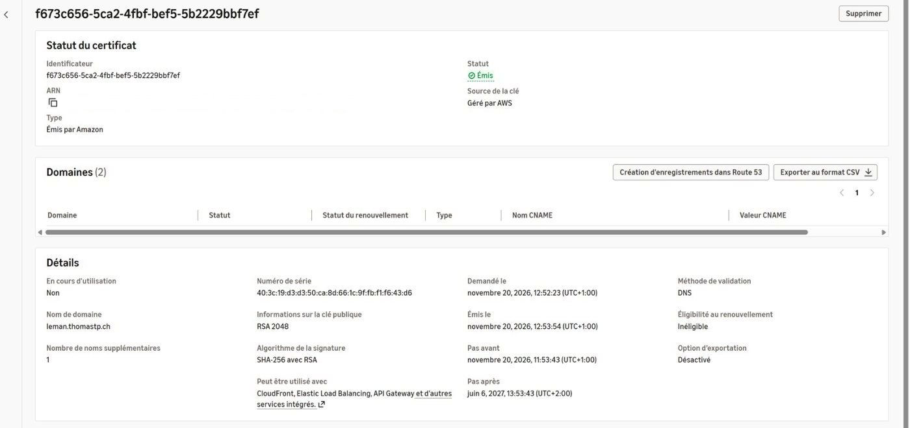
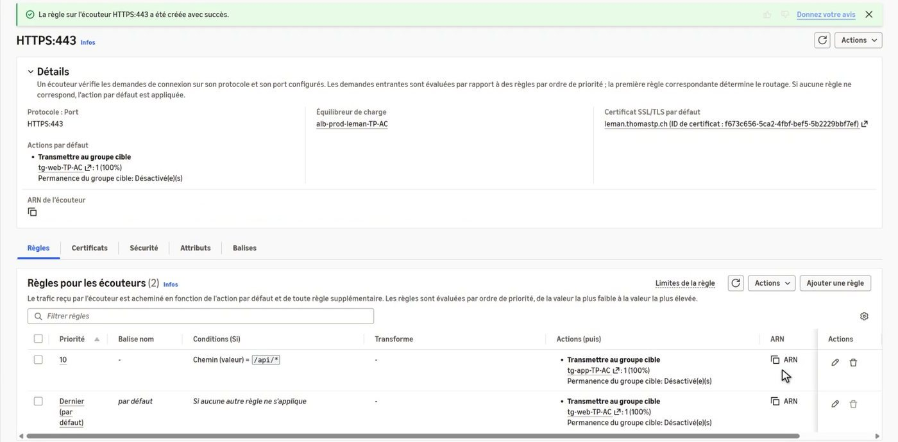
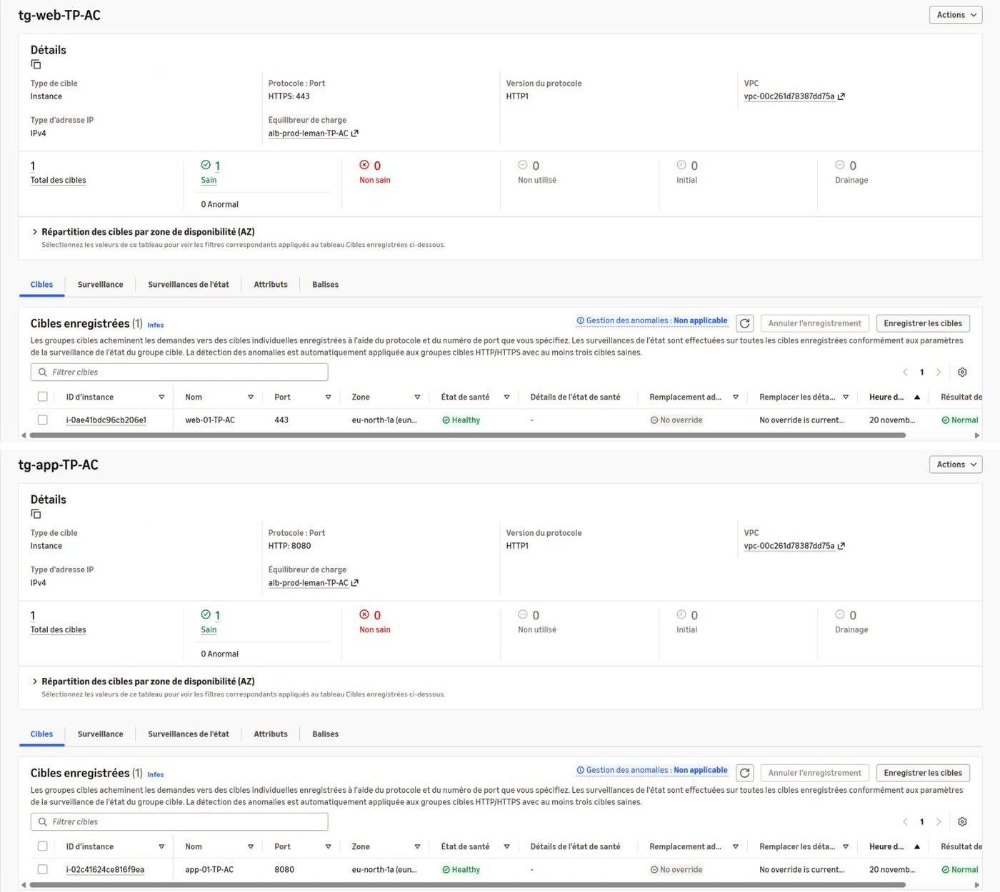
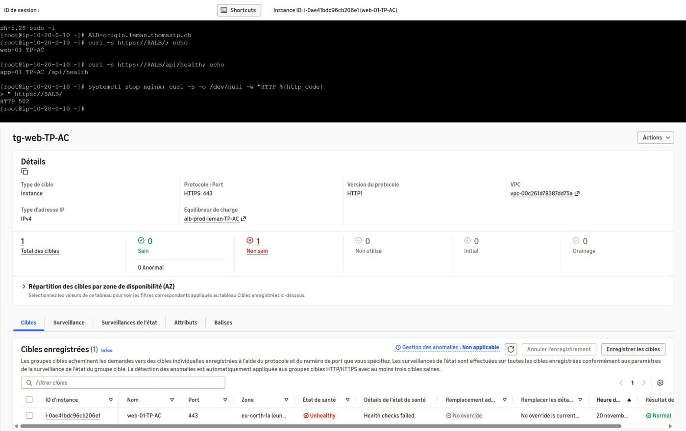
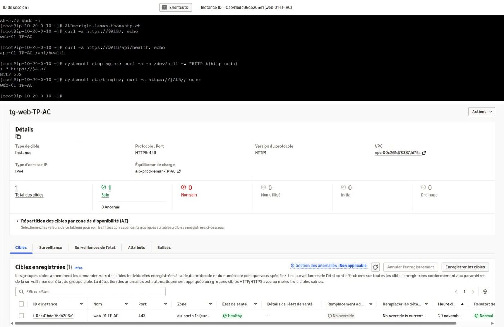

# Module 9 – Load balancer

## Objectif
Publier le site derrière un Application Load Balancer (ALB) en HTTPS, sur deux zones de disponibilité, avec un vrai certificat ACM et une règle qui envoie `/api/*` vers l'API. Puis provoquer une panne et voir comment l'ALB la signale.

## Ce qu'il faut savoir
Un ALB travaille au niveau de l'application (HTTP, HTTPS) et a un nœud par zone de disponibilité : il lui faut donc des sous-réseaux dans au moins deux zones. Il écoute sur un **listener** (ici le port 443). Le listener a une action par défaut et des **règles** (chemin, nom d'hôte, en-tête) qui envoient les requêtes vers des **groupes cibles**. Chaque groupe cible contrôle la santé de ses cibles : une cible qui ne répond plus est marquée « non saine » et ne reçoit plus de trafic.

Pour servir du HTTPS, le listener a besoin d'un certificat. Un certificat public d'AWS Certificate Manager (ACM) est gratuit et se renouvelle seul, à une condition : il faut prouver qu'on contrôle le domaine. C'est la **validation par DNS** : on crée un enregistrement CNAME, fourni par ACM, dans la zone du domaine. Quand le domaine est dans Route 53, la console le crée en un clic. Le certificat ne vaut que pour les noms qu'il contient : le nom `….elb.amazonaws.com` d'un ALB n'y figure pas, il faut donc un nom de notre domaine qui pointe vers l'ALB.

L'ALB coûte environ 0,03 USD de l'heure.

## Environnement
Le réseau construit à la main aux modules 1 à 3 avait été supprimé après le premier tournage. Pour les modules 9 à 11 (tournés le 20/11/2026), nous avons redéployé un environnement avec un modèle CloudFormation, la pile `env-m9-m11-TP-AC` : même nom (`vpc-prod-leman-TP-AC`), mêmes plages (`10.20.0.0/22`, sous-réseaux publics `10.20.0.0/26` en zone A et `10.20.0.64/26` en zone B, sous-réseau privé `10.20.1.0/26`), `web-01-TP-AC` (`10.20.0.10`, nginx en HTTPS sur le port 443 avec un certificat auto-signé), `app-01-TP-AC` (`10.20.1.10`, l'API sur le port 8080), et les Security Groups `web-TP-AC` et `app-TP-AC`. Le modèle ne contient ni ALB, ni groupes cibles, ni Security Group pour l'ALB : tout cela est fait dans la console, ci-dessous.

Le domaine est réel : `leman.thomastp.ch`, un sous-domaine délégué à une zone publique Route 53 (voir le module 10). Cette zone existait déjà avant le tournage.

## Ce que nous avons fait
Voici l'ordre de la vidéo.

**1. Le certificat (ACM, région Stockholm)**
- « Demander un certificat », type public. Noms : `leman.thomastp.ch` et `*.leman.thomastp.ch`. Validation par DNS, clé RSA 2048, exportation désactivée (valeurs par défaut de la console). Balises habituelles, plus `Name` = `cert-leman-TP-AC`.
- Dans les détails du certificat, « Création d'enregistrements dans Route 53 » : la console place le CNAME de validation dans la zone `leman.thomastp.ch`.
- Le certificat passe à « Émis » en une minute et demie : demandé à 12:52:23, émis à 12:53:54. Il est valable jusqu'au 6 juin 2027.

**2. Les deux groupes cibles**
- `tg-web-TP-AC` : protocole **HTTPS**, port 443, VPC `vpc-prod-leman-TP-AC`, contrôle de santé HTTPS sur `/`, cible `web-01-TP-AC`.
- `tg-app-TP-AC` : protocole **HTTP**, port 8080, contrôle de santé HTTP sur `/api/health`, cible `app-01-TP-AC`.
- Nous n'avons pas touché aux « Paramètres avancés de vérification de l'état » : ce sont les valeurs par défaut de la console.

**3. Le Security Group de l'ALB**
- `alb-TP-AC` (description « ALB : 443 public », balise `Name` = `sg-alb-TP-AC`) : une seule règle entrante, le port 443 en TCP depuis `0.0.0.0/0`. Il laisse entrer les clients, et rien d'autre.

**4. L'ALB**
- `alb-prod-leman-TP-AC`, accessible depuis Internet, IPv4, dans `vpc-prod-leman-TP-AC`. Zones `eu-north-1a` (`sub-public-1a-TP-AC`) et `eu-north-1b` (`sub-public-1b-TP-AC`). Le groupe `default` est retiré et remplacé par `alb-TP-AC`.
- Listener : le protocole HTTPS, donc le port 443, avec l'action par défaut « transmettre à `tg-web-TP-AC` ». Le certificat vient d'ACM : `leman.thomastp.ch`. La politique de sécurité est celle que la console recommande (TLS 1.3 et 1.2).
- Après la création, l'ALB est « Mise en service » (provisioning) ; il faut attendre quelques minutes. Nous avons accéléré l'attente dans la vidéo.

**5. Un nom pour l'ALB**
- Dans la zone `leman.thomastp.ch` de Route 53, un enregistrement `origin`, de type A, alias vers « l'application et Classic Load Balancer », région Stockholm, l'ALB `alb-prod-leman-TP-AC`. Le certificat couvre ce nom, ce qui n'est pas le cas du nom `….elb.amazonaws.com`.

**6. Les règles du trafic**
- `app-TP-AC` : une règle entrante de plus, le port 8080 depuis le groupe `alb-TP-AC` (« API depuis alb »). La règle d'origine (8080 depuis `web-TP-AC`) reste.
- Sur le listener HTTPS:443 : une règle de priorité **10** avec la condition « chemin = `/api/*` » et l'action « transmettre à `tg-app-TP-AC` ». Tout le reste va à `tg-web-TP-AC`.

**7. Les tests**
- Les deux groupes cibles affichent une cible saine.
- Dans un navigateur, `https://origin.leman.thomastp.ch/` répond `web-01 TP-AC` et `https://origin.leman.thomastp.ch/api/health` répond `app-01 TP-AC /api/health`, sans avertissement de certificat.
- Depuis `web-01-TP-AC` (Session Manager), la panne : `systemctl stop nginx`, puis `curl` sur l'ALB.

## Captures


Le certificat ACM est « Émis ». La validation par DNS a pris une minute et demie.



Le listener HTTPS:443 de `alb-prod-leman-TP-AC` avec le certificat `leman.thomastp.ch` et ses deux règles : `/api/*` vers `tg-app-TP-AC` (priorité 10), tout le reste vers `tg-web-TP-AC`.



Les deux groupes cibles sont sains : `web-01-TP-AC` sur HTTPS 443 et `app-01-TP-AC` sur HTTP 8080.



La panne : nginx est arrêté sur `web-01`, l'ALB répond `HTTP 502`, et la cible de `tg-web-TP-AC` passe à « Unhealthy » avec le détail « Health checks failed ».



Après `systemctl start nginx`, la page revient (`web-01 TP-AC`) et, quelques minutes plus tard, la cible est de nouveau « Healthy ».

## Tableau récapitulatif
| Élément | Valeur |
|---|---|
| ALB | `alb-prod-leman-TP-AC`, Internet, IPv4, zones A et B (`sub-public-1a-TP-AC`, `sub-public-1b-TP-AC`) |
| Security Group de l'ALB | `alb-TP-AC` : 443 depuis `0.0.0.0/0` |
| Listener | HTTPS 443, certificat ACM public `leman.thomastp.ch` + `*.leman.thomastp.ch` |
| Nom de l'ALB | `origin.leman.thomastp.ch` (alias Route 53) |
| `tg-web-TP-AC` | HTTPS 443, santé HTTPS `/`, cible `web-01-TP-AC` |
| `tg-app-TP-AC` | HTTP 8080, santé HTTP `/api/health`, cible `app-01-TP-AC` |
| Règle du listener | priorité 10, chemin `/api/*` vers `tg-app-TP-AC` ; défaut vers `tg-web-TP-AC` |
| `app-TP-AC` | 8080 depuis `web-TP-AC` (d'origine) et depuis `alb-TP-AC` (ajouté) |

## Résultats des tests
Le journal ci-dessous vient du premier passage, fait avec la ligne de commande sur un environnement équivalent. Il contient deux essais que la vidéo ne montre pas : le test avec le certificat vérifié (`curl` sans `-k`) sur `portefeuilles.leman.thomastp.ch`, et la fermeture du port 443 dans `alb-TP-AC` (le client n'obtient aucune réponse, `curl` sort en erreur 28). La vidéo montre, dans la console, le 502 et la reprise.

```
{{TESTS}}
```

## Pièges rencontrés
- **Un 502, pas un 503.** Quand nginx s'arrête, l'ALB reçoit « connexion refusée » de la cible et répond 502 (Bad Gateway). Le contrôle de santé n'est pas instantané : il faut plusieurs contrôles ratés d'affilée. Dans la vidéo, nous avons attendu un peu plus de deux minutes avant de voir la cible « Unhealthy » dans la console.
- **La page revient avant la cible.** Juste après `systemctl start nginx`, le `curl` obtient déjà `web-01 TP-AC` alors que la cible était encore « Unhealthy » à la dernière vérification. Nous l'expliquons ainsi : quand aucune cible d'un groupe n'est saine, l'ALB envoie quand même le trafic aux cibles qui existent, plutôt que de renvoyer une erreur. La cible repasse à « Healthy » seulement après plusieurs contrôles réussis d'affilée (valeurs par défaut des paramètres avancés, que nous n'avons pas changées). Nous n'avons pas mesuré cette durée à la seconde.
- **Le groupe cible web est en HTTPS alors que nginx a un certificat auto-signé.** Le contrôle de santé de l'ALB ne vérifie pas le certificat de la cible, donc la cible est saine quand même.
- **Un nginx qui fait télécharger la page.** Sans type de contenu, nginx envoie le texte en `application/octet-stream` et le navigateur propose de télécharger le fichier au lieu de l'afficher. La configuration de `web-01` contient donc `default_type text/plain` : c'est ce qui permet à nos tests de lire `web-01 TP-AC` dans le navigateur.
- **Le certificat doit correspondre au nom.** Avec le nom `….elb.amazonaws.com` de l'ALB, `curl` refuse le certificat. D'où l'alias `origin.leman.thomastp.ch`, qui est couvert par le certificat, et le fait que nous testons sans `-k`.
- **La limite de vCPU de la classe.** Le déploiement de l'environnement de tournage a échoué plusieurs fois avant le tournage pour la même raison qu'au module 8 (la classe atteint la limite de 48 vCPU). Nous avons attendu qu'une place se libère, puis redéployé.
- **L'attente.** ACM (une minute et demie) et l'ALB (quelques minutes) demandent du temps ; dans la vidéo, ces attentes sont accélérées.

## Ce qui diffère du sujet
- **Certificat.** Le sujet est respecté avec un domaine réel (écart n°9 de `docs/02-ecarts-au-sujet.md`) : certificat public validé par DNS, listener HTTPS, test sans désactiver la vérification.
- **Un Security Group séparé pour l'ALB.** Le sujet réutilise `sg-web` ; nous avons créé `alb-TP-AC`. En revanche `web-TP-AC` reste ouvert sur le port 443, comme au module 3 : nous n'avons pas limité les serveurs web à l'ALB. Seul `app-TP-AC` a reçu une règle pour l'ALB.
- **Le groupe cible web est en HTTPS 443** (pas en HTTP 80), parce que nginx de `web-01` ne sert que le HTTPS depuis le module 3.
- **Environnement de tournage.** Les modules 9 à 11 ont été filmés dans un environnement redéployé avec un modèle CloudFormation (voir plus haut), pas dans le réseau fait à la main aux modules 1 à 3.

## Nettoyage
Tout ce qui a été créé pour ce module a été supprimé le 20/11/2026 : l'ALB `alb-prod-leman-TP-AC` et son listener, les groupes cibles `tg-web-TP-AC` et `tg-app-TP-AC`, le Security Group `alb-TP-AC` (avec la règle 8080 qui y faisait référence), l'enregistrement `origin`, le certificat ACM et la pile `env-m9-m11-TP-AC` (voir `docs/NETTOYAGE.md`). La seule ressource qui reste de notre projet est le Network Firewall `nfw-prod-leman-TP-AC` du module 4, dont la suppression est bloquée côté AWS.
