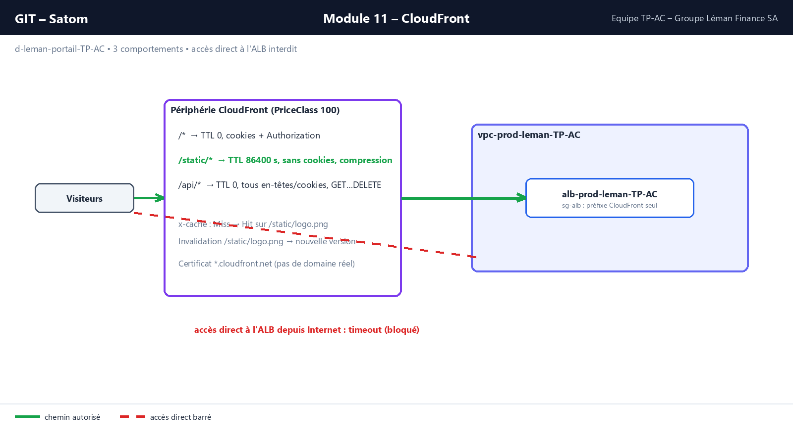

# Module 11 – CloudFront

## Objectif
Mettre un CDN devant l'ALB : garder en cache le contenu statique, ne jamais mettre l'API en cache, et empêcher l'accès direct à l'ALB.

## Ce qu'il faut savoir
CloudFront sert le contenu depuis un point de présence proche du visiteur. Les en-têtes de la réponse le montrent : `x-amz-cf-pop` donne le point de présence, `x-cache` indique `Hit` ou `Miss`. Chaque chemin (`/static/*`, `/api/*`, le reste) a sa politique de cache. Pour changer un fichier avant la fin du délai de cache, on lance une invalidation. Pour fermer l'ALB au reste du monde, son Security Group n'accepte que la liste de préfixes gérée par AWS pour CloudFront.

## Ce que nous avons fait
- La distribution `d-leman-portail-TP-AC`, avec l'ALB comme origine.
- Trois comportements : le défaut (aucun cache, cookies transmis), `/static/*` (cache de 24 h, sans cookies, compression) et `/api/*` (aucun cache, tous les en-têtes et cookies, méthodes GET à DELETE).
- Un fichier `/static/logo.png` sur `web-01`, qu'on modifie ensuite pour tester l'invalidation.
- `sg-alb` limité à la liste de préfixes CloudFront, et l'alias Route 53 déplacé vers CloudFront.

Script : `scripts/m11-cloudfront.ps1` (tests : `m11-tests.ps1`).



| Comportement | Chemin | Cache | Méthodes |
|---|---|---|---|
| défaut | `*` | aucun | GET à DELETE |
| statique | `/static/*` | 86 400 s | GET, HEAD |
| API | `/api/*` | aucun | GET à DELETE |

## Si ça ne marche pas : quatre vérifications
1. Une erreur 403 : le Security Group de l'ALB laisse-t-il passer CloudFront ?
2. Une erreur 502 : l'origine répond-elle (Security Group, protocole, certificat) ?
3. L'en-tête `x-cache` : `Hit` attendu sur le statique, jamais sur l'API.
4. Le certificat : il doit couvrir le nom utilisé.

## Résultats des tests
```
{{TESTS}}
```

## Nettoyage
Nous gardons la distribution pour le module 12 et la désactiverons puis supprimerons à la fin du cours.

## Ce qui diffère du sujet
Sans domaine, nous ne pouvons pas avoir de certificat ACM validé : les visiteurs voient le certificat `*.cloudfront.net`. Pour la même raison, CloudFront joint l'ALB en HTTP (port 80) : il refuserait le certificat auto-signé de l'ALB. L'ALB a donc aussi un listener 80, fermé à Internet. Le préfixe CloudFront compte pour environ 55 règles dans un Security Group (limite 60), nous n'avons pu l'utiliser qu'une fois (port 80).
