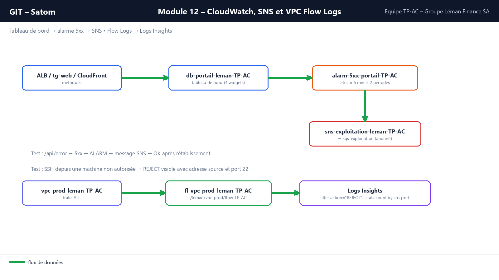

# Module 12 – CloudWatch et VPC Flow Logs

## Objectif
Superviser le portail (tableau de bord), être alerté (alarme + SNS) et tracer les flux réseau (Flow Logs) pour diagnostiquer un rejet.

## Cours (essentiel)
* **CloudWatch Metrics** : chaque service publie des métriques par dimension (ALB, groupe cible, distribution). Une **alarme** évalue une statistique sur N périodes et passe `OK` → `ALARM` → `OK`.
* **SNS** diffuse la notification aux abonnés (e-mail, SQS, Lambda…).
* **VPC Flow Logs** enregistre les connexions acceptées/rejetées (`ACCEPT`/`REJECT`) par interface, avec adresse source, port, protocole. **Logs Insights** permet de les interroger.
* La rétention des journaux est réglée (3 jours ici) pour limiter les coûts.

## TP
| Tâche | Réalisation |
|---|---|
| 1. Tableau de bord | `db-portail-leman-TP-AC` : `HealthyHostCount` / `UnHealthyHostCount` (tg-web), `TargetResponseTime` (ALB), `HTTPCode_Target_5XX_Count`, `5xxErrorRate` (CloudFront, us-east-1) |
| 2. Alarme | topic `sns-exploitation-leman-TP-AC` ; `alarm-5xx-portail-TP-AC` : `HTTPCode_Target_5XX_Count` > 5 sur 5 min, 2 périodes ; actions « en alarme » et « retour à la normale » vers SNS ; erreur provoquée par `/api/error` (HTTP 500) |
| 3. Flow Logs | groupe `/leman/vpc-prod/flow-TP-AC`, rôle IAM `TP-AC-flowlogs-role`, `fl-vpc-prod-leman-TP-AC` (trafic ALL) ; 8 connexions TCP vers le port 22 de l'ALB depuis un poste non autorisé (refusées par `sg-alb`) ; requête Logs Insights sur les `REJECT` : les 8 rejets sont retrouvés avec l'adresse source, le port 22 et l'ENI de l'ALB |

Scripts : `scripts/m12-monitoring.ps1` (déploiement) et `scripts/m12-tests.ps1` (preuves).

## Diagramme


## Tableau de supervision
| Élément | Métrique / source | Seuil | Période | Action |
|---|---|---|---|---|
| `alarm-5xx-portail-TP-AC` | `AWS/ApplicationELB` `HTTPCode_Target_5XX_Count` (Sum) | > 5 | 5 min × 2 | SNS (ALARM et OK) |
| Tableau de bord | `HealthyHostCount` = 1 pour `web-01` | – | 1 min | visuel |
| Flow Logs | `/leman/vpc-prod/flow-TP-AC` | – | – | Logs Insights |

## Procédure de diagnostic
1. **Métrique** : quelle série dérive (5xx, latence, hôtes sains) ?
2. **Alarme** : état, historique, période d'évaluation.
3. **Journal de flux** : `filter action="REJECT" | stats count(*) by srcAddr, dstPort | sort count desc`.
4. **SG ou NACL responsable** : relier le rejet au port/source et corriger la règle (module 3).

## Résultats
```
{{TESTS}}
```

## Nettoyage
Tableau de bord, alarme, groupe de logs conservés (module 13) ; rétention réduite à 3 jours ; le Flow Log et le groupe de logs seront supprimés en fin de projet.

## Écarts et remarques
* **Abonné SNS** : une file SQS (`sqs-exploitation-leman-TP-AC`) joue le rôle de l'équipe d'exploitation ; un abonnement e-mail s'ajoute avec `aws sns subscribe --protocol email` (non fait pour ne pas exposer d'adresse personnelle sur le compte partagé).
* Flow Logs : la livraison dans CloudWatch Logs prend plusieurs minutes. Le groupe de logs avait d'abord échoué à se créer (tags mal formés) : détecté par DeliverLogsStatus=FAILED, corrigé en recréant le groupe puis le Flow Log.
* La sonde SSH vise l'ALB (toujours actif) plutôt que `web-01`, arrêté faute de vCPU libres dans le compte partagé : le rejet est le même (Security Group fermé sur le port 22) et la trace Flow Logs est identique. Des rejets réels de scanners Internet sur le port 22 apparaissent aussi dans les journaux.


