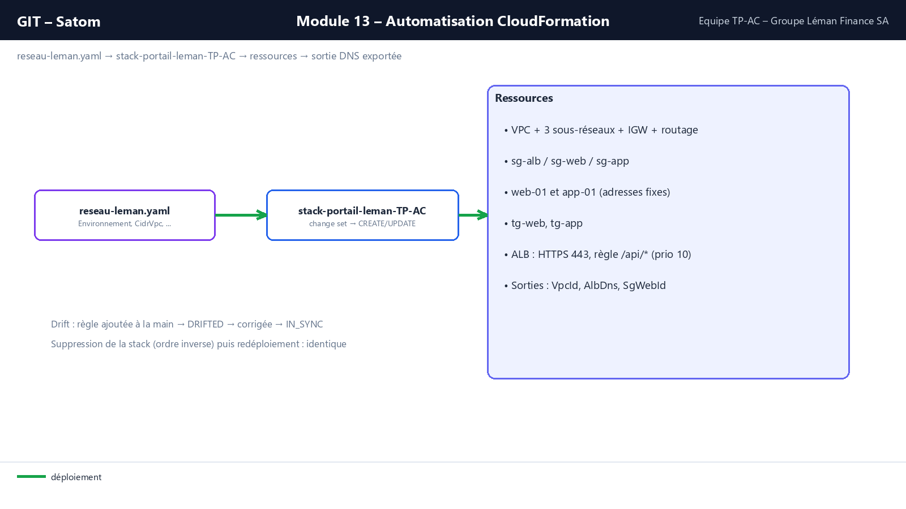

# Module 13 – CloudFormation

## Objectif
Décrire le réseau dans un template, le déployer en stack, relire les changements avant de les appliquer, détecter les écarts avec la réalité (drift) et prouver qu'on peut tout supprimer puis tout recréer à l'identique.

## Ce qu'il faut savoir
Un template contient des ressources, des paramètres (`Environnement`, `CidrVpc`…) et des sorties. La stack est le template déployé ; CloudFormation calcule l'ordre de création et supprime dans l'ordre inverse. Un change set montre ce qui sera ajouté, modifié ou remplacé avant d'exécuter. Le drift est l'écart entre ce qui existe vraiment et le template, par exemple après une modification à la main dans la console.

## Ce que nous avons fait
- `cfn/reseau-leman-etape1.yaml` : le VPC, trois sous-réseaux, l'IGW, la table publique et les trois Security Groups, avec les paramètres `Environnement` (prod ou dev) et `CidrVpc`. Nous l'avons validé avec `validate-template`, puis créé la stack `stack-portail-leman-TP-AC`.
- `cfn/reseau-leman.yaml` : le template complet, avec en plus `web-01`, `app-01` (adresses fixes), les deux groupes cibles, l'ALB (HTTPS 443, règle `/api/*`) et le rôle IAM des instances. Nous l'avons appliqué avec un change set que nous avons relu avant de l'exécuter.
- Un test de drift : une règle SSH ajoutée à la main sur le Security Group web est détectée (`DRIFTED`). Nous retirons la règle manuelle (la pile est de nouveau `IN_SYNC`), puis nous la déclarons dans le template (paramètre `AdminCidr`) et nous redéployons par change set : la règle appartient maintenant à la pile et la pile reste `IN_SYNC`. Un premier essai, où nous déclarions la règle sans retirer la manuelle, laissait la pile en `DRIFTED` (la règle existante n'avait pas la même description).
- La stack est supprimée, puis recréée à l'identique.

Scripts : `scripts/m13-cfn.ps1` (le scénario complet) et `scripts/m13-deploy.ps1` (tout déployer en une commande, certificat compris).



| Paramètre | Valeur par défaut |
|---|---|
| `Environnement` | `prod` (ou `dev`) |
| `CidrVpc` | `10.30.0.0/22` (nous avons gardé `10.20.0.0/22` pour le lab fait à la main) |
| `WebPrivateIp` / `AppPrivateIp` | `10.30.0.10` / `10.30.1.10` |
| `AdminCidr` | vide (pas de règle SSH) |
| `CertificateArn` | à fournir (le script de déploiement l'importe) |

Sorties : `VpcId`, `AlbDns` et `SgWebId`.

## Si ça ne marche pas : quatre vérifications
1. L'état de la stack (`*_COMPLETE`, `*_FAILED`, `ROLLBACK_*`).
2. Les événements : la première ressource en `CREATE_FAILED` donne la raison.
3. Le drift : `detect-stack-drift` puis `describe-stack-resource-drifts`.
4. Le rollback : on corrige le template, jamais la ressource à la main.

## Résultats des tests
```
{{TESTS}}
```

## Nettoyage
Nous gardons le template et la stack. La stack contient des instances et un ALB (facturés) : nous la supprimerons à la fin du cours avec `aws cloudformation delete-stack`.

## Problèmes rencontrés
Deux erreurs de notre part : les descriptions des Security Groups ne peuvent pas contenir d'apostrophes ni d'accents, et notre premier calcul des sous-réseaux avec `!Cidr` donnait au sous-réseau privé une plage qui ne contenait pas l'adresse fixe d'`app-01`. Nous n'avons pas mis de NAT dans la stack (coût) : `app-01` n'a pas besoin de paquets, mais elle n'est donc pas joignable par SSM.

